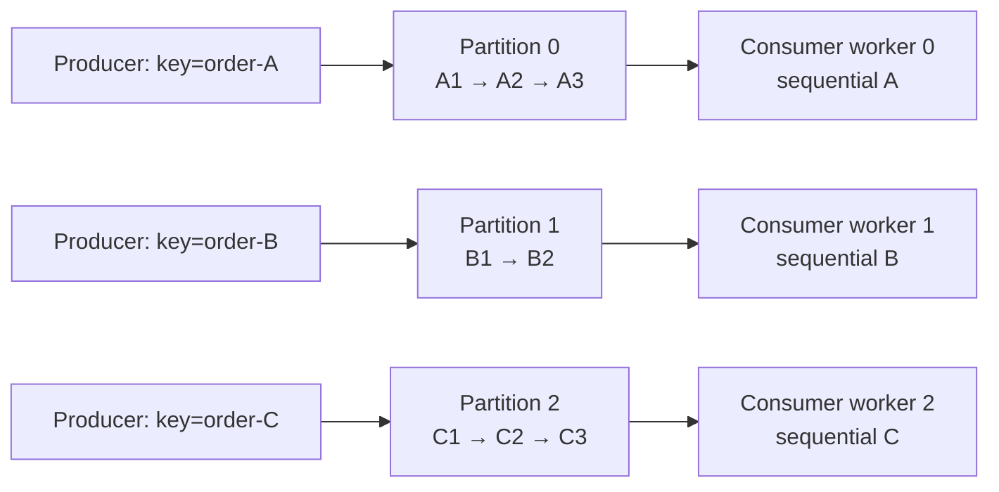

# Message Ordering, Partitioning, and Parallel Processing

## 1. Why Does Message Ordering Matter in Spring Boot Integration?

In Spring Boot integration systems, one service often publishes events through a broker so other services can update data, call HTTP APIs, sync caches, or run Spring Integration flows. As event volume grows, we want multiple consumers processing concurrently. However, **parallel processing can break business ordering** if you fail to define which messages must precede others.

For example, an order emits three events in sequence:

1. `OrderCreated` — the order was created.
2. `OrderPaid` — payment succeeded.
3. `OrderCancelled` — the order was cancelled or a refund workflow started.

If a consumer applies `OrderCancelled` before `OrderCreated`, or updates status to `PAID` after already updating to `CANCELLED`, the projection table can reflect a stale state even though all messages were delivered.

However, you do not need to force **all** orders through serial processing. Events for order `A` and order `B` are normally independent:

- **Per-key ordering required:** `A1 → A2 → A3`; `B1 → B2`.
- **Parallelism allowed:** stream `A` and stream `B`.
- **Global ordering unnecessary:** `A1` need not precede `B1` simply because they were created close in time.

This lesson belongs to the **Messaging Platforms** group of `SPRING_BOOT_INTEGRATION`. Its goal is to design Spring Boot broker integrations that properly manage data contracts, ordering, partitioning, concurrency, errors, deduplication, testing, and observability.

## 2. Distinguish Four Kinds of “Order”

A system can claim “the broker guarantees order” and still corrupt data if you misunderstand what is guaranteed.

| Concept | Meaning | Common Misconception Risk |
| --- | --- | --- |
| **Business order** | Valid state-change sequence for an entity/aggregate, e.g., version 7 then 8 | Two producers emit events out of order relative to DB transactions |
| **Broker write order** | Order in which the broker accepts and appends messages to a log/queue | Does not necessarily match timestamps or business order |
| **Consumer delivery order** | Order in which records are handed to a consumer or consumer group | Rebalances, redeliveries, and multiple consumers complicate delivery |
| **Effect commit order** | Order in which side effects commit: DB writes, API calls, cache updates | `@Async`, thread pools, retries, or timeouts let later records finish earlier |

In Kafka, records within the **same partition** have offset order. Offset 101 preceding 102 does not prove 101's DB transaction committed before 102's. If a consumer submits both to a thread pool and commits the offset immediately, record 102 can finish before 101.

**Timestamp order also differs from offset order.** Producer clocks can skew; event generation time and broker ingestion time are not the same moment. When logic depends on causality, use versions or sequences generated at the business source rather than sorting solely by `occurredAt`.

Therefore, the event contract should state explicitly:

> “For a given `orderId`, state must be applied in ascending `aggregateVersion` order. Different `orderId`s may be processed concurrently. Consumers must tolerate duplicates and redeliveries.”

A statement like that is testable; saying “the system guarantees FIFO” leaves scope and error behavior underspecified.

## 3. Partitions Are Both the Unit of Parallelism and the Ordering Boundary

### 3.1. How Kafka Uses Partitions

A Kafka topic can consist of multiple partitions. Each partition is an append-only log with increasing offsets. Producers attach a `key`; the partitioner assigns records to partitions, typically hashing the key when present unless a custom partitioner is configured.



This diagram is illustrative: Kafka does not allocate a dedicated partition per key. **Multiple keys can land in the same partition**, sharing its read order and processing capacity.

Kafka maintains order **within a single partition**, while providing no meaningful total order across offsets of different partitions. Offset `20` of partition 0 has no ordering relationship with offset `20` of partition 1.

### 3.2. Choosing Keys to Preserve Per-Entity Ordering

If business logic needs per-order synchronization, use the same `orderId` as the message key for all events of that order:

```text
topic: order-events

key = "order-4711"
value = {"eventId":"e-101","orderId":"order-4711","version":1,"type":"OrderCreated"}

key = "order-4711"
value = {"eventId":"e-102","orderId":"order-4711","version":2,"type":"OrderPaid"}

key = "order-4711"
value = {"eventId":"e-103","orderId":"order-4711","version":3,"type":"OrderShipped"}
```

By contrast, keying by `eventId` can scatter the three records across three partitions. Keying by `tenantId` can funnel all events for a large tenant onto one partition, creating a hotspot.

Key selection rules:

1. Identify the **aggregate** requiring order, such as `orderId`, `accountId`, or `shipmentId`.
2. Keep the key **stable** across the aggregate's lifecycle and across event types sharing ordering requirements.
3. Avoid null or random keys when per-aggregate ordering is needed.
4. Inspect key traffic distribution: an overly hot key caps throughput because it cannot be parallelized arbitrarily while keeping strict order.
5. If changing the partitioning algorithm or **increasing partition count**, re-evaluate key mapping stability. Old and new records for a key can land in different partitions during migration, requiring a drain/cutover plan before assuming continuous order.

Typically, key-based ordering applies only within the **same topic, same partition set, and consistent key routing**. Splitting `OrderCreated` into topic A and `OrderPaid` into topic B prevents consumers from deriving global order across the two topics.

### 3.3. Consumer Groups Determine Parallelism

In a standard Kafka consumer group subscription, each partition at a given time is assigned to one consumer in the group. With `P` partitions and `C` valid consumer threads across instances, the maximum concurrent partition-reading branches is:

\[
\text{active consumers} \leq \min(P, C)
\]

For example, a topic has 6 partitions, and two app instances each configure `concurrency=3`. Total Kafka consumers in the group can reach 6—enough to assign all 6 partitions. Raising `concurrency` to 10 per instance does not create extra partitions or run one partition across multiple consumers in the same group.

Note: this is **parallelism at the partition-reading layer**. Within a consumer, offloading records to a worker pool increases active tasks while breaking completion-order guarantees.

## 4. Parallelism Levels and Their Impact on Ordering

| Ways to Increase Throughput | Can Preserve Per-Key Order? | Conditions |
| --- | --- | --- |
| Increase partitions, stable key distribution | Yes, within each partition | All events for the same key must land in the same partition operationally |
| Scale consumers in the **same group** up to partition count | Yes | Listeners process sequentially per partition without async side-effect reordering |
| Multiple consumers in **different groups** | Each group has its own stream | Groups are independent; cannot synchronize cross-service ordering |
| Submit each record to `ExecutorService` or `@Async` | Not automatically | Requires per-key sequential queues and ACKing only after side effects complete |
| Use Reactor `flatMap` on records | Not automatically | Inner publishers can complete out of receive order |
| Use `concatMap` per key or partition | Possible | Must bound concurrency, backpressure, and memory while preserving key boundaries |

Common faulty example:

```java
@KafkaListener(topics = "order-events")
public void onMessage(String payload) {
    executor.submit(() -> projectionService.update(payload));
    // Method returns immediately: container may mark record processed.
}
```

Two flaws arise: (1) a later task can update the DB before an earlier one; (2) if the consumer commits the offset when the listener returns, a task failing later may not be redelivered as expected.

When order matters, let the listener **await durable completion** in a controlled flow, or build a per-key sequential scheduler tied to commit/ack mechanics. Avoid fire-and-forget for critical side effects.

## 5. Comparing Ordering Across Messaging Platforms

### 5.1. Apache Kafka

- Order is meaningful **per partition**, via offsets.
- Records with the same key usually route to the same partition under a proper partitioner; keys do not carry “business sequence.”
- Within a group, partitions can be processed in parallel.
- Retries, redeliveries, or rebalances can reprocess the same record. Kafka transactions/idempotent producers address certain Kafka read/write scenarios, yet **do not guarantee exactly-once for database updates or HTTP APIs outside Kafka**.

### 5.2. RabbitMQ

RabbitMQ stores messages in queues and delivers them to consumers. With one queue, one sequential consumer, no async worker offload, and no reordering from priorities/requeues, processing order is straightforward to control.

However, **multiple competing consumers on one queue**, multi-message prefetch, async processing, redelivery, and requeuing can make *business completion* order diverge from enqueue order. RabbitMQ offers `single active consumer` when only one active consumer on a queue is desired; that still requires sequential handling and matching retry policies.

To parallelize **across keys** while preserving order **within each key**, you can hash-route keys into a fixed set of queues (buckets) and process each queue sequentially. That requires explicit routing and operating multiple queues; RabbitMQ does not automatically provide Kafka-style partitioned logs from a single standard queue.

### 5.3. Amazon SQS

- **SQS Standard** prioritizes scale and at-least-once delivery; it can deliver duplicates or out-of-order messages. Do not use if business logic relies on strict FIFO.
- **SQS FIFO** uses `MessageGroupId` to preserve per-group order while processing different groups in parallel. Consumers must still process batches within the same group in order while managing visibility timeouts and duplicates.

Quick decision table:

| Need | Design Direction |
| --- | --- |
| Historical replay, multi-group fan-out, and partition-based scaling | Kafka with aggregate ID key |
| Work queue with custom routing and explicit retry/ack | RabbitMQ with queue count and consumer topology matching ordering needs |
| AWS managed queue with per-group ordering | SQS FIFO and `MessageGroupId` per aggregate |
| Independent messages requiring no ordering | Leverage multiple partitions/consumers or parallel work queues |
| Strict ordering across all messages system-wide | Re-examine requirement: a single sequential stream bottlenecks easily; if truly required, accept throughput and availability trade-offs |

Never assume “Kafka is always ordered, RabbitMQ is always FIFO, SQS FIFO handles every case.” **Each technology guarantees order only within defined boundaries**, while the application must safeguard side-effect order.

## 6. Designing Order-Aware Event Contracts

An event envelope typically needs these fields:

```json
{
  "eventId": "6ec27d63-8b47-42a0-b02b-169c6154d20c",
  "eventType": "OrderPaid",
  "aggregateType": "Order",
  "aggregateId": "order-4711",
  "aggregateVersion": 8,
  "occurredAt": "2026-11-21T05:00:00Z",
  "correlationId": "checkout-792",
  "payload": {
    "paymentId": "payment-123",
    "amountMinor": 159900,
    "currency": "VND"
  }
}
```

Field meanings:

- `eventId`: unique ID for **each logical event**, used for deduplication. Redeliveries of the same event must preserve this ID.
- `aggregateId`: routing/partition key and scope within which ordering is meaningful.
- `aggregateVersion`: business version incremented on each committed change to the aggregate, used to reject stale data or detect version gaps.
- `occurredAt`: useful for observability and latency analysis, not as a substitute for sequence numbers when causal order is required.
- `correlationId`: links logs/traces across HTTP requests, outbox, brokers, and consumers.
- `eventType` and `payload`: data contracts need explicit versioning/schema evolution policies when multiple consumer versions coexist.

**Version semantics must be unambiguous.** If the system emits every aggregate change with consecutive versions `1, 2, 3...`, consumers can check `incomingVersion = lastAppliedVersion + 1`. If only a subset of events is emitted, versions can have valid gaps; you cannot enforce a `+1` rule without also defining a stream-specific sequence number.

Beyond keys and versions, define **who the canonical event emitter is**. Two independent services incrementing `aggregateVersion` on their own will not produce reliable causal ordering.

## 7. Spring Boot + Spring Kafka Example

Suppose `order-service` publishes order state events while `order-projection` updates a read table serving APIs. Events for a **single `orderId` must be processed in order**, while different orders run in parallel.

### 7.1. Producer Configuration

Example `application.yml`, using String values carrying JSON (to keep focus on ordering):

```yaml
spring:
  kafka:
    bootstrap-servers: ${KAFKA_BOOTSTRAP_SERVERS}
    producer:
      key-serializer: org.apache.kafka.common.serialization.StringSerializer
      value-serializer: org.apache.kafka.common.serialization.StringSerializer
      acks: all
      properties:
        "[enable.idempotence]": true
        "[max.in.flight.requests.per.connection]": 5
```

`acks=all` and `enable.idempotence=true` help the producer reduce retry duplicates and maintain Kafka-supported ordering invariants. With idempotence enabled, `max.in.flight.requests.per.connection` must satisfy Kafka limits; here 5 is used. Do not rely on defaults from memory: verify your project's Kafka client version and effective options.

To route all events of one order under the same key:

```java
@Service
public class OrderEventPublisher {
    private final KafkaTemplate<String, String> kafkaTemplate;

    public OrderEventPublisher(KafkaTemplate<String, String> kafkaTemplate) {
        this.kafkaTemplate = kafkaTemplate;
    }

    public CompletableFuture<SendResult<String, String>> publish(
            String orderId, String eventJson) {
        return kafkaTemplate.send("order-events", orderId, eventJson);
    }
}
```

This illustrates `KafkaTemplate` in Spring Kafka 3.x. Callers must handle the async result: log/trace errors, apply controlled retries, and track send status. **Never equate calling `send` with successful publication**.

Specifically, if a service updates a DB and sends to Kafka, those two operations are not one atomic transaction. For critical workflows, consider a **transactional outbox**: within the same DB transaction, write the business change and an outbox row; a worker/CDC publishes the outbox to the broker and updates its status. However, outboxes also need ordering rules: if multiple workers concurrently publish different versions of **the same aggregate**, they can emit out of order. Use per-aggregate locking/sequencing and a dispatch mechanism that preserves required order.

### 7.2. Consumer Configuration and Synchronous Listener

```yaml
spring:
  kafka:
    bootstrap-servers: ${KAFKA_BOOTSTRAP_SERVERS}
    consumer:
      group-id: order-projection
      key-deserializer: org.apache.kafka.common.serialization.StringDeserializer
      value-deserializer: org.apache.kafka.common.serialization.StringDeserializer
      enable-auto-commit: false
    listener:
      ack-mode: record
```

Listener:

```java
@Service
public class OrderProjectionConsumer {
    private final OrderProjectionService projectionService;

    public OrderProjectionConsumer(OrderProjectionService projectionService) {
        this.projectionService = projectionService;
    }

    @KafkaListener(topics = "order-events", concurrency = "3")
    public void onMessage(ConsumerRecord<String, String> record) {
        // Processing and DB commit must finish before the listener returns.
        projectionService.applyIdempotently(record.value());
    }
}
```

Here:

- `concurrency = "3"` creates up to three Kafka consumer threads in this **single instance**'s listener container; adding instances increases total consumers in the group.
- Under Spring Kafka's standard sequential listener execution, records from the same partition are invoked in order on their assigned consumer thread. Do not add `@Async` or manually `submit` to a pool and return early.
- `ack-mode: record` lets the container record the offset after the listener succeeds on a record; if the listener throws, subsequent handling depends on error handler and retry settings. Ack config does not replace a DB transaction.
- `applyIdempotently` must use an appropriate transaction and never swallow errors before data is durable.

This snippet is an **integration skeleton**; add the Spring Kafka dependency, `OrderProjectionService`, DB schema, serializer/schema contract, and real error handlers. Do not default to concurrency 3 if the topic has only one partition.

### 7.3. Algorithm for Idempotent Application in the DB

One PostgreSQL approach uses these tables:

```sql
CREATE TABLE processed_message (
    consumer_name VARCHAR(80) NOT NULL,
    event_id UUID NOT NULL,
    processed_at TIMESTAMPTZ NOT NULL DEFAULT CURRENT_TIMESTAMP,
    PRIMARY KEY (consumer_name, event_id)
);

CREATE TABLE order_projection (
    order_id VARCHAR(100) PRIMARY KEY,
    status VARCHAR(40) NOT NULL,
    last_version BIGINT NOT NULL
);
```

Algorithm outline **within one DB transaction**:

```text
BEGIN TRANSACTION

1. Read eventId, orderId, aggregateVersion; validate schema/contract.
2. INSERT (consumer_name, event_id) into processed_message;
   ON CONFLICT DO NOTHING.
3. If the record already existed:
     COMMIT; return (duplicate, already applied successfully).
4. Lock the corresponding order_projection row (or create an initial row with version=0)
   using an appropriate DB mechanism.
5. For a contiguous version stream:
     If incomingVersion != lastVersion + 1:
         ROLLBACK; report missing/mismatched version, do not ACK as success.
6. Update projection and lastVersion within the same transaction.
7. COMMIT.

Only after the DB commit succeeds does the listener finish so the container can ack/commit the offset.
```

If step 5 or 6 fails, the transaction rolls back the processed marker **as well**. This is vital: if a dedup marker persisted while the projection failed to update, retries could be wrongly skipped.

The DB transaction and Kafka offset commit still live in two systems. If the DB commits and the app crashes before committing the offset, the record is redelivered; deduplicating by `eventId` handles this safely. That is the practical meaning of **at-least-once + idempotent consumer**.

Note: initial row creation, row locking, and version checks must avoid race conditions when multiple workers touch the same aggregate; DB unique constraints, locking, or versioned compare-and-set belong in the design. If the consumer also calls an external HTTP API with side effects, the DB transaction above cannot roll back that API call. Use target-side idempotency keys, an outbox for side effects, or a controlled compensation workflow.

## 8. Retries, Redelivery, Dead-Lettering, and Ordering Impact

Suppose for `orderId=A` there are three records:

```text
offset 100: A-v1
offset 101: A-v2  ← processing fails
offset 102: A-v3
```

If the consumer sends `A-v2` to a dead-letter topic (DLT) and continues with `A-v3`, the system violates “every version must be applied consecutively,” even though the Kafka partition stored them in order.

There are two distinct policies:

**Policy A — strict ordering preservation**

- Retry `A-v2` within bounds without applying `A-v3`.
- Include backoff, attempt limits, alerts, and remediation when failures persist.
- Can cause **head-of-line blocking**: one failing record stalls its partition or key; trades throughput for correctness.

**Policy B — prioritize processing progress**

- Move failing records to a DLT or error queue, allowing later records to proceed.
- Suitable only when business rules tolerate skipping certain events, or projections detect missing versions and block invalid transitions.
- Replaying the DLT event alone **does not automatically restore order**; state must be reconciled against subsequent events.

Distinguish clearly:

- **Transient failure:** network glitch, temporarily unavailable DB, HTTP 503; retry with backoff.
- **Permanent failure:** invalid JSON, incompatible schema, unrecoverable data violation; quarantine/DLT, alert, and fix producer/contract.
- **Ordering gap:** received version 10 while missing 9; resolve by waiting, replaying/backfilling, or reloading a versioned snapshot—never confuse with duplicates.
- **Duplicate:** same `eventId` already applied earlier; record as handled and safely skip.

With Spring Kafka's non-blocking retry topics, retried records may be processed after newer records on the main topic. Therefore, **non-blocking retries are unsuitable when strict per-partition ordering is required**, unless you add business-layer ordering/versioning. Configure `DefaultErrorHandler`, retries, and `DeadLetterPublishingRecoverer` to match your chosen policy; never assume every DLT setup is safe for FIFO flows.

## 9. Rebalances, Partition Scaling, and Application Rollouts

### 9.1. When a Consumer Group Rebalances

A consumer can leave a group due to deployment, crash, heartbeat timeout, or scaling. The broker/group protocol reassigns partitions to other consumers. A partition is normally owned by one group consumer at a time, yet **unfinished async tasks on the old consumer** can keep running if the application fails to cancel or await them properly.

Safeguards:

- Execute side effects synchronously in the listener, or coordinate in-flight tasks before revoking partitions.
- Never commit offsets past records whose side effects are not yet durable.
- Rely on idempotency, version guards, and rebalance monitoring.
- On shutdown, await in-flight tasks within a controlled grace period before handing off partitions per container settings.

### 9.2. When Increasing Partition Counts

Adding partitions raises throughput for **new** keys, yet under typical key-to-partition hashing, changing the partition count can remap an existing key to a different partition. Old records in the prior partition and new records in the new partition can process concurrently, breaking serial order across the two partitions.

When correctness depends on per-key order, consider:

1. Sizing partitions and headroom upfront; measure throughput before scaling partitions.
2. When forced to change mapping, pause or throttle publishing, drain backlogs, verify checkpoints/consumers caught up, and then switch routing per a cutover plan.
3. For long-term stable key routing, evaluate a fixed logical bucket layer or a new versioned topic and migration; weigh operational cost rather than assuming Kafka does this automatically.
4. Always enforce `aggregateVersion` checks in the DB when business rules are strict.

### 9.3. When Multiple Producers Write for One Aggregate

Broker append order reflects request arrival order at the broker, not which DB transaction committed first. Two producers can emit `v12` and `v11` close together and hit the broker reversed. When exact source-state order is required, allocate versions synchronously at the authoritative writer and emit via a mechanism respecting version/commit order—typically a transactional outbox serialized per aggregate.

## 10. Per-Key Parallelism in Spring Integration and Reactor

Integration flows can also branch across channels or adapters outside Kafka.

### 10.1. Spring Integration Channels

- `DirectChannel` invokes handlers synchronously on the sender's thread in simple flows. However, multiple threads sending into one channel still interleave; the channel itself creates no global business order.
- `ExecutorChannel` dispatches handlers to a task executor, increasing concurrency while potentially altering completion order.
- Multi-worker pollers, aggregators/resequencers, or async HTTP/JDBC branches require explicit policies for ordering, timeouts, and correlation.

Evaluate the **end-to-end path**: a Kafka adapter reading per partition but immediately forwarding to an `ExecutorChannel` and acking defeats partition ordering. A slow HTTP call can also allow a later record to finish ahead of an earlier one.

### 10.2. Reactor and WebFlux

Conceptual **illustration** given an existing event Flux:

```java
source
    .groupBy(OrderEvent::orderId)
    .flatMap(group ->
        group.concatMap(event -> processAsync(event)),
        maxConcurrentGroups
    );
```

`concatMap` preserves processing order within each group, while `flatMap` runs multiple groups concurrently. However, `groupBy` over high-cardinality keys can spawn many long-lived groups, straining memory and backpressure. This is an **explanatory pattern**, not production-ready without managing group lifecycles, max groups, and ack/commit semantics.

A more resilient approach for large key spaces uses a fixed number of buckets, hashing keys into buckets and processing each bucket sequentially. Max parallelism equals the bucket worker count, accepting that distinct keys sharing a bucket wait behind each other.

## 11. Performance: Ordering Is a Constraint, Not a Broker Bug

When throughput bottlenecks, pinpoint the actual constraint:

| Symptom | Possible Cause | How to Investigate |
| --- | --- | --- |
| One partition has high lag while others sit idle | Hot key, skewed key distribution, or slow handling | Measure per-partition lag and event volume by key/bucket |
| Adding instances does not raise throughput | Fewer partitions than consumers, or DB/API bottleneck | Compare partition count, active consumers, connection pools, and latency |
| Latency grows with queue depth | Sequential lane blocked by one slow event | Classify errors, optimize I/O, consider splitting independent flows if allowed |
| High record/s yet projection state is wrong | Async side effects, missing version guard, or ack before commit | Trace eventId/version from listener → DB; inspect retries |
| Reordering started after partition increase | Key mapping shifted | Compare partitions before/after cutover and version history |
| DLT replay overwrote newer data | Old event processed without version checks | Deduplicate + block stale versions; run state repair |

Do not “fix” a hot key by randomly scattering that key's records across partitions if events for that key require ordered processing. To increase throughput legitimately, you may need to refine aggregate boundaries: e.g., **independent** transactions on sub-accounts can key by `accountSubId`, provided business rules permit parallel application.

If updates are commutative (e.g., safely incrementing counters) or only require eventual consistency, you can relax ordering and rely on idempotency/reconciliation. Never apply that relaxation to non-commutative state transitions like `CREATED → PAID → SHIPPED` without consumer guards.

## 12. Realistic Testing for Ordering and Parallelism

Tests should use brokers and databases as close to production as possible—for example, Spring Boot Testcontainers with Kafka and PostgreSQL, paired with fixtures controlling eventId/version. Calling a mocked listener three times sequentially is insufficient.

| Scenario | Pass Criteria |
| --- | --- |
| **One aggregate, multiple events** | Send `A-v1`, `A-v2`, `A-v3`; final projection reaches version 3 with accurate state |
| **Multiple interleaved aggregates** | `A-v1, B-v1, A-v2, B-v2`; each key stays ordered while keys run in parallel |
| **Multiple keys sharing one partition** | Do not assume one partition per key; side effects remain valid |
| **Consumer crashes after DB commit, before offset commit** | Record redelivered, yet no duplicate side effects written |
| **Retry on middle event** | Under strict order, `A-v3` must not apply before `A-v2` or must be blocked by version guard |
| **Late stale event** | Version guard stops `A-v4` from overwriting a projection already at `A-v5` |
| **Missing event** | Gap detection reports the missing version and handles it per policy |
| **Rebalance / rolling deploy** | No two side effects for the same aggregate overlap to produce corrupt state |
| **Partition count change** | Cutover plan verified with zero reordering across transition |
| **Poison message / DLT** | Clear rules on when to skip vs. halt, with version-safe replay/repair tools |
| **Backpressure / hot key** | Bounded concurrency, threads, DB connections; system does not exhaust cluster resources |

A high-value test **intentionally injects a failure after DB commit but before offset commit**, then verifies safe redelivery without duplicating results. That directly validates at-least-once behavior in practice.

## 13. Operational Observability and Troubleshooting

Alongside overall throughput, measure:

- **Per-partition consumer lag:** detects overloaded or stalled partitions.
- **Processing time and event-to-applied latency:** track percentiles, not just averages.
- **Retry, redelivery, DLT/quarantine, event gap, and duplicate counts:** separates infrastructure issues from data contract bugs.
- **Rebalance frequency, active consumers, assigned partitions:** explains shifts in parallelism.
- **Projection version drift vs. source** (where measurable): detects missing events even when broker lag reads 0.
- **Aggregated traffic share by key or bucket:** catches hot keys without putting sensitive identifiers into high-cardinality metric labels.

In logs or traces, capture `eventId`, `aggregateId`, `aggregateVersion`, `topic`, `partition`, `offset`, and `correlationId` under data protection rules. Never use raw `aggregateId` or `eventId` as time-series metric labels if cardinality is high. Being able to trace a single event ID from producer to outbox, broker consumer, and database pinpoints which layer broke ordering.

When a projection holds wrong state, check sequentially:

1. Did the business source emit accurate, consecutive versions per contract?
2. Which key did the producer use; did events share a partition before/after config changes?
3. Did the consumer process synchronously or offload to executors/reactive operators?
4. Did DLT/retry allow a later version to leapfrog an earlier one?
5. Are DB transactions, deduplication, and version guards functioning?
6. Did a replay, rebalance, or partition change occur near the failure window?

Verify **data correctness**, not only offset lag. A consumer with 0 lag can still have processed out of order and written corrupt projections.

## 14. End-to-End Scenario: Payment State Synchronization

Suppose a Spring Boot service receives payment webhooks, saves state in PostgreSQL, and emits `PaymentAuthorized`, `PaymentCaptured`, and `PaymentRefunded`. Another service consumes them to generate invoices, update order statuses, and push entries to accounting.

A solid design chooses:

1. **Ordering scope:** by `paymentId`. Every event for a payment carries `aggregateId=paymentId`, with version incremented inside the state-saving transaction.
2. **Publishing:** write a transactional outbox alongside PostgreSQL updates; dispatcher publishes to Kafka with `key=paymentId`, keeping per-aggregate order.
3. **Partitioning:** multi-partition topic so different payments process in parallel. Do not increase partitions without a cutover plan preserving order.
4. **Consumption:** sequential per partition inside the listener; consumers scale across partitions. The service inserts `processed_message` and updates the projection in the same DB transaction, then commits the offset.
5. **External HTTP integration:** pass `eventId` as an idempotency key if the target API supports it, or record a separate API-call outbox for retries, status tracking, and reconciliation.
6. **Failures:** if `PaymentCaptured` fails, do not let `PaymentRefunded` overwrite while capture outcome is unknown; record the failure and retry/backfill or reconcile from source.
7. **Observability:** per-partition lag, version gaps, duplicates, sync latency, and payments awaiting recovery.

By separating “order within a payment” from “parallelism across payments,” the system scales processing capacity while protecting business invariants.

## 15. Checklist When Designing a New Message Flow

- [ ] Clearly defined whether global, per-aggregate/key, or no ordering is needed.
- [ ] Standardized message key/`MessageGroupId`/routing key and kept it stable across the aggregate lifecycle.
- [ ] Defined event IDs, versions/sequences, payload contracts, and a reliable version generator.
- [ ] Sized partitions/queues and consumers appropriately; understood each broker's concurrency limits.
- [ ] Avoided acking/committing before critical side effects finish; avoided uncontrolled fire-and-forget.
- [ ] Implemented idempotent consumers, DB transactions, and policies for stale records/gaps.
- [ ] Explicitly defined whether retries, DLT, and replays may bypass a failing event.
- [ ] Established rebalance, rolling deploy, and partition-scaling procedures that protect order.
- [ ] Tested duplicates, out-of-order delivery, crashes, concurrent aggregates, and realistic data.
- [ ] Instrumented per-partition lag, hot keys, version gaps, retries, and business-outcome latency.

**Key takeaway:** partitions and consumer groups unlock parallel processing, while ordering must be scoped to business needs and enforced all the way through side-effect persistence. The broker is only one layer in that guarantee. A sound Spring Boot Integration architecture coordinates partition keys, event versions, sequential execution where required, idempotency, transactions, and failure testing across the entire integration pipeline.
