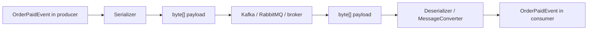
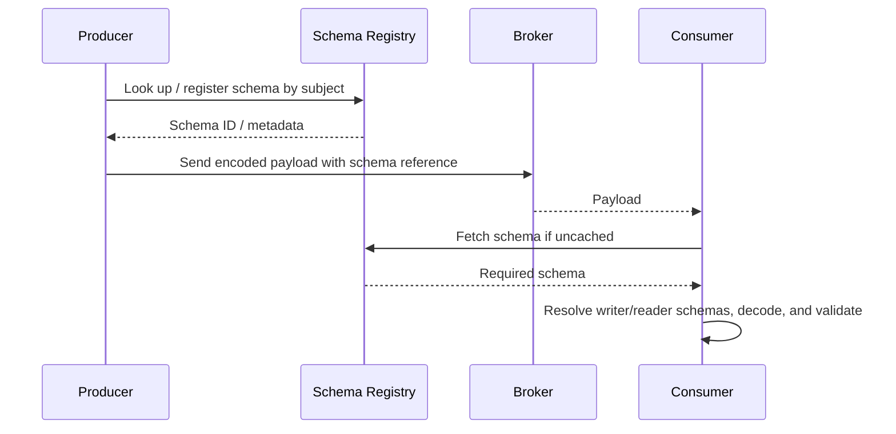
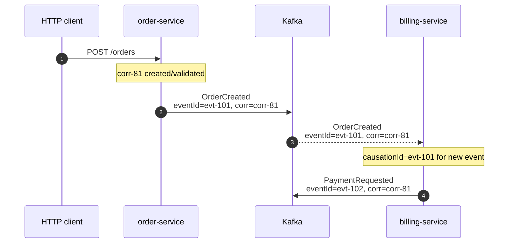
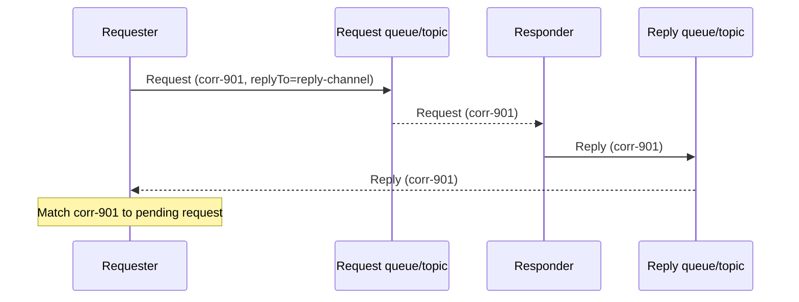
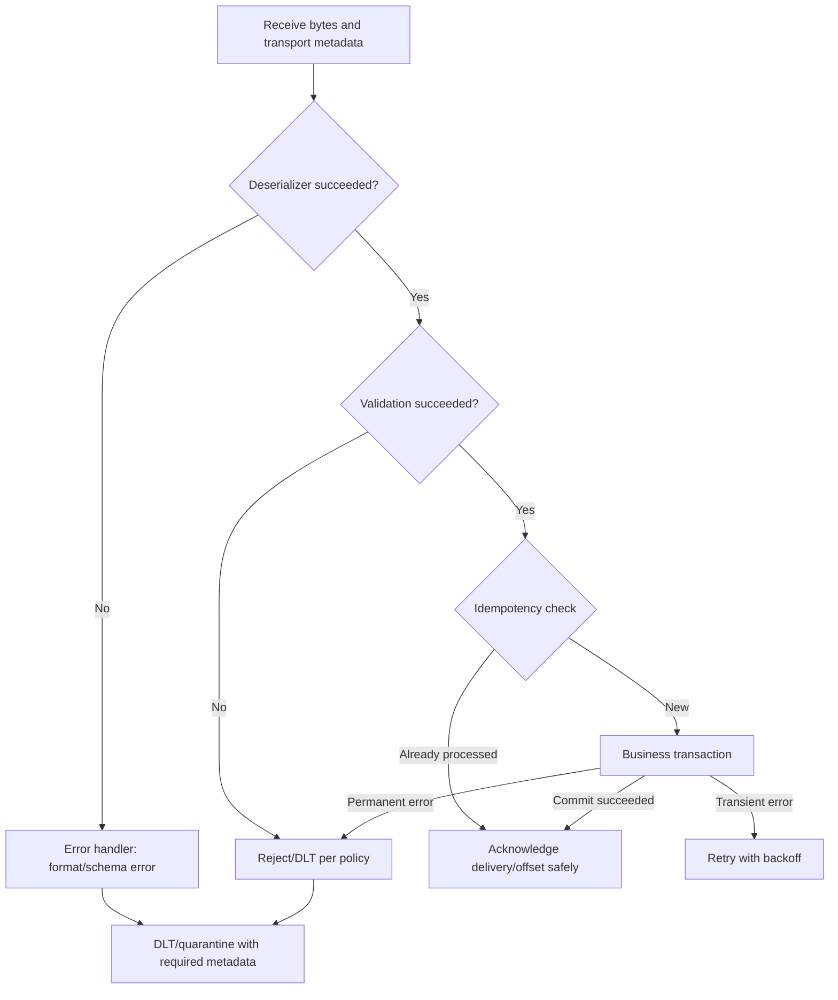

# Serializers, Schemas, Headers, and Correlation IDs

When a Spring Boot service emits an event to Kafka, RabbitMQ, or another message broker, the receiver does not directly receive a Java object. The broker forwards **encoded data**, accompanied by transport information. For two applications to integrate reliably, producers and consumers must agree on the **serializer**, **schema**, **headers**, and rules for generating and propagating **correlation IDs**.

For example, an order service emits an `OrderPaid` event. The billing service needs to read the exact amount and order ID; operations needs to trace how that event relates to an earlier HTTP request or event; the retry system must prevent duplicate charges; and upgrading a DTO version must never break older consumers. These requirements are tightly connected yet belong to distinct layers of responsibility.

This lesson belongs to the **Messaging Platforms** chapter of the **SPRING_BOOT_INTEGRATION** module, which focuses on organizing system integration in Spring Boot across HTTP clients, databases, caches, message brokers, and Spring Integration adapters. Examples emphasize data contracts, configuration, transactions, errors, idempotency, testing, and observability. Illustrative APIs are primarily based on Spring Boot 3.x, Spring Kafka 3.x, and Spring AMQP 3.x; verify your exact library versions before adopting in production.

## 1. Learning Outcomes

1. Accurately trace the path `Java object → bytes → broker → bytes → Java object`.
2. Distinguish serialization formats (JSON, Avro, Protobuf, String, byte[]) from **business schemas** and **schema registries**.
3. Design an event envelope containing event ID, event type/version, timestamp, and business payload.
4. Choose message keys, headers, and correlation IDs for their proper roles without conflating them.
5. Explain the relationships among correlation ID, causation ID, trace ID, and idempotency key.
6. Configure Spring Kafka JSON producers/consumers safely; understand type-header risks and deserialization errors.
7. Map corresponding metadata in Spring AMQP/RabbitMQ, and explain why transport headers are not directly portable across brokers.
8. Perform safe schema evolution, define retry/DLT policies, and write tests verifying producer–consumer compatibility.

## 2. Four Components in a Message

A message typically contains four groups of information:

| Component | Question to Answer | Example |
|---|---|---|
| **Payload** | What data does the event or command carry? | `{"orderId":"O-101","amount":85000}` |
| **Schema/contract** | How must the bytes be decoded and interpreted? | `OrderPaid.v1`, JSON Schema, or Avro schema |
| **Transport metadata** | How is the message sent/read/routed? | Kafka topic, partition, key, offset; AMQP exchange, routing key |
| **Headers/correlation** | What content type, version, trace link, and processing policy accompany it? | `content-type`, `event-type`, `x-correlation-id`, `traceparent` |

Sample test message:

```text
Broker: Kafka
Topic: orders.events
Key: O-101

Headers:
  content-type: application/json
  event-type: order.paid
  schema-version: 1
  x-correlation-id: req-01H...
  traceparent: 00-...-...-01

Payload (UTF-8 bytes containing JSON):
  {
    "eventId": "evt-7f2",
    "eventType": "order.paid",
    "schemaVersion": 1,
    "occurredAt": "2026-11-21T05:30:00Z",
    "data": {
      "orderId": "O-101",
      "amountMinor": 85000,
      "currency": "VND"
    }
  }
```

In this example, `eventId` sits **inside the payload** so the event remains identifiable when moved to storage, a DLT, or another broker. `x-correlation-id` sits in headers for easy observability and request linking. A system can carry the correlation ID in both the envelope and headers, provided it defines which field is authoritative if they ever disagree.

There is no universal standard requiring every broker to use the header names in this example. They are **conventions published by the system**; when integrating with external partners, agree upfront on names, data types, encodings, and missing-header behavior.

## 3. What Do Serializers and Deserializers Do?

`Serializer<T>` converts application data into bytes for the broker; `Deserializer<T>` performs the reverse. In Kafka, producers configure a key serializer and value serializer; consumers configure a key deserializer and value deserializer.



A serializer decides **how bytes are encoded**, not whether any given reader will understand the business meaning of a field.

Example:

```java
public record OrderPaidEvent(
    String eventId,
    String orderId,
    long amountMinor,
    String currency
) {}
```

With a JSON serializer, the event might become:

```json
{
  "eventId": "evt-7f2",
  "orderId": "O-101",
  "amountMinor": 85000,
  "currency": "VND"
}
```

With Protobuf, however, the same information encodes into binary bytes that are not directly human-readable in a text editor. Receivers must know the exact message definition and compatible version. Knowing `content-type=application/x-protobuf` alone is not enough to interpret raw bytes.

### 3.1. Serialization Is Not Validation

A JSON document can be syntactically valid yet business-invalid:

```json
{
  "eventId": "evt-7f2",
  "orderId": "",
  "amountMinor": -900,
  "currency": "UNKNOWN"
}
```

A deserializer can construct the object cleanly, yet the application must still enforce constraints such as:

- `eventId` is required, stable, and validly formatted.
- `orderId` is present and domain-valid.
- `amountMinor` is non-negative if this payment event forbids negative values.
- `currency` belongs to the contract's supported currency codes.
- `schemaVersion` is compatible with versions the consumer supports.

Separate **decode errors**, **schema errors**, and **business validation errors** because retry/DLT strategies may differ for each.

## 4. Choosing a Data Format

| Format | Common Advantages | Trade-Offs and Requirements |
|---|---|---|
| UTF-8 JSON | Readable, easy to debug, broad HTTP compatibility | Larger payloads; contracts require disciplined governance |
| Avro | Compact binary, explicit schemas, strong evolution rules | Requires schemas and writer/reader resolution support |
| Protocol Buffers | Compact binary, typed fields, multi-language support | Must strictly manage field numbers and evolution |
| String | Simple for small commands/identifiers | Unstructured; invites brittle manual parsing |
| Raw byte[] | Complete control over wire protocol | All sides must manually manage codecs, schemas, versions, and safety |

Choose based on producer/consumer ecosystems, event sizes, cross-language needs, latency, schema registry tooling, and operational maturity. Never use Java native serialization for long-lived cross-service messaging: it couples tightly to class layouts and carries compatibility and security risks.

### 4.1. JSON Does Not Always Have an Explicit Schema

Two services can both parse JSON cleanly yet disagree on `amount`:

```json
{"amount": 85000}
```

Is that 85,000 VND, 850 VND, or 850.00 in another currency? When a contract omits units, syntactically valid JSON can still cause severe monetary bugs. Use explicit names like `amountMinor`, and specify units, currency, and rounding rules.

### 4.2. Serializer Version Differs from Event Version

Switching from JSON to Protobuf changes the **wire format/codec**, which can break older consumers even if the event name is unchanged. Adding `couponCode` to JSON is **schema evolution**, without changing the codec. Manage both explicitly in the contract:

```text
content-type      = application/json
event-type        = order.paid
schema-version    = 2
payload contract  = OrderPaidV2
```

Consumers must still be able to read messages remaining in the broker or DLT, even across multiple deployments.

## 5. Designing Event Schemas

A schema formally describes the data contract: which fields appear, data types, constraints, semantics, optionality/defaults, and evolution rules. Below is an illustrative JSON Schema:

```json
{
  "$schema": "https://json-schema.org/draft/2020-12/schema",
  "title": "OrderPaidV1",
  "type": "object",
  "additionalProperties": true,
  "required": [
    "eventId", "eventType", "schemaVersion", "occurredAt", "data"
  ],
  "properties": {
    "eventId": {"type": "string", "minLength": 1},
    "eventType": {"const": "order.paid"},
    "schemaVersion": {"const": 1},
    "occurredAt": {"type": "string", "format": "date-time"},
    "data": {
      "type": "object",
      "additionalProperties": true,
      "required": ["orderId", "amountMinor", "currency"],
      "properties": {
        "orderId": {"type": "string", "minLength": 1},
        "amountMinor": {"type": "integer", "minimum": 0},
        "currency": {"type": "string", "minLength": 3, "maxLength": 3}
      }
    }
  }
}
```

`additionalProperties: true` allows new fields to appear while consumers configured accordingly can ignore them. That aids extensibility, though it also means typos are **not** all caught automatically; balance tolerant reading against strict contract enforcement. A schema registry or CI validator may dictate a different setting depending on organizational policy.

### 5.1. Naming and Data Type Rules

- Event names express **an event that occurred** such as `order.paid`, unlike a command `charge.requested`.
- `eventId` is an immutable identifier for one event; never substitute `orderId`, since one order can have many valid events.
- Timestamps should specify timezone explicitly, e.g., ISO-8601 UTC.
- Monetary values should define units and precision explicitly, avoiding binary floating-point types where exact arithmetic is required.
- Optional fields must distinguish **absent field**, **null**, and **default value** if they mean different things to business logic.
- Never put tokens, secrets, card numbers, or unnecessary private data into events that may be retained long-term, replayed, or routed to a DLT.

### 5.2. Event Envelope vs. Business Data

You can define a wrapper record:

```java
import java.time.Instant;

public record EventEnvelope<T>(
    String eventId,
    String eventType,
    int schemaVersion,
    Instant occurredAt,
    String correlationId,
    String causationId,
    T data
) {}
```

An envelope gives a consistent home for metadata that **must survive** transport changes. However, `EventEnvelope<T>` is generic; when deserializing JSON you must supply the concrete `T` via Jackson `JavaType`/`TypeReference`, or use a dedicated DTO per event. Never assume generic JSON will automatically reconstruct the right Java subtype without configuration.

A simpler approach for a single-contract topic is a concrete record:

```java
import java.time.Instant;

public record OrderPaidV1(
    String eventId,
    String eventType,
    int schemaVersion,
    Instant occurredAt,
    String correlationId,
    String causationId,
    PaymentData data
) {
    public record PaymentData(
        String orderId,
        long amountMinor,
        String currency
    ) {}
}
```

Later snippets use `OrderPaidV1` to reduce ambiguity when configuring JSON deserializers. In production code, place contracts in a dedicated namespace like `com.example.contracts` and version the contract artifact explicitly.

## 6. Schema Evolution: Changing When Producers and Consumers Deploy Independently

In real systems, a V2 producer may run before every consumer upgrades. Kafka still holds V1 messages within retention; DLTs may contain messages from months ago. Therefore, a schema must support reading **historical** data as well as **new** data.

Three key compatibility concepts:

| Compatibility Type | General Meaning | Verification Question |
|---|---|---|
| **Backward** | Newer readers can read data written by older writers | Can consumer V2 read event V1? |
| **Forward** | Older readers can read data written by newer writers | Can consumer V1 read event V2? |
| **Full** | Both backward and forward per format rules | Can both sides deploy asynchronously in either order? |

Exact definitions depend on JSON/Avro/Protobuf and your compatibility checker. Never apply Avro rules directly to Protobuf or vice versa.

### 6.1. Example: Adding an Optional Field

V1:

```json
{"orderId":"O-101","amountMinor":85000,"currency":"VND"}
```

V2:

```json
{
  "orderId": "O-101",
  "amountMinor": 85000,
  "currency": "VND",
  "paymentMethod": "WALLET"
}
```

Old consumers can read V2 only if their JSON parser ignores unknown fields or the schema is explicitly tolerant. Jackson can be configured to ignore unknown properties, yet **never assume every consumer** is configured that way. New consumers reading old V1 data must handle missing `paymentMethod`, e.g., as nullable or with a contract-approved default.

### 6.2. Renaming Fields or Changing Meanings Is a Breaking Change

Replacing `amountMinor` with `amount` or changing VND to another unit is **not** a harmless rename, because old readers will misinterpret values. Use a phased rollout:

1. New consumers support both old and new fields during transition.
2. Producers begin emitting the new field while keeping the old field with unchanged semantics.
3. Monitor which consumers still read the old field; upgrade the remaining ones.
4. Only after retention and replay windows clear should you drop the old field or move to a new event type/major version.

This is the **expand → migrate → contract** pattern. When semantic changes cannot coexist side by side, introducing a new topic or event version is safer.

### 6.3. Avro- and Protobuf-Specific Rules

With Avro, schemas distinguish writer and reader schemas; compatibility rules govern how readers resolve fields and defaults. When adding a field that new readers need when reading old data, a valid default can be decisive.

With Protocol Buffers, **field numbers** are the critical wire identifiers:

```proto
syntax = "proto3";

message OrderPaid {
  string event_id = 1;
  string order_id = 2;
  int64 amount_minor = 3;
  string currency = 4;
}
```

When deleting a field, never reuse its old field number for a new meaning. Use `reserved` to lock out removed numbers or names. Do not arbitrarily change numeric wire types, ignore field-presence semantics, or equate Protobuf message names with topic routing.

## 7. Schema Registries and Schema IDs

A schema registry manages schemas, versions, and compatibility rules for events. A typical Avro/Protobuf pipeline works like this:



However, **where the schema ID lives is not uniform**:

- Some Confluent-ecosystem serializers place a magic byte and schema ID **inside a payload prefix**, not in a Kafka header.
- Other ecosystems use headers, properties, or broker-specific metadata.
- Apache Pulsar integrates schemas directly on topics through the broker and supports schema-aware producers/consumers.
- Plain JSON might simply carry `eventType` and `schemaVersion` without any schema registry at all.

Thus there is no rule that “Kafka always puts `schema-id` in headers.” Producers and consumers must share **the exact same wire format and registry integration**. Reading binary bytes emitted by a registry-backed serializer with a plain JSON deserializer will fail.

### 7.1. Subjects, Compatibility Modes, and Deployment

A registry can organize schemas by topic, record name, or other strategies. Publish clear policies for:

- Your team's subject naming strategy.
- Who may register schemas and whether CI approval is required.
- Compatibility mode (backward/forward/full, transitive or non-transitive) and what that mode enforces in your actual registry.
- Policy for releasing new event versions and how long old versions remain supported.
- Behavior when the registry is temporarily unreachable: do producers/consumers cache schemas, and can messages still publish?

Do not allow production producers to auto-register schemas uncontrolled merely because a serializer defaults to auto-registration. Governance must match operational ownership and release cadence.

## 8. Headers: Metadata for Processing and Observability

Headers let producers pass auxiliary information so consumers can classify messages without decoding payloads upfront. Examples:

| Suggested Header | Meaning | Required? |
|---|---|---|
| `content-type` | Wire format, e.g., `application/json` | Recommended when multiple formats coexist |
| `event-type` | Classifies `order.paid`/`order.cancelled` | Depends on topic/contract design |
| `schema-version` | Event schema version | Needed if consumers pick decoders by version |
| `x-correlation-id` | Groups operations belonging to one request/flow | Recommended for multi-step integrations |
| `x-causation-id` | Identifies the event/command that directly caused this event | Useful when auditing event chains |
| `traceparent` | W3C Trace Context for distributed tracing | Per tracer and trust boundaries |
| `baggage` | Controlled tracing context attributes | Optional; avoid PII and high cardinality |
| `x-tenant-id` | Tenant used for routing when required by contract | Must be verified; never blindly trust client-supplied data |

**Do not use headers to replace business schema fields** if that data must endure across every copy of the event. ETL pipelines, DLTs/replays, or broker bridges may drop headers or alter types. Critical fields like `eventId` and business keys belong in the payload/envelope per contract, even if duplicated in headers for routing/indexing.

### 8.1. Kafka Headers Are Byte Sequences

Kafka `Headers` are collections of `Header(key, byte[] value)` entries; the same key can appear **multiple times**. Consumers must standardize:

- String encoding, typically UTF-8.
- Whether duplicate keys are allowed; if so, whether to pick first, last, or fail.
- Behavior on missing headers, invalid byte sequences, or oversized values.
- Framework-reserved header names such as Kafka correlation/reply/type headers, avoiding semantic collisions.

Never assume a Kafka header has Java type `String` on the wire; converting `byte[]` to `String` is the adapter/consumer's responsibility.

### 8.2. AMQP/RabbitMQ Headers Have Distinct Types and Properties

In AMQP 0-9-1, messages have **basic properties** such as `contentType`, `messageId`, `correlationId`, `replyTo`, `type`, and `timestamp`, plus a headers table for custom metadata. Note the difference from Kafka: `correlationId` in RabbitMQ is usually a **message property**, not necessarily a custom header.

RabbitMQ also exposes exchange/routing keys and delivery properties (e.g., `redelivered`) for routing and acks. They do not map one-to-one to Kafka topics/partitions/offsets; avoid building an abstract “message metadata” wrapper that pretends every broker offers identical guarantees.

### 8.3. Headers and Metadata Can Mutate During Retries

A message passing through a DLT, retry topic, bridge, gateway, or integration adapter may:

- Gain retry-count, exception metadata, original destination, or timestamps.
- Change routing key or topic.
- Receive a new message ID upon republication.
- Lose or normalize certain custom headers depending on converters.

Explicitly define which metadata **must stay intact**—original `eventId`, business key, correlation ID, and meaningful causation ID—and which metadata **must refresh**—attempt ID, broker delivery tag, outbound span ID, or retry timestamp.

## 9. How Do Correlation ID, Causation ID, Trace ID, and Event ID Differ?

These identifiers are frequently confused:

| Identifier | Purpose | Typical Lifecycle |
|---|---|---|
| **eventId/messageId** | Identifies one specific logical event or message | Stable across redeliveries/retries of the same logical event |
| **correlationId** | Groups multiple operations/messages into one business flow or request | Propagated across services, usually unchanged |
| **causationId** | Points to the event/command that directly produced a new event | Changes at each link that emits a new message |
| **traceId** | Identifies one distributed trace in observability tooling | Depends on propagation/sampling policies |
| **spanId** | One operation inside a trace | New span created for each producer/consumer operation |
| **idempotencyKey** | Prevents duplicate business effects where side effects run | Stable per **business operation** and contract |
| **Kafka key** | Controls partitioning and per-partition ordering | Typically a business aggregate ID |

These values **may coincide in simple cases**, yet should never be designed as if they are the same concept.

Order flow example:

```text
HTTP POST /orders
  correlationId = corr-81
  traceId       = 4a... (W3C tracing)

OrderCreated event
  eventId       = evt-101
  correlationId = corr-81
  causationId   = req-50
  Kafka key     = O-101

PaymentRequested event
  eventId       = evt-102
  correlationId = corr-81
  causationId   = evt-101
  Kafka key     = O-101
  idempotencyKey for Billing charge = charge:O-101:v1

OrderPaid event
  eventId       = evt-103
  correlationId = corr-81
  causationId   = evt-102
  Kafka key     = O-101
```

`correlationId` answers “which activities belong to the same flow?” `causationId` answers “which exact event triggered this event?” `eventId` answers “which event is this?” `traceId` supports technical tracing; traces may not span very long workflows or cross all system boundaries. `idempotencyKey` ties to creating the charge, which can differ from `eventId` if one operation emits multiple notification events.

### 9.1. Correlation Does Not Replace Order Keys

Suppose multiple orders are created by one batch import sharing a single `correlationId`. Using correlation ID as the Kafka key could cram all orders from that batch into one partition; conversely, events for the same order across separate requests with different correlation IDs could scatter across partitions, breaking per-order ordering.

When per-order event ordering is required, key by `orderId`. Keep correlation ID in headers/envelopes; it is rarely the right partition key.

### 9.2. Correlation Is Not a Security Principal

Never use `x-correlation-id` to decide whether a user may read an order. Correlation IDs sent by upstream callers or external clients can be spoofed. Authentication, authorization, and tenant isolation must rely on verified identities.

## 10. Generating and Propagating Correlation IDs Across Multi-Step Flows

Suppose an HTTP request arrives at `order-service`, emits an event to Kafka, and `billing-service` handles it and emits another event.



Design steps:

1. At ingress, **validate format/length** of any correlation ID from trusted sources; if absent or invalid, generate a fresh value.
2. Preserve one correlation ID across operations belonging to the same logical workflow per contract.
3. When emitting a new event, generate a **new eventId** and set `causationId` to the direct trigger's identifier.
4. When processing a message, bind correlation ID into logging/tracing context for the **duration of message handling**, then clear context afterward so it never leaks to subsequent messages.
5. When publishing events or calling downstream HTTP APIs, propagate correlation ID via agreed headers/metadata.
6. On replay, retain the original correlation ID if still part of the same workflow; attach a separate retry/attempt ID if you need to identify the new execution.

### 10.1. Generating Unique IDs

Example generating UUIDs:

```java
import java.util.UUID;

String eventId = UUID.randomUUID().toString();
String correlationId = UUID.randomUUID().toString();
```

Generate `eventId` **once when the logical event is created**, never regenerating it each time the same outbox row is published. When persisting events to an outbox, store both `eventId` and `correlationId` alongside the payload.

### 10.2. Logging Context and ThreadLocal Limits

Many systems use SLF4J MDC:

```java
import org.slf4j.MDC;

try (MDC.MDCCloseable ignored =
         MDC.putCloseable("correlationId", correlationId)) {
    handleEvent(event);
}
```

For listeners running on thread pools, always **close/clear MDC** so logs from the next message never inherit stale correlation IDs. MDC relies on thread-local storage; when handing off to async executors, `CompletableFuture`, virtual threads, or Reactor, use proper context propagation. Never assume `ThreadLocal` crosses thread boundaries automatically.

## 11. W3C Trace Context: `traceparent` Differs from `x-correlation-id`

Modern observability libraries propagate distributed tracing via the standard `traceparent` header:

```text
traceparent: 00-4bf92f3577b34da6a3ce929d0e0e4736-00f067aa0ba902b7-01
```

This field encodes trace ID, parent span ID, and flags per W3C Trace Context. It is **not** simply a UUID correlation ID, and you should not hand-craft strings from a correlation ID and pretend it is valid trace propagation.

With Spring Boot/Micrometer Tracing, properly instrumented `KafkaTemplate`/listener containers or `RabbitTemplate`/listeners can inject/extract context and create producer/consumer spans. Depending on versions and observation config:

- Verify tracing is actually enabled on both producer and consumer.
- Verify headers are injected/extracted across the specific adapter used.
- Check sampling and how traces link across async handoffs, retries, or broker hops.
- Never manually create duplicate spans or overwrite `traceparent` without understanding instrumentation behavior.

Not every retry or delayed follow-up days later needs to belong to one technical trace. In long-running flows, use **span links** and business correlation IDs to connect executions while keeping each technical trace semantically accurate.

### 11.1. Baggage and Sensitive Data

W3C `baggage` can carry attributes across services, yet stuffing user IDs, emails, tokens, or account numbers into baggage spreads them widely. Allow only an audited, minimal set of attributes conforming to security policies, and cap header size.

## 12. Spring Kafka: Declaring a JSON Producer and Consumer

An example Spring Boot producer/consumer using topic `orders.paid` with contract `com.example.contracts.OrderPaidV1`.

Gradle:

```groovy
dependencies {
    implementation("org.springframework.kafka:spring-kafka")
}
```

Example YAML:

```yaml
spring:
  kafka:
    bootstrap-servers: localhost:9092
    producer:
      key-serializer: org.apache.kafka.common.serialization.StringSerializer
      value-serializer: org.springframework.kafka.support.serializer.JsonSerializer
      properties:
        spring.json.add.type.headers: false
    consumer:
      group-id: invoices-service
      enable-auto-commit: false
      key-deserializer: org.apache.kafka.common.serialization.StringDeserializer
      value-deserializer: org.springframework.kafka.support.serializer.ErrorHandlingDeserializer
      properties:
        spring.deserializer.value.delegate.class: org.springframework.kafka.support.serializer.JsonDeserializer
        spring.json.use.type.headers: false
        spring.json.value.default.type: com.example.contracts.OrderPaidV1
        spring.json.trusted.packages: com.example.contracts
    listener:
      ack-mode: record
```

Meaning of these choices:

- **String key:** Kafka key is `orderId`, supporting per-order ordering **within a partition**.
- **JsonSerializer value:** serializes DTOs into JSON bytes.
- **No Java type headers:** avoids coupling producer class names into the transport contract. Consumers specify the DTO explicitly via `spring.json.value.default.type`.
- **JsonDeserializer:** decodes JSON into the known DTO; trusts only explicitly allowed packages—never set `trusted.packages: "*"` for untrusted inputs.
- **ErrorHandlingDeserializer:** allows the container and error handler to catch deserialization errors (which otherwise occur before the listener is invoked).
- **Auto-commit disabled:** the container manages offset progress; `record` mode is illustrative, while transactions, retries, and error handlers still need explicit policies.

Here the topic carries only one contract `OrderPaidV1`. If a topic holds multiple event types, **a single default Java type** is insufficient; split topics, use a controlled type resolver/discriminator, or decode an envelope/schema by event type/version instead of forcing every payload into one class.

Spring Kafka auto-configures serialization differently across versions and client factories. This example configures it explicitly so wire behavior is verifiable. With Avro/Protobuf and a schema registry, swap serializers/deserializers accordingly rather than just changing the `content-type` header.

## 13. Spring Kafka Producer: Keys, Headers, and Payloads

Use `ProducerRecord` when you need direct control over custom header bytes:

```java
package com.example.messaging;

import com.example.contracts.OrderPaidV1;
import java.nio.charset.StandardCharsets;
import java.util.concurrent.CompletableFuture;
import org.apache.kafka.clients.producer.ProducerRecord;
import org.springframework.kafka.core.KafkaTemplate;
import org.springframework.kafka.support.SendResult;
import org.springframework.stereotype.Component;

@Component
public class OrderPaidPublisher {

    private final KafkaTemplate<String, OrderPaidV1> kafkaTemplate;

    public OrderPaidPublisher(
            KafkaTemplate<String, OrderPaidV1> kafkaTemplate) {
        this.kafkaTemplate = kafkaTemplate;
    }

    public CompletableFuture<SendResult<String, OrderPaidV1>> publish(
            OrderPaidV1 event) {
        var record = new ProducerRecord<String, OrderPaidV1>(
            "orders.paid",
            event.data().orderId(),
            event
        );
        record.headers().add("content-type",
            "application/json".getBytes(StandardCharsets.UTF_8));
        record.headers().add("event-type",
            event.eventType().getBytes(StandardCharsets.UTF_8));
        record.headers().add("schema-version",
            Integer.toString(event.schemaVersion())
                .getBytes(StandardCharsets.UTF_8));
        if (event.correlationId() != null) {
            record.headers().add("x-correlation-id",
                event.correlationId().getBytes(StandardCharsets.UTF_8));
        }
        if (event.causationId() != null) {
            record.headers().add("x-causation-id",
                event.causationId().getBytes(StandardCharsets.UTF_8));
        }

        return kafkaTemplate.send(record);
    }
}
```

Each `send(record)` returns a future in Spring Kafka 3.x. Enqueuing into the producer buffer does not mean the broker durably acknowledged it. Callers must handle completion/errors per contract and producer durability settings (`acks`, idempotence, retries, transactions if used).

Example caller logic:

```java
publisher.publish(event).whenComplete((result, error) -> {
    if (error != null) {
        // Record error, keep outbox task unfinished,
        // or schedule retry per designed policy.
        return;
    }

    // Record that Kafka confirmed publish at configured acks level.
    // Do not assume the DB transaction committed atomically with Kafka.
});
```

In systems with databases, when you must ensure events are not lost after DB commits, consider a **transactional outbox**: persist `eventId`/payload in the same SQL transaction, and let a separate publisher send and mark the outbox after broker confirmation. Kafka producer transactions provide atomicity within Kafka, not across SQL and Kafka.

### 13.1. Why Key by `orderId` Instead of `eventId`?

Kafka preserves record order **within each partition**. To consume all state changes for an order in topic order, a stable key like `orderId` lets the partitioner route them to the same partition under stable topic/partitioning settings. Using a random `eventId` as key scatters events for the same order across multiple partitions.

Never promise global order across the whole system; when changing partition counts or partitioning logic, assess the impact on consumers and key-based ordering.

## 14. Spring Kafka Consumer: Reading Headers Safely

Consumers can accept `ConsumerRecord<K,V>`:

```java
package com.example.messaging;

import com.example.contracts.OrderPaidV1;
import java.nio.charset.StandardCharsets;
import org.apache.kafka.clients.consumer.ConsumerRecord;
import org.apache.kafka.common.header.Header;
import org.springframework.kafka.annotation.KafkaListener;
import org.springframework.stereotype.Component;

@Component
public class OrderPaidListener {

    private final InvoiceService invoiceService;

    public OrderPaidListener(InvoiceService invoiceService) {
        this.invoiceService = invoiceService;
    }

    @KafkaListener(topics = "orders.paid", groupId = "invoices-service")
    public void handle(ConsumerRecord<String, OrderPaidV1> record) {
        OrderPaidV1 event = record.value();
        String headerCorrelation = readUtf8Header(
            record.headers().lastHeader("x-correlation-id")
        );

        String correlationId = event.correlationId();
        if (headerCorrelation != null
                && correlationId != null
                && !headerCorrelation.equals(correlationId)) {
            throw new IllegalArgumentException(
                "Correlation ID in header and payload differs");
        }

        invoiceService.applyEvent(
            event,
            correlationId != null ? correlationId : headerCorrelation
        );
    }

    private static String readUtf8Header(Header header) {
        if (header == null || header.value() == null) {
            return null;
        }
        return new String(header.value(), StandardCharsets.UTF_8);
    }
}
```

`InvoiceService` is an application business service. The listener counts as succeeding only when `applyEvent(...)` finishes per contract. With `AckMode.RECORD`, the container can commit offsets after the listener returns normally, yet a replay window still exists between DB commit and Kafka offset commit; the service needs idempotency.

This example uses `lastHeader` for consistency when duplicate keys occur; in stricter environments, **reject messages carrying duplicate headers with the same name** rather than silently taking the last one. Java's `new String(bytes, UTF_8)` replaces malformed byte sequences with replacement characters; for critical control headers, consider strict `REPORT` UTF-8 decoding and length caps.

### 14.1. Headers Are Untrusted for Sensitive Decisions

Never use an unverified `x-tenant-id` to bypass tenant checks, never take an arbitrary Java class name from a header for reflection, and never use `x-user-id` to skip authentication. Publisher-supplied headers are only as trustworthy as the publisher, broker ACLs, and transport path; crossing bridges or external systems changes trust boundaries.

## 15. Spring Kafka Type Header Pitfalls

Spring Kafka's `JsonSerializer` can write type headers that `JsonDeserializer` uses to infer Java classes. While convenient for tightly coupled Java-only internal systems, this carries trade-offs:

1. Renaming a producer package/class can prevent older consumers from resolving the type.
2. Event contracts couple to Java class names instead of language-neutral event types/schemas.
3. Consumers must restrict **trusted packages** and type mappings.
4. Multi-language consumers know nothing about Java class names.

For example, the producer moves a class from `com.company.a.OrderPaid` to `com.company.contract.OrderPaidV2` without changing JSON fields. With default Java type headers enabled, consumers can fail even though the JSON payload itself remains compatible.

Remedies:

- **Fixed contract:** set `spring.json.use.type.headers=false` and `spring.json.value.default.type` as shown in section 12.
- **Multiple event types:** use an `event-type` discriminator with an explicit allowlisted mapping/codec, or use a schema registry with matching serializers.
- **Controlled Java type aliases:** use explicit type mappings rather than fully qualified class names when both sides use Spring Kafka.

Never assume setting `trusted.packages: "*"` is the proper fix for type-header errors. That widens the deserializer's trust surface unnecessarily.

### 15.1. Deserialization Errors Happen Before the Listener

If incoming bytes are invalid JSON or mismatch the target type, the Kafka consumer can fail during `poll()` or conversion before `@KafkaListener` is ever called. Therefore:

```java
@KafkaListener(topics = "orders.paid")
public void onMessage(OrderPaidV1 event) {
    try {
        // Cannot catch errors that occurred before onMessage was invoked.
    } catch (Exception ex) {
        // ...
    }
}
```

cannot catch client-layer deserialization errors. Configure `ErrorHandlingDeserializer` and an appropriate error handler/recoverer so the container handles or routes failing records to a DLT.

A producer sending malformed payloads must also be bounded: never let a poison record spin in a tight retry loop. When a DLT holds dangerous raw payloads, restrict access, retention, and inspection tooling to prevent leaks.

## 16. Where Should Schema Validation Run?

Three common checkpoints:

| Validation Location | Advantage | Limitation |
|---|---|---|
| **Producer before publish** | Catches bad events at the source; logs near origin | Consumers may still receive bad data from non-compliant senders |
| **Registry/serializer** | Enforces wire compatibility and schema versions | Does not replace business validation |
| **Consumer after decode** | Protects each receiving domain and trust boundary | Errors surface after network/queue overhead |

Normally you combine all three: producers never emit invalid events, CI checks compatibility via registry, and consumers validate received data. For financial events, an invalid currency or negative amount is a business error even when JSON syntax is valid.

### 16.1. Do Not Put Heavy Validation Inside Kafka Deserializers

Deserializers should focus on decoding and structural checks. Querying databases, calling HTTP endpoints, or mutating state inside a deserializer complicates error handling, timeouts, and retries because deserializers run inside `poll()`, ahead of normal listener/error handling.

Place business validation in handlers/services after decoding. When validation fails, let error handlers or DLT policies decide retryability; permanent errors should generally not retry infinitely.

## 17. Spring AMQP/RabbitMQ: Message Properties and Header Mapping

RabbitMQ uses AMQP 0-9-1 and publishes to **exchanges**, where the broker routes via **routing keys/bindings** to queues. Producers attach properties and headers:

```java
package com.example.messaging;

import com.example.contracts.OrderPaidV1;
import org.springframework.amqp.rabbit.core.RabbitTemplate;
import org.springframework.stereotype.Component;

@Component
public class OrderPaidAmqpPublisher {

    private final RabbitTemplate rabbitTemplate;

    public OrderPaidAmqpPublisher(RabbitTemplate rabbitTemplate) {
        this.rabbitTemplate = rabbitTemplate;
    }

    public void publish(OrderPaidV1 event) {
        rabbitTemplate.convertAndSend(
            "orders.events",
            "order.paid",
            event,
            message -> {
                var props = message.getMessageProperties();
                props.setMessageId(event.eventId());
                props.setCorrelationId(event.correlationId());
                props.setType(event.eventType());
                props.setHeader("schema-version", event.schemaVersion());
                if (event.causationId() != null) {
                    props.setHeader("x-causation-id", event.causationId());
                }
                return message;
            }
        );
    }
}
```

For `convertAndSend` to send JSON the consumer understands, configure consistent JSON `MessageConverter` beans on producer and consumer—never assume `RabbitTemplate` converts Java records to JSON automatically. Example for Spring AMQP 3.x:

```java
import org.springframework.amqp.support.converter.Jackson2JsonMessageConverter;
import org.springframework.context.annotation.Bean;

@Bean
Jackson2JsonMessageConverter amqpJsonConverter() {
    return new Jackson2JsonMessageConverter();
}
```

In newer Spring AMQP releases, Jackson converter classes/APIs may evolve or be superseded; use the converter matching your version. Ensure the converter is wired into `RabbitTemplate` and the relevant listener container factories rather than sitting unused as a bean.

`OrderPaidV1` here is a concrete DTO. In multi-event systems, define contracts for `type`/headers, type mappings, trusted packages, and error handling just like Kafka. Never deserialize an arbitrary Java class chosen from an untrusted message header.

### 17.1. Consuming AMQP and Reading Properties

```java
import org.springframework.amqp.core.Message;
import org.springframework.amqp.rabbit.annotation.RabbitListener;
import org.springframework.stereotype.Component;

@Component
public class OrderPaidAmqpListener {

    private final OrderPaidPayloadDecoder decoder;
    private final InvoiceService invoiceService;

    public OrderPaidAmqpListener(
            OrderPaidPayloadDecoder decoder,
            InvoiceService invoiceService) {
        this.decoder = decoder;
        this.invoiceService = invoiceService;
    }

    @RabbitListener(queues = "invoices.order-paid")
    public void handle(Message message) {
        var props = message.getMessageProperties();
        OrderPaidV1 event = decoder.decode(message.getBody());
        invoiceService.applyEvent(event, props.getCorrelationId());
    }
}
```

`OrderPaidPayloadDecoder` is a **hypothetical application adapter** taking raw bytes and decoding per contract; the snippet highlights the separation between AMQP body and properties. To use typed listener parameters directly, configure an appropriate converter instead of manually decoding bytes.

Points to remember:

- `props.getCorrelationId()` reads the **AMQP correlation property**, not automatically a custom header named `x-correlation-id`.
- `props.getMessageId()` may be set by publishers, yet the broker does not guarantee every publisher populates it.
- `MessageProperties.getHeaders()` holds custom headers with AMQP-typed values; do not apply Kafka's `byte[]` header rules here.
- `@RabbitListener` coordinates with container acknowledgment/requeuing; returning normally does not automatically provide exactly-once with a DB.

### 17.2. Publisher Confirms and Consumer Acknowledgements Are Distinct Mechanisms

`RabbitTemplate.convertAndSend(...)` does not guarantee receivers processed the event. For reliable publication, configure **publisher confirms/returns** and track outbound state; inspect unroutable messages per exchange/mandatory/return policies.

On the consumer side, ACKing an AMQP delivery and committing SQL are also two independent actions. If SQL commits and the AMQP ack drops due to a connection failure, the message may redeliver. Use an inbox/idempotency keyed by `eventId`.

## 18. Kafka, RabbitMQ, Pulsar: Metadata Comparison

| Concept | Kafka | RabbitMQ (AMQP 0-9-1) | Pulsar (Overview) |
|---|---|---|---|
| Publish target | Topic | Exchange + routing key | Topic |
| Ordering unit | Partition + offset | Delivery order per queue/consumer under applicable conditions | Topic partition / message ID, subscription semantics |
| Business key | Record key | No direct equivalent to Kafka partition key; routing keys and headers exchanges handle routing | Message key can assist key-based routing/order |
| Payload | Bytes produced by serializer | Body bytes via MessageConverter | Bytes or schema-aware message |
| Custom headers | `Headers` with `byte[]` values | AMQP headers table with typed values | Properties typically string key/value pairs |
| Correlation | Convention-based header or Kafka request/reply headers | Basic property `correlationId` | Application-convention property |
| Message ID | Offset/topic-partition is not a business event ID | Basic `messageId` set by producer; delivery tag is channel-scoped | Broker-specific message ID |
| Retry/DLQ | Retry topics/DLT or seek/error handler | Nack/requeue, DLX/DLQ | Retry/DLQ and subscription policies |

Never assume identically named fields share identical semantics. If a Spring Integration flow bridges Kafka → AMQP → Pulsar, define a **canonical event envelope** and write explicit metadata mappers:

```text
CanonicalEvent {
  eventId, eventType, schemaVersion, occurredAt,
  correlationId, causationId, businessKey, payload
}
     |
     +-- Kafka adapter: topic/key/headers/payload codec
     |
     +-- AMQP adapter: exchange/routingKey/properties/body converter
     |
     +-- Pulsar adapter: topic/key/properties/schema
```

Each adapter can attach its own transport metadata, but must never overwrite the canonical event's immutable business identifiers.

## 19. Request/Reply Messaging: Correlation IDs Match Responses

In one-way messaging, correlation IDs primarily aid observability. In **request/reply** over a broker, correlation IDs can also serve as the key matching replies to pending requests.



Items to specify:

- **Correlation format:** UUID/string/bytes? Who creates it? Within what scope is it unique?
- **Reply destination:** topic, queue, or reply-to property; can multiple requesters receive it?
- **Deadline:** if a reply arrives after timeout, who handles late replies?
- **Duplicate replies:** one request may emit two replies due to retries; define expected behavior.
- **Request ID vs. business correlation ID:** similar names, different meanings; request/reply frameworks often manage a dedicated correlation header to match each call.

Spring Kafka provides `ReplyingKafkaTemplate` and framework reply/correlation headers; Spring AMQP provides `RabbitTemplate.convertSendAndReceive(...)` and correlation/reply-to handling. Never overwrite framework-reserved pending-reply headers/properties without understanding your configuration. When cross-flow correlation is also needed, carry a separate `businessCorrelationId` field.

## 20. Errors at Each Processing Stage and Retry Decisions



Classifying errors avoids infinite retries:

| Failure | Example | Initial Action |
|---|---|---|
| **Malformed payload** | Bytes are not valid JSON/Avro | Quarantine/DLT; do not hot-retry |
| **Unknown schema version** | Consumer does not yet support `OrderPaidV4` | Halt/review rollout; DLT or pause per policy |
| **Validation error** | Blank `orderId`, negative amount | Non-retryable when data is genuinely bad |
| **Transient dependency** | SQL timeout, HTTP 503, temporary broker error | Bounded retry, backoff, idempotency |
| **Permanent business rejection** | Order invalid/ineligible per contract | Business error/DLT; do not loop infinitely |
| **Duplicate event** | Event ID already in inbox | Return success without new side effects |
| **Authorization/config error** | Bad token, missing ACL, schema registry credentials | Alert on config error; do not retry infinitely |

### 20.1. Deserialization Errors Differ from Listener Errors

When a consumer cannot parse bytes, the listener may never execute; therefore:

- Kafka needs `ErrorHandlingDeserializer` or an appropriate error handler to prevent poison records from looping infinitely.
- RabbitMQ can hit message conversion errors ahead of the handler; listener error strategies must govern reject/requeue/DLX.
- When routing to a DLT, ensure raw bytes, original topic/offset, or properties are preserved for analysis while restricting PII exposure.

Never dump full payloads into production logs just to make debugging easier; logging an event identifier, payload size, schema version, exception class, and controlled quarantine reference is usually far safer.

### 20.2. Where Ack and Commit Sit

In Spring Boot Integration:

```text
deserialize/validate
    -> idempotency check
    -> SQL transaction / external work per contract
    -> business commit
    -> broker acknowledge / consumer offset commit
```

Crashing after SQL commit yet before broker ack can redeliver the message. Acking before persisting results risks losing processing. Details vary between Kafka and RabbitMQ, yet an **idempotent consumer** remains essential.

## 21. Deduplication: Use `eventId`, Not `correlationId`

Multiple messages in the same workflow share one correlation ID and must all be processed. Using `correlationId` as the deduplication key can skip valid downstream events in the same flow.

An inbox table:

```sql
CREATE TABLE processed_events (
    consumer_name VARCHAR(100) NOT NULL,
    event_id VARCHAR(160) NOT NULL,
    processed_at TIMESTAMP NOT NULL DEFAULT CURRENT_TIMESTAMP,
    PRIMARY KEY (consumer_name, event_id)
);
```

Inside the transaction:

1. Attempt to insert `(consumer_name, eventId)` under the unique constraint.
2. If already processed, skip duplicate side effects and finish the listener safely.
3. If new, apply business updates within the **same DB transaction**.
4. Only after DB commit succeeds should broker ack/offset commit run.

Avoid separate `SELECT` then `INSERT` without a unique constraint; two consumers can race. If multiple payloads arrive under the same `eventId` with different contents, the contract must distinguish duplicates from invariant violations; never silently mutate payloads after publishing.

### 21.1. `correlationId` Is Insufficient for Payment Idempotency

One correlation ID can span multiple charges, refunds, and hold releases. Only a **per-operation stable `idempotencyKey`** prevents a specific side effect from running twice per partner contract.

Example:

```text
correlationId = corr-81
charge idempotency key = charge:O-101:v1
refund idempotency key = refund:O-101:R-01
```

Never reuse the same key for both charge and refund just because they share an order.

## 22. Retries, DLQ/DLT, and Preserving Metadata

A failing event can pass through multiple stages:

```text
orders.paid
  -> consumer attempt #1
  -> retry with backoff
  -> consumer attempt #2
  -> orders.paid.DLT / quarantine
  -> operator inspects error, fixes root cause
  -> replay original event
```

Useful metadata when forwarding to DLT/retry topics:

| Field | How to Handle? |
|---|---|
| `eventId` | Preserve unchanged for logical event |
| `eventType`/`schemaVersion` | Preserve so decoders/replays know the schema |
| `correlationId` | Preserve within the same workflow |
| `causationId` | Preserve when replaying the same event |
| `originalTopic/partition/offset` | Append to error metadata when meaningful |
| `originalExchange/routingKey` | Append for AMQP investigations |
| `failureClass`/`errorCode` | Append per policy, omitting secrets |
| `attemptNumber` | Increment/record per attempt |
| `traceparent` | Per tracer and policy; replays much later may start a new trace linked to the old one |

Kafka DLTs commonly use `DeadLetterPublishingRecoverer`/`DefaultErrorHandler` in Spring Kafka; RabbitMQ commonly uses DLX/DLQ and listener requeue/reject policies. There is no universal guarantee that every custom header survives automatically across all brokers, converters, or bridges.

When replaying messages after code upgrades, consumers may encounter **older schemas**. Retention and backward-compatible reader strategies must cover DLT storage too, not only live topics.

### 22.1. Avoiding Infinite Retry Loops

A message with a broken schema will not turn valid after 100 retries. Define:

- Which exceptions are retryable.
- Attempt count, backoff, and deadlines.
- When to move to DLT/quarantine.
- Who owns the DLT and how alerts fire.
- Replay prerequisites: fix schema/consumer/data, keep `eventId`, and verify no duplicate side effects occur.

## 23. Security of Serializers, Schemas, and Headers

Messages may arrive from other teams' services, other environments, or integration bridges. Controls to enforce:

1. **Untrusted deserializers:** never let remote inputs choose arbitrary Java classes to instantiate; use explicit DTOs, package allowlists, and audited codecs.
2. **Payload limits:** enforce max message sizes, JSON depth, and collection bounds per broker/client limits. Oversized payloads can exhaust memory or stall lag.
3. **Header sizes:** brokers cap total message and header bytes; bloated tracing baggage can fail publishes.
4. **ACLs/authorization:** only authorized publishers may emit events affecting money, inventory, or accounts.
5. **TLS and secrets:** protect connections to brokers, schema registries, and backends; never pass access tokens in arbitrary application headers.
6. **PII in DLTs/logs:** a DLT is a persistent data store with its own retention and access rules; apply matching privacy controls.
7. **Content types and schema versions:** validate allowed values and intentionally reject unknown versions.
8. **Correlation spoofing:** validate format and length, never letting users forge trace/tenant identities to escalate privileges.

Specifically, never read `schemaVersion` from a header and ignore a conflicting value in the payload without a policy. A mismatch signals either a broken contract or a buggy producer; detect and surface it explicitly.

## 24. Testing Serializer and Schema Contracts

Unit-testing business methods alone is not enough. You must prove real producers encode payloads that consumers decode accurately.

### 24.1. Codec Round-Trip

For JSON, use the project's configured `ObjectMapper`:

```java
import static org.assertj.core.api.Assertions.assertThat;

import com.example.contracts.OrderPaidV1;
import com.fasterxml.jackson.databind.ObjectMapper;
import java.time.Instant;
import org.junit.jupiter.api.Test;

class OrderPaidJsonContractTest {

    private final ObjectMapper mapper = new ObjectMapper()
        .findAndRegisterModules();

    @Test
    void jsonRoundTripPreservesContract() throws Exception {
        var original = new OrderPaidV1(
            "evt-7f2",
            "order.paid",
            1,
            Instant.parse("2026-11-21T05:30:00Z"),
            "corr-81",
            "evt-101",
            new OrderPaidV1.PaymentData("O-101", 85000L, "VND")
        );

        byte[] bytes = mapper.writeValueAsBytes(original);
        OrderPaidV1 restored =
            mapper.readValue(bytes, OrderPaidV1.class);

        assertThat(restored).isEqualTo(original);
    }
}
```

This tests the Jackson codec layer. It does **not** prove Kafka's `JsonSerializer` sets headers properly or that `ErrorHandlingDeserializer` handles errors properly. Test Spring Kafka serializers/deserializers and broker integration whenever policies rely on headers or type mappings.

### 24.2. Golden Fixtures and Compatibility Tests

Keep versioned sample events:

```text
contracts/
  order-paid-v1.json
  order-paid-v2.json
  order-paid-invalid-missing-order.json
  order-paid-unknown-version.json
```

This is an **illustrative** fixture layout for a real project; this lesson does not create those files. Tests should verify:

- Newer consumers read older V1 payloads when backward compatibility is required.
- Older consumers read newer V2 payloads when forward compatibility is required during rollouts.
- New optional/default fields work cleanly; deprecated/removed fields are never repurposed with conflicting meanings.
- Currency values, timestamps, nulls, Unicode, and unknown fields follow consistent rules.
- Unknown versions/schema IDs are intentionally rejected rather than mis-deserialized and ACKed.

For Avro/Protobuf, run compatibility checks using schema tooling/registry in CI; single-version round-trips do not verify V1↔V2 compatibility.

### 24.3. Header Contract Tests

For a Kafka producer, tests should assert:

```text
topic = orders.paid
key = O-101
header content-type = "application/json" (UTF-8 bytes)
header event-type = "order.paid" (UTF-8 bytes)
header schema-version = "1" (UTF-8 bytes)
header x-correlation-id = "corr-81" (UTF-8 bytes)
payload.eventId = "evt-7f2"
```

For RabbitMQ, assert `MessageProperties.getCorrelationId()`, `getMessageId()`, `getType()`, and custom headers; do not mistakenly test Kafka header mappings.

## 25. Integration Testing Brokers, Retries, and DLQs

A minimal matrix:

| Scenario | Test Action | Expected Observation |
|---|---|---|
| Valid JSON publish/consume | Send `OrderPaidV1` through real/container broker | Consumer receives accurate data, key, and headers |
| Malformed JSON | Send truncated raw payload | Typed listener does not run; error handler/DLT triggers |
| Unknown schema version | Send unsupported version in payload/header | Rejected/DLT or paused per contract; never silently ACKed |
| Duplicate header | Send two `x-correlation-id` entries | Consumer applies documented rule |
| Non-UTF-8 header | Send invalid byte sequence | Rejected/normalized per policy |
| Header/payload mismatch | Two conflicting correlation IDs | Detected and flagged as contract violation |
| Version migration | Send V1 and V2 | Reader handles both per required compatibility direction |
| Same event redelivery | Resend same `eventId` | Business side effect happens once |
| Two events, same correlation | `evt-1` and `evt-2` sharing corr | Both are processed validly |
| Crash after DB commit, before ack | Fault injection / consumer restart | Safe replay; unique inbox blocks duplicate |
| DLT then replay | Fixed failing message replayed | `eventId`/correlation preserved, attempt metadata sensible |
| Request/reply timeout | Reply arrives past deadline | Never matches another pending request |
| Tracing propagation | HTTP → Kafka/Rabbit | Spans/context match instrumentation without leaking secrets |

### 25.1. Testing Against Real Brokers with Testcontainers

Wire-level integration tests use Kafka/RabbitMQ Testcontainers or suitable test brokers to verify:

- Serializers and deserializers actually match.
- Header bytes/properties are not unexpectedly altered by message converters.
- Topic/queue config, ACLs, schema registry, and error handlers work.
- DLT/retry paths preserve required metadata.

Avoid mocking `KafkaTemplate.send(...)` with Mockito and claiming the producer works. That proves your code called a method, not that bytes, broker acks, or downstream decoding succeed.

## 26. Operations: Logs, Metrics, and Traces

A well-instrumented message flow correlates end to end:

```text
HTTP request
  correlationId=corr-81
  traceId=2f...

Kafka orders.paid partition=2 offset=714
  eventId=evt-7f2
  key=O-101
  schemaVersion=1
  correlationId=corr-81

Invoice service
  inbox eventId=evt-7f2 committed
  invoiceId=I-321
  processingLatency=42ms
```

Recommended signals:

| Signal | Purpose |
|---|---|
| Published/consumed count by event type | Tracks message rates and mix per contract |
| Deserialization errors by schema version | Catches producer/consumer version drift |
| Validation failures / unknown versions | Catches bad business data or out-of-sync rollouts |
| Retry, DLT counts, and oldest DLT age | Surfaces forgotten failures |
| Consumer lag and processing latency | Separates queue backlog from slow business logic |
| Outbox unpublished age and publish failures | Surfaces DB events failing to reach the broker |
| Inbox duplicate hits | Measures real-world redelivery/duplicate rates |
| Trace spans and correlation search | Investigates cross-service integration chains |

Use low-cardinality metric tags such as `eventType=order.paid`, `schemaVersion=1`, `dependency=billing`. Never use `eventId` or `correlationId` as metric labels: unique values per message explode cardinality. Keep them in access-controlled logs and traces instead.

### 26.1. Do Not Rely Solely on Correlation ID

If a bridge drops a correlation header, you must still be able to locate the event via `eventId` and business keys. If traces are sampled out, correlation IDs still help in logs; yet logs expire per retention. Build layered observability rather than making one header your sole source of truth.

## 27. Runbook When Consumers Fail to Read Messages

When consumers log deserialization errors or messages flood a DLT:

1. **Identify coordinates:** broker, topic/queue, group/subscription, partition/offset or delivery metadata, timestamp.
2. **Check content-type and codec:** JSON vs. Avro/Protobuf; do wire prefixes and schema registry align?
3. **Check event type/version:** did a producer just ship a new contract, change a required field, or alter Java type headers?
4. **Read the exact error:** malformed bytes, missing field, unknown type mapping, trusted packages, unavailable schema ID, registry auth, oversized payload.
5. **Inspect headers:** correlation ID, schema-version, duplicate keys, encoding, original metadata preserved across retry topics/DLT.
6. **Isolate blast radius:** one producer, one partition, one version, or all messages?
7. **Choose remediation:** roll back producer, upgrade consumer, grant registry permissions, quarantine malformed records, replay DLT after fixing.
8. **Verify post-fix:** processing rate recovers, DLT stops growing, no duplicate side effects occur, business data is accurate.

Never force consumers to skip errors and commit offsets solely to clear lag. Zero lag does not prove events were processed.

## 28. Common Design Mistakes

| Mistake | Why It Is Dangerous | Fix |
|---|---|---|
| Renaming Java DTOs while relying on Java class type headers | Consumers in other packages/versions fail decoding | Class-independent event contracts; explicit mapping/schema |
| Adding a required field without a default | New consumers cannot read historical data | Schema evolution with compatibility tests |
| Using correlation ID as Kafka key when order ordering is needed | Events for one order can split across partitions | Key by business aggregate ID |
| Using correlation ID as deduplication key | Valid sibling events in the same flow get skipped | Deduplicate by event ID / operation ID |
| Sending tokens in custom headers | Sensitive data leaks into logs/replays | Broker auth/TLS and secret management |
| Treating successful JSON parse as business-valid | Units, currencies, or fields may still be wrong | Schema + business validation |
| Ignoring deserialization errors ahead of the listener | Poison records wedge consumers | ErrorHandlingDeserializer / DLT policy |
| Assuming Kafka headers are always Strings | Encoding bugs | Standardize UTF-8 and validate bytes |
| Mapping RabbitMQ correlationId as a Kafka custom header | Loses correlation across bridges | Explicit mapper between basic properties and headers |
| Forwarding to DLT without eventId/schemaVersion | Replays cannot determine contract or deduplicate | Preserve immutable envelope metadata |
| Generating a fresh eventId on every outbox retry | Same event appears as distinct logical events | Persist eventId once in outbox |
| Assuming schema IDs always live in Kafka headers | Decoders misread the wire format | Follow exact serializer/registry convention |
| Testing only V2 round-trips | Unknown whether V2 reads V1 | Cross-version compatibility tests |
| Putting correlationId into metric tags | Unbounded cardinality | Keep in logs/traces; use low-cardinality tags |

## 29. Practice Scenarios

### Scenario A: Schema V2 Adds a New Field

Producer begins emitting `paymentMethod`; V1 consumer using Jackson fails on unknown properties.

**Analysis:** This is a parser/schema compatibility issue, not a Kafka broker issue. Verify tolerant reader settings or upgrade consumers before the producer emits the new field. Add a `V1 reader ← V2 payload` test before rollout.

### Scenario B: Duplicate Invoice After Rebalance

A Kafka consumer wrote an invoice to the DB and crashed before offset commit; after rebalance, the same event is read again. Both deliveries share the same `correlationId`.

**Analysis:** Correlation ID links logs, not deduplication. Use `eventId` with a unique inbox in the invoice write transaction; on replay, detect prior processing and ack safely.

### Scenario C: DLT Loses Correlation ID

An order event travels from Kafka to RabbitMQ. The bridge copies the payload without mapping `x-correlation-id` to AMQP `correlationId`. When a consumer fails and the message hits the DLQ, request tracing breaks.

**Analysis:** Define an explicit metadata mapper and contract specifying where correlation lives. When bridging, retain correlation in the canonical envelope for durability and map it into AMQP properties for observability.

### Scenario D: New Consumer Cannot Read Old Avro

A team adds a new field to an Avro schema without a suitable default; CI's compatibility gate rejects it.

**Analysis:** Newer readers must read data written by older writers across retention/replay windows. Supply a valid default or plan a controlled migration; never disable compatibility checks just to bypass CI.

### Scenario E: Type Header Carries Producer Class Name

A producer refactors its Java package while consumers rely on type headers. The JSON looks fine to the human eye, yet consumers report class/type not found.

**Analysis:** Type headers tie wire formats to Java implementations. Switch to aliases/explicit type mappings or schema-based contracts; do not open `trusted.packages=*` as a quick patch.

### Scenario F: Request/Reply Receives a Late Reply

A requester times out after 5 seconds, yet the reply arrives 20 seconds later with the same request correlation ID after a new request has already started in the same business workflow.

**Analysis:** Request/reply correlation must isolate each pending call; never reuse a shared business correlation ID to match multiple concurrent pending requests. Enforce deadlines, late-reply handling, and pending-map cleanup.

### Scenario G: JSON Amount Uses the Wrong Unit

A V2 producer switches from `amountMinor` to `amountMajor` while keeping the field name `amount` and not bumping the schema version. Consumers receive `85000` and treat it as 85,000 major units—off by 100x.

**Analysis:** A schema is a semantic contract, not mere syntax. Rename fields/units explicitly, increment schema versions clearly, and add business tests for monetary values.

## 30. Pre-Publish Event Checklist

- [ ] Event type, schema version, and payload contract are published and versioned.
- [ ] Producer/consumer share the exact wire codec; schema registry/wire prefix conventions are agreed.
- [ ] Monetary fields, timestamps, null/default semantics, and business rules are clearly specified.
- [ ] Compatibility tests cover old and new data per rollout policy.
- [ ] Events carry a stable `eventId`; retries and outboxes never regenerate event IDs.
- [ ] Kafka keys align with business aggregate ordering needs.
- [ ] Headers have documented names, encodings, defaults, size limits, and trust policies.
- [ ] Correlation, causation, trace, event ID, and idempotency keys are used strictly in their proper roles.
- [ ] Critical data remains recoverable even if headers are stripped across adapters/DLTs.
- [ ] Consumers handle deserialization, unknown schema, and validation failures both before and inside listeners.
- [ ] Bounded retries, DLT ownership, replay procedures, and post-DB-commit idempotency are in place.
- [ ] Monitoring tracks decode errors, schema versions, DLT age, lag, and inbox duplicates.
- [ ] Secrets/PII are excluded from logs and payloads/headers; arbitrary IDs are excluded from metric tags.
- [ ] Tests run against real producers/consumers, especially when modifying schemas, serializers, or message converters.

## 31. Summary

**Serializers** define how Java objects travel across the wire as bytes. **Schemas** define the contract so receivers interpret those bytes accurately and continue doing so across version upgrades. **Headers** carry metadata useful for routing, processing, and observability; they need clear type/encoding contracts and can change across brokers or DLTs. **Correlation IDs** link steps of the same workflow, whereas event IDs identify individual events, causation IDs point to direct causes, trace IDs drive distributed tracing, and idempotency keys guard side-effecting operations.

In a Spring Boot system integrating Kafka, RabbitMQ, and Spring Integration adapters, reliability depends on respecting these boundaries. A sound pipeline combines compatible serializers/deserializers, tested schema evolution, sufficient metadata for investigations, well-timed transactions/acks, duplicate prevention, and failure replayability. When all of these are designed and tested as one unified contract, changing brokers, bumping versions, or resolving incidents becomes far safer and easier to diagnose.
