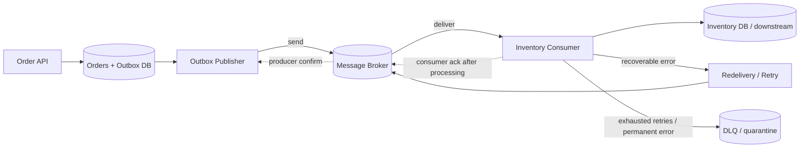
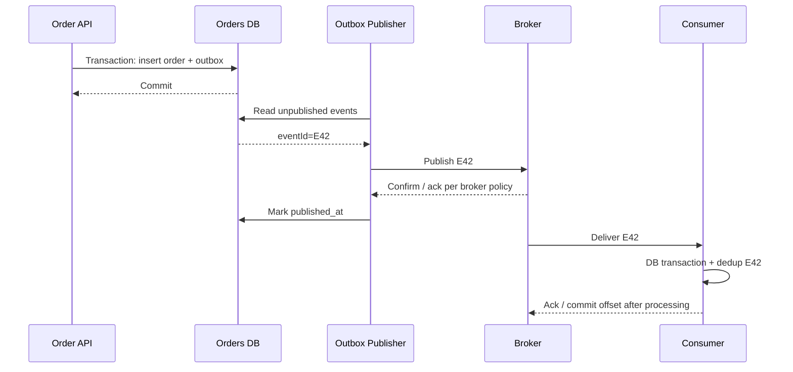

# Message Durability, Retention, and Recoverability

> **Chapter:** Messaging Platforms  
> **Scope:** `SPRING_BOOT_INTEGRATION` — organizing system integration in Spring Boot via HTTP clients, databases, caches, message brokers, and Spring Integration adapters. This lesson focuses on configuration, data contracts, transactions, errors, duplicate handling, testing, and observability of real-world messaging flows.

An ordering system may return HTTP `201 Created` right after saving an order, then emit `OrderPlaced` for the inventory service to reserve stock. If the broker restarts, the producer loses connection, or the consumer dies mid-flight, it is vital that **business work does not vanish, is not executed twice unintentionally, and can recover once systems come back online**.

Three concepts frequently conflated are **message durability**, **retention/expiration**, and **recoverability**. A durably stored message can still expire, be purged by retention, or be acknowledged too early by a consumer. Conversely, a message still sitting in a broker is not guaranteed to be processed cleanly by the receiver. Sound design requires understanding the full lifecycle from source transaction, producer, broker, and consumer through to target systems.

## 1. Learning Objectives

After this lesson, you will be able to:

1. Describe when a message is considered sent, accepted by the broker, capable of surviving failures, and business-completed.
2. Distinguish publisher confirms/producer acknowledgments, consumer acknowledgments, replication, disk persistence, and transactions.
3. Distinguish TTL, log retention, backlog retention, compaction, DLQ, and audit-driven retention.
4. Select suitable settings for RabbitMQ/AMQP, Kafka, JMS providers, or Pulsar without confusing their guarantees.
5. Design a `database → outbox → broker → consumer` flow that recovers after producer, broker, or consumer failures.
6. Keep events/commands idempotent while controlling retries, redeliveries, ordering, and stale messages.
7. Build failure matrices, measure RPO/RTO, test restarts/failovers, and monitor backlogs, replication, retention, and DLQs.

## 2. Four Different Questions About One Message

Suppose a producer sends `OrderPlaced(eventId=E-42, orderId=O-100)` to a broker. Answer four separate questions:

| Question | Required Evidence | What That Evidence **Still Does Not** Guarantee |
|---|---|---|
| Did the producer send it? | Send call initiated; result of send API/`Future` | The broker may not have received or persisted it. |
| Did the broker accept it durably? | Publisher confirm / producer ack **per configured persistence/replication policy** | The consumer updated its database or target system. |
| Does the broker still retain the data? | Message remains in queue/log/backlog; not deleted by ack, expired TTL, or exceeded retention | The record may already have been processed or will still be processed properly. |
| Did the business work finish? | Transaction saving business state, idempotency marker, and confirmation flow | A lone broker ack does not prove external non-DB side effects finished. |



The diagram shows two distinct acknowledgment signals. **Producer acknowledgment/confirm** concerns the broker accepting a record. **Consumer acknowledgment/offset commit** concerns the consumer advancing past a consumption position or finishing receipt. Both only have meaning within specific configuration and transaction boundaries.

### 2.1. Durability Does Not Mean Availability

- **Durability:** data written/replicated at the committed level survives the failure classes it was designed to withstand.
- **Availability:** the system can still accept/deliver messages during node, network, or disk failures.
- **Recoverability:** sufficient data, metadata, backups, and procedures exist to resume or reconstruct state when services recover.

For instance, a Kafka partition replicated across multiple brokers yet lacking enough in-sync replicas can **refuse writes under `acks=all`**. That may be the right behavior to protect durability. Always accepting writes by lowering acknowledgment thresholds boosts immediate write availability at the cost of higher data-loss risk during failovers.

## 3. Lifecycle and Message-Loss Boundaries

An integration flow has multiple “gaps” between steps:

| Boundary | Failure Scenario | Consequence Without Prior Design | Mechanism to Consider |
|---|---|---|---|
| Database → producer | DB commits order, then app dies before publishing | Order exists without an event | Transactional outbox or reconciliation workflow. |
| Producer → broker | Message sent, then connection times out without confirm | Unknown whether broker received it | Retries with stable IDs and downstream deduplication. |
| Broker storage/replication | Broker/node/disk fails right after receipt | Message lost if persistence/replication policy is weak | Durable storage, replication, and proper confirm thresholds. |
| Broker → consumer | Message delivered, yet consumer dies before ack | May redeliver; duplicate processing if unprotected | At-least-once, local transactions, idempotency. |
| Consumer → DB | DB write succeeds, yet dies before ack/offset commit | Redelivery of an already-processed message | Unique business keys / processed-event markers. |
| Consumer → HTTP service | Timeout when sending write command | Unknown whether receiver executed it | Idempotency keys, status lookup / reconciliation. |
| Broker → retention/expiry | Consumer processes too slowly or pauses for days | Messages may expire or be purged from logs before consumption | Retention budgets, lag/backlog alerts, alternative recovery paths. |
| DLQ/replay | Replaying a message whose side effects already succeeded | Executes business work twice or reverts state | Check business state, idempotency, version/sequence. |

You cannot eliminate every failure window with a single `durable=true` flag. Determine specifically **what business impact occurs if data is lost at each step** and design tests accordingly.

## 4. Mechanisms That Provide Message Durability

### 4.1. Durable Storage Differs from Keeping Data in Memory

A broker can keep messages in RAM for speed, flush to disk, append to commit logs, or replicate across nodes. Checks to make:

- **Persistence:** are messages written to the broker's durable storage, or held solely in memory?
- **Replication:** across how many nodes/zones are copies synced? Which components must succeed before the producer receives a confirm?
- **Failover:** how does the broker elect a new leader/node, and can records short of commit conditions be lost?
- **Disk and quotas:** when disks fill up, does the broker block producers, reject writes, or drop messages per policy?
- **Recovery:** upon restart, under what semantics does the broker restore queues/logs, offsets, acknowledgments, subscriptions, and transaction metadata?

**Broker guarantees are always conditional.** Persistent messages do not survive losing every disk/cluster; replication does not replace backups/recovery after accidental deletion; publisher confirms do not promise business work completed.

### 4.2. Publisher Confirms and Consumer Acknowledgments

A publisher confirm is the signal a producer receives from the broker, whose meaning depends on the broker and configured durability. Even when the broker succeeds, **losing the confirm signal on the return path** leaves the producer uncertain of the outcome. Retrying then can create duplicate messages.

Consumer acks or offset commits normally run **after critical business transactions commit**. Acknowledging before saving to the DB and crashing lets the broker treat the message as finished even though business work was never recorded.

In Kafka, committing offsets tracks consumer group progress while event data stays in the log until retention/compaction clears it. In typical RabbitMQ/JMS queues, messages are removed from the queue once acked/committed cleanly (exact behavior varies by provider). Never apply Kafka semantics to queues or vice versa.

## 5. Comparing RabbitMQ, Kafka, JMS, and Pulsar

There is no universal “durable” flag behaving identically across every platform.

| Platform | Storage and Confirmation Mechanism | Once Consumed | Retention / Recovery Approach |
|---|---|---|---|
| **RabbitMQ (AMQP 0-9-1)** | Queues must be durable; publish persistent messages; consider quorum queues and publisher confirms | Consumer ack lets the broker remove the message from the queue per queue model | TTL, length limits, DLX, queue policies; acked messages usually cannot be re-read. |
| **Apache Kafka** | Partition logs with replication factor, ISR, producer `acks`, topic/broker settings | Offset commit marks group progress; records remain in the log | `retention.ms`/`retention.bytes`, `cleanup.policy=delete/compact`; replay via offsets while log still holds data. |
| **JMS (ActiveMQ Artemis, IBM MQ...)** | JMS `DeliveryMode.PERSISTENT` on messages; persistence/replication depends on the JMS provider | Ack/commit settles messages per destination and session | `JMSExpiration`/TTL, DLQ/backout, journals/HA, and retention per provider; JMS API does not standardize all details. |
| **Apache Pulsar** | Persistent topics, replicated ledgers/BookKeeper, and broker/ack protocol | Durable subscriptions retain cursors and unacked backlogs | Message TTL, backlog quotas, retention for acked messages, storage/retention policies per tenant/namespace/topic. |

These rows represent **configuration models**, not hard guarantees across every cluster. For instance, configuring a Kafka topic with `replication.factor=3` while the producer uses `acks=0` does not provide quorum-confirmed reliability. RabbitMQ offers multiple queue types with differing storage and replication behaviors. Pulsar non-persistent topics carry different guarantees from persistent topics; JMS `DeliveryMode.PERSISTENT` must be evaluated within the provider's HA and storage architecture.

### 5.1. When Do You Need a Queue vs. a Log with Retention?

**Queues** fit when workers compete to process tasks, messages do not need to stay readable after completion, and failed tasks flow through redelivery/DLQ. **Retention-backed logs** fit when multiple consumer groups read independently, reprocessing over a time window is needed, or state must be rebuilt from an event stream.

Do not reduce this to “RabbitMQ cannot fan out” or “Kafka is only for events”: both support multiple patterns. The key differentiators are **post-consumption retention semantics, subscriptions, ordering, replay, and operational cost**.

## 6. RabbitMQ: Durable Queues, Persistent Messages, and Confirms

In RabbitMQ, **queue durability** and **message persistence** are two distinct choices. Both must be configured properly for queue-level persistence, alongside queue type, replication, and publisher confirms. Spring AMQP example:

```java
import org.springframework.amqp.core.Binding;
import org.springframework.amqp.core.BindingBuilder;
import org.springframework.amqp.core.DirectExchange;
import org.springframework.amqp.core.Queue;
import org.springframework.amqp.core.QueueBuilder;
import org.springframework.context.annotation.Bean;
import org.springframework.context.annotation.Configuration;

@Configuration(proxyBeanMethods = false)
class OrdersRabbitTopology {
    @Bean
    DirectExchange ordersExchange() {
        return new DirectExchange("orders.events", true, false);
    }

    @Bean
    Queue orderCreatedQueue() {
        return QueueBuilder.durable("inventory.order-created")
            .withArgument("x-queue-type", "quorum")
            .build();
    }

    @Bean
    Binding createdBinding(Queue orderCreatedQueue, DirectExchange ordersExchange) {
        return BindingBuilder.bind(orderCreatedQueue)
            .to(ordersExchange)
            .with("order.created");
    }
}
```

`x-queue-type=quorum` illustrates selecting a quorum queue; verify the actual cluster has enough nodes, policies, and resources to meet fault-tolerance goals. A durable queue alone does not preserve data if only one copy exists and its physical disk fails.

Publisher confirms/returns configuration for a Spring Boot app:

```yaml
spring:
  rabbitmq:
    publisher-confirm-type: correlated
    publisher-returns: true
    template:
      mandatory: true
```

In Spring AMQP, messages sent via `RabbitTemplate` commonly default to persistent delivery mode depending on the message converter/properties, yet **you should not rely on implicit defaults for critical contracts**. Set it explicitly:

```java
import org.springframework.amqp.core.MessageDeliveryMode;
import org.springframework.amqp.rabbit.core.RabbitTemplate;
import org.springframework.stereotype.Service;

@Service
class OrderEventSender {
    private final RabbitTemplate rabbit;

    OrderEventSender(RabbitTemplate rabbit) {
        this.rabbit = rabbit;
    }

    void send(String eventJson) {
        rabbit.convertAndSend(
            "orders.events", "order.created", eventJson,
            message -> {
                message.getMessageProperties()
                    .setDeliveryMode(MessageDeliveryMode.PERSISTENT);
                return message;
            });
    }
}
```

**Important:** `convertAndSend(...)` finishing does not mean the producer handled confirms and returns completely. Register callbacks/correlation data, check `ack/nack`, handle `returned message` for unroutable messages, and track publish state by event ID. `mandatory=true` helps catch missing matching queues, yet returned-message handling and publisher confirms must work together; a confirm alone does not prove routing reached the right business queue.

If the app dies after broker confirm but before marking the outbox sent, the event may be republished. That is normal for **at-least-once** designs; downstream consumers must be idempotent.

### 6.1. RabbitMQ TTL, Dead-Lettering, and Capacity Limits

```java
Queue retryQueue = QueueBuilder.durable("inventory.retry")
    .withArgument("x-message-ttl", 60_000) // Illustrative value: 60 seconds.
    .withArgument("x-dead-letter-exchange", "orders.events")
    .withArgument("x-dead-letter-routing-key", "order.created")
    .build();
```

This illustrates a **TTL-based retry queue**; the broker forwards expired messages to the DLX after the TTL. In production, avoid infinite retry loops with attempt counters/limits and move poison messages to a DLQ. Expiration order also has queue-type, head-of-line, and policy quirks; never treat TTL as a millisecond-accurate timer.

On business queues, `x-message-ttl` can expire messages **before consumers catch up** when backlogs grow. `x-max-length` and overflow policies can also drop messages or block producers depending on configuration. Align these settings with data-retention needs and early alerting.

In RabbitMQ, broker/operator policies may be preferable to hardcoding `x-arguments` in code. Several arguments are immutable or hard to change once a queue exists, and code-declared settings can conflict with broker-managed topology. Pick one clear owner for configuration.

## 7. Kafka: Replication, Acknowledgments, Retention, and Replay

Kafka writes records to topic-partition logs. Durability depends on replication, in-sync replica status, broker policies, and producer settings. A durability-oriented configuration for a critical topic might look like:

```properties
# Topic/broker example; not all settings live in application.yml.
# Topic created with replication factor 3 if cluster has enough brokers.
min.insync.replicas=2
cleanup.policy=delete
retention.ms=604800000
```

Spring Boot producer:

```yaml
spring:
  kafka:
    producer:
      acks: all
      properties:
        enable.idempotence: true
    consumer:
      enable-auto-commit: false
```

With replication factor 3, `min.insync.replicas=2`, and producer `acks=all`, the broker requires minimum in-sync replicas to acknowledge writes per Kafka semantics. If in-sync replicas fall short, writes fail or block rather than succeeding at weaker durability. That is an intentional trade-off between write availability and data protection.

`enable.idempotence=true` reduces duplicate records from **producer retries within the producer mechanism and matching session**; it does not eliminate business duplicates when an application regenerates the same event in a new session, from another outbox publisher, or during replay. You need a stable `eventId` and consumer deduplication.

### 7.1. Kafka Offsets and Retention Are Not Queue Acknowledgments

When a Kafka consumer commits an offset after updating its DB, it reports the group's consumption progress. **Records are not deleted just because offsets committed**; they stay retained per retention/compaction rules and can be re-read while still in the log.

- `retention.ms` governs time-based retention for `delete` cleanup logs; `retention.bytes` can cap size as well.
- `cleanup.policy=delete` removes old segments per broker cleanup cycles—not instantaneously record-by-record at exact expiration.
- `cleanup.policy=compact` retains the latest state per **key** within log-compaction semantics; it is not an audit log of every historical event, and older records can linger until the cleaner runs.
- `delete,compact` can be combined when both policies are needed. Tombstones and `delete.retention.ms` play distinct roles when rebuilding state from compacted topics.

A consumer group stopped for 10 days on a 7-day retention topic risks **losing unconsumed history**. Once old offsets expire, restart behavior depends on settings like `auto.offset.reset` and how missing-offset errors are handled. Never auto-reset to `latest` and pretend the missed work completed.

### 7.2. Spring Kafka: Commit Offsets After the Business Transaction

Example listener using manual acknowledgment to enforce processing order (`OrderEvent`, `InventoryProcessor`, and deserializers are application-defined):

```java
import org.springframework.kafka.annotation.KafkaListener;
import org.springframework.kafka.support.Acknowledgment;
import org.springframework.stereotype.Component;

@Component
class InventoryKafkaListener {
    private final InventoryProcessor processor;

    InventoryKafkaListener(InventoryProcessor processor) {
        this.processor = processor;
    }

    @KafkaListener(
        topics = "orders.events",
        groupId = "inventory",
        containerFactory = "manualAckFactory")
    void onEvent(OrderEvent event, Acknowledgment acknowledgment) {
        processor.process(event); // @Transactional on a public method of another bean.
        acknowledgment.acknowledge(); // After processor has returned/committed DB.
    }
}
```

Corresponding container factory setup, e.g.:

```java
import org.springframework.context.annotation.Bean;
import org.springframework.kafka.config.ConcurrentKafkaListenerContainerFactory;
import org.springframework.kafka.core.ConsumerFactory;
import org.springframework.kafka.listener.ContainerProperties;

@Bean
ConcurrentKafkaListenerContainerFactory<String, OrderEvent> manualAckFactory(
        ConsumerFactory<String, OrderEvent> consumerFactory) {
    var factory = new ConcurrentKafkaListenerContainerFactory<String, OrderEvent>();
    factory.setConsumerFactory(consumerFactory);
    factory.getContainerProperties()
        .setAckMode(ContainerProperties.AckMode.MANUAL_IMMEDIATE);
    return factory;
}
```

This illustrates **invocation order**: `processor.process(...)` lives on a separate bean whose method is wrapped by Spring's transaction proxy and **commits the DB before returning**. Never place `@Transactional` directly on the listener method and call `acknowledge()` inside it if that causes ack to run before actual commit. With asynchronous processing, wait for business completion before acknowledging offsets.

If `processor` throws, the container error handler and retry/DLT policy must align; the snippet above does **not** configure retry/DLT yet. `MANUAL_IMMEDIATE` carries specific threading and container commit semantics; verify with integration tests rather than guessing from the option name.

Kafka transactions provide atomicity across Kafka operations like consuming/producing records and offsets when configured properly, yet **cannot roll an external database commit into a single Kafka transaction**. Across DB + Kafka, you still need outbox/idempotency strategies or explicit coordination and recovery when the two systems do not commit simultaneously.

## 8. JMS: Persistent Delivery and Session Transactions

In Spring JMS, `DeliveryMode.PERSISTENT` requests durable storage within the JMS provider's scope and broker configuration. Check actual semantics against your specific broker, such as ActiveMQ Artemis or IBM MQ.

```java
import org.springframework.context.annotation.Bean;
import org.springframework.context.annotation.Configuration;
import org.springframework.jms.core.JmsTemplate;
import jakarta.jms.ConnectionFactory;

@Configuration(proxyBeanMethods = false)
class JmsPublisherConfig {
    @Bean
    JmsTemplate persistentJmsTemplate(ConnectionFactory connectionFactory) {
        var template = new JmsTemplate(connectionFactory);
        template.setExplicitQosEnabled(true);
        template.setDeliveryPersistent(true);
        // Do not set a TTL here if the event must live until processed.
        return template;
    }
}
```

**Do not equate `DeliveryMode.PERSISTENT` with multi-node replication or protection against losing an entire datacenter.** Those durability levels depend on the JMS provider's journal/HA setup. Check `JMSExpiration` or time-to-live as well: a persistent message can still expire before being processed.

For listeners using local JMS transacted sessions, throwing to roll back the transaction lets the broker redeliver per policy. Consumer success and JMS commit do not prove all side effects succeeded if you made HTTP calls or wrote a DB outside the JMS transaction. Conversely, DB commit paired with JMS rollback triggers redelivery. Enforce business-level idempotency.

DLQ/backout queues and max delivery counts **are not standardized as a single uniform API by JMS**. Configure DLQ targets, redelivery delays, poison-message policies, and forwarding metadata per broker rather than inferring from queue names.

## 9. Pulsar: Durable Subscriptions, Backlogs, and Retention

Pulsar persists topic data through replicated storage (commonly Apache BookKeeper) and tracks consumption via subscriptions. Distinguish these concepts:

- **Persistent topic:** published data goes to durable storage; non-persistent topics offer weaker guarantees.
- **Durable subscription:** subscription cursors/progress persist so consumers resume after reconnecting. Depending on subscription type and acks, unacknowledged messages accumulate as backlog.
- **Backlog quota:** caps unconsumed backlog on a subscription/topic; exceeding it can block producers or trigger configured eviction policies.
- **TTL:** expires messages and stops redelivering them per policy; account for consumer outages.
- **Retention:** keeps messages **after acknowledgment** to allow historical reads within configured bounds; distinct from unacked backlogs.
- **Dead-letter/retry:** consumers can configure retry/DLQ mechanisms per client/subscription; verify semantics and delivery counts for your Pulsar version.

Never assume “a durable subscription keeps all events forever.” Subscriptions have backlog quotas, topics have retention/TTL policies, and storage is finite; verify explicit limits, consumer counts, metadata/ledger recovery, and BookKeeper capacity.

Subscriptions support multiple delivery modes (`Exclusive`, `Shared`, `Failover`, `Key_Shared`) with differing ordering, load balancing, and redelivery behavior. Match subscription mode to business requirements, especially when one `orderId` must not be processed concurrently out of order.

## 10. How Do TTL, Retention, Expiry, Compaction, and DLQ Differ?

All of these affect “whether a message is still there,” yet their purposes and conditions differ.

| Mechanism | Question It Answers | Example | Risk When Misused |
|---|---|---|---|
| **Message TTL / expiration** | How long is a message still valid to deliver? | Stock-reservation request valid for only 15 minutes | Worker pauses 20 minutes, expiring valid work before handling. |
| **Log retention** | How long or how much log history is retained? | Retain Kafka events 14 days for replay | Consumer lag exceeds retention, losing unread history. |
| **Backlog retention/quota** | How much unconsumed data may the broker hold? | Pulsar caps subscription backlog to configured limit | Exceeding quota blocks producers or causes data shedding. |
| **Log compaction** | Retain latest state per key to rebuild state? | Kafka compacts by `productId` | Not enough step-by-step history remains for audit/event replay. |
| **DLQ/quarantine** | Where are failing messages isolated for investigation? | Bad-schema order events moved to DLQ after retries | DLQ overflows, infinite replay loops, or retention purges evidence. |
| **Business deadline** | Does business logic still allow processing now? | Do not send OTP email after confirmation window | Broker still delivers message, yet executing late causes a business bug. |
| **Audit retention** | How long must the organization retain business records? | Retain transaction history for compliance | Confusing broker retention with long-term audit archiving. |

**A message still present in a broker may no longer be business-valid.** `OrderPlaced` might still need syncing/reconciliation, whereas a command `ReserveStockBeforeDeadline` may need skipping or marking expired if handled too late.

In Kafka, `retention.ms` is a log policy unaware of per-record `businessDeadline`s. In RabbitMQ, TTL can route to a DLX when configured; never treat DLQ transfer as “processed.” In JMS, expiry queues/DLQs are provider-specific. Pulsar data-retention settings separate unacked backlogs from retention of acknowledged messages.

### 10.1. Sizing Retention from Required Recovery Time

Suppose orders must tolerate a consumer outage of **up to 72 hours** without losing pending commands. The retention/log/backlog budget must exceed maximum outage duration **plus** detection/intervention time, backlog catch-up time, and operational delays:

```text
Minimum required data retention duration
  > expected consumer outage duration
    + detection and intervention time
    + post-recovery backlog catch-up time
    + safety margin
```

This is a **budgeting principle**, not a substitute for testing. If a topic is also size-bounded, data can be purged earlier than the time threshold. Calculate peak ingress rates, disk quotas, replication overhead, and cleanup behavior rather than setting a day count blindly.

For example, a 7-day Kafka topic producing 100 GB/day with an overly small `retention.bytes` will not keep 7 days of data. For ack-based queues, do not think of retention like a log: messages stay until consumed, expired, or removed by another policy.

## 11. Failure Recovery: From Lost Confirmations to Cluster Loss

Different failures demand different recovery paths.

| Incident | Possible State | Recovery Approach | What to Measure |
|---|---|---|---|
| Producer timeout after send | Broker may have stored it despite missing confirm | Keep event ID, controlled retry from outbox, idempotent consumer | Publish attempts, confirms/timeouts, duplicate rate. |
| Single broker node restart | Failover or brief unavailability | Reconnect with backoff; verify storage/replication policy | Broker availability, reconnect time, unavailable partitions/queues. |
| Replicas short of quorum | Producer writes fail or block | Restore replicas/cluster; never weaken durability unapproved | ISR/quorum health, failed writes, lag. |
| Consumer crashes before ack | Messages usually redeliver | Reconsume with transactions and idempotency | Redelivery counts, dedup hits, duplicate side effects. |
| Poison message | Message fails handler consistently | Bounded retry, then DLQ/quarantine and root-cause fix | DLQ depth/age, retry attempts, errors by schema version. |
| Long consumer outage | Backlog grows; may threaten retention/quotas | Scale consumer capacity, clear bottlenecks, recover from snapshots/sources if log expired | Backlog age, consumer lag, catch-up throughput. |
| Disk/cluster data loss | Some messages/metadata unrecoverable from replicas | Backup/restore, DR, or rebuild from outbox/source system | Actual RPO/RTO, missing events, consistency. |
| Out-of-order replay | Stale events may revert newer state | Version/sequence guards, reconcile current state | Out-of-order counts, rejected stale updates. |

**Reconnecting** only restores the network link. **Recovery** must also re-establish valid business state after the outage, particularly if messages touched HTTP, databases, or third-party systems before the failure was recorded.

### 11.1. Business-Driven RPO and RTO

- **RPO (Recovery Point Objective):** maximum data/work loss tolerated during a disaster, usually expressed in time or event count.
- **RTO (Recovery Time Objective):** target time for a service or business flow to return to defined service levels.

For example, non-critical notifications may tolerate dropping some notifications within business bounds, whereas payment flows require tight persistence and reconciliation. Never claim “RPO = 0” solely from `acks=all` without accounting for event origin, DB/outbox commit timing, total storage loss, backups, and cross-region replication.

A DR plan must answer: **what restores broker metadata/queues/topics/consumer offsets, what restores outbox/DBs, and how are events that already mutated external services reconciled?** Restoring an older DB snapshot can diverge from messages published prior to that snapshot; plan explicit reconciliation.

## 12. Transactional Outbox: Bridging the DB–Broker Gap

One of the biggest risks in Spring Boot integration is this sequence:

```java
// Does not guarantee synchronization across two systems:
orderRepository.save(order); // When does the database commit?
brokerPublisher.publish(event); // Publish can fail after DB commit.
```

Putting `@Transactional` on JDBC/JPA does not automatically enlist a broker call in the same transaction. The standard pattern is an **outbox**: write business data and the intent to emit an event in the **same database transaction**.

```sql
-- PostgreSQL example creating a table with a stable event identifier.
CREATE TABLE outbox_events (
    event_id UUID PRIMARY KEY,
    aggregate_id VARCHAR(80) NOT NULL,
    event_type VARCHAR(80) NOT NULL,
    payload JSONB NOT NULL,
    created_at TIMESTAMPTZ NOT NULL DEFAULT NOW(),
    published_at TIMESTAMPTZ
);
```

Inside a transactional Spring service:

```java
import org.springframework.stereotype.Service;
import org.springframework.transaction.annotation.Transactional;

@Service
class OrderCommandService {
    private final OrderRepository orders;
    private final OutboxRepository outbox;

    OrderCommandService(OrderRepository orders, OutboxRepository outbox) {
        this.orders = orders;
        this.outbox = outbox;
    }

    @Transactional
    public OrderReceipt create(CreateOrder command) {
        Order order = orders.save(Order.from(command));
        outbox.save(OutboxEvent.orderPlaced(
            command.eventId(), order.getId(), command.toEventPayload()));
        return new OrderReceipt(order.getId());
    }
}
```

`Order`, `OrderRepository`, `CreateOrder`, and `OutboxRepository` are illustrative domain types. Ensure both repositories share the same transaction manager/database, `eventId` is persisted stably, and appropriate unique constraints exist. If HTTP clients retry order creation, enforce an idempotency key/unique business constraint for the **order creation command itself**, not only the outbox event ID.

The publisher reads unsent outbox rows, publishes, and **marks `published_at` only after receiving the right confirmation**:



**Duplicate window:** broker received E42, yet the publisher died before updating `published_at`. The next run republishes E42. That is an intentional cost to avoid losing publish intent. Consumers must be idempotent.

When running multiple publisher instances, use proper claiming/locking (such as row-level locking with `SKIP LOCKED` where supported) so two workers do not race on the same event, and reclaim rows whose claiming worker died. Never hold a DB transaction open across long broker waits; doing so pins connections/locks without turning the broker into a DB transaction participant.

## 13. Consumer Idempotency and Recovering from Redelivery

Brokers can redeliver messages if consumers die after DB commit yet before acking. To ensure an event **never mutates business state twice**, use a stable event ID and a DB constraint:

```sql
CREATE TABLE processed_events (
    consumer_name VARCHAR(80) NOT NULL,
    event_id UUID NOT NULL,
    processed_at TIMESTAMPTZ NOT NULL DEFAULT NOW(),
    PRIMARY KEY (consumer_name, event_id)
);
```

In the **same database transaction** as the state update:

```sql
-- PostgreSQL: inserted row count is 1 on first processing.
INSERT INTO processed_events (consumer_name, event_id)
VALUES (:consumer_name, :event_id)
ON CONFLICT DO NOTHING;
```

- If **1 row** is inserted, run the business changes in the same transaction; only ack/commit consumption progress after DB commit succeeds.
- If **0 rows** are inserted, the event was already handled by that consumer; inspect state if needed and ack the message without repeating effects.
- If the business update fails, roll back the marker along with the state change so the next delivery can retry.

Rely on a real unique constraint under concurrency; “`SELECT` to check existence, then `INSERT`” fails under race conditions. For updates requiring order, add `aggregateVersion`/`sequence` checks so stale messages never overwrite newer state.

**Limitation:** the marker only protects side effects inside **the same database transaction**. When consumers call external HTTP APIs, pass a provider-supported idempotency key or persist command state for reconciliation. Never use `processed_events` to claim end-to-end exactly-once across external systems.

### 13.1. Retries and DLQs Must Have Stopping Points

Transient faults like database timeouts can retry with bounds, backoff, and jitter. Permanent faults like corrupted payloads/incompatible schemas usually need fast quarantine. DLQs must preserve `eventId`, `schemaVersion`, `correlationId`, and failure cause for investigation.

Never allow **nested retries** to multiply downstream calls. If a broker redelivers 5 times and the listener retries HTTP 4 times each round, a single event can trigger 20 calls. For non-idempotent operations, that means 20 chances for duplicate side effects.

Replay procedures must verify existing side effects, fix the underlying bug, keep business/event IDs intact, throttle rates, and monitor outcomes. If a message passed its business deadline, decide whether to skip or compensate instead of blindly re-running the original command.

## 14. Monitoring Backlogs, Retention, and Broker Health

Checking only “is the consumer running?” is insufficient. A live consumer running slower than the producer can still let logs exceed retention or fill queues.

| Signal Group | What to Measure | Why |
|---|---|---|
| Producer | Send/confirm latency, nack/error/timeout counts, retry rates, unroutable messages | Detects lost confirms or broken routing. |
| Broker | Free disk, memory, publish rate, replica/ISR/quorum health, unavailable queues/partitions | Measures risk of write stalls or degraded durability. |
| Consumer | Throughput, error rate, handler latency p95/p99, ack/offset commit failures | Detects slow handling or broken acknowledgment. |
| Backlog | Queue depth, Kafka consumer lag, Pulsar backlog, **oldest message age** | Estimates risk of breaching retention or business deadlines. |
| Retention/expiry | Purged records, expired messages, TTLs, quota overflows, retention headroom | Detects potential work loss from storage policies. |
| Recovery | Redelivery attempts, DLQ depth/age, replay success/failures | Quantifies work requiring manual intervention. |
| Business | Orders pending past SLA, duplicate event IDs, state drift vs. source | Catches “error-free” messages whose business flow stalled. |

Exact metrics vary by platform, Spring version, Actuator/Micrometer, and broker exporters. Before alerting, verify metrics accurately reflect the intended partition/queue/topic and confirm units and time windows.

**Record-count consumer lag alone cannot predict catch-up time** if processing cost varies across messages. Combine throughput, backlog age, peak-hour traffic, parallelizable partitions/consumers, and DB/downstream latency. When a repeating poison message drives backlog growth, adding consumers may not fix the bottleneck.

### 14.1. Retention Budget and Catch-Up Speed

Rough planning calculation:

```text
Producer rate: 1,000 messages/minute
Consumer outage: 180 minutes
Backlog after outage ≈ 180,000 messages

Upon recovery:
  producer continues sending 1,000 messages/minute
  consumer processes 2,500 messages/minute
  net backlog drain rate ≈ 1,500 messages/minute
  theoretical catch-up time ≈ 120 minutes
```

This estimate ignores traffic bursts, message sizes, retries, partition skew, locks, and downstream limits. Still, it illustrates why **retention must span both the outage and the catch-up window**, and why a consumer matching producer speed will never drain an accumulated backlog.

## 15. Testing Durability and Recoverability

Unit tests verify validation and retry classification, yet **true durability must be verified against brokers and databases matching production topology**. Use Testcontainers for integration tests, paired with controlled fault-injection/chaos tests on appropriate clusters when verifying failover.

| Scenario | Simulated Fault | Expectation |
|---|---|---|
| Producer loses confirm | Broker accepts event, yet producer disconnects before response | Outbox retries; consumer applies one business side effect. |
| Broker restart | Send persistent/confirmed message, then restart broker | Required messages survive per configured policy. |
| Loss of one broker/replica | Stop a node in a test cluster | Failover, write availability, and durability follow quorum/ISR policy. |
| Consumer dies before ack | Commit DB, then stop consumer before ack/offset commit | Message redelivers; DB deduplication blocks duplicate writes. |
| Poison message | Send bad-schema payload | Bounded retries; message enters DLQ without blocking entire stream. |
| Consumer outage > retention | Stop group longer than log retention | Missing history detected; rebuild/reconcile runbook exists instead of silent skipping. |
| TTL shorter than backlog | Queue accumulates past TTL | Expiry/DLQ signals and business consequences handled cleanly. |
| Storage/quota full | Restrict disk/quota in test environment | Producer/consumer react per policy; alert fires before data loss. |
| Replay from DLQ | Replay a command that previously caused side effects | Preserves IDs and checks state; no duplicates or version regressions. |
| Restore from snapshot | Restore sample broker/DB state and compare with outbox | Discrepancies detected with a reconciliation path. |

Document exact **configuration** during tests: replica count, persistence mode, queue/topic type, acknowledgments, TTL/retention, retry policy, broker/client versions, and fault-injection points. Testing against a single-node broker never proves cluster node-loss tolerance.

### 15.1. Testing Acknowledgment Ordering with Spring Boot

An integration test suite can verify:

1. Insert order and outbox event in DB; before publisher runs, kill the API process. Restart publisher and verify the event still publishes.
2. Let publisher send successfully yet stop it before marking the outbox; rerun publisher and confirm duplicates may emit, while the consumer applies business logic only once.
3. Let consumer commit DB and cut broker connection before ack; restart consumer and verify the duplicate marker works.
4. Pause consumer long enough to measure backlog age and observe retention/expiry behavior in test.
5. Send a message with an expired `businessDeadline`; verify the consumer records expiration instead of executing stale work.

The overarching goal is **zero silent data loss**: if policy intentionally lets messages expire or logs purge, the system must expose metrics/paths to handle it rather than mistaking missing outcomes for “consumer finished.”

## 16. Pitfalls to Avoid

**“Durable queue means every message is safe.”** Queue durability is separate from message persistence, replication, producer confirms, and storage policies. Evaluate the entire configuration together.

**“Producer send returned without error means consumer processed it.”** Send, confirm, delivery, ack, and business transaction are separate steps; one step succeeding never confirms the next.

**“Persistent messages are never deleted.”** TTL, retention, quotas, successful acks, and cleanup policies can all remove messages from the broker.

**“Committing a Kafka offset deletes the record.”** Offsets record group progress; retention/compaction governs record lifecycle in the log.

**“Kafka `acks=all` gives exactly-once across DB and HTTP.”** Acknowledgments are Kafka-scoped; databases and downstream APIs need their own transactions, idempotency, and reconciliation.

**“RabbitMQ queues and Kafka topics replay identically.”** Traditional queues remove messages on ack; Kafka logs retain records per policy. Replay and retention differ fundamentally.

**“DLQ is a backup.”** DLQs hold failed messages per policy; they never store acked messages and cannot protect against cluster loss or accidental deletion.

**“An online consumer cannot lose messages.”** A consumer slower than its producer can build backlog until TTL/retention expires. Track backlog age and retention budgets.

**“We have retries, so we don't need idempotency.”** Retries and redeliveries **increase duplicate processing risk**; idempotency/unique keys protect business outcomes.

**“Restarting the broker means recovery is complete.”** You must still reconcile unpublished outbox items, offsets/subscriptions, committed side effects, and DLQs/replays—especially after DR restores.

## 17. Capstone Practice Exercise

Build an `OrderPlaced` flow in Spring Boot using one database and **choosing one** platform among RabbitMQ, Kafka, a JMS provider, or Pulsar:

1. Define an event contract with `eventId`, `orderId`, `eventType`, `schemaVersion`, `occurredAt`, and required business fields. Specify whether late processing is permitted.
2. Write an outbox row in the same transaction that creates the order. Persist a stable event ID and publication status for recovery.
3. Configure the broker for durability goals: storage/persistence, replication if clustered, producer confirms/acks, and retention/TTL/quotas. Document every value explicitly.
4. Build a publisher with retry/backoff and confirmation handling; simulate a lost confirm to prove duplicate emission can occur without losing publish intent.
5. Build a consumer that writes `processed_events` and updates business state in the same DB transaction; ack/commit progress only after the transaction commits.
6. Test consumer crashes after DB commit and before ack; verify zero duplicate side effects.
7. Configure bounded retries and DLQ/quarantine for poison messages; emit metrics for failures, backlog depth/age, and replays.
8. Simulate a consumer outage, measure actual catch-up time against the retention budget, and verify alerts fire before backlog data expires.
9. Simulate a broker restart or failover in a matching test topology and reconcile broker-confirmed events.
10. Document an operational runbook covering stalled outboxes, lost broker quorum, consumer lag breaching budgets, and DLQ replays, with owners and business verification steps.

**Acceptance criteria:**

- Events persisted in the DB are never lost simply because the publisher stopped after commit; the outbox resumes publishing upon recovery.
- Producer confirms have explicit semantics and error logging; uncertain outcomes retry safely with stable event IDs.
- Consumers apply one business outcome per event ID even when the broker delivers multiple times.
- Retention/TTL settings match planned outage and recovery durations, with alerts ahead of budget exhaustion.
- Poison messages are quarantined and replayed under control without infinite retries.
- Restart, lost-confirm, redelivery, and backlog tests yield observable evidence; RPO/RTO are measured and documented within test scope.

## 18. Self-Assessment Questions

**1. Why can a persistent message in a durable queue still fail to complete business work?**  
Because broker storage covers only part of the lifecycle. Consumers can still crash, fail processing, ack prematurely, or miss business deadlines; DB/HTTP side effects require transactions, idempotency, and reconciliation.

**2. Why can producer retries after a timeout produce duplicate messages?**  
The broker may have persisted the message while the confirm was lost in transit. Unsure of the result, the producer resends the event and may append another copy; stable event IDs and consumer deduplication are needed.

**3. Does committing a Kafka offset delete the event from the topic?**  
No. Events remain in the log per retention and cleanup policies; offset commits only record a consumer group's read progress.

**4. Is a 30-minute TTL reasonable for a required command when operations allows a 2-hour consumer outage?**  
No, unless business rules intentionally expire the command after 30 minutes with clear compensation/status handling. If processing must survive a 2-hour outage, redesign the TTL/retention budget.

**5. Do `acks=all` and replication factor 3 guarantee zero data loss ever?**  
Not unconditionally. Commitments depend on ISR/min replicas, broker settings, correlated failures, storage, and DR. They also neither close the DB→producer gap nor replace backups.

**6. What happens when a consumer commits its DB yet fails before ACKing?**  
The broker can redeliver the message. The consumer must recognize the already-processed event via markers/unique keys and ACK without repeating side effects.

**7. Why is a DLQ not a long-term audit archive?**  
A DLQ holds only quarantined failing messages per policy, may undergo TTL/quotas/manual deletion, and omits succeeded messages. Audit compliance requires dedicated storage and governance.

**8. When a broker recovers after logs already purged unconsumed events, can you simply reset offsets to `latest`?**  
No, if those events represent mandatory work. Detect the gap, rebuild from source/outbox/snapshots if available, reconcile business state, and only then choose a safe resume point.

The core principle of **message durability, retention, and recoverability** is scoping guarantees accurately: producer confirms protect a single publish hop, persistence/replication protects data inside the broker, retention governs how long data stays readable, and ack/idempotency/transactions protect business outcomes. Combining these with outboxes, failure testing, and backlog monitoring enables Spring Boot integration flows to recover verifiably from real-world failures.
