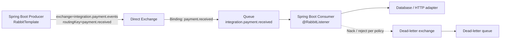
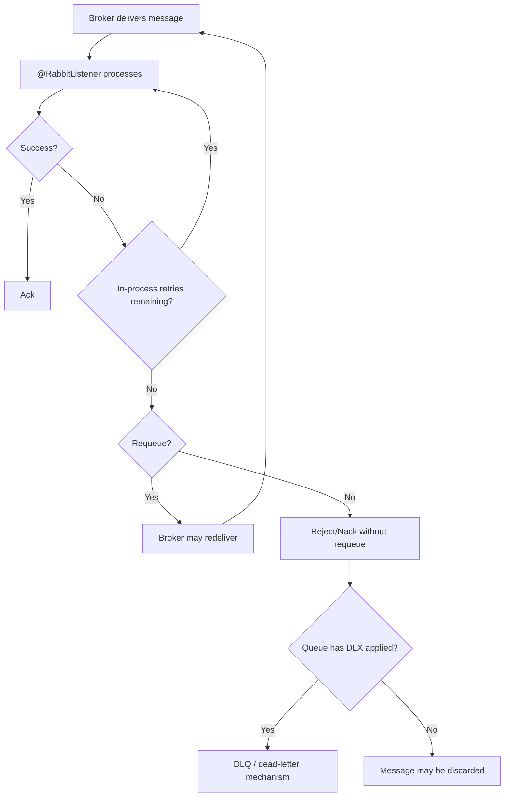

# spring-boot-starter-amqp and spring.rabbitmq.* Configuration

## 1. Purpose and Role of AMQP in Spring Boot Integration

When a Spring Boot application needs to exchange messages asynchronously with another service, **RabbitMQ** is a popular broker choice. Instead of holding an HTTP connection waiting for a downstream system to complete, the application can send a message to an exchange; RabbitMQ routes the message to a queue; and one or more consumers receive and process it.

In the **SPRING_BOOT_INTEGRATION** module, connecting to RabbitMQ should be treated as part of the **integration contract**: connection configuration, data format, exchange/queue/binding declarations, publish/consume acknowledgments, error handling, retries, deduplication, and observability. The two central components of this lesson are:

- `spring-boot-starter-amqp`: the starter that provides the required dependencies and enables Spring Boot's AMQP auto-configuration.
- `spring.rabbitmq.*`: the property group that configures how the application connects to RabbitMQ, publishes messages, runs listeners, and uses connections/channels.

After this lesson, you will be able to add AMQP to an application, understand which beans Spring Boot provides, choose properties suited to real integration flows, and identify configurations that can cause message loss or duplicate processing.

> Scope: Examples assume Spring Boot uses Spring AMQP with RabbitMQ over the AMQP 0-9-1 protocol. Property names and support for certain features may vary across Spring Boot/Spring AMQP versions; when upgrading versions, cross-check the configuration metadata and documentation for the exact version in use.

## 2. RabbitMQ, Exchange, Queue, and Binding

RabbitMQ is not simply a place where a producer writes directly to an arbitrary queue. In the common AMQP 0-9-1 model:

1. A **Producer** sends a message to an **exchange**, along with a **routing key**.
2. The **Exchange** uses **bindings** and its exchange type to decide which queue(s) receive the message.
3. A **Queue** stores messages whose processing has not yet completed.
4. A **Consumer** subscribes to receive messages from a queue and confirms processing via acknowledgment or returns/rejects them according to policy.



| Concept | Role | Key Things to Remember |
| --- | --- | --- |
| **Exchange** | Receives messages and decides routing | Direct relies on exact routing key; fanout broadcasts to all bound queues; topic relies on patterns |
| **Queue** | Holds messages waiting for consumers | A durable queue only ensures the queue definition survives restarts; message persistence and broker policies must also be considered |
| **Binding** | Connects an exchange to a queue | May differ from the routing key sent by the producer, depending on the exchange type |
| **Routing key** | Information that assists routing | Not a unique identifier for the message |
| **Ack/Nack** | Processing result sent from consumer to broker | An ack ends a single message delivery; it does not implicitly prove all external side effects outside the broker have completed |
| **DLX/DLQ** | Routes and stores messages that cannot be processed per policy | A DLQ must be declared and monitored; merely disabling requeue does not automatically create a DLQ |

Business example: the payment system sends `payment.received` to the shipping service. If the shipping service is under maintenance, the queue can hold the message; however, having a queue does not automatically guarantee exactly-once processing. When a connection drops around the time of an ack, a message may be redelivered and the consumer must handle duplicates safely.

## 3. Adding spring-boot-starter-amqp

For a Maven project using the Spring Boot parent or BOM for version management:

```xml
<dependency>
    <groupId>org.springframework.boot</groupId>
    <artifactId>spring-boot-starter-amqp</artifactId>
</dependency>
```

For Gradle:

```groovy
dependencies {
    implementation 'org.springframework.boot:spring-boot-starter-amqp'
}
```

Do not manually pin an incompatible Spring AMQP version if Spring Boot is managing dependencies; let the appropriate BOM select the compatible versions of Spring AMQP, the RabbitMQ Java client, and related libraries.

The starter integrates common components:

| Component | Purpose |
| --- | --- |
| `ConnectionFactory` | Creates/manages connections and channels to RabbitMQ |
| `CachingConnectionFactory` | The connection factory implementation commonly configured by Spring Boot with channel caching support |
| `RabbitTemplate` / `AmqpTemplate` | Sends messages, performs synchronous receives, or handles request/reply when appropriate |
| `RabbitAdmin` / `AmqpAdmin` | Declares exchanges, queues, and bindings if the application is permitted to manage topology |
| `@RabbitListener` and listener container | Consumes messages via callbacks/methods in Spring beans |
| `MessageConverter` | Converts between Java objects and AMQP payloads when an appropriate converter is configured |

When auto-configuration conditions are met, Spring Boot provides the essential beans and listener infrastructure. Custom beans, multiple connection factories, or separate `@EnableRabbit` configurations can change behavior; inspect the actual application context before assuming all beans share the same `ConnectionFactory`.

**The starter does not install or start a RabbitMQ server.** You still need a running RabbitMQ broker, virtual host access permissions, a network route, and valid credentials. Nor can the starter infer exchanges, queues, routing keys, or payload contracts from business requirements.

### When to use Spring AMQP vs. Spring Integration?

- Spring AMQP with `RabbitTemplate` and `@RabbitListener` is suited for direct message sending and receiving.
- Spring Integration provides AMQP inbound/outbound adapters or gateways to wire RabbitMQ into `MessageChannel`, transformers, routers, error channels, and multi-step flows.
- Whichever approach you choose, connection configuration must remain consistent with the broker; avoid creating two consumers on the same queue if they have different processing behavior or if each consumer expects to receive every message.

This lesson focuses on the starter and the `spring.rabbitmq.*` group; building a full Spring Integration flow is not required.

## 4. Minimal Connection Configuration

Example `application.yml` for a development environment with a broker at `localhost:5672`:

```yaml
spring:
  rabbitmq:
    host: ${RABBITMQ_HOST:localhost}
    port: ${RABBITMQ_PORT:5672}
    username: ${RABBITMQ_USERNAME:guest}
    password: ${RABBITMQ_PASSWORD:guest}
    virtual-host: ${RABBITMQ_VHOST:/}
    connection-timeout: 5s
    requested-heartbeat: 30s
```

This is a **local development** example. RabbitMQ typically restricts the `guest` account from remote connections; in staging/production you must use dedicated accounts, passwords from a secret manager or environment variables, per-virtual-host permissions, and transport security.

Spring Boot supports externalized configuration: for instance, the environment variable `SPRING_RABBITMQ_HOST` can supply the value for `spring.rabbitmq.host` via relaxed binding. The expression `${RABBITMQ_HOST:localhost}` means use `RABBITMQ_HOST` if present, otherwise `localhost`. For real deployment environments, you should **omit default values for secrets** and fail fast if required secrets are not provided.

### Basic Connection Properties

| Property | Meaning | Notes |
| --- | --- | --- |
| `spring.rabbitmq.host` | Broker host when connecting to a single address | The address seen from an application container may differ from `localhost` |
| `spring.rabbitmq.port` | Broker AMQP port | The AMQP port is typically `5672`; HTTP management port `15672` is not the AMQP port |
| `spring.rabbitmq.addresses` | List of broker endpoints to connect to | When configuring full addresses, do not rely on `host`/`port` as the primary source |
| `spring.rabbitmq.username`, `password` | Broker authentication credentials | Use secrets; never commit real passwords |
| `spring.rabbitmq.virtual-host` | Resource namespace and permission boundary in the broker | Queues/exchanges in different vhosts are distinct entities |
| `spring.rabbitmq.connection-timeout` | Time limit for establishing a connection | Not the processing deadline for business messages |
| `spring.rabbitmq.requested-heartbeat` | Heartbeat interval proposed to the broker | Must align with timeouts, network, and broker policy |
| `spring.rabbitmq.ssl.enabled` | Enables TLS for the connection when properly configured | Must verify trust, hostname, and broker-side certificates |

Example connecting to one of multiple endpoints provided by infrastructure:

```yaml
spring:
  rabbitmq:
    addresses: ${RABBITMQ_ADDRESSES:mq-a.internal:5672,mq-b.internal:5672}
    username: ${RABBITMQ_USERNAME}
    password: ${RABBITMQ_PASSWORD}
    virtual-host: integration
```

The endpoint list tells the client which addresses it can connect to; it does **not** mean the application automatically creates a RabbitMQ cluster, replicates queues, or guarantees lossless failover. That is the responsibility of broker topology and configuration. Avoid exposing URIs containing passwords in logs or monitoring URLs.

## 5. Configuring Message Publishing with RabbitTemplate

Producers commonly use `RabbitTemplate.convertAndSend(exchange, routingKey, payload)`. The template can convert objects via a `MessageConverter`; without an appropriate JSON converter configured, do not assume passing a Java DTO will produce JSON matching the partner contract. The first example sends a **String containing pre-built/validated JSON**.

```java
import org.springframework.amqp.rabbit.core.RabbitTemplate;
import org.springframework.stereotype.Component;

@Component
public class PaymentEventPublisher {

    private final RabbitTemplate rabbitTemplate;

    public PaymentEventPublisher(RabbitTemplate rabbitTemplate) {
        this.rabbitTemplate = rabbitTemplate;
    }

    public void publish(String eventJson) {
        rabbitTemplate.convertAndSend(
            "integration.payment.events",
            "payment.received",
            eventJson
        );
    }
}
```

In practice, you should standardize payload fields such as `eventId`, `eventType`, `schemaVersion`, `occurredAt`, and partner ID; these fields help validate the data contract and handle deduplication. Standardizing the payload also makes it easier to switch from HTTP webhooks to queues while still identifying the same business event.

### Publisher Confirmations, Returns, and Retry

```yaml
spring:
  rabbitmq:
    publisher-confirm-type: correlated
    publisher-returns: true
    template:
      mandatory: true
      retry:
        enabled: true
        initial-interval: 200ms
        multiplier: 2
        max-interval: 2s
        max-attempts: 3
```

| Property | Effect | Common Misconceptions |
| --- | --- | --- |
| `spring.rabbitmq.publisher-confirm-type: correlated` | Enables tracking publisher confirms tied to each publish via `CorrelationData` | Confirms report broker-side status related to publishing; they do not prove the consumer completed business processing |
| `spring.rabbitmq.publisher-returns: true` | Enables receiving information about unroutable messages when returned by the broker | Must be combined with `mandatory` and appropriate callback/observation registration |
| `spring.rabbitmq.template.mandatory: true` | Requires returning messages that have no destination queue per applicable AMQP rules | Does not reroute or store messages in another queue automatically |
| `spring.rabbitmq.template.retry.*` | Configures retries for `RabbitTemplate` operations when supported | Not a business-level retry backed by an outbox; resending can create duplicates |
| `spring.rabbitmq.template.reply-timeout` | Wait time for a reply when using synchronous request/reply | Does not bound the processing time of an asynchronous listener |

To benefit from publish confirmations, the application must **handle the result** (via callback/future depending on the API version), log by correlation ID, and have a strategy to resend or persist state. Merely enabling `publisher-confirm-type` and `publisher-returns` without reading the outcome provides no end-to-end delivery guarantee.

There is an important distinction:

- **Publisher confirm:** The broker acknowledges the status of the publish operation on the broker side.
- **Publisher return:** The broker reports that a message could not be routed to any queue when `mandatory` applies.
- **Consumer ack:** The consumer confirms to the broker that a message delivery has been processed/completed according to listener policy.
- **Business completion:** State in the database or downstream system has been updated correctly. Proper transactions, idempotency, and flow design are needed to guarantee this step.

If the database commits but the application loses its connection right before sending the ack, RabbitMQ may redeliver the same event. If the broker receives the message but the producer times out before receiving the confirm, the producer may also resend it. Therefore, design for **at-least-once + idempotency** as a safe baseline in most integration flows.

## 6. Configuring Listeners with spring.rabbitmq.listener.*

Spring Boot supports two common listener container styles in Spring AMQP: **simple** and **direct**. Select one using `spring.rabbitmq.listener.type` (in versions supporting this property); properties under `simple.*` apply only to the simple container, while `direct.*` applies to the direct container.

### Simple Listener Container

```yaml
spring:
  rabbitmq:
    listener:
      type: simple
      simple:
        acknowledge-mode: auto
        concurrency: 2
        max-concurrency: 6
        prefetch: 20
        default-requeue-rejected: false
        retry:
          enabled: true
          max-attempts: 3
          initial-interval: 500ms
          multiplier: 2
          max-interval: 5s
```

| `spring.rabbitmq.listener.simple.*` Property | Meaning | Selection Guideline |
| --- | --- | --- |
| `concurrency` | Initial/concurrent number of consumers | Start low; measure processing time, CPU, DB, and downstream capacity |
| `max-concurrency` | Maximum consumers the simple container can scale up to | Account for concurrent load on databases/partner HTTP APIs |
| `prefetch` | Number of unacked messages that can be pre-delivered per consumer/channel per config | Too high can cause one consumer to hoard messages and increase memory pressure |
| `acknowledge-mode` | How the broker receives acks from the listener | `auto`, `manual`, `none` differ in delivery guarantees |
| `default-requeue-rejected` | Whether to requeue by default when a message is rejected/nacked due to error | If `false`, you must declare a DLX/DLQ or accept message discard |
| `retry.enabled` | Enables retry for listener processing if appropriate retry infrastructure is present | Evaluate which exceptions warrant retrying and how many attempts |
| `retry.max-attempts` | Total processing attempts allowed within one retry sequence | Not equivalent to total broker redeliveries across the message's entire lifecycle |

### Direct Listener Container

Example if you want to select the direct container:

```yaml
spring:
  rabbitmq:
    listener:
      type: direct
      direct:
        acknowledge-mode: auto
        consumers-per-queue: 2
        prefetch: 20
        default-requeue-rejected: false
```

The direct container has a different consumer management model than the simple container: `consumers-per-queue` is the key setting, whereas `simple.concurrency` and `simple.max-concurrency` are not the primary controls for the direct container. Do not blindly copy all `simple` properties over to `direct` expecting identical behavior.

### Distinguishing the Three Acknowledge Modes

| Mode | Meaning in Spring AMQP Listener | Risks / Use Cases |
| --- | --- | --- |
| `AUTO` | The **listener container** sends an ack after the handler method succeeds; it can reject/nack based on errors and configuration | Most common choice. Do not confuse with immediate auto-ack upon broker delivery |
| `MANUAL` | Application code is responsible for calling `basicAck`/`basicNack`/`basicReject` | Suitable when fine-grained ack control is needed; forgetting to ack leaves messages stuck unacked |
| `NONE` | Uses broker-side no-ack mode (corresponding to RabbitMQ auto-ack) | Messages can be lost if the application crashes after broker delivery before processing finishes |

A common mistake is reading `acknowledge-mode: auto` as "the broker acks before processing." In Spring listeners, `AUTO` behaves differently from `NONE`. When running a listener with `AUTO`, let exceptions propagate when processing fails; if you catch the error, only log it, and return normally, the container may treat the execution as successful and ack the message.

**In-process retry and broker redelivery are two separate mechanisms:** Listener retry attempts retries within the same message delivery. If the message is ultimately nacked/rejected and configured to requeue, the broker may redeliver it, starting a fresh retry cycle. Without limits and poison-message isolation, this creates a continuous error loop.

## 7. Declaring Topology: Exchange, Queue, Binding, and DLQ

The `spring.rabbitmq.*` properties configure client connectivity and operation; they do not automatically determine business queue, exchange, or binding names. When an application is permitted to manage topology, you can define the corresponding Spring beans; `RabbitAdmin` will declare them when properly configured and connected to the broker.

The example below uses a **direct exchange** to route payment events, while also configuring a dead-letter exchange/queue for unprocessable messages.

```java
import org.springframework.amqp.core.Binding;
import org.springframework.amqp.core.BindingBuilder;
import org.springframework.amqp.core.DirectExchange;
import org.springframework.amqp.core.Queue;
import org.springframework.amqp.core.QueueBuilder;
import org.springframework.context.annotation.Bean;
import org.springframework.context.annotation.Configuration;

@Configuration
public class PaymentAmqpTopology {

    public static final String EXCHANGE = "integration.payment.events";
    public static final String ROUTING_KEY = "payment.received";
    public static final String QUEUE = "integration.payment.received";
    public static final String DLX = "integration.payment.dlx";
    public static final String DLQ = "integration.payment.dlq";
    public static final String DLQ_KEY = "payment.failed";

    @Bean
    DirectExchange paymentExchange() {
        return new DirectExchange(EXCHANGE, true, false);
    }

    @Bean
    Queue paymentQueue() {
        return QueueBuilder.durable(QUEUE)
            .deadLetterExchange(DLX)
            .deadLetterRoutingKey(DLQ_KEY)
            .build();
    }

    @Bean
    Binding paymentBinding(Queue paymentQueue,
                           DirectExchange paymentExchange) {
        return BindingBuilder.bind(paymentQueue)
            .to(paymentExchange)
            .with(ROUTING_KEY);
    }

    @Bean
    DirectExchange deadLetterExchange() {
        return new DirectExchange(DLX, true, false);
    }

    @Bean
    Queue deadLetterQueue() {
        return QueueBuilder.durable(DLQ).build();
    }

    @Bean
    Binding deadLetterBinding(Queue deadLetterQueue,
                              DirectExchange deadLetterExchange) {
        return BindingBuilder.bind(deadLetterQueue)
            .to(deadLetterExchange)
            .with(DLQ_KEY);
    }
}
```

Key takeaways:

1. The producer sends `payment.received` to `integration.payment.events`, and the exchange routes it to the primary queue.
2. The consumer receives from `integration.payment.received`.
3. If a message is rejected/nacked **without requeue** and the broker applies the corresponding dead-letter policy/arguments, the message travels through `integration.payment.dlx` to `integration.payment.dlq`.
4. The DLQ requires a process for investigation, alerting, remediation, and controlled replay. A DLQ does not fix malformed payloads or guarantee successful delivery by itself.

**Boundary between code and broker:** In many production systems, DevOps or the infrastructure team manages queues/exchanges via IaC or policies, and applications are only allowed to publish/consume. In that setup, prevent the application from modifying topology outside its ownership. Queue parameters incompatible with an existing queue, such as `durable` or dead-letter arguments, can cause the broker to return a redeclaration error (`PRECONDITION_FAILED`). With RabbitMQ, configuring DLX via broker policies is often more flexible than hardcoding `x-arguments` if the organization wants to change settings without redeclaring queues.

## 8. Writing a Consumer with @RabbitListener

```java
import org.springframework.amqp.rabbit.annotation.RabbitListener;
import org.springframework.stereotype.Component;

@Component
public class PaymentEventListener {

    @RabbitListener(queues = PaymentAmqpTopology.QUEUE)
    public void onPaymentReceived(String eventJson) {
        // Practical steps: validate schemaVersion and eventId,
        // handle idempotency, persist results / forward to the next adapter.
        // If processing fails, throw an exception so the container handles retry.
        if (eventJson == null || eventJson.isBlank()) {
            throw new IllegalArgumentException("Empty payment event");
        }
    }
}
```

This example intentionally illustrates only the receiving mechanism; a complete integration flow requires JSON validation, business processing, and deduplication checks. If you use a DTO as the listener parameter, you must clearly specify the `MessageConverter`, schema version, and payload compatibility policy. A JSON converter does not replace business contract validation.

### Idempotency Mechanism

Do not assume RabbitMQ will deliver messages exactly once. Consumers should identify events using a key such as `(partnerId, eventId)` backed by a unique constraint in the database or an inbox table:

```sql
CREATE TABLE processed_message (
    partner_id    VARCHAR(80) NOT NULL,
    event_id      VARCHAR(128) NOT NULL,
    processed_at  TIMESTAMP NOT NULL DEFAULT CURRENT_TIMESTAMP,
    PRIMARY KEY (partner_id, event_id)
);
```

One implementation approach is to record the processing marker in the same transaction that updates business data, and only consider the delivery successful after the transaction commits. Be careful about marking a message as "processed" **before** the work actually finishes: if the subsequent work fails, redeliveries could be mistakenly skipped. If calling HTTP outside a database transaction, use a state machine, controlled retries, or an appropriate inbox/outbox pattern.

### When Must a Consumer Throw an Exception?

- **Transient infrastructure errors:** DB connection timeouts or upstream HTTP failures can be retried with backoff.
- **Invalid payloads, contract violations, missing required fields:** usually pointless to retry repeatedly; route to a DLQ, attach a reason, alert, and remediate the data.
- **Deterministic business errors:** require explicit rules: reject, return a business outcome, or route to manual handling.
- **Already processed previously:** return success under an idempotent strategy without re-invoking downstream systems if the outcome has already been confirmed.

## 9. Retry, Requeue, Dead Letter, and Error Handling

Suppose a message fails because the database is temporarily unavailable:



Operational decisions:

- Enable retries with **bounds and backoff** for transient errors. Tight retries amplify pressure on a struggling database or API.
- Avoid infinite requeue for poison messages. Choose retry, DLX, TTL, or delivery-limit policies aligned with the queue type and broker policy.
- Distinguish **unroutable publish** errors (producer→exchange→queue) from **consumer processing** errors (queue→listener); publisher returns address the former, while a DLQ typically addresses the latter.
- When delayed retries via the broker are desired, build dedicated topology/queue policies rather than treating `default-requeue-rejected=true` as delayed retry.
- With publisher retries or DLQ replays, the same `eventId` can appear multiple times; idempotency must be verified in practice.

Do not rely on `default-requeue-rejected: false` as an "absolute safety setting": if the queue lacks a DLX or equivalent error storage mechanism, rejected messages can be dropped. Verify that messages reach the DLQ and remain traceable before deploying.

## 10. Connection/Cache, Concurrency, and Throughput

AMQP uses **TCP connections** and **channels**. Creating a connection/channel arbitrarily for every message is expensive. Spring AMQP's `CachingConnectionFactory` can reuse channels; Spring Boot provides properties such as:

```yaml
spring:
  rabbitmq:
    cache:
      channel:
        size: 25
```

When using channel caching, `size` affects the number of idle channels retained for reuse; it is **not simply a hard cap on total consumers or total concurrent messages**. Listener containers also manage channels/consumers through their own mechanisms. Only tune the cache after measuring connections, channels, throughput, and broker load.

Suppose `concurrency=4` and `prefetch=20`. In a typical consumption setup, the application can hold more unacked messages than the number of threads actively processing at any given moment. Consequences can include:

- A slow consumer holds onto many messages, causing uneven work distribution.
- If each message makes an HTTP request or SQL transaction, increasing concurrency beyond downstream capacity can **reduce** useful throughput.
- Low queue depth does not mean all messages are done: also inspect **unacked** message counts.

When tuning performance, measure `ready`, `unacked`, consumer count, publish/ack rates, processing latency, retry rates, and database/HTTP client connection limits. Do not pick `prefetch` or `max-concurrency` based solely on CPU core count.

## 11. TLS Connections and Environment-Specific Configuration

For brokers outside the local machine, use TLS appropriate to your infrastructure. Basic configuration example:

```yaml
spring:
  rabbitmq:
    host: ${RABBITMQ_HOST}
    port: ${RABBITMQ_PORT:5671}
    username: ${RABBITMQ_USERNAME}
    password: ${RABBITMQ_PASSWORD}
    virtual-host: ${RABBITMQ_VHOST}
    ssl:
      enabled: true
```

Enabling `ssl.enabled` is only the first step. Production environments must also configure a trust store or SSL bundle compatible with the Spring Boot version, hostname verification, appropriate CAs, and certificate rotation policies. Never disable certificate validation to "fix" TLS errors; inspect the hostname and certificate chain instead. Nor does TLS replace `configure`, `write`, and `read` permissions per virtual host.

When packaging with Docker/Kubernetes:

- Inside a container, `localhost` refers to that container itself, not an external RabbitMQ instance. Use the broker's service DNS or infrastructure-provided endpoint.
- Only expose the AMQP port to clients that need to connect; the HTTP management port is a separate administrative channel.
- Pass secrets via a secret manager/Kubernetes Secret or equivalent; never print URLs containing credentials to logs.
- Use profiles or externalized configuration for dev/staging/prod; avoid directly editing `application.yml` to switch environments.
- Configure appropriate timeouts and health/readiness probes. If the broker temporarily loses connectivity, define clearly whether the application should fail startup, wait to reconnect, or degrade gracefully per the architecture.

## 12. Integration Testing and Observability

### Recommended Test Scenarios

| Scenario | Expected Outcome |
| --- | --- |
| Valid host, port, vhost, and credentials | Application connects; exchange/queue/binding match the contract |
| Publish with a valid routing key | Message reaches the queue; consumer receives the expected payload and headers |
| Publish to a routing key with no binding | Application observes a publisher return when `mandatory` and callback are enabled |
| Consumer processes successfully | Message is acked and removed from the queue |
| Consumer throws a transient exception | Retries per policy, finite attempts, with logs/metrics |
| Consumer encounters a poison message | Message is isolated to the DLQ after retries/rejection per policy |
| Same `eventId` arrives twice | Business outcome is not applied twice |
| Broker disconnects and reconnects | Application recovers per policy without assuming every message sent during downtime succeeded |
| Adjusting concurrency/prefetch | Throughput improves or trade-offs are quantified with metrics |
| Upgrading payload version | Old/new consumers handle compatibility per contract and `schemaVersion` |

Use **Testcontainers with real RabbitMQ** for integration tests instead of only mocking `RabbitTemplate`. Mocks are useful for testing publish-invocation logic; only a real broker verifies bindings, acks, requeues, dead-lettering, and network/authentication behavior. Run tests with dedicated vhost/queue names to avoid interfering with other flows.

### Observability

At a minimum, observe both sides:

- **Application side:** publish counts, confirms/returns, exceptions, retries, listener processing time, duplicate event counts, database/downstream errors; correlate logs using `eventId`, `correlationId`, and queue name.
- **Broker side:** ready/unacked messages, publish/deliver/ack rates, consumer count, queue growth, DLQ depth, connections/channels, and node/cluster health.

Spring Boot Actuator and Micrometer can provide part of the health/metrics depending on dependencies and configuration; RabbitMQ management/monitoring provides broker metrics. Application and broker metrics must be read together: a successful publisher confirm does not prove the consumer completed its transaction; a queue depth of 0 does not guarantee zero unacked messages.

Do not log raw payment payloads, personal data, or tokens; prefer IDs, event names, payload sizes, and error codes.

## 13. Common Configuration Mistakes

| Symptom | Possible Cause | Troubleshooting Direction |
| --- | --- | --- |
| `Connection refused` | Wrong host/port, broker not started, blocked port | Check DNS/network, AMQP port, and broker availability |
| `ACCESS_REFUSED` or authentication error | Wrong username/password, vhost, or permissions | Verify credentials, vhost existence, and read/write/configure permissions |
| Publisher sends without error but consumer receives nothing | Wrong exchange/routing key/binding, unroutable message | Enable confirms/returns properly; inspect topology and metrics |
| `PRECONDITION_FAILED` on queue declaration | Queue already exists with different properties/arguments | Compare durable, type, DLX, TTL, and existing policies |
| Message redelivered continuously | Listener error, infinite requeue, no poison-message path | Inspect stack traces, retry, requeue, DLQ, and x-death/redelivery metadata if available |
| DLQ empty despite listener errors | Missing DLX config, missing binding, message still retrying/requeueing | Check queue arguments/policies, routing, and reject conditions |
| Message processed twice | Producer retry after timeout, consumer redelivery, lost ack | Use an idempotency key and persist processing state durably |
| Unacked message count rising | Slow listener, hung processing, unsuitable prefetch/concurrency | Measure downstream latency, threads, transactions, and timeouts |
| App works locally but container cannot connect | `localhost` wrong in container network context | Use a broker address reachable from the container |

When debugging, follow this order: **network/credentials → exchange/queue/binding → publish confirm/return → listener ack/retry → business side effects**. This order isolates the issue without randomly toggling multiple properties at once.

## 14. A Controlled Reference Configuration

The example below combines commonly used properties for a payment consumer with short retries, a DLQ declared per Section 7, and publish outcome tracking. These values are a starting point for load testing, not universal optimal defaults for every system.

```yaml
spring:
  rabbitmq:
    host: ${RABBITMQ_HOST}
    port: ${RABBITMQ_PORT:5672}
    username: ${RABBITMQ_USERNAME}
    password: ${RABBITMQ_PASSWORD}
    virtual-host: ${RABBITMQ_VHOST}

    connection-timeout: 5s
    requested-heartbeat: 30s

    publisher-confirm-type: correlated
    publisher-returns: true
    template:
      mandatory: true

    listener:
      type: simple
      simple:
        acknowledge-mode: auto
        concurrency: 2
        max-concurrency: 6
        prefetch: 20
        default-requeue-rejected: false
        retry:
          enabled: true
          max-attempts: 3
          initial-interval: 500ms
          multiplier: 2
          max-interval: 5s

    cache:
      channel:
        size: 25
```

To use this configuration safely, ensure:

1. The broker, vhost, account, and permissions exist, and the broker has the contracted topology.
2. The app has an idempotent consumer, throws errors appropriately, and DLX/DLQ works when rejecting without requeue.
3. The publisher tracks confirms and returns, distinguishing routing errors from consumer errors; messages needing guaranteed emission from a database transaction can use a transactional outbox.
4. Concurrency and prefetch are measured alongside downstream capacity; do not scale consumers unboundedly.
5. Monitoring has alerts for DLQ, redeliveries, failed connections, and message backlogs.
6. If the environment requires TLS, configure `spring.rabbitmq.ssl.*` and the exact TLS port/endpoint rather than keeping the example's plaintext connection.

## 15. Case Study Exercise

A Spring Boot service receives payment confirmation callbacks via HTTP, writes payment status to PostgreSQL, and publishes an event to RabbitMQ for the shipping service to process. After deployment, the operations team observes: occasionally two shipping records exist for a single payment; some events never reach the queue; and some messages get stuck in the unacked state.

Identify solutions by layer:

1. **Connectivity:** inspect `spring.rabbitmq.host/port/virtual-host`, credentials, and network between the app and broker.
2. **Routing:** verify exchange, routing key, and bindings; enable `publisher-returns` and `template.mandatory` and actually handle the return callback.
3. **Publish reliability:** use publisher confirms, and consider an outbox to prevent losing events between the PostgreSQL transaction and the RabbitMQ publish.
4. **Consumer reliability:** inspect acknowledge mode, exception handling, and retries; configure a dead-letter flow for unprocessable messages.
5. **Duplicates:** use a `(partnerId, eventId)` key and transaction/idempotency in the shipping service instead of expecting the broker to guarantee business-level exactly-once.
6. **Unacked:** measure processing time, HTTP/DB timeouts, `prefetch`, and consumer count; determine whether listeners are hanging or holding long transactions.
7. **Testing:** replay the same message, disconnect the broker at publish/ack boundaries, send an invalid routing key, and craft intentionally malformed payloads to verify the entire error path.

**Key takeaway:** `spring-boot-starter-amqp` brings AMQP libraries and beans into Spring Boot; `spring.rabbitmq.*` configures **how the client connects, sends, and receives messages**. The correctness of an integration system also depends on topology, data contracts, transactions, deduplication, error policies, testing, and end-to-end observability.
