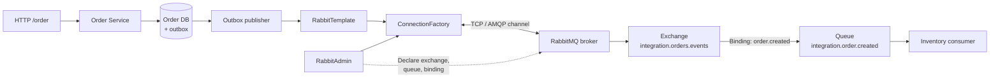
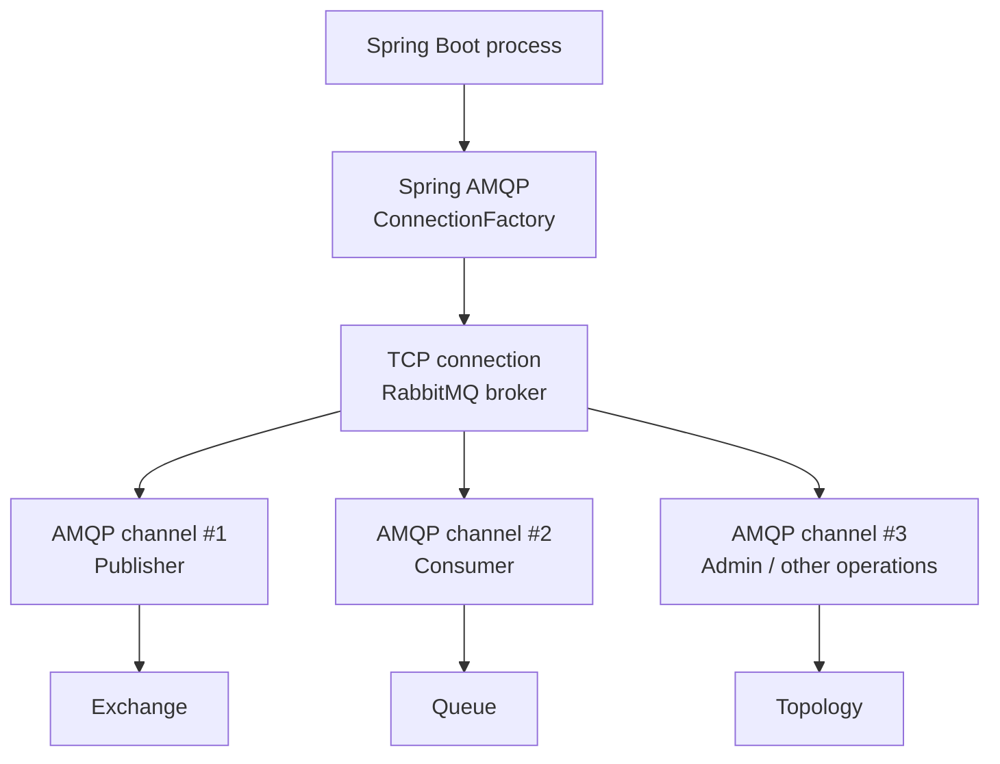
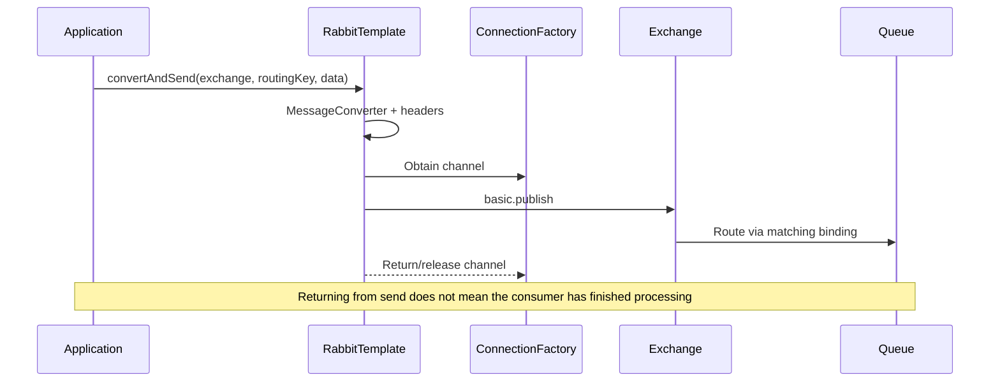
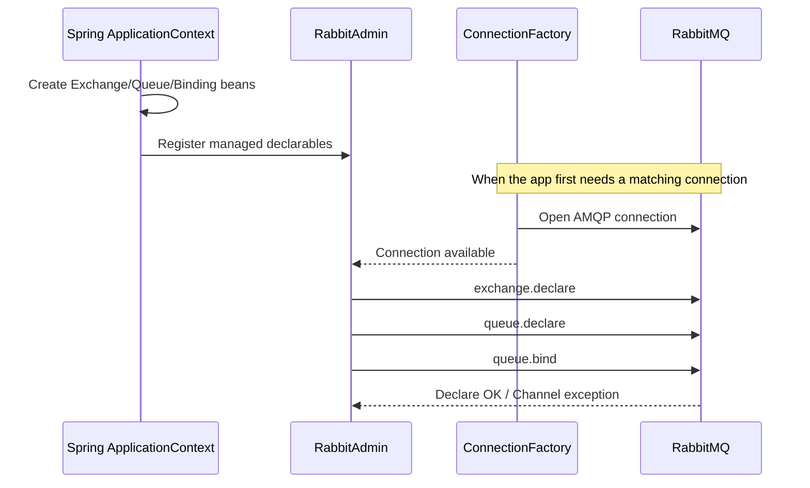
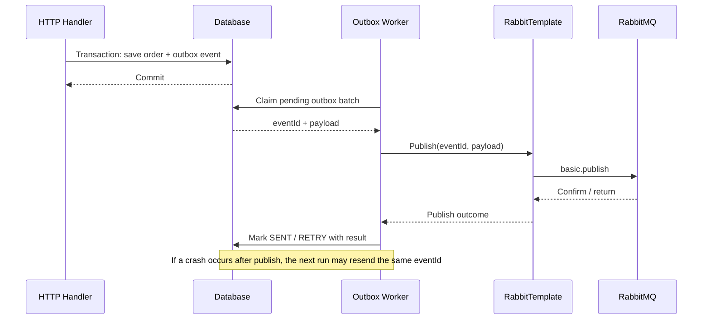

# ConnectionFactory, RabbitTemplate, and RabbitAdmin

## 1. Goal: Three Distinct Responsibilities in a Spring Boot Integration Application

In the **SPRING_BOOT_INTEGRATION** module, a Spring Boot service may receive HTTP requests, write to a database, use a cache to speed up reads, and publish events to a broker for other systems to process. With RabbitMQ over AMQP 0-9-1, three Spring AMQP components frequently appear together: **`ConnectionFactory`**, **`RabbitTemplate`**, and **`RabbitAdmin`**.

You need to understand precisely what each one does:

| Component | Question It Answers | Primary Responsibility | Does Not Guarantee on Its Own |
| --- | --- | --- | --- |
| `ConnectionFactory` | How does the application connect to the broker? | Provides connections/channels, authentication, caching, and connection lifecycle | That a message reached the right queue or business work completed |
| `RabbitTemplate` | How does the application send or receive messages via the broker? | Publishing, synchronous receive, payload conversion, request/reply, callbacks | Exactly-once processing, or transactions spanning database and broker |
| `RabbitAdmin` | Where and when are exchanges, queues, and bindings declared? | Issues AMQP admin commands; declares/deletes/inspects topology | Designing routing keys, DLQs, or infrastructure ownership |

These three components operate at different layers. **The template needs a connection factory** to communicate with the broker. **The admin also needs a connection factory**, primarily to declare topology. **Consumers** use separate listener containers and channels; `RabbitTemplate` is not a background consumer just because it exposes a `receive` method.

After this lesson, you will be able to:

1. Read a Spring Boot configuration and recognize which beans Boot creates conditionally.
2. Distinguish **TCP connections**, **AMQP channels**, connection/channel caching, and publish confirmations.
3. Use `RabbitTemplate` to publish with metadata, confirm outcomes, and handle unroutable messages.
4. Use `RabbitAdmin` together with `Exchange`, `Queue`, and `Binding` to declare topology in a controlled way.
5. Structure transactions, retries, idempotency, testing, and observability to avoid subtle bugs in real integration flows.

> Examples illustrate Spring Boot with Spring AMQP/RabbitMQ over AMQP 0-9-1, favoring APIs common in Spring Boot 3.x and modern Spring AMQP. Certain properties, packages, and configuration styles may differ across major versions. Always check your dependency/BOM and version-specific documentation when applying them.

## 2. End-to-End Flow from HTTP/DB to RabbitMQ

Suppose an order service needs to emit an `order.created` event for an inventory service to process:



A single execution can go through these steps:

1. The HTTP handler validates the data contract and writes both the order and an outbox entry within a database transaction.
2. A publisher reads due outbox records and calls `RabbitTemplate` to send the event to an exchange with a routing key.
3. `RabbitTemplate` obtains a channel via `ConnectionFactory`, encodes the content, and sends AMQP `basic.publish`.
4. The broker routes the message to a queue based on the exchange and bindings.
5. A separate consumer receives, processes, updates its own database, and acknowledges the message.
6. `RabbitAdmin` infrastructure may have declared the exchange/queue/binding ahead of publishing, depending on how topology is governed.

Common point of confusion: `RabbitAdmin` does not sit in the processing path of **every** message. It participates in resource management; once the broker has the right topology, normal publish/consume operations do not keep issuing declare commands.

## 3. Installing the Dependency and Understanding Spring Boot Auto-Configuration

### Maven

If the project uses the Spring Boot parent or BOM:

```xml
<dependency>
    <groupId>org.springframework.boot</groupId>
    <artifactId>spring-boot-starter-amqp</artifactId>
</dependency>
```

### Gradle

```groovy
dependencies {
    implementation 'org.springframework.boot:spring-boot-starter-amqp'
}
```

The starter brings in Spring AMQP, Spring Rabbit, and the RabbitMQ Java client under Spring Boot's dependency management. In multi-module applications, the dependency must be on the **runtime classpath of the executable module**, not only in an API/interface module or `testImplementation`.

When conditions are met, Spring Boot uses `spring.rabbitmq.*` properties to configure:

- Spring AMQP's `ConnectionFactory`, typically `CachingConnectionFactory`.
- `RabbitTemplate` for publish/receive or AMQP request/reply communication.
- `AmqpAdmin` backed by `RabbitAdmin` when dynamic declaration is enabled.
- Listener infrastructure components if the project uses `@RabbitListener` with suitable configuration.

This is **conditional auto-configuration**. If you register your own `ConnectionFactory` or `RabbitTemplate`, the default bean may not be created due to `@ConditionalOnMissingBean`. If multiple connection factories exist without a clear single candidate, the default template/admin may not be created due to bean selection conditions. To determine why, inspect the Conditions Evaluation Report or `/actuator/conditions` with appropriate access controls.

**The starter does not install a RabbitMQ server**, does not invent business exchanges/queues/bindings, and does not turn a DB write + broker publish into a single atomic transaction.

## 4. ConnectionFactory: Connections Are Different from Channels

AMQP 0-9-1 uses a **TCP connection** to the broker and logical **channels** multiplexed over that connection. A channel carries operations such as publish, consume, and declare; multiple channels can share a single TCP connection.



In Spring AMQP:

- `org.springframework.amqp.rabbit.connection.ConnectionFactory` is the Spring abstraction. Do not confuse it with the lower-level `com.rabbitmq.client.ConnectionFactory` from the RabbitMQ Java client.
- `CachingConnectionFactory` is commonly configured by Spring Boot; it caches/reuses channels and manages connections according to the selected cache mode.
- `RabbitTemplate` and `RabbitAdmin` accept a Spring AMQP `ConnectionFactory` rather than managing raw TCP sockets directly in business code.
- Listener containers also use the connection factory, but maintain their own channel/consumer lifecycle, which is not equivalent to calling `RabbitTemplate.receive()`.

### 4.1. Configuring a Local Broker

Example `application.yml` for a development environment:

```yaml
spring:
  rabbitmq:
    host: ${RABBITMQ_HOST:localhost}
    port: ${RABBITMQ_PORT:5672}
    username: ${RABBITMQ_USERNAME:guest}
    password: ${RABBITMQ_PASSWORD:guest}
    virtual-host: ${RABBITMQ_VHOST:/}
    connection-timeout: 5s
    requested-heartbeat: 30s
```

The `guest` credentials are suitable only for local demos; RabbitMQ typically restricts `guest` from remote logins. In staging/production, use dedicated per-application accounts, externalized secrets outside source control, and vhost-scoped permissions.

| Property | Role | Notes |
| --- | --- | --- |
| `spring.rabbitmq.host` | Broker host | `localhost` inside a container points to the container itself |
| `spring.rabbitmq.port` | AMQP port | `5672` is standard for plaintext AMQP; `15672` is the HTTP management port |
| `spring.rabbitmq.addresses` | Multiple endpoint addresses for the client to try | Use syntax and cluster policy appropriate to the client version |
| `spring.rabbitmq.username`, `password` | Authentication credentials | Never log secrets or commit them to a repository |
| `spring.rabbitmq.virtual-host` | Namespace for queues/exchanges/bindings and permissions | Same queue name in two vhosts represents two distinct resources |
| `spring.rabbitmq.connection-timeout` | Connection establishment timeout | Different from business response wait timeouts |
| `spring.rabbitmq.requested-heartbeat` | Proposed heartbeat interval negotiated with the broker | Does not replace per-message timeouts |
| `spring.rabbitmq.ssl.enabled` | Enables TLS when the endpoint supports it | Still requires certificate/hostname verification and proper trust configuration |

Configuring `addresses` only provides connectable endpoints; it does not automatically join standalone RabbitMQ nodes into a cluster, nor does it guarantee queue replication. Broker topology and HA must be operated separately.

### 4.2. When Is a Connection Opened?

Depending on application behavior and auto-configuration, the `CachingConnectionFactory` bean can exist before an actual socket is opened. A socket is typically created on the first operation requiring the broker—for example, `RabbitAdmin` declaring resources, a publisher sending a message, or a listener container starting consumption.

Consequently:

- An application **starting successfully** does not prove RabbitMQ is reachable in every case.
- Wrong vhost access permissions may only surface when the application opens a connection.
- If the broker restarts, inspect recovery/reconnect logs and any unconfirmed outbound messages.
- When changing host/credential config, do not assume an open connection automatically switches to the new credentials without appropriate reconfiguration or reconnection.

When real health checks are needed, check connectivity/capability appropriate for that environment, and evaluate failure modes: should a brief broker outage make the entire HTTP API unavailable, or only pause the publishing flow?

## 5. CachingConnectionFactory and Channel Caching

Creating a TCP connection and an AMQP channel per message puts unnecessary load on both the application and the broker. `CachingConnectionFactory` reuses resources across frequent send/receive operations.

Reference configuration:

```yaml
spring:
  rabbitmq:
    cache:
      channel:
        size: 25
        checkout-timeout: 2s
```

### Understanding the Parameters Correctly

- `spring.rabbitmq.cache.channel.size` is the target channel cache size. When checkout timeout is **not set/enabled**, this is not by itself a hard limit on total active channels; channels beyond the cache size may be created and then closed when returned.
- When `channel.checkout-timeout` is configured positively, `channel.size` acts to limit how many channels can be checked out per connection in the corresponding cache mode; threads may block or time out if no channel is available.
- `spring.rabbitmq.cache.connection.mode` and `spring.rabbitmq.cache.connection.size` affect connection caching when an appropriate mode is selected. Changing modes requires testing, as connection/channel counts and topology declaration behavior can change.
- Channels used by publishers, listeners, and admin are acquired and released differently; do not infer maximum consumer count solely from `cache.channel.size`.

For example, suppose an application increases its RabbitMQ consumers from 2 to 20 while also running many concurrent publishers. If channel limits are configured too low, threads waiting for channels can see higher latency or timeouts. If unbounded and load exceeds design limits, the broker may hit channel or connection limits. Tune based on throughput, consumer count, connection count, CPU, memory, and broker metrics.

**Do not enable multiple independent connection recovery mechanisms simultaneously without understanding how they interact.** Spring AMQP has its own connection management and recovery; if you directly tweak the RabbitMQ Java client's automatic recovery, verify compatibility with your Spring AMQP version.

## 6. RabbitTemplate: Core Operations and Message Lifecycle

`RabbitTemplate` is Spring AMQP's high-level API for sending and receiving AMQP messages. It uses an injected `ConnectionFactory` and a `MessageConverter` to convert Java objects into payloads and back.

| API Group | When to Use | Notes |
| --- | --- | --- |
| `send(exchange, routingKey, Message)` | Full control over raw bytes and message properties | Caller must prepare the exact payload |
| `convertAndSend(exchange, routingKey, object)` | Send Java objects through a converter | Default converter does not automatically serialize arbitrary DTOs to JSON |
| `receive(queue)` | Synchronous single-message receive | May return `null` if no message is available |
| `receiveAndConvert(queue)` | Receive and apply the message converter | Not a background listener |
| `convertSendAndReceive(...)` | RPC/request-reply | Requires reply routing, timeouts, and concurrency bounds |
| `setConfirmCallback(...)` | Receive publisher confirm results | Requires suitable confirm mode on the connection factory |
| `setReturnsCallback(...)` | Handle messages unroutable to any queue | Requires publisher returns and mandatory when applicable |

A typical `RabbitTemplate.convertAndSend` call follows this flow:



A crucial point: `convertAndSend` returns `void` in common one-way overloads. Normal return from the method is **not** end-to-end proof that a consumer has committed to its database. Reliable publishing requires publisher confirms/returns, a retry policy, and separate business state tracking.

## 7. Example: Publishing an Event with MessagePostProcessor

Suppose the order service emits JSON with an `eventId` usable for deduplication. Sample contract:

```json
{
  "eventId": "evt-1001",
  "eventType": "order.created",
  "schemaVersion": 1,
  "orderId": "ORD-501",
  "occurredAt": "2026-11-21T03:00:00Z"
}
```

Publisher:

```java
import org.springframework.amqp.core.MessageDeliveryMode;
import org.springframework.amqp.core.MessageProperties;
import org.springframework.amqp.rabbit.core.RabbitTemplate;
import org.springframework.stereotype.Component;

@Component
public class OrderEventPublisher {

    private static final String EXCHANGE = "integration.orders.events";
    private static final String ROUTING_KEY = "order.created";

    private final RabbitTemplate rabbitTemplate;

    public OrderEventPublisher(RabbitTemplate rabbitTemplate) {
        this.rabbitTemplate = rabbitTemplate;
    }

    public void publish(String eventId, String eventJson) {
        rabbitTemplate.convertAndSend(
            EXCHANGE,
            ROUTING_KEY,
            eventJson,
            message -> {
                MessageProperties props = message.getMessageProperties();
                props.setMessageId(eventId);
                props.setContentType(MessageProperties.CONTENT_TYPE_JSON);
                props.setDeliveryMode(MessageDeliveryMode.PERSISTENT);
                props.setHeader("schemaVersion", 1);
                return message;
            }
        );
    }
}
```

In this example, `eventJson` is a **JSON string already serialized and validated by the application**. `MessagePostProcessor` runs after conversion, allowing you to attach content type, message ID, and headers. If passing a Java DTO, configure a JSON converter supported by your Spring AMQP version to avoid sending an unexpected format.

Distinguish clearly:

- `MessageProperties.messageId` can help trace an event, but the broker does not automatically use it to deduplicate messages.
- `MessageDeliveryMode.PERSISTENT` marks the message as persistent; actual durability also depends on a durable queue, queue type, broker confirms, storage configuration, and failure scenarios.
- `schemaVersion` is payload contract metadata; the consumer must validate supported versions.
- `routingKey` controls routing through the exchange; it does not replace an event identifier.

Do not pass personal data, access tokens, or sensitive payloads directly in headers or logs unless strictly necessary. Headers are transmitted to recipients and may appear in broker management tools.

## 8. MessageConverter: From Java Objects to Bytes

By default, `RabbitTemplate` often uses `SimpleMessageConverter`. For `String`, it produces text bytes; for `byte[]`, it uses the bytes directly; for supported Java objects, it may fall back to Java serialization. **Never treat Java serialization as a long-term integration contract between services** due to security risks, class/version coupling, and language lock-in.

| Data Contract | Recommended Approach | What to Verify |
| --- | --- | --- |
| Cross-service JSON | JSON converter supported by both sides, or pre-validated JSON string/bytes | Charset, MIME type, field names, schema version |
| Binary/Protobuf | Dedicated converter/serializer | Schema registry/version, MIME type |
| Simple text | `String` with explicit charset | Do not confuse text content type with JSON |
| Internal Java object | Explicitly governed converter | Avoid coupling receivers to Java serialization |
| Routing/tracing message headers | `MessagePostProcessor` | Header names, type compatibility, security |

When the app manages a JSON converter: register a `MessageConverter` bean matching your **exact Spring AMQP version**, and ensure it is wired into both the template and listeners if both sides use DTOs. Across versions, Jackson converter classes/APIs evolve; check the Spring AMQP reference for your actual version before copying class names from older guides.

A common mistake: the producer sends `application/json` with a JSON object, while the consumer reads `String` (or vice versa) and hits conversion errors. Inspect the **actual bytes**, `contentType`, headers, and listener method signature. Changing converters can be a breaking change for messages still sitting in queues, so test against older-version messages.

## 9. Publisher Confirms and Publisher Returns: Two Different Signals

RabbitMQ provides two mechanisms to understand for reliable publishing:

1. **Publisher confirm**: the broker reports back on handling the publish under the AMQP confirm extension. A confirm `ack` does **not** prove the consumer has completed its business transaction.
2. **Publisher return**: when `mandatory` is enabled, a message that cannot be routed to any queue can be returned by the broker with exchange, routing key, and error code metadata. A publish can receive **both a confirm ACK and a return**, because the exchange accepted the publish operation yet found no matching queue.

Spring Boot configuration:

```yaml
spring:
  rabbitmq:
    publisher-confirm-type: correlated
    publisher-returns: true
    template:
      mandatory: true
```

For these properties to have operational value, the application must **observe and handle the outcomes**. Merely enabling the properties without callbacks, correlation, or state-tracking workflows can still result in silent event loss.

| Outcome | What Can Be Concluded | Next Action |
| --- | --- | --- |
| Confirm ACK, no return | The broker processed the publish under confirm semantics; no corresponding unroutable signal | Update publish state per design; consumer idempotency is still required |
| Confirm ACK, **with return** | The exchange accepted the publish command but could not route it to any queue | Fix topology/routing and store the message for controlled retry |
| Confirm NACK or channel error | The broker rejected or failed to confirm the publish | Classify the error, check broker health, and decide on retry |
| Timeout/connection drop before confirm | The producer does not know whether the publish was accepted | Do not assume resending is safe without deduplication; use event ID and deduplication |

### 9.1. Tracking with CorrelationData

A typical pattern in Spring AMQP versions supporting `CorrelationData.getFuture()` is attaching a correlation ID to each publish call:

```java
import org.springframework.amqp.rabbit.connection.CorrelationData;
import org.springframework.amqp.rabbit.core.RabbitTemplate;
import org.springframework.stereotype.Component;

@Component
public class ConfirmedOrderPublisher {

    private final RabbitTemplate rabbitTemplate;

    public ConfirmedOrderPublisher(RabbitTemplate rabbitTemplate) {
        this.rabbitTemplate = rabbitTemplate;
    }

    public void publish(String eventId, String json) {
        CorrelationData correlation = new CorrelationData(eventId);

        rabbitTemplate.convertAndSend(
            "integration.orders.events",
            "order.created",
            json,
            correlation
        );

        correlation.getFuture().whenComplete((confirm, error) -> {
            if (error != null) {
                // Record confirm error by eventId; do not lose the record needing retry.
                return;
            }
            if (!confirm.isAck()) {
                // Handle NACK; inspect confirm.getReason() if supported by the API.
                return;
            }

            if (correlation.getReturned() != null) {
                // Publish confirmed by broker, but message was returned:
                // persist UNROUTABLE state and investigate routing/binding.
                return;
            }

            // ACK with no returned message: update publish
            // status according to application policy.
        });
    }
}
```

This is a **logic skeleton** to illustrate the callback, not yet a durable-data publisher. Production needs a thread-safe mechanism to link `eventId` with the outbox record, update outcomes/attempts in the DB, and handle timeouts when no confirm arrives. Do not rely on the callback always running before the process crashes. On different Spring AMQP versions, check the future/callback API and how returned messages are exposed on `CorrelationData`.

Another approach is centrally registering `RabbitTemplate.ConfirmCallback` and `ReturnsCallback`. Assign a single clear owner for callbacks per template; do not let multiple beans repeatedly call `setConfirmCallback` and overwrite each other's handlers.

### 9.2. Unroutable Errors

A producer sends to an existing exchange with a routing key that has no matching binding:

```text
Exchange: integration.orders.events
Routing key: order.paid
Existing binding: order.created -> integration.order.created
Result: no matching queue for order.paid
```

If `mandatory=true` and returns are enabled, the broker can return the message; if disabled, an unroutable message may be discarded while the producer sees only a seemingly successful send call. For a **non-existent exchange**, the broker typically responds with a channel exception, unlike the case where the exchange exists but cannot route.

Nor should "no return received" be treated as absolute proof that a consumer received the message: the broker might be failing, the connection might have dropped, or the confirm might not have arrived yet. You must evaluate **both confirm + return**, along with retry state and observation deadlines.

## 10. Synchronous Receive and Request/Reply with RabbitTemplate

Although producers typically use `convertAndSend`, `RabbitTemplate` also provides receive and request/reply operations.

### 10.1. Synchronous Receive

```java
import java.util.concurrent.TimeUnit;
import org.springframework.amqp.core.Message;
import org.springframework.amqp.rabbit.core.RabbitTemplate;

Message message = rabbitTemplate.receive(
    "integration.order.created",
    TimeUnit.SECONDS.toMillis(2)
);

if (message == null) {
    // No message arrived within the wait timeout.
}
```

This is solely an API usage example (assuming `rabbitTemplate` is injected). `receive` performs a single synchronous fetch; it does not replace `@RabbitListener` when you need continuous consumption, concurrency management, retries, acks, and message processing.

**Never let tests or admin tools call `receive()` against a production queue served by active listeners**, as doing so can steal messages meant for the business consumer.

### 10.2. RPC-Style Request/Reply

```java
Object reply = rabbitTemplate.convertSendAndReceive(
    "integration.inventory.rpc",
    "inventory.check",
    "{\"sku\":\"SKU-001\"}"
);
```

This sends a request and waits for a response via Spring AMQP's request/reply mechanism. You must define:

- The request queue/route and which responder sends the reply.
- Timeout, payload converter, and error-to-business-result mapping.
- Correlation ID management, concurrency, `reply-to`, queue permissions, and behavior when the responder does not reply.
- On timeout, the caller cannot assume the server did not process the request.

Reply wait timeout can be configured per Spring Boot version, such as `spring.rabbitmq.template.reply-timeout: 3s`. RPC over queues works for certain use cases, but an HTTP request thread blocked waiting for a RabbitMQ reply incurs compounded latency and timeout risks. If a service only needs event notification, one-way publishing with separate outcome tracking is usually simpler.

## 11. RabbitAdmin: Who Owns Declaring Exchanges, Queues, and Bindings?

A message is routed properly only when a compatible **topology** already exists:

- **Exchange** receives publishes and applies routing rules.
- **Queue** holds messages awaiting consumer processing.
- **Binding** links an exchange to a queue using a routing key or pattern.
- Additional configuration may include dead-letter exchanges/queues, policies, queue types, or permissions.

In Spring AMQP, `AmqpAdmin` is the administrative abstraction; `RabbitAdmin` is the RabbitMQ-specific implementation. You can inject `AmqpAdmin` in code to reduce coupling to the implementation.

Spring Boot typically creates `RabbitAdmin` when a suitable connection factory exists and dynamic admin support is enabled (`spring.rabbitmq.dynamic` is typically enabled by default). The admin does not invent exchange/queue names. The application must define `Declarable` beans such as `Queue`, `Exchange`, `Binding`, or invoke admin APIs explicitly.

### 11.1. Approach 1: Declaring Topology with Spring Beans

Example of a direct exchange and durable queue:

```java
import org.springframework.amqp.core.Binding;
import org.springframework.amqp.core.BindingBuilder;
import org.springframework.amqp.core.DirectExchange;
import org.springframework.amqp.core.Queue;
import org.springframework.amqp.core.QueueBuilder;
import org.springframework.context.annotation.Bean;
import org.springframework.context.annotation.Configuration;

@Configuration(proxyBeanMethods = false)
public class OrderAmqpTopology {

    public static final String EXCHANGE =
        "integration.orders.events";
    public static final String QUEUE =
        "integration.order.created";
    public static final String ROUTING_KEY =
        "order.created";

    @Bean
    DirectExchange orderExchange() {
        return new DirectExchange(EXCHANGE, true, false);
    }

    @Bean
    Queue orderQueue() {
        return QueueBuilder.durable(QUEUE).build();
    }

    @Bean
    Binding orderBinding(
            Queue orderQueue,
            DirectExchange orderExchange) {

        return BindingBuilder.bind(orderQueue)
            .to(orderExchange)
            .with(ROUTING_KEY);
    }
}
```

When an appropriate `RabbitAdmin` is enabled and has administrative permissions, declarable beans can be declared on the broker once a connection is established. Declarations are **idempotent when definitions match**: redeclaring the same queue/exchange with compatible properties generally succeeds. If the same queue name is declared with an incompatible `durable` flag, queue type, or `x-arguments`, the broker can return `PRECONDITION_FAILED` and close the channel.

**Never delete a production queue to "fix" `PRECONDITION_FAILED` without knowing what pending data it holds.** Compare the existing definition against code and execute a controlled migration or replacement topology procedure.

### 11.2. Approach 2: Grouping Declarations with Declarables

If you want to organize a set of resources together:

```java
import org.springframework.amqp.core.Binding;
import org.springframework.amqp.core.BindingBuilder;
import org.springframework.amqp.core.Declarables;
import org.springframework.amqp.core.DirectExchange;
import org.springframework.amqp.core.Queue;
import org.springframework.amqp.core.QueueBuilder;
import org.springframework.context.annotation.Bean;

@Bean
Declarables orderDeclarables() {
    DirectExchange exchange =
        new DirectExchange("integration.orders.events", true, false);
    Queue queue =
        QueueBuilder.durable("integration.order.created").build();
    Binding binding = BindingBuilder.bind(queue)
        .to(exchange)
        .with("order.created");
    return new Declarables(exchange, queue, binding);
}
```

This is an **alternative** to the three individual beans in the previous section. Do not register both approaches simultaneously for the same single topology; even if redeclaring identical definitions succeeds, it duplicates ownership and complicates maintenance.

### 11.3. Approach 3: Explicit Declaration via AmqpAdmin

Suitable when an authorized admin feature needs to provision queues dynamically:

```java
import org.springframework.amqp.core.AmqpAdmin;
import org.springframework.amqp.core.BindingBuilder;
import org.springframework.amqp.core.DirectExchange;
import org.springframework.amqp.core.Queue;
import org.springframework.amqp.core.QueueBuilder;
import org.springframework.stereotype.Service;

@Service
public class PartnerQueueProvisioner {

    private final AmqpAdmin admin;

    public PartnerQueueProvisioner(AmqpAdmin admin) {
        this.admin = admin;
    }

    public void provision(String trustedPartnerCode) {
        // trustedPartnerCode must already be validated and governed.
        String queueName =
            "integration.partner." + trustedPartnerCode;

        DirectExchange exchange =
            new DirectExchange("integration.partner.events", true, false);
        Queue queue = QueueBuilder.durable(queueName).build();

        admin.declareExchange(exchange);
        admin.declareQueue(queue);
        admin.declareBinding(
            BindingBuilder.bind(queue)
                .to(exchange)
                .with("partner." + trustedPartnerCode)
        );
    }
}
```

This example focuses on the administrative API. In production, you must have lifecycle ownership: when queues are created, when they are deleted, what happens to leftover messages, queue count quotas, validation of input-derived names, concurrency when multiple replicas provision simultaneously, and `configure` permissions on the broker. Never expose a public API allowing arbitrary user-driven queue or exchange creation.

## 12. When Does RabbitAdmin Declare Resources?

This is a frequent source of misunderstanding. Declaring `@Bean Queue` in Spring **does not mean the declare command is sent immediately when the Java bean is instantiated**. `RabbitAdmin` typically registers declaration logic with the connection factory and declares resources when an appropriate connection opens. If the broker is down at startup, initialization/error behavior also depends on connection opening order and admin configuration.



Therefore:

- A publisher might perform its first send before all external dependencies have truly stabilized if deployment readiness is not properly gated.
- Admin may redeclare resources after a connection is re-established, depending on configuration and resource type.
- If multiple `RabbitAdmin`/`ConnectionFactory` beans exist, you must specify which admin owns each group of `Declarable` beans. Otherwise, topology may be declared on the wrong broker or vhost.
- When topology is managed by IaC/infrastructure teams, you can proactively **disable automatic declarations by the application**; avoid giving every service `configure` rights just to publish messages.
- `declare*` commands require a working admin channel and authorized credentials; having `write` permission to publish is not necessarily sufficient to declare exchanges or queues.

Choose one primary model explicitly:

| Model | Team Owning Topology | Characteristics |
| --- | --- | --- |
| **App-managed topology** | Application declares beans via RabbitAdmin | Convenient for dev/test, keeps code and topology coupled, but requires configure rights and queue migration processes |
| **Infrastructure-managed topology** | IaC/policy/broker operations team | Strict permissions and change control; applications only publish/consume using published contracts |

Avoid having both sides arbitrarily mutate queue arguments at different times. **RabbitMQ policies** are often better suited than hardcoded `x-arguments` for centrally operated settings, depending on policy and queue type.

## 13. Dead-Lettering and Queue Arguments

When a consumer rejects a message without requeue, a dead-letter exchange (DLX) can receive the message if the queue is properly configured. You can declare the DLX and DLQ via `RabbitAdmin` just like any other exchange, queue, and binding.

Logical topology example:

```text
Producer -> [integration.orders.events]
                 |
             order.created
                 v
     [integration.order.created] -- reject/nack, requeue=false -->
                  |
                  v
     [integration.orders.dlx] -- order.failed --> [integration.order.dlq]
```

Keep clear distinctions:

- `RabbitAdmin` only helps **declare** the DLX/DLQ/binding.
- The listener container / consumer handles ack/nack/reject according to processing behavior.
- The broker executes dead-letter routing based on queue arguments or policies.
- A rejected message on a queue without an effective DLX may be discarded, even if `default-requeue-rejected=false` is set in Spring Boot.
- A DLQ requires alerting, investigation, and controlled replay mechanisms, especially for contract violations or prolonged downstream outages.

Do not use a DLQ as an unmonitored permanent storage bin. When replaying, keep `eventId` stable so consumers can deduplicate; avoid generating a new message with a different ID for the same business effect without good reason.

## 14. Multiple ConnectionFactories in One Application

An integration service may connect to **two RabbitMQ brokers/vhosts**: one for internal order events and one for a partner. In that case, simply injecting `RabbitTemplate` by type can target the wrong environment.

Ideal layout:

```text
Internal ConnectionFactory
  -> Internal RabbitTemplate
  -> Internal RabbitAdmin
  -> Internal Listener Container

Partner ConnectionFactory
  -> Partner RabbitTemplate
  -> Partner RabbitAdmin
  -> Partner Listener Container
```

Implementation principles:

1. Create and name connection beans clearly per partner/broker, binding separate properties from externalized configuration.
2. Construct each `RabbitTemplate` with its corresponding `ConnectionFactory`.
3. If the app is allowed to declare topology, give each `RabbitAdmin` its own permissions and declaration scope.
4. Listener container factories or `@RabbitListener(containerFactory = "...")` must reference the queue's corresponding connection factory.
5. Use `@Qualifier` or `@Primary` **intentionally**; understand that certain auto-configurations expect a single candidate.

Example creating a dedicated template when the partner connection factory is already configured:

```java
import org.springframework.amqp.rabbit.connection.ConnectionFactory;
import org.springframework.amqp.rabbit.core.RabbitTemplate;
import org.springframework.beans.factory.annotation.Qualifier;
import org.springframework.context.annotation.Bean;
import org.springframework.context.annotation.Configuration;

@Configuration(proxyBeanMethods = false)
public class PartnerRabbitTemplateConfiguration {

    @Bean("partnerRabbitTemplate")
    RabbitTemplate partnerRabbitTemplate(
            @Qualifier("partnerConnectionFactory")
            ConnectionFactory partnerConnectionFactory) {

        return new RabbitTemplate(partnerConnectionFactory);
    }
}
```

This example **adds another template**, assuming the `partnerConnectionFactory` bean already exists. When defining a `RabbitTemplate` manually, you must check its converter, template retry, mandatory flag, publisher callbacks, and other settings that Boot normally applies to the default template. Avoid creating a template that has connectivity yet lacks critical publishing policies.

### RabbitAdmin and Declaration Ownership

With multiple admins using different `ConnectionFactory` beans, prevent both admins from attempting to declare **every** `Queue`/`Exchange` bean found in the context. Spring AMQP provides mechanisms to restrict which admin manages a `Declarable`, such as specifying applicable admins on the resource. Check `setAdminsThatShouldDeclare`, `shouldDeclare`, and `explicitDeclarationsOnly` APIs for your version.

Consequence if unrestricted: a queue intended for vhost A could be declared in vhost B, resulting in unexpected routing or configure-permission errors. For infrastructure-managed brokers, restrict the admin to read/inspect as needed or disable auto-declaration per policy.

## 15. Publishing and Database Transactions: Why an Outbox Is Needed

A common flow has an HTTP handler writing an order to PostgreSQL and then calling `RabbitTemplate`:

```java
@Transactional
public void createOrder(CreateOrderRequest request) {
    orderRepository.save(request.toEntity());
    rabbitTemplate.convertAndSend(
        "integration.orders.events",
        "order.created",
        request.toEventJson()
    );
}
```

This example **has a consistency gap**. `@Transactional` typically manages the database transaction; the RabbitMQ publish is not automatically committed atomically with the SQL transaction. Possible failures include:

- The database commits, but the app crashes before sending or before receiving a confirm.
- The broker receives the message, but the database transaction rolls back, leaving consumers with an event for a non-existent order.
- The broker receives the message, but the producer times out/crashes before receiving the confirm, and retries send duplicates.
- The HTTP client retries the request after a timeout, emitting two events if the API lacks an idempotency key.

This cannot be completely fixed merely by increasing `RabbitTemplate` retries or enabling publisher confirms. A confirm proves **broker publish**, not an atomic distributed commit with the database.

### Transactional Outbox

A more resilient design:



With this design:

1. The HTTP request writes business data + outbox in **the same local transaction**.
2. A worker claims due outbox records using a claim/lease/lock when multiple instances run.
3. The worker publishes with `CorrelationData(eventId)` and tracks confirms/returns.
4. The worker updates the send status or `nextAttemptAt` for bounded retries.
5. The consumer uses a `(sourceSystem, eventId)` key and records processing within its business transaction so **side effects are never applied twice**.

Thus, on failure, outbox data makes recovery and observability possible; RabbitMQ and recipients can still experience **at-least-once delivery**. Exactly-once business effects are a property built at the business layer, not provided by a standalone `ConnectionFactory` or `RabbitTemplate`.

## 16. Retries and Different Error Classes

Not all errors should be retried the same way:

| Error Class | Examples | Approach |
| --- | --- | --- |
| Connectivity | Broker offline, wrong DNS, TLS handshake, vhost permission | Fix configuration/availability; retry with backoff for transient issues |
| Publish/confirm | NACK, connection drop before ACK, confirm timeout | Record `UNKNOWN/RETRY` status; use a stable event ID |
| Routing | Exchange exists but no matching binding; return | Fix exchange/routing key/binding; do not hot-retry infinitely |
| Topology declare | `PRECONDITION_FAILED`, missing configure permission | Fix definition/permissions; never discard queues holding live data |
| Serialization | MessageConverter fails on DTO | Fix contract/codec; do not infinitely resend the same broken payload |
| Consumer | Processing exception, DB timeout, poison message | Listener retry, nack/DLX, idempotency, and DLQ per policy |
| Business | Order rejected by inventory rules | Report business status; retry only under explicit business rules |

Spring Boot offers `spring.rabbitmq.template.retry.*` for retrying template operations. These are useful for transient errors, yet when a publish already reached the broker and the outcome is unknown to the producer, **retries can create duplicate messages**. Do not use template retries as a substitute for an outbox and deduplication.

`RabbitAdmin` is not responsible for retrying business publishes; declaration errors belong to topology/deployment governance. If an application lacks permissions to create a queue, retrying declare thousands of times will not solve it.

## 17. Broker Permissions and Security

RabbitMQ typically assigns permissions per virtual host across `configure`, `write`, and `read` operation sets. Grant permissions matched to each role:

| Application Role | Typical Need | Permission Guideline |
| --- | --- | --- |
| Event-publishing producer | Send to specific exchanges | `write` with appropriate regex/scope; restrict configure |
| Consumer only | Consume from specific queues | `read` with appropriate regex/scope |
| Topology provisioner | Create exchanges/queues/bindings by design | Configure and related permissions as required by commands |
| Observer/diagnostic | View metrics/admin via appropriate interface | Separate admin account/permissions if needed |

Broker permissions also depend on specific operations and exchange/queue types; the table provides least-privilege guidance. Do not grant full vhost admin rights just to publish an event.

Production connections should use TLS across untrusted networks; configuration can start from:

```yaml
spring:
  rabbitmq:
    host: ${RABBITMQ_HOST}
    port: ${RABBITMQ_PORT:5671}
    username: ${RABBITMQ_USERNAME}
    password: ${RABBITMQ_PASSWORD}
    virtual-host: ${RABBITMQ_VHOST}
    ssl:
      enabled: true
```

Enabling TLS alone is insufficient: you need an appropriate trust store/SSL bundle, hostname verification, certificate rotation, and the correct broker TLS endpoint. Never disable certificate validation simply to get connected.

Logs can record exchange names, queue names, routing keys, correlation IDs, event IDs, and error codes; avoid logging passwords, bearer tokens, or full payloads containing personal data.

## 18. Testing Components Against a Real Broker

A unit test mocking `RabbitTemplate` can verify that a publisher passes the expected exchange/routing key, yet cannot verify bindings, broker permissions, confirms, returns, or declaration behavior.

When using Testcontainers or an isolated RabbitMQ test broker, include tests for:

| Scenario | What to Verify |
| --- | --- |
| Correct connectivity | `ConnectionFactory` uses expected host, port, vhost, credentials, and TLS |
| App-managed topology | `RabbitAdmin` declares expected exchange/queue/binding without declare errors |
| Valid routed publish | `RabbitTemplate` delivers message to the right queue |
| Unroutable publish | Return is captured when mandatory/returns are enabled |
| Publish confirm | Correlation ID maps accurately to ACK/NACK outcomes; timeouts are handled |
| Existing queue differs from code | Test detects `PRECONDITION_FAILED` or exercises migration policy |
| Broker disconnect | Reconnect and retry preserve outbox tracking state |
| Duplicate messages | Consumer does not apply business effects twice |
| DLQ | Poison messages are isolated and have a valid replay path |
| Two connection factories | Each template/admin operates against its intended broker/vhost |

### Example: Testing Routing to a Dedicated Queue

This test assumes the Spring test context provides `RabbitTemplate`, `AmqpAdmin`, and connectivity to a test broker. It creates randomly named resources to avoid colliding with shared queues:

```java
import static org.assertj.core.api.Assertions.assertThat;

import java.nio.charset.StandardCharsets;
import java.util.UUID;
import org.junit.jupiter.api.Test;
import org.springframework.amqp.core.AmqpAdmin;
import org.springframework.amqp.core.BindingBuilder;
import org.springframework.amqp.core.DirectExchange;
import org.springframework.amqp.core.Message;
import org.springframework.amqp.core.Queue;
import org.springframework.amqp.core.QueueBuilder;
import org.springframework.amqp.rabbit.core.RabbitTemplate;
import org.springframework.beans.factory.annotation.Autowired;
import org.springframework.boot.test.context.SpringBootTest;

@SpringBootTest
class RabbitInfrastructureIT {

    @Autowired
    RabbitTemplate template;

    @Autowired
    AmqpAdmin admin;

    @Test
    void publishesToExpectedQueue() {
        String suffix = UUID.randomUUID().toString();
        String exchangeName = "it.orders." + suffix;
        String queueName = "it.order.created." + suffix;
        DirectExchange exchange =
            new DirectExchange(exchangeName, false, true);
        Queue queue = QueueBuilder.nonDurable(queueName).autoDelete().build();

        admin.declareExchange(exchange);
        admin.declareQueue(queue);
        admin.declareBinding(
            BindingBuilder.bind(queue)
                .to(exchange)
                .with("order.created")
        );

        try {
            template.convertAndSend(
                exchangeName,
                "order.created",
                "{\"eventId\":\"it-1\"}"
            );

            Message received = template.receive(queueName, 5000);
            assertThat(received).isNotNull();
            String json = new String(
                received.getBody(),
                StandardCharsets.UTF_8
            );
            assertThat(json).contains("it-1");
        } finally {
            admin.deleteQueue(queueName);
            admin.deleteExchange(exchangeName);
        }
    }
}
```

This tests **routing and declaration mechanics**, not confirms/returns or exactly-once. Because it uses real AMQP resources, it requires a running test broker, configure permissions, and proper test dependencies. In suites with active listeners, use a dedicated queue as above so listeners do not consume the message before `receive`. Isolate parallel tests and clean up resources if tests abort mid-run.

For publish confirms/returns, add asynchronous tests with bounded timeouts waiting on confirmation callbacks, as well as tests targeting an existing exchange with an unbound routing key. Avoid tests that merely assert `convertAndSend` throws no exception and claim "delivered successfully."

## 19. Observability and Production Troubleshooting

Key signal groups:

- **Connectivity:** host/vhost, connection/channel status, reconnects, handshake/authentication errors, heartbeat timeouts.
- **Publisher:** publish counts, confirm latency, ACK/NACK/timeouts, returned/unroutable counts, pending/retrying outbox records.
- **Topology:** declare failures, configure permission errors, missing exchanges/bindings, queue type/durable mismatches.
- **Consumer:** ready/unacked counts, redeliveries, consumer count, processing latency, retries, and DLQ depth.
- **Business:** events actually applied, duplicate counts, end-to-end time from HTTP commit to downstream success.

Spring Boot Actuator/Micrometer and RabbitMQ management metrics can provide part of these measurements depending on dependencies, permissions, and configuration. Do not assume Spring AMQP emits every needed metric automatically; you may need custom instrumentation in publisher callbacks, outbox workers, and consumers.

### Common Errors

| Symptom | Possible Cause | Priority Check |
| --- | --- | --- |
| `No qualifying bean of type RabbitTemplate` | Missing starter, auto-config excluded, multiple candidates | Runtime classpath, Conditions Evaluation Report, `@Qualifier` |
| `Connection refused` | Wrong host/port, broker not running, network/firewall | Address from pod/container, AMQP port, DNS |
| `ACCESS_REFUSED` | Wrong credentials/vhost/permissions | Account, `configure/write/read` permissions, virtual host |
| `PRECONDITION_FAILED` | Declaring queue/exchange with existing name but different attributes | Compare queue type, durable, autoDelete, DLX args, and policies |
| Publisher succeeds without error but no message appears | Routing key unbound, mandatory off, message routed to another queue | Exchange, bindings, publisher returns, queue metrics |
| Confirm ACK yet business consumer did not process | ACK reflects publish handling, not consumer completion | Queue ready/unacked, listener errors, DLQ |
| Occasional duplicate messages | Publish retry after timeout, redelivery after crash | Correlation/event ID, outbox, deduplication |
| RabbitAdmin does not declare resources | Admin disabled, declarations not detected, missing permissions/connection | `spring.rabbitmq.dynamic`, declarable beans, admin logs |
| Channel closed during admin declare | Incompatible queue attributes or broker rejection | Channel exception code, current topology |
| Queue declared on wrong broker in multi-broker setup | Multiple admins scanning the same declarables | Qualifiers, admin ownership, connection factory |
| Low throughput, frequent channel timeouts | Cache/checkout bottleneck or overloaded downstream/consumer | Channel cache, listener concurrency, broker limits |
| RPC returns null or times out | No reply, wrong routing, slow responder | Reply timeout, correlation ID, responder logs |

When investigating, follow **connection → topology → publish → confirm/return → consumer → business state**. Each layer produces distinct signals; do not change multiple `spring.rabbitmq.*` properties at once hoping to get lucky.

## 20. Decision Table: When to Define Custom Beans?

| Requirement | Preferred Choice | When Are Custom Beans Needed? |
| --- | --- | --- |
| Single RabbitMQ broker, standard setup | `spring.rabbitmq.*` + auto-config | When factory/template behavior must differ from defaults |
| Publishing JSON per contract | Boot-managed template with explicit converter/serialization | When custom shared converters, headers, or callbacks are needed |
| Publishing with confirms and return handling | Publisher properties + correlation/callbacks | When custom publisher policy, auditing, or outbox integration is needed |
| Topology declared alongside code | `Queue`/`Exchange`/`Binding` beans with RabbitAdmin | When separating admins or custom orchestration is required |
| IaC-managed topology | Application only publishes/consumes | Can disable auto-declaration and omit configure permissions |
| Two independent brokers/vhosts | Distinct ConnectionFactory + template/admin/listener beans | Typically requires manual bean wiring and qualifiers |
| Business messages needing exactly-once effect | Outbox + consumer idempotency + transactions | Custom beans alone do not solve this |

### Anti-Patterns to Avoid

1. **Granting full `RabbitAdmin` privileges to every application:** weakens change control over queues/policies and increases blast radius.
2. **Calling `admin.declareQueue` on every publish:** adds network overhead and blurs topology ownership.
3. **Treating `convertAndSend` returning as a business ACK:** leads to silent event loss or undetected duplicates.
4. **Mutating exchange/routing key globally per request on a shared template:** causes concurrent flows to interfere with each other; pass exchange/routing key per call or use dedicated publisher services.
5. **Relying on auto-config to invent all queues:** Boot cannot infer business topology solely from a queue name on a listener.
6. **Increasing `cache.channel.size` arbitrarily:** measure actual channel usage and checkout timeouts first.
7. **Disabling publisher confirms for "performance" without safeguards:** removes visibility into durable message acceptance.
8. **Creating a custom `RabbitTemplate` while forgetting converter, mandatory, or callbacks:** the app starts, yet publishing semantics silently change.
9. **Disabling `default-requeue-rejected` without a DLQ:** poison messages can be discarded unobserved.
10. **Building producers and consumers under an exactly-once assumption:** idempotency must be proven via crash/retry tests.

## 21. Pre-Release Checklist

- [ ] Project includes `spring-boot-starter-amqp` on the runtime classpath without mixing dependency versions against the BOM.
- [ ] Connections use the intended broker/vhost, credentials, TLS, network route, and least-privilege `read/write/configure` permissions.
- [ ] `ConnectionFactory` and caching are validated against observed connection/channel counts and sensible timeouts.
- [ ] Every `RabbitTemplate` publishes to the intended exchange/routing key with the contracted converter and schema version metadata.
- [ ] Publisher confirms/returns are **handled** and linked to event IDs; business success is never inferred solely from a send call.
- [ ] Ownership of exchanges/queues/bindings/DLX is explicit; `RabbitAdmin` is enabled/disabled consistently with app-managed or IaC governance.
- [ ] No queue declaration mismatches occur against brokers holding live data; topology changes have a migration plan.
- [ ] In multi-broker apps, all templates/admins/listeners reference the correct connection factory and qualifiers.
- [ ] HTTP → database → broker flows use an outbox or equivalent recovery strategy; consumers deduplicate.
- [ ] Retries are bounded and distinguish connection, routing, payload, and consumer errors; DLQs are alerted.
- [ ] Integration tests run against a real broker verifying routing/confirms/returns; both app and broker metrics are monitored.

## 22. Self-Assessment Scenario

An application receives payment notifications via HTTP, saves to PostgreSQL, and publishes events to RabbitMQ. After introducing a manual `RabbitTemplate` bean, the system exhibits these symptoms:

- Publishing occasionally throws no exception, yet no event reaches the queue.
- During broker restarts, some events appear twice.
- A new deployment fails with `PRECONDITION_FAILED` because a queue already exists with different arguments.
- Developers enabled `spring.rabbitmq.publisher-confirm-type=correlated`, yet no ACK/NACK logs appear.
- Queues belonging to a partner broker are occasionally declared by the internal application.

How to analyze:

1. **ConnectionFactory:** check the target broker/vhost, channel cache, reconnection state, credentials, and permissions.
2. **RabbitTemplate:** inspect whether the custom template uses the right connection factory, message converter, mandatory flag, and publisher settings.
3. **Routing:** enable publisher returns properly and cross-check exchange/routing key/bindings; an unroutable message differs from the broker failing to accept a publish.
4. **Confirms:** attach correlation IDs and implement confirm future/callback handling, updating the outbox on ACK/NACK/return. Enabling the property alone produces no logs.
5. **Duplicates:** keep event IDs stable across retries and implement idempotent consumers; producer timeouts before confirms produce unknown states.
6. **Topology:** compare queue attributes with the broker; apply changes via a migration plan rather than deleting queues with live data just to bypass the error.
7. **Multiple admins:** isolate connection factories and `Declarable` scopes per broker using qualifiers and explicit ownership.
8. **Testing:** simulate wrong routing keys, broker restarts, message redeliveries, revoked admin permissions, and duplicate sends to verify actual behavior.

**Key takeaway:** `ConnectionFactory` manages **connections and channels**, `RabbitTemplate` provides **send/receive APIs and publish callbacks**, and `RabbitAdmin` manages **topology declarations**. In Spring Boot Integration, combining these three components properly must go hand in hand with data contracts, transactions, idempotency, retries, testing, and observability for the integration flow to run reliably.
