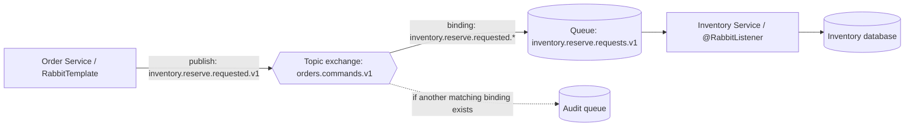
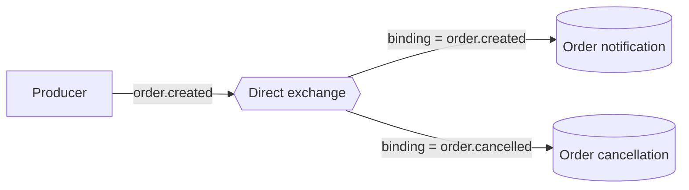
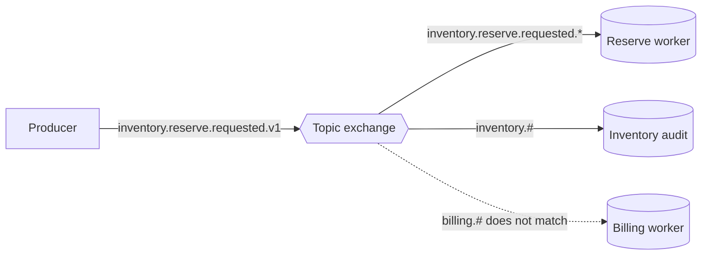
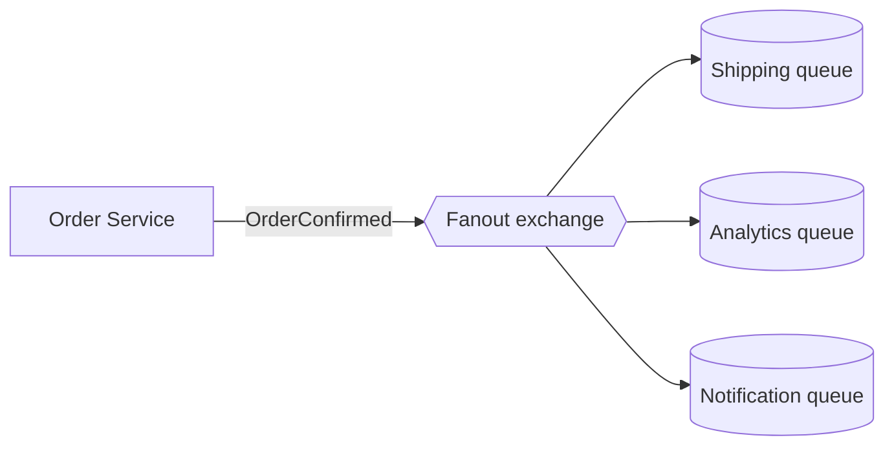
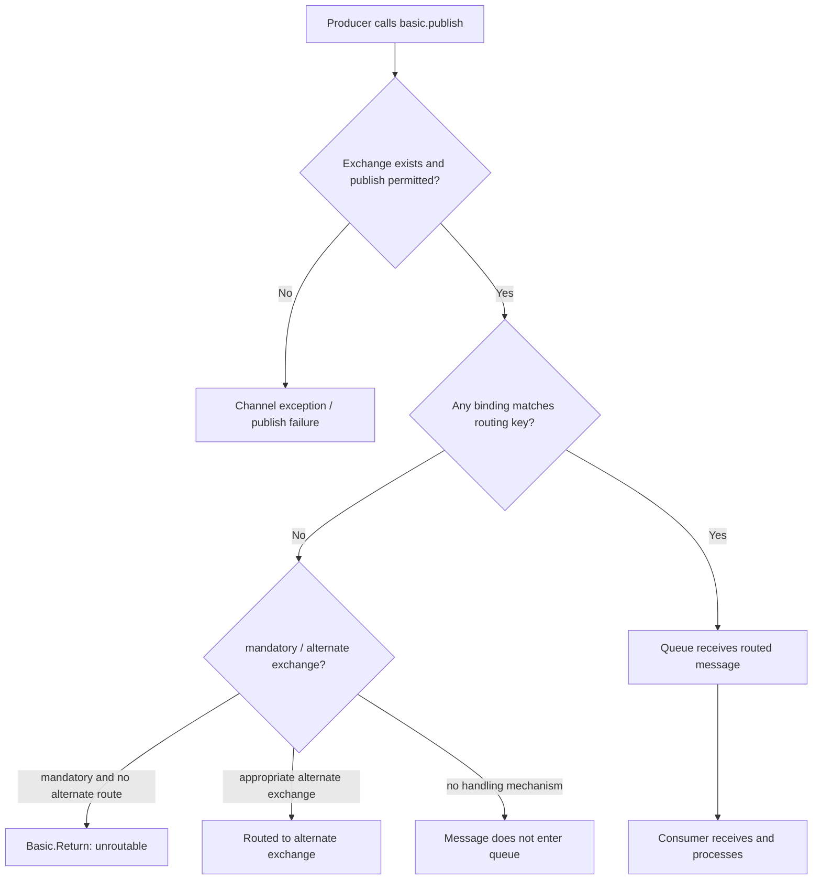

# Declaring Exchanges, Queues, Bindings, and Routing Keys

## 1. Why Design Topology Before Sending Messages?

In HTTP communication, a client typically knows the URL of the receiving service. With RabbitMQ and the AMQP 0-9-1 protocol, a producer **does not have to know which queue will receive a message**. Instead, the producer publishes a message to an **exchange** with a **routing key**; the broker uses **bindings** to determine which **queue(s)** should receive the message.

This decoupling lets a single message contract serve different scenarios: a stock-reservation command needs to reach one processing queue; an order-confirmed event may be delivered to multiple services; or an event type may need routing by business domain. If the exchange, queue, binding, or routing key is declared incorrectly, a producer can receive a publish confirmation while a consumer **receives no messages at all**.

This lesson belongs to the **RabbitMQ and AMQP** chapter in the **SPRING_BOOT_INTEGRATION** module. The module organizes Spring Boot integration across HTTP clients, databases, caches, message brokers, and Spring Integration adapters, focusing on **configuration, data contracts, transactions, error handling, deduplication, testing, and observability of integration flows**. Accordingly, topology should be treated as part of the **integration contract**, not merely a handful of string literals in a YAML file.

After this lesson, you will be able to:

- Explain the **producer → exchange → binding → queue → consumer** path and the role of the routing key.
- Distinguish **direct**, **topic**, **fanout**, **headers**, and **default exchanges**, especially topic wildcards.
- Declare exchanges, queues, and bindings in Spring AMQP with reusable configuration.
- Design destination naming, durability, dead-letter routing, idempotency, and topology evolution.
- Detect **unroutable** errors, topology drift, and permission issues; test routing against a real RabbitMQ broker.

> **Version scope:** Examples use Java 17+, Spring Boot 3.2+ with Spring AMQP from the corresponding Boot BOM, communicating via **AMQP 0-9-1**. RabbitMQ also supports other protocols and mechanisms, but this section does not mix AMQP 1.0 or RabbitMQ Streams into AMQP 0-9-1 exchange/binding semantics. Specific APIs and configurations may change across upgrades; verify against your exact runtime version before implementing.

### Running Scenario: Order Service Requests Inventory to Reserve Stock

Order Service sends a `ReserveStockRequested` command with routing key `inventory.reserve.requested.v1`. Inventory Service consumes commands from the `inventory.reserve.requests.v1` queue. Later, an audit queue can be added with another binding without changing the producer.



Producers publish to an **exchange**; listeners read from a **queue**. An exchange is not something a consumer directly polls to fetch messages. For a message to reach a queue, the exchange must route it via a binding or a special broker routing mechanism.

## 2. Four Core Components of Topology

| Component | Purpose | Example |
|---|---|---|
| **Exchange** | Accepts messages published by producers and routes them based on exchange type and bindings | `orders.commands.v1` |
| **Queue** | Holds messages awaiting consumers according to storage, expiration, and queue-type settings | `inventory.reserve.requests.v1` |
| **Binding** | Links an exchange to a queue (or another exchange) with a routing condition depending on exchange type | `orders.commands.v1` → queue, key `inventory.reserve.requested.*` |
| **Routing key** | String sent by the producer on publish; the exchange evaluates it per its rules | `inventory.reserve.requested.v1` |

A command's contract can be specified precisely:

```text
Exchange:     orders.commands.v1       (topic, durable)
Routing key:  inventory.reserve.requested.v1
Queue:        inventory.reserve.requests.v1  (durable)
Binding key:  inventory.reserve.requested.*
Consumer:     Inventory Service
```

The string `inventory.reserve.requested.v1` has **four dot-separated words**. A topic exchange uses `*` to match **exactly one word** and `#` to match **zero or more words**. Hence, binding `inventory.reserve.requested.*` matches `inventory.reserve.requested.v1`, yet does **not** match `inventory.reserve.requested` or `inventory.reserve.requested.v1.retry`.

### 2.1. What Happens During a Publish?

1. The producer opens a connection/channel and publishes a message to the chosen exchange name.
2. The broker locates the exchange in the **virtual host** the connection logged into.
3. The exchange evaluates matching bindings according to its exchange type and routing key/headers.
4. The message is routed to zero, one, or multiple queues. If multiple bindings route the same message to **the same queue**, the broker does not create duplicate copies solely because multiple bindings matched between that exchange/queue pair.
5. A consumer retrieves the message from the queue, processes it, and acks/nacks per its configured mode.

A message accepted by the broker **does not mean it has reached a consumer or been persisted in the consumer's database**. Distinguish publisher confirms, publisher returns, consumer acknowledgments, and business transactions.

### 2.2. Virtual Hosts as Namespace Boundaries

A RabbitMQ virtual host (vhost) isolates exchanges, queues, bindings, and access permissions. Two applications publishing to the same exchange name on **two different vhosts** will not exchange messages. Therefore, exchange/queue names, vhosts, credentials, and permissions must be aligned in the deployment contract.

## 3. Choosing an Exchange Type for Routing Needs

### 3.1. Direct Exchange — Exact Match

A direct exchange routes a message when the **routing key equals the binding key**. One routing key can match multiple queues bound with the same key, in which case each queue receives a copy.



Sending `order.created` routes into `Order notification`, not the queue bound with `order.cancelled`. Direct exchanges suit commands or events with a finite set of routing keys that do not need pattern matching.

### 3.2. Topic Exchange — Dot-Delimited Pattern Matching

A topic exchange splits routing keys into words by dots; binding keys support two wildcards:

- `*`: matches **exactly one word**.
- `#`: matches **zero or more words**.

| Binding Key | Candidate Routing Key | Matches? | Reason |
|---|---|---|---|
| `inventory.reserve.requested.*` | `inventory.reserve.requested.v1` | Yes | `*` matches the single word `v1` |
| `inventory.reserve.requested.*` | `inventory.reserve.requested` | No | Missing final word |
| `inventory.reserve.requested.*` | `inventory.reserve.requested.v1.retry` | No | One extra word |
| `inventory.#` | `inventory.reserve.requested.v1` | Yes | `#` matches multiple trailing words |
| `inventory.#` | `inventory` | Yes | `#` can match zero words |
| `*.reserve.*.v1` | `inventory.reserve.requested.v1` | Yes | Each wildcard matches one word |
| `inventory.reserve.requested.v2` | `inventory.reserve.requested.v1` | No | Different version |



Topic exchanges work well when routing by domain, action, tenant group (provided permissions are enforced), or version. However, broad wildcards like `#` can pull far more events into a queue than intended, increasing load and risking data exposure if bindings, vhosts, and ACLs are not tightly governed.

### 3.3. Fanout Exchange — Broadcast to Every Bound Queue

A fanout exchange **ignores the routing key when deciding routes**, delivering a copy of the message to every bound queue. Use it when one event must be received by multiple independent systems:



Fanout does not mean every **consumer instance** receives a copy. If Shipping runs multiple replicas reading from **one queue**, those replicas are competing consumers; each message is typically delivered to only one replica at a time. For each service to receive its own copy, each service must have its own dedicated queue.

### 3.4. Headers Exchange — Matching by Headers

A headers exchange routes based on message header attributes and matching rules such as `x-match=all` or `x-match=any` in binding arguments. It fits cases where routing rules depend on multi-dimensional metadata rather than a hierarchical key.

Note that these are **binding arguments**, not topic exchange wildcards. When a clean catalog of actions suffices, direct or topic exchanges are generally easier to inspect and operate; do not pick headers simply to avoid designing routing keys.

### 3.5. Default Exchange — Special Case

RabbitMQ includes a **default exchange** (an unnamed direct exchange denoted by the empty string `""`). Every queue is implicitly bound to it with a routing key **identical to the queue name**. For example:

```java
rabbitTemplate.convertAndSend(
        "", "inventory.reserve.requests.v1", command);
```

This lets you send straight to a queue by name, yet couples the producer to the consumer's queue name. When you want to decouple the publish contract from consumer topology and support multiple bindings/consumers, a **named exchange** is usually better.

## 4. Naming Topology and Choosing Durability

A clear convention:

- Exchanges reflect a domain or contract, such as `orders.commands.v1` or `orders.events.v1`.
- Routing keys describe the action or event, such as `inventory.reserve.requested.v1`.
- Queues reflect **consumer + workload + version**, such as `inventory.reserve.requests.v1`. An event consumed by multiple consumer groups usually gets a separate queue per group.
- Bindings express "which events/commands this consumer wants to receive," not a producer directly invoking a consumer.

### 4.1. Durable, Auto-Delete, and Exclusive

| Attribute | Applies To | Key Meaning |
|---|---|---|
| Durable exchange | Exchange | Exchange declaration survives broker restarts per broker mechanics |
| Durable queue | Queue | Queue metadata survives broker restarts |
| Persistent message | Publish delivery mode | Requests persistent storage; requires durable queues and broker persistence |
| Auto-delete | Exchange/queue depending on type | Deleted per lifecycle once auto-delete conditions are met; unsuitable for persistent business queues |
| Exclusive queue | Queue | Accessible only to the declaring connection; typically for temporary/reply queues, not shared worker queues |
| Queue type | Queue | Classic, quorum, or other types based on RabbitMQ capabilities and HA requirements |

**A durable queue does not guarantee durable messages on its own:** messages must also be published with the appropriate delivery mode, the broker needs persistent storage, and publisher confirms plus HA/replication policies must be considered. Conversely, `exclusive` or `autoDelete` fit ephemeral queues, yet if mistakenly used on a command queue they will cause topology loss when the connection closes.

### 4.2. Classic Queues vs. Quorum Queues

RabbitMQ supports multiple queue types. **Quorum queues** rely on replication/consensus and are generally suited to workloads requiring high reliability; **classic queues** have distinct operational traits and limits. Choose based on RabbitMQ version, SLA, storage capacity, throughput, and HA model; never assume all queue types share identical behavior for priorities, TTL/expiry, max-length, or redelivery.

Queue type is a fundamental property of an existing queue. **Do not alter queue type or incompatible arguments directly on a production queue via a single code deploy**; plan a migration to create a new queue, move bindings/consumers, drain/replay, and avoid message loss.

## 5. Setting Up Spring Boot and Declaring Topology with Spring AMQP

### 5.1. Adding the Appropriate Starters

With Maven and the Spring Boot parent/BOM:

```xml
<dependencies>
    <dependency>
        <groupId>org.springframework.boot</groupId>
        <artifactId>spring-boot-starter-amqp</artifactId>
    </dependency>
    <dependency>
        <groupId>org.springframework.boot</groupId>
        <artifactId>spring-boot-starter-test</artifactId>
        <scope>test</scope>
    </dependency>
</dependencies>
```

`spring-boot-starter-amqp` brings Spring Rabbit and RabbitMQ infrastructure into the application. Spring Boot typically auto-configures `ConnectionFactory`, `RabbitTemplate`, listener container factories, and `RabbitAdmin` based on classpath and properties. `RabbitAdmin` can declare topology beans once connected if auto-declaration is enabled.

### 5.2. Connecting to RabbitMQ

```yaml
# application.yml — local environment example
spring:
  rabbitmq:
    host: ${RABBIT_HOST:localhost}
    port: ${RABBIT_PORT:5672}
    username: ${RABBIT_USERNAME}
    password: ${RABBIT_PASSWORD}
    virtual-host: ${RABBIT_VHOST:/}
    publisher-confirm-type: correlated
    publisher-returns: true
    template:
      mandatory: true
    listener:
      simple:
        acknowledge-mode: auto
        prefetch: 20
        concurrency: 2
        max-concurrency: 6
```

This example uses port `5672` for unencrypted RabbitMQ AMQP locally. Production requires AMQPS/TLS with trusted CAs and hostname verification per policy. Never commit passwords, URLs containing secrets, or private keys. Order and Inventory accounts should have scoped permissions per vhost/exchange/queue rather than using an admin user.

`publisher-confirm-type: correlated` and `publisher-returns: true` enable publish observation; **they do not handle errors for your application** unless code registers callbacks or awaits confirms per contract. `template.mandatory: true` tells the broker to return messages that cannot be routed to any queue (when the exchange exists, matches no bindings, and has no fallback routing). If the exchange is missing, that is a different failure mode (channel/protocol exception), not a normal return.

### 5.3. Declaring Exchanges, Queues, and Bindings with Stable Names

Example using a **topic exchange** for commands and a dedicated **direct exchange** for the DLQ. The main queue configures a dead-letter exchange for rejected-without-requeue or expired messages (depending on broker/policy).

```java
// RabbitTopologyConfiguration.java — abbreviated imports
@Configuration(proxyBeanMethods = false)
public class RabbitTopologyConfiguration {
    public static final String COMMAND_EXCHANGE =
            "orders.commands.v1";
    public static final String COMMAND_ROUTING_KEY =
            "inventory.reserve.requested.v1";
    public static final String COMMAND_BINDING_PATTERN =
            "inventory.reserve.requested.*";
    public static final String COMMAND_QUEUE =
            "inventory.reserve.requests.v1";

    public static final String DEAD_LETTER_EXCHANGE =
            "orders.commands.dlx.v1";
    public static final String DEAD_LETTER_ROUTING_KEY =
            "inventory.reserve.dead.v1";
    public static final String DEAD_LETTER_QUEUE =
            "inventory.reserve.dead.v1";

    @Bean
    Declarables reservationTopology() {
        TopicExchange commands = ExchangeBuilder
                .topicExchange(COMMAND_EXCHANGE)
                .durable(true)
                .build();
        DirectExchange deadLetter = ExchangeBuilder
                .directExchange(DEAD_LETTER_EXCHANGE)
                .durable(true)
                .build();

        Queue requests = QueueBuilder
                .durable(COMMAND_QUEUE)
                .deadLetterExchange(DEAD_LETTER_EXCHANGE)
                .deadLetterRoutingKey(DEAD_LETTER_ROUTING_KEY)
                .build();

        Queue failed = QueueBuilder
                .durable(DEAD_LETTER_QUEUE)
                .build();

        Binding commandBinding = BindingBuilder
                .bind(requests)
                .to(commands)
                .with(COMMAND_BINDING_PATTERN);

        Binding deadLetterBinding = BindingBuilder
                .bind(failed)
                .to(deadLetter)
                .with(DEAD_LETTER_ROUTING_KEY);

        return new Declarables(
                commands,
                deadLetter,
                requests,
                failed,
                commandBinding,
                deadLetterBinding
        );
    }
}
```

Key types:

| Type | Package |
|---|---|
| `Declarables`, `Queue`, `TopicExchange`, `DirectExchange`, `Binding`, `QueueBuilder`, `ExchangeBuilder`, `BindingBuilder` | `org.springframework.amqp.core` |
| `@Configuration`, `@Bean` | `org.springframework.context.annotation` |
| `RabbitTemplate` | `org.springframework.amqp.rabbit.core` |
| `@RabbitListener` | `org.springframework.amqp.rabbit.annotation` |
| `Jackson2JsonMessageConverter` | `org.springframework.amqp.support.converter` |

**Meaning of each object:**

1. `commands` is a durable **topic exchange** with an explicit name.
2. `requests` is a **durable queue**. When dead-lettered, messages can route to `deadLetter` with key `inventory.reserve.dead.v1`.
3. `commandBinding` connects `requests` to `commands` using pattern `inventory.reserve.requested.*`.
4. `deadLetterBinding` connects the failure queue to the DLX using an **exact key**, because the DLX here is a direct exchange.
5. `Declarables` groups these objects so Spring's Rabbit admin knows what to declare. It is **not** an in-JVM message store.

When the application initializes with an active `RabbitAdmin`, these exchanges, queues, and bindings can be declared on the broker. However, **declarations are not guaranteed to succeed ahead of everything else**: the broker might not be ready, the user may lack permissions, or a queue might already exist with different arguments. Verify broker state and establish a clear topology deployment process.

A project may also declare separate `@Bean` definitions for `Queue`/`Exchange`/`Binding`. `Declarables` is useful for grouping topology and preventing multiple same-type beans from being accidentally injected into producers/listeners; whichever style you choose, keep names, durable flags, and arguments consistent.

### 5.4. What Happens If Two Applications Declare the Same Topology?

RabbitMQ declarations are generally **idempotent when parameters match**. However, if one app declares queue `inventory.reserve.requests.v1` with `durable=true` while another declares the same name with `durable=false` or different dead-letter arguments, the broker can return `PRECONDITION_FAILED` and close the channel.

Therefore, topology should have **a single source of truth**: infrastructure as code, deployment charts, RabbitMQ definitions, or a shared configuration module agreed upon by producer and consumer. Only let apps auto-declare when authorized and governed by an agreed workflow. Depending on organizational design, consumers may own queue/binding declarations while producers know only exchanges and routing keys.

### 5.5. Adding an Independent Queue Without Modifying the Producer

If Analytics wants to receive every inventory command for reporting, create queue `analytics.inventory.audit.v1` and bind `inventory.#` on the same topic exchange. The producer continues publishing `inventory.reserve.requested.v1` unchanged.

```java
Queue audit = QueueBuilder
        .durable("analytics.inventory.audit.v1")
        .build();
Binding auditBinding = BindingBuilder.bind(audit)
        .to(commands)
        .with("inventory.#");
```

This is an **illustrative addition** and belongs in the actual topology configuration of the service owning the queue. Do not allow services to receive data they are not authorized to access: enforce vhosts, permissions, exchange design, and routing-key restrictions.

## 6. Sending and Receiving Messages with the Declared Topology

### 6.1. JSON Contracts Should Include Version and Operation ID

```json
{
  "schemaVersion": 1,
  "operationId": "reserve-O-1001",
  "orderId": "O-1001",
  "sku": "SKU-42",
  "quantity": 2
}
```

```java
// ReserveStockRequested.java
public record ReserveStockRequested(
        int schemaVersion,
        String operationId,
        String orderId,
        String sku,
        int quantity
) {}
```

The routing key tells **which queue a message should reach**; it **does not replace the payload contract**. An invalid message or unsupported version can still be routed cleanly by the exchange and then fail at the consumer during deserialization or validation.

### 6.2. JSON Converter

```java
@Configuration(proxyBeanMethods = false)
class RabbitMessageConfiguration {
    @Bean
    Jackson2JsonMessageConverter rabbitMessageConverter() {
        return new Jackson2JsonMessageConverter();
    }
}
```

In the Spring AMQP generation aligned with Boot 3.x, a message converter bean can be applied automatically by Spring Boot to `RabbitTemplate` and Boot-configured listener factories in standard setups. If you construct your own `RabbitTemplate`/listener factory or have multiple converters, attach the converter explicitly.

JSON is generally more suitable than Java object serialization for inter-service contracts, yet you still need rules for encoding, required fields, enum/unknown values, message size limits, and backward compatibility. Never trust data solely because it came from an internal broker.

### 6.3. Producer Using Exchange and Routing Key

```java
// ReserveStockPublisher.java — abbreviated imports
@Service
public class ReserveStockPublisher {
    private final RabbitTemplate template;

    public ReserveStockPublisher(RabbitTemplate template) {
        this.template = template;
    }

    public void publish(ReserveStockRequested command) {
        if (command.operationId() == null
                || command.operationId().isBlank()) {
            throw new IllegalArgumentException(
                    "operationId must not be blank");
        }

        template.convertAndSend(
                RabbitTopologyConfiguration.COMMAND_EXCHANGE,
                RabbitTopologyConfiguration.COMMAND_ROUTING_KEY,
                command,
                message -> {
                    message.getMessageProperties()
                            .setMessageId(command.operationId());
                    message.getMessageProperties()
                            .setHeader("schemaVersion", command.schemaVersion());
                    return message;
                }
        );
    }
}
```

`convertAndSend(exchange, routingKey, payload)` publishes to an **exchange**, not a queue. Here, routing key `inventory.reserve.requested.v1` matches binding `inventory.reserve.requested.*`.

`messageId` is populated from the operation ID for tracing convenience, yet **message IDs, correlation IDs, or broker delivery tags do not provide exactly-once semantics**. The consumer still needs a unique constraint / idempotency key in the database. If the producer sends the wrong routing key, the message can become unroutable even when `convertAndSend` throws no synchronous error.

### 6.4. Consumer Reads a Queue, Not an Exchange

```java
// ReserveStockListener.java — abbreviated imports
@Component
public class ReserveStockListener {
    private final ReservationApplicationService service;

    public ReserveStockListener(ReservationApplicationService service) {
        this.service = service;
    }

    @RabbitListener(queues =
            RabbitTopologyConfiguration.COMMAND_QUEUE)
    public void handle(ReserveStockRequested command) {
        if (command.schemaVersion() != 1
                || command.operationId() == null
                || command.operationId().isBlank()
                || command.sku() == null
                || command.sku().isBlank()
                || command.quantity() <= 0) {
            throw new InvalidReservationCommandException(
                    "Invalid ReserveStockRequested command");
        }
        service.reserve(command);
    }
}
```

The example assumes `ReservationApplicationService` and `InvalidReservationCommandException` exist in the application/domain layer. `@RabbitListener` reads messages from a declared queue; it **does not take a routing key parameter to route messages**. Routing keys only participate in the exchange → binding step before a message enters a queue.

`spring.rabbitmq.listener.simple.acknowledge-mode=auto` means the Spring listener container automatically acks when the callback completes and handles reject/nack on error per container configuration—**not AMQP auto-ack/noAck**. If the callback throws an exception, specific requeue/retry behavior depends on `defaultRequeueRejected`, retry advice, and exception type; set explicit policies to prevent infinite requeue loops.

### 6.5. Multiple Listeners on One Queue Are Not Fanout

Two Inventory instances both declaring `@RabbitListener(queues="inventory.reserve.requests.v1")` act as **competing consumers**. Typically each message goes to one consumer at a time; if unacked or if a consumer dies, the broker may redeliver. Do not assume every replica receives every message. To send the same event to two distinct processing pipelines, define **two queues** with appropriate bindings.

## 7. Why Can a Publish Succeed While the Queue Receives Nothing?

This is a classic topology pitfall: the producer sends without immediate errors, yet the queue depth never rises. Distinguish each stage:



### 7.1. Three Signals You Must Not Confuse

| Signal | Who Generates It | What It Proves | What It Does **Not** Prove |
|---|---|---|---|
| **Publisher confirm** | Broker to producer | Broker acknowledges the publish was processed/accepted under broker semantics and config | That a consumer received it, a DB committed, or business work succeeded |
| **Publisher return** | Broker to producer on routing failure with `mandatory`, conditionally | Message could not be routed to any queue under applicable rules | That a successfully routed message can be processed cleanly by a consumer |
| **Consumer ack/nack** | Consumer to broker | Consumer/container signals acceptance or rejection of a delivery | That external SQL/HTTP transactions were atomic with the ack |

With `publisher-confirm-type: correlated`, code can create `CorrelationData` and handle confirm completion; with `publisher-returns: true`/`mandatory: true`, it can inspect returned messages (via callback or returned info on correlation data depending on Spring AMQP version). A message can receive **both a confirm ack and a return because it was unroutable**. Never treat a confirm ack as a guarantee of reaching the intended queue.

Example illustrating a producer that **actually inspects** confirms and returned messages using Spring AMQP 3.x `CorrelationData` APIs (abbreviated imports):

```java
public void publishAndCheck(ReserveStockRequested command)
        throws InterruptedException, ExecutionException, TimeoutException {
    CorrelationData correlation =
            new CorrelationData(command.operationId());

    rabbitTemplate.convertAndSend(
            RabbitTopologyConfiguration.COMMAND_EXCHANGE,
            RabbitTopologyConfiguration.COMMAND_ROUTING_KEY,
            command,
            correlation
    );

    CorrelationData.Confirm confirm = correlation
            .getFuture()
            .get(5, TimeUnit.SECONDS);

    if (!confirm.isAck()) {
        throw new IllegalStateException(
                "Broker rejected publish: " + confirm.getReason());
    }
    if (correlation.getReturned() != null) {
        throw new IllegalStateException(
                "Message could not be routed to any queue");
    }
}
```

To work properly, the RabbitMQ client must enable **correlated publisher confirms**, publisher returns, and `mandatory` as in the YAML above; the exact `CorrelationData` API must match your Spring AMQP version. Spring AMQP attaches returned messages to correlation data before completing the confirm Future when properly configured. The `get(5, TimeUnit.SECONDS)` call **blocks the calling thread**, making it suitable only for blocking layers; WebFlux applications must handle the Future/callback asynchronously with deadlines instead of blocking the Reactor event loop. If interrupted, callers should preserve the interrupt flag and record an unknown state per policy.

Even with a confirm ack and no returned message, code **must not assume the consumer processed the message successfully**. It only confirms broker publish/routing per broker semantics; if a command drives business state, final status must be verified via a result event or status query API.

In production code, a publisher must handle non-existent exchanges, socket/broker errors, confirm nacks/timeouts, returned messages, and potential duplicates caused by retries. For messages originating from database transactions, a transactional outbox provides a durable checkpoint for those states.

### 7.2. Unroutable Troubleshooting Checklist

1. Is the producer connected to the right **vhost** and broker cluster?
2. Does exchange `orders.commands.v1` exist with type `topic`, and does the user have write permission?
3. Is the actual routing key sent by the producer exact (`inventory.reserve.requested.v1`)? Any extra dots, wrong version, or case mismatch?
4. Does the exchange have a binding to queue `inventory.reserve.requests.v1`? Is the binding key `inventory.reserve.requested.*` or misspelled?
5. Does the queue exist, and does the consumer user have read permission? Could `auto-delete`/`exclusive` be causing the queue to disappear?
6. If the queue exists with message count 0, is a consumer already pulling and acking immediately? Check **ready** and **unacked** counts plus consumer metrics.
7. Are publisher confirm/return callbacks configured with sufficient logs/metrics to surface unroutable events?

RabbitMQ Management UI/API lets you inspect exchanges, queues, bindings, queue depths, and consumer counts per vhost. Use them to compare against your designed topology diagram rather than reading only producer logs.

## 8. Dead-Letter Exchanges, Retries, and Poison Messages

### 8.1. Dead-Lettering Is Also Routing

In Section 5's setup, the main queue declares two arguments:

```text
x-dead-letter-exchange    = orders.commands.dlx.v1
x-dead-letter-routing-key = inventory.reserve.dead.v1
```

When the broker dead-letters a message, it publishes it to the **dead-letter exchange** with the configured routing key; that exchange still needs a **valid binding** to the DLQ, here:

```text
Exchange: orders.commands.dlx.v1  (direct)
Routing:  inventory.reserve.dead.v1
Queue:    inventory.reserve.dead.v1
Binding:  inventory.reserve.dead.v1
```

Thus, a DLQ is not a storage bin that "appears automatically" once named. If the DLX/binding is wrong or the destination is unusable, dead-lettered messages may not be handled as expected. Verify dead-letter behavior for your queue type and broker policies; quorum queues offer safer dead-lettering options yet still require explicit configuration.

### 8.2. When Does the Broker Dead-Letter a Message?

Typical conditions include:

- A consumer rejects or nacks a message with `requeue=false`.
- A message expires due to TTL and is removed from the queue per RabbitMQ rules.
- The queue exceeds its max-length limit per policy.
- On quorum queues, a message exceeds its delivery limit when configured.

**Not every exception thrown in `@RabbitListener` immediately sends a message to the DLQ.** In containers with `defaultRequeueRejected=true`, errors can requeue the message and cause continuous redelivery. Design finite retries with backoff, distinguishing transient failures from permanent ones.

| Situation | Category | Handling Approach |
|---|---|---|
| PostgreSQL temporarily unreachable | Transient | Bounded retry with backoff; after threshold, move to DLQ/reconciliation |
| Unparseable JSON message | Permanent/contract | Route to DLQ/quarantine and alert |
| Unsupported `schemaVersion` | Permanent | Do not requeue infinitely; maintain upgrade/replay runbook |
| Out of stock | Business outcome | Record `REJECTED`, emit result event, ack message |
| Duplicate command with already-processed `operationId` | Idempotent duplicate | Return prior outcome without re-deducting stock; ack |
| SQL deadlock / serialization conflict | Potentially transient | Bounded retry of a fresh transaction |

In Spring AMQP, consumers can throw `AmqpRejectAndDontRequeueException` for errors known not to benefit from requeue. However, converter errors sometimes occur **before the listener method is invoked**, so you must still configure container error handlers and broker DLX. Retry design must account for the listener factory's ack/nack rules rather than simply catching exceptions in services.

### 8.3. Policies vs. x-arguments?

RabbitMQ supports applying rules such as TTL, dead-letter exchange, or queue length via policies; Spring's `QueueBuilder.deadLetterExchange(...)` emits **queue arguments** in the declaration. Settings operators adjust frequently are often better configured via **broker policies** to avoid baking hard-to-change `x-arguments` into existing queues.

Do not declare the same DLX rule across two conflicting sources. If migrating from `x-arguments` to policies, prepare a migration plan and verify behavior for your broker version. Changes to `x-queue-type`, durable flags, or incompatible queue properties generally cannot be "patched in place" by redeclaring the same queue name.

### 8.4. Retry Queues and Delays

A common pattern: transiently failing messages go to a **retry queue** with a TTL that dead-letters back to the main exchange/queue. This requires dedicated bindings/routing, explicit attempt counting (e.g., via metadata and business state), and limits to avoid **infinite loops**. Never wire circular dead-lettering between two queues without a retry cap.

Some RabbitMQ deployments use plugins or delayed-message exchanges; such delay mechanisms are **not present by default on every broker**. Pick an approved mechanism and test across broker restarts, message expirations, full queues, and consumer downtime.

When DLQ depth grows, do not replay blindly in bulk. Categorize root causes, verify payloads/operation IDs, database state, and contract versions, and execute safe, audited replays.

## 9. Consistency: Valid Routing Still Permits Duplicate Processing

AMQP 0-9-1 and Spring AMQP do not provide a shared ACID transaction across RabbitMQ, PostgreSQL, Redis, and HTTP. If Inventory writes to the database and crashes **before acking**, the broker can redeliver the command; if Order Service publishes yet misses the confirm, retrying can send the message twice.

```mermaid
sequenceDiagram
    participant O as Order Service
    participant R as RabbitMQ
    participant I as Inventory Listener
    participant D as Database
    O->>R: Publish command(operationId)
    R->>I: Deliver
    I->>D: Transaction: reserve stock + commit
    D-->>I: Success
    Note over I,R: Listener crashes before ack
    R->>I: Redelivery same operationId
    I->>D: Check unique operationId
    D-->>I: Already processed; do not deduct again
    I-->>R: Ack
```

Business records should track a **unique operation ID per logical command** backed by a database unique constraint:

```sql
CREATE TABLE reservation_request (
    operation_id VARCHAR(100) PRIMARY KEY,
    order_id VARCHAR(100) NOT NULL,
    sku VARCHAR(80) NOT NULL,
    quantity BIGINT NOT NULL CHECK (quantity > 0),
    status VARCHAR(24) NOT NULL
);
```

Upon receiving a command:

1. Validate schema/version/quantity/tenant.
2. Lookup or insert `operationId` inside the transaction backed by the unique constraint.
3. If already processed, return the stored result without **deducting stock again**.
4. If new, atomically update stock and write status `RESERVED` or `REJECTED`.
5. Record the result event in an outbox within the same SQL transaction if emitting an outcome; ack the message once processing/state persistence succeeds per policy.

A **transactional outbox** at the producer lets Order persist `Order=PENDING` and the outbound message in one SQL transaction. The outbox worker publishes to the exchange with the routing key; only after receiving a confirm/reconciliation does it mark the record sent. Even then, a crash between publish and marking sent can resend, so consumers must remain idempotent.

In multi-transaction-manager systems, `@Transactional` does not automatically enlist RabbitMQ, SQL, and cache connections together. Never conclude that "the message matched the binding" implies a business workflow executed exactly once.

## 10. Testing Exchanges, Queues, Bindings, and Routing Keys Against Real RabbitMQ

### 10.1. Why Mocking the Publisher Is Not Enough

A unit test using Mockito to verify `rabbitTemplate.convertAndSend(exchange, key, payload)` catches wrong arguments at the producer, yet does not prove:

- The exchange is declared on the right vhost with type `topic`, and the queue actually exists.
- The binding pattern matches the routing key emitted by the producer.
- RabbitMQ returns unroutable messages under `mandatory`.
- The DLX applies the right routing key and dead-letters into the intended queue.
- Queue type, durability, access permissions, TLS, and consumer transactions work as configured.

Therefore, include at least one **integration test against a real broker**. You can run a dedicated RabbitMQ instance in CI or use Testcontainers with a pinned, approved image version.

### 10.2. Testcontainers Dependencies

In addition to `spring-boot-starter-amqp` and `spring-boot-starter-test`:

```xml
<dependency>
    <groupId>org.springframework.boot</groupId>
    <artifactId>spring-boot-testcontainers</artifactId>
    <scope>test</scope>
</dependency>
<dependency>
    <groupId>org.testcontainers</groupId>
    <artifactId>junit-jupiter</artifactId>
    <scope>test</scope>
</dependency>
<dependency>
    <groupId>org.testcontainers</groupId>
    <artifactId>rabbitmq</artifactId>
    <scope>test</scope>
</dependency>
```

Spring Boot 3.2+ supports `@ServiceConnection` to supply connection details from a RabbitMQ Testcontainer when the appropriate test dependencies are present. Without `@ServiceConnection`, you can register `spring.rabbitmq.host`, `port`, `username`, and `password` via `@DynamicPropertySource`.

### 10.3. Testing Successful Routing Through the Broker

```java
// RabbitTopologyIT.java — abbreviated imports/static imports
@SpringBootTest(properties = {
    "spring.rabbitmq.listener.simple.auto-startup=false",
    "spring.rabbitmq.publisher-confirm-type=correlated",
    "spring.rabbitmq.publisher-returns=true",
    "spring.rabbitmq.template.mandatory=true"
})
@Testcontainers
class RabbitTopologyIT {
    @Container
    @ServiceConnection
    static RabbitMQContainer broker =
            new RabbitMQContainer("rabbitmq:3.13-management");

    @Autowired
    RabbitTemplate rabbitTemplate;

    @Autowired
    AmqpAdmin rabbitAdmin;

    @BeforeEach
    void cleanQueue() {
        rabbitAdmin.purgeQueue(
                RabbitTopologyConfiguration.COMMAND_QUEUE, true);
    }

    @Test
    void routesMessageWhenTopicBindingMatches() {
        ReserveStockRequested command = new ReserveStockRequested(
                1, "op-it-42", "O-42", "SKU-42", 2);

        rabbitTemplate.convertAndSend(
                RabbitTopologyConfiguration.COMMAND_EXCHANGE,
                RabbitTopologyConfiguration.COMMAND_ROUTING_KEY,
                command);

        Message message = rabbitTemplate.receive(
                RabbitTopologyConfiguration.COMMAND_QUEUE, 5_000);

        assertNotNull(message);
        String json = new String(
                message.getBody(), StandardCharsets.UTF_8);
        assertTrue(json.contains("\"operationId\":\"op-it-42\""));
        assertTrue(json.contains("\"sku\":\"SKU-42\""));
    }
}
```

This sample uses `org.springframework.amqp.core.AmqpAdmin`/`Message`, `RabbitTemplate`, `org.testcontainers.containers.RabbitMQContainer`, `org.testcontainers.junit.jupiter.Container`/`Testcontainers`, `org.springframework.boot.testcontainers.service.connection.ServiceConnection`, and JUnit 5.

During the test, `@SpringBootTest` builds the topology beans, `RabbitAdmin` declares them as configured, and the RabbitMQ container handles real publishes. `spring.rabbitmq.listener.simple.auto-startup=false` prevents listeners from racing with the test for messages; if custom listener factories exist, verify they also honor the startup flag. Isolate test queues from parallel tests, and never purge queues shared with live applications or other test suites.

**What is verified** is that the exchange, binding, queue, and payload work against a test broker. The test does not yet prove TLS, HA, DLX, or durability across broker restarts; write dedicated cases for those.

### 10.4. Testing a Mismatched Routing Key

With exchange `orders.commands.v1` bound only via `inventory.reserve.requested.*`, routing key `billing.invoice.created.v1` will not match queue `inventory.reserve.requests.v1`. To detect this properly, tests should register publisher return/confirm handling or use `CorrelationData` per your Spring AMQP version's API rather than just waiting on an empty queue.

Example contract check:

```java
@Test
void wrongRoutingKeyIsNotDeliveredToReserveQueue() {
    rabbitTemplate.convertAndSend(
            RabbitTopologyConfiguration.COMMAND_EXCHANGE,
            "billing.invoice.created.v1",
            new ReserveStockRequested(
                    1, "op-unroutable", "O-99", "SKU-42", 2));

    Message delivered = rabbitTemplate.receive(
            RabbitTopologyConfiguration.COMMAND_QUEUE, 1_000);
    assertNull(delivered);
}
```

This is a **negative routing test**, valid when the test queue has been purged, no listeners are running, and no unexpected extra bindings exist. To prove **the producer actually received the unroutable signal**, assert on `Basic.Return`/Spring's return callback with `mandatory=true` and confirm the exchange has no configured alternate exchange capturing the message. `assertNull` alone does not verify full return behavior.

### 10.5. Testing DLX and Topology Drift

A DLX test should send a message to the primary queue, intentionally reject/nack with `requeue=false` via a consumer/test channel (or trigger a controlled expiry), and verify the message arrives in `inventory.reserve.dead.v1`. Calling `convertAndSend` straight to the DLX only tests the **DLX binding**, not that the source queue actually **dead-letters** messages.

Additional tests to include:

| Test | What to Assert |
|---|---|
| Matching binding | Key `inventory.reserve.requested.v1` enters the primary queue |
| Mismatched binding | Does not enter the primary queue; publisher return received when configured |
| Fanout | One publish reaches multiple distinct bound queues |
| Topic wildcards | `*` matches one word; `#` matches zero or more words |
| Durable queue | Metadata survives restart as configured |
| Persistent message | Message survives controlled restart under test assumptions |
| Dead-letter | Nack `requeue=false` routes cleanly through DLX → DLQ |
| Conflicting queue declaration | Broker returns an error equivalent to `PRECONDITION_FAILED` |
| Permissions | Producer/consumer lacking permissions gets rejected |
| Duplicate command | Replaying an operation ID does not trigger a second database write |

Testing against a RabbitMQ image from the same family/major version as production reduces semantic drift, though it does not replace verifying HA, TLS, policies, and permissions in staging.

## 11. Security, Deployment, and Topology Changes

### 11.1. Connection and Vhost Security

Each service should receive minimum necessary permissions on vhost/exchange/queue:

- **Order Producer:** permission to publish to `orders.commands.v1`, not arbitrary read access across queues.
- **Inventory Consumer:** permission to consume queue `inventory.reserve.requests.v1`; declare rights only if the app owns topology management.
- **Operations Service:** separate administrative permissions for queues/bindings/DLX if organizational policy mandates separation.
- **Network:** AMQPS/TLS, trusted certificates, and hostname verification; restrict broker ports to authorized clients only.

If TLS is required, configure `spring.rabbitmq.ssl.enabled` along with trust material and hostname verification per your Spring Boot and RabbitMQ Java client versions. Illustrative example:

```yaml
# application-prod.yml (conceptual excerpt)
spring:
  rabbitmq:
    host: ${RABBIT_HOST}
    port: 5671
    username: ${RABBIT_USERNAME}
    password: ${RABBIT_PASSWORD}
    ssl:
      enabled: true
      trust-store: ${RABBIT_TRUSTSTORE}
      trust-store-password: ${RABBIT_TRUSTSTORE_PASSWORD}
```

This excerpt does not cover full hostname verification, keystore types, or mTLS; verify against your client/broker versions, enable hostname verification, and confirm certificate SANs match the endpoint. Never substitute an unapproved VPN for TLS or disable certificate verification to bypass connection errors.

### 11.2. Topology Is Versioned Infrastructure

Changing a single binding can immediately alter which services receive messages, even without changing producer code. Manage topology through reviewed, versioned configuration with a rollback plan:

1. Identify the **owner** of exchanges, queues, bindings, DLX, and access permissions.
2. Establish contracts for exchanges, exchange types, routing keys, message schemas, and evolution rules.
3. Validate changes in test/staging RabbitMQ, paying special attention to wildcards and unroutable cases.
4. For breaking changes, introduce versioned exchanges/queues (`v2`), bind in parallel or migrate incrementally; never mutate incompatible queue types/arguments in place.
5. Monitor queue depth and backlogs; drain and delete old queues only once confirmed empty of needed messages.
6. Maintain runbooks for `PRECONDITION_FAILED`, rising DLQs, accidental binding deletion, and abnormal publish returns.

**Version upgrade example:** The producer initially sends `inventory.reserve.requested.v1`; a new consumer expects schema `v2`. Changing the routing key to `v2` while existing bindings only accept `*.v1` turns messages unroutable. Deploy the new consumer/binding first or in parallel, run contract tests, and only then switch the producer. Versions in routing keys and payloads must follow a coherent compatibility policy; never assume route versioning covers every DTO change.

### 11.3. Observing the Routing Path Accurately

| Observation Point | Recommended Metrics/Logs |
|---|---|
| Producer | Publish attempts, confirm ack/nack/timeouts, returns/unroutable counts, exchange names, and routing-key patterns |
| Broker | Exchanges/bindings, queue depth, ready/unacked counts, consumer count, message age, memory/disk alarms |
| Listener | Throughput, processing latency, retries, reject/nack counts, error rate |
| Dead-letter | DLQ depth, failure reason, message age, count awaiting replay |
| Business | Counts of `RESERVED`/`REJECTED`, duplicate operation IDs, pending outbox rows |
| Availability | TCP/TLS connection failures, heartbeats, reconnects, broker cluster health |

Spring Boot Actuator/Micrometer can emit application-side metrics when properly instrumented; RabbitMQ provides Management API/console and exporters depending on deployment. Do not assume all metrics appear simply by adding the AMQP starter. Avoid high-cardinality metric labels like order ID, message ID, SKU, user ID, or dynamic routing keys; prefer bounded labels like exchange, queue, and operation name.

To trace a message, combine **operation ID** (business correlation), message headers, trace context if propagation is configured, producer/consumer logs, and broker metrics. Never log credentials, tokens, sensitive payload contents, or private keys.

## 12. Common Errors and Diagnostics

| Symptom | Possible Cause | Resolution Direction |
|---|---|---|
| Producer publishes yet queue stays empty | Routing key does not match binding | Check exchange type/topic pattern, publisher returns, and vhost bindings |
| `NOT_FOUND` error on publish | Wrong exchange name/vhost or undeclared exchange | Verify topology deployment order and exchange name |
| `PRECONDITION_FAILED` on startup | Queue/exchange already exists with different properties/arguments | Compare actual declarations; migrate instead of conflicting redeclares |
| Queue disappears when connection closes | Misconfigured `exclusive`/`autoDelete` flags | Use durable non-exclusive queues for workers |
| Messages lost after broker restart | Improper durability/delivery mode/persistence/HA | Inspect all durability layers and test restarts |
| Consumer receives unexpected messages | Overly broad `#` topic binding or weak permission isolation | Narrow bindings; inspect ACLs and ownership |
| Two replicas do not both see every event | Reading the same queue as competing consumers | For fanout semantics, give each group its own queue |
| Failing messages loop indefinitely | Exception + default requeue without retry limits | Implement finite retries, DLQ, and error classification |
| DLQ receives no messages | Missing DLX/binding, wrong routing key, conflicting policy | Inspect source arguments, DLX, and bindings; test nack explicitly |
| Same stock reservation deducted multiple times | Redelivery/retry without persisted operation ID | Unique constraint + idempotent handler + outbox |
| Connects successfully yet fails to declare queue | User lacks configure permission or admin disabled | Check vhost ACLs, RabbitAdmin config, and IaC workflow |
| TLS handshake fails | Wrong CA/SAN/mTLS or wrong TLS port | Fix trust/certificates; never disable verification |

## 13. Self-Check Practice Exercises

### Exercise 1 — Designing a New Topology

A system has three processing groups:

- Inventory must receive all `inventory.reserve.requested.v1` commands.
- Audit must receive every message starting with `inventory.`.
- Billing wants only `billing.payment.requested.v1`.

Design one **topic exchange**, three queues, and three bindings so the producer only publishes to a single exchange. Check the case of routing key `inventory.reserve.requested.v1.retry`: with pattern `inventory.reserve.requested.*`, Inventory does **not** receive it, whereas Audit with `inventory.#` still receives it.

### Exercise 2 — Changing the Routing Key and Observing Publish Returns

Change the producer's key to `inventory.reserve.request.v1` while the binding remains `inventory.reserve.requested.*`. Predict which queue receives the message. Enable mandatory returns and observe the callback/event; verify that a publisher confirm ack is **not enough** to conclude the message routed successfully.

### Exercise 3 — Testing DLQ and Duplicate Handling

Publish a valid command and force the consumer to reject with `requeue=false`. Inspect the DLX/queue and redelivery metadata. Replay the same `operationId` after the database has already recorded the reservation, and verify inventory is not deducted a second time.

### Self-Check Questions

1. Why do producers send to an exchange rather than directly to a listener?
2. How do exchange, queue, binding, and routing key differ in responsibility?
3. How does a direct exchange differ from a topic exchange in matching routing keys?
4. Which routing keys match binding `inventory.*` vs. `inventory.#`?
5. Why does fanout to two queues not mean delivering a separate copy to each replica reading one queue?
6. What is the default exchange, and why do named exchanges reduce coupling?
7. Which three distinct guarantee layers do durable queues, persistent messages, and publisher confirms address?
8. When does `PRECONDITION_FAILED` typically happen when deploying with the same queue name?
9. Does a producer confirm ack prove the consumer processed the message?
10. How can you detect an unroutable message rather than silently losing its route?
11. Does a dead-letter exchange automatically store messages without a binding?
12. Why does a valid routing key still not guarantee business-level exactly-once processing?

**Key takeaway:** RabbitMQ AMQP routes messages along **producer → exchange → binding → queue → consumer**. **Direct** matches keys exactly; **topic** uses `*`/`#`; **fanout** broadcasts to bound queues; **headers** evaluates headers; and the **default exchange** uses queue names as routing keys. In Spring Boot, declare topology cleanly using `ExchangeBuilder`, `QueueBuilder`, `BindingBuilder`, and `Declarables`. A production-grade topology also requires versioning/ownership, durability, publisher confirms and returns, DLX, idempotency, TLS, testing against a real broker, and observability across both routing and business outcomes.
