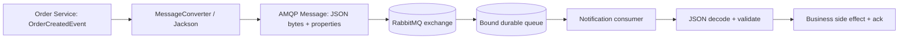
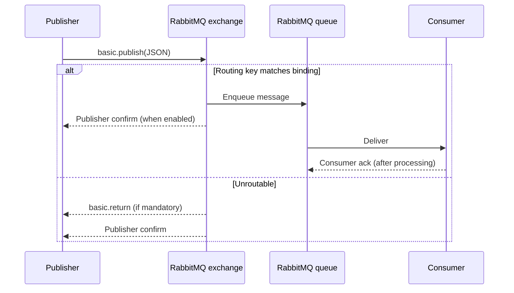
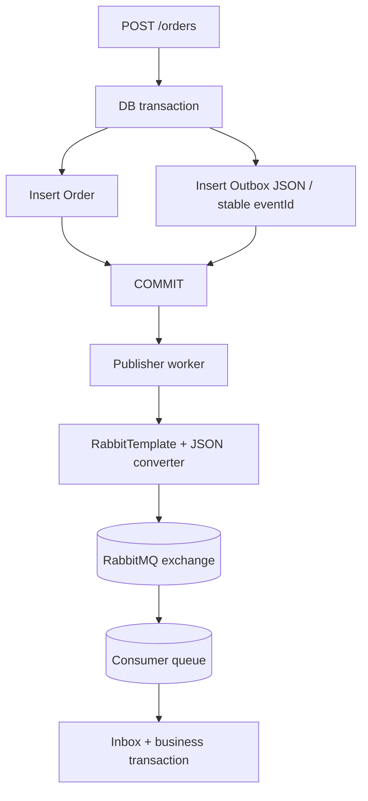

# Sending Data and Converting JSON Messages

## 1. Why Sending a Java Object Does Not Automatically Mean Sending JSON

In the **SPRING_BOOT_INTEGRATION** module, a Spring Boot application connects HTTP clients, databases, caches, message brokers, and Spring Integration adapters. RabbitMQ is commonly used to decouple work that does not need to finish inside the same HTTP request—for example, Order Service creates an order and emits an event for Notification Service, Inventory Service, and reporting systems.

A very common misconception is writing:

```java
rabbitTemplate.convertAndSend(
    "orders.events",
    "order.created",
    new OrderCreatedEvent("evt-1024", "ord-1024", java.time.Instant.parse("2026-11-21T04:00:00Z"), 1)
);
```

and concluding "JSON was sent." **`convertAndSend(...)` merely asks the current `MessageConverter` to turn an object into an AMQP message**; the actual wire format depends on the converter. Without a JSON converter configured, the client may reject the object type, send a string/byte array using default rules, or perform another form of serialization. The method name does not guarantee JSON, and broker acceptance does not guarantee the consumer can decode it.

To send JSON data reliably, align **four layers**:

1. **Business contract:** Which fields, formats, and versions does the payload contain?
2. **Serialization:** Which converter or `ObjectMapper` encodes the Java object into JSON bytes?
3. **AMQP routing:** Which exchange, routing key, and bound queue(s) receive the message?
4. **Delivery and processing:** How does the producer inspect publish results; how does the consumer decode, ack, retry, deduplicate, and persist state?



**Version scope:** Examples follow Spring Boot 3.x and Spring AMQP 3.x using Spring AMQP's `Jackson2JsonMessageConverter`. In newer Spring AMQP lines, Jackson converter API names may change; verify against your project's exact dependencies and documentation. Examples assume Spring Boot on Java 17+ and a separately provisioned RabbitMQ broker.

## 2. An AMQP Message Consists of Payload Bytes and Metadata

In Spring AMQP, `org.springframework.amqp.core.Message` represents the body as a **`byte[]`** paired with `MessageProperties`. It is not identical to `org.springframework.messaging.Message<T>`, which Spring Integration uses between internal endpoints.

```text
Spring AMQP Message
├── body: byte[]
│   └── UTF-8 JSON, e.g. {"eventId":"evt-1024", ...}
└── MessageProperties
    ├── contentType: application/json
    ├── contentEncoding: UTF-8
    ├── deliveryMode: PERSISTENT
    ├── correlationId: req-80a7
    ├── messageId: evt-1024 (if set by producer)
    └── headers: eventType, schemaVersion, eventId, ...
```

The RabbitMQ broker primarily routes and stores **bytes + AMQP properties**; the broker does not validate JSON against your organization's schema. Converting bytes to and from Java objects happens inside the producer, consumer, or Spring Integration adapters.

| Concept | Owning Layer | Function |
| --- | --- | --- |
| `OrderCreatedEvent` | Application | Business contract of the event |
| `ObjectMapper` | Jackson / application | Encodes/decodes JSON |
| `MessageConverter` | Spring AMQP | Converts object ↔ AMQP `Message` |
| `RabbitTemplate` | Spring AMQP client | Publishes via RabbitMQ |
| `MessageProperties` | Spring AMQP / AMQP | Content type, headers, delivery mode |
| Exchange | RabbitMQ | Accepts publishes and evaluates bindings |
| Binding + routing key | RabbitMQ | Determines destination queue(s) |
| Queue | RabbitMQ | Holds messages for consumers |
| `@RabbitListener` | Spring AMQP | Receives messages, converts, and invokes handler |

**Do not automatically use `MessageProperties.messageId` or Spring `MessageHeaders.ID` as an idempotency key.** Preferably, the business event carries its own `eventId`, generated once and kept unchanged across retries or republishes.

## 3. Preparing Dependencies, Connections, and RabbitMQ Topology

### 3.1. Maven / Gradle

With the Spring Boot Maven BOM:

```xml
<dependency>
    <groupId>org.springframework.boot</groupId>
    <artifactId>spring-boot-starter-amqp</artifactId>
</dependency>
```

Gradle:

```groovy
dependencies {
    implementation("org.springframework.boot:spring-boot-starter-amqp")
}
```

This starter provides Spring AMQP and the RabbitMQ Java client; **it does not start a RabbitMQ server**. For development, run a broker via Docker Compose or Testcontainers; in production, use a managed broker with dedicated accounts and least-privilege permissions.

Illustrative local connection config:

```yaml
spring:
  rabbitmq:
    host: localhost
    port: 5672
    username: ${RABBITMQ_USERNAME:devuser}
    password: ${RABBITMQ_PASSWORD:devpass}
    virtual-host: /
    connection-timeout: 5s
    requested-heartbeat: 30s
```

These username/password defaults are for local development only. Never use them as production credentials or commit real secrets. `connection-timeout` is the TCP/AMQP connection setup timeout, not an end-to-end business deadline or consumer processing timeout. Publishing a message and handling an HTTP request have separate lifecycles.

If using Spring Boot Docker Compose service connections or Testcontainers `@ServiceConnection`, endpoints supplied by connection details can take precedence over `spring.rabbitmq.host`/`port`. When an app connects to the wrong broker, inspect the actual connection factory bean and runtime profile.

### 3.2. Exchanges, Queues, and Bindings Must Be Explicit

Example Topic Exchange receiving order events:

```java
import org.springframework.amqp.core.Binding;
import org.springframework.amqp.core.BindingBuilder;
import org.springframework.amqp.core.Queue;
import org.springframework.amqp.core.QueueBuilder;
import org.springframework.amqp.core.TopicExchange;
import org.springframework.context.annotation.Bean;
import org.springframework.context.annotation.Configuration;
import org.springframework.amqp.rabbit.annotation.EnableRabbit;

@Configuration
@EnableRabbit
public class OrderAmqpTopology {

    public static final String EXCHANGE = "orders.events";
    public static final String ROUTING_KEY = "order.created";
    public static final String NOTIFICATION_QUEUE =
        "notification.order-created";

    @Bean
    TopicExchange orderEventsExchange() {
        return new TopicExchange(EXCHANGE, true, false);
    }

    @Bean
    Queue notificationOrderCreatedQueue() {
        return QueueBuilder.durable(NOTIFICATION_QUEUE).build();
    }

    @Bean
    Binding notificationOrderCreatedBinding(
            Queue notificationOrderCreatedQueue,
            TopicExchange orderEventsExchange) {
        return BindingBuilder
            .bind(notificationOrderCreatedQueue)
            .to(orderEventsExchange)
            .with(ROUTING_KEY);
    }
}
```

`TopicExchange` can route across many patterns and queues; the binding above describes only **one consumer queue** for Notification Service. In an event-driven architecture, Inventory Service can have its own queue bound to the same routing key instead of two services competing on a single queue when both need to process every event.

When Spring AMQP's `RabbitAdmin` is configured and auto-declaration is enabled, `Exchange`, `Queue`, and `Binding` beans can be declared on the broker; in production, an infrastructure pipeline may manage topology instead. **Declaring beans in the Spring context does not guarantee the broker created them successfully**: missing permissions, precondition mismatches (e.g., an existing queue with different durability), or an unavailable broker can all fail declarations.

## 4. Distinguishing RabbitTemplate.send vs. convertAndSend

### 4.1. send: The Application Already Built the AMQP Message

`send(...)` accepts an `org.springframework.amqp.core.Message` with a prepared `byte[]` body and `MessageProperties`.

```java
byte[] body = """
    {"eventId":"evt-1024","orderId":"ord-1024","schemaVersion":1}
    """.getBytes(java.nio.charset.StandardCharsets.UTF_8);

org.springframework.amqp.core.MessageProperties properties =
    new org.springframework.amqp.core.MessageProperties();

properties.setContentType("application/json");
properties.setContentEncoding("UTF-8");

org.springframework.amqp.core.Message amqpMessage =
    new org.springframework.amqp.core.Message(body, properties);

rabbitTemplate.send(
    "orders.events",
    "order.created",
    amqpMessage
);
```

Here **the caller is responsible** for ensuring the body is valid JSON and the metadata is accurate. `RabbitTemplate` does not serialize a DTO because the caller supplied a raw AMQP `Message`.

### 4.2. convertAndSend: The Template Delegates to a Converter

```java
OrderCreatedEvent event =
    new OrderCreatedEvent("evt-1024", "ord-1024", java.time.Instant.parse("2026-11-21T04:00:00Z"), 1);

rabbitTemplate.convertAndSend(
    "orders.events",
    "order.created",
    event
);
```

Spring AMQP invokes `MessageConverter.toMessage(...)` to convert the object into an AMQP message, then sends it. If a suitable Jackson JSON converter is configured, the body is JSON bytes. With another converter, the output may differ.

| Criterion | `send` | `convertAndSend` |
| --- | --- | --- |
| Message parameter | AMQP `Message` | Java object or converter-supported type |
| Who encodes payload? | Caller already encoded it | `MessageConverter` |
| Control over body bytes | Direct | Through converter |
| Control over content type | Set by caller | Typically set by converter; customizable via post-processor |
| Best suited for | Strict wire contracts, pre-serialized JSON | Java DTOs with a shared converter |
| Risk | Forgetting encoding/metadata, invalid JSON | Assuming the default converter always emits JSON |

**When to use which?** For a Spring Boot service with clean DTOs and consumers in the same ecosystem, `convertAndSend` with a JSON converter is convenient and reusable. For strict polyglot contracts, deterministic payload bytes, or explicit pre-send metadata control, `send` after explicit `ObjectMapper` serialization is a solid choice.

## 5. Why the Default Converter Does Not Mean JSON

In Spring AMQP, `SimpleMessageConverter` handles specific payload types, typically `String`, `byte[]`, and `Serializable` objects under applicable rules. This leads to two common misconceptions:

1. Sending a `String` containing JSON produces a body with that string's bytes, **yet does not guarantee** `contentType=application/json` or a validated contract.
2. Passing an arbitrary Java DTO does not automatically trigger Jackson JSON serialization. If the object is unsupported by the converter, `MessageConversionException` can be thrown; if handled via Java serialization, the payload will not be cross-language JSON.

Example to avoid for inter-service events:

```java
// Actual content depends on the active converter; JSON cannot be assumed.
rabbitTemplate.convertAndSend(
    "orders.events",
    "order.created",
    new OrderCreatedEvent("evt-1024", "ord-1024", java.time.Instant.parse("2026-11-21T04:00:00Z"), 1)
);
```

The code above **only sends JSON as intended** when `RabbitTemplate` uses a JSON converter or the object is encoded according to the published contract.

Especially avoid Java native serialization as an inter-service wire format: it ties consumers to Java classpaths and types, complicates schema evolution, and introduces deserialization risks on untrusted data. JSON still requires validation and size limits, yet remains far less coupled to Java classes when schemas are designed independently.

## 6. Configuring Jackson2JsonMessageConverter in Spring Boot

### 6.1. Event DTO for the JSON Contract

Define a small, immutable payload with an ID and version:

```java
package example.integration.orders;

import java.time.Instant;

public record OrderCreatedEvent(
        String eventId,
        String orderId,
        Instant occurredAt,
        int schemaVersion
) {}
```

Expected JSON example:

```json
{
  "eventId": "evt-1024",
  "orderId": "ord-1024",
  "occurredAt": "2026-11-21T04:00:00Z",
  "schemaVersion": 1
}
```

`occurredAt` is the timestamp of the **business event**; do not regenerate it on each publish retry. `eventId` supports deduplication and reconciliation and must also remain stable. `schemaVersion` is not an attempt counter—it increments only when the event contract evolves.

### 6.2. Declaring the Converter Bean

```java
package example.integration.orders;

import com.fasterxml.jackson.databind.ObjectMapper;
import org.springframework.amqp.support.converter.Jackson2JsonMessageConverter;
import org.springframework.amqp.support.converter.MessageConverter;
import org.springframework.context.annotation.Bean;
import org.springframework.context.annotation.Configuration;

@Configuration
public class RabbitJsonConfiguration {

    @Bean
    MessageConverter jsonMessageConverter(ObjectMapper objectMapper) {
        return new Jackson2JsonMessageConverter(objectMapper);
    }
}
```

In Spring Boot 3.x and Spring AMQP 3.x, when a suitable `MessageConverter` bean exists in the context, Boot can apply it to the auto-configured `RabbitTemplate` and listener container factories. **If the app builds its own `RabbitTemplate`, registers multiple converter beans, or defines custom listener factories, wire the converter explicitly**; never assume a converter bean will automatically attach to custom components.

Passing Boot's `ObjectMapper` reuses context-configured Jackson settings (such as `Instant` handling and registered modules). Even so, verify that the `ObjectMapper` actually has the needed modules and produces JSON matching the contract; never assume time types or custom Java types serialize identically across versions.

### 6.3. Why Both Producer and Consumer Need Compatible Converters

The producer must convert `OrderCreatedEvent` into bytes, and the consumer must convert bytes back into a matching DTO. If the producer emits Jackson JSON while the listener uses a converter that ignores content type/metadata, the handler may receive raw `byte[]` or hit a conversion failure.

Practical implementation rules:

- Maintain **one published converter configuration** per integration path.
- Verify `RabbitTemplate.getMessageConverter()` and the active listener container factory converter.
- Write integration tests sending events through a real broker, not only `ObjectMapper.writeValueAsString(...)`.
- For non-Java consumers, test against the actual JSON schema rather than relying on Spring's class metadata headers.

Never leave multiple converter beans with overlapping responsibilities without `@Qualifier` or an explicit selection policy.

## 7. Producer: Sending JSON DTOs with Intentional Headers

A straightforward producer:

```java
package example.integration.orders;

import org.springframework.amqp.rabbit.core.RabbitTemplate;
import org.springframework.stereotype.Component;

@Component
public class OrderEventPublisher {

    private final RabbitTemplate rabbit;

    public OrderEventPublisher(RabbitTemplate rabbit) {
        this.rabbit = rabbit;
    }

    public void publish(OrderCreatedEvent event, String correlationId) {
        rabbit.convertAndSend(
            OrderAmqpTopology.EXCHANGE,
            OrderAmqpTopology.ROUTING_KEY,
            event,
            message -> {
                var properties = message.getMessageProperties();
                properties.setHeader("eventType", "OrderCreated");
                properties.setHeader(
                    "schemaVersion", event.schemaVersion()
                );
                properties.setHeader("eventId", event.eventId());
                properties.setCorrelationId(correlationId);
                properties.setMessageId(event.eventId());
                return message;
            }
        );
    }
}
```

The `MessagePostProcessor` callback in `convertAndSend` lets you enrich AMQP properties **after the converter builds the message** and before publishing. Depending on the converter, it may already add type metadata; for a consistent polyglot wire contract across Java/Python/Go, define a header allowlist and govern how consumers use class/type headers.

**Important distinction:** `setMessageId(event.eventId())` is an **application-level choice**, not RabbitMQ generating a business event ID. The broker does not use `messageId` to deduplicate automatically; consumers still need a deduplication store.

### 7.1. Never Generate Event IDs Inside Each Retry Attempt

Wrong:

```java
// WRONG for idempotency during publish retries:
void retryPublish(OrderEntity order) {
    String eventId = java.util.UUID.randomUUID().toString();
    rabbit.convertAndSend(
        "orders.events",
        "order.created",
        new OrderCreatedEvent(
            eventId,
            order.getId(),
            Instant.now(),
            1
        )
    );
}
```

If the same business event is retried, this generates a fresh ID every attempt, preventing consumers from recognizing duplicates.

Right: assign the ID and `occurredAt` when creating the outbox record or logical event; every retry reads the exact same payload and version from the outbox.

## 8. Serializing Explicitly with ObjectMapper Then Calling RabbitTemplate.send

In polyglot systems, teams sometimes prefer **no dependency on Java class metadata** in wire messages. You can encode JSON explicitly:

```java
package example.integration.orders;

import com.fasterxml.jackson.core.JsonProcessingException;
import com.fasterxml.jackson.databind.ObjectMapper;
import java.nio.charset.StandardCharsets;
import org.springframework.amqp.core.Message;
import org.springframework.amqp.core.MessageDeliveryMode;
import org.springframework.amqp.core.MessageProperties;
import org.springframework.amqp.rabbit.core.RabbitTemplate;
import org.springframework.stereotype.Component;

@Component
public class RawJsonOrderPublisher {

    private final RabbitTemplate rabbit;
    private final ObjectMapper mapper;

    public RawJsonOrderPublisher(
            RabbitTemplate rabbit,
            ObjectMapper mapper) {
        this.rabbit = rabbit;
        this.mapper = mapper;
    }

    public void publish(OrderCreatedEvent event)
            throws JsonProcessingException {

        byte[] json = mapper.writeValueAsBytes(event);

        MessageProperties props = new MessageProperties();
        props.setContentType(MessageProperties.CONTENT_TYPE_JSON);
        props.setContentEncoding(StandardCharsets.UTF_8.name());
        props.setDeliveryMode(MessageDeliveryMode.PERSISTENT);
        props.setMessageId(event.eventId());
        props.setHeader("eventType", "OrderCreated");
        props.setHeader("schemaVersion", event.schemaVersion());

        rabbit.send(
            OrderAmqpTopology.EXCHANGE,
            OrderAmqpTopology.ROUTING_KEY,
            new Message(json, props)
        );
    }
}
```

Benefits:

- The body is encoded using a controlled `ObjectMapper`.
- The producer sets `contentType=application/json`, encoding, and metadata explicitly.
- Receivers are not forced to understand `__TypeId__` Java class names.
- Simplifies JSON Schema validation and direct byte-level payload testing.

In return, the application must ensure complete schema/metadata and safe consumer deserialization. **Do not pass an already-serialized AMQP `Message` into `convertAndSend` if you simply want to send the body directly**; use `send` at the right abstraction level.

### 8.1. Why contentType and Charset Matter

`application/json` informs consumers the body is JSON, while `UTF-8` defines byte-to-text decoding where encoding applies. If the body is valid JSON yet `contentType` is wrong or missing, the receiving converter may treat it as plain text or `octet-stream` and fail to map it into a DTO.

Never allow an environment-specific `ObjectMapper` config to serialize `Instant` differently from the contract (e.g., epoch numbers instead of ISO-8601 strings). Snapshot/contract tests on JSON bodies prevent such regressions.

## 9. RabbitListener: Decoding JSON into a DTO

A strongly typed listener:

```java
package example.integration.notifications;

import example.integration.orders.OrderCreatedEvent;
import example.integration.orders.OrderAmqpTopology;
import org.springframework.amqp.rabbit.annotation.RabbitListener;
import org.springframework.stereotype.Component;

@Component
public class OrderCreatedListener {

    private final NotificationService notifications;

    public OrderCreatedListener(NotificationService notifications) {
        this.notifications = notifications;
    }

    @RabbitListener(
        queues = OrderAmqpTopology.NOTIFICATION_QUEUE
    )
    public void handle(OrderCreatedEvent event) {
        notifications.handleOrderCreated(event);
    }
}
```

`NotificationService` is implemented by the application. The example assumes the listener factory uses an appropriate JSON converter, the DTO is a shared contract or compatible type, and the queue is already provisioned.

Spring AMQP's listener adapter can use the **method parameter type** to infer the target conversion type, depending on container, adapter, and converter settings. If a method accepts `Object` or a generic interface, type inference may be insufficient; type headers or an explicit type mapper become necessary.

**Watch out for failure modes:**

- Syntactically valid JSON missing required fields: Jackson may construct an object with null/default fields depending on settings; enforce **bean validation / business validation** separately.
- Non-JSON body or type mismatch: conversion errors can occur **before the listener method is invoked**, so a `try/catch` inside the handler will not catch them.
- Consumer encounters unknown `schemaVersion=2`: never silently misinterpret it as v1; route it to error handling/DLQ/quarantine.
- An exception thrown by the handler can trigger redelivery per container/requeue policy. Verify acknowledgment and error handling rather than assuming one delivery equals one execution.

### 9.1. Validating Input Inside the Handler

```java
public void handle(OrderCreatedEvent event) {
    if (event == null
            || event.eventId() == null
            || event.eventId().isBlank()
            || event.orderId() == null
            || event.schemaVersion() != 1) {
        throw new IllegalArgumentException(
            "Unsupported or invalid OrderCreated event"
        );
    }

    notifications.handleOrderCreated(event);
}
```

This snippet illustrates domain validation; in practice, pair Jakarta Bean Validation with explicit error classification. Poison messages **should never be requeued infinitely**. For unsupported schemas, quarantine for investigation or follow a backward-compatibility strategy.

## 10. The __TypeId__ Header: Convenient in Java, Needs Control

`Jackson2JsonMessageConverter` can write and read **type metadata** in AMQP headers, commonly `__TypeId__` and related type headers. When both producer and consumer are Spring Java apps with matching mappings, this helps reconstruct Java types.

However, it is **not a cross-language JSON schema standard**. A type ID containing a fully-qualified Java class name may not exist in another service or may break during package refactoring.

| Type Resolution Strategy | Strength | Risk |
| --- | --- | --- |
| Type inferred from `@RabbitListener(OrderCreatedEvent)` method | Explicit DTO at consumer | Does not work for generic handlers |
| Spring AMQP type headers | Convenient for multiple Java payload types | Coupled to class names/config; requires trust rules |
| Logical type ID `OrderCreated` + schema version | More stable across languages | Requires explicit registry/mapping |
| Event envelope carrying `eventType` in JSON | Self-describing wire contract | Consumer must validate/route from envelope |
| Dedicated topic/routing key per event type | Infrastructure-level classification | Still requires schema versioning and validation |

When receiving messages from untrusted sources, **never allow arbitrary Java class deserialization driven solely by sender-controlled type headers**. Restrict trusted packages, use a DTO allowlist, validate spoofable headers, and do not enable broad Jackson polymorphic default typing unnecessarily.

For polyglot systems or long-lived events, prefer logical event types plus versions in the contract. You can still use Jackson converters internally without treating `__TypeId__` as a business event schema.

### 10.1. Standardizing Where eventType and schemaVersion Live

You can standardize on an envelope:

```json
{
  "eventId": "evt-1024",
  "eventType": "OrderCreated",
  "schemaVersion": 1,
  "occurredAt": "2026-11-21T04:00:00Z",
  "data": {
    "orderId": "ord-1024"
  }
}
```

If `schemaVersion` appears in both headers and body, designate one as the **source of truth** and verify they do not contradict each other. In many architectures, the body serves as the durable contract while headers merely optimize filtering and routing.

## 11. Never Confuse Valid JSON Syntax with a Valid Contract

A JSON parser can happily parse:

```json
{
  "eventId": "evt-1024",
  "orderId": null,
  "schemaVersion": 999
}
```

Yet this message may be **business-invalid**: `orderId` is null and the version is unsupported. Distinguish five levels:

1. **Syntax validation:** body is valid JSON with valid encoding.
2. **Schema validation:** required fields, data types, enums, formats, and versions.
3. **Semantic validation:** field relationships, business state, and tenant/user permissions.
4. **Idempotency validation:** whether this event has already been processed.
5. **Authorization/trust:** whether the producer is authorized to emit this event type.

A converter succeeding at steps 1–2 (Java mapping) does not fulfill steps 3–5. Events from a broker should not be trusted blindly simply because they came from an internal queue; publisher accounts and vhost/exchange permissions still require governance.

### 11.1. Designing Schema Evolution

| Change | Typical Assessment | Notes |
| --- | --- | --- |
| Adding an optional field with clear default | Potentially backward-compatible | Old consumers must tolerate unknown fields |
| Adding a required field without default | Breaking | Upgrade consumers before producers emit it |
| Changing `orderId` from String to Number | Breaking | Requires versioning/migration |
| Renaming `orderId` to `id` | Potentially breaking | Parallel support window or compatibility mapping |
| Adding a new enum value | Potentially breaking for exhaustive switches | Consumers must define unknown-value handling |
| Changing meaning of `quantity` from items to packs | Semantically breaking despite valid JSON | Must publish a new contract version |

**Never use "deserialization succeeded" as proof of contract compatibility.** Maintain provider/consumer contract tests and a plan for v1 messages still in queues when v2 rolls out.

## 12. Publisher Confirms and Returns: What Does Publish Success Mean?

`RabbitTemplate.convertAndSend(...)` normally returns `void`. Returning without an exception is **not sufficient** to assert the message reached a queue, was persisted durably, or was processed by a consumer.

Separate three questions:

- **Publisher confirm:** Did the broker reply with acceptance (ACK) or rejection (NACK) at the level guaranteed by configuration?
- **Publisher return:** Did the message reach an exchange yet **fail to route to any queue** under mandatory publishing?
- **Consumer acknowledgment:** Did the consumer/container signal that the message was processed per ack policy? This is a later, independent stage.



### 12.1. Enabling Confirms and Returns in Spring Boot

```yaml
spring:
  rabbitmq:
    publisher-confirm-type: correlated
    publisher-returns: true
    template:
      mandatory: true
```

Meaning:

- `publisher-confirm-type: correlated` enables confirms with correlation data to link publish attempts to events/outbox rows.
- `publisher-returns: true` allows the broker to deliver returned messages when unroutable under applicable rules.
- `template.mandatory: true` requests `basic.return` for unroutable messages instead of the broker silently dropping them by default.

Publishing to a **non-existent exchange** fails on the channel/confirm path, which differs from an existing exchange having no matching binding. If an exchange has an alternate exchange, routing/return behavior also depends on that topology; verify each case directly.

### 12.2. CorrelationData Keyed by Event ID

```java
import org.springframework.amqp.rabbit.connection.CorrelationData;

CorrelationData correlation =
    new CorrelationData(event.eventId());

rabbitTemplate.convertAndSend(
    "orders.events",
    "order.created",
    event,
    message -> {
        message.getMessageProperties()
            .setHeader("eventId", event.eventId());
        return message;
    },
    correlation
);
```

`CorrelationData` links broker confirms to publish attempts; it is not a consumer inbox. If an event is retried, track attempts separately when needed, while keeping the **business event ID stable**.

Example registering template-wide callbacks in one place:

```java
import org.springframework.amqp.rabbit.core.RabbitTemplate;
import org.springframework.stereotype.Component;

@Component
public class RabbitPublishSignals {

    public RabbitPublishSignals(RabbitTemplate template) {
        template.setConfirmCallback((correlation, ack, cause) -> {
            String eventId =
                correlation == null ? null : correlation.getId();
            // ack=true is only a publisher confirm; record publish
            // status by eventId and monitor NACK/cause.
        });

        template.setReturnsCallback(returned -> {
            // ReturnedMessage contains metadata for the unroutable publish.
            // Record routing failure for outbox/ops and alert.
        });
    }
}
```

These callbacks illustrate **where signals arrive**, not a full outbox system. Because callbacks may execute on client I/O threads, DB updates require thread safety and explicit error handling. `RabbitTemplate` holds single shared callback slots; multiple components calling `setConfirmCallback(...)` will overwrite each other's policies. Assign one owner for publisher signal tracking, or use a centrally designed future/correlation strategy.

**A publisher confirm ACK does not prove the consumer finished, nor does it create exactly-once delivery.** If the broker accepted a publish yet the producer missed the confirm, the producer may resend; consumers must deduplicate.

## 13. Durable Queues, Persistent Messages, and Acknowledgments Are Three Different Things

A `durable` queue survives broker restarts per supported broker mechanics, yet **does not automatically mean every message inside it is persisted durably**. When durability is required:

1. Declare **durable queues** and corresponding exchanges/bindings.
2. Publish messages with **persistent delivery mode**.
3. Use publisher confirms/returns to track how the broker handled each publish.
4. Select RabbitMQ topology/quorum queues, disk/memory policies, and clustering aligned with your SLA.
5. Implement outbox and idempotent consumers because publishing and DB transactions are not atomic.

Example when using manual `send(...)`:

```java
MessageProperties properties = new MessageProperties();
properties.setContentType(MessageProperties.CONTENT_TYPE_JSON);
properties.setDeliveryMode(MessageDeliveryMode.PERSISTENT);
```

Delivery mode is often set appropriately by converters/templates, yet you should inspect the **actual wire message** and broker settings. Quorum queues, classic queues, mirrored strategies, and RabbitMQ versions carry different guarantees; never claim "PERSISTENT + durable queue = zero data loss" across all failure modes.

### 13.1. AUTO Acknowledgment Does Not Automatically Commit Business Transactions

In Spring AMQP listener containers with standard `AUTO` acknowledge mode, the container typically acks when the listener finishes normally; if the listener throws an exception, the container/error handler decides reject/requeue/dead-letter per configuration.

If the consumer commits PostgreSQL and the JVM crashes **before ACK**, the broker can redeliver and trigger a second execution. That is why a unique business event ID and inbox are required:

```text
Receive event evt-1024
BEGIN DB transaction
  INSERT inbox(consumer_name, event_id) UNIQUE
  If already present: exit safely without repeating side effects
  If new: apply data changes
COMMIT
Broker ACK handled by listener container
```

For real notifications/emails, the DB inbox and the email provider do not share a transaction. Maintain notification state, provider idempotency keys, or reconciliation; **never claim absolute exactly-once semantics for side effects outside the DB**.

## 14. Consumer Errors: Conversion Failures, Business Failures, and Poison Messages

Distinguish error stages:

| Stage | Example | Appropriate Handling Path |
| --- | --- | --- |
| AMQP delivery | Connection/channel dropped | Client reconnect, broker redelivery, and monitoring |
| JSON parse | Truncated body, invalid JSON syntax | Conversion error, reject/DLQ/quarantine |
| Java type mapping | Untrusted type ID or missing class | Fix mapping or isolate message |
| Schema validation | Required field null, unsupported version | Non-retryable, DLQ, and contract alert |
| Business handling | Database deadlock, HTTP 503 | Bounded retry with backoff when safe |
| Authorization | Producer unauthorized to emit event | Security incident; do not hot-retry |
| Commit/ack gap | DB committed yet ACK lost | Redelivery handled by inbox/idempotency |
| Producer serialization | `ObjectMapper` fails to encode DTO | Pre-publish error; fail request/job/outbox cleanly |

**JSON conversion failures can occur before the `@RabbitListener` method starts.** Putting a `try/catch` inside the handler is not enough; configure container error handlers and dead-letter policies for adapter-level conversion errors.

### 14.1. Avoiding Infinite Requeue Loops

Illustrative local configuration:

```yaml
spring:
  rabbitmq:
    listener:
      simple:
        acknowledge-mode: auto
        default-requeue-rejected: false
        prefetch: 20
```

`default-requeue-rejected: false` prevents failed/rejected messages from returning to the source queue under common container behavior, **yet this setting alone does not create a DLQ**. To preserve messages for inspection, the queue must declare a dead-letter exchange and matching binding or use a broker policy.

### 14.2. An Illustrative DLQ Topology

```java
@Bean
org.springframework.amqp.core.DirectExchange deadLetterExchange() {
    return new org.springframework.amqp.core.DirectExchange(
        "orders.dlx", true, false
    );
}

@Bean
org.springframework.amqp.core.Queue orderCreatedDlq() {
    return org.springframework.amqp.core.QueueBuilder
        .durable("notification.order-created.dlq")
        .build();
}

@Bean
org.springframework.amqp.core.Binding orderCreatedDlqBinding(
        org.springframework.amqp.core.DirectExchange deadLetterExchange,
        org.springframework.amqp.core.Queue orderCreatedDql) {
    return org.springframework.amqp.core.BindingBuilder
        .bind(orderCreatedDql)
        .to(deadLetterExchange)
        .with("notification.failed");
}
```

This is an **addition to a topology configuration**, not a complete replacement for `OrderAmqpTopology` in Section 3. For messages from the source queue to reach the DLQ, the source queue must also be **declared with dead-letter exchange** `orders.dlx` and dead-letter routing key `notification.failed`, for example:

```java
@Bean
org.springframework.amqp.core.Queue notificationOrderCreatedQueue() {
    return org.springframework.amqp.core.QueueBuilder
        .durable("notification.order-created")
        .deadLetterExchange("orders.dlx")
        .deadLetterRoutingKey("notification.failed")
        .build();
}
```

**Use the bean above to replace the source queue definition in Section 3—do not register two beans for the same queue with differing arguments.** If the old queue already exists with different arguments, RabbitMQ may reject redeclaration with an inequivalent-arg error; plan a topology migration or use broker policies operationally.

A DLQ is not "permanent storage for everything": enforce retention, size bounds, alerts, and controlled reprocessing tools. Retrying permanent errors inside the main queue can block valid messages.

## 15. Transactional Outbox: Decoupling DB Writes from JSON Publishing

Suppose Order Service runs:

```text
@Transactional
  INSERT orders
  rabbitTemplate.convertAndSend(OrderCreatedEvent)
COMMIT DATABASE
```

Even inside `@Transactional`, PostgreSQL and RabbitMQ **do not automatically participate in one distributed transaction**. There are two failure windows:

- The broker receives the event, then the database rolls back → consumers observe an event for a non-existent order.
- The database commits, then the process crashes before publishing → downstream services never hear about the new order.

For critical events, use a **transactional outbox**:



Example outbox schema:

```sql
CREATE TABLE integration_outbox (
    event_id VARCHAR(64) PRIMARY KEY,
    event_type VARCHAR(100) NOT NULL,
    schema_version INTEGER NOT NULL,
    payload_json TEXT NOT NULL,
    status VARCHAR(20) NOT NULL,
    attempts INTEGER NOT NULL DEFAULT 0,
    created_at TIMESTAMP WITH TIME ZONE NOT NULL
);
```

`payload_json` can use PostgreSQL `jsonb` if appropriate, though canonical representation/serialization should be evaluated. An outbox publisher should store a **stable payload and version** prior to publishing; on retry, never re-read the mutable entity to synthesize a modified event under the old event ID.

### 15.1. Publisher Status and Confirms

Illustrative sequence:

1. Read `PENDING` outbox events using a lease/lock when multiple workers run.
2. Read the committed JSON payload and version from the row.
3. Publish with `CorrelationData` carrying `eventId` and monitor confirms/returns.
4. Transition to "sent" only according to organizational criteria; returned/unroutable messages must be treated as failures.
5. If status is uncertain, retry with the **same eventId**; the consumer inbox prevents duplicate side effects.
6. When retry budget is exhausted → move to `FAILED`/parking and alert with a reprocessing workflow.

**Never transition an outbox row to SENT immediately after `convertAndSend` returns without broker confirmation per contract.** Conversely, even with a confirm ACK, the publisher can crash before updating status → duplicate publishing is expected by design.

## 16. Security, Schema, and Performance of JSON Messages

### 16.1. Never Send JPA Entities Directly Over the Broker

JPA entities typically carry lazy proxies, internal IDs, circular associations, and fields outside the event contract. Letting Jackson serialize them can cause:

- `LazyInitializationException` or unintended queries.
- Bloated payloads leaking PII/tokens.
- Accidental schema breakage whenever entities are refactored.
- Serialization failures due to cyclic relationships.
- Incompatible serialization versions between old and new consumers.

Instead, map entities to dedicated **immutable event DTOs**. Payloads should include a business event ID, timestamp, schema version, and required fields—not an entire system snapshot if consumers do not need it.

### 16.2. Header Allowlist

Do not blindly forward all HTTP headers into AMQP:

- `Authorization`/cookies can leak credentials.
- Spring Integration's `replyChannel`/`errorChannel` may hold non-serializable internal objects.
- Unvalidated caller headers can spoof `eventType` or influence routing.
- Large or numerous broker headers add overhead or hit broker limits.

Select only explicitly needed headers such as `eventId`, `eventType`, `schemaVersion`, and controlled `correlationId`/trace context. Never trust type IDs from untrusted sources; apply least-privilege user/vhost/exchange permissions.

### 16.3. JSON Is Readable Yet Has Costs

Compared to binary formats like Avro/Protobuf, JSON incurs larger payload sizes and higher parsing overhead. For high throughput:

- Keep payloads lean; avoid deeply nested bloated objects.
- Use batch publishing/consuming via supported mechanisms **without sacrificing acks or idempotency**.
- Monitor message sizes, RabbitMQ memory/disk alarms, and queue depths.
- Tune prefetch, consumer concurrency, and backpressure around downstream DB/HTTP capacity.
- For large documents or files, store blobs in object storage and send references/metadata rather than pushing entire files through RabbitMQ.
- Enforce JSON parsing limits and validate inputs before allocating memory or writing to the DB.

**Do not crank up consumer concurrency merely to mask an overloaded database.** If 100 consumers contend on the same hot table constraints/indexes, throughput drops and redeliveries spike.

## 17. Testing Converters and the Path Through RabbitMQ

### 17.1. Unit Test: Verifying the JSON Converter Produces a JSON Body

```java
import static org.assertj.core.api.Assertions.assertThat;

import com.fasterxml.jackson.databind.ObjectMapper;
import org.junit.jupiter.api.Test;
import org.springframework.amqp.core.Message;
import org.springframework.amqp.core.MessageProperties;
import org.springframework.amqp.support.converter.Jackson2JsonMessageConverter;

class OrderJsonConverterTest {

    @Test
    void convertsEventToJsonBytes() throws Exception {
        ObjectMapper mapper = new ObjectMapper()
            .findAndRegisterModules();

        Jackson2JsonMessageConverter converter =
            new Jackson2JsonMessageConverter(mapper);

        OrderCreatedEvent event = new OrderCreatedEvent(
            "evt-1024",
            "ord-1024",
            java.time.Instant.parse("2026-11-21T04:00:00Z"),
            1
        );

        Message encoded =
            converter.toMessage(event, new MessageProperties());

        assertThat(encoded.getMessageProperties().getContentType())
            .isEqualTo("application/json");

        var json = mapper.readTree(encoded.getBody());
        assertThat(json.get("eventId").asText())
            .isEqualTo("evt-1024");
        assertThat(json.get("schemaVersion").asInt())
            .isEqualTo(1);
        assertThat(json.get("orderId").asText())
            .isEqualTo("ord-1024");
    }
}
```

This test proves **the converter emitted JSON with expected key fields**, yet does not prove broker routing, publisher confirms, consumer acks, or full schema compatibility. Add contract tests with older-version fixtures whenever changing event DTOs.

### 17.2. Integration Test with Testcontainers RabbitMQ

With Spring Boot 3.x supporting `@ServiceConnection`, you can run `RabbitMQContainer` for integration testing. Appropriate dependencies include Testcontainers JUnit Jupiter, the RabbitMQ module, `spring-boot-testcontainers`, and `spring-boot-starter-test`.

Test structure:

```java
import static org.assertj.core.api.Assertions.assertThat;

import com.fasterxml.jackson.databind.ObjectMapper;
import org.junit.jupiter.api.Test;
import org.springframework.amqp.core.Message;
import org.springframework.amqp.core.Queue;
import org.springframework.amqp.core.QueueBuilder;
import org.springframework.amqp.rabbit.core.RabbitTemplate;
import org.springframework.beans.factory.annotation.Autowired;
import org.springframework.boot.test.context.SpringBootTest;
import org.springframework.boot.test.context.TestConfiguration;
import org.springframework.boot.testcontainers.service.connection.ServiceConnection;
import org.springframework.context.annotation.Bean;
import org.springframework.context.annotation.Import;
import org.testcontainers.containers.RabbitMQContainer;
import org.testcontainers.junit.jupiter.Container;
import org.testcontainers.junit.jupiter.Testcontainers;

@Testcontainers
@SpringBootTest
@Import(RabbitJsonRoundTripTest.TestTopology.class)
class RabbitJsonRoundTripTest {

    @Container
    @ServiceConnection
    static RabbitMQContainer rabbit =
        new RabbitMQContainer("rabbitmq:3.13-management");

    @Autowired
    RabbitTemplate template;

    @Autowired
    ObjectMapper mapper;

    @Test
    void publishesAndReceivesJsonBody() throws Exception {
        String queue = "orders.json.roundtrip.test";

        OrderCreatedEvent event = new OrderCreatedEvent(
            "evt-test-1",
            "ord-test-1",
            java.time.Instant.parse("2026-11-21T04:00:00Z"),
            1
        );

        template.convertAndSend("", queue, event);

        Message received = template.receive(queue, 5000);

        assertThat(received).isNotNull();
        assertThat(received.getMessageProperties().getContentType())
            .isEqualTo("application/json");

        var json = mapper.readTree(received.getBody());
        assertThat(json.get("eventId").asText())
            .isEqualTo("evt-test-1");
    }

    @TestConfiguration(proxyBeanMethods = false)
    static class TestTopology {
        @Bean
        Queue jsonRoundTripQueue() {
            return QueueBuilder
                .durable("orders.json.roundtrip.test")
                .build();
        }
    }
}
```

The test assumes `RabbitJsonConfiguration` supplies the converter in the application context and `RabbitAdmin`/declaration created the queue before publishing. Use a dedicated queue **with no competing listener**. If a shared listener consumes the same queue, the test may miss the message and become flaky; isolate topology via test profiles/projects/brokers.

**Do not claim this test verifies publisher confirms:** it only verifies the message traversed the broker to the queue with the expected body and content type. Confirms/returns, unroutable routing, dead-lettering, redeliveries, duplicate consumption, and permission failures require dedicated tests.

### 17.3. Essential Test Matrix

| Case | Verification |
| --- | --- |
| Valid DTO | JSON bytes, UTF-8, content type, `schemaVersion` |
| Consumer in a different Java package | No reliance on concrete Java class names in wire contract |
| Non-Java consumer | Decodes JSON by schema without needing `__TypeId__` |
| Missing/null/wrong-type JSON field | Validation reports error cleanly without side effects |
| Producer adds optional field | Backward compatibility per contract |
| Producer bumps `schemaVersion` | v1 consumer classifies and handles cleanly |
| Wrong routing key | Mandatory return/unroutable handling triggers |
| Non-existent exchange | Publish error/negative confirm observed |
| Broker restart during publish | Producer detects unknown status and retries with same `eventId` |
| Consumer commits then loses ACK | Event redelivered without duplicating side effects |
| Handler always throws | Bounded retry and DLQ, no infinite requeue |
| JSON conversion fails before handler | Container error handler isolates poison message |
| Outbox publisher crashes | No committed event lost; safely republished |
| Very large payload | Size limits, memory usage, consumer throughput |
| Insufficient credentials | Error classified; no tight infinite retries |

## 18. Observability and Production Troubleshooting

To trace an event flowing from Order Service to Notification Service, establish a **clear correlation story**:

```text
Order DB commit
  eventId=evt-1024 / orderId=ord-1024
  ↓
Outbox PENDING → publisher attempt=1
  ↓
RabbitTemplate publish(JSON, exchange=orders.events,
                       routingKey=order.created)
  ↓
Publisher confirm ACK / Returned? [yes or no]
  ↓
Queue notification.order-created
  ↓
Consumer deserialize + schema validate
  ↓
Inbox dedupe + business side effect
  ↓
Container ACK / recovery / DLQ
```

Useful metrics:

- Producer publish attempts, confirm ACK/NACK counts, return/unroutable counts.
- Outbox pending count, oldest pending age, failed row count.
- Exchange routing/queue ingress rates, ready/unacked message counts.
- Consumer parse/schema error rates, handler latency, and retry/DLQ rates.
- Consumer completion rate by event type and schema version.
- Idempotency duplicate-detected count and inbox conflict rate.
- Downstream DB/HTTP/Redis failures impacting handlers.
- Message sizes and serialize/deserialize duration under high load.

**Never use `eventId` or `orderId` as metric labels** due to high cardinality. Keep them in access-controlled, redacted logs/traces with bounded retention; never print raw payloads/headers containing PII, tokens, or secrets.

### 18.1. Common Errors

| Symptom | Likely Cause | Resolution Direction |
| --- | --- | --- |
| `MessageConversionException` on publish | Converter does not support DTO | Check the active `RabbitTemplate` converter |
| Queue receives non-JSON binary body | Default serialization is not Jackson | Configure Jackson converter or `send` explicit JSON bytes |
| Valid JSON body yet listener receives `byte[]` | Listener content-type or converter mismatch | Inspect container factory and content type |
| `__TypeId__` fails class resolution | Producer and consumer differ in package/version | Infer target type from listener, use logical type mapping or envelope |
| DTO with `Instant` fails serialization | `ObjectMapper` missing time module/config | Use Boot's mapper and test JSON output format |
| Producer throws no error yet consumer sees nothing | Wrong routing key/binding, unroutable | Enable publisher returns and verify topology |
| Producer ACKs yet consumer has not run | Confirm is not consumer acknowledgment | Inspect ready/unacked counts and consumer metrics |
| Queue declare fails with inequivalent arg | Existing queue differs in durable/DLX/arguments | Plan topology migration or use broker policy |
| Duplicate messages after reconnect | Lost confirm/ack, producer/consumer retry | Stable `eventId` + outbox/inbox |
| Poison JSON requeues forever | Missing error classification/DLQ | Mark conversion errors non-retryable and quarantine |
| Consumer stalls on HTTP calls | Unbounded timeouts/retries | Enforce deadlines, backoff, prefetch/concurrency limits |
| Secrets appear in DLQ JSON | Over-forwarding fields/headers | Masking, least privilege, retention, and access policy |
| Converter unit test passes yet prod fails | Routing/consumer/real broker untested | Add Testcontainers and contract tests |

### 18.2. Pre-Release Checklist

- [ ] Events include a stable `eventId`, `eventType`, `schemaVersion`, and clear payload contract?
- [ ] `RabbitTemplate` uses the right `MessageConverter`, never assuming JSON from `convertAndSend` alone?
- [ ] `contentType=application/json`, encoding, and JSON `Instant` format tested?
- [ ] Exchanges, queues, bindings/routing keys, and permissions provisioned properly?
- [ ] Producer and consumer tested for JSON round-trip via a real broker?
- [ ] Java class/type headers not relied upon as the sole cross-service contract?
- [ ] Publisher confirms/returns enabled with handling for uncertain outcomes?
- [ ] Queue/message durability and broker policies meet published SLAs?
- [ ] Not publishing inside a DB transaction assuming atomicity; using an outbox where needed?
- [ ] Consumers maintain an inbox/idempotency check for post-commit redeliveries?
- [ ] Parse/schema, transient, and permanent errors classified with bounded retries and a valid DLQ?
- [ ] Monitoring covers queue lag, outbox backlog, retry/DLQ rates, and completion—not just "publish returned"?

**Conclusion:** Sending data via RabbitMQ is a pipeline of **serializing objects into body bytes, attaching AMQP properties, routing through exchanges/bindings to queues, then deserializing and processing at consumers**. `RabbitTemplate.send` fits cases where you already hold an AMQP `Message`; `convertAndSend` requires an explicitly configured `MessageConverter`, such as `Jackson2JsonMessageConverter`, to reliably serialize DTOs to JSON. In Spring Boot Integration, reliability also demands stable event IDs, schema versions, publisher confirms/returns, outbox/inbox patterns, bounded retries/DLQ, testing with a real broker, and end-to-end observability. None of those are guaranteed merely because `convertAndSend(...)` returned without throwing.
