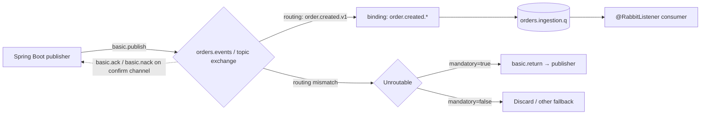
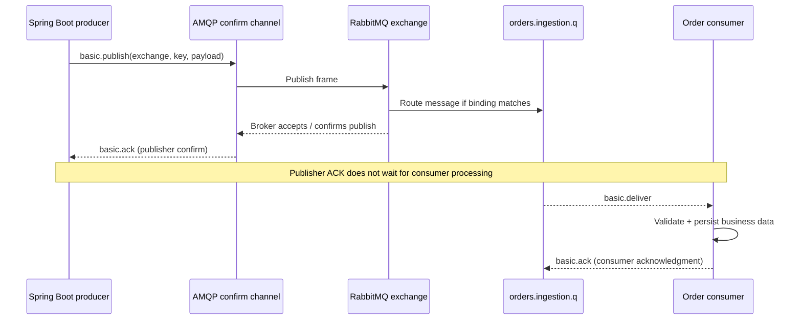
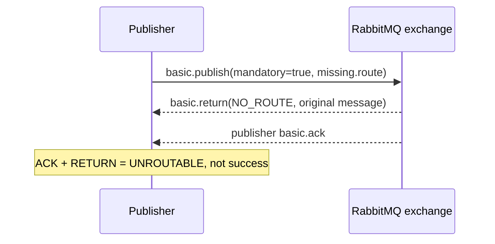
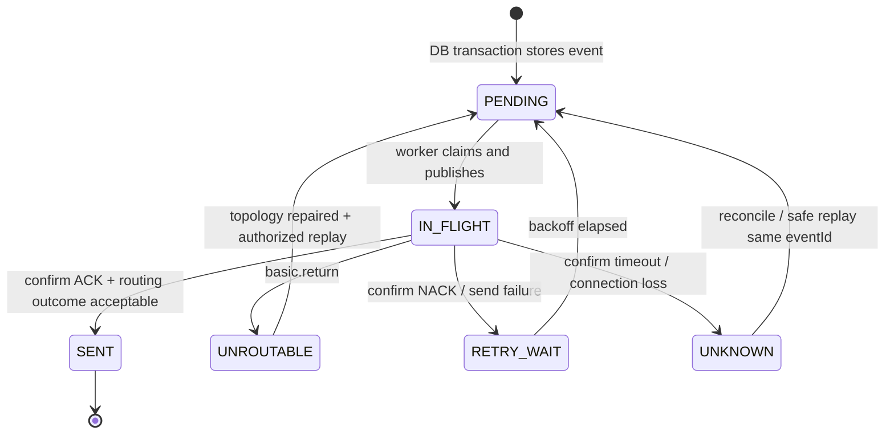
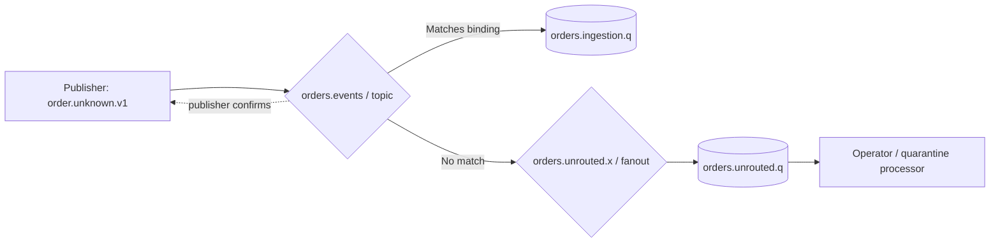
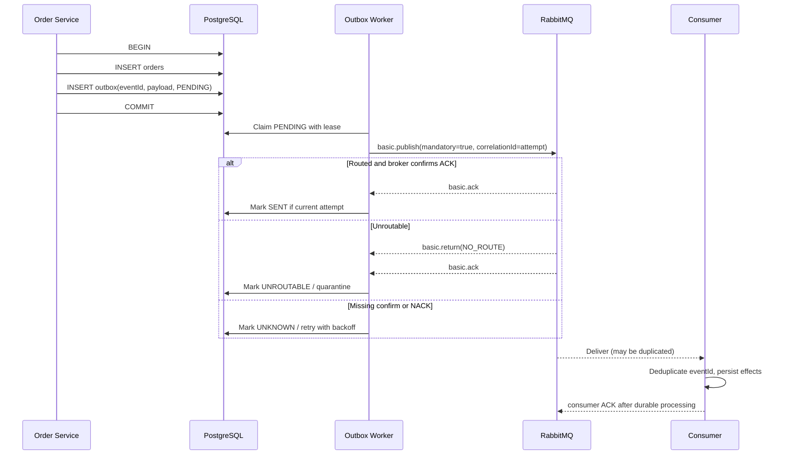
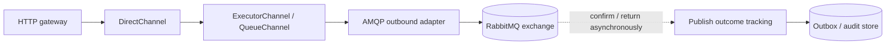
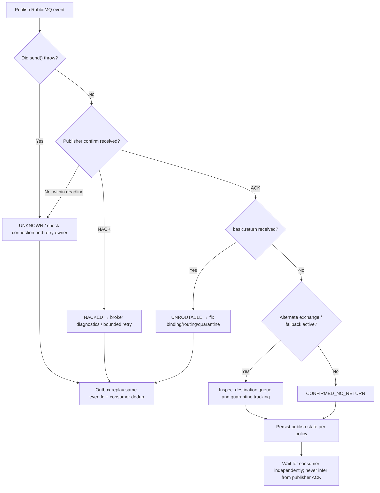

# Publisher Confirms, Returns, and Unroutable Messages

> **Chapter:** RabbitMQ and AMQP  
> **Module:** SPRING_BOOT_INTEGRATION — organizing Spring Boot system integration across HTTP clients, databases, caches, message brokers, and Spring Integration adapters; emphasizing configuration management, data contracts, error handling, deduplication, testing, and observability of real integration flows.

## 1. Problem Statement: RabbitTemplate.send() Does Not Prove the Receiver Got the Message

An order service writes an order to PostgreSQL and then emits an `OrderCreated` event to RabbitMQ. In code:

```java
rabbitTemplate.convertAndSend(
        "orders.events", "order.created.v1", event);
```

Returning without an exception **does not mean** the message reached the expected queue, was persisted durably, or was processed by a consumer. There are at least four very different outcomes:

1. The exchange accepts the message, routes it to one or more queues, and the broker sends a **publisher confirm ACK**.
2. The exchange exists, yet **no binding matches the routing key**. If `mandatory=false` and no fallback route exists, the broker may drop the message while the publisher still receives a confirm ACK.
3. `mandatory=true`, and the message is unroutable: the broker sends a **`basic.return`** (returned message info) and may still send a **confirm ACK** because the broker handled the publish at the exchange.
4. Connectivity drops after the client sends the message but before receiving the publisher confirm: it is **uncertain** whether the broker received or stored the message.

If business code merely catches exceptions from `convertAndSend()` and records `sent=true`, the system can silently lose events. Conversely, if every timeout mints a new message with a new event ID, consumers may process duplicates.

### 1.1. Learning Objectives

After this lesson, you will be able to:

1. Explain the **publisher → exchange → binding → queue → consumer** path and where messages can be lost.
2. Distinguish **publisher confirms** (broker publish confirmation) from **publisher returns** (unroutable notifications) and **consumer acknowledgments**.
3. Configure Spring Boot/RabbitMQ with `publisher-confirm-type=correlated`, `publisher-returns=true`, and `template.mandatory=true`.
4. Use `RabbitTemplate` and `CorrelationData` to classify ACK/NACK, returned messages, send exceptions, and timeouts/missing confirms.
5. Handle unroutable messages via topology checks, bindings, alternate exchanges, quarantine, and controlled replays.
6. Design **transactional outbox**, stable event IDs, retries, and idempotent consumers without mistaking ACK for exactly-once.
7. Test routing and publisher confirms/returns with RabbitMQ Testcontainers while building metrics, alerts, and runbooks.

### 1.2. Three Questions That Must Be Answered Independently

| Question | Appropriate Signal | What It Does Not Prove |
| --- | --- | --- |
| Did the broker process the publish on the channel? | **Publisher confirm ACK/NACK** | That any consumer received, read, or committed business state |
| Was the message routed to any queue? | **`basic.return`** when mandatory and unroutable; topology/fallback monitoring | Consumer ACK; or that the destination queue is the *intended* one if fallbacks exist |
| Did the consumer process it successfully? | **Consumer ACK**, business outcome, inbox/audit/metrics | Publisher confirm ACK provides no final processing outcome |

Even a consumer ACK is only meaningful relative to **when the application sends the ACK**. If a listener acks before committing the DB or making a downstream HTTP call, consumer ACK does not prove all side effects finished.

## 2. AMQP Routing: Exchanges Are Not Queues

RabbitMQ accepts messages sent to an **exchange** with a **routing key**. The exchange evaluates **bindings** to forward messages to matching queue(s). Producers normally **do not publish directly to a queue** (unless using the default exchange with the queue name as routing key).



The dotted publish confirmation returning to the publisher **does not travel through the consumer**. If the exchange finds multiple matching queues, one publish can route to multiple places; confirms still reflect the channel publish, not an individual ACK per consumer.

### 2.1. Four Common Exchange Types

| Exchange | Routing Rule | Example |
| --- | --- | --- |
| **Direct** | Routing key equals binding key exactly | `billing.paid` |
| **Topic** | Pattern with `*` (one segment) and `#` (0 or more segments) | `order.*.v1` matches `order.created.v1` |
| **Fanout** | Sends to every bound queue, ignoring routing key | Broadcast configuration event |
| **Headers** | Matches message headers/binding arguments | Routing by attributes outside the key |

This lesson uses a **topic exchange** named `orders.events` with routing key `order.created.v1`. A queue might be bound with `order.*.v1` or the exact key `order.created.v1`; if the publisher accidentally emits `orders.created.v1` (with an extra *s*) and no binding matches, the message becomes **unroutable** even though the JSON is completely valid.

### 2.2. Cases to Distinguish

| Condition | Publisher Confirms | Publisher Returns (Mandatory) | Meaning |
| --- | --- | --- | --- |
| Exchange exists, binding matches queue | Typically ACK once accepted by broker | No return | Valid route per topology at publish time |
| Exchange exists, no queue matches, no alternate route | **May ACK** | `basic.return` when mandatory | Exchange processed publish yet had no destination |
| Queue receives message, no consumer online | May ACK | No return | **Queue exists**; an offline consumer is not unroutable |
| Exchange does not exist | Channel/protocol error, typically closes channel | Not treated as a normal `NO_ROUTE` return | Misconfigured or undeclared topology |
| Exchange exists, alternate exchange catches fallback | Per publish/broker rules | Depends on alternate topology; no return by default | Fallback caught the message, yet not necessarily the intended business destination |
| Message enters queue then expires via TTL or goes to DLX | Publisher confirm already occurred earlier | Does not trigger a late publisher return | **Post-routing** issue; monitor queue/DLX |

**Critical distinction:** "no consumer currently running" **does not mean** "unroutable." A message sitting in a durable queue can be processed later once a consumer returns, provided topology, persistence, and recovery are intact.

### 2.3. Default Exchange Does Not Exempt Routing Checks

The default exchange is an unnamed direct exchange `""`; RabbitMQ implicitly binds every queue to it using the queue name as binding key. Publishing with a routing key equal to a queue name can deliver to that queue. If the queue name is misspelled or missing, the message can still go unrouted. Never rely on the default exchange to skip `mandatory`/returns or queue provisioning checks.

### 2.4. Topology Declarations Are Part of the Contract

A producer emitting `order.created.v1` must agree with consumers on:

- Exchange name, type, and durability.
- Queue name(s), queue type (classic/quorum), and durable flag.
- Exact routing keys, binding patterns, and vhost.
- Arguments such as alternate exchange, dead-letter exchange, TTL, and queue length/overflow.
- Appropriate `configure/write/read` permissions on RabbitMQ users/vhosts.

Do not assume "both exchange and queue show up in RabbitMQ UI" is enough. A **binding** might be missing, reside in another vhost, or have changed after a deployment. Operations must verify topology as part of the release/rollback contract.

## 3. Publisher Confirms: Confirmation from the Broker, Not the Consumer

Publisher confirms allow RabbitMQ to send ACK or NACK back on a **publisher channel in confirm mode** once the broker processes a publish. This tells the producer whether the broker accepted or rejected the publish under broker semantics, rather than merely knowing the client wrote bytes to a socket.

### 3.1. Timeline of a Publisher Confirm



Broker `basic.ack` for a **publisher confirm** and `basic.ack` for a **consumer acknowledgment** share similar AMQP naming, yet happen on **different channels, responsibilities, and timelines**. Never name a flag `processedSuccessfully` solely because a publisher confirm arrived.

### 3.2. ACK, NACK, and "No Confirm"

| Signal | What Can Be Concluded | Recommended Action |
| --- | --- | --- |
| **Confirm ACK** | Broker acknowledged the publish per channel/broker semantics | Still check `basic.return` and durability requirements |
| **Confirm NACK** | Broker did not confirm successful publish | Mark failure and evaluate retry with same `eventId` per policy |
| **No confirm before deadline** | Publish outcome is **unknown** | Keep outbox pending/unknown; reconcile/retry idempotently |
| **Client send exception** | Client/channel/connection failed to complete send as intended | Do not assume broker never received bytes; classify and persist for recovery |

Under network failures, a publish can succeed while the ACK is lost on the return path. **Retries can produce duplicate publishes**, so consumers must tolerate at-least-once delivery and producers must keep event identities stable.

### 3.3. Does Confirm ACK Guarantee Survival Across Broker Restarts?

Durability depends on **durable exchanges/queues, delivery mode, queue type, and broker policy**. A publisher confirm on a **persistent** message stored in a **durable queue** strengthens durability guarantees, yet does not turn the whole system into exactly-once. RabbitMQ semantics differ across classic vs. quorum queues, replication/leader failovers, and storage failures.

| Property | Meaning | If Missing |
| --- | --- | --- |
| Durable exchange | Exchange definition survives broker restarts per config | Bindings/topology may not persist as expected |
| Durable queue | Queue definition is persistent | Transient queues can vanish |
| Persistent message | Requests broker persistence per queue mechanics | Transient messages can be lost on broker restart |
| Publisher confirms | Surfaces broker ACK/NACK for publish attempts | Successful socket write still hides broker outcome |
| Quorum/HA policy | Protects against certain node failures per quorum semantics | A single broker/node remains a single point of failure |
| Consumer ACK after processing | Limits loss from premature ACK | Messages can be deleted before business DB commit |

**Never equate** publisher confirms with consumer acknowledgments or end-to-end validation. Publisher ACK only coordinates publishing—it does not prove the event was applied in downstream databases.

### 3.4. Publisher Confirms Are Asynchronous

RabbitMQ can confirm multiple publishes on a channel by sequence number, and confirm timing does not necessarily align with the application thread's `send(...)` call. Spring AMQP provides `CorrelationData` to correlate each confirm with a specific **publish attempt**.

In concurrent applications, never maintain a global `lastAck=true` flag or match ACKs by callback order. When publishing 100 messages, tie each attempt's result to its own correlation ID and metadata.

## 4. Publisher Returns: Detecting Unroutable Messages

RabbitMQ sends `basic.return` to the publisher when a message cannot be routed under **`mandatory=true`** within the active topology. A return carries the bounced publish metadata; it is **not a NACK**, and it is not consumer dead-lettering.

### 4.1. What Does the mandatory Flag Change?

```text
Exchange orders.events exists
Bindings:
  order.created.v1 -> orders.ingestion.q

Publish routing key = order.unknown.v1

mandatory=false:
  exchange accepts publish
  no matched queue -> may discard
  publisher confirm may still ACK
  no basic.return to alert application

mandatory=true:
  exchange accepts publish
  no matched queue -> basic.return (often NO_ROUTE, code 312)
  publisher confirm may still ACK
  application must mark attempt UNROUTABLE, not SUCCESS
```

`basic.return` typically includes:

- `replyCode`, such as **312** (`NO_ROUTE`).
- `replyText`, such as `NO_ROUTE`.
- `exchange` and `routingKey` of the publish.
- Original message/payload and headers, which require careful security handling.

Never dump entire returned message payloads into logs or metrics: they may contain order details, customer records, or financial data.

### 4.2. Return Can Arrive Before Confirm ACK

When a publish is both unroutable and accepted by the exchange, the sequence can look like:



With **correlated publisher confirms + publisher returns**, Spring AMQP attaches the returned message to `CorrelationData`. In supporting `RabbitTemplate` flows, the returned message is populated on correlation data **before the confirm future completes**. Therefore, inspect `correlationData.getReturned()` when handling the confirm future instead of declaring success as soon as `isAck() == true`.

**Rule:** Broker ACK confirms the publish was processed; to know whether the attempt routed, check **both RETURN and ACK** when mandatory is enabled. Never mark an outbox row `SENT` based solely on `confirm.isAck()`.

### 4.3. Returns Are Different from Dead Letter Queues

| Mechanism | When Does It Happen? | Where Is the Message? | Who Observes It? |
| --- | --- | --- | --- |
| **Publisher return** | Publish has no eligible route with mandatory enabled and no suitable fallback | Never entered target queue | Publisher, `ReturnsCallback` / `CorrelationData.getReturned()` |
| **Dead-lettering** | Message **already entered a queue**, then rejected/nacked with `requeue=false`, TTL expired, queue overflowed, or other DLX rule matched | Moved from source queue via DLX/error queue | Consumer/queue operators, DLQ monitoring |
| **Alternate exchange** | Original exchange cannot route; forwards to configured fallback exchange | Delivered to fallback topology if routable | Broker topology, fallback queue consumer |
| **Consumer requeue** | Consumer nacks/rejects requesting requeue | Returns to queue / redelivered per broker policy | Consumer/queue metrics |

An application watching only the DLQ will miss **messages dropped due to unroutable publishing** before ever entering a queue. Conversely, mandatory returns will not catch records rejected by a consumer minutes later.

### 4.4. What If the Exchange Does Not Exist?

Publishing to a **non-existent exchange** is a protocol/topology error that usually triggers a channel exception/closure. It is **not** a normal unroutable case for an existing exchange missing a binding. The client may report channel/connection errors and publisher confirms may not arrive as expected.

Do not handle a "missing exchange" by waiting for a `NO_ROUTE` return. Check exchange declarations, vhost, user permissions, startup ordering, and topology contracts. Likewise, `ACCESS_REFUSED` is not a transient rate limit to retry forever.

## 5. Combining Confirms and Returns into Meaningful Outcomes

A reliable publisher separates **attempt status** from **business event status**. One event may undergo multiple publish attempts after network failures while retaining **one logical event ID**.

### 5.1. Publisher-Side Outcome Matrix

| Confirm | Returned Message | What Happened? | Conclusion for Attempt |
| --- | --- | --- | --- |
| **ACK** | No return observed; mandatory and confirms/returns properly configured | Broker confirmed; no unroutable signal on this publish path | `CONFIRMED_NO_RETURN`; eligible to mark publish ACK per policy |
| **ACK** | `NO_ROUTE` or corresponding return received | Exchange handled publish yet found no matching route | **`UNROUTABLE`**, do not treat as published-success |
| **NACK** | None | Broker did not confirm publish success | **`NACKED`** |
| **NACK** | Present | Two failure signals; preserve context | **`NACKED`** and record return for investigation |
| **Pending/None** | Present | Unroutable signal received, confirm not yet finished | **`UNROUTABLE / CONFIRM_PENDING`** per state machine |
| **Pending/None** | None | Unknown whether broker accepted, or connection dropped | **`UNKNOWN`**, do not mark `LOST` or `SENT` |
| **Send exception** | Indeterminate | Client failed before/during publish; partial send possible | **`UNKNOWN/FAILED_TO_SEND`** per evidence; requires recovery |

**The `CONFIRMED_NO_RETURN` label is deliberate.** It is stronger than "no exception thrown" yet weaker than "consumer processed." If the exchange uses an alternate exchange, unexpected bindings, or the message later expires via TTL/DLX, publisher ACK does not guarantee the **expected business queue** processed the event.

### 5.2. Caveats on "ACK and No Return"

To treat `ACK + no return` as success at the **message emission boundary**, verify:

1. The broker has publisher confirms enabled and the app actually waits for the **attempt's confirm**.
2. `mandatory=true` or equivalent routing verification is active.
3. Publisher returns are enabled and correlation is not dropped.
4. Exchange/queue/binding belong to the expected vhost, deployment version, and contract.
5. Delivery mode, queue type, and durability meet the SLA.
6. Outcomes are persisted durably in case the producer JVM dies right after the callback.

If any condition fails, `confirm ACK` may remain protocol-accurate while the application's assumption of "delivered" is wrong.

### 5.3. Event ID vs. Publish Attempt ID

```text
Business event:
  eventId   = evt-order-42-created-v1       // Stable across retries
  orderId   = order-42
  eventType = OrderCreated

Rabbit publish attempt #1:
  correlationId = evt-order-42-created-v1/attempt-1
  result        = UNKNOWN (connection lost)

Rabbit publish attempt #2:
  correlationId = evt-order-42-created-v1/attempt-2
  result        = CONFIRMED_NO_RETURN

Consumer:
  deduplication key = evt-order-42-created-v1
```

Correlation ID matches confirms/returns to **one attempt**. Event ID enables deduplication **across attempts**. Never mint a new event ID solely to retry a publish: to consumers, that looks like **a different logical event**.

### 5.4. Outbox State Machine

An example state machine for outbound messages:



Production state machines often add `FAILED_PERMANENT`, `QUARANTINED`, `DEAD_LETTERED`, and `RECONCILE_REQUIRED`. Above all: **never convert UNKNOWN into definite FAILED and emit a fresh event ID**, and never turn UNROUTABLE into SENT just because the broker sent a confirm ACK.

## 6. Configuring Spring Boot to Capture Full Signals

The examples below target **Java 17+, Spring Boot 3.2–3.5, and Spring AMQP 3.x** (Spring Framework 6.x). If using Spring Boot 4.x/Spring AMQP 4.x or different drivers, verify APIs and config properties against your BOM rather than mixing Spring jar versions arbitrarily.

### 6.1. Dependencies

```groovy
// build.gradle — project using the Spring Boot Gradle plugin/BOM.
dependencies {
    implementation 'org.springframework.boot:spring-boot-starter-amqp'
    testImplementation 'org.springframework.boot:spring-boot-starter-test'
}
```

The AMQP starter configures RabbitMQ infrastructure (connection factory, `RabbitTemplate`, and listener support where applicable). Neither Kafka nor WebFlux is required on the classpath to use RabbitMQ publisher confirms.

### 6.2. application.yml: Three Settings That Belong Together

```yaml
spring:
  rabbitmq:
    host: ${RABBITMQ_HOST:localhost}
    port: ${RABBITMQ_PORT:5672}
    virtual-host: ${RABBITMQ_VHOST:/}
    username: ${RABBITMQ_USERNAME}
    password: ${RABBITMQ_PASSWORD}

    publisher-confirm-type: correlated
    publisher-returns: true
    template:
      mandatory: true
```

| Setting | Effect | If Missing |
| --- | --- | --- |
| `publisher-confirm-type: correlated` | Enables per-message correlated confirms and futures | Cannot rely on per-attempt confirm futures |
| `publisher-returns: true` | Allows handling broker-returned messages | Unroutable messages may not surface as expected |
| `template.mandatory: true` | Instructs broker to return unroutable messages per AMQP rules | Unroutable messages may be dropped while confirm still ACKs |

**Do not confuse** `spring.rabbitmq.publisher-confirm-type` with consumer manual acknowledgment. Listener property `spring.rabbitmq.listener.simple.acknowledge-mode` controls consumers; it **does not enable publisher confirms**.

If the app defines **multiple `RabbitTemplate` beans**, verify which bean the real producer injects and whether these properties apply to it. A `RabbitTemplate` constructed manually via `new` can bypass Boot template customizers, publisher returns, serializers, and observations. Use Boot builders/configurers where appropriate, and avoid creating extra templates when the default bean suffices.

### 6.3. Connection Management and TLS

For real brokers:

- Pick a `vhost`/user with least-privilege permissions: publish on exchanges, declare topology only if app-owned, read queues only at consumers.
- Enable TLS whenever required by the network path; never bypass certificate verification to silence handshake errors.
- Configure connection recovery/heartbeats and connection/channel bounds aligned with broker capacity.
- Verify queues/exchanges exist before sending live traffic, especially when producers lack `configure` rights.
- Never hardcode usernames/passwords or log raw routing identifiers containing PII or credentials.

In many clusters, the management endpoint and AMQP endpoint differ. Seeing a queue in the RabbitMQ dashboard does not prove the application connected to the **same vhost**.

## 7. Declaring Exchanges, Queues, and Bindings as a Contract

The following Spring AMQP topology lets a publisher send `order.created.v1` into queue `orders.ingestion.q`:

```java
import org.springframework.amqp.core.Binding;
import org.springframework.amqp.core.BindingBuilder;
import org.springframework.amqp.core.Queue;
import org.springframework.amqp.core.QueueBuilder;
import org.springframework.amqp.core.TopicExchange;
import org.springframework.context.annotation.Bean;
import org.springframework.context.annotation.Configuration;

@Configuration(proxyBeanMethods = false)
public class OrderRabbitTopology {
    public static final String EXCHANGE = "orders.events";
    public static final String QUEUE = "orders.ingestion.q";
    public static final String ROUTING_KEY = "order.created.v1";

    @Bean
    TopicExchange ordersExchange() {
        return new TopicExchange(EXCHANGE, true, false);
    }

    @Bean
    Queue ordersIngestionQueue() {
        return QueueBuilder.durable(QUEUE).build();
    }

    @Bean
    Binding ordersCreatedBinding(
            Queue ordersIngestionQueue,
            TopicExchange ordersExchange) {
        return BindingBuilder.bind(ordersIngestionQueue)
                .to(ordersExchange)
                .with(ROUTING_KEY);
    }
}
```

In Spring Boot apps with an active `RabbitAdmin`/`AmqpAdmin`, `Declarable` beans can be auto-declared when a connection opens. However, **never assume** auto-declaration always succeeds: the broker may return `PRECONDITION_FAILED` if the same name exists with another type/durability/arguments, or the account may lack `configure` rights.

**Production migration:** avoid changing immutable properties of an existing exchange/queue (such as type or conflicting arguments) in place. Normally, stand up a new versioned topology, migrate bindings/consumers, and retire the old one per runbook. Never delete a live queue holding messages just to let startup succeed.

### 7.1. Versioned Routing Key Contracts

```text
Event type: OrderCreated
Event schema version: v1
Routing key: order.created.v1
Exchange: orders.events
Primary queue: orders.ingestion.q
Dead-letter policy: defined for consumer failures, not publisher returns
```

When upgrading to `order.created.v2`, add the new binding and support v1/v2 concurrently during rollout. If the producer switches routing keys before the queue is bound, publisher confirms can still ACK while returns report **NO_ROUTE**. That is a deployment-order/contract error, not a JSON serialization bug.

### 7.2. Testing Bindings Beyond Queue Names

Two systems can share exchange `orders.events` and queue `orders.ingestion.q`, yet still fail because:

- The exchange was created as `direct` while consumers expected `topic`.
- The binding used `orders.created.v1` instead of `order.created.v1`.
- The producer published to `/dev` while the queue lives in `/prod`.
- The exchange has an alternate exchange routing messages into quarantine instead of the main queue.
- The queue is bound yet has a TTL/overflow policy dropping or dead-lettering messages prematurely.

Contract tests must prove **publishing with the concrete routing key lands in the expected queue**, and that wrong routing keys are caught.

### 7.3. Why Avoid Creating Queues on the Publish Hot Path?

Having a `RabbitTemplate` writer declare exchanges/queues/bindings on every publish creates operational problems:

- Extra RPC round-trips and latency to the broker.
- Race conditions across instances running different versions.
- Forces producers to hold overly broad `configure` permissions.
- Masks topology drift by letting publishers mutate broker state silently.

Prefer IaC or governed declarables plus readiness/topology validation before starting publishers. If a system genuinely creates per-tenant queues dynamically, enforce strict lifecycle, quotas, security, and cleanup rules.

## 8. RabbitTemplate + CorrelationData: Tracking a Publish Attempt

An integration publisher should send JSON with an event ID and receive results **asynchronously**. Do not block an HTTP thread waiting long periods on RabbitMQ just to observe an ACK; when durable delivery is required, an **outbox worker** handles callbacks and updates state.

### 8.1. Event DTO with Stable Identity

```java
// OrderCreatedEvent.java
import java.time.Instant;

public record OrderCreatedEvent(
        String eventId,
        String orderId,
        String customerId,
        Instant occurredAt,
        int schemaVersion) {
}
```

In this example:

- `eventId` represents **one business event**, remaining identical across retries.
- `orderId` is the aggregate key for consumer deduplication or ordering as needed.
- `schemaVersion` lets consumers validate the data contract.
- `occurredAt` is the event timestamp, **not the time of each retry**.
- `attemptId` is **excluded from the event DTO** because it identifies a single transmission attempt and changes on each retry.

For broker JSON payloads, use dedicated event DTOs; never serialize JPA entities carrying lazy references, secrets, or internal DB structures directly.

### 8.2. Defining Actionable Publish Outcomes

```java
// PublishStatus.java
public enum PublishStatus {
    CONFIRMED_NO_RETURN,
    UNROUTABLE,
    NACKED,
    UNKNOWN
}
```

```java
// PublishAttemptResult.java
public record PublishAttemptResult(
        String eventId,
        String attemptId,
        PublishStatus status,
        Integer returnCode,
        String errorCode) {
}
```

These statuses are an **internal application model**, not official AMQP protocol names. `errorCode` stores only safe diagnostic codes—never raw exception messages, JSON bodies, or routing keys containing sensitive data.

### 8.3. Sending Persistent Messages and Observing CorrelationData Futures

```java
// OrderCreatedRabbitPublisher.java
import com.fasterxml.jackson.core.JsonProcessingException;
import com.fasterxml.jackson.databind.ObjectMapper;
import java.util.Objects;
import java.util.concurrent.CompletableFuture;
import org.springframework.amqp.AmqpException;
import org.springframework.amqp.core.Message;
import org.springframework.amqp.core.MessageDeliveryMode;
import org.springframework.amqp.core.MessageProperties;
import org.springframework.amqp.core.ReturnedMessage;
import org.springframework.amqp.rabbit.connection.CorrelationData;
import org.springframework.amqp.rabbit.core.RabbitTemplate;
import org.springframework.stereotype.Component;

@Component
public class OrderCreatedRabbitPublisher {
    private final RabbitTemplate rabbitTemplate;
    private final ObjectMapper mapper;

    public OrderCreatedRabbitPublisher(
            RabbitTemplate rabbitTemplate,
            ObjectMapper mapper) {
        this.rabbitTemplate = rabbitTemplate;
        this.mapper = mapper;
    }

    public CompletableFuture<PublishAttemptResult> publish(
            OrderCreatedEvent event,
            String attemptId) throws JsonProcessingException {

        Objects.requireNonNull(event, "event");
        if (event.eventId() == null || event.eventId().isBlank()
                || attemptId == null || attemptId.isBlank()) {
            throw new IllegalArgumentException(
                    "eventId and attemptId are required");
        }

        MessageProperties props = new MessageProperties();
        props.setContentType(MessageProperties.CONTENT_TYPE_JSON);
        props.setDeliveryMode(MessageDeliveryMode.PERSISTENT);
        props.setMessageId(event.eventId());
        props.setHeader("eventId", event.eventId());
        props.setHeader("schemaVersion", event.schemaVersion());

        byte[] body = mapper.writeValueAsBytes(event);
        Message message = new Message(body, props);

        CorrelationData correlation = new CorrelationData(attemptId);
        CompletableFuture<PublishAttemptResult> outcome =
                new CompletableFuture<>();

        try {
            rabbitTemplate.send(
                    OrderRabbitTopology.EXCHANGE,
                    OrderRabbitTopology.ROUTING_KEY,
                    message,
                    correlation);
        } catch (AmqpException sendFailure) {
            // Cannot determine with certainty whether broker received the publish.
            outcome.complete(new PublishAttemptResult(
                    event.eventId(), attemptId,
                    PublishStatus.UNKNOWN,
                    null, "SEND_FAILURE"));
            return outcome;
        }

        correlation.getFuture().whenComplete((confirm, error) -> {
            if (error != null || confirm == null) {
                outcome.complete(new PublishAttemptResult(
                        event.eventId(), attemptId,
                        PublishStatus.UNKNOWN,
                        null, "CONFIRM_ERROR"));
                return;
            }

            if (!confirm.isAck()) {
                outcome.complete(new PublishAttemptResult(
                        event.eventId(), attemptId,
                        PublishStatus.NACKED,
                        null, "BROKER_NACK"));
                return;
            }

            ReturnedMessage returned = correlation.getReturned();
            if (returned != null) {
                outcome.complete(new PublishAttemptResult(
                        event.eventId(), attemptId,
                        PublishStatus.UNROUTABLE,
                        returned.getReplyCode(),
                        "RETURNED"));
                return;
            }

            outcome.complete(new PublishAttemptResult(
                    event.eventId(), attemptId,
                    PublishStatus.CONFIRMED_NO_RETURN,
                    null, null));
        });

        return outcome;
    }
}
```

This illustrates **Spring AMQP 3.x where `CorrelationData.getFuture()` returns `CompletableFuture<CorrelationData.Confirm>`**. It assumes Spring Boot injected a `RabbitTemplate` configured with `publisher-confirm-type=correlated`, returns enabled, and mandatory true. If any setting is missing, do not treat `CONFIRMED_NO_RETURN` as proof of safe routing.

**Three critical details:**

1. `rabbitTemplate.send(...)` only initiates publishing. `outcome` resolves when the **confirm future** completes; `send` not throwing does not count as an ACK.
2. On confirm ACK, the code **checks `correlation.getReturned()` before marking success**. Spring populates returned messages on correlation data before completing the confirm future when configured accordingly.
3. `outcome` may **never complete within a finite time** if no confirm returns. Production needs a watchdog/deadline in the worker or tracking store to transition stalled attempts to `UNKNOWN` for recovery. Never treat "no callback after N seconds" as a NACK.

Inside the confirm callback, do only lightweight work—never run slow PostgreSQL queries or blocking HTTP calls directly on the callback thread. Hand off state persistence to a bounded, application-managed executor/worker or an outbox mechanism resilient to JVM crashes.

### 8.4. Handling JSON Serialization Errors Before Sending

`mapper.writeValueAsBytes(...)` can throw `JsonProcessingException` **before sending**. That is a producer-side payload/schema bug and normally should not be retried infinitely on the same input. The method signature declares `throws JsonProcessingException` so callers distinguish it from `AmqpException` and broker confirms.

If serialization fails, **do not** record a "successful send attempt"; transition the event to `FAILED_PERMANENT` or quarantine to fix the code/data contract. With an outbox, serializing when writing the DB intent ensures a valid payload exists before workers begin publishing.

### 8.5. Why a Confirm Future Is Not a Delivery Guarantee on Its Own

`CompletableFuture<PublishAttemptResult>` is **in-memory JVM state**. If the process crashes after broker ACK yet before writing the result to the database, a completed future cannot preserve application progress. For events requiring guaranteed delivery:

- Persist the event/payload/`eventId` durably **before publishing**.
- Track `attemptId` separately to correlate ACK/RETURN/NACK.
- On valid ACK+route, update outbox state durably.
- On crash or missing confirm, replay the same `eventId` and rely on consumer deduplication.

Never block a synchronous HTTP request indefinitely on `CompletableFuture.join()`. If an API must confirm event emission, define a **timeout/deadline** and distinguish "broker confirmed" from "downstream business consumer processed."

## 9. ReturnsCallback and ConfirmCallback: When Are They Needed?

In addition to `CorrelationData` futures, Spring AMQP offers `RabbitTemplate`-level callbacks:

- `RabbitTemplate.ConfirmCallback` receives confirm ACK/NACK with correlation data.
- `RabbitTemplate.ReturnsCallback` receives a `ReturnedMessage` whenever a message is returned.
- `CorrelationData.getFuture()` handles confirms **per publish attempt**, and `getReturned()` retrieves the returned message attached to that attempt under matching config.

### 9.1. A Template-Wide Callback Across Publishers

```java
// Configuration fragment on the application's SHARED RabbitTemplate:
rabbitTemplate.setReturnsCallback(returned -> {
    int replyCode = returned.getReplyCode();
    String replyText = returned.getReplyText();
    String exchange = returned.getExchange();
    String routingKey = returned.getRoutingKey();

    // Emit metric: partner=rabbitmq, outcome=unroutable,
    // replyCode=replyCode. Avoid logging raw payloads/headers.
    recordUnroutableMetric(replyCode, exchange);
});
```

This is a **fragment**, assuming `rabbitTemplate` and `recordUnroutableMetric(...)` are defined. The callback receives every return on that template, not per-publish callbacks. Template callbacks have **one owned registration slot**; never let multiple beans call `setReturnsCallback(...)` and overwrite each other.

For per-event business outcomes, **prefer `CorrelationData`**. Global callbacks are helpful for metrics/diagnostics, yet do not replace updating the exact outbox record.

### 9.2. Traditional ConfirmCallback

```java
// Alternative fragment to handling confirms via CorrelationData future:
rabbitTemplate.setConfirmCallback(
        (correlationData, ack, cause) -> {
            String attemptId = correlationData == null
                    ? "unknown" : correlationData.getId();

            if (!ack) {
                recordPublisherNack(attemptId);
            } else if (correlationData != null
                    && correlationData.getReturned() != null) {
                recordUnroutableAttempt(attemptId);
            } else {
                recordPublisherAck(attemptId);
            }
        });
```

The `recordPublisher*` helpers are illustrative service/metric functions, not Spring APIs. Only **one confirm callback exists per template**, so choose one clear ownership pattern instead of scattering callbacks that update outbox state from multiple places. When using `CorrelationData.getFuture()`, per-attempt confirm handling usually needs no extra `ConfirmCallback`.

### 9.3. Never Slow Down Callbacks

Callbacks execute on messaging-client threads. Blocking a callback with JDBC writes, HTTP calls, sleeps/long retries, or disk I/O causes:

- Delayed processing of other ACKs and RETURNs.
- Growing memory retention of pending futures and correlation state.
- Thread pool exhaustion, degrading throughput.
- Uncaught callback exceptions disrupting outcome reporting.

Keep in-memory outcome completion lightweight and offload I/O to bounded workers with durable state and timeout recovery. **Never** put large event payloads into MDC or metric labels inside callbacks.

## 10. Unroutable Is Not Duplicate, NACK, or Consumer Reject

A classic RabbitMQ example:

```text
exchange: orders.events (topic)
binding:  order.created.v1 -> orders.ingestion.q
publish:  routingKey = order.cancelled.v1

Result:
  Exchange exists: YES
  Binding match:  NO
  Mandatory:      TRUE
  basic.return:   NO_ROUTE
  confirm:        ACK possible

Next action:
  Fix routing key/binding OR quarantine event.
  Do NOT mark as SENT solely because confirm ACKed.
```

Common causes:

| Error Category | Example | Action |
| --- | --- | --- |
| **Wrong routing key** | Producer sends `orders.created.v1` instead of `order.created.v1` | Fix schema/routing contract; add regression tests |
| **Binding not declared** | Consumer deployment has not created its binding yet | Restore topology; verify deploy ordering |
| **Wrong vhost** | Producer writes to `/tenantA`, queue lives in `/tenantB` | Verify namespace and credentials |
| **Wrong exchange type** | `direct` instead of `topic` | Versioned topology migration; avoid ad-hoc broker edits |
| **Missing target queue** | Queue deleted or auto-deleted | Restore queue per SLA; inspect policies/permissions |
| **Overly narrow routing pattern** | Binding `order.created.v1` rejects `order.created.v2` | Coordinate versioning and dual bindings |
| **Alternate exchange** | Event diverted to quarantine queue | Monitor fallback and maintain a re-drive runbook |
| **Permissions/configuration** | User lacks rights to declare binding | Fix ACLs/IaC; do not blindly retry publishes |

**Never "fix" the issue by setting `mandatory=false`** just to stop seeing returned events. That hides silent data loss. For required events, fix the route or persist/quarantine durably until safe replay is possible.

## 11. Alternate Exchange: Fallback When Unroutable

RabbitMQ supports **alternate exchanges (AE)**: when a primary exchange cannot route a message to any queue via its bindings, the broker forwards it to another configured `alternate-exchange`. This creates a catch-all path for **events failing primary routing** instead of dropping them.



### 11.1. Declaring an Alternate Exchange

```java
import java.util.Map;
import org.springframework.amqp.core.Binding;
import org.springframework.amqp.core.BindingBuilder;
import org.springframework.amqp.core.FanoutExchange;
import org.springframework.amqp.core.Queue;
import org.springframework.amqp.core.QueueBuilder;
import org.springframework.amqp.core.TopicExchange;
import org.springframework.beans.factory.annotation.Qualifier;
import org.springframework.context.annotation.Bean;
import org.springframework.context.annotation.Configuration;

@Configuration(proxyBeanMethods = false)
public class OrderRabbitAlternateTopology {

    @Bean("ordersExchange")
    TopicExchange ordersExchangeWithAlternate() {
        return new TopicExchange(
                "orders.events",
                true,
                false,
                Map.of("alternate-exchange", "orders.unrouted.x"));
    }

    @Bean("unroutedExchange")
    FanoutExchange unroutedExchange() {
        return new FanoutExchange(
                "orders.unrouted.x", true, false);
    }

    @Bean("unroutedQueue")
    Queue unroutedQueue() {
        return QueueBuilder.durable("orders.unrouted.q").build();
    }

    @Bean
    Binding unroutedQueueBinding(
            @Qualifier("unroutedQueue") Queue queue,
            @Qualifier("unroutedExchange") FanoutExchange exchange) {
        return BindingBuilder.bind(queue).to(exchange);
    }
}
```

**This is an alternative/illustrative configuration—do not run it alongside `ordersExchange()` from Section 7 with the same exchange name and differing arguments.** The broker will reject redeclaring an existing exchange with incompatible arguments. If adopting an AE in production, update topology/IaC with versioning, declare/monitor the fallback queue, and keep the binding to `orders.ingestion.q` per contract.

### 11.2. AE Is Not basic.return or Dead-Letter Exchange

If an alternate exchange **accepts and routes** the message, publishing completes without `basic.return` even though the primary binding missed. Therefore:

- **ACK + no return** does not guarantee a message landed in the **primary queue** when an AE is configured.
- Treat the fallback queue as **quarantine/unrouted workload** with a clear owner, metrics, retention, and a re-drive policy.
- Never let events pile up in a fallback queue indefinitely while reporting publish success to business workflows.
- Never treat AE as consumer error handling; messages that entered the primary queue and were rejected/expired are governed by **dead-lettering**, not publish-time returns.

If the fallback itself cannot route or hits drop policies, verify return/retention behavior against your **exact broker version and topology**. A misconfigured AE adds no durability guarantee on its own; back it with integration tests and broker monitoring.

### 11.3. Safe Re-Drive from Fallback

1. Inspect `eventId`, schema version, exchange/routing metadata, and quarantine reason.
2. Repair topology or routing-key mapping via a reviewed change.
3. Re-publish with the **same business event ID** and a fresh attempt correlation ID.
4. Watch new confirms/returns to avoid looping from the main exchange back into fallback.
5. Ensure consumers deduplicate `eventId` before mutating state.
6. Audit who triggered the re-drive, attempt counts, and outcomes without logging sensitive payloads.

If events require strict ordering relative to newer events, re-driving an older event can arrive out of order; consumers must enforce aggregate version/sequence guards or follow business-specific replay rules.

## 12. Transactional Outbox: Zero Lost Events on Process Crash

Publisher confirms show the broker responded, yet **do not close the gap between PostgreSQL commit and RabbitMQ publish**. Suppose a Spring service saves an order and calls `RabbitTemplate.send(...)`:

```text
1. PostgreSQL COMMIT order
2. JVM crashes
3. RabbitMQ event was never published
```

Reversing the order is still unsafe:

```text
1. RabbitMQ ACKs OrderCreated
2. PostgreSQL transaction rolls back
3. Consumer receives event about order that does not exist
```

**Transactional outbox** records the business mutation and the **intent to publish an event** inside **one SQL transaction**, then a worker publishes to the broker.

### 12.1. DB + Outbox + Publisher Confirms Flow



The goal is **recoverable at-least-once delivery**, not distributed exactly-once across PostgreSQL and RabbitMQ. If the worker crashes after confirm ACK yet before writing `SENT`, the outbox can republish. Consumers must apply idempotent writes.

### 12.2. Illustrative Outbox Schema

```sql
CREATE TABLE order_outbox (
    event_id          VARCHAR(120) PRIMARY KEY,
    aggregate_id      VARCHAR(120) NOT NULL,
    event_type        VARCHAR(80) NOT NULL,
    exchange_name     VARCHAR(120) NOT NULL,
    routing_key       VARCHAR(120) NOT NULL,
    payload_json      JSONB NOT NULL,
    status            VARCHAR(30) NOT NULL,
    attempt_count     INTEGER NOT NULL DEFAULT 0,
    current_attempt   VARCHAR(160),
    lease_expires_at  TIMESTAMPTZ,
    next_attempt_at   TIMESTAMPTZ,
    last_error_code   VARCHAR(80),
    created_at        TIMESTAMPTZ NOT NULL DEFAULT CURRENT_TIMESTAMP,
    updated_at        TIMESTAMPTZ NOT NULL DEFAULT CURRENT_TIMESTAMP,
    version           BIGINT NOT NULL DEFAULT 0,
    CONSTRAINT order_outbox_status_check
      CHECK (status IN (
        'PENDING', 'IN_FLIGHT', 'SENT',
        'UNKNOWN', 'RETRY_WAIT', 'UNROUTABLE',
        'QUARANTINED'))
);

CREATE INDEX order_outbox_claim_idx
    ON order_outbox (status, next_attempt_at, created_at);
```

This is an **illustrative business schema**, not mandatory Spring AMQP DDL. Production schemas also account for migrations, tenant isolation, retention, payload schema/versioning, message sizes, max attempts, optimistic locking, and complete lease-reclaim logic.

### 12.3. Claiming Batches with Leases—Never Hold SQL Transactions Across the Network

PostgreSQL concept:

```sql
-- Inside a SHORT transaction: select and claim due events.
SELECT event_id, payload_json, exchange_name, routing_key
FROM order_outbox
WHERE status IN ('PENDING', 'RETRY_WAIT', 'UNKNOWN')
  AND (next_attempt_at IS NULL OR next_attempt_at <= CURRENT_TIMESTAMP)
ORDER BY created_at
LIMIT 50
FOR UPDATE SKIP LOCKED;

-- After selecting, update status=IN_FLIGHT, current_attempt,
-- lease_expires_at, attempt_count, then COMMIT.
-- Call RabbitMQ AFTER the claim transaction has committed.
```

The SQL illustrates the **selection step** inside a transaction; production implementations update claim/lease columns before committing, handle lease expiration, and coordinate contention across workers. Never hold row locks open while awaiting broker confirms or retry backoff.

### 12.4. Outbox Updates Must Guard on the Current Attempt

A late ACK from attempt #1 can arrive after its lease expired and attempt #2 was already sent. Prevent stale callbacks from overwriting newer state:

```sql
UPDATE order_outbox
   SET status = 'SENT',
       last_error_code = NULL,
       updated_at = CURRENT_TIMESTAMP,
       version = version + 1
 WHERE event_id = :event_id
   AND current_attempt = :attempt_id
   AND status = 'IN_FLIGHT';
```

`:event_id` and `:attempt_id` are **named parameters** for JDBC/SQL clients, not native `psql` pasteable syntax. If `rowsUpdated=0`, the callback may be **stale**; never force state with an unconditional UPDATE.

On confirm ACK + return, record `UNROUTABLE`/quarantine instead of `SENT`. On NACK, record `RETRY_WAIT` with a reason code, budget, and backoff. On connection drop or confirm timeout, record `UNKNOWN` and replay the **same event ID** per policy.

### 12.5. Idempotent Consumers Are Mandatory

Consumers must track processed keys:

```sql
CREATE TABLE processed_message (
    consumer_name   VARCHAR(120) NOT NULL,
    event_id        VARCHAR(120) NOT NULL,
    processed_at    TIMESTAMPTZ NOT NULL DEFAULT CURRENT_TIMESTAMP,
    PRIMARY KEY (consumer_name, event_id)
);
```

Inside **one business DB transaction**, attempt to insert `(consumer_name, event_id)` into the inbox/processed table and apply the business state update. The primary key constraint stops two racing listeners from processing the same event. ACK RabbitMQ **only after the database commits**; on redelivery, detect the existing inbox key and safely ACK again.

**Caution:** if the consumer calls external HTTP APIs, sends emails, or spans multiple databases, a single local transaction does not protect those side effects. Add outbox/saga/reconciliation/idempotency at each external boundary.

## 13. Retries, Timeouts, and Broker Errors: Avoid Losing or Duplicating Events

### 13.1. Application Retries Differ from Rabbit Client Retries

| Layer | What It Usually Retries | Risk |
| --- | --- | --- |
| RabbitMQ Java client / connection recovery | Re-establishing connections/channels | Publishes sent before connection drop may have reached the broker with lost confirms |
| `RabbitTemplate` retry interceptor (if enabled) | Failed send calls per policy | Can duplicate publishes when outcome is uncertain |
| Outbox publisher worker | Events in NACK/UNKNOWN/UNROUTABLE after fix | Duplicate publishes possible; requires stable `eventId` |
| Spring Retry / scheduler / HTTP request | Re-running the full business operation | Minting a new `eventId` creates duplicate business events |
| RabbitMQ consumer | Redelivery/requeue after listener failure | Re-runs handler on the same event; requires inbox/dedup |

**One clear owner of retry logic** must enforce a total retry budget, deadlines, exponential backoff + jitter, permanent vs. transient classification, and max attempts. Never stack unbounded retries across `RabbitTemplate`, services, Spring Batch, and schedulers.

### 13.2. Which Scenarios Should Auto-Retry?

| Scenario | Classification | Action |
| --- | --- | --- |
| Temporary broker disconnect | Potentially transient, result unknown | Wait for recovery; replay same `eventId` with rate limits |
| Broker returns publisher NACK | Publish unconfirmed | Bounded retry after classifying reason |
| No confirm before deadline | **Unknown** | Persist pending/reconcile; replay same `eventId` when safe |
| `basic.return(NO_ROUTE)` | Topology/routing mismatch, usually permanent for current config | Quarantine; fix exchange/binding/routing key before retrying |
| Exchange does not exist | Configuration/deploy ordering error | Restore topology/permissions; do not hammer with retries |
| Access refused / bad credentials | Authorization/configuration error | Stop publishing, alert, fix permissions/secrets |
| JSON serialization failure | Payload/schema bug | Fail/quarantine; fix code/contract |
| Queue overflow, broker disk/memory alarm | Backpressure/queue policy | Monitor broker alarms; throttle publisher and cap retries |
| Consumer rejects after routing | Consumer processing failure | Inspect consumer DLQ/inbox/retries—**not publisher returns** |

A RabbitMQ channel 404 (missing exchange) differs from an HTTP 404 in `RestClient`. Never conflate AMQP and HTTP error taxonomies merely because they share numeric codes.

### 13.3. A Confirm Timeout Is Not a NACK

Suppose a worker sets a 5-second attempt deadline:

```text
12:00:00.000  publisher sends evt-42/attempt-1
12:00:00.025  broker enqueues persistent message
12:00:00.030  broker publishes ACK to network
12:00:00.031  network connection drops
12:00:05.000  application confirm deadline exceeded

Correct state: UNKNOWN (not confirmed to application)
Incorrect:    DEFINITELY_LOST or DEFINITELY_SENT
```

When retrying with the **same `eventId`**, the consumer may see two deliveries yet apply the business effect once. If each retry generates a new `eventId`, the inbox cannot recognize the duplicate.

**Timeout watchdog:** avoid calling unbounded `future.get()` in workers or `join()` on callback threads. Use a deadline scheduler to transition timed-out attempts from `IN_FLIGHT → UNKNOWN` and release the lease. Late confirms only update the DB if `current_attempt` still matches.

### 13.4. Channel Transactions Are Different from Publisher Confirms

AMQP channel transactions (`tx.select/tx.commit`) and publisher confirms (`confirm.select`) are **two distinct channel control models**; do not enable both on the same channel as stacked layers. In Spring AMQP, `RabbitTemplate.channelTransacted=true` is not equivalent to publisher confirms and must not be flipped on blindly to "make publisher confirms more reliable."

Even RabbitMQ channel transactions **do not create a distributed XA transaction with PostgreSQL**. To coordinate DB and broker state, outbox is the standard pattern; only adopt XA/distributed coordinators when infrastructure, resource managers, and operational maturity explicitly support them.

### 13.5. Returns, ACKs, and Backpressure Are Distinct Problems

Under heavy broker load:

- Producers may see slow confirms due to queue durability/persistence/replication overhead.
- The broker may trigger flow control, resource alarms, or reject channel/connection operations.
- Queues may enforce max-length/overflow policies; check their impact on confirms in your RabbitMQ version.
- Consumer lag may climb even while publishers receive steady ACKs.

Monitor **confirm latency**, **confirm timeout/NACK**, **return rate**, **queue depth**, **ready/unacked messages**, **disk alarms**, and **consumer lag** together—not just "messages sent per second."

### 13.6. Do Not Overwhelm the Broker with Unthrottled Re-Drives

A missing binding can trap 100,000 events in quarantine. After fixing the binding, re-driving all of them at once can:

- Spike the consumer queue past memory/TTL/queue-length limits.
- Overload broker disk or quorum replication.
- Deliver older events out of order relative to newer ones.
- Multiply business effects if consumers are not idempotent.

Re-drive in rate-limited batches with checkpoints, max in-flight caps, and auditing, halting whenever broker alarms or consumer errors spike. When aggregate sequencing matters, consumers must check versions/order or follow safe out-of-order rules.

## 14. Testing Publisher Confirms/Returns Against Real RabbitMQ

Unit tests mocking `RabbitTemplate.send(...)` cannot prove the broker emits `basic.return` on a missing binding or confirms ACKs under real routing. In Spring Boot, use **RabbitMQ Testcontainers** to verify AMQP protocol semantics, exchanges, queues, and bindings in isolation.

### 14.1. Test Dependencies

```groovy
dependencies {
    implementation 'org.springframework.boot:spring-boot-starter-amqp'
    testImplementation 'org.springframework.boot:spring-boot-starter-test'
    testImplementation 'org.springframework.boot:spring-boot-testcontainers'
    testImplementation 'org.testcontainers:junit-jupiter'
    testImplementation 'org.testcontainers:rabbitmq'
}
```

Examples follow Spring Boot 3.x / Testcontainers with `org.testcontainers:rabbitmq`, managed by the Boot BOM where compatible. Requires a Docker/container runtime; tests must never point at production RabbitMQ or purge live business queues.

### 14.2. Integration Test Class with Isolated Broker and Topology

```java
// PublisherConfirmReturnIntegrationTest.java
import java.nio.charset.StandardCharsets;
import java.util.UUID;
import java.util.concurrent.TimeUnit;
import org.junit.jupiter.api.BeforeEach;
import org.junit.jupiter.api.Test;
import org.springframework.amqp.core.BindingBuilder;
import org.springframework.amqp.core.DirectExchange;
import org.springframework.amqp.core.Message;
import org.springframework.amqp.core.Queue;
import org.springframework.amqp.rabbit.connection.CorrelationData;
import org.springframework.amqp.core.AmqpAdmin;
import org.springframework.amqp.rabbit.core.RabbitTemplate;
import org.springframework.beans.factory.annotation.Autowired;
import org.springframework.boot.test.context.SpringBootTest;
import org.springframework.boot.testcontainers.service.connection.ServiceConnection;
import org.testcontainers.containers.RabbitMQContainer;
import org.testcontainers.junit.jupiter.Container;
import org.testcontainers.junit.jupiter.Testcontainers;

import static org.assertj.core.api.Assertions.assertThat;

@Testcontainers
@SpringBootTest(properties = {
        "spring.rabbitmq.publisher-confirm-type=correlated",
        "spring.rabbitmq.publisher-returns=true",
        "spring.rabbitmq.template.mandatory=true"
})
class PublisherConfirmReturnIntegrationTest {
    private static final String EXCHANGE = "test.confirm.events";
    private static final String QUEUE = "test.confirm.orders.q";

    @Container
    @ServiceConnection
    static final RabbitMQContainer rabbit =
            new RabbitMQContainer("rabbitmq:4.1-management");

    @Autowired AmqpAdmin admin;
    @Autowired RabbitTemplate template;

    @BeforeEach
    void declareTestTopology() {
        DirectExchange exchange =
                new DirectExchange(EXCHANGE, true, false);
        Queue queue = new Queue(QUEUE, true);

        admin.declareExchange(exchange);
        admin.declareQueue(queue);
        admin.declareBinding(
                BindingBuilder.bind(queue)
                        .to(exchange)
                        .with("order.created.v1"));
        admin.purgeQueue(QUEUE, false);
    }

    @Test
    void confirmAckAndNoReturnForRoutedMessage()
            throws Exception {
        CorrelationData correlation =
                new CorrelationData(UUID.randomUUID().toString());

        template.convertAndSend(
                EXCHANGE, "order.created.v1",
                "order-42-created", correlation);

        CorrelationData.Confirm confirm =
                correlation.getFuture().get(15, TimeUnit.SECONDS);

        assertThat(confirm.isAck()).isTrue();
        assertThat(correlation.getReturned()).isNull();

        Message received = template.receive(QUEUE, 5_000);
        assertThat(received).isNotNull();
        assertThat(new String(received.getBody(),
                StandardCharsets.UTF_8))
                .isEqualTo("order-42-created");
    }

    @Test
    void confirmAckCanCoexistWithUnroutableReturn()
            throws Exception {
        CorrelationData correlation =
                new CorrelationData(UUID.randomUUID().toString());

        template.convertAndSend(
                EXCHANGE, "order.unknown.v1",
                "event-without-binding", correlation);

        CorrelationData.Confirm confirm =
                correlation.getFuture().get(15, TimeUnit.SECONDS);

        assertThat(confirm.isAck()).isTrue();
        assertThat(correlation.getReturned()).isNotNull();
        assertThat(correlation.getReturned().getReplyCode())
                .isEqualTo(312); // AMQP NO_ROUTE
        assertThat(correlation.getReturned().getRoutingKey())
                .isEqualTo("order.unknown.v1");
    }
}
```

Requirements for this test to be valid:

1. A Spring Boot app/config is scanned by `@SpringBootTest`, supplying a Boot-managed `RabbitTemplate` and an active `RabbitAdmin`.
2. `@ServiceConnection` injects RabbitMQ connection details from the container rather than hardcoding `localhost:5672`.
3. The test uses **dedicated exchange/queue names** without competing app listeners draining messages. If global listeners exist, disable them for test queues or isolate the context.
4. Choose a container image/tag compatible with CI, Docker runtime, and your target RabbitMQ version; `rabbitmq:4.1-management` is a **concrete example**, not a universal version mandate.
5. Publisher properties apply to the **exact `CachingConnectionFactory` and `RabbitTemplate`** used in the test. If a custom template without `mandatory` is injected by mistake, returns will not fire.

The second test proves the trickiest point: **a broker confirm ACK does not mean the message routed**. The exchange lacks a binding for `order.unknown.v1`, so the mandatory publish is returned. With `mandatory=false`, the producer would see a confirm ACK and **no return**; test that explicitly when reviewing configs.

### 14.3. Testing Topology Changes Between Deployments

Cover these cases:

| Case | Test Configuration | Expected Outcome |
| --- | --- | --- |
| Valid binding | `order.created.v1` bound to queue | ACK + no return + message arrives in queue |
| Missing binding | Publish `order.unknown.v1` | `NO_ROUTE` return when mandatory and exchange allows |
| Mandatory disabled | No binding, `mandatory=false` | ACK may still arrive; must not infer routing success |
| Non-existent exchange | Publish to undeclared exchange name | Channel exception/closure; **not** normal `NO_ROUTE` |
| Valid alternate exchange | Fallback exchange captures message | Verify fallback queue; never assume primary queue received it |
| Broken alternate exchange | Fallback topology missing/wrong | Detect/quarantine/alert per broker behavior |
| Quorum/durable queue | Persistent message + confirm | Verify durability and broker failover per SLA |
| Offline consumer | Queue exists without consumers | Message routes normally; no publisher return |
| Consumer reject → DLX | Message entered queue first | Observe DLQ rather than publisher returns |
| Concurrent publisher sends | Multiple distinct correlation IDs | ACKs/returns never cross-wire across attempts |

### 14.4. Testing NACKs and Missing Confirms

Do not write tests expecting RabbitMQ to **routinely generate NACKs** in normal flow: RabbitMQ publisher NACKs are relatively rare and tied to broker failure states. Instead:

- **Unit test** ACK/NACK/returned/timeout classification with test doubles rather than relying on random broker NACKs.
- **Isolated chaos/integration tests** simulating connection drop after publish, broker restart, or network fault; assert `UNKNOWN` state and replay of the same `eventId`.
- **Outbox worker contract test**: stale ACK from an older attempt never overwrites a newer attempt's state.
- **Consumer integration test**: two deliveries with the same `eventId` apply **one** business side effect.

Never call `Thread.sleep(5000)` and conclude "no ACK arrived" when waiting on an uncompleted future. Use explicit deadlines, latches/await conditions with bounded timeouts, and separate protocol tests from timing/recovery tests.

### 14.5. Testing Durability, Not Just Routing

An integration test finding a message in a queue does not prove survival across broker restarts. For high durability requirements, test separately:

1. Durable exchange/queue with persistent message delivery mode.
2. Broker confirmed ACK per queue type/policy.
3. Restart/failover of a node in an environment **matching production topology**.
4. Verify the consumer can still read the message post-recovery.
5. Verify duplicates, ordering, and publisher replays.

Quorum queues have different resource and quorum constraints than classic queues; never run destructive failover experiments on shared production brokers.

## 15. Observability: Measuring Publisher and Routing Health Accurately

A `messages_sent_total` counter incremented on every `RabbitTemplate.send()` **does not reflect broker-confirmed messages**. Separate attempted, confirmed, returned, nacked, timed-out/unknown, and business-delivered counts.

### 15.1. Producer-Side Metrics to Track

| Signal | Meaning | What to Alert On |
| --- | --- | --- |
| `publish_attempt_total` | Client publish attempts initiated | Send rate and retry amplification |
| `publisher_confirm_ack_total` | Attempts ACKed by broker | Broker receipt; does not prove destination routing |
| `publisher_confirm_nack_total` | Broker NACKs received | Broker failures or resource/policy rejections |
| `publisher_return_total` | Messages returned via `basic.return` | Binding/routing mismatches |
| `publisher_confirm_latency_seconds` | Elapsed time from send to confirm | Persistence/replication/network congestion |
| `publisher_confirm_timeout_total` | No result before deadline | Unknown outcomes needing recovery |
| `publish_unroutable_total` | Attempts receiving returned/`NO_ROUTE` | Broken topology contract |
| `publish_inflight_attempts` | Pending correlation futures | Backpressure / connection health |
| `outbox_pending_total` | Unpublished outbox events | Backlog processing capacity |
| `outbox_oldest_age_seconds` | Age of oldest unresolved outbox event | Event emission SLA |
| `outbox_unknown_total` | Events with uncertain publish outcome | Replay/duplicate risk |
| `outbox_quarantined_total` | Events unroutable or unserializable | Requires human intervention |

**Never** fold `ACK + RETURN` into `confirmed_success_total`. To count **events routed per contract**, use a dedicated outcome metric verified against both confirm and return. When an AE is used, also track events diverted to the fallback queue.

### 15.2. Broker and Consumer Metrics Must Be Read Together

| RabbitMQ Signal | Indicator |
| --- | --- |
| Exchange publish in/out rates | Gap between incoming publishes and routed messages; one publish does not always equal one queued message |
| Queue messages ready | Backlog waiting to be delivered to consumers |
| Queue messages unacknowledged | Delivered to consumers yet not ACKed |
| Consumer count / consumer capacity | Whether consumers are attached and keeping up |
| Return/no-route rate | Routing key, binding, or topology issue |
| Disk/memory alarms and blocked connections | Broker resource pressure |
| Queue type, leader/quorum health | Durability and failover readiness |
| DLQ depth and oldest message | Consumer rejections/expirations—not publisher `NO_ROUTE` |
| Alternate exchange queue depth | Unroutable traffic captured by fallback instead of primary queue |

An existing queue with `consumer count = 0` still accepts messages, so publisher confirms still ACK. **Do not misdiagnose that as a publisher routing failure.** Conversely, an unbound queue receives nothing even when consumers are waiting.

### 15.3. Cardinality and Privacy

Good metric labels: `component=orderPublisher`, `exchange=orders.events`, `routingFamily=order.created`, `outcome=UNROUTABLE`, `replyCode=312`, `environment=staging`.

Avoid labels such as `eventId`, `orderId`, `attemptId`, full routing keys embedding tenant/customer IDs, raw JSON, message bodies, tokens, or raw exception strings. They cause high cardinality and risk leaking PII.

Sample structured log:

```text
traceId=8f25...redacted
component=orderRabbitPublisher
eventType=OrderCreated
exchange=orders.events
routingFamily=order.created
outcome=UNROUTABLE
amqpReplyCode=312
attemptNumber=2
confirmLatencyMs=41
payloadSizeBytes=682
brokerVhost=/orders
```

This log format is illustrative, not automatic Spring output. When operations needs to find which events to re-drive, query the **access-controlled outbox by `eventId`** instead of pushing raw IDs and payloads into global metrics.

### 15.4. Where to Enable Observations

Spring Boot Actuator/Micrometer can instrument `RabbitTemplate` and Rabbit listeners depending on BOM, observation settings, and enabled exporters. **Do not assume** all signals in the table above appear automatically merely by adding `spring-boot-starter-amqp`.

Recommended practices:

1. Verify Spring Boot management/observation settings and exporters are active.
2. Measure publisher confirm latency with timers/histograms in the attempt-tracking layer.
3. Increment outcome counters **after combining ACK and RETURN**, not merely at `send` invocation.
4. Measure outbox pending/unknown/quarantined counts and oldest pending age directly from the DB.
5. Correlate with RabbitMQ management metrics: queue depths, consumer counts, alarms, rates, and topology/fallback queues.
6. Test alerts in staging by injecting an invalid routing key and temporarily making the broker unreachable.

### 15.5. Actionable Alerts

| Alert | Signal | Priority Action |
| --- | --- | --- |
| Unroutable suddenly > 0 | Broken binding/version/routing contract | Check exchange, vhost, routing key, and recent deployments |
| Confirm p99 latency spikes | Broker I/O, replication, network, flow control | Check resource alarms and queue type |
| Confirm timeout/`UNKNOWN` backlog grows | Connectivity or ACK loss | Inspect network, worker leases, and replay policy |
| NACK rate rises | Broker rejecting publishes | Check broker logs/alarms; cap retries |
| Quarantine AE queue grows | Misrouted traffic captured by fallback | Triage and re-drive after fixing bindings |
| Primary queue depth grows, consumer count = 0 | Routing works yet consumers offline | Restore consumers; do not alter publisher routing |
| DLQ depth rises | Consumer errors/rejections/TTL | Investigate consumers; do not toggle `mandatory` |
| Outbox oldest age breaches SLA | Worker falling behind | Inspect claiming, confirms, RabbitMQ health, and publish rate |
| In-flight correlations grow unbounded | Missing confirms, blocked callbacks, or pool exhaustion | Inspect watchdog, futures, and blocked connections |

Thresholds must reflect real SLOs and baselines; never hardcode "5 NACKs per minute" across every system regardless of traffic volume.

## 16. Runbook: From Symptom to Root Cause

### 16.1. Common Error Matrix

| Symptom | Likely Cause | Investigation / Remediation |
| --- | --- | --- |
| `send()` throws no error yet queue stays empty | `mandatory=false` or missing binding | Enable confirms+returns+mandatory; inspect routes |
| Confirm ACK yet event missing from primary queue | Unroutable / AE / post-routing drop | Check returns, fallback queue, topology, and queue policies |
| Repeated `basic.return(NO_ROUTE)` | Wrong routing key/binding/vhost | Halt aggressive retries; fix topology; re-drive old `eventId` |
| Publisher confirm NACK | Broker failed to confirm publish | Check broker logs, alarms, retry budget, and state |
| Missing confirms / timeouts | Dropped connection, blocked broker, stalled callback | Mark `UNKNOWN`; check pools/alarms and recovery |
| Exchange not found | Undeclared exchange or wrong vhost | Check IaC/`RabbitAdmin`, permissions, startup order |
| `PRECONDITION_FAILED` on declare | Existing exchange/queue differs in type/arguments | Versioned topology migration; never delete live data carelessly |
| `ACCESS_REFUSED` | Wrong `configure/write/read` permissions or credentials | Check secrets/vhost/permissions; fail fast |
| Message lands in fallback while publisher reports sent | AE masks route mismatch | Monitor AE queue; tighten success definition |
| Queue has ready messages yet consumer offline | Consumer down / under-provisioned | Restore consumers; inspect listener config |
| Unacked count climbing | Consumer blocked or forgetting ACK | Inspect consumer thread dumps, DB waits, ack policy |
| DLQ growing without publisher returns | Post-routing consumer reject/TTL/overflow | Run DLX consumer runbook; do not confuse with `NO_ROUTE` |
| Duplicate events after retries | Lost confirm, changing `eventId` per attempt, or missing consumer inbox | Stable `eventId`, outbox, deduplication |
| Outbox `SENT` yet downstream DB unchanged | Publisher confirm is not consumer completion | Check consumer metrics, queue, inbox, and handlers |
| `CorrelationData` future never completes | Correlated confirms off, or broker/network fault | Check properties and active `RabbitTemplate`/`ConnectionFactory` |
| Returns callback never invoked | `mandatory=false`, returns off, or AE caught message | Verify all three settings, topology, and returned correlation |
| Producer JVM OOM after broker outage | Unbounded futures/in-flight/retry queues | Bound concurrency, enforce watchdogs, use disk-backed outbox |

### 16.2. Investigating NO_ROUTE Reports

1. Pull `eventId` from the outbox/tracking store along with `attemptId`, exchange name, routing key, and broker vhost—never log raw payloads.
2. Confirm the **exchange exists with the expected type** inside the connected vhost.
3. List all bindings on that exchange and evaluate against the routing key (topic `*`/`#` or direct exact match).
4. Inspect queue lifecycle: durable, auto-delete/exclusive, or deleted when consumers disconnected.
5. Inspect AE/fallback: did the event land in a quarantine queue or get dropped?
6. Check deploy order: did producers emit v2 before consumers/bindings supported v2?
7. Repair configuration/IaC and test with a single non-sensitive canary event.
8. Re-drive affected events using the same `eventId`, rate-limited, watching confirms/returns and consumer deduplication.
9. Reconcile counts: outbox events queued vs. routed vs. quarantined vs. applied by consumers.

Never swap exchange types or delete queues holding messages just to "stop `NO_ROUTE`." Topology changes require review with consumer owners and retention policies.

### 16.3. Investigating "ACK Received Yet Consumer Did Not Process"

First verify whether it truly was **publisher ACK + no return**:

- If `mandatory` is disabled, ACK does not rule out silent unroutable drops.
- If an AE caught the fallback, primary consumers will not see the message.
- If the queue holds messages with `consumer count = 0`, the issue is consumer availability.
- If queue `unacked` is high, listeners may be slow or blocked.
- If DLQ depth is high, consumers may have rejected or messages expired.
- If the consumer ACKed prematurely before DB commit, the bug lies in the **consumer transaction/ack boundary**.

Do not blindly replay every ACKed event simply because downstream DB state has not appeared yet; if consumers are just lagging, blanket replays double the load. Reconcile by `eventId` and consumer inbox first.

### 16.4. Investigating Lost Confirms

1. Verify `publisher-confirm-type=correlated` on the **active `ConnectionFactory`**.
2. Check which `RabbitTemplate` bean is actually injected; a custom template bean may lack Boot's configuration.
3. Inspect connection recovery logs, channel closures, RabbitMQ resource alarms, network resets, and broker restarts.
4. Measure time spent inside confirm callbacks, active in-flight future counts, and executor/pool saturation.
5. Mark unconfirmed attempts as `UNKNOWN` rather than `NACKED` or `SENT`.
6. With a durable outbox, replay the same `eventId` after backoff/reconciliation; consumers must deduplicate.
7. Guard against stale confirms from older attempts using `current_attempt` conditions in DB updates.

Once a broker ACK is lost across a dropped connection, there is no universal AMQP API on a brand-new connection to ask "was sequence N persisted?" **Idempotent replay** is the practical recovery strategy.

### 16.5. Never "Fix" Issues by Disabling Safeguards

Anti-patterns to reject:

- Changing `mandatory=true` to `false` merely to silence `NO_ROUTE`.
- Dropping `publisher-confirm-type=correlated` and treating exception-free `send()` as success.
- Catching every `AmqpException` and silently dropping events.
- Retrying an event with a fresh `eventId` without consumer deduplication.
- Using return callbacks to infer consumer ACK.
- Calling unbounded `future.get()` inside HTTP requests or listener callback threads.
- Writing outbox `SENT` before broker confirm or relying on ACK without inspecting returns.
- Assuming an alternate exchange means the event reached the primary business queue.
- Purging quarantine/DLQs to clear dashboard alerts without auditing or re-driving.
- Writing raw payloads/headers containing PII into logs or metric labels.

## 17. Integrating with Spring Integration AMQP

In integration systems, producers do not always call `RabbitTemplate` directly from application services. A Spring Integration flow can receive messages from an HTTP gateway, transformer, or poller, then dispatch them to RabbitMQ via an AMQP outbound adapter.

### 17.1. Outbound Adapters Still Require Publisher Guarantees

Spring Integration DSL example (Spring Integration 6.x):

```groovy
// build.gradle — add when using Spring Integration AMQP.
dependencies {
    implementation 'org.springframework.boot:spring-boot-starter-integration'
    implementation 'org.springframework.integration:spring-integration-amqp'
    implementation 'org.springframework.boot:spring-boot-starter-amqp'
}
```

```java
import org.springframework.amqp.rabbit.core.RabbitTemplate;
import org.springframework.context.annotation.Bean;
import org.springframework.context.annotation.Configuration;
import org.springframework.integration.amqp.dsl.Amqp;
import org.springframework.integration.dsl.IntegrationFlow;

@Configuration(proxyBeanMethods = false)
class OrdersOutboundFlowConfiguration {
    @Bean
    IntegrationFlow ordersOutboundFlow(
            RabbitTemplate rabbitTemplate) {
        return IntegrationFlow
                .from("ordersOutboundChannel")
                .handle(Amqp.outboundAdapter(rabbitTemplate)
                        .exchangeName("orders.events")
                        .routingKey("order.created.v1"))
                .get();
    }
}
```

This is an **illustrative flow**: channel senders, message conversion, header propagation, and error/retry policies must follow the application contract. With an outbound adapter, the handler finishing its send **does not prove** broker confirm ACK or consumer completion.

When a workflow requires durable per-event publisher confirms and returns:

1. Keep `RabbitTemplate` configured with correlated confirms/returns/mandatory.
2. Pair it with a dedicated outbox worker/tracking service as in Sections 8 and 12.
3. Link Spring Integration message IDs to the **event ID**, without confusing transient framework IDs (which change across transforms/retries) with the immutable business event identity.
4. Handle publisher confirms/returns on the **appropriate adapter/template APIs**; never assume every failure routes through `errorChannel`.
5. Test an actual running flow with both valid bindings and wrong routing keys, plus restart/replay conditions.

### 17.2. Why errorChannel Does Not Replace Publisher Returns

In Spring Integration, an `errorChannel` captures errors converted into error messages by the framework, such as handler exceptions on supported flows. However, an asynchronous `basic.return(NO_ROUTE)` is not necessarily a Java exception thrown on the stack of the thread invoking `handle(...)`; it can arrive later via **RabbitTemplate's returns callback**.

Consequently, a flow declaring only `errorChannel` without `publisher-returns` and `mandatory` **cannot reliably detect unroutable publishes**.

### 17.3. Asynchronous Channel Boundaries



Crossing an `ExecutorChannel` or `QueueChannel` switches thread and transaction boundaries. Returning HTTP `202 Accepted` when an internal channel enqueues a message does not mean RabbitMQ confirmed it. If an API promises a receipt post-broker confirm, define clear SLAs/deadlines, `PENDING/UNKNOWN` states, and status-lookup endpoints.

## 18. Exercises, Checklist, and Self-Check Questions

### 18.1. Decision Tree When a Publish Finishes or Times Out



**Remember:** even the `CONFIRMED_NO_RETURN` branch reflects only a **publisher-side** result. A publisher must never use it to claim "the order has been processed" by a downstream service.

### 18.2. Hands-On Exercise: Resilient OrderCreated Publishing

**Context:** A Spring Boot service receives `POST /orders`, writes orders to PostgreSQL, and must emit `OrderCreated` to a shipping service. RabbitMQ uses topic exchange `orders.events`, queue `orders.ingestion.q`, and binding `order.created.v1`.

Tasks:

1. Provision the queue, exchange, and binding via IaC or Spring AMQP declarables; verify the right vhost.
2. Enable `publisher-confirm-type=correlated`, `publisher-returns=true`, and `template.mandatory=true`.
3. Build a JSON event with stable `eventId`, `orderId`, and `schemaVersion`; publish persistent messages.
4. For each publish, create a unique `CorrelationData(attemptId)` and inspect the confirm future.
5. Classify outcomes: ACK without return, ACK + `NO_ROUTE`, NACK, send exception, confirm timeout.
6. Deliberately send a wrong routing key `order.unknown.v1`; verify it can **ACK yet still be returned**.
7. Deliberately disable `mandatory` in a separate test; observe the lost return signal and explain the risk.
8. Configure an alternate exchange + fallback queue; verify misrouted events land in fallback instead of the primary queue, and producer ACK does not prove primary delivery.
9. Create an outbox table written in the same PostgreSQL transaction as the order; have a worker claim with leases, publish, and update status on confirm/return.
10. Simulate worker crash after RabbitMQ ACK yet before outbox `SENT`; replay the same `eventId` and verify consumer deduplication via inbox unique key.
11. Simulate broker connection reset while awaiting confirm; transition to `UNKNOWN` without deleting the outbox event.
12. Simulate a missing binding after deployment; trigger `unroutable_total` alerts, repair topology, and re-drive with rate limiting and auditing.
13. Test consumer offline: the publisher still routes into the queue; verify ready depth climbs instead of returning `NO_ROUTE`.
14. Test consumer rejection and DLX; prove this is a **post-routing** error path distinct from `basic.return`.
15. Measure confirm latency, returns, NACKs, missing confirms, oldest outbox age, fallback queue depth, and consumer lag.

**Acceptance criteria:** a mandatory event is never marked `SENT` merely because `send()` returned; `ACK + RETURN` is caught reliably; every `UNKNOWN` outcome has a recovery path; and replays cause zero duplicate business effects.

### 18.3. Pre-Deployment Checklist

- [ ] Exchange, exchange type, vhost, routing key, queue, and bindings verified against the contract?
- [ ] Queue/exchange durability, message persistence, and HA/quorum policies meet SLA?
- [ ] Publisher has `publisher-confirm-type=correlated` on the active connection factory?
- [ ] Returns enabled and `mandatory=true` set on the actual `RabbitTemplate` used by the publisher?
- [ ] Each publish attempt uses a fresh correlation ID while the business event ID remains stable across retries?
- [ ] Publish success checks **both** `confirm.isAck()` and `CorrelationData.getReturned()`?
- [ ] Confirm ACK is never treated as consumer ACK or business completion?
- [ ] `NACK`, `NO_ROUTE`, send exceptions, and confirm timeouts/`UNKNOWN` are handled distinctly?
- [ ] `channelTransacted` is not misused as a substitute for publisher confirms?
- [ ] If alternate exchange is enabled, fallback queue, monitoring, retention, and re-drive ownership exist?
- [ ] Publisher returns are not confused with consumer DLX/dead-lettering?
- [ ] Durable outbox (or equivalent) protects events that must not be lost after DB commit?
- [ ] Outbox retries preserve `eventId`, increment/rotate `attemptId`, and ignore stale callbacks?
- [ ] Consumers maintain unique inbox/`eventId` tracking and ACK only after committing business state?
- [ ] Retries enforce max attempts, backoff/jitter, deadlines, leases, and rate limits?
- [ ] Tests cover valid bindings, missing bindings, mandatory off, AE, offline consumers, and broker failover?
- [ ] Metrics cover confirm latency, ACK/NACK, returns, `UNKNOWN`, primary/fallback queue depths, and outbox backlog?
- [ ] Payloads/PII/credentials are excluded from logs, and `eventId`/`attemptId` are excluded from metric labels?
- [ ] Runbooks exist for repairing topology and re-driving `NO_ROUTE` or missing-confirm events?

### 18.4. Self-Check Questions

1. When `RabbitTemplate.send()` throws no exception, can you assert the broker persisted the message durably? Why or why not?
2. How does a publisher confirm ACK differ from a consumer ACK in actor, timing, and what is confirmed?
3. Why can a message with no matching binding still receive a publisher confirm ACK?
4. How does `mandatory=true` alter the behavior of an unroutable message?
5. How does `basic.return(NO_ROUTE)` differ from `basic.nack`?
6. If a publisher receives **ACK + RETURN**, should the business state be `SENT` or `UNROUTABLE`?
7. When a queue has no online consumer yet exists and is properly bound, should the publisher receive `NO_ROUTE`?
8. When an exchange does not exist, can you expect `NO_ROUTE` just like a missing binding?
9. Why is `publisher-returns=true` insufficient if the template does not enable `mandatory`?
10. What distinct information do `CorrelationData.getFuture()` and `CorrelationData.getReturned()` provide?
11. Why must you distinguish `eventId` from `attemptId`?
12. Does a confirm timeout prove the broker lost the message?
13. Why does an alternate exchange mean ACK + no return **no longer guarantees** the event reached the primary queue?
14. At which point in a message's lifecycle do publisher returns happen compared to consumer DLQs?
15. Does `RabbitTemplate.channelTransacted=true` replace publisher confirms or provide atomic SQL+AMQP commits?
16. If DB commits, publisher ACKs, and the worker crashes before marking `SENT`, what happens on retry?
17. Why do consumers still need an inbox/dedup even when publisher confirms work flawlessly?
18. What routing/return behaviors can Testcontainers prove that unit mocks cannot?
19. Why should you never block inside confirm callbacks or retry infinitely when the broker slows down?
20. In a Spring Integration flow with an `errorChannel`, why must you still design explicitly for publisher returns?

**Key takeaway:** **Publisher confirms** report whether RabbitMQ accepted or rejected a publish attempt; **publisher returns** report when a mandatory publish cannot route per topology; and **consumer acknowledgments** reflect consumer-side ACK policy. None of these three signals **can substitute for another**. In Spring Boot, combine `CorrelationData` confirms with returned messages, enable `mandatory`, govern topology and alternate exchanges, persist a durable outbox, retry with the same `eventId`, test real routing, and monitor backlogs. **ACK does not mean the message reached the right queue or was processed by a consumer.**

### References

- [RabbitMQ — Consumer Acknowledgements and Publisher Confirms](https://www.rabbitmq.com/docs/confirms)
- [RabbitMQ — Publishers](https://www.rabbitmq.com/docs/publishers)
- [RabbitMQ — Exchanges](https://www.rabbitmq.com/docs/exchanges)
- [RabbitMQ — Alternate Exchanges](https://www.rabbitmq.com/docs/ae)
- [RabbitMQ — Dead Letter Exchanges](https://www.rabbitmq.com/docs/dlx)
- [RabbitMQ — Queues](https://www.rabbitmq.com/docs/queues)
- [RabbitMQ — Reliability Guide](https://www.rabbitmq.com/docs/reliability)
- [Spring AMQP — RabbitTemplate, Publisher Confirms and Returns](https://docs.spring.io/spring-amqp/reference/amqp/template.html)
- [Spring AMQP — Configuring the Underlying Client Connection Factory](https://docs.spring.io/spring-amqp/reference/amqp/connections.html)
- [Spring AMQP — Testing](https://docs.spring.io/spring-amqp/reference/testing.html)
- [Spring Boot 3.5 — AMQP Messaging](https://docs.spring.io/spring-boot/3.5/reference/messaging/amqp.html)
- [Spring Integration — AMQP Support](https://docs.spring.io/spring-integration/reference/amqp.html)
