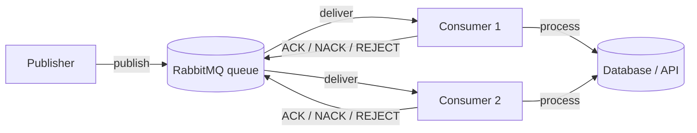
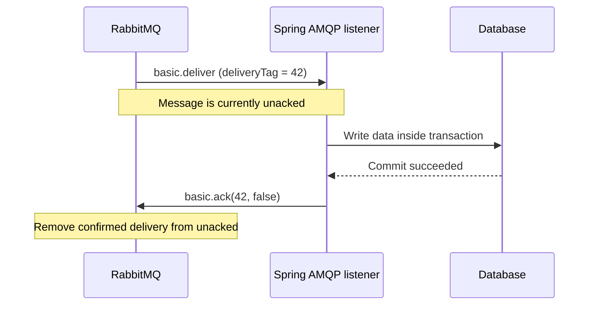

# Acknowledgments, Prefetch, and Consumer Concurrency

## 1. Three Mechanisms That Jointly Govern Message Consumption

In system integration with **Spring Boot, Spring AMQP, and RabbitMQ**, an application typically receives events from a queue, validates data, updates a database or calls another service, and only then finishes processing. Three settings directly govern the reliability and throughput of this flow:

- **Acknowledgment (ACK):** determines when a consumer notifies RabbitMQ that a message delivery has completed processing, or reports a failure.
- **Prefetch:** bounds how many delivered yet unacknowledged messages the broker can hold at each consumer.
- **Consumer concurrency:** determines how many independent consumption streams pull work concurrently from a queue.

For instance, an order-processing service consumes `OrderCreated` from queue `orders.process`. If it ACKs before saving the order, a crash after ACK can lose work. If it ACKs after the database transaction commits, a crash between commit and ACK can cause the same event to be redelivered. If prefetch is set too high while processing is slow, messages can accumulate at busy consumers, skewing distribution. If concurrency is raised too high, the downstream database or API can be overwhelmed.



**Distinguish the two types of confirmation:** consumer acknowledgment confirms *the delivery from RabbitMQ to the consumer*; publisher confirm confirms *the broker accepted the message sent by the publisher*. The two mechanisms govern separate stages and do not substitute for each other. Nor does having a durable queue (`durable`) or publishing persistent messages mean the consumer succeeded in processing them.

## 2. Lifecycle of a Message: Ready, Unacked, and ACK

While a message is waiting to be delivered, it is normally counted under **`messages_ready`**. Once the broker delivers a message to a consumer using manual acknowledgment, the message transitions to **`messages_unacknowledged`** (often called *unacked*). The broker retains responsibility for that delivery until it receives a valid acknowledgment or the consumer's channel/connection closes.



Each delivery carries a **delivery tag** issued by RabbitMQ scoped to a **channel**, not a business event ID. Tag `42` on channel A cannot be used to ACK a delivery on channel B. When RabbitMQ redelivers a message, the new delivery can carry a different delivery tag. Therefore, never store delivery tags in a database as deduplication keys; use `eventId`, `messageId`, or a stable business key defined by the event producer.

### 2.1. Acknowledgment Operations at the AMQP Level

| Operation | Meaning | Typical Consequence |
| --- | --- | --- |
| `basicAck(tag, false)` | Confirms a single delivery succeeded | RabbitMQ removes that message from unacked; this delivery is complete. |
| `basicNack(tag, false, true)` | Processing failed and requests `requeue` | The broker puts the message back for redelivery; it may be redelivered very quickly. |
| `basicNack(tag, false, false)` | Processing failed without requeue | The message routes to a dead-letter exchange (DLX) if configured; otherwise it is discarded. |
| `basicReject(tag, false)` | Rejects a single delivery without requeue | Same non-requeue outcome as above, except `basicReject` applies only to one message. |
| `basicAck(tag, true)` | ACKs multiple unacked deliveries up through `tag` on the same channel | Risks ACKing unfinished work; use with extreme caution. |

The `multiple` parameter of `basicAck`/`basicNack` applies to *multiple delivery tags*. In single-message listeners, `multiple = false` is standard. If a channel were shared across threads and threads ACKed without coordination, duplicate or wrong ACKs could trigger protocol errors like **`PRECONDITION_FAILED - unknown delivery tag`**, closing the channel and causing unacked deliveries to be redelivered.

When a consumer or channel disconnects before RabbitMQ receives an ACK, unacked messages become eligible for **redelivery** to another consumer or to the same consumer upon reconnect. The `redelivered` flag indicates RabbitMQ *may have delivered the message previously*—it does not tell whether a business transaction already completed.

### 2.2. Acknowledgment Modes in Spring AMQP

| `AcknowledgeMode` | Who Sends ACK? | When Is It Appropriate? | Things to Watch Out For |
| --- | --- | --- | --- |
| `AUTO` | **Spring listener container** ACKs after synchronous listener processing succeeds | Common default for synchronous handlers; easy to manage | This is **not** AMQP `autoAck=true`; if the handler catches an error and returns normally, the container may treat it as success and ACK. |
| `MANUAL` | **Application code** calls `basicAck`/`basicNack`/`basicReject` | When you must decide the exact ack moment, align with business outcomes, or manage controlled async | Must explicitly handle every completion and failure branch; never leave deliveries unacked indefinitely. |
| `NONE` | Broker treats the message as acknowledged upon delivery (`autoAck=true` at AMQP level) | Consider only when losing a message is acceptable | If the consumer crashes after receiving, the broker no longer waits for ACK to redeliver. QoS prefetch based on unacked no longer throttles similarly. |

Under `AUTO`, when a listener throws an exception, the container handles reject/NACK according to configuration and exception type. Whether it requeues by default depends on `defaultRequeueRejected` and requeue-controlling exceptions. **Do not manually call `channel.basicAck()` inside an `AUTO` listener**, as the container may ACK as well, causing a duplicate acknowledgment. Under `MANUAL`, business code owns acknowledging each delivery; throwing an exception expecting uniform ACK/NACK behavior across every version/configuration is unsafe.

### 2.3. ACK and Business Transaction Boundaries

Consider three distinct moments:

1. **Failure before commit:** if not yet ACKed, the message can be retried or routed to a DLQ. Classify errors to decide whether retrying makes sense.
2. **Commit succeeded yet ACK never reached the broker:** RabbitMQ may redeliver after a connection failure. The consumer must detect that the event was already applied to avoid crediting balances, creating duplicate orders, or issuing duplicate commands.
3. **ACK before work finishes:** if the process stops after ACK, RabbitMQ will not redeliver that delivery. This is a design bug whenever business rules require zero lost work.

A safe ordering for synchronous handlers is: **receive message → validate → process idempotently → commit required changes → ACK**. This ordering targets *at-least-once* processing; it does not create an atomic transaction spanning RabbitMQ and the database. If external side effects remain in other systems, consider a **transactional outbox**, target APIs supporting idempotency keys, or post-failure reconciliation.

## 3. Prefetch: Bounding Messages Held by a Consumer

In AMQP, `basic.qos` declares a prefetch count. Under RabbitMQ's common `global=false` behavior, RabbitMQ applies the limit **per consumer**. Setting `prefetch = 8` allows the broker to dispatch up to eight unacked messages to each eligible consumer. One message may be actively executing while the rest wait locally at the consumer.

```text
Queue: 100 messages ready
                 prefetch = 3 per consumer
                            ┌────────────────────────┐
RabbitMQ ── deliver ───────▶│ Consumer A: [x][ ][ ]   │  3 unacked
         └─────────────────▶│ Consumer B: [x][ ][ ]   │  3 unacked
                            └────────────────────────┘
                         [x] processing, [ ] received and waiting
```

Until Consumer A ACKs, RabbitMQ stops dispatching additional messages beyond A's prefetch cap, even when work remains in the queue. Consumer B can still receive deliveries within its own budget. The limit counts **unacknowledged messages**, not byte size and not necessarily the number of tasks executing in parallel inside the application.

If a consumer processes messages sequentially on a single thread, `prefetch = 20` does **not** run 20 handlers concurrently. It pre-buffers deliveries to hide network round-trip gaps. Actual concurrency depends on the consumer count and the listener execution model.

### 3.1. Choosing Prefetch Based on Workload Traits

| Setting | Benefit | Trade-off |
| --- | --- | --- |
| `prefetch = 1` | Holds few messages per consumer, redistributes work readily around slow consumers, leaves few queued locally on crash | Can incur extra delivery round-trips and lower throughput when network/ACK latency is significant. |
| Moderate `prefetch`, e.g., `8–20` | Keeps a steady work buffer; generally suits synchronous listeners with consistent processing times | Increases unacked count and consumer memory footprint. |
| Very large `prefetch` | Can help in fast-processing, high-throughput workloads confirmed by benchmarks | Risks hoarding work on slow consumers, skewing load and increasing wait times. |
| `prefetch = 0` | Applies no QoS cap under standard settings | Risks unbounded delivery; queue type or broker policies may impose separate limits. |

Numbers in this table are **starting points for load testing**, not universal presets. For example, with large payloads or memory-heavy handlers, `prefetch=20` may already be too high. Conversely, with tiny messages, fast handlers, and notable broker RTT, a tiny prefetch can starve consumers while the queue still holds messages.

RabbitMQ implements prefetch differences compared to channel-wide QoS wording in the AMQP spec. In particular, `global=true` creates a shared channel-level limit and alters behavior when multiple consumers share one channel. In Spring AMQP, prefer standard container configuration and measure actual unacked counts before tuning `basicQos` directly.

## 4. Consumer Concurrency: True Processing Capacity

**Consumer concurrency** is the number of consumers concurrently subscribed to a queue. In a standard synchronous listener, each consumer runs one handler at a time; raising consumers from 2 to 4 adds parallel capacity if CPU and downstream dependencies have headroom.

In Spring AMQP's **`SimpleRabbitListenerContainerFactory` / `SimpleMessageListenerContainer`**:

- `concurrentConsumers` / `concurrency`: initial/minimum consumer count.
- `maxConcurrentConsumers` / `max-concurrency`: upper limit allowing the container to scale consumers based on queue activity; not a guarantee that max consumers are always active.
- `prefetchCount` / `prefetch`: maximum unacked messages per consumer in typical setups.

In **`DirectRabbitListenerContainerFactory` / `DirectMessageListenerContainer`**, the key setting is **`consumersPerQueue`**. Do not carry `concurrency`/`max-concurrency` assumptions from the simple container to the direct container: the two containers manage consumers differently.

### 4.1. Relationship Between Prefetch and Concurrency

For one queue, assuming each consumer shares prefetch `P`, with `C` active consumers each holding a channel and quota normally:

\[
\text{Approximate max unacked messages} \leq P \times C
\]

For instance, `prefetch = 8` and `concurrency = 4` allow **up to about 32 delivered yet unacked messages** across those four consumers. With two replicas running four consumers each against the same queue, potential held messages grow to roughly **64 unacked**. Actual unacked counts may be lower if the queue lacks work, separate limits apply, or the container has not scaled up to max.

**Never confuse `P × C` with parallel execution count.** With synchronous sequential listeners per consumer, active handlers run close to `C`, whereas `P × C` reflects only the unacked delivery buffer. If each message takes 200 ms on average with no external bottleneck, one consumer has a theoretical ceiling around 5 messages/second, and four consumers around 20 messages/second. That is only a rough estimate—real throughput must be measured because DB/API latency, retries, network overhead, and resource contention dominate.

### 4.2. Why You Cannot Increase Consumers Without Limit

Adding consumers increases DB connections, outbound HTTP requests, memory consumption, and lock contention. When the true bottleneck is a database connection pool or a downstream API rate limit, raising concurrency can actually **reduce** throughput due to escalating timeouts and retries.

Always count **total consumers across all replicas**, not a single instance. For instance, three pods with up to six consumers each can create 18 concurrent consumers on a queue. If every handler checks out a DB connection, verify per-pod connection pool sizing alongside the database's global connection limit. Also track multiple queues bound to the same listener container, since consumer and prefetch totals no longer follow a simple single-queue formula.

### 4.3. Message Ordering

When multiple consumers read one queue, messages can **finish in a different order than delivered**. A slow message on Consumer A may finish after the next message on Consumer B. Requeues and redeliveries alter observed ordering further. If an event group requires sequential processing, design ordering by **business key** (e.g., sharding by `accountId` into dedicated single-consumer queues/partitions) or enforce versioning and state guards. Setting `prefetch = 1` with multiple consumers still does not guarantee global processing order.

## 5. Configuration in Spring Boot

### 5.1. Option A: Letting the Spring Container ACK on Success

For straightforward synchronous listeners, `AUTO` mode reduces ACK boilerplate:

```yaml
spring:
  rabbitmq:
    listener:
      simple:
        acknowledge-mode: auto
        prefetch: 8
        concurrency: 3
        max-concurrency: 6
        default-requeue-rejected: false
```

```java
@Component
public class OrderCreatedListener {
    private final OrderService orderService;

    public OrderCreatedListener(OrderService orderService) {
        this.orderService = orderService;
    }

    @RabbitListener(queues = "orders.process")
    public void onMessage(byte[] body) {
        orderService.processIdempotently(body); // returns after commit
    }
}
```

Here, the container ACKs when `onMessage` returns normally. If `processIdempotently` throws an exception, the listener container runs its error path. Setting `default-requeue-rejected: false` keeps rejected messages from automatically requeueing; they reach a DLQ only if the queue has a corresponding DLX configured. To retry, design bounded retries with backoff explicitly rather than assuming a DLQ or broker will provide delayed retries automatically.

Common trap: catching `Exception` inside the listener and merely logging it causes the method to return normally, prompting the container to ACK even though business logic failed. Under `AUTO`, let errors needing recovery propagate to the container or use an intentional error handler/recoverer. A listener that dispatches async work and returns immediately also requires a different design, since ACK can occur before that async work completes.

### 5.2. Option B: Explicit ACK Decisions in `MANUAL` Mode

When distinguishing permanent bad data, dependency outages, and successful processing:

```yaml
spring:
  rabbitmq:
    listener:
      simple:
        acknowledge-mode: manual
        prefetch: 8
        concurrency: 3
        max-concurrency: 6
```

The following example reads events with `ObjectMapper`, applies idempotent business updates, and then ACKs. Unparseable messages are rejected; downstream processing failures are nacked without requeue so operations can investigate or run controlled replays from the DLQ.

```java
import com.fasterxml.jackson.core.JsonProcessingException;
import com.fasterxml.jackson.databind.ObjectMapper;
import com.rabbitmq.client.Channel;
import java.io.IOException;
import org.springframework.amqp.rabbit.annotation.RabbitListener;
import org.springframework.amqp.support.AmqpHeaders;
import org.springframework.messaging.handler.annotation.Header;
import org.springframework.stereotype.Component;

@Component
public class OrderConsumer {
    private final ObjectMapper mapper;
    private final OrderProcessor processor;

    public OrderConsumer(ObjectMapper mapper, OrderProcessor processor) {
        this.mapper = mapper;
        this.processor = processor;
    }

    @RabbitListener(queues = "orders.process")
    public void consume(byte[] body, Channel channel,
                        @Header(AmqpHeaders.DELIVERY_TAG) long tag)
            throws IOException {
        final OrderCreated event;
        try {
            event = mapper.readValue(body, OrderCreated.class);
        } catch (JsonProcessingException invalidPayload) {
            channel.basicReject(tag, false);  // Do not requeue; route to DLX if configured
            return;
        }

        try {
            processor.applyIdempotently(event); // Commit completes before returning
        } catch (Exception processingFailure) {
            channel.basicNack(tag, false, false); // Route to DLX if configured
            return;
        }

        channel.basicAck(tag, false); // ACK only after business processing succeeds
    }
}

record OrderCreated(String eventId, String orderId) {}

interface OrderProcessor {
    void applyIdempotently(OrderCreated event);
}
```

`OrderProcessor` is an illustrative business contract; its implementation must be a Spring bean using proper transactions so `applyIdempotently` returns only after required changes have committed. Configure DLX/DLQ before adopting `requeue=false`; otherwise rejected messages can be discarded. In production, log `eventId`, failure reason, and metrics while avoiding logging raw sensitive payloads.

Note three important caveats in this example:

- An `IOException` while sending ACK/NACK does not prove whether the broker received the frame. Never guess state by retrying ACK blindly; let connection recovery and **idempotency** handle potential redelivery.
- `basicNack(tag, false, true)` may work for brief transient glitches, yet immediate repeated requeue creates a **hot retry loop**. Use finite attempt caps, backoff delays, DLQs, or dedicated retry tiers.
- Never let multiple threads concurrently ACK delivery tags on one channel without coordination. In particular, avoid `multiple=true` under uncoordinated parallel processing.

### 5.3. Using a Direct Listener Container

A conceptually equivalent configuration using the `direct` container type looks like:

```yaml
spring:
  rabbitmq:
    listener:
      type: direct
      direct:
        acknowledge-mode: auto
        prefetch: 8
        consumers-per-queue: 3
```

`consumers-per-queue` sets the number of consumers **per queue** for the direct container. Choose one container type per listener and place properties under that type's section; do not mix `simple.concurrency` with `direct` expecting both to take effect.

## 6. Designing Deduplication Alongside ACK

Even when ACKing after commit, a RabbitMQ disconnect right after commit can cause redelivery. A common solution persists `eventId` in a deduplication table with a unique constraint **inside the same transaction** as the business update:

```sql
-- Illustrative table; column types vary by DBMS.
CREATE TABLE processed_event (
    consumer_name VARCHAR(100) NOT NULL,
    event_id      VARCHAR(100) NOT NULL,
    PRIMARY KEY (consumer_name, event_id)
);
```

Conceptual flow:

1. Start a database transaction.
2. Attempt to `INSERT` `(consumer_name, event_id)`. If it already exists, treat it as an already-processed duplicate and finish the transaction cleanly.
3. If newly inserted, apply business updates inside **that same transaction**.
4. Commit; once committed, return to the listener so it can ACK.

A separate check-then-insert fails when multiple consumers run concurrently; rely on a real unique constraint and atomic insert (`INSERT ... ON CONFLICT DO NOTHING` or database equivalent). When side effects occur outside the database, a database transaction alone cannot make RabbitMQ ACK and an HTTP call atomic together; add patterns such as outbox and idempotency at the target service.

## 7. Data-Driven Tuning of Prefetch and Concurrency

Suppose a service runs two pods, each with `concurrency=3` and `prefetch=10`. When all six consumers are active, the total unacked allowance is about **60 messages**. If each message takes 300 ms to process synchronously, the simple handler throughput ceiling is `6 / 0.3 = 20 messages/sec` assuming no other bottlenecks. Raising prefetch from 10 to 100 will not multiply 20 by ten. Raising concurrency can help if the DB/API has spare headroom, yet must be measured.

A controlled tuning workflow:

1. **Define targets:** ingress rate, processing rate, P95/P99 latency, acceptable queue backlog, DB/API capacity, and ordering constraints.
2. **Start with bounded defaults:** e.g., prefetch 5–10 and consumer counts matching pod resources; these are strictly test starting points.
3. **Measure under steady and burst load:** throughput, queue lag, processing duration, timeout errors, retries, and unacked counts.
4. **Adjust one variable at a time:** if consumers idle on delivery round-trips, raise prefetch; if handlers stay busy and dependencies have headroom, raise consumers; if the DB/API saturates, reduce pressure and resolve the bottleneck first.
5. **Test failover:** stop a consumer/pod while messages are unacked and observe redeliveries, recovery time, idempotency, and DLQ behavior. Repeat with failures right after commit before ACK.

### 7.1. Reading RabbitMQ Metrics to Locate Bottlenecks

| Observation | What May Be Happening | What to Inspect |
| --- | --- | --- |
| `messages_ready` climbing steadily while consumers are busy | Arrival rate exceeds processing rate | Handler duration, DB/API latency, active consumer count, CPU, rate limits. |
| `messages_unacknowledged` high and persistent | Consumers received deliveries yet are not ACKing; slow handlers or oversized prefetch | Prefetch, handler duration, deadlocks, connection pools, hung threads. |
| `messages_ready` high while unacked is low | Consumers are not pulling work as expected | Consumer count, connections/channels, paused/cancelled consumers, listener errors, or broker limits. |
| `redeliver` rate spiking | Messages repeatedly redelivered | Requeue loops, crashes/restarts, recurring business errors, retry policies. |
| DLQ growing | Messages rejected, out of retries, or expired per design | Error types, affected message volume, remediation and replay workflow. |

Monitor **ready**, **unacked**, **consumer count**, publish/deliver/ack/redeliver rates, processing latency, errors, DLQ depth, and downstream resources together. A high unacked count is a signal to investigate, not proof of failure on its own: with large prefetch, many messages may simply be legitimately buffered.

## 8. Common Mistakes and How to Avoid Them

| Design or Config Mistake | Consequence | Fix |
| --- | --- | --- |
| ACKing before business commit | Work can be lost after a crash | Commit first, then ACK; use idempotency to survive redeliveries. |
| Believing `AUTO` means broker auto-ack at delivery | Misunderstands confirmation timing | `AUTO` means container ACKs on synchronous success; `NONE` is broker auto-ack. |
| Catching exceptions and returning normally in `AUTO` | Failed messages can be ACKed | Classify errors and propagate to container/error handler properly. |
| Infinite `basicNack(..., requeue=true)` | Hot retry loops, rising CPU/network, zero progress | Bounded retries with backoff, DLQ, and controlled replay. |
| Overly large `prefetch` with heavy payloads | High unacked counts, uneven distribution, high RAM | Lower prefetch; measure distribution and wait times. |
| Multiplying `prefetch × concurrency` to estimate active threads | Overestimates true throughput | Distinguish buffered unacked messages from concurrent handlers. |
| Raising concurrency while ignoring replica count | Overwhelms downstream DB/APIs | Calculate total consumers across the full deployment and cap shared resources. |
| Assuming multiple consumers preserve processing order | Out-of-order state mutations | Partition by business key or enforce versioning/idempotency. |
| NACK/REJECT without requeue and no DLX | Messages can be permanently dropped | Provision DLX/DLQ, alerting, and replay workflow before launch. |

## 9. Integration Flow Application Checklist

Before taking a RabbitMQ listener to production, answer these questions:

1. Does the handler execute synchronously and return after business completion, or spawn async work?
2. Are you using `AUTO`, `MANUAL`, or `NONE`; who owns ACKing, and where does every error branch lead?
3. Where is the business commit boundary, and are redeliveries between commit and ACK handled safely?
4. Which messages retry vs. go to DLQ; are retry limits, backoff, and replay procedures in place?
5. What is prefetch **per consumer**; with large/slow messages, is total unacked safe?
6. What is the total consumer count across all pods; can connection pools, CPU, and downstream APIs sustain it?
7. Are there per-customer/account/order ordering rules, and could concurrency break them?
8. Have you measured `ready`, `unacked`, `redeliver`, `ack rate`, processing latency, and DLQ under load tests and consumer crashes?

**Connecting the three mechanisms:** acknowledgments define delivery safety; prefetch bounds how many messages the broker sends ahead of ACKs; and concurrency sets true parallelism. In Spring Boot integration flows, place ACK at business boundaries, secure idempotency before scaling speed, and tune prefetch and consumers using operational metrics.
