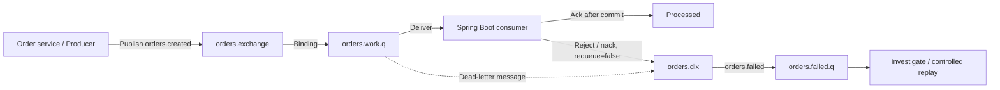
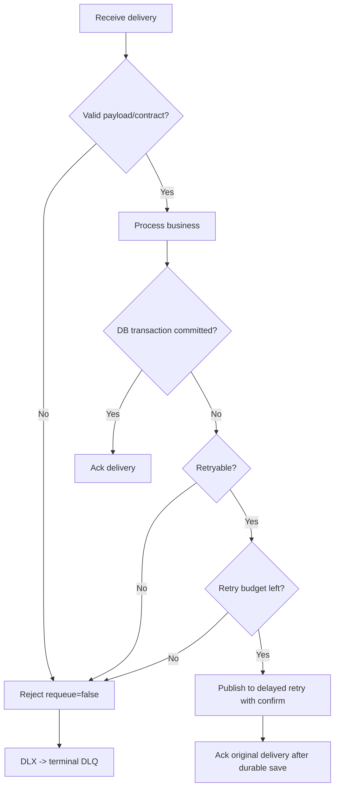
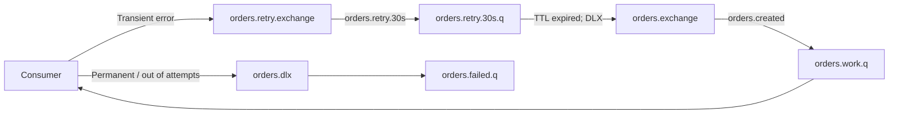
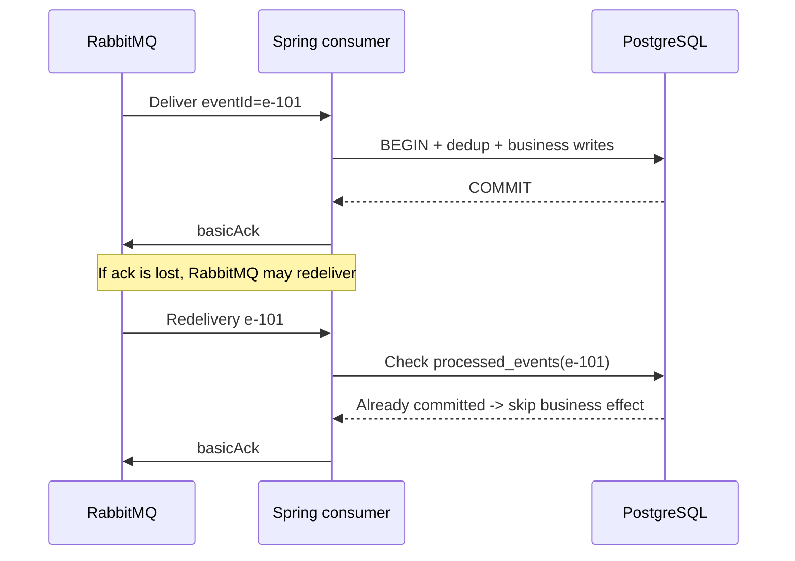
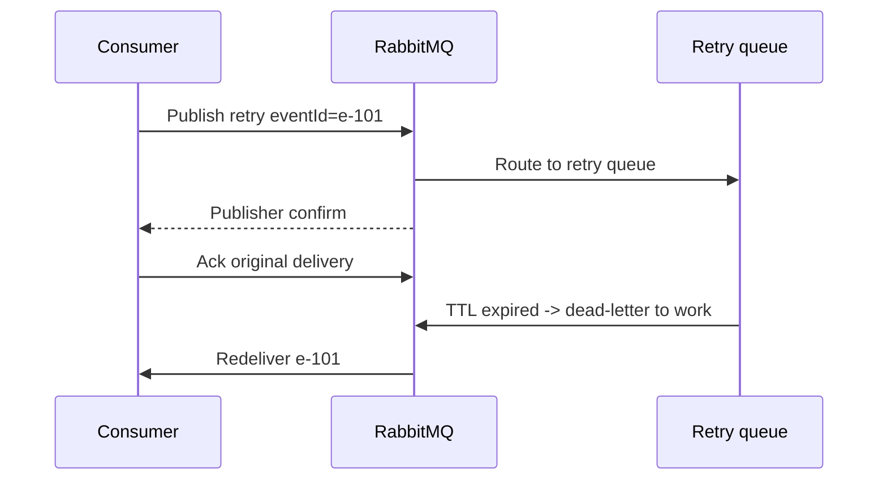
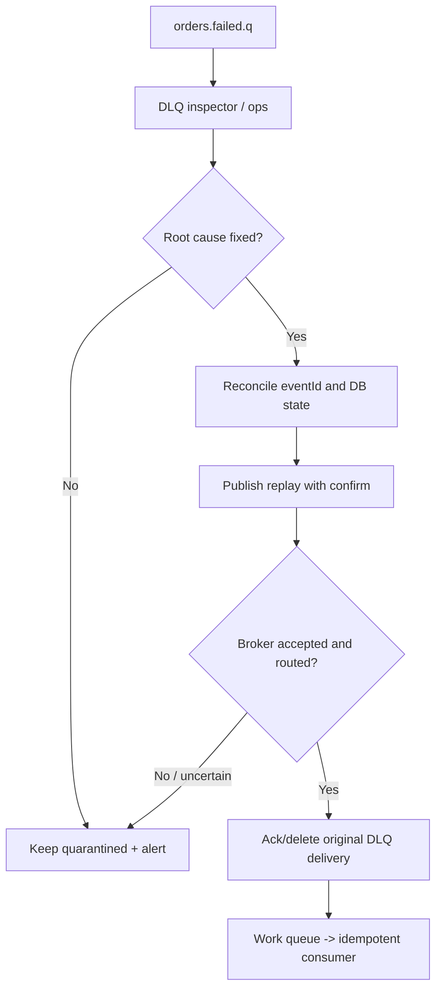
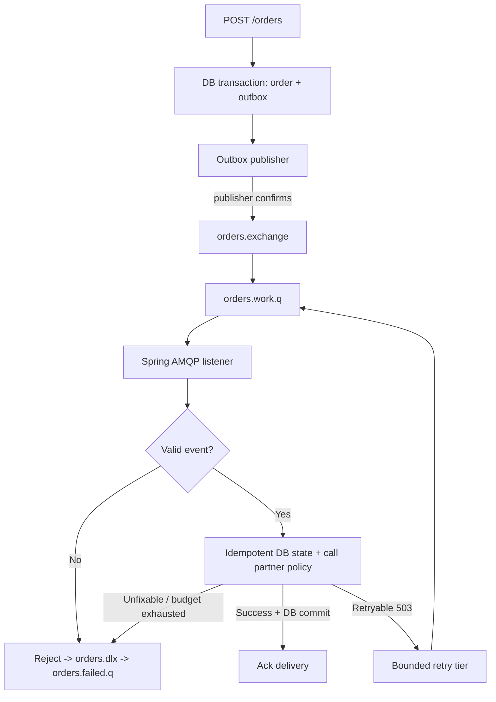

# Dead-Letter Exchanges and Post-Failure Handling Policies

In a Spring Boot integration system, RabbitMQ commonly receives events or commands from HTTP APIs, databases, and other services. A consumer may hit transient failures due to DB disconnects, downstream HTTP rate limits, or encounter invalid data that fails even after retries. Repeatedly returning failing messages to the same queue puts consumers in a hot loop; ACKing success before business work completes drops messages from the processing flow.

A **Dead-letter exchange (DLX)** is RabbitMQ's mechanism for rerouting messages from a queue once they become *dead-lettered*. A **Dead-letter queue (DLQ)** is simply the queue that receives those messages via exchange routing; a DLQ is not a special protocol queue type. DLX helps build delayed retry policies, isolate malformed data, investigate root causes, and replay messages. Yet a DLX **does not automatically provide bounded retries, deduplication, durability across all failures, or successful business recovery**.

This lesson belongs to the **RabbitMQ and AMQP** chapter of `SPRING_BOOT_INTEGRATION`. Its goal is to design practical failure-handling flows with Spring Boot/Spring AMQP covering data contracts, DB transactions, idempotency, error policies, observability, and testing. Examples use RabbitMQ, Spring Boot, Spring AMQP, and PostgreSQL; TTL values, retry counts, and queue names are illustrative.

## 1. From Exchange to Queue and the Path of Failed Messages

RabbitMQ normally routes messages via **exchange → binding → queue**. Producers publish to an exchange with a routing key; the exchange selects target queues based on exchange type and bindings. Consumers receive deliveries from queues and respond with ack or nack/reject depending on processing outcomes.



**Dead-lettering happens at the broker according to the source queue's policy.** When a consumer sends `basic.reject` or `basic.nack` with `requeue=false`, RabbitMQ can forward the message to the configured DLX. If the queue has no DLX, or the DLX routes to no queue, never assume the message is safely preserved.

| Component | Role |
| --- | --- |
| `orders.exchange` | Exchange where producers publish business events |
| `orders.work.q` | Queue processed by normal consumers |
| `orders.dlx` | Exchange receiving dead-lettered messages from the source queue |
| `orders.failed.q` | Durable queue isolating failed messages after DLX routing |
| Routing key `orders.failed` | Key binding the DLX to the DLQ in this example |
| `basic.ack` | Confirms a delivery succeeded per consumer contract |
| `basic.reject`/`basic.nack` | Rejects a delivery, requesting requeue or dead-lettering |

Key distinctions to remember:

- **A DLX is an exchange**, not a queue; a single DLX can route to multiple queues via bindings.
- **A DLQ is the destination queue**, which may be a classic or quorum queue as needed. Names ending in `*.dlq` are merely a naming convention.
- **Publisher confirms** confirm broker receipt of a producer publish per config, completely separate from **consumer acknowledgments** of a delivery.
- **A dead-lettered message** does not mean the issue is fixed or business processing finished; it represents an operational state transition.

## 2. When Does RabbitMQ Route a Message to a Dead-Letter Exchange?

Supported RabbitMQ triggers include:

| Situation | Trigger | Common `x-death.reason` | Notes |
| --- | --- | --- | --- |
| Consumer rejects without requeue | `basic.reject(deliveryTag, false)` or `basic.nack(tag, false, false)` | `rejected` | DLX must be configured on the **source queue** |
| Message expires in queue | Per-message or queue-level TTL | `expired` | TTL measures **time waiting in queue**, not business execution limits |
| Queue exceeds length limit | `max-length`/`max-length-bytes` policy with matching overflow mode | `maxlen` | Behavior depends on queue type, overflow policy, and version |
| Quorum queue exceeds redelivery cap | `delivery-limit` on quorum queues | `delivery_limit` | Useful for isolating poison messages after repeated redeliveries |

A delivery **does not automatically dead-letter** merely because a business method throws an exception. The Spring AMQP listener container must decide ack/nack/reject/requeue according to configuration or its error handler. Under auto acknowledgment, the framework normally acks on normal return and routes exceptions per container policy. Under manual acknowledgment, application code must ack/nack explicitly at the right moment.

### 2.1. `requeue=true` vs. `requeue=false`

```text
basicAck(tag, false)
  -> delivery confirmed; does not go to DLX

basicReject(tag, true) / basicNack(tag, false, true)
  -> broker requeues delivery; may redeliver very soon

basicReject(tag, false) / basicNack(tag, false, false)
  -> delivery not requeued; dead-lettered if queue has DLX
```

`basic.nack` takes a `multiple` parameter; pass `multiple=false` to settle only a single delivery. Delivery tags are scoped to a **RabbitMQ channel**—never reuse them to ack on another channel. Closing a channel or connection with unacked deliveries typically causes RabbitMQ to requeue/redeliver them; account for cases where the handler already committed to the DB before disconnecting.

**Never pick `requeue=true` for every error.** For schema-invalid payloads or orders violating permanent invariants, consumers will immediately redeliver the exact same bad data, wasting CPU, network, and logs while starving valid messages behind it.

### 2.2. TTL Triggers Dead-Lettering, Not Precision Scheduling

Message TTL in a queue is the lifetime before the message expires in that queue. Upon expiration, the broker can dead-letter it to the DLX. In certain queue types and configurations, expired messages may not be evicted instantly if blocked behind earlier messages; **never use TTL as a millisecond-accurate timer**.

**Queue** TTL differs from **message** TTL:

- `x-message-ttl` (or `message-ttl` policy) caps how long messages wait in the queue.
- `x-expires` (or matching policy) specifies how long an unused queue stays alive before auto-deletion—never use it for message delays.
- Producer-set per-message expiration and queue-level TTL can coexist; expiration happens according to whichever triggers first.

A retry queue with a 30-second TTL provides an *approximate wait window* before dead-lettering back to the work queue, not a guarantee of exact 30-second redelivery.

## 3. Declaring DLX and DLQ Topology in Spring Boot

The application uses `spring-boot-starter-amqp` for Spring AMQP/RabbitMQ support. Gradle example:

```gradle
dependencies {
    implementation 'org.springframework.boot:spring-boot-starter-amqp'
    implementation 'org.springframework.boot:spring-boot-starter-jdbc'
    runtimeOnly 'org.postgresql:postgresql'
}
```

Minimal design:

```text
orders.exchange (direct)
  orders.created -> orders.work.q

orders.work.q:
  dead-letter-exchange = orders.dlx
  dead-letter-routing-key = orders.failed

orders.dlx (direct)
  orders.failed -> orders.failed.q
```

Spring AMQP Java configuration example:

```java
@Configuration(proxyBeanMethods = false)
public class OrdersRabbitTopology {
    public static final String EVENTS_EXCHANGE = "orders.exchange";
    public static final String WORK_QUEUE = "orders.work.q";
    public static final String DLX = "orders.dlx";
    public static final String FAILED_QUEUE = "orders.failed.q";

    @Bean
    DirectExchange ordersExchange() {
        return new DirectExchange(EVENTS_EXCHANGE, true, false);
    }

    @Bean
    DirectExchange ordersDeadLetterExchange() {
        return new DirectExchange(DLX, true, false);
    }

    @Bean
    Queue ordersWorkQueue() {
        return QueueBuilder.durable(WORK_QUEUE)
                .deadLetterExchange(DLX)
                .deadLetterRoutingKey("orders.failed")
                .build();
    }

    @Bean
    Queue ordersFailedQueue() {
        return QueueBuilder.durable(FAILED_QUEUE).build();
    }

    @Bean
    Binding workBinding(
            @Qualifier("ordersWorkQueue") Queue ordersWorkQueue,
            @Qualifier("ordersExchange") DirectExchange ordersExchange) {
        return BindingBuilder.bind(ordersWorkQueue)
                .to(ordersExchange).with("orders.created");
    }

    @Bean
    Binding deadLetterBinding(
            @Qualifier("ordersFailedQueue") Queue ordersFailedQueue,
            @Qualifier("ordersDeadLetterExchange")
                    DirectExchange ordersDeadLetterExchange) {
        return BindingBuilder.bind(ordersFailedQueue)
                .to(ordersDeadLetterExchange).with("orders.failed");
    }
}
```

Required imports: `org.springframework.amqp.core.DirectExchange`, `Queue`, `QueueBuilder`, `Binding`, `BindingBuilder`; `org.springframework.beans.factory.annotation.Qualifier` plus `@Configuration` and `@Bean`. Use `@Qualifier` whenever multiple `Queue` or `DirectExchange` beans exist. This declares standard **classic durable queues**. Spring's `RabbitAdmin` can declare these beans when connected with proper permissions; verify vhost, credentials, queue types, and existing topology.

### 3.1. Durable Queues Do Not Mean Every Message Is Persisted Durably

`durable=true` ensures queue definitions survive broker restarts. Message durability also depends on **delivery mode** (persistent), queue type, broker confirms, replication, and RabbitMQ storage configuration. Producers should publish with persistent delivery mode and use **publisher confirms** whenever zero event loss is required; `RabbitTemplate.convertAndSend(...)` returning does not prove durable persistence.

To survive node failures, consider quorum queues and appropriate clustering. A classic durable queue on a single node does not survive node loss automatically. When migrating classic queues to quorum queues, plan compatibility and migration steps rather than trying to alter an existing queue's type simply by deploying modified bean arguments.

### 3.2. Why Production Often Configures DLX via Policies

The snippet above sets `x-dead-letter-exchange` and `x-dead-letter-routing-key` in **queue arguments**. That is easy to learn, yet arguments on existing queues generally cannot be changed without deleting/redeclaring or migrating; RabbitMQ rejects mismatched redeclarations with `PRECONDITION_FAILED`.

For live operational topologies, RabbitMQ recommends configuring DLX settings via **policies** for flexibility:

```bash
rabbitmqctl set_policy orders-dlx "^orders\\.work\\.q$" \
  '{"dead-letter-exchange":"orders.dlx","dead-letter-routing-key":"orders.failed"}' \
  --apply-to queues
```

This illustrates shell line-continuation `\`; admin rights and targeting the right vhost are required. When using policies, **omit `.deadLetterExchange(...)`/`.deadLetterRoutingKey(...)` from the queue bean declaration** so the policy controls them; client-supplied `x-arguments` generally take precedence over user policies. Note that policies cannot alter every immutable queue attribute.

Ensure the RabbitMQ user holds appropriate permissions for declaring/binding and dead-letter routing. Verify permissions across DLXs and target topology during provisioning; missing rights or bindings can silently prevent messages from reaching the DLQ.

## 4. Classify Errors Before Choosing Ack, Retry, or DLQ

Not every failure shares the same fix. Base policies on **root cause** and **business impact**, not merely exception presence.

| Error Class | Examples | Recommended Action |
| --- | --- | --- |
| **Unretryable with current data** | Schema-invalid JSON, unsupported enum, missing required field, invalid partner code | Reject `requeue=false` to terminal DLQ; record reason and coordinate fix |
| **Business error waiting on state change** | Order not yet created, prerequisite entity not ready | Delayed retry with deadline; move to DLQ if overdue |
| **Transient infrastructure failure** | DB timeout, HTTP 503, Redis disconnect, momentary broker congestion | Bounded retry with backoff/jitter; throttle concurrency |
| **Contract or configuration error** | Bad credentials, missing exchange binding, incompatible transformer | Halt/route to DLQ; alert to fix config, avoid hot retries |
| **Uncertain commit outcome** | DB committed then consumer lost connection before ack | Allow redelivery; idempotent consumer reconciles via event ID |
| **Unclassified unexpected error** | Runtime exception, handler code bug | Cap attempts; send to DLQ with diagnostic metadata |



The hard part in this diagram is **forwarding to delayed retry and then ACKing the original message**: publishing to the retry queue and ACKing the source delivery do not form an atomic transaction automatically. If the retry publish succeeds yet the ACK drops, the message can run twice. If ACK fires early and the publish fails, the message is lost. Later sections explain safe designs per required guarantee level.

## 5. Choosing a Retry Strategy: In-Consumer, Retry Queue, or Straight to DLQ?

Not every failure belongs in another queue. Three primary options exist:

| Strategy | How It Works | Pros | Cons |
| --- | --- | --- | --- |
| Short in-consumer retry | Retries handler a few times with backoff before ack/nack | Simple; handles brief glitches | Holds consumer slot; long retries starve throughput |
| Delayed retry via dedicated queue | Publishes to retry queue; TTL dead-letters back to work queue | Frees consumers while waiting | Must guard publish+ack, cap attempts, and prevent loops |
| Straight to terminal DLQ | Reject/nack `requeue=false` for RabbitMQ dead-lettering | Isolates poison messages and permanent failures | Requires operators/tooling to fix, replay, and watch backlogs |

A practical hybrid: validate payloads first, run two short in-process retries for brief blips, then route through 30-second and 5-minute retry queues up to a retry cap, and finally move to a terminal DLQ when budget expires or errors are permanent. Choose timings based on SLAs, downstream recovery times, and capacity—not RabbitMQ defaults.

### 5.1. Bounded Retry in Spring AMQP

For brief in-listener retries, configure **AUTO acknowledge** with Spring Retry advice. Example using `RetryInterceptorBuilder`:

```java
@Configuration(proxyBeanMethods = false)
public class OrdersListenerConfiguration {

    @Bean("ordersAutoAckListenerFactory")
    SimpleRabbitListenerContainerFactory ordersListenerFactory(
            ConnectionFactory connectionFactory) {

        SimpleRabbitListenerContainerFactory factory =
                new SimpleRabbitListenerContainerFactory();
        factory.setConnectionFactory(connectionFactory);
        factory.setAcknowledgeMode(AcknowledgeMode.AUTO);
        factory.setDefaultRequeueRejected(false);
        factory.setPrefetchCount(10);
        factory.setAdviceChain(
                RetryInterceptorBuilder.stateless()
                        .maxAttempts(3)
                        .backOffOptions(500, 2.0, 2000)
                        .recoverer(new RejectAndDontRequeueRecoverer())
                        .build());
        return factory;
    }
}
```

Imports: `org.springframework.amqp.rabbit.config.SimpleRabbitListenerContainerFactory`, `RetryInterceptorBuilder`, `org.springframework.amqp.rabbit.connection.ConnectionFactory`, `org.springframework.amqp.rabbit.retry.RejectAndDontRequeueRecoverer`, and `org.springframework.amqp.core.AcknowledgeMode`. Depending on Spring Boot/Spring AMQP version, an explicit Spring Retry dependency may be needed; check your dependency graph.

Listener usage:

```java
@RabbitListener(
        queues = "orders.work.q",
        containerFactory = "ordersAutoAckListenerFactory")
public void onOrder(OrderCreatedEvent event) {
    orderProcessor.processOnce(event);
}
```

`orderProcessor.processOnce` must commit durable business state **before** the listener method returns normally. If the handler still throws after three attempts, `RejectAndDontRequeueRecoverer` rejects the delivery so the broker dead-letters it per config. `maxAttempts(3)` counts the initial attempt plus two retries—not three extra retries.

This baseline policy retries many unrecoverable errors too unless an exception classifier is added. In production, configure retry policies by error cause/data category so poison messages move straight to the DLQ. Converter exceptions thrown **before the Java listener runs** go through the container's error handler, bypassing any `try/catch` inside the method—include integration tests for those too.

**Do not combine this AUTO-ack pattern with manual `channel.basicAck(...)` calls inside the same listener.** If you need manual delivery control, switch to the `MANUAL` pattern in Section 6.

### 5.2. Delayed Retry Architecture Using TTL and DLX

A common 30-second retry topology:



The retry queue has no business consumer. It holds messages until TTL expires and dead-letters them back to the work exchange. Source queue `orders.work.q` still points its DLX to the **terminal DLQ**; on transient errors, the consumer explicitly republishes a retry message per rules rather than rejecting straight into the terminal DLQ.

Java DSL additions to the topology:

```java
@Bean
DirectExchange ordersRetryExchange() {
    return new DirectExchange("orders.retry.exchange", true, false);
}

@Bean
Queue ordersRetry30SecondsQueue() {
    return QueueBuilder.durable("orders.retry.30s.q")
            .ttl(30_000)
            .deadLetterExchange("orders.exchange")
            .deadLetterRoutingKey("orders.created")
            .build();
}

@Bean
Binding ordersRetry30SecondsBinding(
        @Qualifier("ordersRetry30SecondsQueue")
                Queue ordersRetry30SecondsQueue,
        @Qualifier("ordersRetryExchange")
                DirectExchange ordersRetryExchange) {
    return BindingBuilder.bind(ordersRetry30SecondsQueue)
            .to(ordersRetryExchange)
            .with("orders.retry.30s");
}
```

Add these **additional beans** to the same `@Configuration` or a separate config class with the same imports as Section 3. Distinct bean names prevent collisions with work/failed beans. To manage TTL/DLX via RabbitMQ policies, drop `ttl(...)`/`deadLetterExchange(...)`/`deadLetterRoutingKey(...)` from the queue builder and apply matching broker policies.

**There is no automatic attempt limit in this topology.** If the consumer endlessly republishes to the retry queue on error, messages cycle forever. The application must enforce the retry budget—for instance, persisting attempt counts and deadlines in a workflow/DB table keyed by `eventId`, or propagating a trusted internal retry header consistently across hops. Never blindly trust attempt counters supplied by untrusted external producers.

### 5.3. Why Avoid One Retry Queue with Varying Per-Message TTLs?

Suppose a queue holds two messages: the head message has a 10-minute TTL, and the message behind it has a 1-second TTL. Depending on queue type and expiration mechanics, the trailing message may not dead-letter upon expiry until it reaches the front. This is *head-of-line blocking*.

With TTL-based retries, using **multiple fixed-TTL queues** (e.g., 30s, 5m, 30m) is much more predictable. If exact per-message retry schedules are required, consider a persistent state-backed scheduler or a delayed-delivery plugin/mechanism supported and tested in your deployment environment. Delayed-message exchange plugins are not included out of the box merely because RabbitMQ is installed.

### 5.4. Avoiding Infinite Dead-Letter Cycles

When a retry queue dead-letters back to the work queue, consumers must know when to **divert to the terminal DLQ**. Misconfigured retry routing can also trap messages in zero-progress cycles. RabbitMQ detects certain dead-letter cycles and drops messages under specific rules, yet you must never rely on cycle detection as a retry policy.

Trace the exact route:

```text
orders.work.q --[explicit retry publish]--> orders.retry.30s.q
orders.retry.30s.q --[TTL expired]-------> orders.work.q
orders.work.q --[reject, no requeue]----> orders.failed.q
```

Enforce the "budget exhausted" rule **before** republishing to the retry queue. Never configure TTL + DLX on the terminal DLQ pointing back to the work queue automatically—that turns your investigation bin into an uncontrolled retry loop.

## 6. Manual Acknowledgment and Business Transactions

The following uses **manual ack**, explicitly routing unfixable business exceptions or unresolved failures to the terminal DLQ. This is an **alternative** to `ordersAutoAckListenerFactory` in Section 5.1—do not combine both ack modes on one listener.

```yaml
spring:
  rabbitmq:
    host: localhost
    port: 5672
    listener:
      simple:
        acknowledge-mode: manual
        prefetch: 10
```

DTO example:

```java
public record OrderCreatedEvent(
        UUID eventId,
        String orderId,
        BigDecimal amount,
        String currency) {
}
```

Listener example:

```java
@Component
public class OrdersConsumer {
    private final OrderEventProcessor processor;

    public OrdersConsumer(OrderEventProcessor processor) {
        this.processor = processor;
    }

    @RabbitListener(queues = "orders.work.q", ackMode = "MANUAL")
    public void consume(
            OrderCreatedEvent event,
            Channel channel,
            @Header(AmqpHeaders.DELIVERY_TAG) long tag)
            throws IOException {

        try {
            processor.processOnce(event);
        } catch (InvalidOrderEventException permanent) {
            channel.basicReject(tag, false);
            return;
        } catch (RuntimeException other) {
            // Example policy: route to terminal DLQ for investigation;
            // bounded retry/delay from Section 5 is an optional add-on.
            channel.basicNack(tag, false, false);
            return;
        }

        // Ack only after the business service has committed.
        channel.basicAck(tag, false);
    }
}
```

Imports: `com.rabbitmq.client.Channel`, `java.io.IOException`, `org.springframework.amqp.rabbit.annotation.RabbitListener`, `org.springframework.amqp.support.AmqpHeaders`, and `org.springframework.messaging.handler.annotation.Header`. `InvalidOrderEventException` and `OrderEventProcessor` are application-defined. Configure a JSON converter compatible with `OrderCreatedEvent` if producers emit JSON; Spring cannot decode arbitrary DTOs without a matching converter.

Key principle: `processor.processOnce(event)` executes on a separate bean and **commits its DB transaction before returning**. If SQL fails before commit, the listener can reject or retry. If DB commits yet `basicAck` fails to reach the broker due to a disconnect, the broker may redeliver. Consumers must treat duplicates **as normal**, even when manual ack ordering is exact.

If `channel.basicAck`/`basicNack` throws an I/O error, broker state is uncertain. Never retry ack with an old delivery tag on a closed channel. Once connectivity recovers, the broker redelivers unconfirmed messages per queue semantics.

### 6.1. Ack After Commit, Never Before



ACKing before writing to the DB is dangerous: if the consumer dies between ack and DB commit, the broker considers the message done while business effects are lost. For critical data, always **commit DB before ack** and guard against duplicates with unique constraints/idempotency.

### 6.2. Deduplicating Inside the Same DB Transaction

PostgreSQL example:

```sql
CREATE TABLE processed_events (
    consumer_name VARCHAR(100) NOT NULL,
    event_id UUID NOT NULL,
    processed_at TIMESTAMPTZ NOT NULL DEFAULT NOW(),
    PRIMARY KEY (consumer_name, event_id)
);

CREATE TABLE order_projection (
    order_id VARCHAR(120) PRIMARY KEY,
    amount NUMERIC(18, 2) NOT NULL,
    currency CHAR(3) NOT NULL
);
```

Idempotent processor example:

```java
@Service
public class OrderEventProcessor {
    private final JdbcTemplate jdbc;

    public OrderEventProcessor(JdbcTemplate jdbc) {
        this.jdbc = jdbc;
    }

    @Transactional
    public void processOnce(OrderCreatedEvent event) {
        validateContract(event);

        int inserted = jdbc.update(
                """
                INSERT INTO processed_events (consumer_name, event_id)
                VALUES (?, ?)
                ON CONFLICT (consumer_name, event_id) DO NOTHING
                """,
                "order-projection",
                event.eventId());
        if (inserted == 0) {
            return; // This event already committed earlier.
        }

        jdbc.update(
                """
                INSERT INTO order_projection (order_id, amount, currency)
                VALUES (?, ?, ?)
                ON CONFLICT (order_id) DO NOTHING
                """,
                event.orderId(), event.amount(), event.currency());
    }
}
```

`validateContract` is project-defined to validate event ID, schema, amount, currency, and invariants; `@Transactional` must run through a Spring proxy sharing the same `DataSource` and transaction manager as `JdbcTemplate`. If the projection insert fails, the `processed_events` marker rolls back too. If DB commits and ack drops, redelivery inserts no new marker and skips re-applying SQL updates.

**Limitation of this snippet:** `ON CONFLICT(order_id) DO NOTHING` stops duplicate row inserts, yet does not verify whether two payloads carry identical values. If the same `eventId` or `orderId` arrives with differing payloads, production systems must compare fingerprints/semantic fields, flag conflicts, or enforce versioning/ordering policies—never silently drop a valid new update merely because it touches the same `order_id`.

If event handling also calls HTTP, sends emails, or publishes downstream messages, the DB transaction cannot roll back those external effects. Record an outbox event/command in the same DB transaction and dispatch via a post-commit relay; downstream consumers must also be idempotent.

### 6.3. Conversion Failures and Container Error Handlers

If the converter fails to deserialize JSON, `consume(...)` may **never be invoked**. The failure happens inside Spring AMQP, so `catch (InvalidOrderEventException)` inside the listener cannot catch it. Inspect `ConditionalRejectingErrorHandler`, converters, retry advice, and `defaultRequeueRejected` for your Spring AMQP version; fatal conversion errors can be configured to reject without requeue. Always test with a real schema-broken JSON payload to verify it lands in the terminal DLQ rather than spinning in the work queue.

## 7. Publishing to a Retry Queue: Confirms and Uncertain Outcome Windows

When a consumer delays a retry by 30 seconds, it can publish a copy to `orders.retry.exchange`. Keep the **same business `eventId`**, attach trusted attempt/deadline metadata, and ack the original delivery only after confirming the broker accepted the retry publish per policy.

```yaml
spring:
  rabbitmq:
    publisher-confirm-type: correlated
    publisher-returns: true
    template:
      mandatory: true
```

This configures publisher confirms and returned messages in Spring AMQP. If the exchange lacks a matching binding, a message can receive a broker **confirm ack** yet still be **returned as unroutable** under `mandatory=true`. Thus, before ACKing the original delivery, check both confirm and returned-message status alongside actual queue/persistence guarantees.

Required sequence:

1. Consumer catches a transient failure and verifies retry budget for `eventId`.
2. Builds retry message keeping the **original event ID**, updated attempt marker, and routing key to the retry queue.
3. Publishes and awaits/observes publisher confirm and returned messages; if publish fails or outcome is uncertain, never ACK the source delivery as transferred.
4. Once the broker confirms valid routed retry publishing, consumer ACKs the original delivery.
5. After TTL expires in the retry queue, RabbitMQ dead-letters the message back to the work queue for reprocessing.



**An uncertainty window still remains:** if publishing the retry succeeds yet the consumer crashes before ACKing the original delivery, both original and retry copies may be delivered. That is **at-least-once** and explains why idempotency is non-negotiable; swapping publish/ack order cannot eliminate the window.

If a broker publish times out without confirmation, do not assume the retry failed completely. You can pause/stop the consumer, let the channel close so the broker redelivers the original, or track durable retry/outbox state in the DB. Immediately requeueing during a broker outage creates hot loops; monitor and throttle load.

When ultra-tight coordination between retry publish and source ack is required, use a **transactional outbox in the business DB** or durable workflow tracking instead of pretending two AMQP operations form a distributed transaction. Publisher confirms also never prove the target consumer committed business state.

## 8. Reading Dead-Letter Metadata and Tracking Attempts

RabbitMQ can add an **`x-death`** header whenever a message passes through dead-lettering. It contains a list of death entries aggregated by **queue and reason**, recording counts, exchange/routing-key, and timestamps depending on broker version. Some versions also attach `x-first-death-queue`, `x-first-death-exchange`, and `x-first-death-reason`.

Illustrative metadata:

```text
x-death:
  - queue: orders.retry.30s.q
    reason: expired
    count: 2
    exchange: orders.retry.exchange
  - queue: orders.work.q
    reason: rejected
    count: 1
    exchange: orders.exchange
```

Do not assume every consumer sees identical ordering or Java types in `x-death`: RabbitMQ and Spring AMQP convert headers during deserialization. `x-death` is **not** a count of Java handler executions, not a business ID, and holds no Spring exception stack trace.

### 8.1. Inspecting Headers Safely

```java
@Component
public class FailedOrderInspection {

    public Map<String, Object> describe(Message message) {
        MessageProperties properties = message.getMessageProperties();
        return Map.of(
                "messageId",
                String.valueOf(properties.getMessageId()),
                "xDeath",
                String.valueOf(properties.getHeaders().get("x-death")));
    }
}
```

Imports: `org.springframework.amqp.core.Message`, `org.springframework.amqp.core.MessageProperties`, `java.util.Map`. This snippet only illustrates reading metadata—it does **not** parse retry counts, expose message bodies, or serve as an end-user HTTP payload. For business diagnostics, store dedicated logs/audits containing `eventId`, consumer name, error category, and attempt time.

Other signals frequently misread:

- `redelivered=true` flags that the broker may have delivered the message before—**not** an exact attempt count.
- With **quorum queues**, `x-delivery-count` tracks failed/redelivered attempts and participates in `delivery-limit`. Never use it as a generic counter across classic queues or the entire system.
- When an application **republishes a new message** to a retry exchange, the fresh publish may carry different headers; decide which metadata to preserve and prevent external clients from controlling retry budgets via spoofed headers.
- A message can traverse multiple queues with multiple death reasons; summing all `x-death.count` entries without understanding scope miscounts business executions.

### 8.2. Where Should Attempts Be Stored?

| Information Source | Strength | Limitation |
| --- | --- | --- |
| `x-death` | Broker-supplied on dead-lettering with queue/reason | Misses in-process handler retries and manual republishes |
| `x-delivery-count` (quorum) | Useful for quorum delivery limits/redeliveries | Reflects only eligible broker/queue scope |
| App header `retry-attempt` | Easy to pass across retry tiers | Requires trusted origin, validation, and preservation on republish |
| `message_attempts` table by `eventId` | Durable across queues, brokers, and restarts | Requires transactions, storage, and retention cleanup |

For critical workflows needing durable retry budgets across restarts and tiers, tracking `eventId`, attempt, deadline, status, and last error in the DB is easiest to reconcile. When isolating errors within one broker queue, `x-death` works well as an observability signal yet should not be the sole anchor for financial invariants.

## 9. Quorum Queues: delivery-limit and Dead-Lettering Reliability

Quorum queues use replication and behave differently from classic queues in several respects. For poison messages, quorum queues support **delivery limits**: once a message exceeds the broker-tracked redelivery threshold, it can be dead-lettered to a configured DLX or dropped if no valid dead-letter route exists.

Illustrative **policy** in a quorum-queue environment:

```bash
rabbitmqctl set_policy orders-quorum-limit "^orders\\.work\\.q$" \
  '{"delivery-limit":5,"dead-letter-exchange":"orders.dlx","dead-letter-routing-key":"orders.failed"}' \
  --apply-to quorum_queues
```

Check `--apply-to` scope and policy keys against your RabbitMQ version; policies scoped solely to quorum queues have no effect on **classic queues**. Plan migrations when changing existing queue types. Do not set `delivery-limit` too low if consumers hit frequent disconnects between DB commit and ack: broker delivery failures and business handler failures are not identical.

### 9.1. Dead-Lettering Also Has Reliability Boundaries

When RabbitMQ dead-letters a message, the broker executes an internal publish to the DLX. **Internal dead-lettering is not an atomic distributed transaction across every queue.** If the target exchange is missing, no binding matches the routing key, the target queue is gone, or the cluster loses write availability, messages can still fail to reach the intended destination.

In certain classic queue setups or default dead-letter modes, internal republishing does not offer full publisher-confirm guarantees to the target queue prior to removing the message from the source queue. In supporting RabbitMQ versions, **quorum queues offer at-least-once dead-lettering** to retain the source entry until dead-letter delivery to targets is confirmed per broker mechanics. This option has specific prerequisites and resource trade-offs:

- The source queue must be a quorum queue with a valid DLX and route.
- Configure the dead-letter strategy, overflow mode, and version-specific flags—for example, `dead-letter-strategy=at-least-once` and `overflow=reject-publish` in policies on supported versions.
- The broker must remain able to buffer/republish unconfirmed dead-letters; if the destination DLQ is unavailable, the source queue backlog grows, consuming memory/disk and potentially blocking ingress.
- At-least-once **can emit duplicates** when internal publish/confirms are interrupted; consumers must stay idempotent.

Never equate `durable queue`, `persistent message`, `publisher confirm`, and **at-least-once dead-lettering**: each protects a distinct boundary. Where zero loss is critical, run fault-injection tests tailored to your exact queue type and policy rather than merely confirming a normal message enters the DLQ.

### 9.2. DLQs Need Sufficient Capacity and Retention Policies

DLQs hold failed messages, potentially carrying large payloads or sensitive fields. Choose queue type, replication, TTL/retention, `max-length`, overflow policies, and access controls deliberately. A full DLQ or aggressive auto-expiration can erase forensic evidence. If setting a TTL on a terminal DLQ, document where expired messages go and why deletion is authorized.

Do not share one DLQ across all tenants and event types when access controls or retention windows differ. You can split DLQs per domain or consumer, balancing operational overhead against business isolation.

## 10. Operating Terminal DLQs: Hold, Classify, Fix, and Replay

A terminal DLQ is a **quarantine zone**, not automated resolution. Operators must determine why a message arrived, which messages already succeeded earlier, whether payloads or configs need fixing, and whether replays risk duplicate side effects.

Operational procedure:

1. **Detect:** alert on new messages in the terminal DLQ or `oldest_age` breaching SLA.
2. **Identify:** inspect `eventId`, source exchange/queue, timestamp, dead-letter reason, schema version, tenant, and validated correlation ID—masking PII and secrets.
3. **Classify:** permanent schema/data bug, temporary missing dependency, routing config issue, code bug, or uncertain commit state.
4. **Remediate:** deploy compatible handlers, fix mappings, provision missing resources, or reconcile target DB/HTTP state.
5. **Controlled replay:** republish with the **same business event ID**, recording replay audit ID, operator, and reason; ACK/remove the DLQ copy only after the replayed publish is confirmed stored at the destination per policy.
6. **Verify:** watch the work queue, consumer status, and business outcome; close the incident once invariants hold.



Never attach a `@RabbitListener(queues="orders.failed.q")` that simply logs and returns normally if your goal is retaining messages for investigation: the container can auto-ack and **delete** messages from the DLQ. For automated triage consumers, persist a copy/quarantine record in durable storage before ACKing, and retry failures on that persistence step.

### 10.1. Replaying Does Not Always Mean Resending Raw Bytes

If an error stemmed from a retired v1 schema, resending identical bytes will fail again. Replay tooling may need to transform payloads to a newer schema—without **silently altering business meaning**:

- Archive original payloads and metadata in an access-controlled audit store.
- Emit transformed messages with the new `schemaVersion`, keeping `eventId` when representing the same logical event; if issuing a brand-new compensating action, mint a new ID linked to the original event per contract.
- Validate payload fingerprints, tenant, and aggregate IDs—never reuse one `eventId` across non-equivalent business content.
- Check target DB idempotency before replaying partially committed messages.
- Throttle replay rates to avoid overwhelming recovering DBs, HTTP APIs, or consumers.

When using RabbitMQ Management UI or redrive tools, verify whether an action **consumes**, **publishes**, or **copies** messages; confirm how source ACKs and target confirms behave rather than guessing from button labels like "requeue."

### 10.2. Replays and Event Ordering

An `OrderCreated(version=1)` event might sit in the DLQ while `OrderPaid(version=2)` already ran. Replaying version 1 must never "roll back" order state to newly created. For ordering-sensitive aggregates, enforce versions/sequences and valid state transitions; a DLQ replay arriving minutes later enters out of chronological order.

RabbitMQ does not enforce end-to-end business ordering across multiple consumers, requeues, retry queues, and replays. Never extrapolate single-queue FIFO into a global ordering guarantee across exchanges and queues.

## 11. Spotting Common DLX Configuration Mistakes

| Symptom | Cause to Check | Action |
| --- | --- | --- |
| Consumer fails endlessly, DLQ stays empty | Container requeues by default instead of rejecting with false | Check ack mode, retry advice, and `defaultRequeueRejected` |
| Messages vanish from work queue yet skip DLQ | Wrong DLX/binding/routing key, missing destination, unapplied policy | Inspect live topology, vhost, permissions, and broker logs |
| RabbitMQ closes channel with `PRECONDITION_FAILED` | Queue exists with differing arguments (e.g., adding DLX in code) | Use policies or controlled migration; avoid conflicting redeclares |
| Messages ping-pong between work and retry | Missing max attempts/deadline or broken retry metadata | Enforce retry budget and terminal route |
| TTL expired yet retries have not returned | Head-of-line expiration, queue type/config, missing consumer/route | Check queue depth, DLX binding, TTL, and broker behavior |
| DLQ fills up rapidly | Prolonged downstream outage or surge of poison messages | Throttle upstream, alert, and scale remediation per policy |
| Logs claim replayed yet target saw nothing | Publish lacked confirms, returned unroutable, or wrong queue routing | Enable confirms/returns and verify destination |
| DB holds duplicates after redelivery | Consumer lacks idempotency / unique constraint | Commit DB before ack and dedup by event ID |
| No stack trace inside `x-death` | Broker header records only dead-letter metadata | Log/audit error details with correlation IDs |
| DLQ holds older messages yet replay hits schema error | Consumer or schema evolved | Version contracts and apply controlled transformations |

Start investigations at the **source queue and active policies**, then inspect DLX routing, and finally check converters, handlers, and permissions. What the app *thinks* it declared can differ from what the broker actually holds, particularly when policies, operator policies, or legacy queues exist.

## 12. End-to-End Example: From HTTP Order Creation to RabbitMQ Error Handling

Suppose the system accepts `POST /orders`, writes orders to PostgreSQL, and emits `OrderCreated` to a shipping service. The consumer calls a partner HTTP API to book shipments. Three distinct failure types arise:

1. **Invalid event:** missing `orderId` or negative `amount`. Do not retry; route to terminal DLQ and record reason.
2. **Partner HTTP returns 503 or rate limits:** retry with delay and deadline without blocking consumer threads long-term or hot-requeueing.
3. **Partner may have created the shipment yet HTTP response dropped:** query status using an idempotency key rather than blindly resubmitting shipment creation.



**Avoid executing partner HTTP calls inside a long-running SQL transaction whenever possible.** A safer pattern has the consumer persist workflow/command state in the same transaction as `processed_events`, then ack after commit; a separate worker picks up the durable command, calls HTTP with an idempotency key, and records the result—reconciling with the partner if responses drop. This keeps RabbitMQ acks independent of slow HTTP networks while the DB preserves recovery state.

### 12.1. Minimal Message Contract

```json
{
  "eventId": "f0e9df83-9b01-44a7-9abd-70d1caa3fc19",
  "eventType": "OrderCreated",
  "schemaVersion": 1,
  "tenantId": "tenant-42",
  "orderId": "ord-317",
  "amount": 250000,
  "currency": "VND",
  "occurredAt": "2026-11-21T10:00:00Z"
}
```

Generate `eventId` once when writing the outbox and keep it unchanged across publish retries, dead-lettering, and replays for **the same logical event**. Validate `tenantId` at trust boundaries rather than trusting arbitrary producer headers. `schemaVersion` lets consumers select the right transformer. `occurredAt` records business event time, not an implicit retry deadline unless specified by contract.

When workflows emit multiple events per order (`OrderCreated`, `OrderPaid`, `OrderCancelled`), never deduplicate solely by `orderId`: use `eventId` plus version/transition rules so valid subsequent events are never skipped.

### 12.2. Avoiding "False Success" When Routing to DLQ

When a listener calls `basicReject(tag, false)` and the broker accepts it, the app knows only that **the delivery left the work queue per that instruction**; it has no independent guarantee an operator saw the message in the terminal DLQ, and still depends on DLX/durability settings. For strict durability, choose reliable queue topologies, enable quorum at-least-once dead-lettering where appropriate, monitor counts/age, and test target DLQ failures.

A message entering a DLQ also does not dictate that the original HTTP API call should have failed. If an API persists commands via an outbox and returns after durable commit, consumer execution is asynchronous; the API can return an operation ID and status endpoint. Define explicitly when an operation is **accepted**, **processing**, **completed**, or **failed**, decoupled from consumer message acks.

## 13. Topology Testing and Fault Injection

Unit testing validation and mapping in handlers is necessary, yet **does not prove** RabbitMQ dead-letters to the right queue, applies TTLs properly, or issues publisher confirms. Write integration tests against real RabbitMQ (e.g., Testcontainers) and a real DB to verify topology, acks, and transactions.

| Test Scenario | Expected Behavior |
| --- | --- |
| Producer publishes valid event to `orders.exchange` | Work queue receives it; consumer commits business state and acks |
| Valid JSON yet violates invariant | Listener rejects without requeue; message lands in `orders.failed.q` |
| Malformed JSON / converter error | Container error handler classifies cleanly; no hot requeue loop |
| `basicNack(tag,false,true)` with always-failing consumer | Demonstrates hot-loop risk; production policy must avoid |
| `basicNack(tag,false,false)` with valid DLX | Message routes via binding to DLQ |
| Work queue missing DLX/wrong route | Exposes message-loss path; topology validation/alerts catch it |
| 30-second TTL retry queue | Message eventually returns to work queue per policy (not exact clock) |
| Retry budget exhausted | Stops cycling; routes to terminal DLQ |
| Same event published/replayed twice | Unique constraint + DB transaction apply side effect only once |
| DB commits then consumer crashes before ack | RabbitMQ redelivers; consumer detects duplicate and acks |
| Producer retries after lost publisher confirm | Consumer stays idempotent for same event ID |
| Retry publish succeeds yet original ack fails | Two copies may appear; zero duplicate business outcomes |
| Target DLQ missing/unavailable | Exposes broker dead-letter failure and retention impact per queue type |
| Quorum queue exceeds `delivery-limit` | Routes to DLQ per policy with expected metadata |
| Multiple consumer instances | Zero duplicate side effects when concurrent deliveries race on same event ID |
| DLQ replay after schema fix | Replay completes with actor/reason audit; source not deleted pre-confirm |

### 13.1. Example Test: Rejecting into the DLQ

Assuming `validateContract(...)` in `OrderEventProcessor` throws `InvalidOrderEventException` when `amount < 0`, and producer/listener share a JSON message converter:

```java
@Test
void invalidOrderEventEndsUpInFailedQueue() {
    OrderCreatedEvent bad = new OrderCreatedEvent(
            UUID.randomUUID(),
            "order-invalid-42",
            new BigDecimal("-100.00"),
            "VND");

    rabbitTemplate.convertAndSend(
            "orders.exchange",
            "orders.created",
            bad);

    Message dead = rabbitTemplate.receive(
            "orders.failed.q", 10_000);

    assertThat(dead).isNotNull();
    assertThat(dead.getMessageProperties().getHeaders())
            .containsKey("x-death");
}
```

`rabbitTemplate` is the Spring AMQP bean injected into the test; `@Test` and `assertThat` come from the test libraries. The test requires a running RabbitMQ broker, declared topology, active listener consumer, and an isolated test queue free of stale messages. Inside an isolated integration test, calling `receive` against the terminal DLQ is acceptable; **never** use that pattern as a production DLQ inspector if data must be retained.

This test verifies basic routing. To prove deduplication, inspect the database after sending the same `eventId` twice. To prove transactional safety, inject faults between DB commit and ack or before consumer return. To prove DLX reliability, simulate an unavailable target and observe broker behavior for your exact queue type and policy.

### 13.2. Testing Broker and Client Under Realistic Conditions

Test these scenarios independently:

- Deleted exchange/queue, wrong binding, missing permissions, and `mandatory` publisher returns.
- Consumer losing connection between DB transaction and ack.
- Retry queue waiting on TTL, switching routing keys, and re-entering the work queue.
- Poison message looping across worker restarts; verify retry caps persist across restarts.
- Quorum DLQ unavailable while source quorum queue uses at-least-once dead-lettering; observe backlogs and duplicates.
- Incompatible message schema during a version upgrade.
- Mixed-version producers and consumers running concurrently during rolling deployments.

You do not need heavy node-kill tests in every unit run, yet you should run a scheduled reliability/integration suite regularly and whenever broker or topology configs change. When upgrading RabbitMQ or Spring AMQP, re-verify delivery-limit, `x-death`, and error-handler semantics on the new version.

## 14. Monitoring and Alerting DLX/DLQ in Production

A system with a DLQ yet no alerts or owners is still **silently accumulating failures**. Track:

| Metric Group | Example Metrics / Data | Meaning |
| --- | --- | --- |
| Work queue | `messages_ready`, `messages_unacknowledged`, consumer count | Backlog, hung consumers, or under-capacity |
| Dead-letter | Messages entering DLX by reason, routing failures | Error spikes or broken topology |
| Terminal DLQ | `messages_ready`, oldest message age, ingress/egress rates | Error handling SLA and triage throughput |
| Retry tier | Depth, message age, attempts per event ID | Prolonged transient outages or retry loops |
| Consumer | Ack/nack/reject/requeue counts, processing latency | Detects hot loops and saturation |
| Producer | Confirm ack/nack, returned/unroutable, publish latency | Lost routes or unstable broker |
| Business | Processed/deduplicated events, DB errors, reconciliation backlog | Whether messages produced real business outcomes |
| Broker capacity | Disk/memory alarms, blocked connections, queue limits | Durability and headroom while DLQs grow |

Exact metric names depend on RabbitMQ Management/Prometheus exporters and Spring Boot Micrometer instrumentation. Never assume metrics populate automatically without enabling plugins and instrumentation. Build dashboards broken down by **vhost, queue, consumer group/role, and error class**, avoiding high-cardinality labels like event ID or customer ID.

Processing logs should record `eventId`, `correlationId`, `queue`, `consumerName`, `attempt`, `failureCategory`, timestamp, and `ACK/RETRY/DLQ` decision. Never log Bearer tokens, card details, user addresses, or raw sensitive payloads. Store diagnostic error payloads in a restricted quarantine store with strict retention.

### 14.1. Runbook for Rapidly Growing DLQs

1. Identify which queue is growing, message age, and `rejected/expired/delivery_limit/maxlen` breakdown; check recent producer/consumer deploys.
2. Check the work queue for hot requeueing, converter/schema errors, or disconnected dependencies.
3. Inspect live DLX, bindings, queue types, and policies on the broker; catch missing routes or unavailable target queues.
4. For systemic transient outages, throttle producer/consumer rates to protect downstream DBs/APIs—never bulk-replay while dependencies remain unhealthy.
5. For data errors, group by schema/version/`eventId` and fix producers/consumers/mappers while preserving reconciliation records.
6. Replay in small audited batches with publisher confirms; monitor success rates and messages bouncing back to the DLQ.
7. Once stable, audit unique constraints, business side effects, and leftover backlogs; update alerts and add regression tests.

## 15. Misconceptions to Avoid

| Misconception | Accurate Understanding |
| --- | --- |
| "DLX is a queue storing failed messages." | DLX is an exchange; a DLQ is a queue receiving messages via bindings. |
| "Every exception in `@RabbitListener` goes straight to the DLQ." | Container/ack policies govern reject/requeue; the queue must also configure a DLX. |
| "`basicNack(requeue=true)` waits before retrying." | It can redeliver nearly instantly, creating a hot loop. |
| "A TTL retry queue automatically limits retry attempts." | TTL provides only delay; attempt budgets must be enforced separately. |
| "`x-death.count` equals the number of handler invocations." | It counts dead-letter events per queue/reason, not all processing attempts. |
| "Quorum `delivery-limit` works on all classic queues." | It is a quorum-queue capability per supporting broker versions/configs. |
| "If a queue is durable, dead-letters cannot be lost." | Depends on queue type, persistence, routing, confirms, and dead-letter strategy. |
| "Publisher confirm ack means the consumer committed." | Producer acknowledgments and consumer acknowledgments are completely separate. |
| "DB commit + RabbitMQ ack guarantees exactly-once." | Acks can be lost; consumers still need idempotency on redelivery. |
| "Messages in the DLQ are finished processing." | They await investigation, fixes, replay, or audited disposal. |
| "Replaying just means changing the routing key and resending." | Preserve `eventId`, validate schemas/business state, confirm publishes, and ack originals in order. |
| "You can change DLX arguments on an existing queue anytime in code." | Can trigger `PRECONDITION_FAILED`; manage via policies or controlled migrations. |

## 16. Checklist for DLX and Post-Failure Policies

1. **Topology:** Are source exchange, work queue, DLX, terminal DLQ, and all bindings/routing keys provisioned in the right vhost?
2. **Dead-letter conditions:** Does the container distinguish ack, nack, reject, and `requeue=false`; do queue TTL, overflow, and quorum delivery limits behave as intended?
3. **Error policy:** Do permanent errors go straight to DLQ while transient errors use delays, retry budgets, deadlines, and backoff?
4. **No lost work:** Do retry-queue publishes use confirms/returns; is the source delivery ACKed only after durable persistence, with handling for uncertain states?
5. **DB consistency:** Do business writes and dedup markers share one transaction; does ack happen post-commit; do consumers tolerate redeliveries/duplicates?
6. **Broker durability:** Do queue types, persistent delivery, publisher confirms, replication, and dead-letter strategies meet acceptable loss tolerances?
7. **Metadata:** Are stable event IDs, schema versions, correlation IDs, retry counts, and `x-death` used in their proper roles?
8. **Poison messages:** Do conversion errors, bad payloads, timeouts, and unfixable failures route cleanly to quarantine without hot loops?
9. **Replay:** Is there an investigation/fix/reconciliation workflow with publisher confirms, auditing, rate limiting, and preserved business event IDs?
10. **Observability:** Are alerts configured for DLQ depth/age, retry backlogs, nack/requeue rates, unroutable messages, broker capacity, and business errors?
11. **Testing:** Have you run Testcontainers/real-broker tests for reject → DLQ, TTL → retry, lost publish confirms, DB commit before ack, multi-instance races, and fault injection?

**Target outcome:** RabbitMQ DLXs provide an explicit path for rejected, expired, or limit-exceeded messages per queue policies. Spring Boot consumers classify errors into bounded retries or terminal DLQs; DB updates commit before acknowledgment with idempotency to survive redeliveries. Successful operations require DLQ monitoring, business state reconciliation, and controlled replays—because **dead-lettering is a failure-routing mechanism, not a substitute for transactions, deduplication, or recovery processes**.
