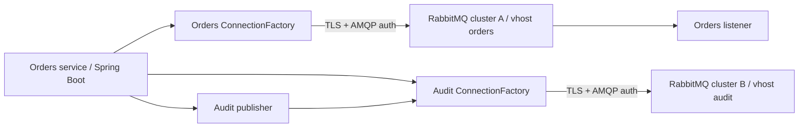

# SSL, Authentication, and Multi-Broker Connections via Configuration

## 1. The Challenge of Secure RabbitMQ Connectivity in Spring Boot Integration

In **Spring Boot Integration**, an application often does more than call HTTP APIs or query databases—it also sends and receives messages to decouple processing steps. For instance, an order service consumes events from an e-commerce RabbitMQ broker, persists data, and publishes audit events to a separate RabbitMQ broker managed by the security team. Those two systems may differ in **hostname**, **virtual host**, **credentials**, **trusted CA**, **client certificates**, **exchange/queue permissions**, and **retry policies**.

If everything is wired through one `ConnectionFactory` or a TLS certificate is treated as sufficient to log into RabbitMQ, the application can:

- Fail authentication when the broker requires username/password or `EXTERNAL`.
- Send messages to the **wrong cluster or wrong virtual host**.
- Trust invalid certificates due to disabled hostname verification.
- Declare queues/exchanges on the wrong broker at startup.
- Accidentally halt both flows when one broker loses connectivity.
- Retry publishes and produce duplicates even with publisher confirms enabled.

**Goal:** explicitly design **TLS transport**, **AMQP authentication**, **authorization**, **per-broker routing**, **connection management**, and **integration testing**. The result must preserve message contracts, transactions, error handling, and idempotency for each flow.



Two connection factories represent **two independent connection domains**, not just two aliases for a single default configuration.

## 2. Distinguishing TLS, AMQP Authentication, and Authorization

When a client connects to RabbitMQ via AMQPS, multiple verification layers apply:

| Layer | Question Answered | Example |
| --- | --- | --- |
| **TCP / address** | Did the client reach the right host and port? | `rabbit.orders.internal:5671` |
| **TLS server authentication** | Does the server present a valid cert signed by a trusted CA for the right hostname? | SAN includes `rabbit.orders.internal` |
| **TLS client authentication (mTLS)** | Does the broker require and verify a client certificate? | Client presents certificate + private key |
| **AMQP SASL authentication** | How does RabbitMQ identify the AMQP user? | `PLAIN`/`AMQPLAIN` with user-password or `EXTERNAL` with cert |
| **AMQP authorization** | What is the user allowed to do in the vhost? | `configure`, `write`, `read` permissions on resources |
| **Message contract** | Do payload and routing match business rules? | Exchange, routing key, headers, event ID |

**TLS does not mean logged into AMQP.** A client can pass the TLS handshake and still be rejected for wrong username/password, an unauthorized virtual host, or a broker not configured for `EXTERNAL`. Likewise, succeeding AMQP login does not guarantee permission to publish to an exchange or consume from a queue.

### 2.1. One-Way TLS vs. mTLS

- **One-way TLS:** the client verifies the server certificate; the broker typically proceeds with AMQP authentication via username/password or another configured mechanism.
- **mTLS:** the broker also verifies a client certificate. This proves the client possesses the private key for its issued identity; mapping that identity to an AMQP user and permissions is a separate configuration step.

In internal networks, **5672** is conventionally used for plaintext AMQP and **5671** for AMQP over TLS. These are **port conventions**, not enforced rules. Actual ports depend on broker listeners, load balancers, and network policies; never assume a connection is encrypted just because it uses port 5671.

### 2.2. Certificate Chains and Hostname Verification

When verifying the server, check:

1. The server certificate chains up to a CA trusted by the application.
2. Certificate validity periods and extended key usage are appropriate.
3. The connected DNS hostname matches a Subject Alternative Name (SAN).
4. The broker or proxy serves the proper intermediate certificates and uses allowed TLS protocols/cipher suites.

Never enable `trust-all` or disable hostname verification to work around `PKIX path building failed`. The proper fix is repairing the CA bundle, certificate chain, SANs, system clock, or configured hostname.

## 3. Single RabbitMQ Broker: Standard Spring Boot Configuration

For **one logical RabbitMQ broker/cluster**, Spring Boot can auto-configure `ConnectionFactory`, `RabbitTemplate`, and listener factories from `spring.rabbitmq.*`:

```yaml
spring:
  rabbitmq:
    host: rabbit.orders.internal
    port: 5671
    virtual-host: /orders
    username: ${ORDERS_RABBIT_USER}
    password: ${ORDERS_RABBIT_PASSWORD}
    ssl:
      enabled: true
      trust-store: file:/etc/ssl/rabbit/orders-truststore.p12
      trust-store-password: ${ORDERS_TRUSTSTORE_PASSWORD}
      trust-store-type: PKCS12
      validate-server-certificate: true
      verify-hostname: true
    listener:
      simple:
        acknowledge-mode: auto
        prefetch: 20
        concurrency: 2
        max-concurrency: 4
```

**Configuration breakdown:**

- `host` and `port` identify one endpoint. For multiple nodes of the **same cluster**, use `spring.rabbitmq.addresses` as an endpoint list instead.
- `virtual-host` is RabbitMQ's logical namespace; the user must hold permissions in that vhost. `/orders` is not an HTTP URL path.
- `username/password` supply AMQP credentials; values should come from a secret manager or environment variables, never literal values in Git.
- `ssl.enabled: true` requires a TLS connection; the truststore verifies the server certificate.
- `validate-server-certificate` and `verify-hostname` explicitly reject spoofed servers; verify exact property names and support in your deployed Boot version.
- `listener.simple.acknowledge-mode: auto` is **Spring AMQP AUTO**: the container sends ACK after the listener succeeds. It **differs** from broker auto-ack/no-ack; exceptions can cause rejection/requeue per policy.
- `prefetch` and `concurrency` tune in-flight volume; they do not guarantee each message is processed only once.

Depending on Spring Boot version, certain SSL/timeout properties and underlying client selection may vary. Check the configuration metadata for your **exact deployed version** rather than mixing properties across Spring Boot generations.

### 3.1. Using mTLS with PKCS#12

If the broker requires a client certificate, add a client identity keystore:

```yaml
spring:
  rabbitmq:
    ssl:
      enabled: true
      key-store: file:/etc/ssl/rabbit/orders-client.p12
      key-store-password: ${ORDERS_KEYSTORE_PASSWORD}
      key-store-type: PKCS12
      trust-store: file:/etc/ssl/rabbit/orders-truststore.p12
      trust-store-password: ${ORDERS_TRUSTSTORE_PASSWORD}
      trust-store-type: PKCS12
      validate-server-certificate: true
      verify-hostname: true
```

Here **KeyStore** holds the client's private key and certificate chain, whereas **TrustStore** holds trusted CAs for server verification. Do not reuse the same file for both solely out of convenience unless deliberately designed and securely verified. Restrict private key file permissions to minimum privileges and plan issuance, rotation, and revocation.

If the broker uses the client certificate only for TLS transport auth while still requiring AMQP username/password, provide both. If the broker maps the certificate to an AMQP user via `EXTERNAL`, SASL setup differs (next section).

## 4. AMQP Authentication: User/Password, EXTERNAL, and Vhost Permissions

### 4.1. Username/Password

RabbitMQ commonly supports `PLAIN` or `AMQPLAIN` for AMQP authentication. Under valid TLS, credentials are encrypted in transit. Never log passwords, embed credentials in connection URLs printed to exceptions/metrics, or grant administrator privileges to runtime accounts.

Least-privilege permissions vary by role:

| Application Role | Required Permissions | Should Not Be Granted Automatically |
| --- | --- | --- |
| Producer | `write` on target exchanges and publish-related permissions | Permission to configure/delete arbitrary queues |
| Consumer | `read` on target queues | Permission to publish to all exchanges |
| Topology provisioner | `configure` permissions required to declare queues, exchanges, and bindings | Unrestricted cluster-wide admin rights |
| Health/monitor | Read-only monitoring API or dedicated account | Runtime infrastructure-configuration rights |

RabbitMQ's `configure`, `write`, and `read` rules also depend on specific exchanges, queues, and AMQP commands. Test using the application's actual account and vhost; connecting cleanly does not prove ACLs cover every operation.

### 4.2. SASL EXTERNAL When Using Client Certificates

For `EXTERNAL`, RabbitMQ must be configured to **accept EXTERNAL** and map certificate identities to AMQP users per broker policy (e.g., client-certificate authentication mechanism). Enabling mTLS on the TLS listener alone **does not automatically enable EXTERNAL**.

Conceptual setup with the RabbitMQ Java client:

```java
import com.rabbitmq.client.ConnectionFactory;
import com.rabbitmq.client.DefaultSaslConfig;
import javax.net.ssl.SSLContext;

ConnectionFactory nativeFactory = new ConnectionFactory();
nativeFactory.setHost("rabbit.orders.internal");
nativeFactory.setPort(5671);
nativeFactory.setVirtualHost("/orders");
nativeFactory.useSslProtocol(sslContext);
nativeFactory.enableHostnameVerification();
nativeFactory.setSaslConfig(DefaultSaslConfig.EXTERNAL);
```

`sslContext` is an `SSLContext` constructed from valid key/trust material, including the client private key when mTLS is required. This snippet illustrates only the SASL selection—it is not a complete standalone example and requires `EXTERNAL` enabled on the broker. When using standard username/password auth, do not switch to `EXTERNAL` merely because port 5671 is in use.

### 4.3. Distinguishing Handshake Failures from AMQP Authentication Failures

| Observed Error | Layer to Investigate First |
| --- | --- |
| `SSLHandshakeException`, `PKIX path building failed` | CA/truststore, chain, SAN, TLS protocol |
| `CertificateExpiredException` | Expired certificate or clock skew |
| `bad_certificate`, `certificate_required` | Client certificate, broker CA, mTLS policy |
| `ACCESS_REFUSED - Login was refused` | SASL mechanism, username/password, vhost permissions |
| Channel closed with `ACCESS_REFUSED` on publish/consume | `configure/write/read` permissions or wrong resource name |
| `NOT_FOUND - no exchange/queue` | Wrong broker/vhost or unprovisioned topology |

Read the root cause in both client and broker logs; never infinitely retry invalid credentials. After fixing authentication, still verify flows can publish, consume, and process messages properly.

## 5. Multiple Nodes in One Cluster vs. Multiple Independent Brokers

This is the **single most important configuration distinction** when a system lists multiple RabbitMQ addresses:

| Topology Model | Meaning | ConnectionFactory |
| --- | --- | --- |
| Multiple **nodes in the same RabbitMQ cluster** | Multiple addresses into **one logical broker** sharing cluster metadata; queue placement/replication depends on queue type | Typically **one ConnectionFactory** with an address list |
| Two **independent clusters** | Each cluster has independent vhosts, users, topology, messages, and state | Requires **two ConnectionFactory beans**, typically two RabbitTemplates/listener factories |
| One cluster, **two virtual hosts** with isolated permissions | Two separate AMQP namespaces; each connection selects one vhost at connect time | Typically requires **two ConnectionFactory beans** if one app uses both |
| Broker behind **load balancer endpoints** | Same logical broker behind LB | Can use one ConnectionFactory to LB endpoint, yet must verify DNS/TLS/SNI |

Example when hosts belong to the **same cluster**:

```yaml
spring:
  rabbitmq:
    addresses: rabbit-a-1.internal:5671,rabbit-a-2.internal:5671
    virtual-host: /orders
    username: ${ORDERS_RABBIT_USER}
    password: ${ORDERS_RABBIT_PASSWORD}
    ssl:
      enabled: true
      verify-hostname: true
```

The `addresses` list gives the client multiple endpoints to try on connect/reconnect; it does **not** sync messages across two independent clusters, guarantee per-message round-robin, or replace topology replication. Every hostname in the list must present a valid certificate matching the name used by the client.

**Never** combine addresses from an Orders cluster and an Audit cluster into one `spring.rabbitmq.addresses` list expecting Spring to route by exchange name. If both clusters define an `events` exchange, reconnects can silently publish to the wrong cluster.

## 6. Two Separate Brokers: Explicit Configuration with Clear Identities

Suppose an application must:

- **orders**: consume order events from RabbitMQ A, vhost `/orders`.
- **audit**: publish audit events to RabbitMQ B, vhost `/audit`.

In this example, we **explicitly declare both** `CachingConnectionFactory` beans and their templates/listeners without relying on Spring Boot to auto-create a default factory. Once you define a custom connection factory bean, Boot's auto-configuration typically **backs off** for the default factory; the pattern of "declare a second factory and keep using Boot's default" usually breaks configuration.

### 6.1. application.yml with Two Independent Namespaces

Example for Spring Boot versions supporting **SSL bundles** (Spring Boot 3.1+). Mount CA files from a trusted source:

```yaml
spring:
  ssl:
    bundle:
      pem:
        orders-rabbit:
          truststore:
            certificate: file:/etc/ssl/rabbit/orders-ca.pem
        audit-rabbit:
          truststore:
            certificate: file:/etc/ssl/rabbit/audit-ca.pem

integration:
  rabbitmq:
    orders:
      host: rabbit.orders.internal
      port: 5671
      virtual-host: /orders
      username: ${ORDERS_RABBIT_USER}
      password: ${ORDERS_RABBIT_PASSWORD}
      ssl-bundle: orders-rabbit
    audit:
      host: rabbit.audit.internal
      port: 5671
      virtual-host: /audit
      username: ${AUDIT_RABBIT_USER}
      password: ${AUDIT_RABBIT_PASSWORD}
      ssl-bundle: audit-rabbit
```

`spring.ssl.bundle.pem.*.truststore.certificate` provides only the trusted CA for server verification. When a broker also requires a **client certificate**, add `keystore.certificate` and `keystore.private-key` to that bundle, protect the private key, and verify client identity during TLS handshake:

```yaml
spring:
  ssl:
    bundle:
      pem:
        audit-rabbit:
          keystore:
            certificate: file:/etc/ssl/rabbit/audit-client.crt
            private-key: file:/etc/ssl/rabbit/audit-client.key
          truststore:
            certificate: file:/etc/ssl/rabbit/audit-ca.pem
```

This mTLS snippet **replaces/extends the corresponding audit bundle block**—do not duplicate YAML keys in an actual file. Never bake secrets or private keys into container images or repositories.

### 6.2. Binding Per-Broker Configuration

To avoid mixing orders and audit settings and enable startup validation, define two records:

```java
import org.springframework.boot.context.properties.ConfigurationProperties;

interface RabbitTarget {
    String host();
    int port();
    String username();
    String password();
    String virtualHost();
    String sslBundle();
}

@ConfigurationProperties(prefix = "integration.rabbitmq.orders")
record OrdersRabbitTarget(
        String host, int port, String username, String password,
        String virtualHost, String sslBundle) implements RabbitTarget {}

@ConfigurationProperties(prefix = "integration.rabbitmq.audit")
record AuditRabbitTarget(
        String host, int port, String username, String password,
        String virtualHost, String sslBundle) implements RabbitTarget {}
```

This uses Spring Boot 3.x record constructor binding. Place the records in an appropriate package and register them via `@EnableConfigurationProperties` or `@ConfigurationPropertiesScan`. In production, validate required host, port, vhost, and bundle names via bean validation or startup checks, and **never log record `toString()`** since it prints the `password` field by default.

### 6.3. Initializing Two Connection Factories with TLS Hostname Verification

```java
import com.rabbitmq.client.ConnectionFactory;
import org.springframework.boot.context.properties.EnableConfigurationProperties;
import org.springframework.boot.ssl.SslBundles;
import org.springframework.context.annotation.Bean;
import org.springframework.context.annotation.Configuration;
import org.springframework.context.annotation.Primary;
import org.springframework.amqp.rabbit.connection.CachingConnectionFactory;

@Configuration(proxyBeanMethods = false)
@EnableConfigurationProperties({
        OrdersRabbitTarget.class, AuditRabbitTarget.class
})
class RabbitBrokerConfiguration {

    @Bean("ordersConnectionFactory")
    @Primary
    CachingConnectionFactory ordersConnectionFactory(
            OrdersRabbitTarget target, SslBundles bundles) throws Exception {
        return create(target, bundles);
    }

    @Bean("auditConnectionFactory")
    CachingConnectionFactory auditConnectionFactory(
            AuditRabbitTarget target, SslBundles bundles) throws Exception {
        return create(target, bundles);
    }

    private CachingConnectionFactory create(
            RabbitTarget target, SslBundles bundles) throws Exception {

        ConnectionFactory nativeFactory = new ConnectionFactory();
        nativeFactory.setHost(target.host());
        nativeFactory.setPort(target.port());
        nativeFactory.setVirtualHost(target.virtualHost());
        nativeFactory.setUsername(target.username());
        nativeFactory.setPassword(target.password());
        nativeFactory.useSslProtocol(
                bundles.getBundle(target.sslBundle()).createSslContext());
        nativeFactory.enableHostnameVerification();

        // Spring AMQP manages connection recovery independently.
        nativeFactory.setAutomaticRecoveryEnabled(false);

        return new CachingConnectionFactory(nativeFactory);
    }
}
```

**Why each line matters:**

1. `host/port/vhost/user/password` are drawn from the **exact target broker config**.
2. `SslBundles.getBundle(...).createSslContext()` builds the TLS context from the configured PEM CA and (if present) client identity.
3. `enableHostnameVerification()` enforces hostname validation at the RabbitMQ Java client layer rather than trusting any cert signed by the CA.
4. `setAutomaticRecoveryEnabled(false)` avoids layering RabbitMQ Java client native recovery on top of Spring AMQP's own connection/listener recovery. Verify recovery behavior for your exact library versions.
5. `@Primary` intentionally resolves unqualified injections to the orders factory; even so, use `@Qualifier` on every critical integration boundary to prevent accidental cross-wiring.

This pattern targets Spring Boot 3.x with SSL bundles and compatible RabbitMQ Java clients. Older Spring Boot versions or requirements for `EXTERNAL`, PKCS#12 truststores, certificate pinning, proxies, or custom connection timeouts require explicit adjustments. Never call parameterless `useSslProtocol()` assuming it enforces production-grade certificate verification.

### 6.4. Two RabbitTemplates and Listener Container Factories

```java
import org.springframework.amqp.rabbit.core.RabbitTemplate;
import org.springframework.amqp.rabbit.connection.CachingConnectionFactory;
import org.springframework.amqp.rabbit.config.SimpleRabbitListenerContainerFactory;
import org.springframework.beans.factory.annotation.Qualifier;
import org.springframework.context.annotation.Bean;
import org.springframework.context.annotation.Configuration;

@Configuration(proxyBeanMethods = false)
class BrokerEndpointsConfiguration {

    @Bean("ordersRabbitTemplate")
    RabbitTemplate ordersRabbitTemplate(
            @Qualifier("ordersConnectionFactory") CachingConnectionFactory cf) {
        return new RabbitTemplate(cf);
    }

    @Bean("auditRabbitTemplate")
    RabbitTemplate auditRabbitTemplate(
            @Qualifier("auditConnectionFactory") CachingConnectionFactory cf) {
        return new RabbitTemplate(cf);
    }

    @Bean("ordersListenerFactory")
    SimpleRabbitListenerContainerFactory ordersListenerFactory(
            @Qualifier("ordersConnectionFactory") CachingConnectionFactory cf) {
        SimpleRabbitListenerContainerFactory factory =
                new SimpleRabbitListenerContainerFactory();
        factory.setConnectionFactory(cf);
        factory.setConcurrentConsumers(2);
        factory.setMaxConcurrentConsumers(4);
        factory.setPrefetchCount(20);
        return factory;
    }
}
```

On `@RabbitListener`, specify the container factory belonging to that broker:

```java
import org.springframework.amqp.rabbit.annotation.RabbitListener;
import org.springframework.stereotype.Component;

@Component
class OrdersEventConsumer {
    @RabbitListener(
            id = "ordersEventConsumer",
            queues = "orders.events",
            containerFactory = "ordersListenerFactory")
    public void onOrderEvent(String payload) {
        // Validate schema/eventId and process idempotently.
        // On success, the container ACKs per configured policy.
    }
}
```

Add `@EnableRabbit` on a `@Configuration` class if the project does not already enable annotation-driven listeners; check Spring Boot's active configuration. If you also consume from the Audit broker, declare a separate `auditListenerFactory` and reference it explicitly instead of relying on a default factory.

Using `String` payloads and the default converter above illustrates routing only. With JSON DTOs, configure **compatible message converters** on each template and listener: `contentType`, charset, `__TypeId__` headers if used, type allowlists, and event versions—never assume both brokers share the same payload contract.

### 6.5. Never Let Default Beans Silently Pick the Wrong Broker

When two `ConnectionFactory` and two `RabbitTemplate` beans exist:

- Unqualified by-type injection can fail with ambiguity or silently route via `@Primary` to the wrong broker.
- A default `RabbitListenerContainerFactory` might bind to a different connection factory than expected.
- Spring Boot auto-configuration can back off on default beans once custom beans are registered.
- A default `RabbitAdmin` can pick up declarable beans and declare topology on the wrong broker.

Name beans after their logical target, put `@Qualifier` on every integration boundary, and write tests verifying **template A actually connects to broker A**.

## 7. Provisioning Topology in the Right Place: RabbitAdmin and Declarables

Exchanges, queues, and bindings are not "system-global"; they belong to **one virtual host on a specific broker/cluster**. When an application connects to two brokers, any automatic topology declaration must have strict ownership.

When a platform team manages topology, application accounts may hold only `read/write` without `configure`. In that case, disable auto-declaration instead of treating `ACCESS_REFUSED` as a broker bug. When the app owns topology, pin which `RabbitAdmin` declares each resource.

```java
import org.springframework.amqp.core.Binding;
import org.springframework.amqp.core.BindingBuilder;
import org.springframework.amqp.core.DirectExchange;
import org.springframework.amqp.core.Queue;
import org.springframework.amqp.rabbit.connection.CachingConnectionFactory;
import org.springframework.amqp.rabbit.core.RabbitAdmin;
import org.springframework.beans.factory.annotation.Qualifier;
import org.springframework.context.annotation.Bean;
import org.springframework.context.annotation.Configuration;

@Configuration(proxyBeanMethods = false)
class AuditTopologyConfiguration {
    @Bean("auditAdmin")
    RabbitAdmin auditAdmin(
            @Qualifier("auditConnectionFactory") CachingConnectionFactory cf) {
        RabbitAdmin admin = new RabbitAdmin(cf);
        admin.setExplicitDeclarationsOnly(true);
        return admin;
    }

    @Bean
    DirectExchange auditEventsExchange(
            @Qualifier("auditAdmin") RabbitAdmin admin) {
        DirectExchange exchange = new DirectExchange("audit.events", true, false);
        exchange.setAdminsThatShouldDeclare(admin);
        return exchange;
    }

    @Bean
    Queue auditNotificationsQueue(
            @Qualifier("auditAdmin") RabbitAdmin admin) {
        Queue queue = new Queue("audit.notifications", true);
        queue.setAdminsThatShouldDeclare(admin);
        return queue;
    }

    @Bean
    Binding auditBinding(
            Queue auditNotificationsQueue,
            DirectExchange auditEventsExchange,
            @Qualifier("auditAdmin") RabbitAdmin admin) {
        Binding binding = BindingBuilder.bind(auditNotificationsQueue)
                .to(auditEventsExchange)
                .with("audit.created");
        binding.setAdminsThatShouldDeclare(admin);
        return binding;
    }
}
```

`setExplicitDeclarationsOnly(true)` restricts `RabbitAdmin` to declaring only `Declarable` beans explicitly assigned to it. This is essential when **multiple `RabbitAdmin` beans exist**; otherwise one admin can try to declare every exchange, queue, and binding bean in the context.

These examples define durable queues/exchanges without DLX, TTL, or quorum/classic policies yet. In production, specify queue type, dead-lettering, retention, retries, and ownership upfront. Never redeclare an existing queue with altered attributes; RabbitMQ rejects incompatible redeclarations with `PRECONDITION_FAILED`.

## 8. Message Routing and Transaction Limits Between Two Brokers

Producers must inject the matching `RabbitTemplate`:

```java
import org.springframework.amqp.rabbit.core.RabbitTemplate;
import org.springframework.beans.factory.annotation.Qualifier;
import org.springframework.stereotype.Service;

@Service
class AuditPublisher {
    private final RabbitTemplate auditTemplate;

    AuditPublisher(
            @Qualifier("auditRabbitTemplate") RabbitTemplate auditTemplate) {
        this.auditTemplate = auditTemplate;
    }

    public void publish(String eventJson) {
        auditTemplate.convertAndSend(
                "audit.events", "audit.created", eventJson);
    }
}
```

This assumes `eventJson` was already validated and serialized upstream. `convertAndSend` returning per the template API **does not prove the broker persisted the message, routed it to a queue, or that a consumer processed it**. High reliability requires confirms/returns, an outbox, and idempotency.

### 8.1. Publisher Confirms and Returns Are Not Consumer ACKs

- **Publisher confirm:** the broker acknowledges producer publish processing per RabbitMQ semantics and queue/replication settings.
- **Publisher return:** when `mandatory` is enabled, unroutable messages can be returned (where broker/publish path applies).
- **Consumer ACK:** the consumer settled the delivery per acknowledgment policy, happening later on a different path.

With custom-declared factories and templates, configure these features **on the actual beans** rather than assuming `spring.rabbitmq.publisher-confirm-type` or `publisher-returns` automatically apply to custom factories:

```java
import org.springframework.amqp.rabbit.connection.CachingConnectionFactory;
import org.springframework.amqp.rabbit.core.RabbitTemplate;

void enablePublisherReliability(
        CachingConnectionFactory cf, RabbitTemplate template) {
    cf.setPublisherConfirmType(
            CachingConnectionFactory.ConfirmType.CORRELATED);
    cf.setPublisherReturns(true);
    template.setMandatory(true);

    template.setConfirmCallback((correlation, ack, cause) -> {
        // Record confirm outcome by work ID; handle NACK separately.
    });
    template.setReturnsCallback(returned -> {
        // Message was unroutable; record and handle via controlled recovery.
    });
}
```

This **illustrates configuration mechanics**, not a complete outbox. Register callbacks during bean initialization before any publishing starts—never invoke this dynamically while connections hold in-flight traffic. Verify callback correlation, timeout/unknown outcome handling, and durable publish state persistence in the business database.

### 8.2. Publishing to Two Brokers Has No Default Atomic Transaction

If a service must emit the same event to both Orders and Audit, no standard JDBC `@Transactional` commits or rolls back both brokers simultaneously. Failures occur when **A accepts yet B rejects**, or B accepts yet the client times out uncertain. Never wrap `ordersTemplate.convertAndSend` and `auditTemplate.convertAndSend` in a `try/catch` claiming exactly-once.

Safer architecture:

1. Inside **one DB transaction**, store the business mutation and two outbox entries keyed by logical target.
2. Dedicated workers per broker read their outbox, publish with a stable `eventId`, and watch confirms/returns.
3. Mark `SENT` only on sufficient proof per contract; errors/unknown outcomes remain retryable/reconcilable.
4. Receivers deduplicate by `eventId` or business key, as crashes can trigger republishes.

Even with quorum queues and publisher confirms, external HTTP APIs and consumer databases do not share a unified transaction. Design for at-least-once delivery and idempotency.

## 9. Consumer Reliability, ACK, Prefetch, and Retries

### 9.1. Spring AMQP `AUTO` vs. Broker Auto-Ack

| Acknowledge Mode | How It Operates | Risks / Conditions |
| --- | --- | --- |
| `AcknowledgeMode.AUTO` | Spring listener container ACKs when listener succeeds; rejects/nacks on error per config | Know `defaultRequeueRejected`, retry, and error handler behavior |
| `AcknowledgeMode.MANUAL` | Listener calls ACK/NACK/REJECT via channel as appropriate | Must handle all success/error paths; never ACK before business commit |
| `AcknowledgeMode.NONE` | Broker auto-acks/no-acks deliveries per AMQP semantics | Messages can be lost if consumer crashes mid-processing |

Manual ACK example (use only when the listener factory sets `AcknowledgeMode.MANUAL`):

```java
import com.rabbitmq.client.Channel;
import org.springframework.amqp.core.Message;
import org.springframework.amqp.rabbit.annotation.RabbitListener;
import java.io.IOException;

class ManualOrderConsumer {
    @RabbitListener(
            queues = "orders.events",
            containerFactory = "ordersManualListenerFactory")
    public void consume(Message message, Channel channel) throws IOException {
        long deliveryTag = message.getMessageProperties().getDeliveryTag();
        try {
            // Validate, process idempotently, and commit data before ACK.
            process(message);
            channel.basicAck(deliveryTag, false);
        } catch (PermanentPayloadException invalid) {
            channel.basicReject(deliveryTag, false); // DLX if configured.
        } catch (Exception transientError) {
            channel.basicNack(deliveryTag, false, true);
        }
    }
}
```

`ordersManualListenerFactory`, `process(...)`, and `PermanentPayloadException` are illustrative and require separate implementation/configuration; this snippet is not a standalone runnable class. For transient errors, immediate requeue risks a **hot loop**. In production, use backoff retries, delayed retry queues, or DLQs with bounded attempt counts. Under manual ACK, ensure exactly one ACK/NACK branch runs and never ACK prior to DB transaction commit.

### 9.2. Prefetch and Concurrency Must Account for Total Replicas

If each pod configures `concurrentConsumers=4` and `prefetch=20`, one pod can hold up to about **80 unacked deliveries** under broker/client conditions. Across five pods, total in-flight load can easily exceed downstream database/HTTP API capacity.

Higher prefetch can trim network round-trips in some cases, yet can also:

- Hold messages longer in client buffers, increasing tail latency.
- Pin messages onto slow consumers, degrading fairness.
- Trigger large redelivery bursts on pod crash or broker reconnect.
- Exhaust DB/HTTP connection pools as concurrency scales.

Never raise concurrency and prefetch together just to "drain a backlog" when downstream returns 429/503. Track **business completion rates**, consumer lag/queue depth, unacked counts, retries, and DLQs.

## 10. Secret Rotation, Certificate Rotation, and Reconnection

RabbitMQ connections and channels are long-lived. When secrets or certificates rotate in a secret manager or Kubernetes volume, **the JVM does not automatically refresh the `SSLContext` of existing connections** unless the application implements reload support.

Safe rotation workflow when the broker supports overlapping credentials:

1. Issue the new username/password or client certificate with matching permissions on the right vhost.
2. When rotating CAs, distribute a trust bundle containing **both old and new CAs** to all clients before switching the server's leaf certificate.
3. Configure the broker to accept both old and new identities during the transition window; verify certificate chain, hostname, and ACLs.
4. Perform a rolling restart or tested factory/connection/listener refresh; verify **new TLS handshakes and AMQP logins** succeed.
5. Verify live publish/consume rates, queue depth, redeliveries, and business idempotency.
6. Revoke old credentials/certificates only once zero clients depend on them, then continue monitoring.

If a **private key is compromised**, do not keep a long overlap window merely to avoid disruption. Prioritize revocation per incident response—even if that means temporarily pausing the affected flow and recovering cleanly.

### 10.1. Distinguishing HTTP Readiness from Broker Consumers

A Kubernetes `NotReady` pod stops receiving HTTP Service traffic, yet RabbitMQ listeners inside that pod can continue running and consuming messages. To pause consumption before migrations or rotations, control **`RabbitListenerEndpointRegistry`/container lifecycle** explicitly, drain in-flight work, and watch redeliveries. HTTP readiness is **not** a consumer off-switch.

### 10.2. Never Layer Native Auto-Recovery on Top of Spring AMQP

The RabbitMQ Java client has its own automatic recovery; Spring AMQP also manages connections and listener containers. Enabling both without clear boundaries risks unpredictable recovery states, duplicate consumers, or duplicate topology declarations. With Spring-managed `CachingConnectionFactory`, stick consistently to Spring AMQP's recovery model and test broker restarts, network drops, and TLS certificate rotations.

## 11. Testing: Two Brokers, Two TLS Identities, and Correct Routing

### 11.1. Context-Level Configuration Tests

For Spring Boot tests with two connection factories, verify at minimum:

- `ordersConnectionFactory` and `auditConnectionFactory` exist as **two distinct beans**.
- `ordersRabbitTemplate` uses the orders factory, and `auditRabbitTemplate` uses the audit factory.
- `ordersListenerFactory` builds listeners using the orders factory; any audit listener uses the audit factory.
- Each `RabbitAdmin` binds declarables only to its intended target without creating Orders queues/exchanges in Audit.
- Missing CA, missing password, or wrong vhost **never silently falls back** to a default broker.

Configuration tests **do not replace** real TLS broker connection tests, because constructing a `ConnectionFactory` bean may not open a TCP socket yet.

### 11.2. Testcontainers with Two Independent RabbitMQ Instances

In integration tests, spin up **two separate RabbitMQ containers** and bind dynamic hosts/ports for each. Provision separate queues/data and assert:

1. Publishing `OrderCreated` to broker A delivers exactly one logical event to the Orders consumer (or deduplicates on redelivery).
2. Publishing `AuditCreated` via `auditRabbitTemplate` lands in broker B.
3. Broker A contains **no** audit exchanges/queues where strict isolation is required.
4. Restarting broker B verifies audit publisher recovery without disrupting Orders consumption.
5. Simulating an auth failure on B lets A keep running if business logic does not depend synchronously on B.
6. Verify topology and permissions using the real runtime users and vhosts.

To verify TLS/mTLS, generate a CA, a server certificate with valid SANs, and client certificates in a **securely managed test fixture**, configuring TLS listeners mirroring production. Default `RabbitMQContainer` AMQP ports lack production TLS; two non-TLS containers prove routing and logic, **not SSL**.

### 11.3. Security and Failure Test Suite

| Scenario | Expected Outcome |
| --- | --- |
| Trusted CA, matching SAN, valid user/vhost | TLS + AMQP auth succeed |
| Untrusted CA or expired certificate | Handshake rejected; `trust-all` never enabled |
| DNS alias missing from SAN | Hostname verification blocks connection |
| Broker requires mTLS yet client lacks key | Handshake rejected |
| Broker lacks `EXTERNAL` yet client requests EXTERNAL | AMQP authentication fails |
| Valid user missing read/write permission | Operation rejected; error classified cleanly |
| Audit broker network outage | Orders never rerouted to Audit |
| Exchange lacks matching binding | Mandatory publish return observed |
| Broker receives publish yet client loses confirm | Retry/reconcile with same `eventId`; never mark unsent permanently |
| Consumer crashes after DB commit before ACK | Redelivery produces zero duplicate side effects |
| Certificate/secret rotated | New connections use new credentials without unnecessary outage |

### 11.4. Testing TLS from an Application-Equivalent Environment

Inspect the server's certificate chain using `openssl`:

```bash
openssl s_client \
  -connect rabbit.orders.internal:5671 \
  -servername rabbit.orders.internal \
  -verify_hostname rabbit.orders.internal \
  -verify_return_error \
  -CAfile orders-ca.pem
```

This tests only the TLS handshake under OpenSSL's trust settings—**it does not prove AMQP login or ACLs succeed**. Moreover, Java truststores and RabbitMQ Java client config differ from OpenSSL; always test the actual application with its real `SSLContext`. Never pull random CA files suggested by error logs or disable cert verification just to "get connected."

## 12. Observing Two Brokers in Production

| Metric / Signal | How to Slice | When Spiking Abnormally |
| --- | --- | --- |
| TLS handshake failures | By logical broker / hostname | CA/SAN/certificate/protocol mismatch |
| AMQP auth / authorization failures | By logical broker / vhost / user alias | Bad secret, SASL, or ACL mismatch |
| Connections / channels / reconnects | Per `ConnectionFactory` | Network outage or recovery loop |
| Publish confirm NACKs / timeouts | Per `RabbitTemplate` / broker | Publish path fault or uncertain outcomes |
| Publisher returns (unroutable) | Per allowlisted exchange / routing family | Missing binding, wrong vhost, topology drift |
| Queue ready / unacked / redelivery / DLQ | Per broker / vhost / queue | Slow workers, crashes, hot retries |
| Active listeners / consumers | Per listener container factory | Stopped listeners, auth failures, or missing queues |
| End-to-end business success | Per workflow, `eventId` / correlation ID | Downstream failure despite healthy AMQP |

Never put passwords, raw tokens, private keys, or full connection URLs with secrets into logs. Keep metric tags to allowlisted logical broker names, vhosts, and exchanges; never tag per `eventId` to avoid cardinality explosions.

Useful structured logs include `integration=orders-inbound`, `broker=orders`, `eventId=...`, `attempt=...`, and retry timestamps. On redelivery, tie traces and idempotency markers together to separate **re-receiving the same event** from **a brand-new event**.

## 13. Common Configuration Mistakes

| Symptom | Possible Cause | Troubleshooting Direction |
| --- | --- | --- |
| `PKIX path building failed` | Untrusted CA or missing intermediate | Check truststore/bundle and server cert chain |
| `No subject alternative names matching` | Hostname missing from SAN | Verify DNS/SNI and certificate SANs |
| `bad_certificate` with mTLS enabled | Wrong client cert/key or broker rejects CA | Check keystore, `clientAuth`, and broker trust chain |
| `ACCESS_REFUSED - Login was refused` | Wrong user/password, vhost, or SASL | Check broker auth logs, secrets, and vhost policy |
| Login succeeds yet publish fails | Missing `write` permission or wrong exchange | Inspect runtime user ACLs in vhost |
| `NOT_FOUND` on queue/exchange | Wrong broker/vhost or unprovisioned topology | Check which cluster actually holds the queue/exchange |
| `PRECONDITION_FAILED` on declare | Queue/exchange arguments mismatch existing | Compare type, durability, auto-delete, DLX args |
| Audit listener consumes Orders | Missing `containerFactory` or wrong qualifier | Check bean wiring and active listener factory |
| Template A publishes to broker B | `@Primary` picked wrong factory bean | Qualify injections by name and add integration tests |
| One cluster failure "fails over" to the other | Mixed independent clusters in `addresses` | Separate `ConnectionFactory`/target beans |
| Message sent yet never enters queue | Wrong routing key/binding, mandatory returns off | Check bindings and publisher returns |
| Publisher confirm ACK yet business update lost | Confirm is not consumer ACK; missing transaction | Add outbox/idempotency and fix ACK boundary |
| Post-rotation connections still use old cert | Cached `SSLContext` / connection not reloaded | Recreate factory/connections and verify new TLS |
| Backlog grows after raising prefetch | Slow downstream, bloated unacked buffer | Tune concurrency, pools, retries, and rate limits |

## 14. Runbook: Rotating Audit Connections Without Disrupting Orders

**Context:** Orders are actively consumed from the Orders cluster while the Audit cluster must rotate its CA and credentials. Both clusters are independent; Orders listeners must neither drop connections nor misroute data to Audit.

1. **Inventory:** verify bean names `ordersConnectionFactory`, `auditConnectionFactory`, templates/listeners, and exchanges/queues per cluster.
2. **Distribute new CA:** update the Audit trust bundle to trust both old and new CAs during transition where possible; leave Orders config untouched.
3. **Provision new identity:** create the new Audit account or client cert with scoped `/audit` permissions and verify connectivity/ACLs via a canary.
4. **Roll Audit only:** perform a rolling restart or tested connection-factory refresh; verify AMQP auth and Audit publisher confirms/returns.
5. **Keep Orders running:** monitor Orders listeners, prefetch/unacked, DLQs, and order processing rates. Do not fail global readiness if architecture permits buffering audit events in an outbox briefly.
6. **Reconcile data:** check `PENDING/UNKNOWN` audit events, retry with the same `eventId`, and prevent duplicate side effects.
7. **Revoke old credentials:** revoke old Audit credentials/certs only after confirming zero active connections use them, then monitor stability.
8. **Post-mortem:** update runbooks, secret references, certificate expiry monitors, and independent broker tests.

If business rules mandate **synchronous audit confirmation before confirming an order**, never let Orders keep confirming while Audit is unreachable—pause/reject per data contract, or persist audits durably in a transactional outbox prior to order confirmation.

## 15. Pre-Production Checklist

1. Have you clearly separated a **multi-node RabbitMQ cluster** from **multiple independent clusters/vhosts**?
2. Does each broker have isolated host/port/vhost, user, ACLs, CA/truststore, and client identity?
3. Does TLS validate certificate chains and hostnames without `trust-all` or disabled verification?
4. When using mTLS, is `EXTERNAL` configured intentionally where needed, distinguishing TLS auth from AMQP SASL and vhost permissions?
5. Are secrets/passwords/private keys sourced securely and excluded from logs and record `toString()`?
6. Are `ConnectionFactory` beans created cleanly per broker without accidentally relying on Boot's backed-off default factory?
7. Do `RabbitTemplate`, listener container factories, and `RabbitAdmin` carry explicit `@Qualifier` / broker-specific names?
8. Are exchanges, queues, and bindings declared in the intended vhost only by authorized admins with zero cross-declaration?
9. Are publisher confirms/returns, mandatory routing, consumer ACKs, and retries designed independently per broker?
10. Do transactions, outboxes, and `eventId` tracking handle cases where one broker succeeds while the other's outcome is unknown?
11. Are prefetch/concurrency calculated across total replicas and downstream HTTP/DB/cache capacity?
12. Have you tested bad CA/SAN, missing mTLS cert, AMQP login/ACL failures, broker restarts, and reconnects?
13. Does a two-broker integration test prove messages never cross clusters/vhosts and topology never cross-declares?
14. For secret/CA rotation, are overlap windows, `SSLContext`/connection reloads, canaries, rollbacks, and connection verification planned?
15. Do dashboards separate TLS, auth, permission, topology, publisher confirm, consumer redelivery, and business outcome errors per broker?

**Key takeaway:** Securing RabbitMQ requires more than `ssl.enabled`: it demands **certificate verification, AMQP authentication, scoped vhost permissions**, and disciplined connection isolation. With multiple independent brokers, a Spring Boot app needs **explicitly targeted `ConnectionFactory`, `RabbitTemplate`, listener factories, and `RabbitAdmin` beans**. Combine real TLS tests, clear separation between security and topology errors, and outbox/idempotency patterns so integration flows stay resilient across disconnects, retries, and credential rotations.
