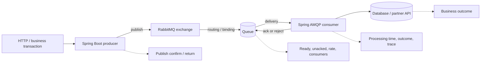

# Observing Queues, Consumers, and Processing Latency with RabbitMQ in Spring Boot

## 1. The Challenge of Observing an AMQP Flow

In a Spring Boot integration system, a producer may accept orders from an HTTP API, write to a database, and emit events to RabbitMQ. One or more consumers using Spring AMQP (`@RabbitListener`) receive messages, invoke partner services, update status, and acknowledge the broker. The system might still return HTTP 200 with healthy RabbitMQ connections while orders lag by minutes or endlessly redeliver.

**RabbitMQ observability must answer three questions simultaneously:**

1. **Is the queue accumulating backlog?** How many messages are ready, how many are delivered yet unacknowledged, and how do ingress and completion rates compare?
2. **Are consumers actually working and completing accurately?** How many consumers are active, are they blocked on external databases/APIs, and are there errors, retries, redeliveries, or dead-letters?
3. **How long does an event take from creation to completion?** Queue wait time, handler execution time, and end-to-end duration must be measured separately.

These measurements require combining **metrics from the RabbitMQ broker**, **metrics/traces from the Spring Boot application**, and **business signals** (orders updated cleanly, pending backlog rows). Looking at queue depth alone never proves an integration flow is healthy.

### Flow Diagram and Measurement Points



In this diagram, `publish confirm`, `message delivered`, `handler success`, and `business completed` are distinct milestones—never equate one with another.

## 2. Understanding Message States Before Reading Charts

| Concept | Practical Meaning | What Cannot Be Concluded Alone |
|---|---|---|
| **Ready** | Messages sitting in the queue, available for delivery | Does not prove consumers failed; may simply reflect bursty traffic |
| **Unacked** | Messages dispatched to consumers awaiting broker ack | Does not automatically mean hung: consumers may be actively working or holding prefetch buffers |
| **Total messages** | Sum of ready and unacked reported by the broker for a queue | Does not reflect processed messages or messages dead-lettered elsewhere |
| **Consumers** | Consumers subscribed to the queue at measurement time | Having consumers does not guarantee useful processing throughput |
| **Publish / deliver / ack rates** | Rates entering, dispatched, and acknowledged | Deliveries can include redeliveries; publish and ack do not measure identical scopes |
| **Redeliveries** | Messages re-dispatched due to requeues, closed channels, etc. | Not every retry increments broker redeliveries; in-process handler retries may leave this unchanged |
| **DLQ/DLX** | Messages dead-lettered elsewhere when configured triggers fire | Seeing a message in a DLQ does not mean the issue has been resolved |

RabbitMQ separates `messages_ready` and `messages_unacknowledged` (commonly `unacked`). With manual acknowledgment, the app acks/nacks/rejects explicitly; with Spring AMQP `AcknowledgeMode.AUTO`, the listener container normally acks after normal method return and handles exceptions per container policy. **Ack only proves the broker received acknowledgment**, not that downstream business state is durably valid.

For instance, with `prefetch=50` and 4 active consumers, up to roughly 200 unacked deliveries can sit on those consumers depending on channel state, prefetch settings, and dispatch behavior. High unacked counts must be read alongside ack rates, processing durations, and consumer counts.

## 3. Metrics to Collect Across Three Layers

### 3.1. Broker: Queue Pressure and Connection Health

| Group | Metrics to Track | Operational Question |
|---|---|---|
| Queue depth | Ready, unacked, total messages per queue | Is work piling up or actively draining? |
| Message flow | Publish, deliver, ack, redeliver, reject/dead-letter rates | How much faster is work arriving than completing? |
| Consumers | Consumer count, consumer capacity (if exported by RabbitMQ) | Is there enough capacity to receive and process? |
| Connections/channels | Connection/channel counts, churn, channel closures, auth failures | Are consumers and publishers holding stable connections? |
| Resource pressure | Memory/disk alarms, flow control, disk space, CPU, network | Is the broker throttling ingress or delivery? |
| Queue policy | TTL, length limits, overflow, DLX, queue type | Can policies drop or divert messages? |

Use **RabbitMQ Management UI/API** to inspect queues, channels, connections, and message rates; for centralized monitoring, enable **`rabbitmq_prometheus`** to export metrics to Prometheus/Grafana. Some metrics are aggregated by default; per-queue breakdowns may require per-object/detailed metrics mode depending on broker version and exporter endpoint. Always verify metric names, labels, and collection overhead on your real RabbitMQ cluster before building dashboards.

### 3.2. Application: Listener Processing Quality

Spring Boot should emit at least these metrics:

- **Processing duration:** elapsed time from listener invocation start until the method returns or throws.
- **Outcome:** success/failure counts tagged by queue name and a bounded set of error categories.
- **Retry:** in-application retries, separating business errors from transient failures; never infer app retries from broker redeliveries.
- **Dependency latency:** time spent calling databases, HTTP clients, caches, or Spring Integration adapters inside handlers.
- **In-flight work:** active consumer tasks (where reliably measurable), queued executor tasks, and saturation.
- **Publish outcome:** broker confirms, unroutable returns, timeouts, and send failures when ensuring producers reach intended targets.

Never attach `messageId`, `orderId`, dynamic URLs, or payload contents as metric tags. High-cardinality values bloat Prometheus series and storage costs. Use controlled logs/tracing to trace individual messages.

### 3.3. Business: True Progress

Track a business metric for true completion: orders synced to partners, successful callbacks, records stuck in `PENDING` past deadlines, or reconciliation mismatches. Queues can drain to zero while listeners **ack prematurely**, delete data wrongly, or skip work; business metrics expose that gap.

## 4. Distinguishing Different Kinds of Latency

Define clear timestamps for each message:

- **t0 — event created:** when the business system records the event to emit.
- **t1 — producer sends:** when the app begins publishing to the exchange.
- **t2 — broker receives and routes:** broker confirmation time (not consumer delivery time).
- **t3 — listener starts:** when the consumer begins handling a delivery.
- **t4 — listener finishes:** when business code exits, right before or around ack depending on mode.
- **t5 — durable business outcome:** e.g., transaction committed or partner accepted the request.

| Latency Name | Approximate Formula | Meaning |
|---|---|---|
| Publish latency | `t2 - t1` | Send plus broker confirmation; needs publisher confirms for a reliable end timestamp |
| Delivery/queue age | `t3 - t1` | Time from publish to listener start, including network, routing, queue wait, and client prefetch wait |
| Processing latency | `t4 - t3` | Handler execution time; typically measured via a monotonic timer in the app |
| End-to-end latency | `t5 - t0` | Business event creation to verifiable terminal state |

RabbitMQ does not automatically measure end-to-end application logic latency. A producer-stamped timestamp header is commonly used to estimate "message age" at the consumer, yet it is **not pure queue wait**. Clock skew between producer and consumer, publish retries, prefetch buffering, redeliveries, and downtime all skew it. When comparing timestamps across hosts, synchronize clocks and document metric semantics clearly.

Across retries or redeliveries, messages often retain the original timestamp, causing age to rise across attempts. That is useful for user-perceived delay, yet track `attempt duration`, `retry count`, and `time to completion` separately to diagnose root causes.

## 5. Configuring Spring Boot for Observability

Example for an app using Spring Boot Actuator, Micrometer, Spring AMQP, and Prometheus:

```yaml
# application.yml
spring:
  rabbitmq:
    addresses: ${RABBITMQ_ADDRESSES}
    username: ${RABBITMQ_USERNAME}
    password: ${RABBITMQ_PASSWORD}
    listener:
      simple:
        acknowledge-mode: auto
        concurrency: 2
        max-concurrency: 8
        prefetch: 20

app:
  rabbit:
    orders-queue: orders.events

management:
  endpoints:
    web:
      exposure:
        include: health,info,prometheus
  metrics:
    tags:
      application: order-integration
    distribution:
      percentiles-histogram:
        app.rabbit.consumer.processing: true
        app.rabbit.message.age: true
```

Include matching dependencies, typically `spring-boot-starter-amqp`, `spring-boot-starter-actuator`, and `micrometer-registry-prometheus`. On `/actuator/prometheus`, custom meters appear once recorded and scraped. Restrict access to management/metrics endpoints per security policy.

The `concurrency` and `prefetch` values above are **illustrative only**, not universal optimums. Listener count, parallelism, DB/API cost, and external resource caps govern real capacity. Increasing concurrency has no benefit when the bottleneck is a DB pool or partner rate limit.

### Observation and Tracing

On Spring AMQP versions supporting Micrometer Observation, enable observations on `RabbitTemplate` and listener containers—for example via `setObservationEnabled(true)` when configuring beans/factories. In Spring Boot apps, integrate this with Boot's auto-configured beans and customizers so creating new beans does not strip converter, retry, or callback settings.

Observation unifies metrics, traces, and distributed context across publish, consume, and downstream HTTP/DB spans. Cross-process producer–consumer tracing works only when trace context propagates and extracts properly via headers, alongside active exporters/collectors and compatible sampling. Exact metric and span names vary across Spring AMQP, Micrometer, and instrumentation versions; verify actual output. Once observation is enabled, review built-in timers alongside custom timers so you do not double-count.

## 6. Measuring Approximate Queue Wait and Consumer Runtime

Suppose a producer sends JSON to `orders.exchange` with routing key `orders.created` and attaches a send-time header:

```java
@Service
public class OrderEventPublisher {
    private final RabbitTemplate rabbitTemplate;

    public OrderEventPublisher(RabbitTemplate rabbitTemplate) {
        this.rabbitTemplate = rabbitTemplate;
    }

    public void publish(String eventJson) {
        rabbitTemplate.convertAndSend(
                "orders.exchange",
                "orders.created",
                eventJson,
                message -> {
                    message.getMessageProperties().setHeader(
                            "app-published-at-ms",
                            System.currentTimeMillis()
                    );
                    return message;
                }
        );
    }
}
```

This records **client pre-publish time**, not the moment the broker durably persisted the message. To confirm broker receipt or detect unroutable messages, configure publisher confirms and publisher returns alongside timeout/unknown handling.

The consumer records two separate timers: age upon entering the listener and handler execution duration.

```java
@Component
public class ObservedOrderListener {
    private final MeterRegistry registry;
    private final OrderProcessor processor;

    public ObservedOrderListener(MeterRegistry registry, OrderProcessor processor) {
        this.registry = registry;
        this.processor = processor;
    }

    @RabbitListener(queues = "${app.rabbit.orders-queue}")
    public void consume(Message message) {
        Timer.Sample sample = Timer.start(registry);
        String outcome = "success";

        Object raw = message.getMessageProperties()
                .getHeaders()
                .get("app-published-at-ms");

        if (raw instanceof Number sentAt) {
            long ageMs = System.currentTimeMillis() - sentAt.longValue();
            if (ageMs >= 0) {
                Timer.builder("app.rabbit.message.age")
                        .description("Time from publish to listener start")
                        .tag("queue", "orders.events")
                        .publishPercentileHistogram()
                        .register(registry)
                        .record(ageMs, TimeUnit.MILLISECONDS);
            }
        }

        try {
            processor.process(message.getBody());
        } catch (RuntimeException ex) {
            outcome = "failure";
            throw ex;
        } finally {
            sample.stop(
                    Timer.builder("app.rabbit.consumer.processing")
                            .description("Processing duration inside listener")
                            .tag("queue", "orders.events")
                            .tag("outcome", outcome)
                            .publishPercentileHistogram()
                            .register(registry)
            );
        }
    }
}
```

This assumes `OrderProcessor.process(byte[])` performs business logic and throws `RuntimeException` on failure. Add standard JDK, Spring AMQP, Micrometer, and Spring stereotype imports. The listener defaults to container `AUTO` acknowledgment.

Interpreting the metrics:

- `app.rabbit.message.age`: span from producer timestamp to **listener start**; excludes listener runtime and does not confirm business completion.
- `app.rabbit.consumer.processing`: handler method runtime (`success`/`failure`). Not necessarily identical to broker ACK receipt time or external commit time.
- `outcome` uses bounded values; add others (e.g., `skipped`) only if explicitly defined. Never tag with dynamic exception strings.
- When the header is missing/wrong type or clock skew yields a negative age, this example skips recording. In production, count dropped samples to surface instrumentation bugs.
- Histogram distribution timers allow Prometheus p95/p99 calculation across buckets; histograms increase storage, so enable them selectively on key metrics and control label series.

**Transaction and ack note:** if `processor.process(...)` performs side effects and later throws, RabbitMQ may redeliver depending on retry, error handler, and requeue settings. Ensure idempotency by business key, sound transactions, and DLQ policies—never estimate completed orders by counting handler invocations.

## 7. Estimating Throughput, Backlog, and Drain Time

Suppose a queue receives 100 messages/sec on average while consumers acknowledge only 80 messages/sec for 5 minutes. Under simple conditions without redeliveries and consistent rate metrics, ready backlog grows by roughly:

```text
Backlog growth = (arrival rate - completion rate) × duration
               = (100 - 80) × 300
               = 6,000 messages
```

If ack rate rises to 140 messages/sec while publish stays at 100 messages/sec, net drain speed is roughly 40 messages/sec, taking nearly 150 seconds to clear those 6,000 messages. This is **an approximation assuming steady traffic and processing**; batching, retries, DLX, priorities, prefetch, and wide processing-time variance demand deeper analysis.

Useful formulas and intuition:

- `backlog delta ≈ arrival rate − completion rate`. Useful for trend direction; publishes, acks, and redeliveries do not always count identical "work units."
- `true throughput = valid business completions / unit time`. Cross-check broker ack rates against business counts whenever messages can run multiple times.
- `consumer load` climbs when handlers slow down or dependencies degrade; raise throughput by optimizing handlers, scaling consumers within downstream limits, or sharding workloads.
- **Little's Law** (`L = λ × W`) applies only in relatively stable systems with consistent counting and no unbounded backlog growth; never divide one point-in-time depth snapshot by an instantaneous ack rate and call it "p95 queue wait."

Define business-oriented SLOs, e.g.: "95% of order events finish syncing within 5 seconds of creation under design load." Allocate latency budgets across publishing, queue/delivery, processing, and external APIs; tie alert thresholds to SLOs and live traffic rather than one static `messages_ready` cap across all queues.

## 8. Actionable Dashboards and Alerts

An operational dashboard needs three aligned panels:

| Dashboard Area | Charts to Place Side-by-Side | Question |
|---|---|---|
| Queue & broker | Ready/unacked, publish/ack/redelivery rates, consumer count, broker alarms | Is backlog growing due to under-capacity or lost connectivity? |
| Consumer & dependencies | Processing p50/p95/p99, success/failure rate, HTTP/DB latency, active threads/pools | Which step is slowing consumers down? |
| Business quality | Listener event age, end-to-end latency, overdue tasks, DLQ depth, retry count | Are users impacted or losing progress? |

Example PromQL query for the custom histogram configured above (verify exact metric names via `/actuator/prometheus`):

```promql
histogram_quantile(
  0.95,
  sum by (le) (
    rate(app_rabbit_consumer_processing_seconds_bucket{
      queue="orders.events", outcome="success"
    }[5m])
  )
)
```

This calculates p95 **successful handler duration** in seconds over a 5-minute window. Across multiple instances, aggregate buckets by `le` and preserve only needed distinguishing labels—never average per-instance p95s. Normalized Prometheus metric names can vary with instrumentation/config changes.

Practical alert conditions:

1. **Sustained ready backlog with consumer count = 0:** listeners may be stopped, failing auth/TLS, misconfigured on queue name, or scaled to 0. Apply only to queues expected to have active consumers.
2. **Rising ready backlog with ack rate below publish rate:** work is piling up; alert on sustained trends rather than brief traffic spikes.
3. **High unacked, near-zero ack rate, rising processing latency:** handlers or dependencies may be hung, running slow queries, out of connection pools, or forgetting manual acks.
4. **Rising redeliveries, retries, and DLQ:** likely poison messages, non-idempotent failures, contract violations, or extended dependency outages.
5. **Broker memory/disk alarms or blocked connections:** producers may be throttled; correlate with connection states and node resources.
6. **End-to-end p95 breaches SLO or overdue work ages out:** catches user-facing degradation even before broker resources saturate.

Every alert needs severity, hold duration, owner, dashboard link, and runbook. A 5–10 minute window works well as a starting baseline for many trend alerts, yet tune windows and thresholds to your SLOs, traffic frequency, and queue criticality; highly sensitive events may need shorter windows.

### Health Checks Do Not Replace Progress Monitoring

`/actuator/health` can confirm RabbitMQ reachability when the health indicator is enabled, yet a green connection does not prove consumers are ACKing or business logic is succeeding. Overly simple health checks miss backlogs and poison messages; conversely, never mark pods "unhealthy" on every queue lag spike, or orchestrators will restart pods continuously and worsen the outage. Pair readiness/liveness with progress dashboards and alerts.

## 9. Isolating Incidents by Metric Patterns

### Scenario A — Ready Climbing, Zero Consumers

**Symptoms:** ready count climbs, `consumers=0`, ack rate near zero.

Check deployment/pod status, authentication/TLS errors, queue routing, `consume` permissions, listener startup, container factories, `autoStartup` flags, and closed connections/channels. If autoscaling on queue depth, check scale-up lag and metrics adapters. Never blindly "add replicas" when every replica is failing to connect.

### Scenario B — Ready Climbing, Consumers Present Yet Slow

**Symptoms:** consumers > 0, processing p95 rising, ack rate lagging behind publish rate.

Inspect DB queries, HTTP clients, and integration adapters; check thread pools, DB connection pools, timeouts, internal retries, and rate limits. Scale concurrency gradually if dependencies have headroom. Extra consumers can crush a saturated DB or partner API; benchmarks must track response times, timeouts, and backpressure.

### Scenario C — Unacked High, Ready Low

**Symptoms:** broker dispatched messages yet ACKs stall. With high prefetch, buffered client messages leave `ready` looking artificially low.

Check for hung handlers, thread dumps, slow queries, network calls without timeouts, deadlocks, manual ack/nack bugs, and channel lifetimes. If a consumer disconnects holding unacked deliveries, the broker requeues and redelivers them. Lower prefetch when fairness or long processing matters, while avoiding arbitrary cuts that throttle fast workloads.

### Scenario D — Producer Reports Success Yet Consumer Receives Nothing

Check exchange type, routing key, bindings, queue name, virtual host, and publisher permissions. **Publisher confirm** reports broker confirm acceptance, yet does not prove routing to the desired queue or consumer completion. Enable `mandatory` publishing and publisher returns to surface unroutable messages; verify callbacks and state handling. Also inspect TTL, max-length/overflow, and dead-letter policies removing messages from the queue.

### Scenario E — Redeliveries or DLQ Climbing

Inspect application exceptions, broker `x-death` headers (where present), failing message types, and retry attempts. Separate transient errors (timeouts, 503s) from permanent ones (invalid schemas). Enforce bounded retries with backoff and a DLQ path to prevent infinite requeue loops. With redeliveries, enforce idempotency so orders are never saved twice, accounts never charged twice, or notifications never sent twice.

### Scenario F — Broker Blocked, All Throughput Charts Collapse

Inspect memory alarms, disk-free alarms, blocked connections, queue growth, storage throughput, and network; correlate node logs and broker reports. Adding consumers cannot cure a resource-starved broker or alarm-blocked publishers; resolve underlying infrastructure pressure and throttle ingress.

## 10. Tracing, Correlation, and Logs When Investigating a Message

A useful trace links the originating HTTP request, DB/outbox write, publish, listener, and downstream calls. Asynchronous RabbitMQ hops introduce timing gaps that standard synchronous HTTP traces do not automatically explain.

Emit structured logs at key emit/receive/complete milestones with just enough context:

```json
{
  "event": "rabbit-consume-completed",
  "environment": "staging",
  "queue": "orders.events",
  "result": "success",
  "attempt": 1,
  "duration_ms": 42,
  "correlation_id": "trace-safe-id"
}
```

Generate/manage `correlation_id` per application rules without accidentally encoding PII. Never log full payloads, customer addresses, tokens, passwords, or card numbers. Under trace sampling, never assume every message has a trace; aggregate metrics must remain independent of trace sampling rates.

During redeliveries or retries, multiple deliveries share one logical message/correlation. Log attempt counts, delivery `redelivered` flags, and idempotency status to distinguish first-time execution from replays. Remember `redelivered=false` does not prove the handler never ran before—especially when in-process retries occurred.

## 11. Test Scenarios to Trust Your Instrumentation

A practical integration test suite can pair RabbitMQ Testcontainers with Spring Boot Test and HTTP stubs to test both instrumentation and behavior:

| Scenario | Intentional Action | Signals to Verify |
|---|---|---|
| Happy path | Publish a valid event | Handler succeeds, ack increments, DB state accurate |
| Slow dependency | Stub HTTP adds bounded delay | Processing p95/age rise accurately; timeouts behave cleanly |
| Failing dependency | Stub returns 503 or resets socket | Failure and retry metrics rise; errors remain visible |
| Consumer stopped | Pause/stop listener in test | Ready backlog climbs, consumer count drops; drains on restart |
| Poison message | Schema-invalid payload | Routes to DLQ per policy without spinning infinitely |
| Duplicate delivery | Intentionally resend same business key | Idempotency catches it; attempt metrics stay distinct from completed orders |
| Controlled high load | Publish a large burst | Measure consumer throughput, backlog drain, and dependency impact |

For multi-instance tests, compare Prometheus/Grafana aggregates against business DB counts and published counts. Also test instrumentation failure modes: missing headers, clock skew, extreme age spikes, and unbounded metric labels. Never run load bursts or poison messages straight against production queues.

## 12. Recommended Operational Workflow

1. **Catalog queues by business domain:** producer, exchange/routing key, consumer owner, payload contract, DLQ, and latency expectations.
2. **Define SLIs/SLOs:** completion rate, publish success, processing p95/p99, event age, and overdue work counts with clear start/end boundaries.
3. **Collect RabbitMQ and Spring Boot metrics:** verify labels per queue, replica, environment, and exporter version; check rate consistency.
4. **Build dashboards and alerts:** pair backlog with throughput, unacked with latency, and DLQ with error types; attach runbooks and owners.
5. **Run failure drills:** stop consumers, inject HTTP latency, replay duplicates, and recover; confirm alerts fire accurately.
6. **Review regularly:** tune concurrency/prefetch, set metric retention, and recalibrate thresholds as traffic, SLOs, and integration maturity evolve.

### Checklist Before Calling a Flow "Observable"

- [ ] Queue, exchange, routing key, owner, and dead-letter destination are explicitly documented.
- [ ] Charts cover ready, unacked, publish/ack rates, consumer count, and broker alarms.
- [ ] Handler timers and producer-to-consumer latency metrics exist with clearly documented measurement boundaries.
- [ ] Business completion, retry, redelivery, and DLQ metrics exist to cross-check broker stats.
- [ ] Correlation/tracing spans async hops where supported; metrics remain accurate under trace sampling.
- [ ] Trend-based or SLO-based alerts with runbooks are verified in non-production environments.
- [ ] Secrets, message bodies, and high-cardinality IDs are excluded from metric labels.

## 13. Summary

In **SPRING_BOOT_INTEGRATION**, RabbitMQ and AMQP sit alongside HTTP clients, databases, caches, and Spring Integration adapters. True observability links three viewpoints: **how much work the broker holds and dispatches**, **how fast and reliably consumers process**, and **how long business outcomes actually take**. By separating ready vs. unacked, publish vs. ack, queue age vs. processing duration, and retries vs. end-to-end latency, teams can pinpoint bottlenecks in RabbitMQ, application code, or external dependencies based on evidence rather than blindly adding consumers.
