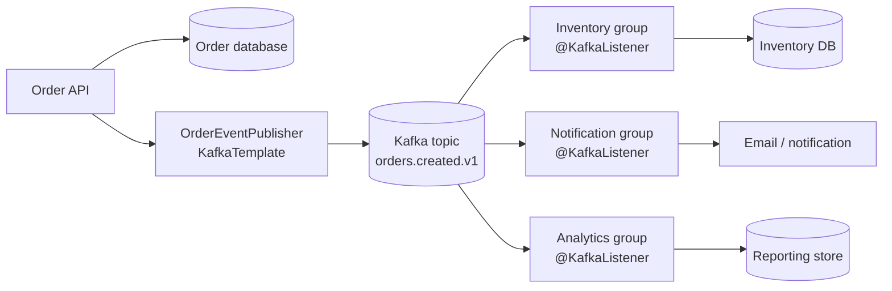
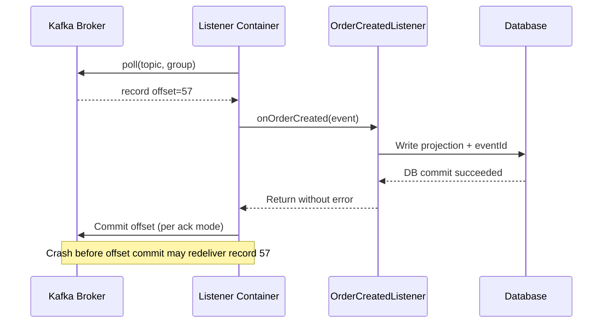
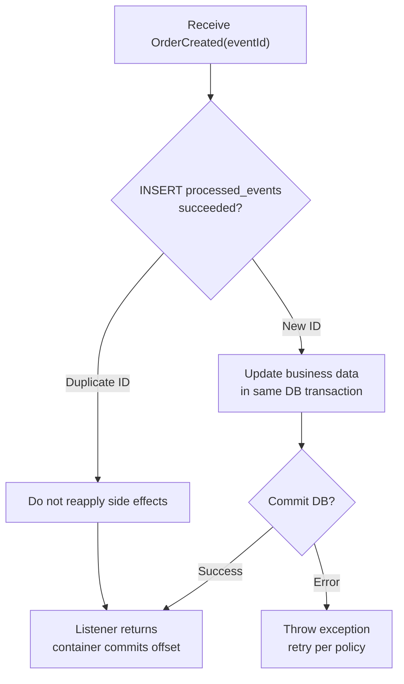
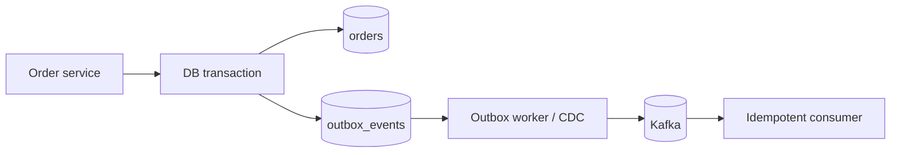

# Integrating `spring-kafka` and Configuring `spring.kafka.*`

## 1. Goal and Context

In a multi-service system, HTTP fits operations that require an immediate response, whereas Apache Kafka is well-suited for transmitting asynchronous **events** or **commands** between components that process work at different paces. For example, after `order-service` confirms an order, the system needs to update inventory, send notifications, and generate reporting data. If all of these operations were synchronous HTTP calls, a slow or unavailable service could prolong the response time of the order placement flow.

Within the **SPRING_BOOT_INTEGRATION** module, the goal is to organize system integration in Spring Boot via HTTP clients, databases, caches, message brokers, and Spring Integration adapters. This lesson focuses on **Apache Kafka with Spring for Apache Kafka (`spring-kafka`)**: configuring producers/consumers using `spring.kafka.*`, defining event contracts, managing offsets, handling errors and duplicate messages, testing, and observing processing flows.

After this lesson, you will be able to:

1. Explain how topics, partitions, consumer groups, and offsets affect event flows.
2. Declare dependencies, `application.yml`, and Kafka beans auto-configured by Spring Boot.
3. Use `KafkaTemplate` to send and `@KafkaListener` to receive typed events.
4. Distinguish between producer retries, listener retries, idempotency, and Kafka transactions.
5. Design event paths for deserialization errors, business errors, duplicate sends, or database transaction failures.
6. Build integration tests and the observability metrics needed before operating in production.

> **Version scope:** The sample code targets **Java 17+, Spring Boot 3.x, and Spring Kafka 3.x** (such as Boot 3.5). Spring Boot 4.x/Spring Kafka 4.x introduce API changes and renamed JSON serializers/deserializers; check the documentation for your active version and do not mix code across the two generations. Official documentation links are provided at the end.

## 2. What Problems Does Kafka Solve in Spring Boot?

Kafka stores **records** in topics; a topic is divided into partitions. Producers send records with a key/value and optional headers. Brokers distribute records across partitions; consumers in a group read records and track their reading position using offsets.



Two consumers with the same **group-id** share partitions to process the same workload; two consumers belonging to **different groups** can process the same event independently. A record that has been read is not deleted just because one consumer finishes processing it: replayability depends on the topic's retention policy and the group's offset.

### 2.1. Shared Terminology

| Concept | Practical Meaning |
| --- | --- |
| Broker / cluster | Stores and serves topic partitions. |
| Topic | Name of a record stream, e.g., `orders.created.v1`. |
| Partition | Storage unit with its own offset sequence; determines parallelism and local ordering. |
| Record key | Used for partitioning and routing; typically an aggregate ID such as `orderId`. |
| Record value | Event payload; should include schema, version, and event identifier. |
| Header | Out-of-payload metadata such as trace ID, content type, and schema version by convention. |
| Offset | Position of a record within a partition; **not** a global business ID. |
| Consumer group | Instances coordinating to divide partitions and track committed offsets. |
| Rebalance | Reassigning partitions when members/partitions change; records may be redelivered. |
| Retention | Policy for keeping data on the broker, independent of consumer processing progress. |

**Ordering is guaranteed only within a single partition.** If all events for `orderId=ORD-42` use the same key, they typically go to the same partition under the active partitioner and preserve ordering within that partition. Ordering is not guaranteed across the entire topic or across different keys/partitions; changing the partition count can also cause a key to map to a different partition for subsequently sent records.

### 2.2. Kafka and Other Integration Components

- **HTTP client:** used when data is needed immediately in return or for synchronous requests; can be combined with HTTP to query state after receiving an event.
- **Database:** holds business state and has internal transactions; committing a database transaction does not automatically commit a Kafka message.
- **Cache:** speeds up reads, but still requires an invalidation/update strategy when events arrive.
- **Spring Integration:** provides Kafka inbound/outbound channel adapters to pass messages through integration flows; if you only send/receive Kafka directly, `KafkaTemplate` and `@KafkaListener` are usually simpler.

## 3. Installing Libraries and Auto-Configuration

In Spring Boot 3.x, add `spring-kafka`; versions are managed through Spring Boot's dependency management/BOM. When the library is on the classpath, Boot creates several default components based on `spring.kafka.*`, such as `KafkaTemplate`, `ProducerFactory`, `ConsumerFactory`, `KafkaAdmin`, and `KafkaListenerContainerFactory`. Only define custom beans when you need adjustments beyond the default configuration.

```xml
<!-- pom.xml: application using Spring Boot parent/BOM 3.x -->
<dependency>
    <groupId>org.springframework.kafka</groupId>
    <artifactId>spring-kafka</artifactId>
</dependency>

<dependency>
    <groupId>org.springframework.kafka</groupId>
    <artifactId>spring-kafka-test</artifactId>
    <scope>test</scope>
</dependency>

<dependency>
    <groupId>org.springframework.boot</groupId>
    <artifactId>spring-boot-starter-test</artifactId>
    <scope>test</scope>
</dependency>
```

With Spring Boot 4.x, starter packaging and serializer libraries may differ; obtain the corresponding dependencies from the BOM and version-specific documentation. This lesson uses the `JsonSerializer` and `JsonDeserializer` class names from Spring Kafka 3.x; Spring Kafka 4.x uses `JacksonJsonSerializer` and `JacksonJsonDeserializer` per the newer documentation.

**Basic startup flow:**

1. Boot binds `spring.kafka.*` into `KafkaProperties` and configures the Kafka clients.
2. `KafkaTemplate` uses the producer factory to publish records.
3. With `@KafkaListener`, Spring creates a listener container, uses the consumer factory to poll records, and invokes the corresponding method.
4. If a `NewTopic` bean is present and permissions allow topic creation, `KafkaAdmin` can create the topic at startup. Production environments usually manage topics via infrastructure/CI/CD.

You do not need to write a manual `KafkaConsumer.poll()` loop when using `@KafkaListener`; the container manages polling, assignment, offsets, and the consumer lifecycle.

## 4. Configuring `spring.kafka.*` in `application.yml`

### 4.1. Property Groups

| Group | Example | Purpose |
| --- | --- | --- |
| Common | `spring.kafka.bootstrap-servers`, `spring.kafka.client-id` | Cluster addresses and client name. |
| Producer | `spring.kafka.producer.acks`, `retries`, `key-serializer`, `value-serializer` | Sending records and converting Java → bytes. |
| Consumer | `spring.kafka.consumer.group-id`, `auto-offset-reset`, `enable-auto-commit`, deserializer | How consumers join a group and read records. |
| Listener | `spring.kafka.listener.ack-mode`, `concurrency`, `type` | Behavior of the container running `@KafkaListener`. |
| Admin | `spring.kafka.admin.*` | Admin client behavior and topic management. |
| Template | `spring.kafka.template.default-topic` | Default topic for `sendDefault(...)` calls, if desired. |
| Security | `spring.kafka.security.protocol`, `spring.kafka.ssl.*` | TLS/SASL connections matching cluster configuration. |
| Kafka Streams | `spring.kafka.streams.*` | Needed only when using Kafka Streams. |
| Native Kafka properties | `spring.kafka.properties[...]`, `producer.properties[...]`, `consumer.properties[...]` | Passing settings that do not have dedicated fields in `KafkaProperties`. |

Common-level properties apply broadly across clients; producer/consumer/admin-specific settings can override common values. Use bracket notation with quotes for **dotted keys** in YAML, such as `"[enable.idempotence]"`, so the binder preserves the key verbatim instead of interpreting it as nested YAML structure.

### 4.2. Derived Configuration for the Example

Suppose a sample application both publishes and subscribes to `OrderCreatedEvent`. In a real architecture, the publisher typically resides in `order-service` and the subscriber resides in another consuming service; each application then configures only what matches its role.

```yaml
spring:
  application:
    name: order-kafka-integration
  kafka:
    bootstrap-servers: ${KAFKA_BOOTSTRAP_SERVERS:localhost:9092}
    client-id: ${spring.application.name}

    producer:
      key-serializer: org.apache.kafka.common.serialization.StringSerializer
      value-serializer: org.springframework.kafka.support.serializer.JsonSerializer
      acks: all
      retries: 5
      properties:
        "[enable.idempotence]": true
        "[spring.json.add.type.headers]": false
        "[delivery.timeout.ms]": 120000

    consumer:
      group-id: ${KAFKA_CONSUMER_GROUP:inventory-projection-v1}
      auto-offset-reset: earliest
      enable-auto-commit: false
      key-deserializer: org.apache.kafka.common.serialization.StringDeserializer
      value-deserializer: org.springframework.kafka.support.serializer.ErrorHandlingDeserializer
      properties:
        "[spring.deserializer.value.delegate.class]": org.springframework.kafka.support.serializer.JsonDeserializer
        "[spring.json.value.default.type]": com.example.orders.integration.kafka.OrderCreatedEvent
        "[spring.json.use.type.headers]": false
        "[spring.json.trusted.packages]": com.example.orders.integration.kafka
        "[max.poll.interval.ms]": 300000

    listener:
      ack-mode: record
      concurrency: 3

app:
  kafka:
    topics:
      order-created: ${ORDER_CREATED_TOPIC:orders.created.v1}
```

> **Applicability conditions:** Change the `com.example.orders.integration.kafka` package to match your actual record package. For topics with multiple event types, configuring a single `value.default.type` as shown above is insufficient; you will need a message converter, type mapping/schema registry, or clear separation of topics/consumers. `spring.kafka.*` belongs to Spring Boot, while `app.kafka.topics.*` is a **custom** application key that avoids hard-coding topic names.

#### Explaining Easily Misunderstood Lines

- `bootstrap-servers` is the list of **bootstrap** addresses used to discover the cluster. Clients must also be able to connect to the broker addresses advertised via `advertised.listeners`; traffic passing through Docker/Kubernetes/VPN can fail even if the initial bootstrap connection succeeds.
- `acks: all` requests acknowledgment according to Kafka's leader/ISR mechanism. To achieve the desired durability, broker/topic settings such as replication factor and `min.insync.replicas` are also required; client configuration alone is not enough.
- `enable.idempotence=true` combined with `acks=all`, retries, and appropriate in-flight limits helps prevent duplicate writes caused by **producer self-retries**. It does not prevent an application from sending the same event twice via two independent logical calls.
- `retries: 5` is the number of times the Kafka producer can retry recoverable send failures. You must also consider `delivery.timeout.ms`; the overall timeout may end the send before all retries are exhausted.
- `spring.json.add.type.headers=false` avoids attaching the Java class name to JSON headers; the consumer in this example uses a fixed type and determines the contract itself.
- `ErrorHandlingDeserializer` wraps the `JsonDeserializer` delegate to convert deserialization errors into metadata that the listener container/error handler can process. Using `JsonDeserializer` directly can make recovery from poll-stage errors harder to control.
- `trusted.packages` must restrict allowed packages rather than using `*`. Do not use type headers from untrusted sources as an arbitrary class-selection mechanism.
- `auto-offset-reset: earliest` only decides the starting point when the group **has no valid committed offset**; switching from `latest` to `earliest` does not automatically rewind a group that has already committed offsets.
- `enable-auto-commit: false` lets the listener container manage commits according to `ack-mode`. With `ack-mode: record`, the container commits progress after the listener processes a record successfully per container mechanics; errors and recovery can alter commit progression.
- `concurrency: 3` allows up to three consumers in the same listener container. If the topic has only one partition, increasing concurrency will not allow one group to process that partition concurrently.

### 4.3. Using Environment-Specific Configuration Files

Keep shared settings in `application.yml`, and place endpoints, timeouts, security, and environment scale in a secret manager, environment variables, or appropriate profiles. For example:

```yaml
# application-prod.yml: SASL_SSL example, depending on the Kafka provider
spring:
  kafka:
    bootstrap-servers: ${KAFKA_BOOTSTRAP_SERVERS}
    security:
      protocol: SASL_SSL
    properties:
      "[sasl.mechanism]": PLAIN
      "[sasl.jaas.config]": 'org.apache.kafka.common.security.plain.PlainLoginModule required username="${KAFKA_USERNAME}" password="${KAFKA_PASSWORD}";'
```

Only use the configuration above when the cluster actually requires SASL/PLAIN over TLS; other environments may use SCRAM, OAuth, mTLS, or IAM. Secrets must be managed in a secret-provisioning system—never commit real passwords or log full JAAS values. Truststore/keystore settings must match the Kafka cluster's TLS policy.

## 5. Event Contract: Key, Payload, Version

Example where the ordering API completes order creation and emits an event:

```json
{
  "eventId": "evt-2026-00042",
  "schemaVersion": 1,
  "orderId": "ORD-42",
  "totalAmount": 125000,
  "occurredAt": "2026-11-20T09:12:00Z"
}
```

Java DTO, placed in `OrderCreatedEvent.java`:

```java
package com.example.orders.integration.kafka;

import java.math.BigDecimal;

public record OrderCreatedEvent(
    String eventId,
    int schemaVersion,
    String orderId,
    BigDecimal totalAmount,
    String occurredAt
) {}
```

The fields serve different roles:

| Field | Role |
| --- | --- |
| `eventId` | Unique identifier of the **logical event occurrence**, used to prevent duplicate processing. |
| `schemaVersion` | Helps consumers interpret the data structure and compatibility strategy. |
| `orderId` | Aggregate key, typically used as the **Kafka record key** to preserve local ordering for an order. |
| `totalAmount` | Business data; use an appropriate type to avoid losing monetary precision. |
| `occurredAt` | Timestamp when the event occurred in ISO-8601/UTC; distinct from Kafka log append time. |

**The wire contract is a commitment between services**, not an internal Java class. Renaming fields, changing types, or removing fields can break older subscribers; enforce a versioning policy, add backward-compatible fields, run schema tests, and define a support window for older versions. When multiple languages/runtimes or large scale are involved, consider JSON Schema or Avro/Protobuf with a schema registry and compatibility policies.

The contract should also describe how late, duplicate, and out-of-order events are handled. `eventId` serves deduplication, while `orderId` serves partitioning; they do not replace each other.

## 6. Producer: Sending Events with `KafkaTemplate`

Spring Boot creates `KafkaTemplate` when a producer factory is configured. Event-publishing service:

```java
package com.example.orders.integration.kafka;

import java.util.concurrent.CompletableFuture;
import org.springframework.beans.factory.annotation.Value;
import org.springframework.kafka.core.KafkaTemplate;
import org.springframework.kafka.support.SendResult;
import org.springframework.stereotype.Component;

@Component
public class OrderEventPublisher {
    private final KafkaTemplate<String, OrderCreatedEvent> kafkaTemplate;
    private final String topic;

    public OrderEventPublisher(
        KafkaTemplate<String, OrderCreatedEvent> kafkaTemplate,
        @Value("${app.kafka.topics.order-created}") String topic
    ) {
        this.kafkaTemplate = kafkaTemplate;
        this.topic = topic;
    }

    public CompletableFuture<SendResult<String, OrderCreatedEvent>> publish(
        OrderCreatedEvent event
    ) {
        // The same orderId usually goes to the same partition if the partitioner and partition count are stable.
        return kafkaTemplate.send(topic, event.orderId(), event);
    }
}
```

Starting from Spring Kafka 3.x, `KafkaTemplate.send(...)` returns `CompletableFuture<SendResult<K,V>>`. Returning a future **does not mean the broker has persisted the record**. Callers must handle the result asynchronously:

```java
publisher.publish(event).whenComplete((result, error) -> {
    if (error != null) {
        // Record failure and route to retry/outbox/reconciliation.
        // Do not silently swallow errors; do not log full sensitive payloads.
    } else {
        var metadata = result.getRecordMetadata();
        // Observe topic, partition, offset, and send latency.
    }
});
```

The callback snippet illustrates the caller's responsibility; `event` and `publisher` are variables in the actual calling flow. To wait synchronously for confirmation, you can use `future.get(timeout, TimeUnit.SECONDS)`, but avoid blocking request threads unnecessarily. An exception thrown immediately by `send(...)` (such as a configuration error) must also be distinguished from an exception completing the future.

### 6.1. Sending Messages with Metadata

When trace ID, source service, or event type is needed, use `ProducerRecord`:

```java
import java.nio.charset.StandardCharsets;
import org.apache.kafka.clients.producer.ProducerRecord;
import org.apache.kafka.common.header.internals.RecordHeader;

ProducerRecord<String, OrderCreatedEvent> record =
    new ProducerRecord<>(
        "orders.created.v1",
        event.orderId(),
        event
    );
record.headers().add(
    new RecordHeader("event-type", "OrderCreated".getBytes(StandardCharsets.UTF_8))
);
record.headers().add(
    new RecordHeader("correlation-id", correlationId.getBytes(StandardCharsets.UTF_8))
);
kafkaTemplate.send(record);
```

Here `event`, `correlationId`, and `kafkaTemplate` are provided by the caller. Do not put passwords/tokens or unnecessary personal data into headers; Kafka records are often stored across multiple logging systems and can be replayed.

### 6.2. Creating Topics for Development

With `KafkaAdmin` configured by Boot, a `NewTopic` bean can create a topic if it does not yet exist:

```java
import org.apache.kafka.clients.admin.NewTopic;
import org.springframework.beans.factory.annotation.Value;
import org.springframework.context.annotation.Bean;
import org.springframework.context.annotation.Configuration;
import org.springframework.kafka.config.TopicBuilder;

@Configuration(proxyBeanMethods = false)
public class KafkaTopicConfiguration {

    @Bean
    NewTopic orderCreatedTopic(
        @Value("${app.kafka.topics.order-created}") String topicName
    ) {
        // Local single-broker demo: replication factor = 1.
        return TopicBuilder.name(topicName)
            .partitions(3)
            .replicas(1)
            .build();
    }
}
```

In production, topics require controlled management of retention, replication factor, `min.insync.replicas`, ACLs, cleanup policy, and partition count. Do not copy `replicas(1)` from a demo into production; on a cluster, match the broker count and durability requirements. `NewTopic` is not a mechanism to alter every policy on an existing topic, nor does it replace IaC.

## 7. Consumer: Receiving Records with `@KafkaListener`

The following listener receives the `OrderCreatedEvent` type directly because the consumer is configured with the JSON deserializer and default type from the example:

```java
package com.example.orders.integration.kafka;

import org.slf4j.Logger;
import org.slf4j.LoggerFactory;
import org.springframework.kafka.annotation.KafkaListener;
import org.springframework.kafka.support.KafkaHeaders;
import org.springframework.messaging.handler.annotation.Header;
import org.springframework.stereotype.Component;

@Component
public class OrderCreatedListener {
    private static final Logger log =
        LoggerFactory.getLogger(OrderCreatedListener.class);

    @KafkaListener(topics = "${app.kafka.topics.order-created}")
    public void onOrderCreated(
        OrderCreatedEvent event,
        @Header(KafkaHeaders.RECEIVED_KEY) String recordKey
    ) {
        if (!event.orderId().equals(recordKey)) {
            throw new IllegalArgumentException("Kafka key does not match orderId");
        }

        // Demo: replace with a service persisting state with transaction + dedup.
        log.info(
            "Received OrderCreated eventId={} orderId={}",
            event.eventId(),
            event.orderId()
        );
    }
}
```

With full Spring Boot 3.x auto-configuration, `@KafkaListener` can run using the default factory and `spring.kafka.listener.*`; `@EnableKafka` is only needed when the application configures listener infrastructure manually or lacks it. To separate multiple groups or handle multiple event types, you can specify `groupId`, `containerFactory`, and deserializers/converters per listener.

### 7.1. Poll, Offset, and Acknowledgment

A consumer polls records from the broker, runs the handler, and commits offsets to record the **group's** progress. This is a read-position management mechanism, not a transaction encompassing side effects in a database or external HTTP API.



| Mode | General Behavior | When to Use |
| --- | --- | --- |
| `record` | Commits progress after each record is successfully processed by the container. | Common practice for independent records. |
| `batch` | Commits after all records from a poll are processed by the container. | Reduces commits; redelivery unit can be larger. |
| `manual` | Application calls `Acknowledgment.acknowledge()`, container manages commit timing. | When intentional progress control is needed. |
| `manual_immediate` | Application acks, may commit immediately on the consumer thread depending on invocation. | Requires careful control over threads and commit conditions. |

**Do not commit/ack before important side effects complete**, if the contract requires not losing processing. `AckMode.RECORD` does not eliminate the failure window: the business transaction may have committed while the offset has not yet been committed. Therefore, consumers must be designed as **idempotent** by default to tolerate redelivery.

### 7.2. Operational Settings to Tune

- `group-id` is fixed per application/processing function. Independent groups maintain separate progress. Changing `group-id` can cause the consumer to re-read part or all of retained data if `auto-offset-reset=earliest`.
- `concurrency` and partition count determine the concurrency limit within **one group**. Having `instances × concurrency` exceed the partition count generally leaves consumers with no assigned partitions.
- `max.poll.interval.ms` is the time limit between polls; a listener that takes too long to process can cause the consumer to be considered stalled and trigger a rebalance.
- `max.poll.records` helps cap the batch size returned from a single poll, but does not replace optimizing per-record processing time.
- If an event triggers slow HTTP calls or heavy DB operations, consider timeouts, bulkheads, batching, and offloading work so the listener does not hold partitions for too long.
- With batch listeners, you must know which records succeeded before retrying/acking; you cannot blindly apply `record`-mode error logic to a batch without accounting for partial failures.

## 8. Serialization, Deserialization, and Protecting Data Contracts

Kafka only stores bytes. Serializers convert Java objects into bytes on the producer; deserializers convert bytes into values on the consumer. There are three main groups of options:

| Approach | When Suitable | Risks to Manage |
| --- | --- | --- |
| `StringSerializer/StringDeserializer` | Text payloads or raw JSON handled explicitly. | Must parse, validate schema, and check versions manually. |
| `JsonSerializer/JsonDeserializer` (Spring Kafka 3.x) | Typed JSON events, quick Java integration. | DTO changes, type headers, and trusted packages. |
| Avro/Protobuf + Schema Registry | Multi-service/multi-language environments needing strict schema evolution. | Registry availability, compatibility policy, schema ID management. |

In the sample YAML, `spring.json.use.type.headers=false` and `spring.json.value.default.type` bind the consumer to `OrderCreatedEvent`. Advantage: no dependency on the fully qualified class name emitted by the producer. Drawback: such a consumer configuration cannot interpret an arbitrary topic containing multiple object types.

### 8.1. Handling Corrupted Payloads

A record with malformed JSON or unparseable fields fails before the `@KafkaListener` method is ever invoked. Without handling at the deserializer layer, the listener cannot use `try/catch` inside its method to catch that error.

`ErrorHandlingDeserializer` can pass error information into headers for the container/error handler to recover. When sending a deserialization-failed record to a **dead-letter topic (DLT)**, the original payload may become `byte[]`; the DLT producer must support serializing both valid DTOs that failed business logic and raw bytes that failed deserialization. A DLT using `JsonSerializer` alone may not handle raw bytes properly.

For data coming from multiple teams or partners, clearly define: allowed schemas, handling of extra/missing fields, versioning, idempotency keys, and a quarantine step when a schema cannot be decoded. Do not use `trusted.packages: "*"` as a quick fix for configuration errors.

## 9. Retries, Dead-Letter Topics, and Business Errors

Distinguish **send retries** on the producer from **processing retries** on the consumer:

| Error | Where It Occurs | Typical Policy |
| --- | --- | --- |
| Transient broker disconnect | Producer | Kafka producer retries within delivery timeout. |
| Unrecoverable payload validation failure | Deserializer/listener | Route to DLT or quarantine; infinite retries do not help. |
| Transient database timeout | Listener | Bounded retry with backoff and monitoring. |
| External HTTP service returns 429/503 | Listener | Controlled retry, backoff, and total time cap. |
| Business rule violation | Listener | Classify as non-retryable; respond via status event or DLT per contract. |
| Code bug recurring on every record | Listener | Alert; avoid infinite processing loops that stall the partition. |

Spring Kafka provides `DefaultErrorHandler` to classify exceptions and configure backoff. A simple example:

```java
import org.springframework.context.annotation.Bean;
import org.springframework.context.annotation.Configuration;
import org.springframework.kafka.listener.DefaultErrorHandler;
import org.springframework.util.backoff.FixedBackOff;

@Configuration(proxyBeanMethods = false)
public class KafkaListenerErrorConfiguration {

    @Bean
    DefaultErrorHandler kafkaErrorHandler() {
        // Two retry attempts after the initial attempt, spaced 1 second apart.
        DefaultErrorHandler handler =
            new DefaultErrorHandler(new FixedBackOff(1_000L, 2L));

        // Example permanent data error: retrying will not change the outcome.
        handler.addNotRetryableExceptions(IllegalArgumentException.class);
        return handler;
    }
}
```

Because Boot automatically wires a `CommonErrorHandler` bean into the default listener factory, declaring this bean affects listeners using that factory. **This configuration only illustrates retries**: once retries are exhausted, the default recoverer may log and skip the record. For critical business messages, define durable recovery—such as a DLT with alerting and a replay procedure.

### 9.1. DLT When Retries Are Exhausted

`DeadLetterPublishingRecoverer` can send failed records to a separate topic along with metadata about the original topic/partition/offset and exception. Core configuration snippet:

```java
// Snippet: dltTemplate must be a KafkaTemplate configured specifically for the DLT.
// Depending on the data, serializers for both DTOs and byte[] may be needed.
DeadLetterPublishingRecoverer recoverer =
    new DeadLetterPublishingRecoverer(
        dltTemplate,
        (record, error) -> new TopicPartition(
            record.topic() + ".DLT",
            record.partition()
        )
    );

DefaultErrorHandler handler =
    new DefaultErrorHandler(recoverer, new FixedBackOff(1_000L, 2L));
handler.addNotRetryableExceptions(IllegalArgumentException.class);
```

This is an **illustrative snippet**, not a complete bean configuration: `dltTemplate` needs to be declared with an appropriate producer factory, key/value serializers, and security settings; required imports include `org.springframework.kafka.listener.DeadLetterPublishingRecoverer` and `org.apache.kafka.common.TopicPartition`. The DLT `orders.created.v1.DLT` must exist and have enough partitions if the resolver preserves the original partition. In a real application, replace the `DefaultErrorHandler` bean in the previous example with the bean built from this recoverer.

A valid recovery design should answer:

1. Does the DLT record retain the payload, key, trace ID, and root cause needed for diagnosis?
2. Who monitors DLT counts, triages errors, and decides on replay or data correction?
3. Does replay guarantee idempotency without double writes or out-of-order effects?
4. If writing to the DLT also fails, is the record falsely treated as "processed"?
5. Do exception headers contain sensitive stack traces/payloads that require restricted access or retention?

> **Note:** A DLT does not automatically guarantee successful message processing. It is an error-management branch requiring ownership, alerting, and a controlled fix/replay process. `@RetryableTopic` is another option for non-blocking retries, but its impact on ordering, topic count, and interaction with Kafka transactions must be evaluated before use.

## 10. Duplicates, Transactions, and "Exactly Once"

Kafka consumers are typically designed under the assumption of **at-least-once processing**: a record may arrive again after a rebalance, crash, timeout, or failed offset commit. Enabling producer idempotence only prevents certain duplicates caused by Kafka producer retransmissions; it **does not** prevent two calls to `publish` from producing two identical logical events.

### 10.1. Preventing Duplicate Processing on the Consumer

A straightforward approach is a `processed_events` table with a unique key on consumer name and event ID:

```sql
CREATE TABLE processed_events (
    consumer_name VARCHAR(100) NOT NULL,
    event_id VARCHAR(100) NOT NULL,
    processed_at TIMESTAMP NOT NULL,
    PRIMARY KEY (consumer_name, event_id)
);
```

Within the **same database transaction** as the business update:

1. Attempt to insert `(consumer_name, event_id)` into the dedup table backed by a UNIQUE/PRIMARY KEY constraint.
2. If it already exists, treat the event as already processed and exit cleanly without reapplying side effects.
3. If the marker insert succeeds, update the projection/inventory and commit them in the same transaction.
4. Only after successful processing does the listener return so the container can manage the offset commit.

Do not split "check existence" and "insert marker" into two separate transactions, as this introduces a race condition between consumers. For external side effects (sending emails, calling HTTP), a database dedup record alone is not enough to guarantee no duplicate delivery; you need an idempotency key on the receiving side, a transactional outbox, or an equivalent mechanism.



### 10.2. Kafka Transactions Are Not Distributed Transactions with Databases

Configuration property:

```yaml
spring:
  kafka:
    producer:
      transaction-id-prefix: ${KAFKA_TX_PREFIX:orders-instance-a-}
    consumer:
      properties:
        "[isolation.level]": read_committed
```

When `spring.kafka.producer.transaction-id-prefix` is configured in Boot 3.x, Boot can automatically create a `KafkaTransactionManager`. Kafka transactions group Kafka writes and, in appropriate consume-process-produce flows, coordinate offsets with output records inside Kafka. A `read_committed` consumer avoids reading records belonging to aborted Kafka transactions.

However:

- A Kafka transaction does not turn `order-service`'s database and the Kafka broker into a single ACID transaction.
- The transactional ID prefix must avoid collisions across running instances; in the example, the placeholder `orders-instance-a-` is illustrative only and must be provisioned uniquely per instance.
- Kafka transactions/consumer offsets provide specific guarantees **within Kafka** under matching configuration; external HTTP/email sends or database writes can still be duplicated.
- Enabling transactions impacts throughput, error flows, and operations; enable them only when the problem genuinely requires them.

### 10.3. Transactional Outbox for Database → Kafka Flows

If business logic updates an order in the database and immediately calls `KafkaTemplate.send(...)`, two awkward failure modes arise:

| Order | Failure Scenario | Risk |
| --- | --- | --- |
| Commit DB then send to Kafka | App crashes before publish | Order exists in DB, but no event was emitted. |
| Send to Kafka then commit DB | DB rolls back after Kafka received the message | Consumers see an event for an order that does not exist. |

The **transactional outbox** solves this by writing the order change **and** an outbox row in the **same database transaction**. A worker or CDC connector reads the outbox and publishes to Kafka, then marks it sent according to policy. The publisher can still republish upon crashing; consumers still need deduplication via `eventId`.



This design bridges Kafka's responsibilities with databases, caches, HTTP, and integration adapters without assuming the systems share a transaction manager.

## 11. Security, Advanced Configuration, and Operations

### 11.1. Key Configuration Practices

| Goal | Property / Action | Notes |
| --- | --- | --- |
| Identify cluster | `spring.kafka.bootstrap-servers` | Verify DNS, advertised listeners, and network routes. |
| Reduce data loss | Producer `acks=all`, idempotence; broker with proper ISR/replication | A client flag alone is insufficient. |
| Control batching | `producer.properties[linger.ms]`, `batch.size` | Higher throughput can increase latency. |
| Bound send time | `producer.properties[delivery.timeout.ms]` | Must align with `request.timeout.ms` and `linger.ms`. |
| Tune polling | `consumer.properties[max.poll.interval.ms]`, `max.poll.records` | Slow record processing can trigger rebalances. |
| Protect data | TLS/SASL, ACLs, key/secret rotation | Never put credentials in logs or source code. |
| Topic governance | Partitions, replication, retention, quotas, ACLs | Topic and data ownership must be explicit. |
| Schema handling | Versioning, schema registry, compatibility tests | Do not couple over the wire to Java class names. |
| Contain failures | Backoff, DLT, circuit breakers for HTTP calls from consumers | Avoid infinite retries stalling a partition. |

### 11.2. Observing Producers, Consumers, and Brokers

Beyond error logs, measure:

- **Producer:** send rate, `send`-to-ack latency, retry count, timeouts, serialization errors, and pending outbox event count.
- **Consumer:** records processed/sec, p95/p99 processing time, error rate, retry count, consumer lag by group and partition.
- **Broker/topic:** partition count, ISR/under-replicated partitions, storage/retention, controller/broker availability, and quotas.
- **Recovery:** DLT record count, age of unprocessed records, failed replay count, schema error rate by version.

Micrometer/Actuator and tracing can attach observations to `KafkaTemplate` and listener containers depending on version/configuration. Propagate trace/correlation IDs via headers by convention; do not use high-cardinality values like `orderId`/`eventId` as metric tags. When logging, prioritize `eventId`, topic, partition, offset, group, and errors with sensitive data redacted.

## 12. Integration Testing with Real Kafka or an Embedded Broker

Unit tests mocking `KafkaTemplate` verify topic, key, and payload selection logic, but cannot test serialization, broker routing, or offsets. Integration tests should run real producers/consumers against an isolated Kafka environment.

### 12.1. `@EmbeddedKafka` Example

`spring-kafka-test` provides `@EmbeddedKafka` to spin up a broker for tests. With Spring Kafka 3.x, Boot can bind the generated bootstrap address:

```java
package com.example.orders.integration.kafka;

import static org.assertj.core.api.Assertions.assertThat;

import java.math.BigDecimal;
import java.util.concurrent.TimeUnit;
import org.junit.jupiter.api.Test;
import org.springframework.beans.factory.annotation.Autowired;
import org.springframework.boot.test.context.SpringBootTest;
import org.springframework.kafka.core.KafkaTemplate;
import org.springframework.kafka.test.context.EmbeddedKafka;

@SpringBootTest(properties = {
    "app.kafka.topics.order-created=orders.created.it",
    "spring.kafka.consumer.group-id=inventory-projection-test"
})
@EmbeddedKafka(
    topics = "orders.created.it",
    partitions = 3,
    bootstrapServersProperty = "spring.kafka.bootstrap-servers"
)
class OrderKafkaIntegrationTest {

    @Autowired
    KafkaTemplate<String, OrderCreatedEvent> kafkaTemplate;

    @Test
    void publishOrderCreatedToBroker() throws Exception {
        OrderCreatedEvent event = new OrderCreatedEvent(
            "evt-test-42",
            1,
            "ORD-42",
            new BigDecimal("125000"),
            "2026-11-20T09:12:00Z"
        );

        var result = kafkaTemplate
            .send("orders.created.it", event.orderId(), event)
            .get(10, TimeUnit.SECONDS);

        assertThat(result.getRecordMetadata().topic())
            .isEqualTo("orders.created.it");
        assertThat(result.getRecordMetadata().partition())
            .isBetween(0, 2);
    }
}
```

This is a **publish smoke test**: it confirms the producer serializes and the broker acknowledges the record, but does not prove the consumer processed it successfully. In consumer tests, wait on business state or a listener signal using polling/await with a deadline; avoid fixed `Thread.sleep` calls that create flaky tests. When CI needs networking, auth, broker versions, transactions, and DLTs closer to production, run Kafka via Testcontainers or a real test cluster.

### 12.2. Minimum Contract Test Suite

1. **Producer:** sends `key=orderId`, correct topic, JSON schema, and required metadata; failed futures have a handling path.
2. **Consumer:** parses records and updates state; sending the same `eventId` twice applies side effects only once.
3. **Offset/restart:** after successful processing and commit, restarting a consumer in the same group does not unexpectedly reprocess; crashing before commit allows safe replay.
4. **Deserialization error:** raw bytes violating the schema go to DLT/quarantine without permanently stalling the listener.
5. **Transient error:** database/HTTP exceptions are retried the configured number of times with backoff; once exhausted, the record is recovered as designed.
6. **Non-retryable error:** validation violations do not loop endlessly; evidence and business handling flow exist.
7. **Outbox:** DB commit succeeds while the publisher is temporarily paused, and still publishes after recovery; replay produces no duplicate side effects.
8. **Real environment:** verify ACL/TLS, advertised listeners, partition count, DLT topic, retention, and metrics/alerting.

## 13. Common Errors and Troubleshooting

| Symptom | Possible Cause | Where to Check |
| --- | --- | --- |
| Bootstrap connects, but send/read times out | `advertised.listeners` points to an unreachable broker address | Check broker metadata, Docker/K8s/DNS/firewall. |
| `@KafkaListener` receives no messages | Wrong topic/group, offset already at end, partition unassigned, auth ACL | Check group lag/assignment, topic existence, ACLs, `auto-offset-reset`. |
| Consumer gets `JsonDeserializer` error | Invalid type header, wrong package, JSON/schema mismatch | Check classes, `trusted.packages`, type config, and data on the topic. |
| Producer future fails | Timeout, quota, authorization, serializer, or broker error | Check root exception, client metrics, and broker logs. |
| Same order updated twice | At-least-once delivery, missing deduplication | Design `eventId` and unique constraint in the side-effect transaction. |
| Consumer lag grows continuously | Slow listener, too few partitions, overloaded downstream, or repeated retries | Compare throughput vs lag, profile each stage, plan partition scaling. |
| Continuous rebalances | Consumer processing exceeds `max.poll.interval.ms`, heartbeat issues, or deploy churn | Measure processing time, inspect group members and poll configuration. |
| DLT cannot publish | DLT missing partitions/permissions or serializer does not support raw bytes | Check topic, ACLs, DLT template, recovered record metadata. |
| DB committed then event lost | Sending to Kafka outside the DB transaction | Use outbox and retry publisher. |
| Kafka transactions enabled, yet duplicate emails occur | Transaction does not span the email system | Design idempotency for external side effects outside Kafka. |

## 14. Workflow for Implementing a Kafka Flow in a Project

1. **Finalize the event contract:** event name, schema, version, key, ownership, retention, security details, replay policy.
2. **Choose business guarantees:** accept at-least-once, deduplication strategy, when outbox or Kafka transactions are needed.
3. **Declare `spring.kafka.*`:** bootstrap, auth, serializers, group-id, offset strategy, acks, timeouts, concurrency.
4. **Separate integration layers:** producers/consumers live in adapters; business services own domain rules; event DTOs stay separate from JPA entities.
5. **Define recovery:** error classification, retry/backoff, DLT, owner, and replay mechanism.
6. **Test:** verify wire format, key/partition, broker ack, consumer side effects, duplicates, and crash/restart.
7. **Operate:** monitor lag/errors/DLT, limit metric tags, enforce secret controls and topic policies.

**Self-Check Questions:**

- Why does `spring.kafka.consumer.auto-offset-reset=earliest` not cause a group with an existing committed offset to re-read all records?
- Why is `producer.properties[enable.idempotence]=true` insufficient to eliminate all duplicate events?
- If a topic has 3 partitions and `listener.concurrency=10`, how many consumers in the same group can actively receive partitions from that topic at the same time?
- By what mechanism are deserialization errors occurring before `@KafkaListener` handled?
- Why should an outbox be considered between a database and Kafka, even when Kafka producer transactions are enabled?
- When retrying a record to a DLT, who owns follow-up handling and how do you ensure replay does not cause duplicate side effects?

## 15. References

- [Spring Boot 3.5 — Apache Kafka Support](https://docs.spring.io/spring-boot/3.5/reference/messaging/kafka.html): auto-configuration, `KafkaTemplate`, `@KafkaListener`, `KafkaProperties`, transactions, embedded Kafka.
- [Spring Boot Current — Apache Kafka Support](https://docs.spring.io/spring-boot/reference/messaging/kafka.html): check changes in newer Boot releases.
- [Spring Kafka — Sending Messages](https://docs.spring.io/spring-kafka/reference/kafka/sending-messages.html): `KafkaTemplate` and `CompletableFuture<SendResult>`.
- [Spring Kafka — Handling Exceptions](https://docs.spring.io/spring-kafka/reference/kafka/annotation-error-handling.html): `DefaultErrorHandler`, `DeadLetterPublishingRecoverer`, retries, and DLT.
- [Spring Kafka 3.3 — Serialization, Deserialization and Message Conversion](https://docs.spring.io/spring-kafka/reference/3.3/kafka/serdes.html): `JsonSerializer`/`JsonDeserializer` for 3.x, type headers, and trusted packages.
- [Apache Kafka — Documentation](https://kafka.apache.org/documentation/): partitions, producer/consumer configuration, delivery semantics, brokers, and topics.
