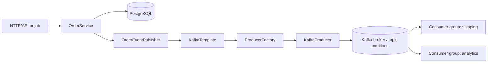
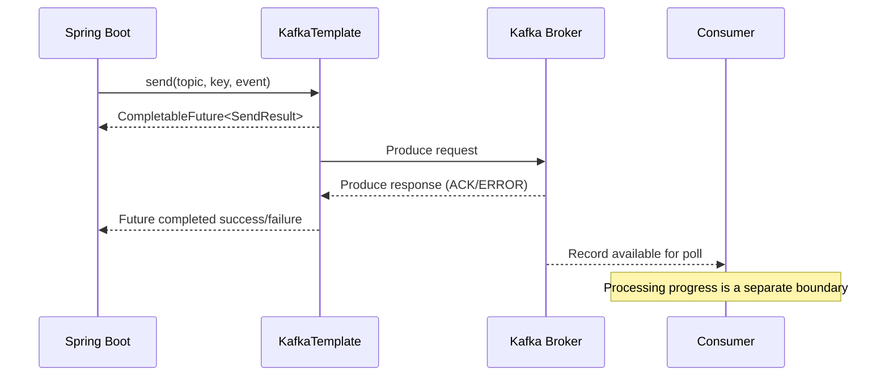
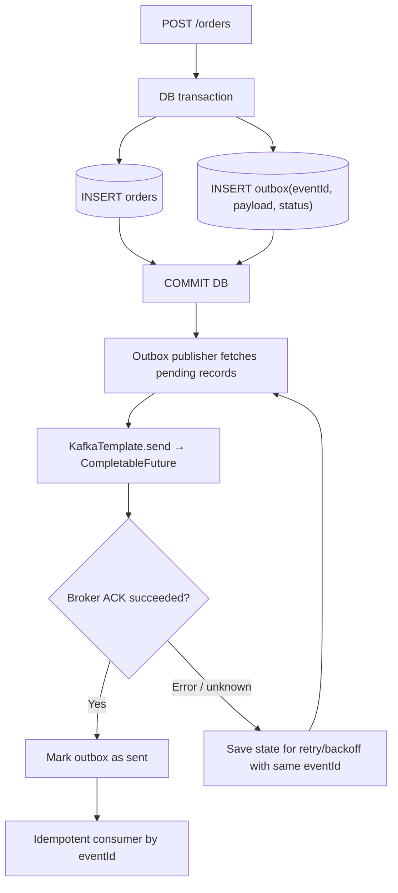

# KafkaTemplate, ProducerFactory, and Asynchronous Messaging

> **Chapter:** Apache Kafka  
> **Scope:** SPRING_BOOT_INTEGRATION — organizing integration across HTTP clients, databases, caches, message brokers, and Spring Integration adapters; managing configuration, data contracts, transactions, errors, deduplication, testing, and observability for real-world integration flows.

## 1. Problem Statement: How Does Spring Boot Send Events to Kafka?

An ordering service receives an HTTP `POST /orders` request, persists the order in PostgreSQL, and needs to notify shipping, reporting, and inventory control of `OrderCreated`. Instead of calling all three services directly and waiting for responses, the system can publish an event to **Apache Kafka**. Different consumers process it at the pace of their respective *consumer groups*.

On the producer side of Spring for Apache Kafka, there are two main components:

- **`ProducerFactory<K, V>`** is responsible for creating and managing `KafkaProducer<K, V>` instances from connection settings, serializers, authentication, and client properties. The standard implementation is `DefaultKafkaProducerFactory`.
- **`KafkaTemplate<K, V>`** provides a convenient Spring API for sending a `ProducerRecord` or payload to Kafka. Starting in **Spring Kafka 3.0+**, `send(...)` methods return `CompletableFuture<SendResult<K, V>>` for handling results asynchronously.

Relationship:



**Crucial distinction:** `KafkaTemplate.send(...)` initiates the send operation and returns a future; that **does not mean the broker has persisted it successfully**. You must await or handle the future's completion to know how the broker responded. Even when a send succeeds, the result only confirms **a write to Kafka per producer/broker settings**, not that a consumer has finished business processing.

### 1.1. Learning Objectives

After this lesson, you will be able to:

1. Add the Spring Kafka starter to a Boot application matching its version line.
2. Distinguish the roles of `KafkaTemplate`, `ProducerFactory`, and `KafkaProducer`.
3. Configure brokers, serializers, `acks`, idempotence, timeouts, batching, and authentication appropriately.
4. Send messages asynchronously and use `CompletableFuture` to return receipts or handle failures.
5. Design message keys, event contracts, ordering, retries, and idempotency.
6. Explain Kafka transactions, the transactional outbox, and boundaries with DB transactions.
7. Test producers and observe failures, latency, throughput, and outbox backlog.

## 2. Kafka Concepts Needed Before Writing Code

| Concept | Meaning in the Producer Flow | Design Note |
| --- | --- | --- |
| **Broker/cluster** | Provides distributed storage and retrieval of event logs | Requires bootstrap servers, access permissions, and proper TLS/SASL |
| **Topic** | Logical event stream, e.g., `orders.created` | Name, retention settings, and schema form an infrastructure contract |
| **Partition** | Sequence of records with monotonically increasing offsets within a topic | Ordering exists **within a single partition**, not across a multi-partition topic |
| **Record key** | Used to select a partition via the partitioner | A stable key like `orderId` usually routes records for the same order to the same partition |
| **Value** | Payload serialized into bytes | Schema version, compatibility, and sensitive data must be managed |
| **Headers** | Optional metadata attached to a record | Event ID, correlation ID, content type; never store secrets |
| **Offset** | Position of a record within a partition | A successful send receipt can return topic/partition/offset |
| **Producer acknowledgment** | Broker response to a send operation depending on `acks` | Completely different from consumer offset commits |
| **Consumer group** | Group of consumers sharing partition reads | The producer does not know whether each group has finished processing |

With multiple partitions, two events `OrderCreated` and `OrderCancelled` for the same `orderId` should carry the **same stable key** if per-order ordering is required. However, ordering also depends on emission timing, retry attempts, producer count, partition-count changes, and downstream processing. Do not treat the key as a system-wide ordering guarantee.

### 2.1. "Asynchronous" at Three Different Layers

**Layer 1 — Producer API:** `send(...)` returns a future so callers do not have to block waiting for the result during a normal send call. However, serialization or waiting for metadata/buffers inside `send` can still consume time on the calling thread depending on client/config.

**Layer 2 — Broker:** once the producer receives a successful acknowledgment, the record is accepted by Kafka according to the `acks` setting and broker cluster state; this is the producer's reliability boundary.

**Layer 3 — Consumer:** may process late, fail, or receive redeliveries. A Kafka producer cannot confirm "business delivery completed" from `SendResult` alone.



Do not use an uncompleted Future as proof that a record was written. Nor should you fire-and-forget a Future in a flow where event delivery is mandatory.

## 3. Starter and Version Compatibility

In **Spring Boot 3.x**, the simple way to add a Kafka producer:

```groovy
// build.gradle; project already applies the Spring Boot plugin/BOM
dependencies {
    implementation 'org.springframework.kafka:spring-kafka'
    testImplementation 'org.springframework.boot:spring-boot-starter-test'
    testImplementation 'org.springframework.kafka:spring-kafka-test'
}
```

In the Spring Boot 3.x ecosystem, `spring-kafka` is the official dependency auto-configured by Boot; there is no need to build a custom starter for standard producer tasks. In **Spring Boot 4.x**, starters may be reorganized; for instance, `org.springframework.boot:spring-boot-starter-kafka` is an artifact to verify against your Boot release documentation. Therefore:

- **Choose versions via the BOM/matching Boot release**, avoiding arbitrary Spring Kafka versions copied from a different release line.
- Sample code in this lesson uses **Java 17+ / Spring Boot 3.x / Spring Kafka 3.x**. Spring Kafka **2.x** uses the older `ListenableFuture` API, so `CompletableFuture` examples cannot be copied verbatim there.
- When upgrading Boot/Spring Kafka, check Kafka clients, serializers, callback APIs, transactions, and auto-configuration behavior separately.

Maven equivalent (Boot 3.x includes dependency management):

```xml
<dependency>
    <groupId>org.springframework.kafka</groupId>
    <artifactId>spring-kafka</artifactId>
</dependency>
```

**`@EnableKafka` is not needed to use `KafkaTemplate` for sending messages.** That annotation relates to Kafka listener infrastructure for consumer annotations; producers only need the appropriate producer beans and configuration.

## 4. How Does Spring Boot Create ProducerFactory and KafkaTemplate?

When Spring Kafka is on the classpath, Boot checks auto-configuration conditions and any user-provided beans. In a typical setup, Boot builds:

| Bean | Function | When Customizing Is Needed |
| --- | --- | --- |
| `KafkaProperties` | Binds `spring.kafka.*` from the environment | Configuring endpoints, serializers, security, and properties |
| `DefaultKafkaProducerFactory<?, ?>` | Creates producer clients from properties, manages producer caching when applicable | Needing separate producer factories per partner/cluster or custom serializers |
| `KafkaTemplate<?, ?>` | Wraps the factory with Spring's sending API | Needing separate templates, interceptors/observation, or multiple clusters |
| `KafkaTransactionManager<?, ?>` | Manages Kafka transactions when conditions are met | Kafka-only transactions; does not automatically merge atomically with SQL |

Whether a bean is created depends on the classpath, properties, conditions like `@ConditionalOnMissingBean`, and other configurations. When the application declares its own `ProducerFactory` or `KafkaTemplate`, Boot's corresponding default bean **may back off**. Verify bean counts and types when multiple producers/configs exist.

To investigate why a bean is missing:

1. Check the dependency tree: are `spring-kafka` and `kafka-clients` aligned?
2. Check `spring.kafka.bootstrap-servers`, serializer classes, and environment variables.
3. Check whether the application already defines custom beans that suppress the defaults.
4. Start with `--debug` and inspect the *Conditions Evaluation Report*.
5. Once the bean exists, test sending a record in a test environment; **a bean existing does not prove the broker is reachable**.

### 4.1. Generic Type Relationship

`KafkaTemplate<String, OrderCreatedEvent>` uses a matching `ProducerFactory<String, OrderCreatedEvent>` at the Java API level. The serializer **determines the actual bytes** sent to the broker; generic types do not automatically select JSON/Avro serializers.

Configuring `StringSerializer` for keys and `JsonSerializer` for values typically works well when all producers/consumers agree on a JSON contract. For cross-language integrations or strict schema evolution, consider Avro/Protobuf and a schema registry matching your organization's infrastructure rather than relying on internal Java type headers.

## 5. Configuring Producer Connectivity and Reliability

Example `application.yml` for a **development environment**:

```yaml
app:
  kafka:
    orders-topic: ${ORDERS_TOPIC:orders.created}

spring:
  kafka:
    bootstrap-servers: ${KAFKA_BOOTSTRAP_SERVERS:localhost:9092}
    producer:
      key-serializer: org.apache.kafka.common.serialization.StringSerializer
      value-serializer: org.springframework.kafka.support.serializer.JsonSerializer
      acks: all
      retries: 3
      properties:
        "[enable.idempotence]": true
        "[max.in.flight.requests.per.connection]": 5
        "[delivery.timeout.ms]": 120000
        "[request.timeout.ms]": 30000
        "[linger.ms]": 5
        "[batch.size]": 16384
```

`${...}` placeholders pull values from the environment; `localhost` is only appropriate when the application actually runs in the same network namespace as the broker. When deploying via containers/Kubernetes, use network-reachable broker addresses and verify the cluster's `advertised.listeners`. The values above **merely illustrate trade-offs**, not optimal settings for every SLA.

### 5.1. Meaning of Key Parameters

| Property | Purpose | Key Point to Understand |
| --- | --- | --- |
| `bootstrap.servers` | Addresses to initiate connections and fetch cluster metadata | Insufficient if the broker advertises unreachable addresses |
| `key.serializer` / `value.serializer` | Converts objects to bytes | Producers and consumers must agree on schema and encoding |
| `acks=all` | Leader waits for acknowledgment from replicas in the ISR per broker settings | Effectiveness depends on replication factor and `min.insync.replicas` |
| `enable.idempotence=true` | Prevents duplicate writes from producer retries within idempotent producer scope | Does not prevent business logic from republishing the same event |
| `retries` | Number of times the Kafka client may retry eligible send failures | Also constrained by `delivery.timeout.ms` |
| `max.in.flight.requests.per.connection` | Caps unacknowledged requests per connection | Must match idempotence requirements; max 5 for modern idempotent producers |
| `delivery.timeout.ms` | Upper time bound to complete a record from send call to success/failure | Includes batching, metadata, and client retries |
| `request.timeout.ms` | Wait time for broker response to a single request | Coordinates with broker settings and `delivery.timeout.ms` |
| `linger.ms` | Waits to accumulate records into batches when appropriate | Increases throughput at the potential cost of latency |
| `batch.size` | Target batch size per partition | Does not guarantee every send fills this exact size |
| `buffer.memory` / `max.block.ms` | Caps buffer size and wait time for metadata/buffer during send | An "async" send API can still block temporarily |

In modern Kafka client releases, several default values have changed across versions. **Inspect effective runtime settings** and load-test rather than relying on memorized defaults from older docs.

### 5.2. Security and Environments

Production Kafka typically requires TLS/SASL—such as `SASL_SSL`, SCRAM, OAuthBearer, or mTLS depending on the cluster. Spring Boot allows passing client properties under `spring.kafka.properties.*` or producer-specific configuration. SASL parameters, truststores/keystores, and secrets must be injected from a secret manager or secure environment variables, never hard-coded in source or written to logs.

Common pitfalls:

- Bootstrap broker connects, yet sends fail because `advertised.listeners` resolves to an unreachable internal hostname.
- TCP connects, yet the client lacks `WRITE`/`DESCRIBE` ACLs on the topic; infinite retries do not fix missing permissions.
- Producer succeeds in dev but fails with serialization/size/timeout errors in prod due to differences in schemas, quotas, `max.request.size`, and broker configs.
- Enabling compression or batching must be measured alongside CPU, network, payload size, and SLAs rather than chosen by guesswork.

## 6. When Should You Define a Custom ProducerFactory?

**Prefer Boot's auto-configuration** if you only need a single cluster and standard producer properties. Create a custom `ProducerFactory` only when genuinely required, such as multiple clusters, specialized serializers, or per-domain producer management.

A minimal example illustrating the relationship between factory and template:

```java
import java.util.HashMap;
import java.util.Map;
import org.apache.kafka.clients.producer.ProducerConfig;
import org.apache.kafka.common.serialization.StringSerializer;
import org.springframework.context.annotation.Bean;
import org.springframework.context.annotation.Configuration;
import org.springframework.kafka.core.DefaultKafkaProducerFactory;
import org.springframework.kafka.core.KafkaTemplate;
import org.springframework.kafka.core.ProducerFactory;
import org.springframework.kafka.support.serializer.JsonSerializer;

@Configuration
class OrderProducerConfiguration {

    @Bean
    ProducerFactory<String, OrderCreatedEvent> orderProducerFactory() {
        Map<String, Object> config = new HashMap<>();
        config.put(ProducerConfig.BOOTSTRAP_SERVERS_CONFIG, "localhost:9092");
        config.put(ProducerConfig.KEY_SERIALIZER_CLASS_CONFIG,
                StringSerializer.class);
        config.put(ProducerConfig.VALUE_SERIALIZER_CLASS_CONFIG,
                JsonSerializer.class);
        config.put(ProducerConfig.ACKS_CONFIG, "all");
        config.put(ProducerConfig.ENABLE_IDEMPOTENCE_CONFIG, true);
        return new DefaultKafkaProducerFactory<>(config);
    }

    @Bean
    KafkaTemplate<String, OrderCreatedEvent> orderKafkaTemplate(
            ProducerFactory<String, OrderCreatedEvent> factory) {
        return new KafkaTemplate<>(factory);
    }
}
```

In this explanatory snippet, `localhost:9092` is hard-coded for clarity. **Do not copy verbatim into production**: if you manually create a factory, Boot-bound producer properties (TLS, SASL, timeouts, observability, etc.) **do not automatically appear** in this manual `Map`. In real deployments, bind those properties consistently with `KafkaProperties` and your Boot version's SSL bundle/config mechanism, or use customizers on the default factory.

**Note on back-off:** declaring a custom `ProducerFactory` bean can prevent Boot from creating its default factory. If the system also needs multiple factories and templates, name beans explicitly and use `@Qualifier` or `@Primary` to avoid injection ambiguity on generic types. Do not confuse Java generic types with Boot automatically selecting the right cluster.

### 6.1. Lifecycle and Thread-Safety

- `KafkaTemplate` is normally used as a **thread-safe singleton** when the producer factory is configured properly; never instantiate a new `KafkaProducer` per HTTP request.
- `DefaultKafkaProducerFactory` can share or cache producers depending on mode and manages their lifecycle. Do not manually `close()` a framework-managed producer after each send.
- Producers have a dedicated I/O thread, and callbacks may run on internal client threads or future-completion threads. Avoid blocking operations, slow API calls, or long DB transactions inside callbacks.
- When multiple clusters or distinct serializer setups are required, model separate `KafkaTemplate`/factory pairs for each connection and name them clearly.

## 7. Example: Sending Events Asynchronously with KafkaTemplate

The following example assumes a Boot 3.x application configured with `spring.kafka.*` as shown earlier. The `orders.created` topic is provisioned and the app has write permissions. To decouple integration from business logic, define an event contract with a stable ID and inject `KafkaTemplate` into a publisher.

### 7.1. Data Contract and Receipt

```java
// OrderCreatedEvent.java
import java.time.Instant;
import java.util.UUID;

public record OrderCreatedEvent(
        UUID eventId,
        String orderId,
        Instant occurredAt,
        int schemaVersion) {
}
```

```java
// PublicationReceipt.java
public record PublicationReceipt(
        String topic,
        int partition,
        long offset) {
}
```

`eventId` is the **logical event ID**, reused when retrying a failed publish or reprocessing an outbox record. `orderId` acts as the **record key** so records for the same order typically land in the same partition. `schemaVersion` helps consumers handle payload changes in a controlled way. A production application may also add event type, correlation ID, tenant, and standardized business fields.

### 7.2. Publisher Returning a Future to the Caller

```java
// OrderEventPublisher.java
import java.nio.charset.StandardCharsets;
import java.util.Objects;
import java.util.concurrent.CompletableFuture;
import org.apache.kafka.clients.producer.ProducerRecord;
import org.apache.kafka.common.header.internals.RecordHeader;
import org.springframework.beans.factory.annotation.Value;
import org.springframework.kafka.core.KafkaTemplate;
import org.springframework.kafka.support.SendResult;
import org.springframework.stereotype.Service;

@Service
public class OrderEventPublisher {
    private final KafkaTemplate<String, OrderCreatedEvent> template;
    private final String topic;

    public OrderEventPublisher(
            KafkaTemplate<String, OrderCreatedEvent> template,
            @Value("${app.kafka.orders-topic}") String topic) {
        this.template = template;
        this.topic = topic;
    }

    public CompletableFuture<PublicationReceipt> publish(
            OrderCreatedEvent event) {
        Objects.requireNonNull(event, "event");
        Objects.requireNonNull(event.eventId(), "event.eventId");
        if (event.orderId() == null || event.orderId().isBlank()) {
            return CompletableFuture.failedFuture(
                    new IllegalArgumentException("orderId is required"));
        }

        ProducerRecord<String, OrderCreatedEvent> record =
                new ProducerRecord<>(topic, event.orderId(), event);
        record.headers().add(new RecordHeader(
                "event-id",
                event.eventId().toString()
                        .getBytes(StandardCharsets.UTF_8)));

        try {
            return template.send(record)
                    .thenApply(result -> {
                        var metadata = result.getRecordMetadata();
                        return new PublicationReceipt(
                                metadata.topic(),
                                metadata.partition(),
                                metadata.offset());
                    });
        } catch (RuntimeException synchronousFailure) {
            return CompletableFuture.failedFuture(synchronousFailure);
        }
    }
}
```

Key details explained:

1. `new ProducerRecord<>(topic, event.orderId(), event)` sets key and value explicitly. The Kafka producer selects the partition using the active partitioner; do not rely on HTTP request ordering to infer Kafka ordering.
2. The `event-id` header uses UTF-8 consistently. Never place secrets, bearer tokens, or unnecessary sensitive payloads into headers.
3. `template.send(record)` may return a future as soon as the record is accepted into the send pipeline; **the receipt is built only when the future completes successfully**.
4. `SendResult.getRecordMetadata()` provides the topic, partition, and offset of the acknowledged record. This is **not downstream processing status**.
5. Catching synchronous failures protects callers against errors thrown immediately during the send call (such as certain serialization, metadata lookup, or buffer errors). Asynchronous completion failures surface via the future; neither should ever be silently ignored.

In real code, validate schema version, null/empty fields, message size limits, and contract rules before sending. Do not treat events sharing the same `orderId` as the same event: a single order can legitimately emit multiple events with distinct `eventId` values.

### 7.3. Responding to HTTP After Kafka Acknowledgment

If an API truly requires returning an HTTP response only after the broker accepts the message, Spring MVC can return a `CompletableFuture` as an async result:

```java
import java.util.concurrent.CompletableFuture;
import org.springframework.http.ResponseEntity;
import org.springframework.web.bind.annotation.PostMapping;
import org.springframework.web.bind.annotation.RequestBody;
import org.springframework.web.bind.annotation.RequestMapping;
import org.springframework.web.bind.annotation.RestController;

@RestController
@RequestMapping("/demo/events")
public class OrderEventsController {
    private final OrderEventPublisher publisher;

    public OrderEventsController(OrderEventPublisher publisher) {
        this.publisher = publisher;
    }

    @PostMapping("/orders")
    public CompletableFuture<ResponseEntity<PublicationReceipt>> publish(
            @RequestBody OrderCreatedEvent event) {
        return publisher.publish(event)
                .thenApply(receipt ->
                        ResponseEntity.accepted().body(receipt));
    }
}
```

With Spring MVC, returning a future lets the framework handle the request asynchronously. **HTTP 202 is produced only after the future completes successfully**, not immediately when `send()` returns. If the future fails, a consistent `@RestControllerAdvice`/exception mapping is needed to return an appropriate error status; the example omits the full HTTP error contract to stay focused on the producer.

The endpoint above is **demo-only** and does not create an order or save to a database. A production application must emit events after accepting the business operation and explicitly decide its consistency guarantee with the database; never allow external clients to forge `eventId` or domain event contents without validation/authentication.

### 7.4. Using Callbacks for Observation, Not Heavy Business Logic

You can observe the outcome without blocking:

```java
CompletableFuture<PublicationReceipt> future = publisher.publish(event);

future.whenComplete((receipt, failure) -> {
    if (failure == null) {
        // Record success metric by topic/partition.
        // Do not interpret this as consumer processing completion.
        log.info("Kafka publish OK topic={} partition={} offset={}",
                receipt.topic(), receipt.partition(), receipt.offset());
    } else {
        // Record error code/metric for recovery or outbox handling.
        log.error("Kafka publish failed eventId={}", event.eventId(), failure);
    }
});
```

The snippet assumes `event`, `log` (class logger), and `publisher` exist. `whenComplete` is not the right place for slow HTTP calls or long DB transactions: callbacks can execute on I/O threads or future-completion threads. If durable recovery is required, persist state to an outbox or dispatch work to a dedicated managed executor/worker.

**An observation callback does not replace error handling:** if nothing consumes and handles the failure, the message can be lost from a business standpoint even though logs show the error. A Future does not turn work into a durable background job.

## 8. Asynchronous Sending Requires Stage-by-Stage Error Handling

Each send has distinct failure points; distinguishing them determines whether to retry or reconcile:

| Stage | Observable Signal | Safe to Assume Not Written to Broker? | Recovery |
| --- | --- | --- | --- |
| Pre-send event validation | `IllegalArgumentException`, missing DTO field | Yes, if template was not called | Fix data or reject at business layer; do not retry same input |
| Serialize/construct record | Serializer exception, invalid schema | Usually that record was not sent | Fix schema/serializer; classify as permanent failure |
| Metadata fetch / buffer allocation | Timeout, metadata unavailable, buffer exhausted | Depends on failure point; check client semantics | Shed load, inspect cluster, bounded safe retry |
| Broker handles request | Authorization, invalid topic, insufficient replicas, quota | Depends on error/ACK type | Fix permissions/config or retry within budget |
| Broker wrote record, response lost | Timeout/uncertain delivery | **No** | Idempotency, event ID, reconciliation, and dedup consumer |
| Future succeeded | `SendResult`, `RecordMetadata` | Broker acknowledged per `acks` | Mark producer success; consumer remains independent |

### 8.1. Errors to Classify Upfront

- **Permanent/configuration errors:** wrong serializer, incompatible contract, missing topic without auto-creation, authorization failure, bad authentication, `RecordTooLargeException` if payload exceeds limits. Retrying immediately with the same config is usually futile.
- **Potentially transient errors:** broker disconnect, leader unavailable, temporary replica shortage, quota/throttling, saturated producer buffer. Retrying can be considered while within deadline and clear safety rules.
- **Uncertain outcome:** timeout after sending, lost broker acknowledgment. Do not conclude the broker never received the message; never emit a **new logical event** with a new ID to "retry."
- **Business rejections:** nonexistent order, already canceled, limit exceeded—these typically originate in the service before publishing or in the consumer after reading; they are domain decisions, not Kafka producer transport errors.

Avoid retrying every `Exception` by calling `send()` again directly inside `whenComplete`: Kafka client retries, application retries, and downstream redeliveries can multiply attempts and cause a retry storm.

### 8.2. Two Distinct Types of Retries

**Client-level retry:** the Kafka producer automatically retries eligible send errors according to `retries`, `delivery.timeout.ms`, `retry.backoff.ms`, and idempotence settings. When producer idempotence is enabled under valid conditions, the broker detects duplicate requests retried by the same producer session.

**Application-level retry:** the application decides to call `KafkaTemplate.send(...)` again after a future fails, or retries an outbox row. This can become a **new logical publish at the producer layer**, even with the same payload and event ID. An idempotent producer **does not guarantee deduplicating every application-level publish**, especially across restarts or different producer sessions.

Therefore, at the application layer keep `eventId` constant, cap total attempts, and use an **idempotent consumer**. With an outbox, the publisher may resend an existing outbox record, while the consumer must handle receiving the same record multiple times.

### 8.3. Avoid Unnecessary Thread Blocking

```java
// Avoid doing this in every HTTP request "just to be sure":
PublicationReceipt receipt = publisher.publish(event).join();
```

`join()` blocks the calling thread and throws `CompletionException` if the future fails. In Spring MVC a synchronous boundary is occasionally acceptable with a deadline and sufficient threads, though it sacrifices the benefits of returning a future. In a WebFlux/Netty event loop, avoid `join()` or `get()` as they stall the event loop.

If a service uses reactive APIs, you can adapt the future to a `Mono`:

```java
import reactor.core.publisher.Mono;

Mono<PublicationReceipt> result =
        Mono.fromFuture(() -> publisher.publish(event));
```

Providing a Supplier to `Mono.fromFuture(...)` **defers invoking the producer until subscription**; the publisher must still handle cancellation and lifetime as required. This example requires Spring WebFlux/Reactor on the classpath and is optional for imperative Kafka apps. A Reactor pipeline does not turn the Kafka client into an end-to-end transaction with a database.

### 8.4. Bounding In-Flight Futures

Returning a future does not mean you can buffer unbounded messages in memory. When HTTP traffic spikes faster than Kafka can accept writes, producer buffers, queues, and pending callbacks can create memory pressure or trigger `max.block.ms` expiration.

Recommended practices:

1. Cap the number of *in-flight* events per Kafka cluster/topic based on measured load.
2. Use backpressure, bounded queues/bulkheads, or an outbox to avoid unbounded intake.
3. Apply retries with jitter and an overall budget rather than independent retries across multiple layers.
4. Accept that if an HTTP request is canceled after a record has been sent to Kafka, canceling the future **does not necessarily recall the message**.
5. Monitor buffer exhaustion, send latency, delivery timeouts, and exhausted retries.

## 9. Key, Partition, Ordering, and Message Contract

Kafka does not inherently understand ordering domain rules. Producers must agree with consumers on **topic**, **record key**, **schema**, and **event semantics**.

### 9.1. Choosing the Record Key Based on Required Ordering

Consider this sequence of events:

```text
OrderCreated(orderId=O-42)
OrderPaid(orderId=O-42)
OrderCancelled(orderId=O-42)
```

If `orderId` is used as the key on the same topic, the partitioner typically maps the same key to the same partition while the partition count and partitioning strategy remain stable. Kafka preserves log order within **one partition**. However:

- There is no ordering guarantee **across partitions**.
- Multiple producers and application operations may emit events in a different order than the true business order.
- Increasing the partition count or changing the partitioner can change key mapping.
- Parallel consumer processing or retries/DLTs can still cause side effects to occur out of read order.

If strict per-order ordering is mandatory, design for it starting at the source service: a reliable source event sequence, a stable key, appropriate concurrency, and state/version checks when applying events.

### 9.2. Data Contract and Schema Evolution

Minimum fields an event should carry:

| Field | Purpose |
| --- | --- |
| `eventId` | Identifies one business state change; helps consumers deduplicate |
| `eventType` | Distinguishes event types when one topic carries multiple types |
| `schemaVersion` | Manages payload structure evolution |
| `aggregateId` / `orderId` | Identifies the domain entity and can serve as the Kafka key |
| `occurredAt` | Timestamp when the event occurred at the source |
| `correlationId` | Links HTTP → DB → Kafka → consumer during tracing |

With Spring Kafka's `JsonSerializer`, the serializer may attach Java type metadata to headers under version defaults. That is convenient when both producer and consumer are Spring apps, but **Java class names should not be treated as a public contract schema** for polyglot systems.

For cross-system integration, choose JSON with unified schema/validation or Avro/Protobuf with a schema registry depending on requirements. Test both *new producer → old consumer* and *old producer → new consumer* before incrementing `schemaVersion`.

### 9.3. Topic/Partition/Offset Do Not Replace eventId

A Kafka record is identified by *topic, partition, offset*. If an outbox row is sent successfully while the producer misses the ACK, the same event may be sent again at a different offset. Deduplicating by offset alone will **fail to detect** two records at different offsets sharing the same `eventId`.

Consumers should use a deduplication key such as `(consumerName, eventId)` in the database, recording it and applying side effects within the same transaction unit whenever possible.

## 10. Kafka Transactions and Database Boundaries

### 10.1. Producer Idempotence vs. Kafka Transactions

| Mechanism | Goal | What It Does Not Guarantee |
| --- | --- | --- |
| `enable.idempotence=true` | Prevents duplicate records from producer retries at the Kafka protocol level under supported conditions | Duplicate events caused by the application republishing in a different producer session |
| Kafka transaction | Groups multiple Kafka producer operations into one transaction; in Kafka-to-Kafka flows can coordinate offsets by design | Atomic commit with an external database or HTTP service |
| Transactional outbox | Writes DB changes and publish intent in a single DB transaction | That an event appears strictly once in Kafka |
| Idempotent consumer | Prevents repeated side effects when the same event is read again | Automatically fixing schema/contract bugs or source transaction errors |

### 10.2. Enabling Transactional Producers When Needed

In Spring Boot 3.x, you can configure a transaction ID prefix:

```yaml
spring:
  kafka:
    producer:
      transaction-id-prefix: order-publisher-${INSTANCE_ID:local}-
```

Boot can set up a transactional producer factory and `KafkaTransactionManager` when conditions apply. The prefix must **avoid collisions across concurrent instances** to prevent them from fencing each other's transactions. Consumers reading transactional records should set `isolation.level=read_committed` if they should only see committed records; offset commits must also align with the consume-process-produce pattern.

Sending within a Kafka transaction using Spring Kafka:

```java
import org.springframework.kafka.core.KafkaTemplate;

public class TransactionalKafkaPublisher {
    private final KafkaTemplate<String, OrderCreatedEvent> template;

    public TransactionalKafkaPublisher(
            KafkaTemplate<String, OrderCreatedEvent> template) {
        this.template = template;
    }

    public void publishTwo(OrderCreatedEvent first, OrderCreatedEvent second) {
        template.executeInTransaction(operations -> {
            operations.send("orders.created", first.orderId(), first);
            operations.send("orders.created", second.orderId(), second);
            return null;
        });
    }
}
```

When the factory is configured for transactions, `executeInTransaction(...)` begins a Kafka transaction, executes the operations, and commits or aborts based on the outcome. **It does not automatically enclose a JDBC transaction.** If the application also uses `@Transactional` for JPA, do not assume having two transaction managers produces distributed 2PC/atomic commits; explicitly account for commit ordering and crash windows.

### 10.3. DB → Kafka Scenario and the Transactional Outbox

The naive direct-send pattern:

```text
BEGIN SQL TRANSACTION
  INSERT orders(...)
COMMIT

kafkaTemplate.send("orders.created", event)
```

If the process crashes after committing SQL but before sending/receiving ACK, the DB has the order while Kafka may lack the event. Reversing the order to send before SQL commit risks consumers seeing an event for an order that later rolls back.

The **transactional outbox** solves recoverability:



Essential implementation details:

1. Write `orders` and `outbox` in the **same DB transaction**.
2. Workers claim/lock outbox rows safely when multiple instances run.
3. Mark `SENT` **after** the Kafka send future completes successfully.
4. If an ACK is lost after the broker persists the record, the worker may resend. Keep the **same eventId**, and enforce a unique constraint/inbox on the consumer to deduplicate.
5. Monitor stale pending outbox rows, attempt counts, permanent errors (serializer/schema), and manual recovery procedures.

An outbox achieves practical **at-least-once publishing** when the worker recovers properly—not an "exactly once across SQL + Kafka" promise. If stronger guarantees are truly required, verify the entire end-to-end protocol and participating resource capabilities.

## 11. Testing the Producer from API to Kafka

### 11.1. Choosing Test Levels

| Level | Tools | Purpose | Limitation |
| --- | --- | --- | --- |
| Unit | Mockito for `KafkaTemplate`, fake future | Verify topic/key/headers, `SendResult`-to-receipt mapping, error handling | Does not run a real Kafka producer |
| Spring context | `@SpringBootTest` with matching beans/test config | Verify property binding and producer injection | Bean existence does not prove broker sends succeed |
| Integration | `@EmbeddedKafka` or Kafka Testcontainers | Real send/receive, serializers, topics, ACKs, partition/key | More resource-intensive than unit tests |
| End-to-end | HTTP → DB/outbox → Kafka → consumer | Crash/replay, idempotency, timeouts, transactions, tracing | Requires standing up multiple dependencies and fault simulation |

### 11.2. Integration Test Sending Real Messages with Embedded Kafka

Add `spring-kafka-test` to test dependencies; with Spring Boot 3.x and JUnit 5 you can write:

```java
import java.time.Instant;
import java.util.UUID;
import java.util.concurrent.TimeUnit;
import org.junit.jupiter.api.Test;
import org.springframework.beans.factory.annotation.Autowired;
import org.springframework.boot.test.context.SpringBootTest;
import org.springframework.kafka.test.context.EmbeddedKafka;

import static org.assertj.core.api.Assertions.assertThat;

@SpringBootTest(properties = {
        "app.kafka.orders-topic=orders.created"
})
@EmbeddedKafka(
        partitions = 1,
        topics = "orders.created",
        bootstrapServersProperty = "spring.kafka.bootstrap-servers")
class OrderKafkaPublisherIntegrationTest {

    @Autowired
    OrderEventPublisher publisher;

    @Test
    void publishCompletesWithBrokerMetadata() throws Exception {
        OrderCreatedEvent event = new OrderCreatedEvent(
                UUID.randomUUID(), "order-123", Instant.now(), 1);

        PublicationReceipt receipt = publisher.publish(event)
                .get(10, TimeUnit.SECONDS);

        assertThat(receipt.topic()).isEqualTo("orders.created");
        assertThat(receipt.partition()).isZero();
        assertThat(receipt.offset()).isGreaterThanOrEqualTo(0L);
    }
}
```

This test verifies **broker ACK and metadata**, without asserting that a consumer actually receives valid JSON. To test the contract, create a test consumer with matching serializers/deserializers, `poll` the record, and compare key, event ID, schema, and headers. For tests involving Spring JSON type headers, verify consumer compatibility per configuration.

`@EmbeddedKafka` spins up an in-memory Kafka broker for tests and sets the bootstrap property; never share a production broker for testing. Choose Kafka Testcontainers when you need an environment closer to your deployment cluster, multiple brokers, security, or specific failover behavior. CI must provide the required runtime.

### 11.3. Key Test Scenarios

1. Correct topic, `key = orderId`, payload with `eventId`/`schemaVersion`, UTF-8 `event-id` header.
2. `CompletableFuture` succeeds: receipt contains topic/partition/offset, API returns 202 **after** ACK.
3. Future fails: system does not falsely return HTTP 202, records error code, and preserves state for retry/outbox if applicable.
4. Serialization failure: no infinite retries; payload/schema must be fixed.
5. Slow/disconnected broker: bounded timeout, no unbounded accumulation of futures.
6. Broker persisted record but ACK lost: worker retries with the same `eventId`, consumer does not apply side effects twice.
7. Two consecutive events with the same key land in the same partition when partition count is stable; verify required ordering handling.
8. Process crashes after SQL commit before publish: outbox retains the record for worker recovery.
9. With Kafka transactions enabled: `read_committed` consumer sees only committed records, never aborted ones.

**Do not write mock tests that merely count `send()` invocations and claim Kafka is verified.** Unit tests verify the publisher contract; integration tests verify serializers, ACKs, and real broker behavior.

## 12. Observing the Producer Path and Recovering from Failures

An event-publishing system needs visibility from **request → publisher → broker → outbox/consumer**, rather than just logging "send called".

### 12.1. Metrics to Track

| Group | Data to Monitor | Meaning |
| --- | --- | --- |
| **Application** | Events created, publish success/failure counts, attempts, and future latency | Are events being lost or retried abnormally? |
| **Producer client** | `record-send-rate`, `request-latency`, `retry-rate`, `bufferpool-wait`, `record-error-rate` | Is the producer bottlenecked by network, broker, or buffers? |
| **Broker/topic** | Under-replicated partitions, ISR, produce errors, quota/throttling | Can the cluster satisfy `acks=all` and SLAs? |
| **Outbox** | Pending row count, oldest record age, retries/exhausted, status breakdown | Are unpublished records piling up? |
| **Consumer** | Consumer lag, duplicate count, side-effect failures, DLT backlog | Broker accepted the record, but is downstream keeping up? |
| **Trace/log** | `eventId`, `orderId` where permitted, topic, partition, offset, correlation ID | Can a single event be traced across services? |

Spring Kafka provides Micrometer observation/metrics depending on version, registry configuration, producer listeners, and interceptors. Spring Boot Actuator can integrate observation/export when configured properly. **Do not assume all producer/broker metrics appear automatically** just by adding a dependency: enable the registry/instrumentation and verify real metrics in your monitoring system.

Avoid attaching `eventId`, `orderId`, or payloads as **metric labels** per record due to high cardinality; they belong in controlled logs and traces. Never log passwords, tokens, full sensitive payloads, or SASL configs.

### 12.2. A Contextual Yet Non-Leaking Log Entry

Example of what a success log should include:

```text
action=kafka_publish
status=success
topic=orders.created
partition=2
offset=12031
eventType=OrderCreated
correlationId=req-6c22
durationMs=48
```

Failure logs should record the exception class, appropriate error code, and attempts; avoid misleading messages like "not published" when a timeout actually happened **after** the broker wrote the record. For uncertain outcomes, use labels like `OUTCOME_UNKNOWN` or `RECONCILE_REQUIRED` and keep the event in the outbox to verify/retry per policy.

### 12.3. Quick Diagnosis of Common Issues

| Symptom | Likely Cause | Investigation Steps |
| --- | --- | --- |
| Cannot inject `KafkaTemplate` | Missing Spring Kafka dependency, auto-configuration mismatch, multiple templates of same type | Check dependency tree, bean definitions, `--debug` |
| Connection timeout despite valid bootstrap host | Unreachable `advertised.listeners`, ACL/TLS/SASL, DNS, or firewall | Verify broker advertised addresses, network, and credentials |
| Future completes with `SerializationException` | Wrong serializer type, invalid payload/schema | Inspect serializers, DTOs, type headers, and contract |
| Producer throws `TimeoutException` | Slow broker/ISR, metadata unavailable, full buffer/queue, `delivery.timeout.ms` | Inspect producer metrics, broker logs, timeouts, and throughput |
| Permission error on send | Missing `WRITE`/`DESCRIBE` ACLs, wrong auth config | Check permissions; do not blindly retry |
| Offset exists, yet consumer sees nothing | Different topic/group, offset policy, deserialization error, `read_committed` with uncommitted tx | Inspect consumer config and contract independently |
| Same event processed twice by consumer | Application republish, outbox retry, consumer replay | Preserve `eventId`, inbox/unique constraint |
| p99 latency spikes with high batch size/linger | Batching, broker throttling, or connection saturation | Measure send-to-ACK latency alongside pool/buffer/quota metrics |
| Kafka transaction fenced | Duplicate transactional ID or old producer replaced | Inspect prefix/instance ID, restarts, and transaction logs |

To inspect auto-configuration during development:

```bash
java -jar app.jar --debug
```

Once beans are verified to exist, test sending against a **properly configured test broker** to separate Spring context issues from transport errors. Avoid using production topics as ad-hoc test targets.

## 13. Practical Exercise: Reliable Order Event Publishing

**Scenario:** A Spring Boot application receives orders, writes `orders` to PostgreSQL, and publishes `OrderCreated` to Kafka. Requirement: when Kafka is slow/disconnected or the app crashes between DB commit and publish, publishing intent must not be lost; when an event is republished, the consumer must not double-process it.

Implementation steps:

1. Choose Spring Boot 3.x and let the BOM manage `spring-kafka`. Configure brokers, serializers, topic, `acks=all`, and suitable timeouts.
2. Create `OrderCreatedEvent(eventId, orderId, occurredAt, schemaVersion)`; use `orderId` as the Kafka key and `eventId` for deduplication.
3. Define `KafkaTemplate<String, OrderCreatedEvent>` and a publisher returning `CompletableFuture<PublicationReceipt>`; never ignore the future's outcome.
4. Persist `orders` and `outbox` rows in the same SQL transaction; use a worker to publish outbox rows and mark `SENT` **after successful ACK**.
5. Handle errors by category: invalid schema/auth → fix, broker unavailable → budgeted retry, timeout with unknown outcome → retry with same `eventId`/reconcile.
6. Build a consumer with a unique constraint on `(consumer_name, event_id)`, writing business side effects and the deduplication key in the same transaction.
7. Use Embedded Kafka/Testcontainers to test successful ACK, broker unavailable, app crash, duplicate publish, and consumer redelivery.
8. Measure pending outbox count, oldest record age, send-to-ACK latency, retries, and duplicate counts.

### 13.1. Self-Check Questions

1. How do `ProducerFactory` and `KafkaTemplate` differ in responsibility? When is declaring a manual factory necessary?
2. Why does a `CompletableFuture<SendResult<...>>` returned from `send` not mean the broker has persisted the message?
3. If the broker has ACKed successfully, can you conclude `shipping-service` has already shipped the order? Why or why not?
4. How are `acks=all`, `min.insync.replicas`, and replication factor related?
5. Which type of duplicate does producer idempotence prevent, and which does it **not** prevent?
6. Why does `key = orderId` preserve ordering within a partition without guaranteeing system-wide ordering?
7. What problems can running slow SQL queries inside a `whenComplete` callback cause?
8. Why is calling `send(...).join()` inside a WebFlux event loop risky?
9. After an SQL commit succeeds and the Kafka ACK is lost, how do transactional outbox and `eventId` enable recovery?
10. What does a test asserting only `offset >= 0` prove, and what does it fail to prove about the event contract?

**Key Takeaway:** `ProducerFactory` governs producer configuration and lifecycle; `KafkaTemplate` provides a convenient sending API; `CompletableFuture` is the boundary for **asynchronous result confirmation**, not an end-to-end business guarantee. Real reliability requires combining **acks, serializers/schemas, keys/ordering, idempotence, bounded retries, transactional outbox, idempotent consumers, testing, and observability**.

### References

- [Spring for Apache Kafka — Sending Messages](https://docs.spring.io/spring-kafka/reference/kafka/sending-messages.html)
- [Spring for Apache Kafka — Transactions](https://docs.spring.io/spring-kafka/reference/kafka/transactions.html)
- [Spring for Apache Kafka — Serialization, Deserialization, and Message Conversion](https://docs.spring.io/spring-kafka/reference/kafka/serdes.html)
- [Spring for Apache Kafka — Testing Applications](https://docs.spring.io/spring-kafka/reference/testing.html)
- [Spring Boot — Apache Kafka Support](https://docs.spring.io/spring-boot/reference/messaging/kafka.html)
- [Apache Kafka — Producer Configs](https://kafka.apache.org/documentation/#producerconfigs)
