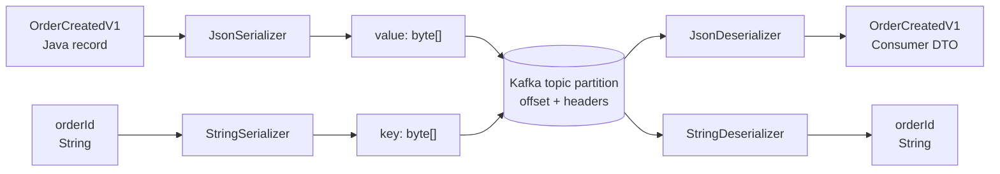
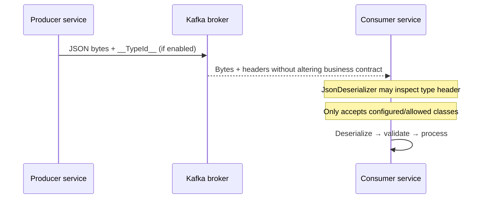
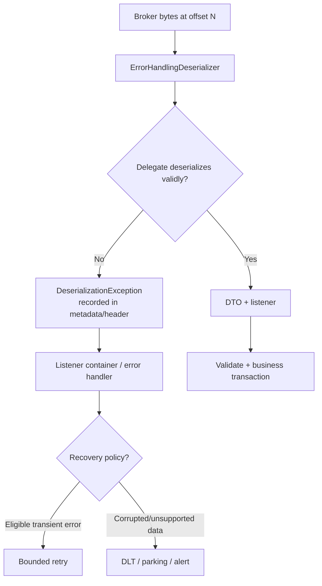
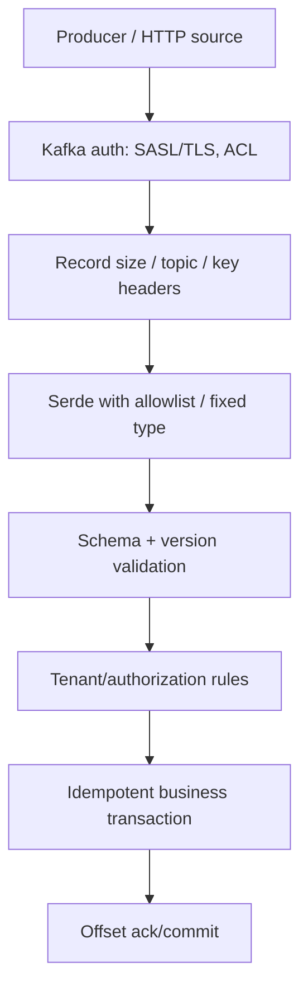

# Serializers, Deserializers, and Trusted Data Type Control

## 1. Why Is Message Format a Critical Integration Boundary?

In a Spring Boot integration system, one service may receive an HTTP request, write to PostgreSQL, and publish an `OrderCreated` event to Apache Kafka; another service consumes the event, updates payment state, and writes results back to the broker. Services **do not exchange Java objects directly** over Kafka. Kafka stores and transmits **byte arrays** for keys and values; producers and consumers must agree on how to turn data into bytes and restore it into business types.

A producer can emit a message that is valid for itself yet unreadable by a consumer because:

- The producer uses JSON while the consumer is configured with `StringDeserializer`, `ByteArrayDeserializer`, or a different format.
- Type headers carry a Java class name from the emitting service, while the receiving service lacks that class.
- The consumer uses `JsonDeserializer`, but the package in the type header is not trusted.
- The JSON has a new shape or is missing required fields compared to the data contract.
- The message contains corrupted data, is oversized, or exceeds processing limits, causing consumer deserialization to fail.
- The handler completes side effects successfully, but the message is redelivered because the offset was not committed, causing duplicate processing.

**Serializers/deserializers** define the meaning of byte payloads at the Kafka boundary; **trusted data type control** governs whether data arriving from the broker is allowed to influence **which Java class** gets instantiated. In the **SPRING_BOOT_INTEGRATION** module, this must be paired with configuration management, data contracts, error handling, transactions, idempotency, testing, and observing the HTTP → database → broker flow.

### Learning Objectives

After this lesson, you will be able to:

1. Distinguish Kafka key serializers, value serializers, deserializers, byte payloads, and message headers.
2. Choose String/byte[]/JSON serdes matching the data contract.
3. Configure `JsonSerializer`, `JsonDeserializer`, `spring.json.value.default.type`, `spring.json.use.type.headers`, and `spring.json.trusted.packages` in Spring Boot.
4. Explain why `trusted.packages=*` or trusting a partner's Java type headers is a risky design.
5. Use `ErrorHandlingDeserializer` and a Spring Kafka error handler to handle unparseable data and avoid poison-pill loops.
6. Design schema evolution, event identification, DLTs, retries, untrusted-data tests, and operational procedures.

> **Version scope:** Java snippets and configuration illustrate **Spring Boot 3.x**, **Spring for Apache Kafka 3.x**, Java 17+, and the Kafka Java client managed by the Spring Boot BOM. On Spring Kafka 4.x / Spring Boot 4, Jackson serializer/deserializer API names may differ; consult the migration guide for your exact version. Addresses, topics, and class names below are illustrative and not asserted to exist in any existing project.

## 2. Kafka Transmits Bytes; Java Types Are an Application Choice

Model of a single record:



Before the Kafka broker appends a record, the producer converts key and value to bytes using the configured serializers. On poll, the consumer uses deserializers to turn bytes into values passed to the Spring Kafka listener. The broker **does not validate business schemas** or inspect Java classes across services; it primarily handles bytes, partitions, offsets, headers, and protocol attributes.

A Kafka record typically contains:

| Part | Example | Responsibility |
| --- | --- | --- |
| Topic | `orders.events.v1` | Categorizes the data channel; requires ACLs and governance policies |
| Partition | `2` | Unit of distribution and in-partition ordering |
| Offset | `1042` | Record position in a partition, not a business event ID |
| Key bytes | UTF-8 bytes of `ORD-123` | Controls partition routing via the partitioner; does not deduplicate on its own |
| Value bytes | UTF-8 bytes of a JSON object | Event content per the contract |
| Headers | `event-type`, `schema-version`, trace ID, or Spring type headers | Metadata sent by the producer; **not inherently trustworthy** |
| Timestamp | CreateTime/LogAppendTime per topic/broker | Aids operations/retention; does not replace business timestamps |

**A Kafka key is not synonymous with a business data primary key.** The same key can have many records over time. An independent business event ID/idempotency key is needed if side effects must happen only once.

### 2.1. Serialization, Deserialization, and Validation Are Different

- **Serialization:** `OrderCreatedV1` → bytes for transport over Kafka.
- **Deserialization:** bytes → `OrderCreatedV1` according to the schema/type permitted by the consumer.
- **Validation:** checking `schemaVersion`, `eventId`, `orderId`, amounts, and business rules.
- **Authorization:** verifying the producer/service is permitted to emit and the consumer is permitted to execute the operation.
- **Idempotency:** preventing duplicate business effects when brokers or applications retry/redeliver.

Syntactically valid JSON can still violate the contract or be malicious—for example, `totalMinor=-10000000` or an `orderId` belonging to another tenant. A deserializer **does not replace** validation and authorization.

## 3. Choosing a Serde: String, byte[], or Schema-Backed Data?

Kafka includes serializers/deserializers for common primitives; Spring Kafka adds JSON and message-conversion utilities.

| Format | Producer Serializer | Consumer Deserializer | When Suitable |
| --- | --- | --- | --- |
| UTF-8 String | `StringSerializer` | `StringDeserializer` | Text events or JSON parsed explicitly by the application |
| Raw bytes | `ByteArraySerializer` | `ByteArrayDeserializer` | Binary formats decoded by an application or SDK |
| JSON DTO | Spring Kafka `JsonSerializer` | Spring Kafka `JsonDeserializer` | Explicit JSON contracts with controlled DTO mapping |
| Avro/Protobuf/JSON Schema + Registry | Provider-specific serde | Matching format/registry serde | Controlled schema evolution and cross-service contract sharing |
| Custom format | Custom `Serializer<T>` | Custom `Deserializer<T>` | Specialized formats with a clear technical rationale |

You cannot change the deserializer class without also changing the contract. A service emitting Avro binary does not magically become valid JSON just because the receiver switches to `JsonDeserializer`.

### 3.1. When Should You Use StringDeserializer for JSON?

If the consumer is a strict security boundary, you can read **JSON as a String** first and then:

1. Check payload size and version/type against an allowlist.
2. Select the **target DTO in code**, never taking a Java class name from the message.
3. Parse using a securely configured `ObjectMapper`.
4. Validate the DTO before invoking the business service.

This separates Kafka consumption mechanics from the data contract, which is convenient when a topic holds multiple event types or when raw payloads must be retained for investigation. The trade-off is having to build routing, validation, error handling, and tests yourself.

If a topic carries **a single DTO type**, `JsonDeserializer` with a fixed target type and ignored type headers is simpler and less ambiguous.

## 4. Sample Event Contract

Suppose the team defines an `OrderCreatedV1` event:

```json
{
  "eventId": "evt-8b2d",
  "schemaVersion": 1,
  "orderId": "ORD-123",
  "totalMinor": 129900,
  "occurredAt": "2026-11-21T08:00:00Z"
}
```

Conventions:

| Field | Meaning | Requirement |
| --- | --- | --- |
| `eventId` | Unique identifier of the **event**, used for idempotency | Non-empty, backed by uniqueness constraint where receipts are recorded |
| `schemaVersion` | Payload contract version | Matches the list of versions accepted by the consumer |
| `orderId` | Aggregate/order identifier, usable as the Kafka key | Non-empty and compliant with domain rules |
| `totalMinor` | Monetary amount in smallest currency unit to avoid floating-point errors | Non-negative, within domain bounds |
| `occurredAt` | Business timestamp in ISO-8601 UTC | Parsed/validated independently of Kafka timestamp |

Corresponding Java record:

```java
// src/main/java/example/integration/kafka/event/OrderCreatedV1.java
package example.integration.kafka.event;

public record OrderCreatedV1(
        String eventId,
        int schemaVersion,
        String orderId,
        long totalMinor,
        String occurredAt) {
}
```

The code uses `String occurredAt` to minimize dependencies in the example. In a real application, you can use `Instant` with Jackson Java Time support and explicit timezone conventions. **A Java record type is not a broker-published schema**; field names, JSON types, versions, and compatibility must be agreed upon across teams.

### 4.1. Do Not Send JPA Entities Directly

Avoid serializing an `@Entity Order` directly to Kafka:

- Entities carry lazy relationships, Hibernate proxies, or internal fields not meant for consumers.
- Database model changes can unintentionally break the event schema.
- Java package/class names can leak into type headers and couple services together.
- Sensitive entity fields risk being published to the broker outside the contract.

Instead, map from entities/commands into an **immutable event DTO** containing only approved fields.

## 5. Spring Boot Dependencies and Version Strategy

With Maven using the Spring Boot parent/BOM:

```xml
<!-- pom.xml: dependencies section -->
<dependency>
    <groupId>org.springframework.kafka</groupId>
    <artifactId>spring-kafka</artifactId>
</dependency>
<dependency>
    <groupId>org.springframework.boot</groupId>
    <artifactId>spring-boot-starter-test</artifactId>
    <scope>test</scope>
</dependency>
<dependency>
    <groupId>org.springframework.kafka</groupId>
    <artifactId>spring-kafka-test</artifactId>
    <scope>test</scope>
</dependency>
```

Gradle:

```groovy
dependencies {
    implementation 'org.springframework.kafka:spring-kafka'
    testImplementation 'org.springframework.boot:spring-boot-starter-test'
    testImplementation 'org.springframework.kafka:spring-kafka-test'
}
```

In Spring Boot 3.x, `spring-kafka` is the standard integration dependency; do not invent a hypothetical Kafka starter. Boot auto-configures `KafkaTemplate`, producer/consumer factories, and listener containers under matching conditions. Dependencies managed by the Boot BOM typically need no explicit version; if overriding Spring Kafka or Kafka clients, verify compatibility.

> **Example independence:** the configuration and code below illustrate a single app acting as both producer **and** consumer using the same Java contract. Two real microservices do not need to share a JAR containing the DTO; they only need a compatible **wire format/contract**. The consumer can map JSON into its own DTO in its own package.

## 6. Configuring the Producer: String Key and JSON Value

```yaml
# application.yml — local broker example; production requires TLS/SASL/ACLs
spring:
  kafka:
    bootstrap-servers: ${KAFKA_BOOTSTRAP_SERVERS:localhost:9092}
    producer:
      key-serializer: org.apache.kafka.common.serialization.StringSerializer
      value-serializer: org.springframework.kafka.support.serializer.JsonSerializer
      properties:
        spring.json.add.type.headers: false

integration:
  kafka:
    topic: orders.events.v1
```

Explanation:

1. The Java `String` key is converted to bytes via `StringSerializer`.
2. The Java `OrderCreatedV1` value is converted to JSON bytes via `JsonSerializer`.
3. `spring.json.add.type.headers: false` instructs the serializer **not to attach Java type info** via Spring JSON type headers.
4. The consumer must have a contract/config telling it what type to parse those bytes into, such as `spring.json.value.default.type`.

### 6.1. Why Explicitly Disable Java Type Headers?

By default, Spring Kafka `JsonSerializer` may add type-information headers. While convenient when two Spring Kafka apps share classes or compatible type mappings, it introduces package coupling:

```text
Producer Java type:
  com.shop.orders.api.OrderCreatedEvent

Consumer Java type:
  com.billing.integration.events.OrderCreatedV1
```

Both classes can share the exact same JSON contract yet have **different class names**. If the consumer relies on the header carrying the producer's class name, it may attempt to load a nonexistent class or reject it as an untrusted package.

When a topic contains a single event type with a clear schema contract, **omitting type headers and fixing the target DTO on the consumer** usually reduces coupling and sharpens the trust boundary.

Do not mistake `add.type.headers=false` for "disabling schema checks": validation must still run on the consumer. It merely stops sending serializer-injected Java type metadata.

## 7. Configuring the Consumer: Fixed Type and Ignoring Untrusted Headers

Example consumer for `orders.events.v1` accepting only `OrderCreatedV1`.

```yaml
spring:
  kafka:
    consumer:
      group-id: billing-orders-v1
      auto-offset-reset: earliest
      key-deserializer: org.apache.kafka.common.serialization.StringDeserializer
      value-deserializer: org.springframework.kafka.support.serializer.ErrorHandlingDeserializer
      properties:
        spring.deserializer.value.delegate.class: org.springframework.kafka.support.serializer.JsonDeserializer
        spring.json.value.default.type: example.integration.kafka.event.OrderCreatedV1
        spring.json.use.type.headers: false
        spring.json.trusted.packages: example.integration.kafka.event
    listener:
      ack-mode: record
```

This is the core practical takeaway of the lesson:

- `value-deserializer`: outer wrapper `ErrorHandlingDeserializer` to provide a safer handling path for deserialization failures (section 11).
- `spring.deserializer.value.delegate.class`: actual delegate converting JSON bytes into the DTO.
- `spring.json.value.default.type`: **application-configured target type**, not chosen by the message sender.
- `spring.json.use.type.headers=false`: **prevents record type headers from dictating the target class**.
- `spring.json.trusted.packages`: restricts packages trusted when type resolution uses class identity; keep it narrow as a defense-in-depth layer.
- `ack-mode: record`: container ack/commit mechanism after each record is processed per container policy; **not an exactly-once guarantee across JDBC/Kafka**.

When using a **fixed target** and ignoring type headers, safety primarily stems from selecting the DTO in configuration. `trusted.packages` is not a JSON validation mechanism and does not by itself protect against all risky mappings/gadgets if the application enables broad polymorphic deserialization.

### 7.1. Configuring Producer and Consumer in Two Projects

In a single demo app, both `producer` and `consumer` branches can coexist under `spring.kafka`:

```yaml
spring:
  kafka:
    bootstrap-servers: ${KAFKA_BOOTSTRAP_SERVERS:localhost:9092}
    producer:
      key-serializer: org.apache.kafka.common.serialization.StringSerializer
      value-serializer: org.springframework.kafka.support.serializer.JsonSerializer
      properties:
        spring.json.add.type.headers: false
    consumer:
      group-id: billing-orders-v1
      key-deserializer: org.apache.kafka.common.serialization.StringDeserializer
      value-deserializer: org.springframework.kafka.support.serializer.ErrorHandlingDeserializer
      properties:
        spring.deserializer.value.delegate.class: org.springframework.kafka.support.serializer.JsonDeserializer
        spring.json.value.default.type: example.integration.kafka.event.OrderCreatedV1
        spring.json.use.type.headers: false
        spring.json.trusted.packages: example.integration.kafka.event
    listener:
      ack-mode: record
```

In a real system, `orders-service` needs the producer config while `billing-service` needs the consumer config; neither project is required to carry both branches.

### 7.2. Producer Code via `KafkaTemplate`

```java
// OrderEventPublisher.java
package example.integration.kafka;

import example.integration.kafka.event.OrderCreatedV1;
import java.util.concurrent.CompletableFuture;
import org.springframework.beans.factory.annotation.Value;
import org.springframework.kafka.core.KafkaTemplate;
import org.springframework.kafka.support.SendResult;
import org.springframework.stereotype.Component;

@Component
public class OrderEventPublisher {

    private final KafkaTemplate<String, OrderCreatedV1> kafkaTemplate;
    private final String topic;

    public OrderEventPublisher(
            KafkaTemplate<String, OrderCreatedV1> kafkaTemplate,
            @Value("${integration.kafka.topic:orders.events.v1}") String topic) {
        this.kafkaTemplate = kafkaTemplate;
        this.topic = topic;
    }

    public CompletableFuture<SendResult<String, OrderCreatedV1>> publish(
            OrderCreatedV1 event) {
        // The same orderId is routed consistently by the partitioner
        // within the active partitioning configuration.
        return kafkaTemplate.send(topic, event.orderId(), event);
    }
}
```

In Spring Kafka 3.x, `KafkaTemplate.send(...)` returns `CompletableFuture`. The producer can log/observe completion callbacks and handle failures. **Returning a future from `publish` does not mean the broker has confirmed writing the record.** When the application must guarantee an event is emitted after a DB commit, consider a transactional outbox rather than uncontrolled sends from a controller.

### 7.3. Consumer Code and Validation Step

```java
// OrderEventsConsumer.java
package example.integration.kafka;

import example.integration.kafka.event.OrderCreatedV1;
import org.apache.kafka.clients.consumer.ConsumerRecord;
import org.springframework.kafka.annotation.KafkaListener;
import org.springframework.stereotype.Component;

@Component
public class OrderEventsConsumer {

    private final OrderEventsProcessor processor;

    public OrderEventsConsumer(OrderEventsProcessor processor) {
        this.processor = processor;
    }

    @KafkaListener(
            topics = "${integration.kafka.topic:orders.events.v1}",
            groupId = "${spring.kafka.consumer.group-id}")
    public void onRecord(ConsumerRecord<String, OrderCreatedV1> record) {
        OrderCreatedV1 event = record.value();
        if (event == null) {
            throw new IllegalArgumentException(
                    "Expected OrderCreatedV1, received null/tombstone");
        }
        if (record.key() == null ||
                !record.key().equals(event.orderId())) {
            throw new IllegalArgumentException("Kafka key/orderId mismatch");
        }
        processor.processIdempotently(event);
    }
}
```

Example validator/service:

```java
// OrderEventsProcessor.java
package example.integration.kafka;

import example.integration.kafka.event.OrderCreatedV1;
import org.springframework.stereotype.Service;
import org.springframework.transaction.annotation.Transactional;

@Service
public class OrderEventsProcessor {

    private final InboxRepository inbox;
    private final BillingRepository billing;

    public OrderEventsProcessor(
            InboxRepository inbox, BillingRepository billing) {
        this.inbox = inbox;
        this.billing = billing;
    }

    @Transactional
    public void processIdempotently(OrderCreatedV1 event) {
        if (event.schemaVersion() != 1 ||
                event.eventId() == null || event.eventId().isBlank() ||
                event.orderId() == null || event.orderId().isBlank() ||
                event.totalMinor() < 0) {
            throw new IllegalArgumentException(
                    "Invalid OrderCreatedV1 contract");
        }

        // tryInsertReceipt must use a unique constraint on eventId
        // within the same DB transaction as the billing write.
        if (!inbox.tryInsertReceipt(event.eventId())) {
            return; // event was already processed or recorded previously
        }
        billing.applyOrderCreated(event);
    }
}
```

`InboxRepository` and `BillingRepository` are application-defined abstractions. This snippet illustrates the **transaction boundary**, not concrete SQL/DDL. `tryInsertReceipt` must handle concurrency/races using a unique constraint and database transaction, never a check-then-insert outside a transaction.

Be careful to distinguish two error categories:

- Malformed JSON/unparseable types → **deserialization exception** before the listener.
- DTO parsed successfully, but bad `schemaVersion`, blank `eventId`, or negative `totalMinor` → **validation/business exception** inside the listener.

Both categories follow different error-handling paths; organize DLTs and retries accordingly.

## 8. Spring Kafka Type Headers

When `JsonSerializer` adds type metadata, Spring Kafka can use internal headers to tell the consumer the target class. Common headers include `__TypeId__`, `__KeyTypeId__`, and collection/map type metadata. These headers are **Spring Kafka protocol metadata**, not a universal standard understood by Kafka brokers.



### 8.1. Important Properties

| Property | Scope | Meaning |
| --- | --- | --- |
| `spring.json.add.type.headers` | `JsonSerializer` | Whether to attach Java type metadata when serializing |
| `spring.json.use.type.headers` | `JsonDeserializer` | Whether to use type headers to select the target class |
| `spring.json.value.default.type` | Value deserializer | Default/chosen value type when not relying on headers |
| `spring.json.key.default.type` | Key JSON deserializer | Corresponding key type when the key is also JSON |
| `spring.json.trusted.packages` | `JsonDeserializer` | Packages trusted when resolving classes from type metadata |
| `spring.json.type.mapping` | Serializer/deserializer | Maps type tokens to Java classes instead of using FQCNs directly |
| `spring.json.remove.type.headers` | `JsonDeserializer` | Whether to strip type metadata after use |

These `spring.json.*` keys are configured under `spring.kafka.producer.properties` or `spring.kafka.consumer.properties`, **not** as a top-level `spring.json` block at the root of application YAML.

### 8.2. Why Avoid Relying on FQCNs Across Services?

Suppose the producer sends `__TypeId__=com.shop.orders.OrderCreated`. A newer consumer uses `com.billing.events.OrderCreatedV1`. Both services may agree on the JSON schema yet still break at the **Java class name** layer.

When the long-term contract is JSON, class and package names are internal implementation details of each service that should be refactorable independently. Putting `schemaVersion` in the payload or using a schema registry/topic convention is more stable than coupling to producer FQCNs.

### 8.3. When Can Type Headers Be Used?

A topic carrying multiple message types where producer and consumer are **under shared control** can use type headers for convenient DTO resolution. Even so:

- Trust only packages/classes that are genuinely permitted.
- Prefer **type mapping tokens** over public Java class names if services use different packages.
- Validate schemas and event types independently of Java metadata.
- Never allow external input to choose arbitrary class names or classloader settings.
- Write tests for forged or mismatched type headers before deployment.

## 9. `spring.json.trusted.packages`: A Boundary to Understand Precisely

When `JsonDeserializer` needs to resolve a type identifier from a header into a Java class, Spring Kafka restricts which packages are trusted. Basic packages like `java.util` and `java.lang` are typically permitted by default depending on API/version; **application DTOs are not implicitly trusted just by being on the classpath**. You must configure an explicit allowlist when using header-driven typing.

Narrow package example:

```yaml
spring:
  kafka:
    consumer:
      properties:
        spring.json.trusted.packages: example.integration.kafka.event
```

**Not recommended**:

```yaml
spring:
  kafka:
    consumer:
      properties:
        # RISK: every package is trusted for type lookup
        spring.json.trusted.packages: "*"
```

### 9.1. Why Is `*` Dangerous?

If a consumer reads from a topic with multiple publishers or a compromised producer, message headers may be supplied by an untrusted actor. Trusting all packages widens the set of classes resolvable from type metadata and weakens type control boundaries.

This **does not mean** that any JSON containing an arbitrary class name always leads to arbitrary code execution: exploitability depends on libraries, Jackson configuration, deserializer APIs, classpath classes, and other conditions. However, "trust all" removes a defense-in-depth layer unnecessarily and creates a dependency on the safety of the entire classpath.

### 9.2. Trusted Packages Is Not the Only Safeguard

A safer configuration for a single-event-type topic:

```yaml
spring:
  kafka:
    consumer:
      properties:
        spring.json.use.type.headers: false
        spring.json.value.default.type: example.integration.kafka.event.OrderCreatedV1
        spring.json.trusted.packages: example.integration.kafka.event
```

Here:

1. The application selects `OrderCreatedV1` from trusted configuration.
2. A `__TypeId__` header cannot force the consumer to pick a different class.
3. The package allowlist adds a fallback boundary if type-lookup strategy ever changes.
4. The handler still validates data, version, tenant, scope, and idempotency.

Setting `trusted.packages` alone while **still honoring arbitrary type headers** is weaker than a fixed contract with validation.

### 9.3. Jackson Polymorphic Deserialization Is a Separate Concern

Spring Kafka's `JsonDeserializer` can use Jackson to instantiate objects. If an application configures an `ObjectMapper` with overly broad polymorphic default typing, a package allowlist at the type-header layer **does not prove** every Jackson object-creation path is safe.

Principles:

- Do not enable unrestricted default typing for untrusted payloads.
- Prefer fixed DTOs, sealed types, or tightly controlled explicit subtype mappings.
- Keep Jackson/Spring Kafka patched with compatible security updates.
- Bound record size, nesting depth, and check JSON fields against the contract.
- Never treat a **type header** or **`@class` field in the payload** as proof of producer identity.

## 10. Type Mapping: Reducing Coupling Without Replacing Validation

If a topic genuinely carries multiple event types, short tokens can be mapped to Java classes on each side.

Producer:

```yaml
spring:
  kafka:
    producer:
      value-serializer: org.springframework.kafka.support.serializer.JsonSerializer
      properties:
        spring.json.add.type.headers: true
        spring.json.type.mapping: orderCreatedV1:com.shop.orders.events.OrderCreatedV1
```

Consumer:

```yaml
spring:
  kafka:
    consumer:
      value-deserializer: org.springframework.kafka.support.serializer.ErrorHandlingDeserializer
      properties:
        spring.deserializer.value.delegate.class: org.springframework.kafka.support.serializer.JsonDeserializer
        spring.json.use.type.headers: true
        spring.json.type.mapping: orderCreatedV1:com.billing.events.OrderCreatedV1
        spring.json.trusted.packages: com.billing.events
```

Thus, an `orderCreatedV1` token resolves to **two different Java classes** across two services, provided they share the JSON contract. This is an **alternative** to the fixed-type strategy in section 7, not something to mix uncontrollably.

Notes:

- Producer and consumer must agree on tokens, wire format, and semantics.
- Declare only allowed tokens/types in config; never derive class names from external data.
- Type mapping does not guarantee semantic schema compatibility.
- Type headers sent by producers must still be treated as **untrusted input**; enforce ACLs, versioning, and validation.
- If the topic already contains older records without headers or with FQCNs, plan a migration/fallback path.

**Usually simpler option:** single-event-type topic → fixed DTO and `use.type.headers=false`. Multi-event-type topic → consider routing by `eventType`/`schemaVersion` in a JSON envelope or schema registry rather than relying solely on Java metadata.

## 11. When Deserializers Fail: Poison Pills Can Stall Consumers

A deserialization error occurs during `KafkaConsumer.poll()`, **before** the `@KafkaListener` method is called. For example, a producer accidentally sends the String `not-json` to a JSON topic:

```text
offset=10: valid JSON
offset=11: non-JSON bytes
offset=12: valid JSON
```

If a consumer configures `JsonDeserializer` directly without an error-handling wrapper, the failure at offset 11 can prevent poll/consumer containers from producing a normal record for the listener. Some error handlers cannot treat that the same way as listener exceptions; the consumer can get stuck in a loop at that offset.



### 11.1. What Does `ErrorHandlingDeserializer` Do?

Spring Kafka provides `org.springframework.kafka.support.serializer.ErrorHandlingDeserializer` as a **wrapper** around the real delegate:

- Calls the delegate, e.g., `JsonDeserializer`.
- If the delegate succeeds, returns the deserialized value.
- If the delegate fails, attaches error details (including cause and raw bytes per the corresponding mechanism) into a deserialization exception header so the Spring Kafka listener container/error handler can detect it.
- Enables recovery/dead-letter handling; **does not configure a DLT by itself**.

Precisely because the failure happens **before the listener**, a `try/catch` inside `@KafkaListener` cannot catch poison pills at the deserialization step.

### 11.2. Wrapping Both Key and Value When Needed

If the Kafka key also comes from an uncontrolled source, wrap both:

```yaml
spring:
  kafka:
    consumer:
      key-deserializer: org.springframework.kafka.support.serializer.ErrorHandlingDeserializer
      value-deserializer: org.springframework.kafka.support.serializer.ErrorHandlingDeserializer
      properties:
        spring.deserializer.key.delegate.class: org.apache.kafka.common.serialization.StringDeserializer
        spring.deserializer.value.delegate.class: org.springframework.kafka.support.serializer.JsonDeserializer
        spring.json.value.default.type: example.integration.kafka.event.OrderCreatedV1
        spring.json.use.type.headers: false
        spring.json.trusted.packages: example.integration.kafka.event
```

With `StringDeserializer` on the key, UTF-8 decoding errors rarely surface like JSON syntax errors because many byte sequences decode into Strings per charset replacement behavior; the wrapper is still useful if a key deserializer can throw exceptions. Test failures on **both key and value** when using specialized serializers.

### 11.3. Decode Errors Should Not Be Retried Infinitely

Malformed JSON bytes usually **will not become valid** a few seconds later. Retrying the same bytes repeatedly only stalls the partition, increases lag, and burns CPU. You need a dedicated strategy:

1. Classify `RecordDeserializationException`/`DeserializationException` via Spring Kafka's mechanism.
2. Provision a DLT/parking topic for unprocessable data, with proper publish permissions and retention.
3. Capture enough context for investigation: original topic/partition/offset, event ID if readable, error category, timestamp, and safely managed raw bytes.
4. Determine when the offset is considered recovered per error handler/commit policy.
5. Replay after fixing consumer/schema with idempotency—never blindly replay into side-effect flows.

**Do not log full raw payloads on every exception**, as they may contain personal data or sensitive fields.

## 12. Spring Kafka Error Handlers and DLTs: Designing the Producer Properly

Spring Kafka offers `DefaultErrorHandler` and `DeadLetterPublishingRecoverer` to handle listener or deserialization errors per container configuration. However, **the DLT publisher also needs appropriate serializers**.

Bean structure example (not yet a complete DLT producer configuration):

```java
// KafkaErrorHandlerConfiguration.java
package example.integration.kafka;

import org.apache.kafka.common.TopicPartition;
import org.springframework.context.annotation.Bean;
import org.springframework.context.annotation.Configuration;
import org.springframework.kafka.core.KafkaTemplate;
import org.springframework.kafka.listener.DefaultErrorHandler;
import org.springframework.kafka.listener.DeadLetterPublishingRecoverer;
import org.springframework.util.backoff.FixedBackOff;

@Configuration(proxyBeanMethods = false)
public class KafkaErrorHandlerConfiguration {

    @Bean
    DefaultErrorHandler kafkaErrorHandler(
            KafkaTemplate<Object, Object> deadLetterTemplate) {

        var recoverer = new DeadLetterPublishingRecoverer(
                deadLetterTemplate,
                (record, exception) -> new TopicPartition(
                        record.topic() + ".DLT",
                        -1 // let the producer choose the DLT partition
                ));

        // Two retries, 1 second apart, before recovering.
        return new DefaultErrorHandler(
                recoverer, new FixedBackOff(1_000L, 2L));
    }
}
```

**This is a skeleton to illustrate policy—do not copy verbatim and treat it as a complete production pipeline.** The `KafkaTemplate<Object, Object>` bean for dead letters must be provided or configured compatibly by the application. If an auto-configured template uses only `JsonSerializer`, sending the raw `byte[]` of a deserialization-failed record **may not preserve the exact raw bytes**.

In Spring Kafka, the recoverer may publish **raw bytes** for deserialization failures (since no DTO exists), while for business listener errors the value may still be a **DTO**. Therefore, a DLT producer often needs a type-dispatching serializer such as `DelegatingByTypeSerializer` with:

```text
byte[].class          → ByteArraySerializer
OrderCreatedV1.class  → JsonSerializer
(other valid types per allowlist)
```

Alternatively, separate the DLT publishing path to **wrap all records into a byte envelope with a clear schema**, then use `ByteArraySerializer`. Pick one strategy and test it against a real broker with both malformed raw values and valid DTOs that fail business logic.

### 12.1. Policy for `DefaultErrorHandler`

| Error Type | Retry Same Record? | Suggested Recovery |
| --- | --- | --- |
| Malformed / unparseable JSON | Normally no | DLT with raw bytes and metadata, alert |
| Untrusted type header | No, unless a temporary misconfiguration is fixed | Reject/DLT, check producer and ACLs |
| Unsupported event version | Usually will not self-heal | Parking/DLT, coordinate consumer/contract upgrade |
| Transient DB timeout | Yes, **bounded** | Backoff, keep offset uncommitted / route retry |
| Partner API 429/503 | Yes, per policy and `Retry-After` | Bounded retry; do not block partition indefinitely |
| Unprocessable business error | No, or requires intervention | DLT/separate business path, no tight retry loop |
| Crash after DB commit before offset commit | Broker may redeliver | Inbox/idempotency; do not treat as bad data |

Retry counts, offset commits, and error handler behavior **depend on ack mode, transaction mode, batch/record listener, and specific configuration**. Do not assume "FixedBackOff(1000,2) = runs handler exactly three times" across every deserialization/batch/rebalance scenario without testing.

### 12.2. A DLT Is Not a Place to Ignore Problems

A DLT requires operational policies:

- Appropriate topic and partitioning; same partition count as source if preserving mapping, or producer-selected partition otherwise.
- ACLs for recoverer publishing, retention/quotas, and byte-size controls.
- Dashboards for DLT rate by topic, error reason, and record age.
- Approved replay with deduplication and clear version mapping.
- Never leak exception stack traces, tokens, or sensitive data into metric labels or public logs.

If the recoverer fails to publish to the DLT, the error must not be treated as "safely handled" by default. Verify offset-commit/error-handler behavior when DLT publishing fails and alert on that condition.

## 13. Multi-Layered Trust Boundaries

Good design looks beyond `trusted.packages`. A Kafka producer may be SASL-authenticated yet still send bad payloads due to bugs or a compromised upstream system.



| Boundary | Measure | Does Not Solve |
| --- | --- | --- |
| Broker connection | TLS, hostname verification, SASL/mTLS, and ACLs | Whether JSON fields are valid |
| Kafka record | Size limits, quotas, topic policies, key/header rules | Safe Java types if trusting headers blindly |
| Deserializer | Fixed DTO, type allowlist, error handling | Semantic business validation |
| Contract | Schema/version compatibility, required fields, validation | Whether `eventId` was already processed |
| Business | Tenant checks, authorization, DB constraints | Whether TCP/broker connection is secure |
| Delivery | Proper offset commit, retry/DLT, inbox/outbox | Turning a malicious message into a valid one |

**Do not treat `bootstrap-servers` addresses as an authentication mechanism.** TLS requires certificate/hostname verification, while SASL/ACLs govern which producers/consumers may publish/consume. Simply knowing a Kafka IP/host does not prove messages are trustworthy.

### 13.1. Headers Are Untrusted Even When Containing "schema-version"

Producer-attached headers are not digital signatures. If a consumer inspects `event-type` or `schema-version` to select a DTO:

1. Map tokens only against a fixed list in code/configuration.
2. Verify the version matches the actual payload.
3. Never pass header values into `Class.forName(...)`, URL openers, script runners, or arbitrary class loaders.
4. When a token is unrecognized, route to contract failure/DLT rather than falling back to an overly permissive deserializer.

### 13.2. Message Size and Resources

Kafka enforces limits such as `max.message.bytes`, `max.request.size`, `fetch.max.bytes`, and `max.partition.fetch.bytes`, which vary across broker, producer, and consumer. Control **payload size and JSON nesting depth** before they cause excessive memory allocations.

Do not raise all limits unboundedly just to accommodate one oversized event. When appropriate, pass a reference to object storage in the contract and enforce approved quotas/size limits. Large payloads also degrade consumer poll latency, GC, and parallel processing capacity.

## 14. Alternative Architecture: StringDeserializer and Envelope Routing

For topics carrying multiple event types or consumers needing tight control over parsing, you can read raw JSON as a String:

```yaml
spring:
  kafka:
    consumer:
      key-deserializer: org.apache.kafka.common.serialization.StringDeserializer
      value-deserializer: org.apache.kafka.common.serialization.StringDeserializer
```

Envelope wire format:

```json
{
  "eventId": "evt-8b2d",
  "eventType": "order.created",
  "schemaVersion": 1,
  "payload": {
    "orderId": "ORD-123",
    "totalMinor": 129900
  }
}
```

The listener can read `eventType` and `schemaVersion` into a **predefined** structure, then map `payload` to the appropriate DTO:

```java
// Routing example without reading Java class names from the message
switch (eventType) {
    case "order.created" -> handleOrderCreatedV1(payload);
    case "order.cancelled" -> handleOrderCancelledV1(payload);
    default -> throw new UnsupportedOperationException(
            "Unknown event type");
}
```

Here `eventType`, `payload`, `handleOrderCreatedV1`, and `handleOrderCancelledV1` are application variables/methods. Add version validation, size limits, safely configured `ObjectMapper` mapping, and a DLT. Never translate `eventType` into a fully-qualified class name for dynamic class loading.

**Trade-off:** `StringDeserializer` avoids JSON parse errors inside the Kafka deserializer itself, moving parsing errors into the listener, so error handlers, validation, and side effects must be designed accordingly. Test both malformed JSON syntax and unsupported event versions; never "catch and ack" without recording evidence/recovery.

## 15. Schema Evolution: Safer Than Relying on Class Names

In microservices, producers and consumers are not deployed simultaneously. A topic may contain multiple event versions, and newer consumers may read older events from retention or replay.

### 15.1. Common Changes

| JSON / Event Contract Change | Risk | Strategy |
| --- | --- | --- |
| Adding an optional field | Older consumers may ignore it or fail under strict mapping | Define unknown-field policy and defaults |
| Removing a required field | Older consumers lack necessary data | Do not remove directly; migrate or introduce a new event version |
| Renaming a field | Equivalent to delete + add for older consumers | Alias/transition via contract, then retire on schedule |
| Changing `String` to number or object | Deserializer may fail or map with wrong semantics | Version contract + thorough tests |
| Changing unit of `totalMinor` | JSON remains syntactically valid while business meaning breaks | Explicitly version semantics; avoid ambiguous field names |
| Changing the event key | Partition routing and per-aggregate ordering change | Evaluate ordering, replay, and consumer state |
| Changing type header FQCN | Consumers relying on old headers may fail | Fixed DTO, mapping tokens, or coordinated contract rollout |

**Backward compatibility** and **forward compatibility** must be defined specifically per rollout strategy rather than used as blanket promises. With Avro/Protobuf/JSON Schema, a registry can enforce compatibility rules, yet semantic and real-data tests are still required.

### 15.2. Expand → Migrate → Contract at the Event Layer

```text
Release A: producer still emits old payload; consumer supports V1.
Release B: new consumer understands both V1 and V2, backed by contract tests.
Release C: producer begins emitting V2 on schedule.
Release D: once backlog/retention/replay policy allows,
           new consumer drops V1 support.
```

During the transition window, some consumers or replay tools may still read V1. Do not delete old DTOs/versions immediately after upgrading the producer if older data remains on the broker or un-upgraded consumers exist.

### 15.3. Does a Registry Replace Trusted Packages?

Schema Registry/Avro/Protobuf manage **wire schemas**, enforce compatibility, and generally avoid embedding Java class names in messages. However, consumer-side object instantiation and validation must still be safe, and schema IDs in messages should be verified against the trusted registry endpoint.

`spring.json.trusted.packages` is a setting for **Spring Kafka's `JsonDeserializer`**, not a universal property across Avro/Protobuf deserializers. When using third-party serdes, follow their specific type/record mapping and security controls.

## 16. Transactions, Offsets, Retries, and Idempotency

Even with flawless serialization, Kafka can **redeliver** messages. A producer may succeed yet time out waiting for an ACK; a consumer may commit its DB yet crash before committing its offset; a group rebalance may cause records to be re-read.

```mermaid
sequenceDiagram
    participant Kafka
    participant Consumer as Spring Kafka listener
    participant DB as Billing DB
    Kafka-->>Consumer: OrderCreatedV1(eventId=E1)
    Consumer->>DB: BEGIN; insert inbox E1 + update balance
    DB-->>Consumer: COMMIT OK
    Note over Consumer: Crash before offset commit
    Kafka-->>Consumer: Redelivery E1
    Consumer->>DB: Try inserting receipt E1
    DB-->>Consumer: Unique key exists -> do not reapply
    Consumer->>Kafka: Commit offset after appropriate processing
```

This is **at-least-once delivery with idempotent business effects**, not an automatic atomic transaction spanning Kafka and the database.

### 16.1. Do Not Use Offsets as eventIds

Kafka's `topic + partition + offset` identifies record position; the same business event can be published again at a **new offset**. Deduplicating by offset alone misses two publishes of the same `eventId`. You need an idempotency key in the event contract stored with a durable constraint across the protected scope.

### 16.2. Do Not Ack Before the Business Commit Point

If a listener pushes a DTO onto an in-memory queue and returns so the container commits the offset, a process crash can lose unprocessed work. A safer pipeline:

```text
Consume → Deserialize → Validate → DB transaction (receipt + effects)
        → COMMIT → ACK/commit offset
```

Alternatively, before acking, persist the event into a **durable inbox** for background worker processing. This model requires full recovery logic and inbox backlog monitoring.

### 16.3. Producers and the Transactional Outbox

The application writes an order to the database and emits `OrderCreatedV1` via `KafkaTemplate`:

```text
BEGIN DB transaction
  insert order
  insert outbox event JSON/schemaVersion/eventId
COMMIT

Outbox publisher:
  load pending events
  KafkaTemplate.send(topic, orderId, event)
  verify publish result
  mark event published/retry
```

Do not rely on JDBC `@Transactional` to automatically roll back a Kafka publish. Spring Kafka offers producer transactions with specific scope and limited coordination, but does not provide default atomicity across arbitrary DB + broker + HTTP calls. Outbox/inbox and idempotency are typically easier to reason about in cross-system integrations.

## 17. Testing Serializers, Deserializers, and Type Trust

Do not test only the happy path with valid JSON. Design a **test matrix**:

| Category | Scenario | Expected Result |
| --- | --- | --- |
| Round-trip | `OrderCreatedV1` → bytes → DTO | Fields and semantics preserved |
| Wire compatibility | Separate consumer DTO reads producer-generated JSON | No dependency on Java FQCNs |
| Untrusted type header | `__TypeId__` header points to an unexpected class | Fixed-type consumer ignores it; or rejects per policy |
| Trusted package | Header carries a package outside allowlist in header-based typing | Deserialization rejected |
| Invalid JSON | Truncated value bytes / malformed JSON syntax | `ErrorHandlingDeserializer` + error handler catch it, DLT |
| Unsupported version | `schemaVersion=99` | Validation rejects; controlled routing |
| Invalid business data | Empty `eventId`, `totalMinor<0` | No side effects persisted |
| Null/tombstone | `null` value | Explicit handling policy; never treated as `OrderCreated` |
| Oversized payload | Exceeds producer/broker/consumer limits or app guard | Controlled rejection, no OOM |
| Retry/redelivery | DB committed, offset uncommitted | Business effects do not repeat thanks to `eventId` |
| DLT | Failed raw bytes and business-failed DTOs | DLT preserves data/metadata without DLT serializer failures |
| Rolling deploy | V1 and V2 coexist | Contract tests verify mutual readability |

### 17.1. Minimal Round-Trip Unit Test

```java
package example.integration.kafka;

import example.integration.kafka.event.OrderCreatedV1;
import org.junit.jupiter.api.Test;
import org.springframework.kafka.support.serializer.JsonDeserializer;
import org.springframework.kafka.support.serializer.JsonSerializer;

import static org.assertj.core.api.Assertions.assertThat;

class OrderCreatedSerdeTest {

    @Test
    void canRoundTripWithFixedTargetType() {
        var event = new OrderCreatedV1(
                "evt-1", 1, "ORD-1", 129900L,
                "2026-11-21T08:00:00Z");

        var serializer = new JsonSerializer<OrderCreatedV1>();
        serializer.setAddTypeInfo(false);
        var deserializer =
                new JsonDeserializer<>(OrderCreatedV1.class, false);

        try {
            byte[] bytes = serializer.serialize("orders.events.v1", event);
            OrderCreatedV1 actual = deserializer.deserialize(
                    "orders.events.v1", bytes);
            assertThat(actual).isEqualTo(event);
        } finally {
            serializer.close();
            deserializer.close();
        }
    }
}
```

This example uses Spring Kafka 3.x APIs. The `new JsonDeserializer<>(OrderCreatedV1.class, false)` constructor sets the target type and disables type-header resolution, matching the configuration strategy in section 7. This unit test **does not** prove Spring Boot YAML binds correctly or verify real Kafka listener/DLT behavior.

### 17.2. Integration Testing with Real Kafka

You can use `spring-kafka-test` with an embedded Kafka broker or Testcontainers Kafka. When testing against a broker:

1. Create isolated test topics and distinct group IDs across parallel tests.
2. Publish a valid JSON record; verify the listener receives the expected DTO and business state updates.
3. Publish raw bytes `not-json` using `ByteArraySerializer` to simulate a misbehaving producer; verify the consumer does not stall and the DLT works per policy.
4. Publish a record with a forged `__TypeId__` and valid JSON; with `use.type.headers=false`, verify the consumer still resolves only the fixed DTO.
5. Test ACLs, TLS, and SASL in staging/integration environments configured with matching security.
6. Restart the consumer before/after DB commit to verify redelivery, offsets, and idempotency.

**Do not only mock `@KafkaListener`**: mocks bypass Kafka `poll()` and the deserializer step, missing poison-pill failures or DLT producers unable to serialize raw bytes.

### 17.3. Separate Configuration Tests from Data-Error Tests

A `@SpringBootTest` can confirm `ConsumerFactory`/`KafkaTemplate` beans and group properties; however, bean creation does not prove broker ACLs, topic readiness, or successful polling. Test with real records carrying headers, keys, values, and invalid payloads.

## 18. Observability and Troubleshooting

| Symptom | Likely Cause | Investigation Steps |
| --- | --- | --- |
| `SerializationException` on send | Unserializable value, mismatched producer type, Jackson error | Check producer serializer, DTO, payload, type mapping |
| `RecordDeserializationException` on consumer | Wrong byte format, schema/type mismatch | Inspect raw bytes at topic/offset, delegate config, message origin |
| `The class ... is not in the trusted packages` | Header requests a type outside the allowlist | Why are type headers used? Switch to fixed DTO or narrow mapping/allowlist |
| `ClassNotFoundException` for producer package | FQCN from type header does not exist in consumer | Disable FQCN dependency or use type mapping |
| Consumer lag grows on one partition | Poison pill or tight retry loop at that offset | Check `ErrorHandlingDeserializer`, DLT, offset/partition, backoff |
| DLT publish fails on malformed JSON | DLT publisher uses `JsonSerializer` for raw bytes | Use `ByteArraySerializer`/proper delegating serializer |
| Consumer parses DTO, fails business fields | DTO permits missing fields/nonsensical values | Fix validation and schema contract, not `trusted.packages` |
| Duplicate messages after deployment | Offset commit/rebalance or producer retry | Inbox idempotency, ack/commit, `eventId` |
| New records fail while old ones succeed | Producer made incompatible schema change | Contract versioning, migration/rollout, registry |
| `MessageConversionException` after deserialize | Listener argument/record converter mismatch | Listener generic types, converters, record payload |

### 18.1. Metrics to Monitor

- **Consumer lag/backlog** by topic/partition/group, and oldest unprocessed record age.
- Deserialization failure counts by category (malformed JSON, untrusted type, unsupported version).
- Error handler retries, successful/failed DLT publishes, and DLT backlog.
- Business completion rate and idempotency duplicate rate (do not treat `poll` counts as completions).
- Producer send errors, batching/latency, and schema/version mismatches.
- GC, heap, message size, and thread utilization to spot oversized payloads or retry storms.

Keep metric labels **low-cardinality**; avoid using raw `eventId`, `orderId`, sender-supplied header class names, or JSON content as metric labels. Logs can include topic/partition/offset, safe trace IDs, and error categories; never automatically log full sensitive payloads.

### 18.2. Practical Error Investigation Workflow

1. Confirm **which versions of producer and consumer are running**, along with exact topic, group, and offset.
2. Verify effective producer key/value serializers and consumer key/value deserializers after Boot binding.
3. Classify whether the error happened in **Kafka deserialization**, **argument conversion**, **validation**, or **business side effects**.
4. If type headers are involved, inspect `spring.json.use.type.headers`, `trusted.packages`, `type.mapping`, and classpath.
5. Verify raw bytes/DLT preservation with the right serializer and offset recovery policy.
6. Fix the root cause in producer/schema/consumer; test replay and deduplication.
7. Watch lag, retries, DLT, CPU, and business completion after rollout.

Never use `spring.json.trusted.packages=*` as a default fix for type-header errors. Understand why the consumer would ever accept a Java type **dictated externally**; in many cases, switching to a fixed DTO and removing FQCN header coupling is the right solution.

## 19. Real-World Scenario: Package Rename Breaks the Consumer

**Hypothetical scenario:**

- `orders-service` emits `OrderCreated` JSON and attaches `__TypeId__=com.shop.orders.OrderCreated` by default.
- `billing-service` only has DTO `com.billing.events.OrderCreatedV1`.
- After an upgrade, the consumer fails complaining of an untrusted package or missing class, even though the raw JSON contains valid `eventId`, `orderId`, and `totalMinor`.
- Operations considers setting `trusted.packages: "*"` to silence the error.

**Analysis:** the failure stems from **coupling to Java type headers**, not invalid JSON. Trusting every package will not conjure up a class that does not exist on the consumer, and unnecessarily widens the trust boundary.

**Solution when the topic holds a single event type:**

1. Producer sets `spring.json.add.type.headers=false`.
2. Consumer sets `spring.json.value.default.type=com.billing.events.OrderCreatedV1` (matching its actual project path) and `spring.json.use.type.headers=false`.
3. Consumer keeps `spring.json.trusted.packages=com.billing.events` as defense-in-depth.
4. Add `ErrorHandlingDeserializer`, DLT, and `schemaVersion`/payload validation.
5. Run integration tests with **older records still carrying type headers** to confirm the new consumer ignores them; verify multi-version rollback/rollout.

If a topic carries multiple event types, switch to token type mapping or an envelope/registry under a clear contract, letting each service map to its own DTOs. Never solve it by trusting the entire classpath.

**Lesson:** wire schemas should remain stable independently of Java class names, and trust boundaries must be controlled by the receiving service.

## 20. Pre-Production Checklist

1. **Contract:** define which events a topic carries, key format, value format, and schema/version.
2. **Producer serde:** correct `key-serializer` and `value-serializer`; consider disabling Java type headers for single-type topics.
3. **Consumer serde:** `key-deserializer` and `value-deserializer` match actual bytes and bootstrap properties.
4. **Trust boundary:** fixed target DTO or allowlisted type mapping; never reflexively set `trusted.packages=*`.
5. **Jackson:** avoid unrestricted polymorphic default typing; enforce class mapping, payload size, and depth limits.
6. **Validation:** required fields, version, enums, amounts, tenant ownership, and authorization after deserialization.
7. **ErrorHandlingDeserializer:** errors before the listener have an explicit recovery path without stalling offsets.
8. **DLT:** publisher handles both raw `byte[]` and DTOs; has ACLs, retention, monitoring, and a replay policy.
9. **Delivery semantics:** commit/ack after the durable point; `eventId` idempotency for safe reprocessing.
10. **Schema evolution:** test old/new readers, new/old producers, and replays within retention.
11. **Integration tests:** valid payloads, forged headers, malformed JSON, unknown versions, nulls, DLT, rebalances, duplicates.
12. **Observability:** lag, deserialization failures, retries, DLT, publish failures, and business completion.

### Self-Check Questions

**1.** Why can a consumer receive `OrderCreatedV1` in `@KafkaListener` when Kafka brokers only store `byte[]`?

**2.** If producer and consumer use different Java packages with the same JSON schema, why can `__TypeId__` cause failures? How do you avoid this coupling?

**3.** What does `spring.json.trusted.packages` protect against? Why is setting `*` an inappropriate fix for package mismatches?

**4.** When using `spring.json.use.type.headers=false` and `spring.json.value.default.type`, who determines the target Java class?

**5.** Why cannot a `try/catch` inside `@KafkaListener` catch every `JsonDeserializer` failure?

**6.** Which serializers does a DLT publisher need if it may publish both raw bytes from deserialization failures and DTOs from business failures?

**7.** A consumer commits to the DB, crashes before committing the Kafka offset, and restarts. Why is `eventId` better than `topic-partition-offset` for preventing double charges?

**8.** JSON successfully parses into a DTO with `totalMinor=-100`. Which layer should catch this, and is it related to `trusted.packages`?

## References

- [Spring for Apache Kafka — Serialization, Deserialization and Message Conversion](https://docs.spring.io/spring-kafka/reference/kafka/serdes.html): JSON serdes, type headers/mapping, `ErrorHandlingDeserializer`, and handling options.
- [Spring for Apache Kafka — Handling Exceptions](https://docs.spring.io/spring-kafka/reference/kafka/annotation-error-handling.html): `DefaultErrorHandler` and `DeadLetterPublishingRecoverer`.
- [Spring Boot 3.5 — Apache Kafka Support](https://docs.spring.io/spring-boot/3.5/reference/messaging/kafka.html): `spring.kafka.*`, producer/consumer auto-configuration, and testing.
- [Apache Kafka — Consumer Configs](https://kafka.apache.org/documentation/#consumerconfigs): key/value deserializers, offsets, polling, and client limits.

## Conclusion

Kafka transmits bytes; producer/consumer serializers and deserializers together with the **wire format contract** determine whether data can be read. With Spring Boot 3.x, `JsonSerializer` and `JsonDeserializer` convert JSON to DTOs, but **Java type headers should not be treated as unconditionally trustworthy**. For single-event-type topics, prefer a fixed target DTO, `spring.json.use.type.headers=false`, a narrow package allowlist, and explicit validation. When multiple event types are needed, use controlled type mapping/envelopes/schema registries rather than opening up every package. `ErrorHandlingDeserializer`, `DefaultErrorHandler`, and a DLT producer with matching serializers handle poison messages; combine schema evolution, ack/offset management, inbox/outbox, idempotency, and real failure testing so HTTP, database, and broker integration flows stay correct as messages and app versions evolve.
