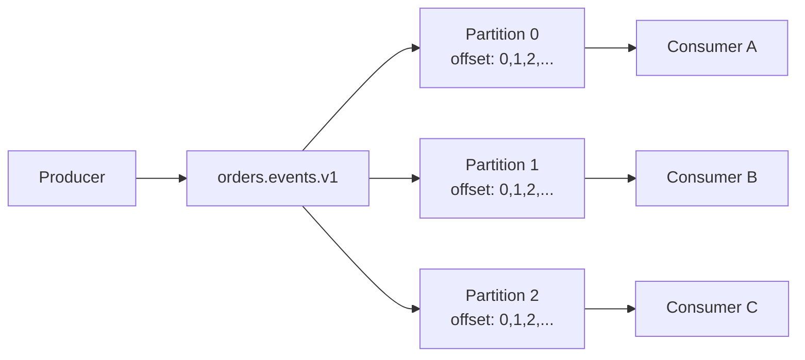
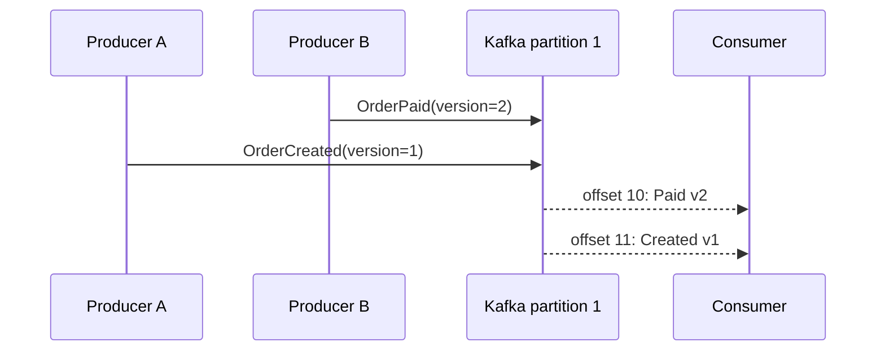
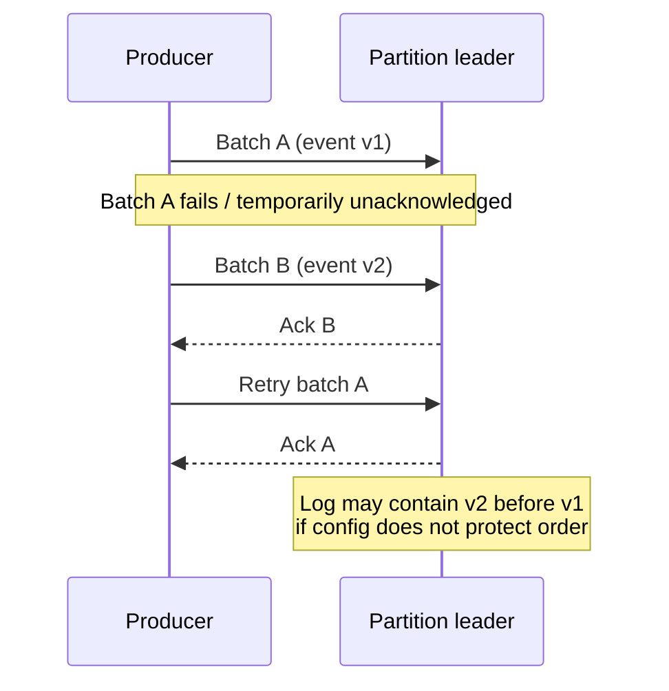
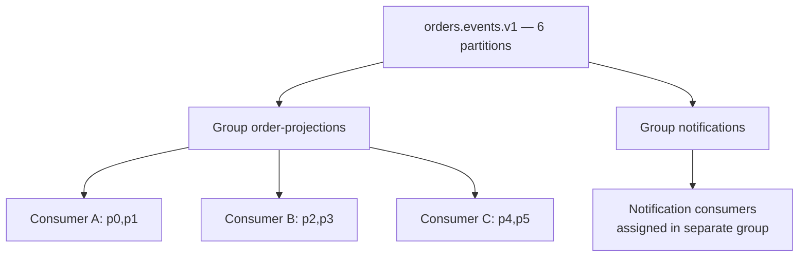
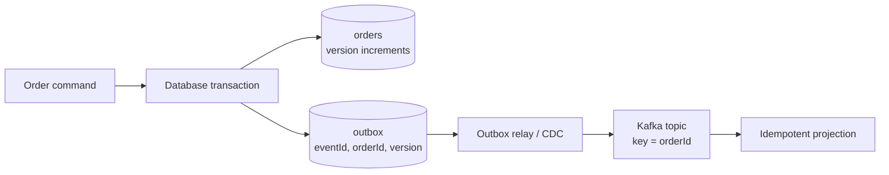

# Topics, Partitions, Keys, and Key-Based Ordering Guarantees

## 1. Context: Why Does Event Ordering Matter to Business Logic?

Suppose `order-service` records changes to an order:

```text
OrderCreated(orderId=ORD-42, version=1)
OrderPaid(orderId=ORD-42, version=2)
OrderShipped(orderId=ORD-42, version=3)
```

`notification-service` may send a post-payment notification, while `search-indexer` updates the order status in Elasticsearch. If a consumer applies `OrderShipped` before `OrderPaid` without a version-control rule, the displayed status can regress or a business step can execute at the wrong time.

Apache Kafka writes records to a **topic** divided into multiple **partitions**. A record carries an optional **key**. When all events for the same order use a stable key and are routed to the same partition, a consumer can read them in **partition offset order**. This is a powerful tool for organizing integration, yet it is not a promise that "every event in the system arrives in global order."

This lesson belongs to the **Apache Kafka** chapter of the **SPRING_BOOT_INTEGRATION** module: we examine producer/consumer configuration in Spring Boot, event contracts, consistency with databases/outboxes, retries, deduplication, testing, and operational observability. The goal is to understand **what Kafka guarantees**, while knowing what else you must design yourself so business state stays accurate.

**After this lesson, you will be able to:**

1. Distinguish topics, partitions, offsets, keys, leaders/replicas, and consumer groups.
2. Explain accurately the ordering guarantee **within a single partition**, rather than across partitions.
3. Choose message keys by aggregate/business ID, understand routing, and identify why the same key can switch partitions.
4. Use `KafkaTemplate` and `@KafkaListener` in Spring Boot to send/receive keyed events.
5. Configure producer idempotence, acknowledgments, retries, and in-flight limits to avoid reordering due to retries.
6. Design sequential per-partition consumption, idempotency, and version guards for redeliveries/out-of-order arrivals.
7. Scale partition counts, monitor hot partitions/consumer lag, and test ordering realistically.

> **Version scope:** Examples use Java 17+, Spring Boot 3.x, Spring for Apache Kafka 3.x, and an Apache Kafka version compatible with the project BOM. Spring Boot 4.x/Spring Kafka 4.x and newer Kafka clients may change partitioner-related defaults/properties; verify against the documentation for your actual version. Topics, endpoints, and business IDs in this lesson are illustrative.

## 2. What Are Topics, Partitions, Offsets, and Keys?

| Concept | Explanation | Example |
| --- | --- | --- |
| **Topic** | Logical stream/log of records of the same type or contract. | `orders.events.v1` |
| **Partition** | A log segment with its own offset sequence, distributed across brokers. | Partition 0, 1, 2 |
| **Offset** | Monotonically increasing position of a record **within one partition**. | Partition 2, offset 184 |
| **Record key** | Optional byte sequence used for partitioning and/or record identification. | `ORD-42` |
| **Record value** | Event or command payload following a schema/contract. | JSON `OrderPaid` |
| **Leader** | The partition replica handling reads and writes under the cluster model. | Broker 1 is leader for partition 2 |
| **Replica / ISR** | Copies of a partition; ISR is the set of replicas in sync per Kafka criteria. | Replication factor 3 |
| **Consumer group** | Group of consumers dividing a topic's partitions among themselves. | `order-projections` |
| **Committed offset** | Progress position saved by a consumer group to resume after restart/rebalance. | Group has processed up to a given offset |

A topic is a **unit of data categorization**; a partition is the **unit of ordered log storage and parallel distribution**. Offsets have no topic-wide meaning: offset 100 in partition 0 has no "earlier than" relationship with offset 90 in partition 3.

### 2.1. Diagram of a Three-Partition Topic



The diagram illustrates assignment when the group has enough consumers for the partitions; it does **not** imply each partition necessarily sits on a separate broker or requires a separate consumer process. One consumer can be assigned multiple partitions.

### 2.2. What Can a Record Contain?

A Kafka record includes components such as:

```text
topic      = orders.events.v1
partition  = 2
offset     = 184
key        = "ORD-42"
value      = {"eventId":"evt-42-2","orderId":"ORD-42",
              "version":2,"type":"OrderPaid"}
headers    = content-type, correlation-id, schema-version, ...
timestamp  = record timestamp per Kafka configuration
```

Both key and value pass through serializers, becoming bytes underneath. Kafka does not understand the business meaning of `orderId` or `version` just because they appear in JSON. **The Kafka partitioner sees only key bytes and routing settings**—it does not sort records by a `version` field inside the payload.

## 3. How Far Does Kafka Guarantee Ordering?

Kafka stores records in **append order within each partition's log**. A consumer reads that partition in increasing offset order during normal consumption.

```text
orders.events.v1

Partition 0:  [offset 40, key=ORD-07, Created]
              [offset 41, key=ORD-07, Paid]
              [offset 42, key=ORD-07, Shipped]

Partition 1:  [offset 71, key=ORD-42, Created]
              [offset 72, key=ORD-42, Paid]

Partition 2:  [offset 18, key=ORD-99, Created]
              [offset 19, key=ORD-99, Cancelled]
```

With stable key routing, all events for `ORD-42` land on partition 1, so the consumer observes offset 71 followed by offset 72. However:

1. There is no **global order between partition 0 and partition 1**.
2. There is no ordering guarantee across **two different topics**, even with the same key.
3. Kafka records only the **arrival order at the broker/partition**—it does not detect if `version=2` was sent by a producer before `version=1`.
4. **Read order** is not guaranteed to equal **side-effect completion order** if the consumer processes records asynchronously.
5. Retries, rebalances, and replay/DLTs can cause the same record to be processed multiple times; an **ordered log does not mean exactly-once business processing**.

### 3.1. Counterexample: Same Key Published Out of Order

Two service replicas emit events for `ORD-42` concurrently:



Kafka behaved correctly: offset 10 arrived before offset 11. Yet business state breaks if `Created → Paid` is required. You must control **publication order at the source** or reject regressions on the consumer using an aggregate version.

### 3.2. Three Kinds of "Order" to Distinguish

| Kind of Order | Who Is Responsible? | Guarantee |
| --- | --- | --- |
| Partition append order | Kafka broker/log and producer protocol. | Monotonically increasing offsets per partition. |
| Event publication order by business version | Application/outbox publisher. | Must be designed when multiple writers/relays exist. |
| Committed side-effect order | Consumer and database/business service. | Must be enforced via sequential processing, versioning, and transactions/idempotency. |

Claiming "same key means ordered" is meaningful only when **all three layers** are accounted for.

## 4. How Does the Message Key Determine Routing?

In standard producer configurations, when a record **has a key** and no explicit partition is specified, the partitioner selects a partition from the key bytes and current partition count. Many Java Kafka clients hash keys consistently under identical configs, ensuring **same key → same partition**.

```text
partition = partitioner(serializedKey, availablePartitions, configuration)

With key "ORD-42" and 6 partitions:
  "ORD-42" -> a fixed partition while routing conditions stay unchanged
```

Do not treat a single modulo formula as an immutable law across every client version/partitioner. A Kafka client can use a default partitioner, a custom partitioner, an explicitly specified partition, or a flag to ignore keys such as `partitioner.ignore.keys` in versions that support it.

### 4.1. Conditions for Same Key → Same Partition

1. Producers send records to the **same topic**.
2. **Key bytes** are identical—not just visually similar in meaning.
3. The partition count does not change during the window requiring ordering.
4. The same partitioner policy applies; one producer cannot use a custom partitioner while another uses the default.
5. No explicit partition overrides are set, and key-ignoring options are disabled.

If any condition breaks, records sharing a business key can land on different partitions; a consumer group can then process them in parallel, breaking per-key ordering.

### 4.2. Keys Are Bytes: Canonicalization Must Be Consistent

```text
"ord-42"  !=  "ORD-42"
"ORD-42"  !=  "ORD-42 "
"00123"   !=  "123"
"tenantA:42" != "tenantB:42"
```

For example:

- If business IDs are case-insensitive, all producers must apply the same canonicalization rule **before serialization**.
- In multi-tenant systems, use an unambiguous composite key—such as a stable encoding of `tenantId` and `orderId`—rather than ad-hoc string concatenation that could collide.
- The same string passed through two incompatible serializers/encodings produces different bytes.
- Never use a fresh random UUID as the record key for every event if ordering by `orderId` is required.

**Keys do not need to be unique per event.** For `OrderCreated`, `OrderPaid`, and `OrderShipped` on one order, repeating key `ORD-42` is **the exact goal for partitioning**. Event ID must be a separate unique field for deduplication.

### 4.3. What About a Null Key?

When the key is `null`, the producer can distribute records across partitions using the client's batching/throughput algorithm. That works well for logs that do not require per-entity ordering.

However, if you write:

```java
kafkaTemplate.send("orders.events.v1", jsonValue);
```

without providing a key, two events for the same order can land on different partitions. **Do not infer from a local test that happened to arrive in order that a keyless design preserves order.**

### 4.4. Keys Are Not the Only Partition Field

A Kafka record can specify the partition directly:

```java
// Conceptual example; construct a ProducerRecord and pass to KafkaTemplate.send(record).
ProducerRecord<String, String> record =
    new ProducerRecord<>(
        "orders.events.v1", 0, "ORD-42", "{\"type\":\"OrderPaid\"}"
    );
```

When partition `0` is explicitly set, key `"ORD-42"` **does not force** the record to follow default hash routing. Never mix producers with differing partition selection strategies when the ordering contract relies on the key.

## 5. Choosing Keys Based on the Unit Requiring Ordering

Ask: "Which events strictly need to be processed sequentially relative to one another?"

| Use Case | Key to Consider | Meaning |
| --- | --- | --- |
| Single order's state | `orderId` | Updates for the same order go to the same partition. |
| Single account's balance changes | `accountId` | Preserves the sequence of movements per account. |
| Inventory updates for one SKU at one warehouse | Stably encoded `warehouseId + sku` | Preserves change order per warehouse–SKU pair. |
| User session | `sessionId` | Tracks state transitions within a session. |
| Multi-tenant data | `tenantId + aggregateId` | Prevents ID collisions across tenants. |
| Independent telemetry without entity ordering | `null` or device key as needed | Optimizes distribution/batching. |

### 5.1. Overly Broad Keys Cause Hot Partitions

If every order for a large tenant uses `tenantId` as the key, all traffic for that tenant concentrates onto **a single partition**. Even if the topic has 100 partitions, a hot key only uses the sequential throughput of one partition (under stable routing).

Choose `orderId` instead of `tenantId` when ordering is only needed per order. Do not randomly "salt" keys to spread load if business rules require ordering by the original key; salting breaks ordering unless the consumer adds a stateful resequencing layer.

### 5.2. When a Key Is Too Narrow

If business rules require two orders on the same **payment account** to debit balances in order, `orderId` is too narrow: each order hits a different partition and runs concurrently. When the invariant spans an account balance, key by account or use an independent DB/ledger transaction with concurrency control.

**Choose keys along aggregate consistency boundaries**, not simply the most convenient column. This is a decision about both throughput and domain design.

### 5.3. Changing a Key Is a Contract Migration

Switching from `customerId` to `orderId` alters partition distribution, parallelism, and ordering. If the topic already holds older records under the old routing, deploying new producers/consumers does not "move" old records into new partitions. You need a rollout plan, topic/version migration, checkpoints, and version guards to prevent overlapping out-of-order processing.

## 6. Designing Topics and Partition Counts

### 6.1. How Do Partitions Relate to Throughput?

Within one consumer group, partitions are the unit of work assignment. For a topic with 6 partitions:

- Group with 1 consumer: that consumer can read all 6 partitions.
- Group with 3 consumers: each consumer is typically assigned ~2 partitions.
- Group with 6 consumers: each consumer can own 1 partition.
- Group with 10 consumers: at most 6 consumers have partitions to read; the extra instances stay idle.

Useful active consumers/threads depend on partition count, yet **adding partitions does not guarantee linear throughput gains** because DBs, downstream APIs, networks, and hot keys remain bottlenecks.

### 6.2. Creating Topics with Spring Kafka `NewTopic`

```java
// KafkaTopicConfiguration.java
import org.apache.kafka.clients.admin.NewTopic;
import org.springframework.context.annotation.Bean;
import org.springframework.context.annotation.Configuration;
import org.springframework.kafka.config.TopicBuilder;

@Configuration(proxyBeanMethods = false)
public class KafkaTopicConfiguration {

    @Bean
    NewTopic orderEventsTopic() {
        return TopicBuilder.name("orders.events.v1")
            .partitions(6)
            .replicas(1) // Suitable only for a single-broker local environment.
            .build();
    }
}
```

With `KafkaAdmin` from Spring Boot auto-configuration and sufficient permissions, a `NewTopic` bean can create the topic. In production, many organizations manage topics via IaC/cluster administration and do not grant topic-creation privileges to runtime services.

**Never copy replication factor 1 to production.** With enough brokers in a cluster, a replication factor of 3 and an appropriate `min.insync.replicas` (e.g., 2) are commonly considered for durability; evaluate availability, cost, and operator policies.

### 6.3. Replicas Do Not Increase Consumer Parallelism

Replication factor 3 means three copies exist for **each partition** per Kafka placement. It **does not** turn one partition into three independent partitions for a consumer group. Ordering still follows logical partition offsets.

| Setting | Purpose | Do Not Confuse With |
| --- | --- | --- |
| `partitions` | Parallelizes reads/writes and shards keys. | Not the number of brokers. |
| `replication.factor` | Provides copies for recovery when a broker fails. | Does not multiply consumer throughput on a single partition. |
| `min.insync.replicas` | Minimum synchronized replicas required for `acks=all` writes to succeed. | Does not create replicas or replace ISR monitoring. |
| `retention.ms/bytes` | Retains logs by time/size. | Not a guarantee of retaining every record forever. |
| `cleanup.policy` | Deletes by retention or compacts logs. | Compaction can drop older versions of the same key. |

### 6.4. Increasing Partition Count Can Change Key Mapping

Suppose key `ORD-42` routes to partition 1 when the topic has 3 partitions. After scaling to 6 partitions, the same key may route to partition 4 under the active partitioning algorithm:

```text
Before scaling:
  ORD-42 v1 -> partition 1, offset 100
  ORD-42 v2 -> partition 1, offset 101

After scaling:
  ORD-42 v3 -> partition 4, offset 1

Consumer A reads partition 1, consumer B reads partition 4:
  No single log/consumer preserves order across v2 and v3 anymore.
```

**Important:** increasing the partition count on a key-ordered topic is an **architectural change carrying ordering risk**, not a harmless scaling tweak. Kafka does not migrate old records into new partitions and does not allow decreasing partition counts via standard admin operations.

Options when scaling is required:

1. **Plan upfront:** choose enough partitions for projected growth to avoid resizing while strict ordering is active.
2. **Migrate to a new topic version:** move producers/consumers to a topic with the new partition count via controlled checkpoints/cutover.
3. **Freeze writes and drain:** if operations allow, ensure all in-flight/old events finish before switching routing.
4. **Consumer version guard:** protect state from older events overwriting newer ones; still handle gaps for delta events.
5. **Key-stable custom partitioning:** possible with a custom strategy, but mapping and compatibility must be designed upfront.

There is no universal "automatically preserve ordering for every key when resizing partitions" feature across all systems.

## 7. Spring Boot Producer: Serialization and Durability Configuration

### 7.1. Dependencies

```xml
<!-- pom.xml with Spring Boot parent/BOM -->
<dependency>
    <groupId>org.springframework.kafka</groupId>
    <artifactId>spring-kafka</artifactId>
</dependency>
<dependency>
    <groupId>org.springframework.boot</groupId>
    <artifactId>spring-boot-starter-test</artifactId>
    <scope>test</scope>
</dependency>
<dependency>
    <groupId>org.springframework.kafka</groupId>
    <artifactId>spring-kafka-test</artifactId>
    <scope>test</scope>
</dependency>
```

Spring Boot auto-configures `KafkaTemplate`, producer/consumer factories, and listener containers when dependencies and config align. When using typed JSON serializers, configure serdes, trusted packages, and schemas explicitly; the example below uses **String key and JSON String value** so readers can clearly see the key passed into Kafka.

### 7.2. Minimal `application.yml` with an Idempotent Producer

```yaml
spring:
  kafka:
    bootstrap-servers: ${KAFKA_BOOTSTRAP_SERVERS:localhost:9092}
    producer:
      key-serializer: org.apache.kafka.common.serialization.StringSerializer
      value-serializer: org.apache.kafka.common.serialization.StringSerializer
      acks: all
      retries: 10
      properties:
        enable.idempotence: true
        max.in.flight.requests.per.connection: 5
        delivery.timeout.ms: 120000
        request.timeout.ms: 30000
    consumer:
      group-id: order-projections
      key-deserializer: org.apache.kafka.common.serialization.StringDeserializer
      value-deserializer: org.apache.kafka.common.serialization.StringDeserializer
      enable-auto-commit: false
      auto-offset-reset: earliest
    listener:
      ack-mode: record
```

Explanation:

- `bootstrap-servers` is the initial broker list for cluster discovery and does not need to list every broker; returned broker metadata must carry `advertised.listeners` addresses reachable by the app.
- `key-serializer` and `value-serializer` define the bytes written to Kafka. Choose stable types across producers.
- `acks=all` requests acknowledgment from synchronized replicas per cluster settings; real durability still depends on replication, ISR, and cluster policy.
- `enable.idempotence=true` enables protocol-level producer idempotence to prevent duplicates from producer retries within session guarantees.
- `max.in.flight.requests.per.connection=5` is compatible with Kafka's idempotent producer; combined with `acks=all` and `retries > 0` as required by the feature.
- `delivery.timeout.ms` is the producer's time budget for delivering a record, tied to request timeout and retries; it is not a business command TTL.
- `enable-auto-commit=false` lets the listener container manage progress via ack mode rather than committing offsets on an independent timer.
- `ack-mode=record` records/commits offsets after the listener processes each record successfully under Spring Kafka container semantics.

**Do not infer** that these settings create a transaction between PostgreSQL and Kafka. Producer idempotence and Kafka transactions have a different scope from business idempotency.

### 7.3. What Does `auto-offset-reset=earliest` Mean?

`earliest` primarily applies when a group **has no valid committed offset** for a partition. It does not automatically "replay from the beginning" for a group that already has committed offsets. To replay, use a new group or a controlled offset-reset/seek procedure combined with idempotency and reprocessing ownership.

## 8. Sending Keyed Events with `KafkaTemplate`

### 8.1. Defining the Event Contract

```java
// OrderChanged.java
package com.example.kafka;

import java.time.Instant;

public record OrderChanged(
    String eventId,
    String orderId,
    long aggregateVersion,
    String status,
    Instant occurredAt
) {}
```

A practical event should carry:

| Field | Meaning |
| --- | --- |
| `eventId` | Unique identifier of the event to prevent duplicate processing. |
| `orderId` | Aggregate key used for Kafka partitioning. |
| `aggregateVersion` | Monotonic order of business changes on the order. |
| `status` | Snapshot of order status at this version. |
| `occurredAt` | Business occurrence timestamp, not a strictly reliable sequence order. |

**Do not substitute timestamps for versions:** two producers can experience clock skew, timestamps can collide, or events can be emitted late. When sequential order matters, versions should be owned by the authoritative data source/transaction and incremented consistently.

### 8.2. Producer Service

```java
// OrderEventPublisher.java
package com.example.kafka;

import com.fasterxml.jackson.core.JsonProcessingException;
import com.fasterxml.jackson.databind.ObjectMapper;
import java.util.concurrent.CompletableFuture;
import org.springframework.kafka.core.KafkaTemplate;
import org.springframework.kafka.support.SendResult;
import org.springframework.stereotype.Service;

@Service
public class OrderEventPublisher {
    public static final String TOPIC = "orders.events.v1";

    private final KafkaTemplate<String, String> kafkaTemplate;
    private final ObjectMapper mapper;

    public OrderEventPublisher(
        KafkaTemplate<String, String> kafkaTemplate,
        ObjectMapper mapper
    ) {
        this.kafkaTemplate = kafkaTemplate;
        this.mapper = mapper;
    }

    public CompletableFuture<SendResult<String, String>> publish(
        OrderChanged event
    ) throws JsonProcessingException {
        if (event.orderId() == null || event.orderId().isBlank()
            || event.eventId() == null || event.eventId().isBlank()
            || event.aggregateVersion() <= 0) {
            throw new IllegalArgumentException("Invalid order event");
        }

        String json = mapper.writeValueAsString(event);

        // Key is orderId; the same order is routed to the same partition
        // while partition count and routing configuration remain stable.
        return kafkaTemplate.send(TOPIC, event.orderId(), json);
    }
}
```

`KafkaTemplate.send(topic, key, value)` in Spring Kafka 3.x returns `CompletableFuture<SendResult<K,V>>`. This is an **asynchronous** producer interaction: returning a future from `publish` does not mean the broker has ACKed the record.

### 8.3. Observing Broker Acknowledgment Outcomes

```java
publisher.publish(event).whenComplete((result, error) -> {
    if (error != null) {
        // Classify error / log audit for outbox retry;
        // do not log raw payloads containing sensitive data.
        log.warn("Kafka publish failed for eventId={}",
            event.eventId(), error);
        return;
    }

    var metadata = result.getRecordMetadata();
    log.info("Published topic={} partition={} offset={}",
        metadata.topic(), metadata.partition(), metadata.offset());
});
```

Here `publisher`, `event`, and `log` belong to the service/caller. The callback must connect to a durable completion mechanism if this is an outbox relay. **A success log line is not a transaction commit for an outbox** and does not replace updating publish state in the database.

If the producer sent a record but the acknowledgment response was lost, the caller cannot tell whether the broker wrote it. Republishing with the same event ID at the application layer can still produce a second record; consumers must be idempotent.

### 8.4. Should the Key Go in a Header or the Record Key?

For the partitioner to use an ID, it must be placed in the **Kafka record key**, such as the second argument to `send(topic, key, value)` or a Kafka header properly translated to the record key by an adapter/serializer. Simply putting `orderId` inside the JSON body or an arbitrary Spring Messaging header **does not** make the Kafka producer use that field as the key.

When using Spring Kafka annotations or message converters, verify the exact mapping of `KafkaHeaders.KEY` or `ProducerRecord.key()` before claiming per-key routing.

## 9. Producer Retries, In-Flight Requests, and Idempotence

A common question: "If a producer sends v1 then v2 with the same key, will Kafka always store v1 before v2?"

**Conditional answer.** With a single producer and stable partitions, a properly configured Kafka client preserves record order, yet retries/in-flight requests/producer concurrency can alter the outcome if misconfigured or if callers emit out of order.

### 9.1. Retry Reordering Risk Without Idempotence



With a non-idempotent producer, multiple in-flight requests, and retries enabled, a later batch can be appended before an earlier failed batch is retried. Lowering `max.in.flight.requests.per.connection` to 1 protects ordering in some older producer setups, at the cost of throughput.

### 9.2. How Does an Idempotent Producer Help?

When `enable.idempotence=true` under compatible configuration:

- Kafka uses producer identity and sequence numbers to detect retried duplicates from that producer.
- The producer preserves per-partition record order within Kafka-supported in-flight bounds (typically `max.in.flight.requests.per.connection ≤ 5`).
- `acks=all` and suitable retries are prerequisites for the idempotent producer mechanism.

**Do not overstate its scope:** producer idempotence **does not** guarantee that a business command creates only one event when:

1. The application independently calls `publish(event)` twice.
2. The process restarts and an outbox relay republishes an event that was ACKed but not marked `DONE`.
3. Two producer replicas emit events concurrently for the same aggregate.
4. A consumer processes a record, crashes before committing the offset, and receives it again.

Those cases require stable event IDs, outbox/inbox tables, unique constraints, and event version handling.

### 9.3. `acks=all`, Replication, and Durability

| Setting | Effect | Limitation |
| --- | --- | --- |
| `acks=0` | Producer does not wait for broker acknowledgment. | Cannot know if the record was ever written. |
| `acks=1` | Leader acknowledges once it writes locally per policy. | Risk of loss if leader fails before replicas catch up. |
| `acks=all` | Waits for acknowledgment across in-sync replicas. | Actual durability also depends on replication factor, ISR, `min.insync.replicas`, and cluster failure settings. |
| `enable.idempotence=true` | Prevents duplicates from protocol-level producer retries. | Does not prevent app-level republishing or consumer redelivery. |
| `delivery.timeout.ms` | Caps how long the producer tries to deliver a record. | Timeout does not prove the record was not appended. |

A topic with replication factor 1 and `acks=all` still has only a single copy of the data. True durability requires proper replication and failure domains, not just producer config tweaks.

### 9.4. Multiple Producers Sharing the Same Key

Even when **every producer is idempotent**, two producers A and B emitting events with the same `orderId` are not automatically ordered by `aggregateVersion` by Kafka. Kafka knows only the order in which appends arrive. If business logic requires v1 before v2, the source must serialize publication per aggregate or the consumer must enforce a version guard/buffer with explicit gap policies.

## 10. Consumer Groups, Partition Ownership, and Concurrency

Each partition in a consumer group is typically assigned to **one consumer member at a time** under group assignment; a single member may own multiple partitions. Different consumer groups maintain independent progress and can read the same events for different purposes.



**Consumer concurrency does not mean one partition is read in parallel by multiple members of the same group.** Spring Kafka can spawn multiple Kafka consumers via `@KafkaListener(concurrency=...)`; effective parallelism is bounded by partition assignments and downstream bottlenecks.

### 10.1. `@KafkaListener` Reading Key, Partition, and Offset

```java
// OrderProjectionListener.java
package com.example.kafka;

import com.fasterxml.jackson.core.JsonProcessingException;
import com.fasterxml.jackson.databind.ObjectMapper;
import org.apache.kafka.clients.consumer.ConsumerRecord;
import org.springframework.kafka.annotation.KafkaListener;
import org.springframework.stereotype.Component;

@Component
public class OrderProjectionListener {
    private final ObjectMapper mapper;
    private final OrderProjectionService projections;

    public OrderProjectionListener(
        ObjectMapper mapper,
        OrderProjectionService projections
    ) {
        this.mapper = mapper;
        this.projections = projections;
    }

    @KafkaListener(
        topics = OrderEventPublisher.TOPIC,
        groupId = "order-projections",
        concurrency = "3"
    )
    public void onRecord(ConsumerRecord<String, String> record)
        throws JsonProcessingException {

        OrderChanged event = mapper.readValue(
            record.value(), OrderChanged.class
        );

        if (record.key() == null
            || !record.key().equals(event.orderId())) {
            throw new IllegalArgumentException(
                "Kafka key does not match orderId"
            );
        }

        // Process synchronously until DB commit or throw.
        // Never fire-and-forget subscribe() and return immediately.
        projections.apply(event);
    }
}
```

`OrderProjectionService` is an application-defined component whose `apply(OrderChanged event)` method writes the projection with version checks inside a transaction. The example omits concrete retry/DLT config; add policies per error type—especially malformed JSON, database timeouts, and event version gaps.

### 10.2. Synchronous Execution Inside the Listener and Completion Order

When a listener processes records synchronously, waiting for the database commit before returning:

```text
Partition p2:
  offset 10 -> parse -> DB commit -> return
  offset 11 -> parse -> DB commit -> return
```

Each partition is then processed in standard poll/dispatch order. By contrast, the pattern below can break **side-effect** ordering:

```java
// RISK: fire-and-forget; listener returns immediately.
@KafkaListener(topics = "orders.events.v1")
void handle(ConsumerRecord<String, String> record) {
    executor.execute(() -> processSlowly(record.value()));
}
```

If offset 11 finishes faster than offset 10 on the executor, the database can commit v2 before v1. The container can even advance the offset before the task finishes. If async processing is required, bound and **serialize by key/partition**, or hand off work to a durable inbox with strict version/ack protection.

### 10.3. `concurrency=3` Is Not "Three Threads per Key"

When a key hashes to partition p2, typically only one consumer member in the group owns p2 at any moment. Raising `concurrency` to 10 on a 6-partition topic cannot make a hot key on p2 run in parallel while preserving order.

Changing the key to "spread traffic" involves a trade-off: it may increase throughput while **breaking the original aggregate's ordering constraint**.

### 10.4. Kafka Offset Commits and Side Effects

With a synchronous `void` listener and matching ack mode, offsets should be acknowledged **after** business processing/commits finish. If an exception is thrown, the container error handler/retry/DLT decides the next step; never assume throwing means the broker will replay indefinitely or that messages can never be lost.

If the DB commits successfully and the consumer crashes before committing the offset, the record can be redelivered. This is standard at-least-once behavior; an **idempotent consumer** is mandatory whenever repeated side effects are unacceptable.

## 11. Business Ordering: Version Guards in the Database

A safe pattern is attaching a monotonically increasing `aggregateVersion` managed by the source database. The consumer records the last applied version and prevents older events from overwriting newer snapshots.

### 11.1. Projection Table

```sql
CREATE TABLE order_projection (
    order_id      VARCHAR(80) PRIMARY KEY,
    last_version  BIGINT NOT NULL,
    status        VARCHAR(30) NOT NULL,
    updated_at    TIMESTAMP NOT NULL DEFAULT CURRENT_TIMESTAMP
);
```

If the event carries a **complete state snapshot** at that version, you can use a PostgreSQL UPSERT:

```sql
INSERT INTO order_projection (
    order_id, last_version, status, updated_at
)
VALUES (:orderId, :version, :status, CURRENT_TIMESTAMP)
ON CONFLICT (order_id)
DO UPDATE SET
    last_version = EXCLUDED.last_version,
    status       = EXCLUDED.status,
    updated_at   = CURRENT_TIMESTAMP
WHERE order_projection.last_version < EXCLUDED.last_version;
```

Semantics:

- Event version 3 after version 2 → updates to v3.
- Event version 2 arrives late when DB is already at v3 → does not regress.
- Duplicate event version 3 → makes no change because strict `<` is false.

This is **last-version-wins for snapshots**, not a universal solution for all event types. If events are deltas (e.g., "add 5 to balance"), applying v3 before v2 arrives loses the v2 update. For deltas/strict state transitions, allow applying only the next sequential version, or buffer/park gapped events until the missing version arrives.

### 11.2. Delta vs. Snapshot Event Handling

| Event Style | Safe to Skip Older Versions? | Condition |
| --- | --- | --- |
| Full snapshot: `OrderStatusChanged(status=SHIPPED, version=3)` | Usually yes, per business contract. | Snapshot suffices to rebuild state; no per-step side effects. |
| Delta: `BalanceDebited(amount=50, version=3)` | Cannot arbitrarily skip v2. | Must process sequentially or reconcile from source of truth. |
| Notification: "send email per event" | Skipping can miss notifications. | Requires `eventId` inbox and replay/compensation policy. |
| Reindex search doc from latest event | Version guard works well. | Snapshot or source data sufficient to rebuild. |

### 11.3. Inbox and Unique Event ID

If a consumer must execute a side effect once for **each event**, storing only `last_version` may be insufficient. Use a table such as:

```sql
CREATE TABLE processed_events (
    consumer_name VARCHAR(100) NOT NULL,
    event_id      VARCHAR(160) NOT NULL,
    processed_at  TIMESTAMP NOT NULL DEFAULT CURRENT_TIMESTAMP,
    PRIMARY KEY (consumer_name, event_id)
);
```

Within the same **local database transaction**, the consumer attempts to insert the marker and apply the business change. If the unique key already exists, check the stored record and skip duplicate side effects. If the transaction rolls back, the marker rolls back too so the record can be retried.

Kafka offset commits are **not** part of a normal PostgreSQL transaction. Between DB commit and offset commit, redelivery can occur; unique markers and sequence guards protect side effects.

## 12. Producer-Side Ordering: Databases and the Transactional Outbox

Sending a Kafka event immediately after a DB write:

```text
BEGIN DB TRANSACTION
  UPDATE order
COMMIT
KafkaTemplate.send(event)
```

still leaves a failure window: the DB commits, then the process crashes before `send`. Conversely, publishing before commit and rolling back the DB leaves consumers seeing "phantom" events.

A **transactional outbox** stores the business change and pending event in the same DB transaction. A relay or CDC connector publishes records to Kafka after commit.



### 12.1. Outbox Needs Stable Identifiers and Versions

```text
event_id:         evt-ORD-42-3
aggregate_id:     ORD-42
aggregate_version:3
event_type:       OrderShipped
payload:          {...}
published:        false
```

The producer relay uses `aggregate_id` as the Kafka key; do not use `event_id` as the key if events for the same order must land in the same partition.

### 12.2. Outbox Does Not Automatically Preserve Order Across Parallel Relays

If relay A claims event v2 and stalls while relay B claims v3 and sends first, Kafka can append v3 before v2 even though both came from one outbox table.

Choose one of these strategies:

- Allow only one active publisher per aggregate or shard partitions by aggregate ID.
- Add relay claim/sequence logic ensuring v(n+1) is not published before v(n) for the same aggregate.
- Use transaction-log CDC with an appropriate routing key and pipeline design, while still accounting for change-event order and pipeline parallelism.
- On the consumer, check versions and handle gaps/late events per snapshot or delta semantics.

**An outbox solves atomic persistence of data + publishing intent; it does not automatically solve all ordering, duplication, or exactly-once problems.**

### 12.3. Kafka Transactions Do Not Replace a PostgreSQL Outbox

Kafka producer transactions help with **read-process-write within Kafka** alongside offsets under Kafka's transaction model. They **do not** create a distributed ACID transaction between Kafka and PostgreSQL via a Spring Boot annotation. When the business DB is the source of truth and events must follow commits, outbox/inbox remains essential for surviving crashes without event loss.

## 13. How Rebalances, Replays, Errors, and Dead-Letters Affect Ordering

### 13.1. Consumer Rebalance

When consumers join or leave a group, the broker reassigns partitions. A partition can move from consumer A to consumer B. Committed offsets determine where B resumes; if A updated the DB without committing the offset, B can re-read that record.

**The per-partition log retains offset order**, yet business execution can overlap if an old worker still has a background task running after losing partition ownership. To prevent stale overwrites, use version guards/fencing and never allow detached async tasks to commit results unchecked.

### 13.2. Retries Within the Same Partition

When offset 10 fails:

```text
offset 10: OrderPaid(v2) -> DB timeout
offset 11: OrderShipped(v3)
```

If business rules require v2 before v3, the listener must handle error 10 appropriately before confirming/applying 11. Bounded retries with backoff handle transient errors; for persistent failures, you need a parking/pause/replay policy so invariants are not violated.

### 13.3. DLTs Can Change Business Processing Order

Suppose offset 10 (v2) is routed to a dead-letter topic and the main consumer moves on to offset 11 (v3). The original log still has 10 then 11, yet **side effects of v3 can complete before v2**; when the DLT is later replayed, v2 arrives late.

| Policy | Advantage | Trade-off |
| --- | --- | --- |
| Stop/pause key or partition until fixed | Preserves strict sequence. | One poison event can block many other keys in the same partition. |
| Route to DLT and continue | Preserves throughput for most traffic. | Can create business gaps or out-of-order execution. |
| Snapshot + version guard | Prevents projection regression. | Unsuitable for every delta or per-event side effect. |
| Stateful per-aggregate parking | Isolates problematic keys while letting others proceed. | Extra state, complex scheduling/ordering logic. |

**No single retry/DLT policy fits every event.** Decide upfront whether missing an intermediate state is acceptable.

### 13.4. Retention and Compaction

Kafka can delete old data per retention settings. On compacted topics, the broker retains the latest record per **record key** under compaction rules, without promising to keep every historical update forever.

- Event histories requiring full step-by-step replay → generally need log retention (plus archiving if needed longer).
- Needing only the latest snapshot per key → compaction can fit.
- Tombstones are records with a key and `null` value in compacted topics, representing deletion subject to tombstone retention.

If an application needs `OrderCreated`, `OrderPaid`, and `OrderShipped` to replay every side effect, never switch the topic to compaction without evaluating intermediate event loss.

## 14. Scaling Without Losing Key-Ordering Semantics

### 14.1. Hot Partitions

A partition can receive disproportionate load because:

- One hot key dominates traffic.
- Key distribution is skewed, e.g., most events carry key `tenantA`.
- The producer sets explicit partitions or uses an unbalanced custom partitioner.
- Partition count is too small relative to aggregate IDs and target concurrency.

Monitor throughput/bytes/lag **per partition**, not only topic totals.

### 14.2. Ways to Scale Capacity

| Measure | When Suitable | What Must Be Preserved |
| --- | --- | --- |
| Scale consumer instances up to partition count | Consumer CPU/I/O is the bottleneck. | Group assignment, DB pools/quotas. |
| Optimize handlers and DB writes | Slow queries/side effects. | Do not turn sequential work into unordered async tasks. |
| Narrow the key to a finer aggregate | Current key is overly broad. | Domain invariant genuinely requires only per-aggregate order. |
| Separate traffic classes/topics | Search indexing and payment ledgers have different SLOs. | Do not assume cross-topic ordering. |
| Increase partitions with migration | Cutover/ordering guards are planned. | Key mapping can change; migration strategy required. |
| Per-partition batching | Sequential batch processing is more efficient. | Accurate record commits/acks and partial-failure handling. |

If **a single account** requires 10,000 strictly sequential transactions per second, that is a domain bottleneck requiring ledger/concurrency design—you cannot preserve that invariant simply by adding partitions.

### 14.3. Ordering Across Multiple Topics

Example:

```text
orders.created.v1   -> OrderCreated(ORD-42)
payments.paid.v1    -> PaymentCaptured(ORD-42)
shipping.sent.v1    -> OrderShipped(ORD-42)
```

Even though all three topics use key `ORD-42`, Kafka **does not** provide a shared offset or guarantee consumers observe `Created → Paid → Shipped` across three topics. An orchestrator/state machine must rely on business versions, preconditions, or event-time semantics. When strict ordering for an aggregate is required, consider **a single event log/topic** keyed by aggregate ID with an appropriate schema contract, while still controlling publication order at the source.

## 15. Common Key-Design Mistakes

| Mistake | Consequence | Fix |
| --- | --- | --- |
| Calling `KafkaTemplate.send(topic, value)` when per-order order is needed | Records lack keys and can scatter across partitions. | Call `send(topic, orderId, value)`. |
| Using `eventId` as the Kafka key | Every event gets a different key, splitting one order across partitions. | Use aggregate ID as the key; keep `eventId` in payload/headers. |
| Using `tenantId` when only per-order order is needed | Large tenants create hot partitions. | Use a composite key of `tenantId + orderId`. |
| Inconsistent whitespace/casing/serializers on keys | Same business ID yields different key bytes. | Canonicalize and standardize encoding. |
| Scaling partitions from 3 to 6 mid-flight | Same key can move to a new partition. | Use topic migration/cutover and version guards. |
| Producers A and B use different partitioners | Same key routes to different partitions. | Align client routing and serializers. |
| Mixing explicit partitions with hashed keys | One key ends up on multiple partitions. | Stick to one partitioning strategy. |
| Multiple idempotent producers emitting out-of-order versions | Kafka appends in arrival order, breaking business order. | Per-aggregate outbox ordering and version checks. |
| Raising listener concurrency and dispatching async arbitrarily | Later offsets commit before earlier ones. | Process sequentially per partition/key, or use a durable inbox. |
| Routing v2 to DLT and applying v3 unconditionally | Causes gaps or regressions on replay. | Define snapshot/delta/gap policies. |
| Treating producer idempotence as business exactly-once | App republishes/restarts still create duplicates. | Use event IDs, inboxes, unique constraints, and replay tests. |
| Treating timestamps as sequence numbers | Clock skew and publish delays break ordering. | Use source-managed aggregate versions. |
| Mixing compaction with per-event replay requirements | Intermediate events can be compacted away. | Match cleanup policy and retention to the contract. |

## 16. Testing Producers: Same Key Goes to Same Partition

Testing should span from **routing unit tests** to **real broker interactions**. Unit tests mocking `KafkaTemplate` verify the key is passed correctly, but cannot prove the real partitioner routes as expected.

### 16.1. Testing with `@EmbeddedKafka`

An example with Spring Kafka Test (requires a test context with producer factory/template and matching topic):

```java
// OrderKeyPartitionIntegrationTest.java
import static org.assertj.core.api.Assertions.assertThat;

import java.util.concurrent.TimeUnit;
import org.junit.jupiter.api.Test;
import org.springframework.beans.factory.annotation.Autowired;
import org.springframework.boot.test.context.SpringBootTest;
import org.springframework.kafka.test.context.EmbeddedKafka;
import org.springframework.kafka.core.KafkaTemplate;

@SpringBootTest
@EmbeddedKafka(
    partitions = 6,
    topics = "orders.events.v1",
    bootstrapServersProperty = "spring.kafka.bootstrap-servers"
)
class OrderKeyPartitionIntegrationTest {

    @Autowired
    KafkaTemplate<String, String> kafka;

    @Test
    void sameKeyGoesToSamePartitionWithIncreasingOffsets()
        throws Exception {

        var first = kafka.send(
            "orders.events.v1", "ORD-42",
            """
            {"eventId":"e-1","orderId":"ORD-42","aggregateVersion":1,
             "status":"CREATED","occurredAt":"2026-11-21T00:00:00Z"}
            """
        ).get(10, TimeUnit.SECONDS);

        var second = kafka.send(
            "orders.events.v1", "ORD-42",
            """
            {"eventId":"e-2","orderId":"ORD-42","aggregateVersion":2,
             "status":"PAID","occurredAt":"2026-11-21T00:00:01Z"}
            """
        ).get(10, TimeUnit.SECONDS);

        var a = first.getRecordMetadata();
        var b = second.getRecordMetadata();

        assertThat(b.partition()).isEqualTo(a.partition());
        assertThat(b.offset()).isGreaterThan(a.offset());
    }
}
```

**Note:** `@EmbeddedKafka` is imported from `spring-kafka-test` (`org.springframework.kafka.test.context.EmbeddedKafka`). This test is a structural example; if your project already defines a listener on the same topic writing to a database, isolate the test context or seed valid contract data so the consumer does not interfere. If the app defines a `NewTopic` bean, ensure its partition/replica settings are compatible with the embedded broker.

The two sends in the example await acknowledgment **sequentially**, proving routing and offsets in a stable producer test. It **does not** prove correctness under producer concurrency, retries, broker failover, DLTs, or partition resizing.

### 16.2. Testing That Consumers Actually Observe Ordering

For stronger verification, write a consumer test:

1. Publish multiple events sharing the same key with ascending versions.
2. Subscribe a test group from an appropriate offset and read records.
3. Assert all records for that key land on the same partition, offsets increase, and the handler processes the sequence in order.
4. Interleave different keys and assert **no** global ordering requirement is assumed.
5. Introduce slow listeners, async executors, and rebalances to verify side-effect ordering.

Use `KafkaTestUtils`, a test consumer, or Testcontainers Kafka to inspect records on the broker. When testing order-sensitive routing, prevent defaults/rebalances/partition counts from shifting across test runs.

### 16.3. Testcontainers Kafka

With Testcontainers:

- Starts a compatible Kafka container and supplies dynamic bootstrap servers via Spring Boot test properties.
- Tests real serializers/deserializers and topic creation.
- Supports multiple consumers in one group to verify partition assignment and post-restart replays.
- Simulates broker unavailability/latency to a degree; testing true leader/ISR failover requires a multi-broker cluster or staging environment.

A single test broker cannot prove replication factor 3, ISR durability, or network-partition behavior.

## 17. Testing Scenarios That Break Ordering

| Scenario | Input | What to Assert |
| --- | --- | --- |
| Same key, one producer | v1, v2, v3 sent sequentially. | Same partition, increasing offsets. |
| Different keys | ORD-42 and ORD-99 interleaved. | No reliance on global order. |
| Null key | Keyless event. | No per-order routing assumed. |
| Key canonicalization | `ord-42` vs `ORD-42`. | Canonical key contract enforced. |
| Two producers | v2 sent before v1 due to race. | Consumer version guard or source sequencer detects it. |
| Producer retry/failover | Batch retry while in-flight. | Idempotence config preserves per-partition order within supported limits. |
| Partition scaling | Before/after increasing partition count. | Remapping recognized and rollout guards active. |
| Async handler | Offset 11 finishes faster than 10. | Side-effect order still preserved or blocked by version guard. |
| Rebalance | Consumer A crashes before offset commit. | Redelivery does not duplicate business side effects. |
| DLT gap | v2 fails, v3 arrives later. | Does not apply delta incorrectly or lose required events. |
| Event replay | Same `eventId`/version arrives twice. | Inbox/unique key/conditional update prevents duplication. |
| Different topics | `Created`, `Paid` on separate topics. | No cross-topic ordering assumed. |
| Hot key | One account drives most traffic. | Lag/skew spikes detected and handled. |

For critical flows (money, inventory, legally binding notifications), include **fault-injection tests** that deliberately crash after DB commit and before Kafka ack/offset commit, rather than just unit-testing a consumer receiving three records.

## 18. Operational Observability: Monitor by Partition and by Business State

### 18.1. Metrics to Track

| Area | Metric / Signal | Why |
| --- | --- | --- |
| Producer | Record send rate, error rate, retries, request latency, delivery timeout. | Detects send issues and batching bottlenecks. |
| Partition | Bytes/records per partition, leader/ISR health, skew. | Exposes hot partitions or uneven partitioning. |
| Consumer group | Lag per partition, oldest record age, rebalance count. | Forecasts SLAs and replay needs. |
| Handler | Processing latency, concurrency, DB commit failures. | Pinpoints consumer bottlenecks. |
| Business ordering | Version gaps, stale events ignored, duplicate event IDs. | Detects out-of-order or buggy publishing logic. |
| Retry/DLT | Retried message count, DLT backlog, and oldest record age. | Prevents silent event loss in DLTs. |
| Consistency | Outbox backlog, CDC lag, event-to-projection latency. | Measures freshness between DB and read models. |

Kafka client metrics can be exported via Micrometer/Actuator when configured, yet **business version gaps and outbox lag are invisible to Kafka**: the application must track and expose them.

Avoid using specific `orderId`/`eventId` values as high-cardinality metric tags; store IDs in access-controlled logs/traces instead. Kafka headers can carry correlation IDs, but never credentials/tokens or unnecessary personal data.

### 18.2. Runbook When One Partition's Lag Spikes

1. Identify the exact topic, partition, consumer group, lag/time lag, and broker health.
2. Inspect key distribution: is a single hot key or many keys piling onto one partition?
3. Inspect handler/DB/downstream API: latency, transaction locks, retries, memory/connections.
4. Inspect rebalances/error handler/DLT: is a poison message blocking progress?
5. If pausing is necessary, use the listener container's pause controls with a clear ack/restart procedure.
6. Never delete topics, reset offsets, or resize partitions before assessing data/ordering impact.
7. When reprocessing, rely on `eventId`/version guards and reconcile snapshot vs. delta semantics.
8. After recovery, verify projection consistency/freshness rather than stopping once Kafka lag hits 0.

**Zero lag does not prove business processing succeeded** if the listener merely enqueued work to an in-memory executor and committed the offset, or if the error handler dumped records to a DLT. Pair consumer metrics **with** business store checks.

## 19. Design Checklist for a Key-Ordered Topic

1. **Define the invariant:** is ordering required per order, account, SKU, or tenant?
2. **Choose the key:** stable aggregate/business ID; normalize bytes and tenant namespaces.
3. **Lock the topic contract:** name, event schema/version, headers, `eventId`, `aggregateVersion`, key serializer, and snapshot/delta semantics.
4. **Size partitions:** throughput, group concurrency, hot-key distribution, and future migration needs.
5. **Configure the producer:** `acks=all`, idempotence, compatible retries/in-flight/timeouts; verify broker replication/ISR.
6. **Control publication order:** events for the same aggregate must be emitted in source-version order, or consumers must handle out-of-order arrivals.
7. **Pass the key in `KafkaTemplate.send(topic, key, value)`**, not solely inside JSON.
8. **Design the consumer:** one partition owner per group, sequential processing/commits, no fire-and-forget.
9. **Protect side effects:** inbox/unique event ID, aggregate version, local transactions; distinguish snapshots from deltas.
10. **Define retry/DLT policies:** decide how gaps and poison messages are handled before skipping a version.
11. **Test:** same-key routing, offset ordering, producer concurrency/retries, rebalances, replays, DLTs, and partition-count changes.
12. **Monitor:** per-partition lag/skew, outbox lag, duplicates, version gaps, freshness, and consumer failures.

**Self-Check Questions**

1. Can you compare offset 100 in partition 0 against offset 50 in partition 1 to tell which event "arrived first"?
2. Why is `send(topic, value)` unsuitable if all events for `ORD-42` must land in the same partition?
3. Is `eventId` or `orderId` the better Kafka key for keeping order-level sequence? Why?
4. Two producers share a key, yet `version=2` is sent before `version=1`; does Kafka automatically fix the order?
5. Which class of duplicates does `enable.idempotence=true` prevent, and which does it not prevent?
6. How can increasing the partition count of a live topic alter key mapping?
7. Why does `@KafkaListener(concurrency=10)` fail to parallelize a hot key while preserving ordering?
8. If a consumer dispatches a record to an async executor and returns immediately, what can happen to ordering and committed offsets?
9. When v2 goes to the DLT and v3 is processed, what is the difference between snapshot events and delta events?
10. Why are a database inbox and aggregate version still necessary even when a topic is partitioned by `orderId`?
11. Do two separate topics both using key `ORD-42` form a single total order for Created and Paid?
12. Is zero consumer lag enough to prove the projection database is consistent?

## 20. References

- [Apache Kafka — Documentation](https://kafka.apache.org/documentation/): topics, partitions, producers, consumers, and delivery semantics.
- [Apache Kafka — Producer Configs](https://kafka.apache.org/documentation/#producerconfigs): `enable.idempotence`, `acks`, retries, in-flight requests, and partitioning.
- [Apache Kafka — Consumer Configs](https://kafka.apache.org/documentation/#consumerconfigs): group ID, offset reset, poll, and commit settings.
- [Spring for Apache Kafka — Reference](https://docs.spring.io/spring-kafka/reference/): `KafkaTemplate`, listener containers, concurrency, and error handling.
- [Spring for Apache Kafka — Sending Messages](https://docs.spring.io/spring-kafka/reference/kafka/sending-messages.html): keys, send futures, and broker metadata.
- [Spring for Apache Kafka — Receiving Messages](https://docs.spring.io/spring-kafka/reference/kafka/receiving-messages.html): `@KafkaListener`, record metadata, and acknowledgment.
- [Spring for Apache Kafka — Exactly Once Semantics](https://docs.spring.io/spring-kafka/reference/kafka/exactly-once.html): Kafka transactions and limits of EOS.
- [Spring Boot — Apache Kafka Support](https://docs.spring.io/spring-boot/reference/messaging/kafka.html): `spring.kafka.*`, `KafkaTemplate` auto-configuration, and testing.
- [Spring Kafka — Testing Applications](https://docs.spring.io/spring-kafka/reference/testing.html): `@EmbeddedKafka` and integration tests.
- [Confluent — Kafka Message Key and Partitions](https://developer.confluent.io/learn-kafka/apache-kafka/partitions/): partitioning and key practices.
