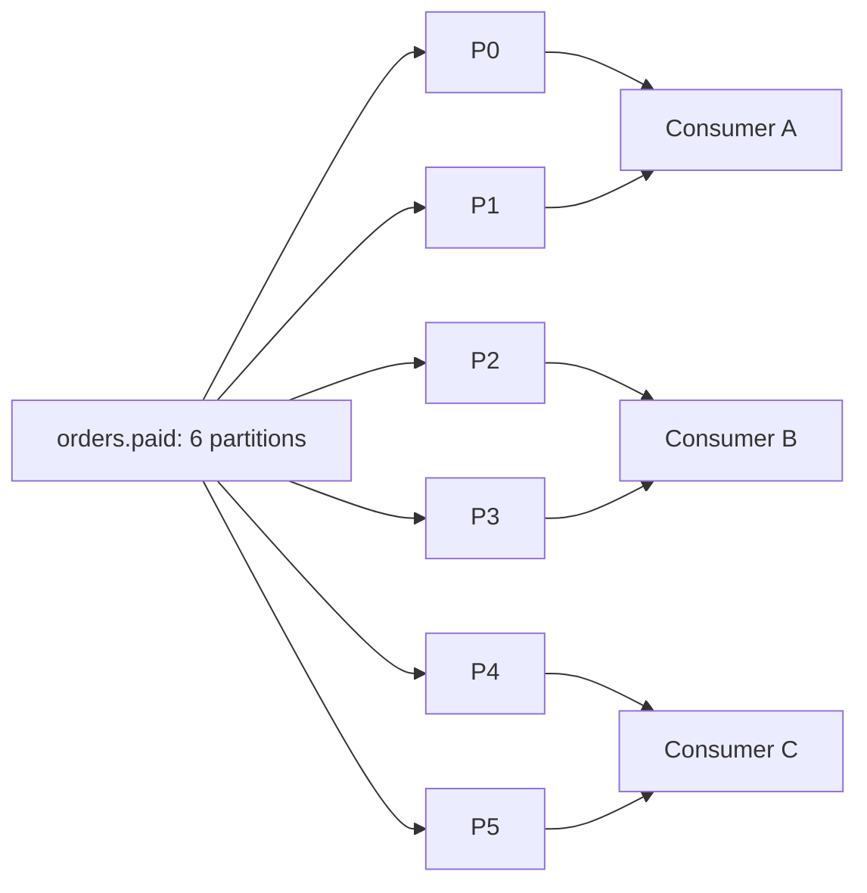
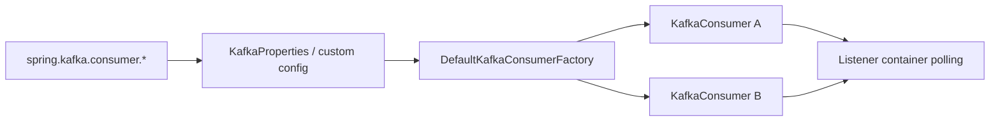
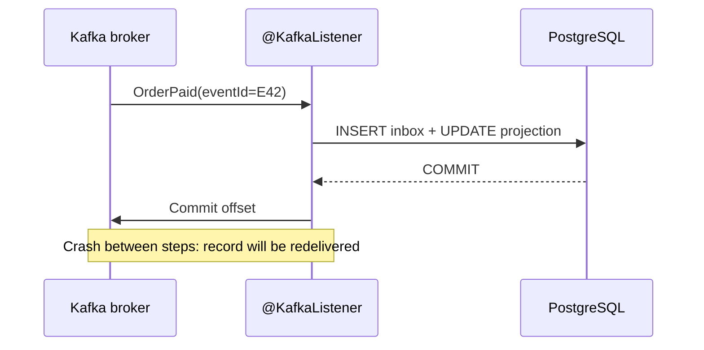
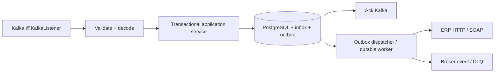

# `@KafkaListener`, `ConsumerFactory`, and Listener Containers

## 1. Why Must These Three Components Be Understood Together?

In a Spring Boot application, Kafka handling code can look as short as a few lines:

```java
@KafkaListener(topics = "orders.paid", groupId = "order-projection")
public void onOrderPaid(String payload) {
    orderService.apply(payload);
}
```

Yet a single annotation hides what happens when **a consumer rebalances, a record is redelivered, JSON fails to deserialize, the database commits while the offset does not, or a slow listener blocks all its partitions**. Those behaviors are governed by the entire Spring Kafka and Apache Kafka pipeline.

This lesson belongs to the **Apache Kafka** chapter of the **SPRING_BOOT_INTEGRATION** module: organizing integration across HTTP clients, databases, caches, message brokers, and Spring Integration adapters; focusing on configuration, data contracts, error handling, deduplication, testing, and observability. The direct focus here is **`@KafkaListener`, `ConsumerFactory`, and listener containers**.

To reason accurately, separate three responsibilities:

- **`ConsumerFactory`**: creates actual `KafkaConsumer` instances, configuring brokers, deserializers, security, client properties, and related customizations.
- **Listener container**: manages consumer lifecycle, `poll()`, dispatching records to listeners, group membership, partitions, offset acknowledgment, error handling, and shutdown.
- **`@KafkaListener`**: declares which method handles messages, which topic/pattern/partition/group to subscribe to, and which container factory supplies the runtime.

**Rule of thumb:** `@KafkaListener` does not spawn "one thread per message," does not synchronize producer/consumer transactions with PostgreSQL, and does not automatically guarantee exactly-once business effects.

### Lesson Objectives

1. Trace the path from `spring.kafka.*` to `DefaultKafkaConsumerFactory`, `ConcurrentKafkaListenerContainerFactory`, and `@KafkaListener` methods.
2. Choose record/batch listeners, group IDs, concurrency, and keys/partitions appropriately.
3. Design safe offset acknowledgments, retries, error handlers, and DLTs.
4. Distinguish pre-listener deserialization errors from in-listener business errors.
5. Coordinate consumers with JDBC/jOOQ, HTTP/SOAP clients, Redis, and Spring Integration.
6. Test against real Kafka in Testcontainers and monitor rebalances, lag, backlogs, and idempotency.

## 2. Execution Model: The Container Runs `poll()`

```mermaid
flowchart TD
    CFG[Spring Boot spring.kafka.*] --> CF[ConsumerFactory]
    CF --> K1[KafkaConsumer 1]
    CF --> K2[KafkaConsumer 2]
    FACTORY[ConcurrentKafkaListenerContainerFactory] --> LCC[ConcurrentMessageListenerContainer]
    LCC --> CHILD1[KafkaMessageListenerContainer A]
    LCC --> CHILD2[KafkaMessageListenerContainer B]
    CHILD1 --> K1
    CHILD2 --> K2
    K1 --> POLL[Poll records from Kafka broker]
    K2 --> POLL
    POLL --> ADAPTER[MessagingMessageListenerAdapter]
    ADAPTER --> METHOD[@KafkaListener business method]
    METHOD --> DB[(PostgreSQL / outbox / Redis)]
    METHOD --> ERP[HTTP / SOAP dependency]
    METHOD --> RESULT[Ack / error handler / DLT]
```

This is a simplified model for a **record listener**. Spring Kafka uses listener adapters, containers, and Kafka client APIs matching the active version. When batch listening is enabled, the adapter passes a `List<ConsumerRecord<...>>` or payload list to the method.

| Component | Created By | What It Actually Controls |
|---|---|---|
| `KafkaProperties` | Spring Boot bound from `spring.kafka.*`. | Producer, consumer, listener, admin, and security config groups. |
| `ConsumerFactory<K,V>` | Boot auto-configured or app-defined. | New `KafkaConsumer<K,V>` instances with config/deserializers. |
| `ConcurrentKafkaListenerContainerFactory<K,V>` | Boot or app-defined. | Blueprint for creating containers for endpoints. |
| `KafkaMessageListenerContainer` | Created at runtime per consumer task. | One Kafka consumer and its polling/handling loop. |
| `ConcurrentMessageListenerContainer` | Created at runtime to manage child containers. | Concurrent consumers for a single listener endpoint. |
| `@KafkaListener` | Spring annotation scan on beans. | Endpoint declaration: method, topic, id, groupId, factory. |
| `CommonErrorHandler` | Factory/container configuration. | Handles exceptions from listener/container per policy. |

**Factory vs. container:** changing a property on a factory after containers have started does not mean running consumers reconfigure themselves. Some Kafka client properties are read only when creating a `KafkaConsumer`; a rolling restart/redeploy or explicit lifecycle management is required.

## 3. Groups, Partitions, and Consumers: Three Units Never to Confuse

Kafka stores records in **topics** split into **partitions**. Each consumer group tracks offsets and distributes partitions among consumers in that group.

Example topic `orders.paid` with 6 partitions:



Within **the same group**, each partition is normally owned by at most one consumer with a valid assignment at a time. Consumers in the same group split the load; **different groups** track separate offsets and can each read the same records for independent purposes.

| Concept | Operational Contract |
|---|---|
| **Topic** | Record stream with retention/compaction per broker policy. |
| **Partition** | Unit of sharding and log ordering; keys usually influence routing. |
| **Consumer group** | Logical processing subscriber maintaining read positions per topic-partition. |
| **Consumer instance** | Concrete `KafkaConsumer` with group membership and poll loop. |
| **Offset** | Position within one partition, not a topic-wide unique ID. |
| **Committed offset** | Position recorded by a group to resume after restart/rebalance. |
| **Kafka record key** | Used to route events of the same aggregate to the same partition. |

If three services—**Inventory, CRM, Audit**—all need `OrderPaid`, assign them three **different group IDs**. If three Inventory replicas share one group ID, they split partitions rather than every replica receiving every record.

### 3.1. Concurrency Cannot Exceed Partitions for Infinite Throughput

When a group consumes only a 3-partition topic, setting `concurrency=10` will not give 10 consumers useful partitions; extra consumers sit idle. Adding replicas and child containers also changes rebalance behavior, connection load, memory, and network usage.

Never assume raising `concurrency` from 3 to 30 makes an app ten times faster. The bottleneck may be database pools, lock contention, ERP HTTP quotas, Kafka broker partitions, or CPU spent deserializing.

## 4. What Does Spring Boot Auto-Configure?

In Spring Boot 3.x with Spring Kafka on the classpath and not overridden by custom beans, Boot can provide:

- `KafkaProperties` bound from `spring.kafka.*`.
- Default `ConsumerFactory` and `ProducerFactory`.
- `KafkaTemplate` for producers.
- `KafkaAdmin` when applicable.
- Default `ConcurrentKafkaListenerContainerFactory`, typically named `kafkaListenerContainerFactory`.
- `ConcurrentKafkaListenerContainerFactoryConfigurer` to build additional factories while reusing Boot's customizations.

In a Boot app with standard auto-configuration enabled, `@KafkaListener` works without manually instantiating a Kafka consumer in code. In plain Spring Framework, listener infrastructure and `@EnableKafka` must be wired explicitly. **Do not equate "having the `spring-kafka` dependency" with "all Boot beans configured as expected"**: custom `ConsumerFactory`/container factories can cause Boot to back off or select different beans.

### 4.1. Core Dependencies

Gradle Kotlin DSL:

```kotlin
dependencies {
    implementation("org.springframework.kafka:spring-kafka")
    implementation("org.springframework.boot:spring-boot-starter-jdbc")
    runtimeOnly("org.postgresql:postgresql")

    testImplementation("org.springframework.boot:spring-boot-starter-test")
    testImplementation("org.springframework.kafka:spring-kafka-test")
    testImplementation("org.springframework.boot:spring-boot-testcontainers")
    testImplementation("org.testcontainers:junit-jupiter")
    testImplementation("org.testcontainers:kafka")
}
```

JDBC/Testcontainers dependencies are needed only if the example interacts with a database or test containers. Use the **Spring Boot BOM** or project dependency management to keep Kafka clients and Spring Kafka aligned; Testcontainers Kafka module/package names differ across library generations, so pick the matching version. Never bump `kafka-clients` to a different major version without checking compatibility with Spring Kafka and brokers.

## 5. Configuring Consumers via `spring.kafka.*`

An `application.yml` example for a **record listener** receiving JSON strings parsed at the application boundary:

```yaml
spring:
  kafka:
    bootstrap-servers: ${KAFKA_BOOTSTRAP_SERVERS}
    consumer:
      group-id: order-projection
      enable-auto-commit: false
      auto-offset-reset: earliest
      key-deserializer: org.apache.kafka.common.serialization.StringDeserializer
      value-deserializer: org.apache.kafka.common.serialization.StringDeserializer
      max-poll-records: 200
      properties:
        max.poll.interval.ms: 300000
        session.timeout.ms: 45000
    listener:
      type: single
      ack-mode: record
      concurrency: 3
      missing-topics-fatal: true
```

This is an **illustrative** configuration, not a universal default or recommended production sizing. In the shared config, `ack-mode: record` lets the container commit progress after the method finishes each record; the specialized factory shown later **intentionally switches to `MANUAL_IMMEDIATE`** for listeners accepting an `Acknowledgment` parameter. Check exact property names/values against the configuration metadata of **your Spring Boot version**.

| Property | Meaning | Watch Out For |
|---|---|---|
| `bootstrap-servers` | Kafka bootstrap address list. | Actual connectivity also depends on advertised listeners, DNS, TLS, and ACLs. |
| `consumer.group-id` | Default group for configured consumers. | `@KafkaListener(groupId=...)` can override it. |
| `enable-auto-commit=false` | Prevents Kafka client from periodically auto-committing offsets. | Must configure/understand the container ack strategy. |
| `auto-offset-reset=earliest` | Picks starting position when the group lacks a valid committed offset. | **Does not** rewind a group that already committed offsets. |
| `key/value-deserializer` | Converts bytes to Java keys/values. | Errors here happen before the listener method receives a record. |
| `max-poll-records` | Maximum records returned per `poll()`. | Does not cap total backlog or downstream HTTP concurrency. |
| `max.poll.interval.ms` | Max allowed gap between polls before consumer is deemed dead. | Long-blocking handlers trigger rebalances. |
| `listener.ack-mode` | How the Spring container commits/acknowledges offsets. | Must align with actual commit/ack logic. |
| `listener.concurrency` | Number of child Kafka consumers per endpoint under global config. | Limited by partitions and downstream quotas. |
| `listener.type` | `single` or `batch` on Boot-configured factory. | Listener method signature must match. |

If an app declares a custom `ConcurrentKafkaListenerContainerFactory` **without** using Boot's configurer, `spring.kafka.listener.ack-mode`/`concurrency` may **not apply to the new factory**. This is a frequent wiring mistake even when YAML looks right.

### 5.1. Never Drop Security Settings in Custom Factories

When Kafka requires SASL/SCRAM, TLS, or mTLS, `spring.kafka.security.protocol`, `spring.kafka.ssl.*`, `spring.kafka.properties.*`, and consumer security properties must make it onto the **actual `ConsumerFactory`**. Never build a `DefaultKafkaConsumerFactory` from a bare map containing only `bootstrap.servers` and deserializers, accidentally stripping security, `client.id`, metrics/tracing, or environment settings.

Never log full client configurations, as they may contain JAAS credentials, SSL key passwords, or tokens.

## 6. `@KafkaListener`: Declaring a Message-Consuming Endpoint

A simple record listener:

```java
package com.example.integration.orders;

import org.apache.kafka.clients.consumer.ConsumerRecord;
import org.springframework.kafka.annotation.KafkaListener;
import org.springframework.stereotype.Component;

@Component
public class OrderPaidListener {

    private final OrderEventApplicationService application;

    public OrderPaidListener(OrderEventApplicationService application) {
        this.application = application;
    }

    @KafkaListener(
        id = "orders-paid-handler",
        topics = "orders.paid",
        groupId = "order-projection")
    public void consume(ConsumerRecord<String, String> record) {
        application.applyJson(
                record.value(),
                record.key(),
                record.topic(),
                record.partition(),
                record.offset());
    }
}
```

`OrderEventApplicationService` is an application-defined bean. Passing metadata helps services and logs trace records; apps should typically decode into a DTO upfront or in a dedicated adapter. For idempotency, **`eventId`/business key in the payload** matters more than Kafka offset, since a record can be republished to a different partition/offset.

### 6.1. Common Annotation Attributes

| Attribute | Purpose | Common Pitfall |
|---|---|---|
| `topics` | Subscribe to one or more named topics. | Wrong environment/schema or missing topic ACLs. |
| `topicPattern` | Subscribe via regex. | Overly broad patterns can pull in unintended topics. |
| `topicPartitions` | Assign specific partitions/offsets explicitly. | Differs from group-managed subscriptions and normal scale-out. |
| `groupId` | Group ID for this listener. | Overrides default group; colliding with another group splits load. |
| `id` | Identifies the listener container for management/observability. | With default `idIsGroup=true`, omitting `groupId` makes `id` act as the group ID. |
| `containerFactory` | Selects the container factory bean. | Typo in bean name or factory lacks shared ack/error settings. |
| `concurrency` | Overrides endpoint concurrency where supported. | Cannot exceed useful partitions. |
| `autoStartup` | Enables/disables automatic container startup. | Disabling without a runbook silently grows lag. |
| `clientIdPrefix` | Sets client ID prefix for consumer identification. | Not the same as Kafka group ID. |

A group ID should represent **one logical subscriber** (e.g., `inventory-projection`), never a random ID generated per deployment if the app must resume from prior offsets. If intentionally creating a new group for replay, plan retention, offset reset, and idempotency.

### 6.2. Do Not Confuse Listener ID and Group ID

Because `idIsGroup` typically defaults to `true` in common Spring Kafka versions, an annotation specifying only `id="orders-paid-handler"` uses that ID as the consumer group. Always set `groupId` explicitly or check `idIsGroup` behavior in your version to prevent unintended group changes.

## 7. Method Signatures: Payloads, Headers, Records, and Acknowledgment

Spring Kafka supports several ways to receive data:

```java
@KafkaListener(topics = "orders.paid", groupId = "order-projection")
public void handlePayload(String json) {
    // Payload only.
}
```

Receiving Kafka metadata:

```java
import org.springframework.kafka.support.KafkaHeaders;
import org.springframework.messaging.handler.annotation.Header;

@KafkaListener(topics = "orders.paid", groupId = "order-projection")
public void handleWithMetadata(
        String json,
        @Header(KafkaHeaders.RECEIVED_KEY) String key,
        @Header(KafkaHeaders.RECEIVED_PARTITION) int partition,
        @Header(KafkaHeaders.OFFSET) long offset) {
    // Use metadata for tracing/diagnostics, never as sole business dedupe key.
}
```

Or receiving the full record:

```java
@KafkaListener(topics = "orders.paid", groupId = "order-projection")
public void handleRecord(ConsumerRecord<String, String> record) {
    // record.key(), value(), topic(), partition(), offset(), headers().
}
```

**These snippets are mutually exclusive alternatives**—do not activate all three listeners for the same group/topic if each message should pass through **one** business handler; depending on group IDs, they will act as competing consumers or duplicate logic.

### 7.1. Not Every Metadata Field Is Guaranteed Present

Record keys can be `null`; do not assume `@Header(KafkaHeaders.RECEIVED_KEY)` is always non-null. When keys are optional, mark `@Header(..., required = false)` or inspect `ConsumerRecord` directly. Check `KafkaHeaders` constants and converter behavior against your Spring Kafka version when using specialized header names.

Never use topic/partition/offset as the sole **business** idempotency key: Kafka replays or republishes to another topic create new offsets for the same event.

## 8. Which Configs Does `ConsumerFactory` Pass to Kafka Consumers?

The `ConsumerFactory<K,V>` interface lives in `org.springframework.kafka.core`. The standard implementation is `DefaultKafkaConsumerFactory<K,V>`. The factory creates Kafka consumers from properties and deserializers, typically when a listener container starts or reinitializes.



Settings the factory must preserve:

- `bootstrap.servers` and `group.id` (unless overridden at the container).
- Key/value deserializers and serialization/schema policies.
- `enable.auto.commit`, `auto.offset.reset`, `max.poll.records`.
- `max.poll.interval.ms`, `session.timeout.ms`, `heartbeat.interval.ms`.
- SSL/SASL credentials, client ID, network request timeouts.
- `isolation.level=read_committed` if consumers must read only committed transactional Kafka records by design.
- Kafka consumer interceptors/metrics/observation settings if required by the app.

**`ConsumerFactory` does not call `poll()` and does not decide when to ack after a DB commit.** That responsibility belongs to the listener container and application.

### 8.1. When Should You Declare a Custom `ConsumerFactory`?

Reasons include:

- One consumer reads raw bytes while another reads JSON/Avro.
- Reading from **two Kafka clusters** with distinct bootstrap/security/credentials.
- Separating internal listeners from partner-facing listeners with different deserialization policies.
- Applying specific Kafka client settings that should not apply globally.
- Using interceptors/customizations with independent lifecycles.

However, if the application connects to one cluster with uniform deserializers, **prefer the Boot-managed `ConsumerFactory`**, customizing via `spring.kafka.consumer.*` and version-appropriate extension points instead of building raw maps from scratch.

### 8.2. Standalone `DefaultKafkaConsumerFactory` Example (Illustrating the API)

```java
import java.util.HashMap;
import java.util.Map;
import org.apache.kafka.clients.consumer.ConsumerConfig;
import org.apache.kafka.common.serialization.StringDeserializer;
import org.springframework.kafka.core.ConsumerFactory;
import org.springframework.kafka.core.DefaultKafkaConsumerFactory;

static ConsumerFactory<String, String> basicConsumerFactory(
        String bootstrapServers) {

    Map<String, Object> props = new HashMap<>();
    props.put(ConsumerConfig.BOOTSTRAP_SERVERS_CONFIG, bootstrapServers);
    props.put(ConsumerConfig.GROUP_ID_CONFIG, "order-projection");
    props.put(ConsumerConfig.ENABLE_AUTO_COMMIT_CONFIG, false);

    return new DefaultKafkaConsumerFactory<>(
            props, new StringDeserializer(), new StringDeserializer());
}
```

This is a **minimal example illustrating the factory API**, not a production-hardened bean: it **does not** automatically carry SSL/SASL, quotas, timeouts, monitoring, or Boot customizations. In real custom factories, start from `KafkaProperties`/managed Boot configuration for your exact Boot version and apply only the required deltas. When using multiple clusters, add explicit `@Qualifier` annotations to avoid mis-injection.

Never create a new `KafkaConsumer` per message. A Kafka consumer is stateful, bound to a group/poll loop, and **not thread-safe** for concurrent calls across threads.

## 9. `ConcurrentKafkaListenerContainerFactory`: The "Template" for Runtime Containers

Spring Boot auto-configures a default `kafkaListenerContainerFactory`. When you need dedicated factories for flows with distinct ack or concurrency requirements, use Boot's **`ConcurrentKafkaListenerContainerFactoryConfigurer`** to retain shared settings.

```java
import org.springframework.boot.autoconfigure.kafka.ConcurrentKafkaListenerContainerFactoryConfigurer;
import org.springframework.context.annotation.Bean;
import org.springframework.context.annotation.Configuration;
import org.springframework.kafka.config.ConcurrentKafkaListenerContainerFactory;
import org.springframework.kafka.core.ConsumerFactory;
import org.springframework.kafka.listener.ContainerProperties;

@Configuration(proxyBeanMethods = false)
class OrderKafkaListenerConfiguration {

    @Bean("ordersListenerFactory")
    ConcurrentKafkaListenerContainerFactory<String, String> ordersListenerFactory(
            ConcurrentKafkaListenerContainerFactoryConfigurer bootConfigurer,
            ConsumerFactory<String, String> consumerFactory) {

        var factory =
                new ConcurrentKafkaListenerContainerFactory<String, String>();

        // Preserve shared settings provided by Spring Boot.
        bootConfigurer.configure(factory, consumerFactory);

        // Intentional overrides for this logical subscriber.
        factory.setConcurrency(3);
        factory.getContainerProperties()
                .setAckMode(ContainerProperties.AckMode.MANUAL_IMMEDIATE);

        return factory;
    }
}
```

This example assumes a matching `ConsumerFactory<String,String>` bean exists (from Boot auto-configuration or typed app config). When multiple factories/clusters exist, select the right one via qualifiers.

Using it on a listener:

```java
@KafkaListener(
    topics = "orders.paid",
    groupId = "order-projection",
    containerFactory = "ordersListenerFactory")
public void handle(String json, Acknowledgment acknowledgment) {
    orderService.applyJson(json);
    acknowledgment.acknowledge();
}
```

Here `Acknowledgment` is `org.springframework.kafka.support.Acknowledgment`; use it only when the container's ack mode supports manual acknowledgment. `applyJson` must ensure **work is completed or durably persisted** before acking.

### 9.1. Why Use Boot's Configurer?

Calling `new ConcurrentKafkaListenerContainerFactory<>()` and only `setConsumerFactory(...)` can lose:

- Bound `spring.kafka.listener.*` defaults.
- Message converters and batch/record selection.
- Common error handler, retry/recoverer wiring.
- Interceptors, advice, or observation customizations.
- Transaction-related container settings if configured.

**Do not assume `ConcurrentKafkaListenerContainerFactoryConfigurer` preserves every custom bean once you override configuration**; verify the resulting factory, logs, and context. Still, it provides a far safer baseline than building a factory detached from Boot.

### 9.2. Purposeful Multi-Factory Design

| Factory Bean | Suitable Listener | Key Differences |
|---|---|---|
| `kafkaListenerContainerFactory` | Default subscriptions. | Global Spring Boot listener settings. |
| `ordersListenerFactory` | Order projection needing manual acknowledgment. | Group/ack policy, concurrency, error handling. |
| `auditBatchListenerFactory` | Batch-oriented audit ingestion. | Batch listener, batch size/ack strategy. |
| `rawInvalidEventFactory` | Diagnostics/quarantine intake. | Raw bytes, `ErrorHandlingDeserializer`, restricted ACLs. |

Declaring a factory does not immediately spawn consumers. Runtime containers are instantiated per listener endpoint and started according to the managed lifecycle.

## 10. Container Lifecycle: Start, Stop, Pause, Rebalance

A Kafka listener container has runtime state: created from endpoint metadata, started when the Spring context reaches the appropriate phase, running `poll()`, joining groups/receiving partition assignments, dispatching records, committing offsets, pausing/resuming, and stopping gracefully.

Application components can access containers via `KafkaListenerEndpointRegistry`:

```java
import org.springframework.kafka.config.KafkaListenerEndpointRegistry;
import org.springframework.kafka.listener.MessageListenerContainer;
import org.springframework.stereotype.Component;

@Component
public class ListenerOperations {
    private final KafkaListenerEndpointRegistry registry;

    public ListenerOperations(KafkaListenerEndpointRegistry registry) {
        this.registry = registry;
    }

    public void pauseOrders() {
        MessageListenerContainer container =
                registry.getListenerContainer("orders-paid-handler");
        if (container == null) {
            throw new IllegalStateException("Unknown listener id");
        }
        container.pause();
    }

    public void resumeOrders() {
        MessageListenerContainer container =
                registry.getListenerContainer("orders-paid-handler");
        if (container == null) {
            throw new IllegalStateException("Unknown listener id");
        }
        container.resume();
    }
}
```

`pause()` typically takes effect at the `poll()` boundary and does not instantly abort records already fetched. Expose start/stop/pause/resume operations only behind operational authorization, audit logging, and checks like `isPauseRequested()`/`isContainerPaused()` per API version.

### 10.1. Rebalances Are Not Rare Errors

Rebalances happen whenever:

- A replica deploys or restarts.
- A consumer joins or leaves the group.
- Topic partitions change.
- A worker fails to poll in time.
- The broker/coordinator changes or networking blips.
- Assignment strategy changes.

During a rebalance, partition ownership shifts; in-flight records whose offsets were not committed can be re-read. Handlers must therefore be idempotent. Never hold onto a `ConsumerRecord` or `Acknowledgment` to ack arbitrarily from another thread after partition revocation without well-designed semantics.

### 10.2. Pause Is Not a DLQ

Pausing relieves pressure or waits for a dependency to recover, but does not process the failing message or persist a failure record. For poison messages, you need error handlers/retries/DLTs/quarantine; leaving a container paused indefinitely spikes consumer lag and halts progress.

## 11. Ack Modes: When Are Kafka Offsets Committed?

With `enable.auto.commit=false`, the Spring Kafka listener container manages acknowledgment/commits per `AckMode`, rather than relying solely on Kafka client auto-commit.

| Ack Mode | Common Meaning | Watch Out For |
|---|---|---|
| `RECORD` | Commits progress after each record is successfully processed by the listener. | Higher overhead; gives granular progress. |
| `BATCH` | Commits after all records from a `poll()` are processed per container behavior. | One failing record can trigger reprocessing of the batch/poll. |
| `TIME` | Commits periodically after offsets are marked. | Not a business deadline. |
| `COUNT` | Commits after a threshold count of processed records. | Gap exists between business commit and offset commit. |
| `COUNT_TIME` | Combines count and time thresholds. | Understand exact commit triggers. |
| `MANUAL` | Listener calls `acknowledge()`, container commits at the next appropriate point. | Acknowledgments may be queued until the end of the poll. |
| `MANUAL_IMMEDIATE` | Listener calls ack, container can commit immediately when on the consumer thread. | Acking from another thread has different semantics; sync/async commit settings still matter. |

**Never set `enable.auto.commit=true` and assume `Acknowledgment.acknowledge()` is the sole driver of offset commits.** Modern Spring Kafka containers disable client auto-commit by default, yet you should verify effective runtime config and define explicit policies whenever correctness depends on it.

### 11.1. Offset Commit Is Not Database Commit

Risky sequence:



A record can be processed and committed to the DB before its Kafka offset is committed. After restart/rebalance, the consumer receives it again. This is expected **at-least-once** behavior requiring an idempotent design—not a "bug to fix by increasing timeouts."

An even more dangerous anti-pattern:

```text
listener receives message
  -> acknowledge() or offset commit
  -> hand off task to in-memory @Async / ExecutorChannel
  -> return
  -> JVM crashes before task writes DB
  -> Kafka thinks it succeeded; work is lost
```

Never ack merely because work was "enqueued in memory"; ack only after completion or **durable handoff persistence** per contract.

## 12. Record Listeners vs. Batch Listeners

Record listeners receive one record/payload at a time, making error classification and per-`eventId` idempotency straightforward. Batch listeners receive a batch of polled records, improving throughput when business/storage supports batching, at the cost of more complex error policies.

Record listener example:

```java
@KafkaListener(topics = "orders.paid", groupId = "order-projection")
public void onRecord(ConsumerRecord<String, String> record) {
    applicationService.process(record.value());
}
```

Batch listener example (factory must enable batching):

```java
@Bean("auditBatchListenerFactory")
ConcurrentKafkaListenerContainerFactory<String, String> auditBatchListenerFactory(
        ConcurrentKafkaListenerContainerFactoryConfigurer configurer,
        ConsumerFactory<String, String> consumers) {

    var factory =
            new ConcurrentKafkaListenerContainerFactory<String, String>();
    configurer.configure(factory, consumers);
    factory.setBatchListener(true);
    factory.getContainerProperties()
            .setAckMode(ContainerProperties.AckMode.BATCH);
    return factory;
}
```

```java
@KafkaListener(
    topics = "audit.events",
    groupId = "audit-projection",
    containerFactory = "auditBatchListenerFactory")
public void onBatch(java.util.List<ConsumerRecord<String, String>> records) {
    auditService.appendBatch(records);
}
```

This snippet demonstrates a separate batch endpoint; import `ContainerProperties` from `org.springframework.kafka.listener` for the factory config. With batch listeners, choose `AckMode.BATCH` explicitly rather than inheriting `RECORD` from general config. Do not simultaneously register a record listener handling the same logical messages unless intentional. Verify batch error handlers, partial failures, committed record counts, retry/seek semantics, and DB batch transactions.

### 12.1. `max.poll.records` Is Not a Fixed Business Batch Size

`max.poll.records=200` is an upper bound from the consumer client, not a guarantee that every batch invocation receives 200 records. Actual batch size varies with topic traffic, partitions, fetch settings, poll timing, and assignments. Never rely on `records.size() == 200` for correctness.

### 12.2. When One Record in a Batch Fails

Options include rolling back the whole DB batch, retrying the batch, processing item by item, or using mechanisms like `BatchListenerFailedException` and an error handler matching your Spring Kafka version. Never ack the entire batch if only 199 of 200 records succeeded. When fine-grained progress tracking is required, a record listener with unique event keys and service-layer SQL batching is often easier to maintain than complex batch error recovery.

## 13. Deserializers, Converters, and DTO Contracts

Kafka stores only **bytes**; the consumer converts keys/values into Java types expected by the listener. Two distinct stages exist:

1. **Kafka deserializer**: `byte[]` → Java value, executed inside the Kafka consumer before the Spring listener runs.
2. **Spring message converter/argument resolver**: adapts the payload to the listener method's parameter type after the Kafka record is read.

Configuring `StringDeserializer` and writing `@KafkaListener void consume(String json)` keeps parsing explicit in the adapter. For typed DTOs, you can use `JsonDeserializer`, `JsonMessageConverter`, or schema-aware deserializers depending on architecture.

DTO example:

```java
public record OrderPaidEvent(
        String eventId,
        String orderId,
        long aggregateVersion,
        String paymentReference) {}
```

Adapter-level JSON parsing without forcing the Kafka client to know the DTO class:

```java
import com.fasterxml.jackson.databind.ObjectMapper;
import org.apache.kafka.clients.consumer.ConsumerRecord;
import org.springframework.kafka.annotation.KafkaListener;
import org.springframework.stereotype.Component;

@Component
class OrderJsonListener {
    private final ObjectMapper mapper;
    private final OrderEventApplicationService application;

    OrderJsonListener(ObjectMapper mapper,
                      OrderEventApplicationService application) {
        this.mapper = mapper;
        this.application = application;
    }

    @KafkaListener(
        topics = "orders.paid",
        groupId = "order-projection")
    public void onRecord(ConsumerRecord<String, String> record)
            throws com.fasterxml.jackson.core.JsonProcessingException {

        OrderPaidEvent event =
                mapper.readValue(record.value(), OrderPaidEvent.class);

        application.applyOnce(event);
    }
}
```

`application.applyOnce` is an application-defined method requiring transactions and idempotency. Because parsing happens **inside the listener method**, the container error handler receives parsing exceptions directly. When decoding happens in a Kafka `Deserializer` **before** record creation, the failure path differs and requires dedicated setup.

### 13.1. Avoid Accepting Arbitrary Class Names from Untrusted Messages

Some JSON deserializers support type headers or trusted packages. Never blindly set `trusted.packages=*` for messages from multiple or untrusted producers; doing so risks instantiating disallowed classes or breaking across deployments.

Prefer:

- Topics with explicit **schemas/versions** and consumer-owned DTOs.
- Producer/consumer compatibility checks (JSON Schema, Avro, Protobuf...) per contract.
- Never deserializing arbitrary Java classes from headers.
- A version-migration plan so old retained events can still be replayed after upgrades.
- DLTs capturing raw payloads and controlled metadata to investigate schema mismatches.

## 14. Deserialization Errors Before `@KafkaListener` and `ErrorHandlingDeserializer`

A common trap:

```text
KafkaConsumer.poll()
  -> ValueDeserializer throws SerializationException
  -> Record never becomes a valid payload for @KafkaListener
  -> Advice wrapping only the listener method NEVER sees the raw data
```

With proper setup, Spring Kafka provides `ErrorHandlingDeserializer` to wrap the real deserializer and attach failure details into Kafka record headers. The container/error handler can then recover or quarantine without getting stuck at the same offset on deserialization failures.

YAML example with String key + JSON value:

```yaml
spring:
  kafka:
    consumer:
      key-deserializer: org.springframework.kafka.support.serializer.ErrorHandlingDeserializer
      value-deserializer: org.springframework.kafka.support.serializer.ErrorHandlingDeserializer
      properties:
        spring.deserializer.key.delegate.class: org.apache.kafka.common.serialization.StringDeserializer
        spring.deserializer.value.delegate.class: org.springframework.kafka.support.serializer.JsonDeserializer
        spring.json.value.default.type: com.example.integration.orders.OrderPaidEvent
        spring.json.trusted.packages: com.example.integration.orders
```

This illustrates **application-selected typed JSON deserialization**; verify class packages, producer serialization, and actual Java/Kafka versions. Do not declare a listener taking `String` if the value deserializer returns `OrderPaidEvent` without a matching converter.

When routing deserialization failures to a DLT recoverer, configure a **producer serializer compatible with raw bytes or the recovered payload type**—never assume a JSON/String producer serializer handles both `byte[]` and DTOs identically. Some Spring Kafka versions allow the recoverer to forward original raw payloads; test end-to-end.

### 14.1. Never Tightly Retry Poison Messages Forever

Schema errors, corrupted JSON, or class mismatches will not heal by waiting 500 ms. Classify them as **non-retryable**, route to DLT/quarantine with topic/partition/offset, exception category, and a payload reference. Never log raw payloads containing PII, and never let one malformed record stall a partition indefinitely.

## 15. Common Error Handler: `DefaultErrorHandler`

Spring Kafka 3.x uses `CommonErrorHandler`, commonly implemented by `DefaultErrorHandler`. It intercepts container/listener exceptions and applies retry, backoff, and recovery policies.

For String-typed records, the DLT producer can forward the same key/value types:

```java
import org.springframework.context.annotation.Bean;
import org.springframework.kafka.core.KafkaTemplate;
import org.springframework.kafka.listener.DefaultErrorHandler;
import org.springframework.kafka.listener.DeadLetterPublishingRecoverer;
import org.springframework.util.backoff.FixedBackOff;

@Bean
DefaultErrorHandler orderErrorHandler(
        KafkaTemplate<String, String> kafkaTemplate) {

    var recoverer = new DeadLetterPublishingRecoverer(kafkaTemplate);

    // 2 retries AFTER the initial attempt => up to 3 total attempts here.
    var handler = new DefaultErrorHandler(
            recoverer, new FixedBackOff(1_000L, 2L));

    handler.addNotRetryableExceptions(
            InvalidOrderEventException.class);

    return handler;
}
```

`InvalidOrderEventException` is an application-defined exception for **unrecoverable** contract violations. With Boot-managed factories, verify the handler is wired to the right factory; call `factory.setCommonErrorHandler(orderErrorHandler)` on custom factories or rely on Boot's configurer per version. Never declare a bean and assume it automatically governs a manual factory that bypassed the configurer.

### 15.1. `FixedBackOff` and Total Attempts

In `new FixedBackOff(1_000L, 2L)`, two retries after the first attempt yield **up to three processing attempts** before recovery. Total wall-clock time also includes DB/ERP latency, queue waits, rebalances, and scheduling—not just 2 seconds of backoff.

Set an end-to-end retry budget: if the listener retries 3 times, Spring Integration advice retries 3 times, and the HTTP client retries 3 times, one event can trigger up to 27 downstream calls. Pick one **primary business-retry layer** and define a threshold to transition to durable retry/DLT.

### 15.2. Not All Listener Errors Should Be Retried the Same Way

| Error | Handling Strategy |
|---|---|
| Invalid JSON/schema | Quarantine/DLT; fix producer/consumer contract. |
| Permanent validation/business rejection | Record outcome or DLT per contract; do not retry forever. |
| PostgreSQL deadlock/serialization conflict | Bounded retry if transaction rolled back and operation is idempotent. |
| Exhausted DB connection pool | Reduce consumer concurrency/apply backpressure; bounded retry. |
| ERP 429/503 | Backoff/jitter, reduce in-flight count; consider durable retry. |
| Timeout after HTTP `POST` write to ERP | `UNKNOWN`, reconcile; never blindly replay with a new key. |
| Code bug (`NullPointerException`) | Usually needs a code fix; avoid infinite tight retries. |
| Transient Kafka broker outage | Client/container handles reconnect/rebalance; monitor availability separately. |

### 15.3. DLT Does Not Mean "Completed"

`DeadLetterPublishingRecoverer` typically publishes failed records to a dead-letter topic (e.g., `<topic>-dlt` on the matching partition under defaults). If the DLT does not exist, lacks partitions/ACLs, or uses incompatible serializers, recovery itself fails.

Design **commit conditions for the original message's offset** after recovery:

- Was the DLT write acknowledged at the required durability level?
- If DLT publishing fails, is the original offset accidentally committed?
- Is DLT retention long enough for investigation and replay?
- Does the DLT consumer deduplicate and handle **a message published to the DLT twice**?
- Who owns fixing and replaying DLT records?

**Error handler recovery succeeding does not mean the business task succeeded.** It may only mean the record was safely parked in a durable error stream so the consumer can move on.

## 16. In-Container Retries, Retry Topics, and Quarantine

Three tiers of solutions:

| Strategy | Best For | Risks |
|---|---|---|
| `DefaultErrorHandler` + in-container backoff | Very brief transient errors, few attempts. | Blocks partition/consumer while waiting, reducing throughput. |
| Delayed retry topics / `@RetryableTopic` in supported versions | Retrying seconds/minutes later without blocking main traffic. | Adds topics/consumer groups; can alter event ordering. |
| DLT/quarantine + controlled fix/replay | Permanent errors, schema mismatches, `UNKNOWN` outcomes. | Requires owner/runbook, retention, and audit trail. |

Never treat a DLT as a "trash bin assumed to succeed." For ledger-impacting events, records sent to a DLT may need a visible `FAILED_FINAL` or `NEEDS_RECONCILIATION` status for operations.

### 16.1. Ordering Changes When Routing to Retry Topics

On an original partition, record E1 fails and moves to a retry topic; the consumer may proceed to process E2 for the same aggregate before E1 is retried. If business logic requires ordering, enforce aggregate versions, state machines, or order-preserving retry modes—trading off throughput.

`@RetryableTopic` is a Spring Kafka API in supported versions; it does not automatically compose with every transactional container setup. When adopting it, verify compatibility across retry topics, DLTs, transaction managers, batch listeners, and annotated endpoints in your target release.

## 17. Manual Acknowledgment: Ack Only After a Durable Checkpoint

A listener with explicit responsibility:

```java
import org.apache.kafka.clients.consumer.ConsumerRecord;
import org.springframework.kafka.annotation.KafkaListener;
import org.springframework.kafka.support.Acknowledgment;
import org.springframework.stereotype.Component;
import com.fasterxml.jackson.databind.ObjectMapper;

@Component
class OrderPaidAcknowledgingListener {

    private final OrderPaidService service;
    private final ObjectMapper mapper;

    OrderPaidAcknowledgingListener(OrderPaidService service,
                                  ObjectMapper mapper) {
        this.service = service;
        this.mapper = mapper;
    }

    @KafkaListener(
        topics = "orders.paid",
        groupId = "order-projection",
        containerFactory = "ordersListenerFactory")
    public void handle(
            ConsumerRecord<String, String> record,
            Acknowledgment ack)
            throws com.fasterxml.jackson.core.JsonProcessingException {

        OrderPaidEvent event = mapper.readValue(
                record.value(), OrderPaidEvent.class);
        // Another service owns @Transactional and returns only after commit.
        service.applyIdempotently(event);

        // Do not ack if the service throws an exception.
        ack.acknowledge();
    }
}
```

`OrderPaidService` is a separate Spring bean implemented by the application, assuming calls go through a properly configured transaction proxy. If the method merely pushes a task onto an in-memory queue and returns, `acknowledge()` is **unsafe** for durable work.

### 17.1. `MANUAL` vs. `MANUAL_IMMEDIATE`

`MANUAL` typically marks the offset so the container commits at the next poll boundary. `MANUAL_IMMEDIATE` can commit immediately when ack is invoked on the consumer thread; calling it from another thread has different semantics and version-specific restrictions.

In most applications, processing messages **on the listener thread** or persisting a durable handoff before acking is far easier to reason about than returning uncoordinated Futures. If async processing is unavoidable, inspect the async acknowledgment/future-return support in your Spring Kafka version and test ordering, out-of-order completions, rebalances, shutdown, and failure propagation.

### 17.2. Acking After Catching Exceptions?

Anti-pattern:

```java
try {
    service.applyIdempotently(json);
} catch (Exception ex) {
    log.error("Cannot process event", ex);
}
ack.acknowledge(); // Can silently lose work.
```

Unless you durably persisted the failure, let the exception propagate so the container error handler takes over. If catching to record a business rejection, persist the outcome explicitly and ack only when the contract considers that terminal.

## 18. Idempotency: Protecting the DB Against Redelivery and Replay

Kafka can redeliver the same record when:

- The consumer crashes after DB commit and before offset commit.
- A rebalance occurs mid-processing.
- An operator seeks/resets/replays older offsets.
- A producer emits a duplicate business event at a different offset.
- DLTs/retry topics re-drive the event multiple times.

Therefore **topic + partition + offset** is insufficient as a business key. You need a stable `eventId`/`operationId` backed by a unique constraint in the database.

Example inbox table:

```sql
CREATE TABLE consumed_events (
    consumer_name VARCHAR(100) NOT NULL,
    event_id VARCHAR(100) NOT NULL,
    payload_hash VARCHAR(64) NOT NULL,
    processed_at TIMESTAMPTZ NOT NULL DEFAULT now(),
    PRIMARY KEY (consumer_name, event_id)
);
```

Projection table:

```sql
CREATE TABLE order_projection (
    order_id VARCHAR(100) PRIMARY KEY,
    paid BOOLEAN NOT NULL,
    aggregate_version BIGINT NOT NULL
);
```

### 18.1. The Transaction Must Span Both the Marker and the Business Update

An illustrative application service using `JdbcClient`:

```java
import org.springframework.jdbc.core.simple.JdbcClient;
import org.springframework.stereotype.Service;
import org.springframework.transaction.annotation.Transactional;

@Service
public class OrderPaidService {

    private final JdbcClient jdbc;
    private final OrderEventFingerprint fingerprint;

    public OrderPaidService(JdbcClient jdbc,
                            OrderEventFingerprint fingerprint) {
        this.jdbc = jdbc;
        this.fingerprint = fingerprint;
    }

    @Transactional
    public void applyIdempotently(OrderPaidEvent event) {
        int inserted = jdbc.sql("""
                INSERT INTO consumed_events(
                    consumer_name, event_id, payload_hash)
                VALUES (:consumer, :eventId, :payloadHash)
                ON CONFLICT (consumer_name, event_id) DO NOTHING
                """)
            .param("consumer", "order-projection")
            .param("eventId", event.eventId())
            .param("payloadHash", fingerprint.sha256(event))
            .update();

        if (inserted == 0) {
            // In production, verify matching hash and stored outcome.
            validatePreviouslyProcessed(event);
            return;
        }

        jdbc.sql("""
                UPDATE order_projection
                SET paid = true,
                    aggregate_version = :version
                WHERE order_id = :orderId
                  AND aggregate_version < :version
                """)
            .param("orderId", event.orderId())
            .param("version", event.aggregateVersion())
            .update();

        // Write outbox rows in the same transaction if needed.
    }

    private void validatePreviouslyProcessed(OrderPaidEvent event) {
        // Application helper to implement: compare hash, state, and intent.
    }
}
```

**Illustrative** snippet: `OrderEventFingerprint` is an application abstraction computing SHA-256 over a canonicalized payload representation—never trust a sender-supplied hash. Implement `validatePreviouslyProcessed(...)` to verify matching hashes/outcomes and handle `UPDATE` returning 0 rows (missing row, newer version already applied, or bad data). Do not copy verbatim assuming every edge case is solved.

Crucial point: inserting the inbox marker, updating the projection, and writing any outbox rows must commit/roll back in the **same transaction**. Never commit the marker first and apply business changes separately: crashing in between leaves the marker present, causing redelivery to skip unfinished work.

### 18.2. Distinct Subscribers Need Distinct Keys

Including `consumer_name` in the primary key lets inventory, CRM, and audit each process the same `eventId` independently when sharing an inbox table or database. Never use a single global dedup key that lets subscriber A swallow events meant for subscriber B.

## 19. Kafka Transactions and Database Transactions Are Separate Scopes

Spring Kafka supports Kafka producer transactions and listener container transaction coordination in specific setups. This works well when consuming a record and **producing another record to Kafka** alongside offset progression within Kafka.

However, if a listener also updates PostgreSQL and calls an ERP:

```text
Kafka consume
  -> PostgreSQL transaction COMMIT
  -> Kafka offset/producer transaction failure
  -> source message gets redelivered
```

**Kafka exactly-once semantics do not automatically extend to PostgreSQL or an ERP.** When a database is the authoritative store and events must be emitted after commit, **transactional outbox + inbox/idempotency** is far easier to reconcile than pretending a non-existent distributed transaction exists.

### 19.1. When Does `@Transactional` End?

When a listener calls a `@Transactional` Spring service through a proxy, the local DB transaction commits when that service method returns. If the listener method itself carries `@Transactional`, beware of self-invocation or async tasks returning early—the transaction boundary shifts. Keep **consumer adapter** and **transactional application service** as two separate beans for clarity.

If a DB commit ends with an `UNKNOWN` outcome due to a connection drop at commit time, never retry the write under a new business key. Use unique IDs, DB lookups, or reconciliation to verify state before deciding to replay.

## 20. Poll Interval, Blocking Operations, and Rebalance Risks

`KafkaConsumer.poll()` must be called frequently enough per the Kafka client protocol. A listener processing large batches via slow blocking HTTP calls or holding long transactions can exceed `max.poll.interval.ms`, causing the consumer to be evicted and partitions reassigned.

Example: a listener receives 200 records in one poll; each record makes a 3-second synchronous ERP call. Processed sequentially, that takes 600 seconds—exceeding `max.poll.interval.ms=300000` ms even while the Kafka broker is healthy.

Mitigations:

1. **Lower `max.poll.records`** to match real processing times.
2. Optimize DB queries or use appropriate batch operations.
3. Offload long-running remote work to a **durable job/outbox** before acking, rather than an in-memory `@Async` queue.
4. Enforce bulkheads, timeouts, and connection pool limits for HTTP/ERP calls.
5. Adjust `max.poll.interval.ms` based on measurements rather than raising it blindly.
6. Cap concurrency to match DB/ERP quotas and replica counts.
7. Monitor `consumer lag`, listener processing times, poll cadence, and rebalances.

**`max.poll.records` caps only the records returned per poll**, not total Kafka backlog or pending app tasks. With multi-partition consumers, actual counts and durations vary with real traffic.

### 20.1. Do Not Access a Kafka Consumer from Arbitrary Threads

`KafkaConsumer` is stateful; `poll()`, seek, assignment, and commits must respect consumer thread/lifecycle rules. Never inject a raw consumer and invoke `commitSync()` from an `@Async` thread while the listener container is polling. When pause/resume/seek is needed, use container methods, `ConsumerSeekAware`, or Spring Kafka callbacks matching thread and version rules.

## 21. Backpressure, Pause/Resume, and Protecting Downstream Systems

If PostgreSQL or an ERP cannot keep up with incoming records, raising concurrency only exhausts connection pools or triggers retry storms. Backpressure can be applied at several points:

| Point | Technique | Trade-off |
|---|---|---|
| Kafka listener concurrency | Lower child consumers or replicas. | Lag may grow, while downstream stays safe. |
| `max.poll.records` | Reduce work fetched per poll. | Too small a value can add polling overhead. |
| Container pause/resume | Pause delivery when dependencies degrade. | Must keep polling to retain group membership; track pause state. |
| Bulkhead/semaphore at ERP adapter | Bound in-flight remote calls. | Tasks may wait or be rejected; needs deadlines. |
| Durable job/outbox | Ack after persisting job; separate worker calls downstream. | Adds tables/queues, state machines, and ops overhead. |
| Circuit breaker/retry policy | Stop hammering failing dependencies. | Does not replace durable error handling. |

Pausing a consumer does not increase throughput; it **protects resources and preserves recoverability**. Alert on lag/age during prolonged pauses rather than relying solely on pod liveness probes.

## 22. Choosing Groups, Partition Keys, and Event Ordering

Suppose events for the same `orderId` update a projection by version:

```text
OrderPaid(orderId=O42, version=7)
OrderRefunded(orderId=O42, version=8)
```

If the producer uses `orderId` as the key under stable topology/partitioner settings, records sharing that key land in one partition. Kafka preserves order **within a single partition**, not globally across all partitions or topics.

Even within one partition, an app can break order when:

- The listener hands records off to uncontrolled worker threads.
- E7 moves to a retry topic and E8 gets processed first.
- A consumer replays/reprocesses an older DLT event.
- One record commits to the DB after a newer record due to transaction/async timing.

Use `aggregateVersion` / optimistic locking:

```sql
UPDATE order_projection
SET paid = :paid, aggregate_version = :version
WHERE order_id = :id AND aggregate_version < :version;
```

This is an illustrative pattern—still handle missing rows, duplicates, and differing event types. Never use Kafka offsets as business versions, because offsets are partition-scoped and producers can republish events at different offsets.

### 22.1. Explicit Partition Assignment

`@KafkaListener(topicPartitions=...)` can be useful for replay tools or specialized partition-pinned apps, unlike standard group-managed `topics=...`. Static partition assignment complicates scaling out and rebalancing; never adopt it as a default "speedup."

## 23. Consumer Lifecycle and Graceful Shutdown

During shutdown:

1. The application/context signals listener containers to stop per lifecycle order.
2. Consumers stop fetching new batches or finish in-flight processing per policy.
3. Offset commits/acks run if time remains.
4. Consumers leave the group; partitions can be reassigned.
5. Tasks already running on external workers may still be unfinished unless durably persisted.

Deployment checks: Kubernetes termination grace period, longest record processing duration, HTTP/client timeouts, DB transactions, DLT/outbox producers, and shutdown hooks. Never assume graceful shutdown survives `SIGKILL`, hard crashes, or network partitions.

### 23.1. Shutdown Must Not Drop Unfinished Messages

If the listener has not acked, the broker can redeliver the record after restart/rebalance—desired behavior when idempotent. If the listener already acked while work only lived in an in-memory `ExecutorChannel`/`@Async`, tasks are lost. Operations that must finish eventually must be persisted to a DB or broker before acking.

## 24. Spring Integration vs. `@KafkaListener`: Pick One Processing Boundary

Spring Integration provides Kafka inbound adapters/gateways; Spring Kafka provides `@KafkaListener`. Both are valid, but avoid mixing them arbitrarily.

| Integration Style | Entry Point | Best For |
|---|---|---|
| Direct `@KafkaListener` | Annotated method receiving records. | Straightforward flows with clear record/service transactions. |
| Spring Integration Kafka inbound adapter | Bridges Kafka records onto a `MessageChannel`. | Complex routing/filtering/transforming/service-activator flows. |
| Spring Integration Kafka gateway | Matches request-reply/integration gateway patterns. | Explicit gateway semantics supported by the framework. |

**Risk of bridging into an `ExecutorChannel`:** the listener puts the message into an in-memory queue and returns, the container commits the Kafka offset, and the worker fails later. Switching threads does not make messages durable or automatically propagate transactions/acks.

For multi-step integrations:



On this path, the listener acks after **persisting a durable handoff**, avoiding holding Kafka poll threads while an ERP takes minutes. The system gains explicit state to reconcile retries, `UNKNOWN` outcomes, and outbox idempotency.

## 25. Observability: Measure the Container, Not Just the Handler

Kafka integrations carry distinct signals:

| Signal | Helps Answer |
|---|---|
| Consumer group lag per topic-partition | How many records behind is the subscriber? |
| Records consumed/sec and bytes consumed | Actual traffic and throughput. |
| Poll duration/rate and max poll interval pressure | Is a blocking listener starving `poll()`? |
| Assigned partitions / rebalances | Why did concurrency or lag suddenly shift? |
| Processing duration per operation | Is the handler slow on DB, ERP, or decoding? |
| Consumer commit/ack failures | Is group progress advancing as expected? |
| Deserialization errors | Is there schema drift or poison records? |
| Retry attempts, DLT publishing failures | Is the error policy helping or flooding the system? |
| Hikari pending/active, slow JDBC queries | Is downstream DB causing backpressure? |
| HTTP pool/bulkhead saturation | Is the ERP dependency overloaded? |
| Inbox/outbox backlog and `UNKNOWN` business age | Were messages received yet business work remains stuck? |

Spring Boot Actuator, Kafka client metrics, Micrometer Observation, and Spring Kafka listener observations are configured per release. **Do not assume adding Actuator auto-generates all of the metrics above**; application-level signals like idempotency conflicts, business completions, and DLT backlogs require explicit instrumentation or broker/exporter metrics.

### 25.1. Tracing and Correlation

Kafka headers can carry trace context/correlation IDs, yet consumers run on separate threads and often separate processes. Never rely on the originating HTTP request's `MDC`/`ThreadLocal` inside a Kafka consumer. When processing:

- Read trusted correlation/trace headers per policy and create an appropriate observation span.
- Carry `eventId` and `operationId` inside the business envelope to stitch workflows across restarts.
- Propagate trace context through outbox/producers via supported instrumentation.
- Never put `eventId`, `orderId`, trace IDs, or tenant IDs into high-cardinality metric tags.
- Redact `Authorization`, credentials, payment references, and raw payloads before logging.

In logs, record topic, partition, offset, sanitized event ID, and error category; keep metric tags bounded, e.g., `listener=orders-paid-handler`, `outcome=success|retry|dlt`.

## 26. Testing `@KafkaListener`, ConsumerFactory, and Real Containers

Unit tests with mocked services verify method logic, yet **cannot** prove group assignment, offsets, listener containers, deserializers, rebalances, or DLTs. Combine:

1. Unit tests for validation, mapping, and idempotency logic.
2. Spring context/wiring tests: factory beans, ack modes, container factory selection.
3. Integration tests with real Kafka in Testcontainers (and real DB when testing transactions/outbox).
4. Contract tests for message schemas/versions and producer-consumer compatibility.
5. Fault injection: redelivery, transient DB errors, malformed JSON, DLT publish failures, consumer restarts/rebalances.

### 26.1. Kafka Testcontainers + `@ServiceConnection` (Illustrative Skeleton)

```java
import org.junit.jupiter.api.Test;
import org.springframework.beans.factory.annotation.Autowired;
import org.springframework.boot.test.context.SpringBootTest;
import org.springframework.boot.testcontainers.service.connection.ServiceConnection;
import org.testcontainers.junit.jupiter.Container;
import org.testcontainers.junit.jupiter.Testcontainers;
import org.testcontainers.kafka.KafkaContainer;
import org.testcontainers.utility.DockerImageName;

@SpringBootTest
@Testcontainers
class OrderKafkaIntegrationIT {

    @Container
    @ServiceConnection
    static KafkaContainer kafka =
            new KafkaContainer(
                DockerImageName.parse("apache/kafka:3.8.0"));

    @Autowired
    OrderEventPublisher producer;

    @Autowired
    OrderProjectionRepository projection;

    @Test
    void consumesAndPersistsOrderPaid() {
        String eventId = "evt-" + java.util.UUID.randomUUID();

        producer.publish(new OrderPaidEvent(
                eventId, "order-42", 1L, "ref-test"));

        // Poll DB with a deadline until projection commits,
        // then assert eventId/aggregateVersion/idempotency.
    }
}
```

This is a **skeleton**, not a complete runnable test: `OrderEventPublisher`, `OrderProjectionRepository`, fixtures, topic creation, serializers/deserializers, and polling assertions must exist in the project. **Verify the exact Kafka container class/package name and matching Docker image against your Testcontainers version/BOM.** Some versions use `ConfluentKafkaContainer` or a different Kafka container package; never mix incompatible APIs and images.

`@ServiceConnection` requires a Spring Boot version supporting Kafka connection details and the `spring-boot-testcontainers` module. Otherwise, use `@DynamicPropertySource` to bind `spring.kafka.bootstrap-servers` from `kafka.getBootstrapServers()`. Never hard-code `localhost:9092`, as Testcontainers brokers advertise dynamic listeners/ports.

### 26.2. Never Use `Thread.sleep` as a Completion Condition

Listeners run asynchronously; producer `send` completion marks only Kafka ingestion, **not** consumer DB commit. Tests should:

- Wait for listener/container partition assignment or topic readiness when needed.
- Publish a message with a unique `eventId`.
- Poll a **final business state** in PostgreSQL with a deadline (via Awaitility or a test helper).
- Resend the **same `eventId`** and assert idempotency.
- Inspect outbox rows, DLT records, or error states on forced failures.

Never poll an `AtomicBoolean` set before transaction commit and assume the DB has committed.

### 26.3. Operational Test Matrix

| Scenario | What to Prove |
|---|---|
| Container factory built by Boot configurer | Concurrency, ack mode, converters, and error handler are wired properly. |
| Group has no initial offset | `auto-offset-reset` applies properly for a new group. |
| Two listeners in different groups | Same event reaches both logical subscribers. |
| Two instances in the same group | Partitions are shared without duplicating business effects. |
| Malformed JSON before listener | `ErrorHandlingDeserializer`/DLT handles it without stalling the offset. |
| `String` listener fails JSON parse | Common error handler classifies as non-retryable properly. |
| Transient DB deadlock | Bounded retries run; failed transactions roll back. |
| DB commits, then offset commit fails | Redelivery is idempotent. |
| Listener submits to in-memory executor then acks | Tests must expose the risk of losing work on crash. |
| One partition hits a poison record | DLT/quarantine keeps the partition moving per policy. |
| DLT publish fails | Original message is not lost under recovery settings. |
| Batch listener hits one bad record | Does not falsely ack the entire batch. |
| Consumer rebalances mid-processing | No stale version updates or duplicate side effects. |
| Scaling replicas/concurrency | Does not exceed DB/ERP quotas. |
| Shutdown mid-workflow | Durable work can resume or replay cleanly. |

### 26.4. Test Failures Must Not Be Masked by Test Transaction Rollbacks

Annotating a test method with `@Transactional` causes Spring Test to roll back at the end of the test, distorting after-commit and outbox conditions. In Kafka listener tests, **the listener runs on a different thread** and does not join the JUnit thread's transaction. To prove production semantics, assert committed data via an independent connection/transaction and isolate data using unique `eventId` values.

## 27. Troubleshooting: From Symptom to the Right Configuration Layer

| Symptom | Common Cause | Where to Check |
|---|---|---|
| `@KafkaListener` receives no messages. | Bean not scanned, container not started, wrong topic/group/ACL. | Registry, startup logs, group assignment, broker metadata. |
| Container factory bean not found. | Wrong `containerFactory` name or mismatched bean type. | `ApplicationContext` bean names/types. |
| YAML specifies ack mode, yet listener uses another. | Custom factory skipped Boot configurer or overrode settings. | Inspect runtime factory/container properties. |
| Multiple replicas fail to increase throughput. | Too few partitions, idle replicas, DB/ERP quotas. | Partition assignment and downstream metrics. |
| Receiving records from very old offsets. | New group/no committed offset + `earliest`. | Group ID, `auto-offset-reset`, existing offsets. |
| No new records received after deploy. | Group offsets, lag/assignment, or paused listener. | Consumer group state, registry pause/start status. |
| Bad JSON stalls consumer polling. | Deserialization fails before listener without error handling. | Deserializer config, DLT/error logs. |
| Listener throws, yet DLT stays empty. | Error handler/recoverer not wired to factory or DLT send fails. | Container error handler, DLT topic/ACLs/serializers. |
| One event triggers business effects twice. | DB commit vs. offset commit gap or producer duplicate. | Inbox key, transactions, retries. |
| Offset committed yet work disappeared. | Acked after RAM enqueue or caught exception then acked. | Timeline of ack vs. durable DB handoff. |
| Continuous consumer rebalances. | Processing exceeds `max.poll.interval.ms`, heartbeat/network issues, pod churn. | Poll cadence, processing duration, group events. |
| Listener occasionally slow despite low CPU. | JDBC/HTTP connection pool waits, backoff, retries. | Hikari metrics, ERP latency, pool quotas. |
| Typed listener does not receive DTO. | `StringDeserializer` vs. `JsonDeserializer`/converter mismatch. | `ConsumerFactory` config and method parameter type. |
| One listener gets events while another subscriber gets none. | Two logical subscribers share the same group ID. | Group IDs and topic subscriptions. |
| Batch listener runs like a record listener. | Factory missing `setBatchListener(true)` or config overridden. | Active container factory bean. |
| Missing or wrong metric tags. | Observation disabled/auto-binding differs by version, duplicate instruments. | Actuator/Micrometer/Kafka client configs. |

### 27.1. Ordered Investigation Workflow

1. Check actual topics, partitions, broker ACLs, and `bootstrap.servers`.
2. Identify the `@KafkaListener` endpoint ID, `groupId`, topic/pattern, and chosen `containerFactory`.
3. Verify the `ConsumerFactory` has the right deserializers, security, and consumer settings.
4. Check `KafkaListenerEndpointRegistry`, container running/paused state, assignment, and concurrency.
5. Separate exceptions occurring in the Kafka deserializer, message converter, listener method, or DB/ERP.
6. Verify retries/`DefaultErrorHandler`, DLT publishing, and offset commit policy.
7. Cross-check business DB/outbox state against Kafka committed offsets and event IDs.
8. Inspect Kafka lag, rebalances, max poll interval, and Hikari/HTTP saturation.
9. After fixing, add an integration test using the exact container factory that failed.
10. Never reset consumer group offsets or replay a DLT before verifying idempotency and side-effect impact.

## 28. Anti-Patterns to Avoid

1. **Assuming `@KafkaListener` spawns one thread per record.**
2. **Sharing one group ID across independent business subscribers** and wondering why each receives only half the events.
3. **Raising `concurrency` above partition counts and DB/ERP quotas** expecting endless throughput gains.
4. **Creating a custom `ConsumerFactory` without TLS/SASL/serializer settings**, bypassing Spring Boot-managed config.
5. **Building a custom listener factory without Boot's configurer**, silently dropping `spring.kafka.listener.*`.
6. **Attaching two listeners with the same group/topic to the same business operation** without intending load sharing.
7. **Using Kafka offsets as business idempotency keys**, leading to duplicates across topics or replays.
8. **Acking after simply enqueuing work to an in-memory `@Async`/`ExecutorChannel`.**
9. **Catching exceptions and still acking without persisting a durable failure record.**
10. **Retrying JSON/schema/validation errors indefinitely.**
11. **Assuming `DefaultErrorHandler` automatically catches pre-deserializer errors.**
12. **Failing to verify the DLT serializer when forwarding raw bytes/error records.**
13. **Using retry topics for order-sensitive events without version guards.**
14. **Running long blocking ERP HTTP calls inside a listener and merely raising `max.poll.interval.ms`.**
15. **Using Kafka transactions to assume PostgreSQL/ERP exactly-once.**
16. **Omitting `UNKNOWN`/reconciliation states after write timeouts.**
17. **Not measuring consumer lag, rebalances, DLTs, and business backlogs.**
18. **Relying on `Thread.sleep` to test listener completion.**
19. **Leaking SQL/PII/raw payloads into metric tags or uncontrolled logs.**
20. **Disabling/pausing listeners indefinitely without runbooks or alerts.**

## 29. Pre-Deployment Checklist

- [ ] `spring-kafka` and Spring Boot/Kafka client versions align via the BOM.
- [ ] Topics, partitions, retention, ACLs, serializer schemas, and group IDs are explicitly defined.
- [ ] The active `ConsumerFactory` receives full bootstrap, deserializer, SSL/SASL, and poll settings.
- [ ] Custom `ConcurrentKafkaListenerContainerFactory` beans invoke Boot's configurer when preserving shared defaults.
- [ ] `@KafkaListener` specifies the right `topics`, `groupId`, `id`, and `containerFactory`.
- [ ] Record/batch mode and method signatures match deserializers and converters.
- [ ] Concurrency is balanced against partitions, CPU, Hikari/HTTP pools, and upstream quotas.
- [ ] Ack mode is tested and tied to durable/business completion checkpoints.
- [ ] Never ack after in-memory enqueue; for deferred work, durable handoff/outbox commits first.
- [ ] `eventId`, `operationId`, `aggregateVersion`, and payload schema versions are designed.
- [ ] Inbox/unique constraints/idempotency handle consumer redeliveries and replays.
- [ ] Error handling covers both pre-listener deserialization failures and listener exceptions.
- [ ] Retry/backoff and DLT policies enforce a total budget and valid serializers/topology/ACLs.
- [ ] DLT/quarantine has an owner, retention, audit trail, and safe replay procedure.
- [ ] When using Kafka transactions, scope boundaries are never confused with DB/ERP atomicity.
- [ ] Poll duration and `max.poll.interval.ms` are monitored around blocking operations.
- [ ] Pause/resume/shutdown are managed and observed along the container lifecycle.
- [ ] Metrics cover consumer lag, rebalances, processing latency, retries, DLTs, and inbox/outbox.
- [ ] Tests run against real brokers/DBs via Testcontainers rather than only mocking templates.
- [ ] Tests cover duplicates, out-of-order arrivals, malformed JSON, DB commit/ack gaps, DLT failures, and consumer restarts.
- [ ] Operational runbooks exist for backlog growth, poison messages, pauses, and Kafka outages.

## 30. Summary

**`@KafkaListener` declares where messages are handled; `ConsumerFactory` constructs Kafka clients with broker/deserialization/security configs; the listener container actually runs `poll()`, partition assignment, concurrency, acknowledgment, retries, and lifecycle management.** Spring Boot provides default infrastructure to minimize boilerplate, yet whenever you declare custom factories, you must deliberately preserve Boot's configuration and verify which bean is actually active.

In **SPRING_BOOT_INTEGRATION**, a reliable Kafka listener goes far beyond deserializing payloads. It requires **proper groups/partitions, versioned data contracts, clear commit/ack points, inbox idempotency, outboxes for dual-writes, bounded retries/DLTs, downstream concurrency limits, Testcontainers, and observability**. Only by mastering all three layers—annotation, factory, and container—can you guarantee every record is processed, retried, or durably parked for recovery rather than silently lost or producing duplicate side effects.
