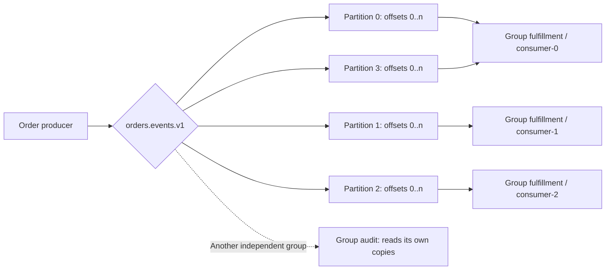
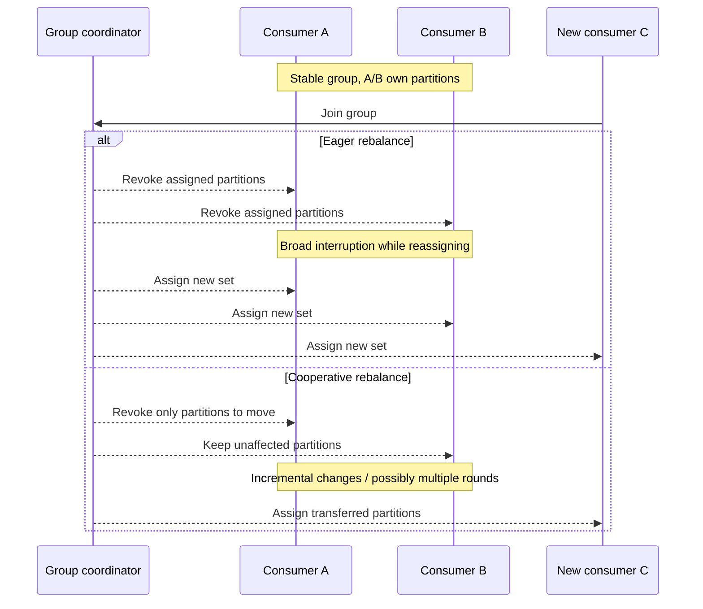
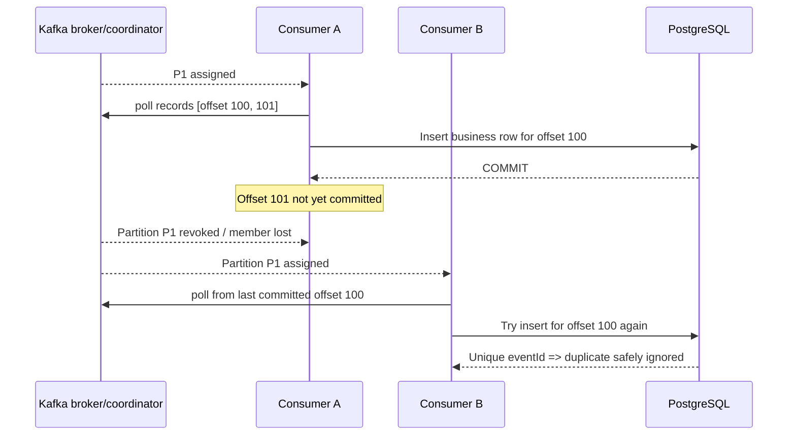
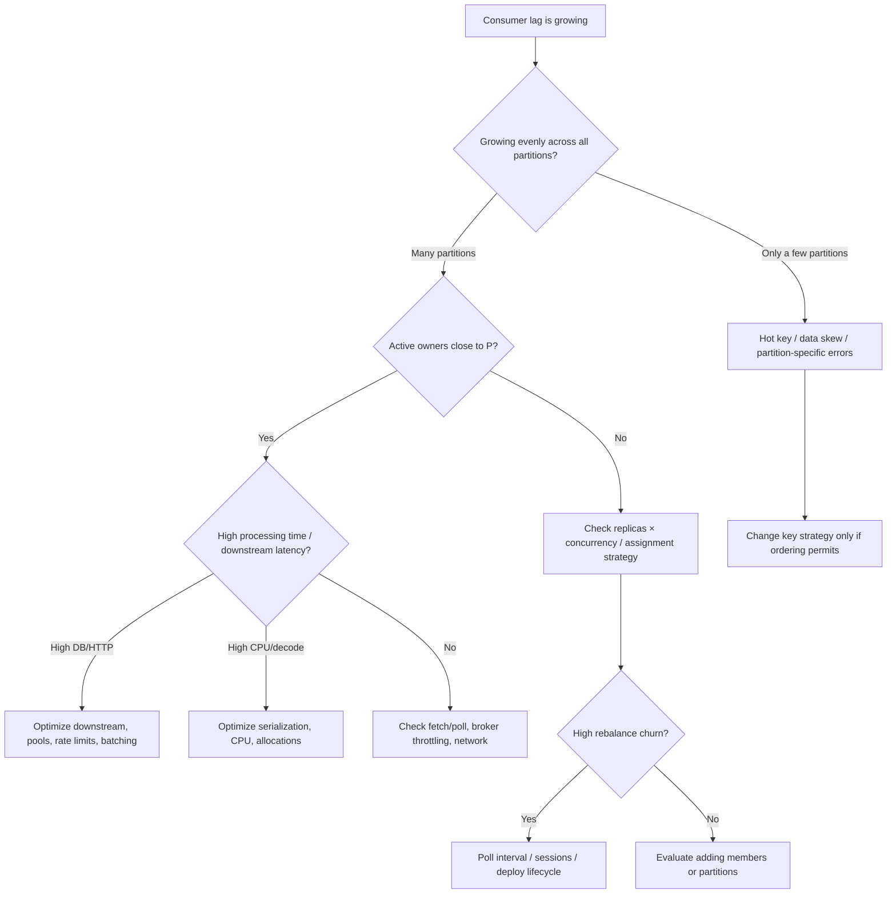
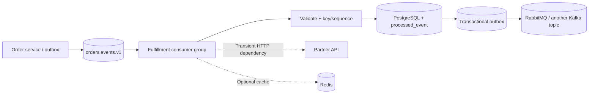
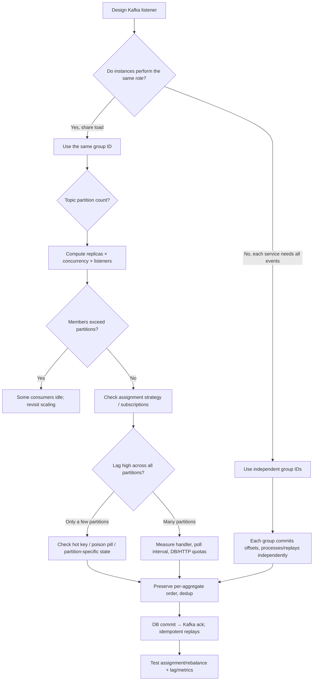

# Consumer Groups, Concurrency, and Partition Distribution

> **Chapter:** Apache Kafka  
> **Module:** SPRING_BOOT_INTEGRATION — integrating Spring Boot systems via HTTP clients, databases, caches, message brokers, and Spring Integration adapters; focusing on data contracts, transactions, errors, deduplication, testing, and observability of real-world flows.

## 1. Why Does Adding More Consumers Not Always Increase Throughput?

Suppose an ordering system uses a Kafka topic `orders.events.v1` with **6 partitions**. A Spring Boot service consumes `OrderCreated` and writes a read model into PostgreSQL. The system runs three replicas of the service, each with its own listener container.

- If **all three consumers belong to the same consumer group**, partitions are divided among members: each partition of a topic normally has **one consumer owner at a time within that group**.
- If **each replica has a different group ID**, each group receives its own copy of the data: **three times the business processing**, not load sharing.
- If a group has only one consumer and the listener takes a long time per record, increasing partitions from 6 to 12 **does not increase throughput** when only one consumer is executing.
- If a group has **10 consumers reading a single 6-partition topic**, at most 6 consumers can own partitions of that topic; at least 4 consumers have no partitions to process.
- If one partition always receives orders from a "hot" customer, that partition can bottleneck **even while other consumers in the group sit idle**.

Choosing the wrong `group.id` or `concurrency` makes applications prone to **duplicate processing, uneven load, wasted cost, continuous rebalances, or broken business ordering**.

### 1.1. An Operational Scenario

```text
Topic: orders.events.v1 (6 partitions)
Group: fulfillment-service-v1

Replica A: concurrency=2  -> child consumers A-0, A-1
Replica B: concurrency=2  -> child consumers B-0, B-1
Replica C: concurrency=2  -> child consumers C-0, C-1

Total group members: 3 replicas × 2 = 6 consumers
Max active owners for this single topic: 6
```

This layout fits when load distributes reasonably evenly across partitions and each consumer can keep up with its assigned partitions. However, raising `concurrency=5` across all three replicas yields 15 group members for just 6 partitions—**not 15 useful reading threads**.

### 1.2. Learning Objectives

After this lesson, you will be able to:

1. Distinguish **topic**, **partition**, **offset**, **consumer**, **consumer group**, **group coordinator**, **group ID**, and **member**.
2. Explain the rule that each partition of a topic has one consumer owner within a group, while independent groups can read the same data.
3. Calculate parallelism limits from partition count, application replicas, `@KafkaListener` concurrency, and subscribed topics.
4. Describe assignment strategies, partition skew, group membership, partition revocation, and rebalances.
5. Configure Spring Kafka `ConcurrentMessageListenerContainer`/`@KafkaListener` with `group.id`, `client.id`, `concurrency`, `max.poll.records`, and timeouts.
6. Design key-based ordering, offset management, idempotent consumers, and transaction/outbox boundaries.
7. Test partition assignment, scaling out/in, same-group/cross-group reads, and replays against a real Kafka broker.
8. Monitor consumer lag, rebalance frequency, partition skew, duplicate processing, error handling, and recovery.

## 2. Foundations: Topics, Partitions, Offsets, and Consumer Groups

Kafka stores events in **partition logs**. Each record has a topic, partition, and offset; a partition orders records by increasing offset. Producers pick the partition (typically using a key and partitioner). Consumer groups coordinate how consumers in the same group split subscribed partitions.



### 2.1. Distinguishing Key Concepts

| Concept | Role | Misconception to Avoid |
| --- | --- | --- |
| **Topic** | Named stream of records comprising one or more partitions | A topic is not a single queue with one shared pointer |
| **Partition** | Log with its own offset order; the unit normally assigned to a consumer group member | There is no global order across partitions |
| **Offset** | Position of a record **within a single partition** | Offset 10 in partition 0 differs from offset 10 in partition 1 |
| **Consumer** | Kafka client executing poll/fetch, record processing, and offset commits | One Spring Boot process can spawn multiple consumer clients |
| **Consumer group** | Consumers sharing `group.id` to split reading subscribed partitions | Consumers in another group do not share load with this group |
| **Group coordinator** | Broker coordinating membership, assignments, and offset commits per protocol | Not a Spring bean or consumer listener |
| **Group member** | A consumer participating in coordination with membership/heartbeats | One replica does not necessarily equal one group member |
| **Committed offset** | Position where the group expects to resume reading in a partition | Not proof that SQL/HTTP side effects committed |
| **Consumer lag** | Distance between log end and consumption/commit progress per metric definition | Does not automatically reflect business processing latency |

### 2.2. Consumer Groups and Multiple Independent Groups

```text
orders.events.v1:
  partitions: P0, P1, P2, P3

group.id=fulfillment-v1:
  consumer A <- P0, P2
  consumer B <- P1, P3

group.id=analytics-v1:
  consumer C <- P0, P1, P2, P3

Result:
  fulfillment group splits load between A and B
  analytics group independently reads the same log using its own offsets
```

Thus **an event can be delivered once per group**, not only to one consumer cluster-wide. Accidentally setting `group.id` to a random instance ID per pod creates **multiple consumer groups**, making every pod read the entire topic instead of sharing load.

### 2.3. Conditional "One Partition — One Consumer" Rule

Under Kafka group-coordinator-managed subscriptions, a partition is **assigned to at most one member of the same group during a stable assignment**. However, one consumer member can own **multiple partitions**, and partitions from multiple topics can be assigned to the same consumer.

This rule does not mean:

- Only **one process** cluster-wide reads the topic: distinct groups still read independently.
- Every consumer always gets exactly one partition: a member can get 0, 1, or many.
- "Exactly-once" processing: rebalances, crashes, or offset commits can still cause redeliveries.
- Records across **multiple partitions** have a unified order.
- A listener automatically rolls back PostgreSQL if a consumer offset commit fails.

If consumers use **manual partition assignment** (`assign(...)` or Spring Kafka listeners specifying explicit partitions) instead of group subscription, the coordinator does not balance them automatically. Two processes manually configured for the same partition can read overlapping records at different positions; never apply group-assignment safety assumptions in that mode.

### 2.4. Which Group Are Offsets Committed For?

Kafka stores committed offsets keyed by **(group, topic, partition)**. When a new consumer in the same group replaces an old member, it can resume from the group's committed offset rather than whatever the old consumer held in memory.

```text
Topic P2:
  Record offset 100 processed in memory
  Group committed offset = 100   (next to read is offset 100)

Consumer crashes before committing 101
Replacement reads offset 100 again
Business handler must be idempotent
```

In Kafka, a committed offset generally denotes the **next offset to read**. After processing offset 100 successfully, the consumer typically commits 101. If 101 is committed **before** PostgreSQL writes succeed, a crash can skip the business record because the group will not re-read offset 100.

## 3. Calculating Concurrency from Partitions, Replicas, and Group Membership

### 3.1. Spring Kafka's Unit of Concurrency

A Spring Kafka `@KafkaListener` is usually managed by a `ConcurrentMessageListenerContainer`. Setting `concurrency=N` requests **N child listener containers**, each normally owning **one `KafkaConsumer`** with its own poll loop.

Within one consumer group, if you have:

- `R` replicas,
- each replica has `L` listener containers on the same group/topic,
- each listener container has `C` child consumers,

then the total **consumer group members created by these listeners** is roughly `R × L × C`, assuming all join the same group and are running. With one listener container per replica, member count is `R × C`.

For **a single topic with P partitions, no manual assignment, and no other topics**, active members receiving useful partitions are bounded by `min(P, R × L × C)`. Remaining members receive **0 partitions for that topic**.

**Do not apply this formula mechanically** when a group subscribes to multiple topics with differing partition counts: each member can hold partitions across multiple topics, assignment strategies influence skew, and group membership varies if listener IDs/groups differ.

### 3.2. Calculation Table for an 8-Partition Topic

| Replicas | Concurrency/Replica | Group Members | Max Members Owning a Partition (8P Topic) | Conclusion |
| ---: | ---: | ---: | ---: | --- |
| 1 | 1 | 1 | 1 | One consumer processes all 8 partitions |
| 1 | 4 | 4 | 4 | Can split 8 partitions across 4 consumers |
| 2 | 4 | 8 | 8 | Can reach 8 consumer owners |
| 4 | 4 | 16 | 8 | At least 8 idle members for this **single topic** |
| 8 | 1 | 8 | 8 | 8 replicas, each running one consumer |
| 3 | 2 | 6 | 6 | Two members short of 8 partitions; some members hold multiple |

Reaching `P` active owners does not guarantee linear throughput scaling. Throughput also depends on record sizes, batching, CPU, network, JDBC pools, external HTTP calls, deserialization, broker fetch settings, hot keys, and consumer lag.

### 3.3. Example Partition Assignment at Steady State

```text
Topic partitions: P0 P1 P2 P3 P4 P5
Group members: C0 C1 C2

Example balanced assignment:
  C0: P0, P3
  C1: P1, P4
  C2: P2, P5

Add C3:
  Kafka triggers rebalance.
  New assignments depend on selected assignor + group protocol.
```

This **illustrates one valid assignment**, not a promise that `RangeAssignor` or `CooperativeStickyAssignor` always yields these exact mappings. To inspect actual assignments, observe the `TopicPartition`s assigned to each consumer/child listener rather than guessing from pod order.

### 3.4. Scaling Out While P Is Fixed

For a 3-partition topic and one consumer group:

```text
1 pod × concurrency 1 = 1 member → 3 partitions/member
1 pod × concurrency 3 = 3 members → ~1 partition/member
2 pods × concurrency 3 = 6 members → only 3 useful owners
```

Once group members match partition count, adding pods or increasing concurrency **adds zero parallelism within the group for that topic**. Consider **increasing partitions** if ordering/keys/partitioners/throughput permit, or cutting per-record processing time, optimizing DB access, and batching/offloading safely—never blindly adding replicas.

### 3.5. Scaling In Also Triggers a Rebalance

When a pod terminates or a child consumer stops, the coordinator revokes its partitions and reassigns them to remaining members. Affected partitions can pause briefly during ownership transfer. During rolling restarts, configure **graceful shutdown** for listeners, handle offsets cleanly, and monitor rebalance duration to avoid unexpected redeliveries.

## 4. Assignment Strategies: Balanced Partitions Do Not Mean Balanced Work

A **partition assignor** decides which consumer member gets which partitions when group membership or subscriptions change. Under Kafka's traditional (**classic**) group protocol, clients configure `partition.assignment.strategy`; common assignors include Range, RoundRobin, Sticky, and CooperativeSticky.

### 4.1. Common Strategies

| Strategy | Idea | Benefit | Limitations / Conditions |
| --- | --- | --- | --- |
| `RangeAssignor` | Splits partition ranges per topic across members subscribed to that topic | Simple, contiguous per-topic assignment | With multiple low-partition topics, can overload early members |
| `RoundRobinAssignor` | Distributes partitions across all topics round-robin among members | Often balances total partition counts better | Watch heterogeneous subscriptions; can trigger broader ownership churn |
| `StickyAssignor` | Minimizes moved partitions while maintaining balance | Helps cache locality and stateful processing | Depends on eager/cooperative mechanics and Kafka client version |
| `CooperativeStickyAssignor` | Preserves sticky assignments with **incremental/cooperative revocation** | Usually reduces stop-the-world rebalance pauses | Requires compatible members and protocol; roll out in phases |

**Never confuse** a partition assignor with a **producer partitioner**: producers pick partitions for new records, while group assignors pick which consumer reads each existing partition.

### 4.2. Load Skew with RangeAssignor Across Multiple Topics

Suppose two topics `orders.created` and `orders.cancelled` each have **2 partitions**, and a group of three consumers C0/C1/C2 subscribes to both. Under per-topic Range assignment, the outcome can be:

```text
orders.created:    P0 -> C0, P1 -> C1
orders.cancelled:  P0 -> C0, P1 -> C1

Total:
  C0 owns 2 partitions
  C1 owns 2 partitions
  C2 owns 0 partitions
```

This does not prove Range is always skewed; it shows **splitting per topic** can leave members idle even with 4 total partitions. A different assignor can distribute the combined partitions more evenly depending on subscriptions and protocol rules.

### 4.3. Changing an Assignor Is More Than a One-Line YAML Edit

Members in the same group must be **compatible in group protocol and assignment strategy**. When upgrading an assignor:

1. Check Kafka broker/client versions, Spring Kafka version, and active group protocol.
2. Verify the default strategy of your client version/BOM rather than copying old examples.
3. Plan a rolling migration supported by all members in the group.
4. Measure partition revocations, rebalance counts, and latency before and after.
5. Run integration tests with topics of varying partition counts and heterogeneous subscriptions.

Configuration example specifically for the **classic group protocol** where supported by the client:

```yaml
spring:
  kafka:
    consumer:
      properties:
        partition.assignment.strategy: org.apache.kafka.clients.consumer.CooperativeStickyAssignor
```

**Version note:** Kafka deployments using the **new consumer group protocol** (introduced via KIP-848 in supporting Kafka broker/client versions) perform **broker-side assignment**, with different client/assignor configurations from classic. Never blindly apply `partition.assignment.strategy` to groups running the new protocol. Consult the exact documentation for your broker, Kafka client, and Spring Kafka BOM.

### 4.4. Eager vs. Cooperative Rebalance



Under cooperative rebalancing, unmoved partitions can keep processing in many scenarios; however, **never** assume cooperative rebalancing eliminates pauses, duplicates, or partition revocations. Callbacks, commits, and handoffs must still be handled properly.

### 4.5. How Does Static Membership Help?

Kafka supports **static group membership** via `group.instance.id` so a member keeps a stable identity across brief restarts. When compatible with the protocol/broker and rollout plan, it reduces unnecessary rebalances during short consumer disconnects.

```yaml
# Example property for a single KafkaConsumer with a stable static member ID:
spring:
  kafka:
    consumer:
      properties:
        group.instance.id: fulfillment-instance-01
```

**Never configure the exact same `group.instance.id` across multiple concurrent consumer clients in a group.** When Spring Kafka creates multiple child consumers (`concurrency > 1`), verify how the framework suffixes IDs and ensure each replica has a distinct base identity. Pod autoscaling with ephemeral identities, multiple containers per pod, and group protocol versions can complicate static membership; enable it only after testing.

Static membership **does not increase parallelism beyond partition count**, does not guarantee zero rebalances, and does not replace graceful shutdown, replays, or idempotency.

### 4.6. Impacts of Adding Partitions to a Topic

Increasing partitions (e.g., 6 → 12) raises the parallelism ceiling for a group, yet:

- Producer key hashing/partition mapping can change, causing events with the same key **before vs. after scaling** to land on different partitions if the partitioner depends on partition count.
- Existing records in old partitions are not redistributed into new partitions.
- It can trigger rebalances, ownership shifts, lag metric jumps, and cache locality changes.
- If business logic relies on per-aggregate ordering, evaluate routing changes and compatibility.
- Kafka normally does not support shrinking an existing topic's partition count as an "undo"; increasing P requires a controlled decision.

Never add partitions solely to fix a **hot key**: under the same partitioner, a hot key still concentrates onto one partition.

## 5. Rebalances: Why Do Consumers Receive the Same Record Again?

A rebalance occurs when the coordinator must adjust memberships or partition assignments. Causes include:

- A new consumer joins or an existing consumer leaves the group.
- A consumer dies/disconnects and misses heartbeat/session timeouts.
- A consumer **fails to poll in time** relative to `max.poll.interval.ms` (under classic semantics).
- Subscribed topics or partition counts change.
- Subscription, assignment strategy, or group protocol changes.
- Rolling deployments/restarts cause membership churn.

### 5.1. Rebalance Timeline When Ownership Changes



This diagram illustrates **a possible redelivery**. Rebalances do not automatically duplicate every record, yet records **already committed to the DB with uncommitted Kafka offsets** can be re-polled. Conversely, committing offsets too early before DB commit can cause business events to be skipped after a crash.

### 5.2. Offset Commit Is "Read Progress," Not a Business Transaction

Processing example:

```text
P3 offset 87: OrderCreated(eventId=evt-87)

Bad ordering:
  commit Kafka offset 88
  write PostgreSQL
  -> DB failure => record may be skipped by group

Safer at-least-once:
  write PostgreSQL transaction + unique(eventId)
  commit DB
  commit Kafka offset 88
  -> crash between commits => redelivery, dedup by eventId
```

In Kafka, consumer offset commits are **not** atomic with PostgreSQL merely because a method has `@Transactional`. Kafka transactions/EOS cover certain **Kafka → Kafka** pipelines within configuration/compatibility boundaries; they do not turn Kafka offsets + external SQL/HTTP into an atomic distributed transaction.

### 5.3. When Do Listeners Receive Revoke/Assign Callbacks?

The Kafka client exposes `ConsumerRebalanceListener` to notify when partitions are assigned or revoked (and supporting protocols/versions provide a separate callback for lost partitions). Spring Kafka also exposes container rebalance listener hooks.

Applications can use callbacks to:

- Emit metrics for partition assignments/revocations and log topic-partition IDs.
- Clear per-partition caches, locks, or offset tracking upon losing ownership.
- Flush **fully completed** work per policy, without committing still-running records.
- Preload/warm caches for newly assigned partitions if genuinely needed.

**Never** run long blocking work inside callbacks or blindly force offset commits. Rebalances sit on the critical path of group coordination; slow callbacks delay handoffs or trigger timeouts. With async downstream workers, stop accepting new tasks, wait within a short budget, persist durable state, and let idempotent replay handle uncertain records.

### 5.4. Manual Assignment vs. Auto Group Assignment

Spring Kafka lets you configure a listener directly:

```java
@KafkaListener(
        id = "fixed-orders-partition-0",
        topicPartitions = @TopicPartition(
                topic = "orders.events.v1",
                partitions = "0"))
public void onFixedPartition(String payload) {
    // Explicitly assigned P0; not coordinator load balancing.
}
```

This snippet requires importing `org.springframework.kafka.annotation.KafkaListener` and `TopicPartition`. **Explicit partition assignment** fits specialized needs, not auto-scaling Kubernetes consumer groups. If two applications manually listen to partition 0, both read independently regardless of group balancing expectations.

## 6. Ordering: Kafka Preserves Order per Partition, Not Topic-Wide

Kafka guarantees offset order **within each partition log**. When producers attach a consistent routing key and the partitioner picks the same partition, consumers can process those records in partition read order **as long as the application does not break ordering via unordered async execution**.

### 6.1. Using a Business Key as the Record Key

```java
// Illustrative producer: same orderId typically routes to the same partition.
kafkaTemplate.send(
        "orders.events.v1",
        event.orderId(),
        event);
```

Key-based partitioning depends on the configured partitioner, serializer, and partition count. In standard setups, events for a given `orderId` land in the same partition **while partitioning config stays constant**; never claim this holds unconditionally across partition-count or partitioner changes.

### 6.2. Two Different Keys Have No Global Order

```text
Partition 0: Order A created  → Order A paid
Partition 1: Order B created  → Order B cancelled

No guaranteed global order:
  A created / B created / A paid / B cancelled
could be interleaved differently among consumers.
```

If fulfillment requires "never process Paid before Created **for the same order**," use a consistent aggregate key, single-partition logical routing, and version/sequence checks. If global system-wide ordering is required, a multi-partition topic does not supply it; additional ordering/coordination is required at the cost of throughput.

### 6.3. Concurrency Does Not Inherently Break Per-Partition Order

When Spring Kafka spawns multiple child consumers in a group, **each partition still has one owner**; the listener runs sequentially on each child's poll thread (unless you offload asynchronously). Raising `concurrency` to process **different partitions in parallel** generally preserves per-partition poll order.

By contrast, if a listener does:

```java
@KafkaListener(topics = "orders.events.v1")
void receive(OrderEvent event) {
    executor.submit(() -> process(event));
    // Return immediately without waiting for durable completion.
}
```

events within the **same partition** can complete out of order, and offsets can be ACKed/committed before DB writes finish. This is an **illustrative anti-pattern**; `executor` and `process` are placeholders. If offloading is unavoidable, use per-key serial execution, track in-flight/contiguous offset acks with backpressure, and thoroughly test rebalances and cancellations.

### 6.4. Hot Partitions and Key Skew

If one customer generates 70% of traffic and the producer keys by `customerId`, 70% of records hit one partition. Scaling consumers from 4 to 12 will not split that partition across two members in the same group.

Options depending on the business contract:

- Switch the key from `customerId` to `orderId` if ordering is only needed per order rather than across all orders of a customer.
- Optimize the hot-partition handler (SQL batching, bounded caching, avoiding blocking HTTP where feasible).
- Separate workloads with different semantics onto distinct topics.
- If forced to "shard" a hot key, build aggregate sequence/ordering reconciliation, because splitting a key across partitions **sacrifices strict ordering**.

Never "fix" skew by randomizing keys on events of the same order while claiming per-order order is preserved.

## 7. Configuring Spring Boot Consumer Groups and Concurrency

Examples target **Java 17+, Spring Boot 3.2–3.5, Spring Kafka 3.x, and compatible Kafka clients/brokers**. Kafka group coordination changed significantly across recent broker/client lines; on Spring Boot 4.x or Kafka 4.x, verify dependency management and **classic vs. consumer group protocol** semantics. Never mix Kafka client/Spring Kafka versions outside the BOM just to enable a single flag.

### 7.1. Gradle Dependencies

```groovy
// Project already applies the Spring Boot Gradle plugin/BOM.
dependencies {
    implementation 'org.springframework.kafka:spring-kafka'
    implementation 'org.springframework.boot:spring-boot-starter-jdbc'
    runtimeOnly 'org.postgresql:postgresql'

    testImplementation 'org.springframework.boot:spring-boot-starter-test'
    testImplementation 'org.springframework.kafka:spring-kafka-test'
    testImplementation 'org.springframework.boot:spring-boot-testcontainers'
    testImplementation 'org.testcontainers:junit-jupiter'
    testImplementation 'org.testcontainers:kafka'
    testImplementation 'org.testcontainers:postgresql'
}
```

Include JDBC only if listeners persist to PostgreSQL as shown. If an app only reads and writes Kafka, omit JDBC. Use Boot-managed `org.springframework.kafka:spring-kafka` without overriding Kafka client versions unless compatibility is verified.

### 7.2. `application.yml`: Configuring a Group

```yaml
app:
  kafka:
    order-topic: orders.events.v1
    order-group: fulfillment-service-v1
    order-concurrency: ${ORDER_CONCURRENCY:3}

spring:
  kafka:
    bootstrap-servers: ${KAFKA_BOOTSTRAP_SERVERS:localhost:9092}
    consumer:
      group-id: ${KAFKA_CONSUMER_GROUP:fulfillment-service-v1}
      key-deserializer: org.apache.kafka.common.serialization.StringDeserializer
      value-deserializer: org.apache.kafka.common.serialization.StringDeserializer
      enable-auto-commit: false
      auto-offset-reset: earliest
      max-poll-records: 200
      properties:
        max.poll.interval.ms: 300000
    producer:
      key-serializer: org.apache.kafka.common.serialization.StringSerializer
      value-serializer: org.apache.kafka.common.serialization.StringSerializer
    listener:
      concurrency: ${ORDER_CONCURRENCY:3}
      ack-mode: manual_immediate
```

Summary:

| Property | Goal | Common Mistake |
| --- | --- | --- |
| `bootstrap-servers` | Broker bootstrap endpoints | Misconfigured DNS/`advertised.listeners` in Docker/Kubernetes |
| `group-id` | Consumer group sharing load and offsets | Generating random IDs per pod so every pod reads the whole topic |
| `enable-auto-commit=false` | Prevents unintended periodic Kafka client commits | Forgetting to configure listener ACK/commit strategy |
| `auto-offset-reset=earliest` | Applies when group **has no valid committed offset** | Thinking changing it replays all data for a group with offsets |
| `max-poll-records` | Caps records returned per poll | Mistaking it for a byte fetch limit or fixed throughput |
| `max.poll.interval.ms` | Max gap allowed between valid polls | Blocking handlers make members appear dead |
| `listener.concurrency` | Default child consumers per listener factory | Forgetting to multiply by replicas and other listener containers |
| `ack-mode=manual_immediate` | Listener decides when to ACK per Spring Kafka semantics | Acking before DB commit or from an unmanaged thread |

**On duplicate group configuration:** specifying `@KafkaListener(groupId=...)` can **override `spring.kafka.consumer.group-id`** for that listener. Maintain one clear source of truth; the example below uses `app.kafka.order-group` to surface the group directly on the listener.

**On earliest:** for a group with existing committed offsets, consumers resume from those offsets rather than jumping back just because `auto-offset-reset` changed. To replay intentionally, use a fresh group or controlled offset resets/stopped consumers with idempotency checks.

### 7.3. A Listener with Explicit Concurrency

```java
// OrderEventListener.java
import org.apache.kafka.clients.consumer.ConsumerRecord;
import org.springframework.kafka.annotation.KafkaListener;
import org.springframework.kafka.support.Acknowledgment;
import org.springframework.stereotype.Component;

@Component
public class OrderEventListener {
    private final OrderEventProcessor processor;

    public OrderEventListener(OrderEventProcessor processor) {
        this.processor = processor;
    }

    @KafkaListener(
            id = "fulfillment-orders-listener",
            topics = "${app.kafka.order-topic}",
            groupId = "${app.kafka.order-group}",
            concurrency = "${app.kafka.order-concurrency:3}")
    public void receive(
            ConsumerRecord<String, String> record,
            Acknowledgment acknowledgment) {

        // This method is NOT @Transactional.
        // The downstream service commits PostgreSQL before returning.
        processor.process(record.value());
        acknowledgment.acknowledge();
    }
}
```

Here `processor.process(...)` is a **Spring-proxied** transactional service method that returns only after committing or throws an exception. Only afterward does the listener call `acknowledge()`. On errors, Spring Kafka's common error handler/container policy handles redelivery or DLT routing; **never ACK inside a catch block and swallow the exception**.

Declaring `concurrency` directly on the annotation overrides the factory default for this listener depending on framework version; stick to one canonical config source for clarity. Concurrency sets child `KafkaConsumer`s **per application instance**, not global cluster-wide threads.

### 7.4. DTO and PostgreSQL Idempotency

```java
// OrderEvent.java — simplified event contract.
import java.time.Instant;

public record OrderEvent(
        String eventId,
        String orderId,
        String type,
        Instant occurredAt) {
}
```

Minimal database schema for the listener:

```sql
CREATE TABLE processed_event (
    consumer_name VARCHAR(100) NOT NULL,
    event_id VARCHAR(120) NOT NULL,
    processed_at TIMESTAMPTZ NOT NULL DEFAULT CURRENT_TIMESTAMP,
    PRIMARY KEY (consumer_name, event_id)
);

CREATE TABLE order_projection (
    order_id VARCHAR(120) PRIMARY KEY,
    state VARCHAR(60) NOT NULL,
    last_event_at TIMESTAMPTZ NOT NULL
);
```

Example JDBC service:

```java
// OrderEventProcessor.java
import com.fasterxml.jackson.core.JsonProcessingException;
import com.fasterxml.jackson.databind.ObjectMapper;
import java.util.Set;
import org.springframework.dao.DataIntegrityViolationException;
import org.springframework.jdbc.core.JdbcTemplate;
import org.springframework.stereotype.Service;
import org.springframework.transaction.annotation.Transactional;

@Service
public class OrderEventProcessor {
    private final JdbcTemplate jdbc;
    private final ObjectMapper mapper;

    public OrderEventProcessor(
            JdbcTemplate jdbc, ObjectMapper mapper) {
        this.jdbc = jdbc;
        this.mapper = mapper;
    }

    @Transactional
    public void process(String json) {
        OrderEvent event;
        try {
            event = mapper.readValue(json, OrderEvent.class);
        } catch (JsonProcessingException malformed) {
            throw new InvalidPartnerEventException(
                    "Invalid order event JSON", malformed);
        }

        if (event == null
                || event.eventId() == null
                || event.eventId().isBlank()
                || event.orderId() == null
                || event.orderId().isBlank()
                || event.occurredAt() == null
                || event.type() == null
                || !Set.of("CREATED", "CONFIRMED")
                        .contains(event.type())) {
            throw new InvalidPartnerEventException(
                    "Missing required fields or unknown event type");
        }

        int inserted = jdbc.update("""
                INSERT INTO processed_event
                    (consumer_name, event_id)
                VALUES (?, ?)
                ON CONFLICT (consumer_name, event_id) DO NOTHING
                """, "fulfillment-v1", event.eventId());

        if (inserted == 0) {
            // Duplicate event already processed and committed.
            return;
        }

        jdbc.update("""
                INSERT INTO order_projection
                    (order_id, state, last_event_at)
                VALUES (?, ?, ?)
                ON CONFLICT (order_id) DO UPDATE
                SET state = EXCLUDED.state,
                    last_event_at = EXCLUDED.last_event_at
                WHERE order_projection.last_event_at
                      <= EXCLUDED.last_event_at
                """,
                event.orderId(),
                event.type(),
                java.sql.Timestamp.from(event.occurredAt()));
    }
}
```

Application-defined exception:

```java
public final class InvalidPartnerEventException
        extends RuntimeException {
    public InvalidPartnerEventException(String message) {
        super(message);
    }

    public InvalidPartnerEventException(
            String message, Throwable cause) {
        super(message, cause);
    }
}
```

**Correctness detail:** the example uses `ON CONFLICT DO NOTHING` on `(consumer_name, event_id)` so an event updates the projection at most once within the **same PostgreSQL transaction**. Duplicates arriving after the first transaction committed skip the projection update. If the initial PostgreSQL transaction rolls back, the marker rolls back too so retries process normally.

In production, also store **schema version and payload fingerprint/hash** alongside the inbox marker: if a producer reuses an `eventId` with different content, the consumer must flag an **ID collision/payload mismatch** instead of silently ignoring it. Valid duplicates must represent the exact same logical event.

The timestamp condition on `order_projection` is only a coarse guard for this example; **event time is not a reliable business sequence** because producer clocks can skew. In production, use producer-supplied aggregate versions/sequences (paired with key ordering) to block stale overwrites. If the event schema lacks versions, document the risk and reconciliation plan.

The listener method intentionally omits `@Transactional`: the Spring-proxied `process()` method owns its JDBC transaction and commits before the caller ACKs Kafka. If an application has multiple datasources/transaction managers, specify `@Transactional(transactionManager="...")` explicitly instead of assuming auto-wiring picks the right one.

### 7.5. Why Is `Acknowledgment` Not Used in Every Listener?

Spring Kafka supports multiple **AckMode** options such as `RECORD`, `BATCH`, `MANUAL`, and `MANUAL_IMMEDIATE`. With `AckMode.RECORD` or `BATCH`, the container manages commits based on normal listener returns rather than manual acks. Pick one consistent strategy:

| Ack Mode | Typical Behavior | When Appropriate |
| --- | --- | --- |
| `RECORD` | Container commits after each record per container batch/poll semantics | Simple for synchronous listeners |
| `BATCH` | Commits once all records from a `poll()` are processed | Good throughput; wider replay window |
| `MANUAL` | Listener calls ACK; container commits per schedule/container rules | Explicit completion signaling with batched commits |
| `MANUAL_IMMEDIATE` | ACK on consumer thread can trigger immediate commit per config | Confirms right after DB commit; narrows pending window |

**Never claim `MANUAL_IMMEDIATE` gives Kafka exactly-once.** Kafka commits and JDBC commits remain two separate actions; crashes between them still cause redelivery. Furthermore, commits can be sync/async per container config, and commit failures must be handled; never assume `acknowledge()` guarantees a durable broker ACK on return.

### 7.6. Checking Group IDs Across Multiple `@KafkaListener` Methods

```java
// These two listeners split partitions if sharing group and subscription.
@KafkaListener(
        id = "fulfillment-orders",
        topics = "orders.events.v1",
        groupId = "fulfillment-v1")
void processOrders(String json) { /* ... */ }

@KafkaListener(
        id = "fulfillment-orders-extra",
        topics = "orders.events.v1",
        groupId = "fulfillment-v1")
void processOrdersExtra(String json) { /* ... */ }
```

This is an **illustrative fragment**; if two listeners share a group and topic, Kafka splits partitions between them: **neither listener receives every event**. If the goal is two **independent business projections**, assign **two distinct group IDs** (and separate idempotency/inbox namespaces). Conversely, if two listeners are identical workers, sharing a group ID divides load.

When listener/container IDs differ from group IDs, mind Spring Kafka's `idIsGroup`/annotation `groupId` semantics. Setting `groupId` explicitly prevents renaming a listener ID from silently switching consumer groups and reading different offsets.

## 8. Poll Loop and Processing Time: Concurrency Cannot Fix Infinite Blocking

Kafka consumer poll loops face hard bounds:

- `max.poll.records`: max records returned per `poll()`, not a network byte limit.
- `max.poll.interval.ms`: max gap between polls under classic group membership; slow listeners risk losing membership and triggering rebalances.
- `session.timeout.ms` and `heartbeat.interval.ms` (classic): coordinator detects dead members via missed heartbeats; relations and configs differ in the new protocol.
- `fetch.min.bytes`/`fetch.max.wait.ms`: balances fetch latency against batch efficiency.
- `max.partition.fetch.bytes`/`fetch.max.bytes`: governs memory/network fetch limits; tune for large messages.
- `isolation.level=read_committed`: reads only committed Kafka transactional records; does not affect PostgreSQL transactions.

### 8.1. The 500 Records × 2 Seconds Trap

```text
max.poll.records = 500
handler latency = 2 seconds per record, sequential
worst processing time = 500 × 2 s = 1000 seconds
max.poll.interval.ms = 300 seconds

Consequence: poll progress deadline violated;
group rebalance / failed commits / redelivery become possible.
```

Never fix this by inflating `max.poll.interval.ms` to hours when the handler makes unbounded external HTTP calls. Reduce `max.poll.records`, batch DB writes, offload to a durable worker queue with clear ACK/cursor semantics, scale partitions/consumers, or isolate slow external calls into durable workflows.

### 8.2. `max.poll.records` Is Not the Commit Batch Size

When a consumer polls 200 records, `AckMode.RECORD` commits per record while `AckMode.BATCH` commits after the poll batch. Actual commit cadence also depends on container properties (`syncCommits`, `ackTime`/`ackCount` in applicable modes, transactions). Never infer from `max.poll.records=200` that Kafka commits strictly every 200 records.

### 8.3. Pause/Resume Does Not Replace Rebalances or System-Wide Backpressure

Spring Kafka listener containers support pause/resume; pausing a consumer/partition temporarily halts fetching new data when handlers fall behind. However:

- The consumer must still **poll/heartbeat** per protocol; pausing does not disable group membership.
- If the bottleneck sits in DB/HTTP/Redis, enforce rate limits and circuit breakers downstream.
- If a listener already returned and ACKed while side effects run asynchronously, pausing cannot recover lost records.
- Scaling Kafka consumers increases active owners, which can overwhelm Hikari pools or HTTP partners; measure downstream capacity.

### 8.4. Never Use One `KafkaConsumer` Across Multiple Threads

`KafkaConsumer` is **not thread-safe** for poll/commit/seek/assignment operations. The Spring Kafka container manages the poll loop and consumer thread; never call `consumer.poll(...)`, `commitSync(...)`, or `seek(...)` from arbitrary worker threads.

When a listener needs asynchronous external jobs, persist tasks durably with `eventId`, enforce backpressure/in-flight caps, and ack offsets only past a safe boundary—or hand off to another service/worker via outbox/broker instead of tossing raw `ConsumerRecord`s onto a thread pool and acking immediately.

## 9. Error Handling, Poison Pills, and Offset Commits with Multiple Consumers

### 9.1. Three Error Categories to Classify

| Error Type | Examples | Appropriate Response |
| --- | --- | --- |
| **Transient infrastructure** | PostgreSQL unavailable, Kafka broker disconnect, API returns 503 | Budgeted backoff/retry; keep record un-ACKed while unprocessed |
| **Permanent data/contract** | Malformed JSON, unsupported schema version, null required field | DLT/quarantine and audited alert; avoid infinite retries |
| **Business duplicate/conflict** | Already-processed `eventId`, stale aggregate version | Idempotent skip or domain conflict per contract; do not treat as transport outage |

A single unparseable poison pill can cause a partition to **re-read the exact same record endlessly** if the error handler retries forever without recovery. Yet committing past the record without **saving the failure to a DLT/audit store** permanently drops business data.

### 9.2. Consumer Group Concurrency and DLTs

Dead-letter topics (DLTs) receive records that still fail after bounded retries. A typical Spring Kafka setup:

```java
import org.springframework.context.annotation.Bean;
import org.springframework.context.annotation.Configuration;
import org.springframework.kafka.core.KafkaTemplate;
import org.springframework.kafka.listener.CommonErrorHandler;
import org.springframework.kafka.listener.DeadLetterPublishingRecoverer;
import org.springframework.kafka.listener.DefaultErrorHandler;
import org.springframework.util.backoff.FixedBackOff;

@Configuration(proxyBeanMethods = false)
public class OrderKafkaErrorHandling {

    @Bean
    CommonErrorHandler ordersErrorHandler(
            KafkaTemplate<String, String> kafkaTemplate) {

        DeadLetterPublishingRecoverer recoverer =
                new DeadLetterPublishingRecoverer(kafkaTemplate);

        DefaultErrorHandler handler =
                new DefaultErrorHandler(
                        recoverer, new FixedBackOff(1000L, 2L));

        handler.addNotRetryableExceptions(
                InvalidPartnerEventException.class);
        return handler;
    }
}
```

This template fits the **`String`-key/value listener** from section 7 paired with `StringSerializer` in `application.yml`; it enforces **bounded retries then DLT routing** instead of swallowing exceptions. If your app uses `JsonDeserializer`, `byte[]`, or `ErrorHandlingDeserializer`, build a **DLT producer/serializer compatible with every actual value type** and test poison pills; `KafkaTemplate<String,String>` is not universal for all payloads.

By default, `DeadLetterPublishingRecoverer` maps the DLT topic-partition from the source topic/partition in many configs; **ensure the DLT topic exists with matching partition counts** or supply a custom destination resolver. If a poison pill sits on partition 5 while the DLT only has 1 partition and the resolver keeps partition 5, DLT publishing fails. Never equate "handler called recoverer" with "message safely saved."

`FixedBackOff(1000L, 2L)` specifies fixed-interval retries per Spring Retry/Spring Kafka backoff APIs; exact attempts and timings depend on container/error-handler behavior. Test both business-handler invocation counts and DLT delivery.

### 9.3. Is Committing the Offset After DLT Allowed?

An application may treat "persisted to DLT with reliable ACK" as completed recovery so the partition can advance. However:

1. DLT publishing must use durable producer acks.
2. Define failure handling when DLT publishing fails; never silently advance the source offset.
3. With `MANUAL_IMMEDIATE`, Spring Kafka offers options like `DefaultErrorHandler.setCommitRecovered(true)`, though exact semantics depend on listener/container version and config.
4. DLT records must retain original topic/partition/offset, sanitized error category, `eventId`, and correlation ID for re-driving.
5. DLT re-driving requires rate limits, deduplication, and ordering policies.

Never "fix" a poison pill by flipping `auto-offset-reset=latest` to skip the backlog. That setting only affects groups without valid committed offsets, not error recovery on an active partition.

### 9.4. Deserialization Failures Happen Before the Listener

When a Kafka consumer configured with `JsonDeserializer` hits invalid JSON, the error happens **inside the deserializer before `@KafkaListener` is called**. A `try/catch` inside the listener method **never sees that exception**.

Standard Spring Kafka remedies:

- Wrap the real deserializer in `ErrorHandlingDeserializer`, paired with a suitable error handler.
- Restrict JSON trusted packages/type headers via an allowlist; avoid deserializing arbitrary classes from external data.
- Or deserialize `String`/`byte[]` inside the listener and validate before writing to DB as in section 7; invalid JSON then triggers `InvalidPartnerEventException` inside the method.
- Test poison pills against a real broker to verify bounded retry/DLT without stalling the entire group.

Never set `JsonDeserializer.TRUSTED_PACKAGES="*"` casually where untrusted producers exist.

### 9.5. Retries and Ordering Within a Partition

Record at offset 101 fails while offset 102 carries a related event for the same order. Advancing to offset 102 before resolving or quarantining 101 can corrupt the state machine. Pick an explicit policy:

- **Stop/retry partition:** preserves strict per-partition order while halting later records; increases consumer lag.
- **DLT/quarantine and advance:** keeps the group moving while the app handles downstream out-of-order/missing business events.
- **Retry topics:** frees the main partition yet alters ordering, requiring event versions/sequences and deduplication.

No single policy fits every domain. Realtime price feeds may tolerate skipping bad records; financial/fulfillment ledgers may require pausing for human intervention to avoid missing a mandatory transition.

## 10. Coordinating Multiple Replicas on Kubernetes

### 10.1. Counting Group Members During Autoscaling

Given a deployment:

```yaml
apiVersion: apps/v1
kind: Deployment
metadata:
  name: fulfillment-consumer
spec:
  replicas: 3
  selector:
    matchLabels:
      app: fulfillment-consumer
  template:
    metadata:
      labels:
        app: fulfillment-consumer
    spec:
      containers:
        - name: app
          image: example.registry.invalid/fulfillment:1.0
          env:
            - name: ORDER_CONCURRENCY
              value: "2"
            - name: KAFKA_CONSUMER_GROUP
              value: fulfillment-service-v1
```

This is a **deployment fragment**; production apps also need bootstrap servers, TLS/SASL secrets, probes, resource limits, shutdown grace periods, and network policies. With 3 replicas, concurrency 2, and one listener container, the group holds roughly **6 consumer clients** once all pods are ready.

Never derive group IDs from `HOSTNAME`/pod UIDs when scaling out a shared group. Nor should every consumer share an identical client ID if metrics/tracing must distinguish them: Spring Kafka can suffix client IDs on child containers—verify actual runtime naming.

### 10.2. Guidelines for Choosing Replicas vs. Concurrency

| Choice | Pros | Trade-offs |
| --- | --- | --- |
| More replicas, concurrency 1 | Process/pod isolation, independent CPU/memory, clean HPA scaling | More JVMs, network connections, group churn on scale |
| Fewer replicas, higher concurrency | Shares JVM overhead, fewer pods | Shared failure domain, shared CPU/heap/DB pool |
| Replicas × concurrency ≈ P | Effectively utilizes partitions for one topic | May still skew under hot keys or multiple topics |
| Replicas × concurrency > P | Spare members during transitions | Idle consumers still consume connections and memory |
| Increase P | Raises parallelism ceiling | Shifts key distribution/ordering; adds metadata/storage overhead |

In every case, measure **lag per partition**, CPU, memory, processing latency, DB pool waits, and external API rate limits. If consumers call a slow payment REST API, scaling concurrency unchecked can trigger a **retry storm** against the partner.

### 10.3. Graceful Shutdown and Rolling Deployments

When a pod receives `SIGTERM`:

1. Stop accepting new business work, giving listener/containers time to finish in-flight records within the shutdown grace period.
2. Ensure PostgreSQL commits/rolls back before Kafka offset ACKs per policy.
3. Never promise all in-flight records finish if the Kubernetes grace period cuts them short.
4. Once a member leaves the group, the coordinator reassigns its partitions to other consumers.
5. Uncommitted records are re-read; unique `eventId`/inbox handles duplicates.

Align Kubernetes `terminationGracePeriodSeconds`, container `shutdownTimeout`, and processing budgets; never set a 5-second grace period when batches take 2 minutes. Yet **never inflate timeouts excessively just to mask hanging handlers**—measure and reduce processing time.

### 10.4. What Does Scale-to-Zero Mean?

If all consumer replicas stop:

- Kafka topics retain records per **retention/compaction policy**—not indefinitely once retention expires.
- Group committed offsets persist in Kafka subject to offset/group metadata retention.
- When consumers restart, they resume from valid committed offsets or follow `auto-offset-reset` if none exist.
- Lag builds up while consumers are offline; processing SLAs must account for catch-up time.

Never treat "Kafka stores data" as a guarantee that a consumer stopped for months can replay everything: topic and offset retention bounds apply.

## 11. Proper Monitoring: Lag, Assignments, Rebalances, and Processing Latency

### 11.1. What Is Consumer Lag?

A common per-partition approximation:

```text
lag = log end offset (LEO) - committed offset

Example:
  LEO = 1050
  group committed offset = 1020
  approximate lag = 30 records
```

Exact metric definitions vary (fetch position lag, committed offset lag, end offset under isolation levels). With `read_committed`, Last Stable Offset and open transactions complicate lag interpretation. Never blindly apply one formula to every metric named "lag."

Near-zero lag **does not guarantee business state is updated** if the app ACKs before DB commit or pushes work onto a detached executor and commits immediately. Conversely, growing lag may reflect intentional consumer pausing to protect downstream systems.

### 11.2. Metrics to Measure

| Signal | Question | Alert Trigger |
| --- | --- | --- |
| Committed offset lag per topic-partition/group | Which partition is falling behind? | Hot partition / non-draining backlog |
| Partition assignment count per member | Are members receiving expected partitions? | Active members > P, dropped assignments |
| Rebalance count/rate/duration | Is the group churning? | Rolling deploys, session timeouts, protocol mismatch |
| Records consumed/s and bytes consumed/s | Actual read rate | Low throughput despite broker backlog |
| Listener processing p95/p99 | How slow are handlers/DB/HTTP? | Approaching `max.poll.interval.ms` |
| Poll duration / idle ratio | Waiting on data or blocked processing? | Poll loop stalled |
| Commit failures / latency | Are offsets committing cleanly? | Redeliveries and churn |
| Retry, DLT, poison pill counts | Are business records failing? | Growing quarantine backlog |
| Duplicate `eventId` / inbox conflicts | Are redeliveries happening after crashes/rebalances? | Spikes beyond normal at-least-once baseline |
| Hikari pool waits / DB deadlocks | Is downstream DB bottlenecked? | Adding consumers only worsens contention |
| JVM CPU, heap, GC | Is the client overloaded? | OOMs or long GC pauses triggering rebalances |
| Kafka broker fetch throttling / network | Is the broker bottlenecked? | Drop in producer/consumer throughput |

Spring Kafka provides observation/Micrometer instrumentation depending on version, Boot Actuator, and config. Kafka Java clients expose their own metrics too. **Do not assume** all counters/timers above appear automatically just by adding `spring-kafka`. Verify metric endpoints, labels, exporters, and custom business instrumentation.

### 11.3. Cardinality and Security

Use bounded-cardinality labels:

```text
service=fulfillment
group=fulfillment-service-v1
topic=orders.events.v1
partition=2
consumerClientId=fulfillment-orders-listener-1
outcome=SUCCESS|RETRY|DLT
```

Never put `orderId`, `customerId`, `eventId`, raw payloads, tokens, or full error messages into metric labels. They explode time-series cardinality and leak PII. To investigate a single event, use access-controlled audit/inbox/outbox stores, trace IDs, and sanitized logs.

### 11.4. Inspecting Live Assignments from a Spring Kafka Container

```java
// Fragment inside a service/diagnostics bean with registry injected.
import org.springframework.kafka.config.KafkaListenerEndpointRegistry;
import org.springframework.kafka.listener.MessageListenerContainer;

MessageListenerContainer listener =
        registry.getListenerContainer("fulfillment-orders-listener");

if (listener != null) {
    var assigned = listener.getAssignedPartitions();
    // Log/metric per topic-partition and child consumer.
    // Do not assume one child owns one partition.
}
```

`registry` is an injected `KafkaListenerEndpointRegistry` bean; this snippet is for introspection only. In some Spring Kafka versions, to inspect **each child consumer**, iterate `ConcurrentMessageListenerContainer.getContainers()` and read each child's assigned partitions; results shift mid-rebalance. Never call `seek` from a metrics thread to "fix lag."

### 11.5. Using `kafka-consumer-groups` CLI to Investigate

CLI example:

```bash
bin/kafka-consumer-groups.sh \
  --bootstrap-server localhost:9092 \
  --group fulfillment-service-v1 \
  --describe
```

Output typically lists `TOPIC, PARTITION, CURRENT-OFFSET, LOG-END-OFFSET, LAG, CONSUMER-ID, HOST, CLIENT-ID` (depending on broker/client version and protocol). This is a **read-only** diagnostic command.

Never run `--reset-offsets --execute` while a group is still active or without a replay/idempotency plan; resetting offsets can trigger massive reprocessing or skip needed records. Prefer dry-runs, coordinated consumer shutdowns, backups/reconciliation, and controlled offset adjustments.

## 12. Testing Consumer Groups and Partition Assignments with Real Kafka

Mocking a `ConsumerRecord` and invoking the listener method directly tests mapping and validation, yet **cannot prove** Kafka coordinator partition assignment, concurrency, or rebalances. Include at least one integration test with a **real Kafka broker**. Spring Kafka provides `EmbeddedKafka` and `spring-kafka-test`, while Testcontainers models real broker networking/config even more faithfully in an isolated container.

### 12.1. Provisioning a Broker for Spring Boot Tests with Testcontainers

Example using an Apache/Confluent Kafka Docker image compatible with your Testcontainers version:

```groovy
dependencies {
    implementation 'org.springframework.kafka:spring-kafka'
    testImplementation 'org.springframework.kafka:spring-kafka-test'
    testImplementation 'org.springframework.boot:spring-boot-starter-test'
    testImplementation 'org.springframework.boot:spring-boot-testcontainers'
    testImplementation 'org.testcontainers:junit-jupiter'
    testImplementation 'org.testcontainers:kafka'
}
```

With Spring Boot 3.x/Testcontainers 1.x, you can use `org.testcontainers.containers.KafkaContainer` and `org.testcontainers.utility.DockerImageName`. Newer Testcontainers lines may change APIs/packages; check module versions against your locked BOM before adopting. Never point tests at a production broker.

### 12.2. Integration Test: 6 Partitions, `concurrency=3`, Non-Overlapping Assignments

```java
// KafkaAssignmentIntegrationTest.java
import java.time.Duration;
import java.util.HashSet;
import java.util.Set;
import java.util.concurrent.BlockingQueue;
import java.util.concurrent.LinkedBlockingQueue;
import java.util.concurrent.TimeUnit;
import org.apache.kafka.common.TopicPartition;
import org.junit.jupiter.api.Test;
import org.springframework.beans.factory.annotation.Autowired;
import org.springframework.boot.SpringBootConfiguration;
import org.springframework.boot.autoconfigure.EnableAutoConfiguration;
import org.springframework.boot.test.context.SpringBootTest;
import org.springframework.boot.testcontainers.service.connection.ServiceConnection;
import org.springframework.context.annotation.Bean;
import org.springframework.context.annotation.Import;
import org.springframework.kafka.annotation.EnableKafka;
import org.springframework.kafka.annotation.KafkaListener;
import org.springframework.kafka.config.KafkaListenerEndpointRegistry;
import org.springframework.kafka.config.TopicBuilder;
import org.springframework.kafka.core.KafkaTemplate;
import org.springframework.kafka.listener.ConcurrentMessageListenerContainer;
import org.springframework.kafka.test.utils.ContainerTestUtils;
import org.apache.kafka.clients.admin.NewTopic;
import org.testcontainers.containers.KafkaContainer;
import org.testcontainers.junit.jupiter.Container;
import org.testcontainers.junit.jupiter.Testcontainers;
import org.testcontainers.utility.DockerImageName;

import static org.assertj.core.api.Assertions.assertThat;

@Testcontainers
@SpringBootTest(
        classes = KafkaAssignmentIntegrationTest.TestApp.class,
        properties = {
                "spring.kafka.consumer.group-id=assignment-it",
                "spring.kafka.consumer.key-deserializer=org.apache.kafka.common.serialization.StringDeserializer",
                "spring.kafka.consumer.value-deserializer=org.apache.kafka.common.serialization.StringDeserializer",
                "spring.kafka.producer.key-serializer=org.apache.kafka.common.serialization.StringSerializer",
                "spring.kafka.producer.value-serializer=org.apache.kafka.common.serialization.StringSerializer",
                "spring.kafka.consumer.auto-offset-reset=earliest"
        })
class KafkaAssignmentIntegrationTest {

    @Container
    @ServiceConnection
    static final KafkaContainer kafka = new KafkaContainer(
            DockerImageName.parse("confluentinc/cp-kafka:7.7.1"));

    @SpringBootConfiguration
    @EnableAutoConfiguration
    @EnableKafka
    @Import(TestConsumer.class)
    static class TestApp {
        @Bean
        NewTopic ordersTopic() {
            return TopicBuilder.name("orders.events.it")
                    .partitions(6)
                    .replicas(1)
                    .build();
        }
    }

    static class TestConsumer {
        final BlockingQueue<String> seen =
                new LinkedBlockingQueue<>();

        @KafkaListener(
                id = "orders-assignment-it",
                topics = "orders.events.it",
                groupId = "assignment-it",
                concurrency = "3")
        public void receive(String payload) {
            seen.add(payload);
        }
    }

    @Autowired KafkaListenerEndpointRegistry registry;
    @Autowired KafkaTemplate<String, String> producer;
    @Autowired TestConsumer consumer;

    @Test
    void dividesSixPartitionsAcrossThreeChildConsumers()
            throws Exception {
        @SuppressWarnings("unchecked")
        ConcurrentMessageListenerContainer<String, String>
                container =
                (ConcurrentMessageListenerContainer<String, String>)
                        registry.getListenerContainer("orders-assignment-it");

        assertThat(container).isNotNull();
        ContainerTestUtils.waitForAssignment(container, 6);
        assertThat(container.getContainers()).hasSize(3);

        Set<TopicPartition> assigned = new HashSet<>();
        int totalOwnerships = 0;
        for (var child : container.getContainers()) {
            var partitions = child.getAssignedPartitions();
            assertThat(partitions).isNotNull();
            totalOwnerships += partitions.size();
            assigned.addAll(partitions);
        }
        // Every partition has one owner within this stable group.
        assertThat(totalOwnerships).isEqualTo(6);
        assertThat(assigned).hasSize(6);

        producer.send(
                "orders.events.it", "order-42", "event-42")
                .get(15, TimeUnit.SECONDS);
        assertThat(consumer.seen.poll(15, TimeUnit.SECONDS))
                .isEqualTo("event-42");
    }
}
```

**Conditions of this example:**

- `TestApp` is an isolated Spring Boot test configuration that avoids scanning production `@KafkaListener`/JDBC beans, keeping the assignment test decoupled from PostgreSQL/Redis.
- `NewTopic` is declared via `KafkaAdmin` at context startup; the test requires the broker to be ready with admin topic-creation permissions.
- `@ServiceConnection` supplies the container's bootstrap servers to Boot; never hard-code `localhost:9092`.
- `ContainerTestUtils.waitForAssignment(...)` waits cleanly for partition assignment instead of guessing with `Thread.sleep(...)`.
- The test asserts **six non-overlapping assignments in a steady-state group**, without asserting C0 must receive P0/P3. Assignors/versions may change exact mappings.
- A single-node test broker with replication factor 1 **cannot** verify production HA, ISR, failover, or durability guarantees.

If your Spring Boot/Testcontainers BOM does not wire `KafkaContainer` via `@ServiceConnection`, use `@DynamicPropertySource` to bind `spring.kafka.bootstrap-servers` from `kafka::getBootstrapServers`. Pick **one** clear mechanism so tests never connect to the wrong broker.

### 12.3. Two Distinct Groups Receiving the Same Record

A test can instantiate two real `KafkaConsumer` instances with **two distinct group IDs**:

```java
// Test fragment — different groups maintain independent offsets and reads.
import java.time.Duration;
import java.util.List;
import java.util.Properties;
import org.apache.kafka.clients.consumer.ConsumerConfig;
import org.apache.kafka.clients.consumer.KafkaConsumer;
import org.apache.kafka.common.serialization.StringDeserializer;

Properties forGroup(String groupId) {
    Properties p = new Properties();
    p.put(ConsumerConfig.BOOTSTRAP_SERVERS_CONFIG,
            kafka.getBootstrapServers());
    p.put(ConsumerConfig.GROUP_ID_CONFIG, groupId);
    p.put(ConsumerConfig.AUTO_OFFSET_RESET_CONFIG, "earliest");
    p.put(ConsumerConfig.ENABLE_AUTO_COMMIT_CONFIG, "false");
    p.put(ConsumerConfig.KEY_DESERIALIZER_CLASS_CONFIG,
            StringDeserializer.class);
    p.put(ConsumerConfig.VALUE_DESERIALIZER_CLASS_CONFIG,
            StringDeserializer.class);
    return p;
}

try (KafkaConsumer<String, String> audit =
             new KafkaConsumer<>(forGroup("audit-it-unique"))) {
    audit.subscribe(List.of("orders.events.it"));
    // Poll boundedly until expected record is observed.
    // The fulfillment group may have read that record already,
    // but it does not consume audit group's offsets.
    var records = audit.poll(Duration.ofMillis(500));
}
```

This is a **guidance fragment**, not a strong assertion on its own: the first poll often only joins the group and returns 0 records. A full test polls in a loop **under an overall deadline**, locates the published event ID, ignores stale offsets, and uses a unique group ID with no prior committed offsets (or controlled offset resets on the test broker).

To test **load sharing within one group**, create two consumers with the same `group.id`, subscribe both, poll until coordinator assignment stabilizes, and assert:

```text
assigned(C0) ∩ assigned(C1) = empty
assigned(C0) ∪ assigned(C1) = all 6 partitions
```

After closing C1, continue polling C0 past the rebalance and confirm C0 acquires all six partitions. Never assert fixed P0→C0 mappings: that is an assignor detail, not a required invariant.

### 12.4. Testing Concurrency Exceeding Partition Count

For instance, change the test topic to **2 partitions**, set `concurrency=4`, and wait for steady-state assignment. Expected findings:

- Total unique assigned partitions remains **2**, not 4.
- At least two child consumers hold no assignment for this **single topic**.
- No two members in the same group own the same `TopicPartition` in steady state.
- Idle consumers are not a Kafka bug; they highlight over-provisioned concurrency needing capacity review.

If Spring Kafka optimizes the actual consumers spawned for **manual assignment** or specialized configs, verify behavior for your framework version. In standard auto-group subscriptions like the example, separate Spring container config from coordinator assignment outcomes.

### 12.5. Testing Rebalances, Restarts, and Duplicate Handling

| Scenario | Setup | What to Assert |
| --- | --- | --- |
| New member joins | 2 → 3 consumers in same group | Partition ownership shifts with zero overlap |
| Member leaves | Close one assigned consumer | Remaining members absorb its partitions |
| Rolling restart | Stop and restart one listener/pod | Offsets resume cleanly; zero business data loss |
| DB commit then crash before ACK | Stop consumer after JDBC commit, before offset commit | `eventId` redelivers; inbox unique key prevents duplicates |
| Offset commit before DB commit | Simulate flawed flow | Test exposes lost business side effects |
| Hot key | Send most records under one key | One partition shows high lag while other members stay lightly loaded |
| Topic partitions increased | Alter topic metadata | Rebalance observed and key-routing shift risk assessed |
| Poison pill | Malformed JSON among valid records | Bounded retry/DLT isolates it without blocking forever |
| Manual assignment | Two consumers pinned to same partition | Duplicate reads possible; no automatic group sharing |
| Multiple groups | Groups A/B read same event | Both groups process independently with separate offsets |

### 12.6. Choosing Between `EmbeddedKafka` and Testcontainers

- `@EmbeddedKafka` is convenient for Spring Kafka tests, starting an in-process broker inside the test JVM. It fits fast producer-consumer logic checks when topics and properties are carefully isolated.
- Testcontainers runs a real containerized broker, getting closer to real networking, `advertised.listeners`, and broker versions.
- Neither **automatically proves** multi-broker production resilience, IAM/SASL/mTLS, rack-aware placement, or partition leader failover.
- Use a real test broker for assignment/offset checks, controlled unit tests for business errors, and Testcontainers PostgreSQL for DB transactions/inboxes. For end-to-end verification, run both broker + DB and test crash/replay.

Never point tests at shared staging or production brokers; offset resets, topic deletions, and concurrent test consumers directly corrupt live business data.

## 13. Capacity Design: Find the Bottleneck Before Raising Concurrency

### 13.1. Read Capacity Depends on More Than Consumer Count

A rough baseline estimate for sequential processing per consumer:

\[
\text{capacity}_{\text{records/s}} \approx
\min(P, C_{\text{active}})
\times \text{effective throughput per active consumer}
\]

Where:

- `P` is the partition count **of the single topic** in question.
- `C_active` is the number of consumers actually holding assignments for that topic.
- Per-consumer throughput depends on processing time and effective batching, and may **differ across consumers**.
- This estimate holds only when load is reasonably balanced and downstream systems have headroom.

If a record takes 20 ms **sequentially** on the listener thread, one consumer caps near `50 records/s` before counting poll, commit, deserialization, and network overhead. With 8 partitions and 8 active consumers, the *ideal* linear ceiling is around `400 records/s`; if PostgreSQL sustains only 180 writes/s, real throughput stays lower and adding concurrency only increases pool waits.

### 13.2. Capacity Planning Table

| Workload | Topic Partitions | Useful Consumers | System Symptom | What to Optimize |
| --- | ---: | ---: | --- | --- |
| 100 records/s, 5 ms/record | 3 | 3 | Lag stays steady at 0 | Keep config; do not over-scale |
| 500 records/s, 30 ms/record | 6 | 6 | Lag climbs steadily | Optimize handler/DB, compute real capacity, then consider P |
| 300 records/s, one key takes 80% | 12 | 12 | One partition lags heavily | Revisit key partitioning/ordering |
| 200 records/s, HTTP partner quota 100 rps | 12 | 12 | 429s, retry storm | Rate limiter/outbox; do not add consumers |
| 50 records/s, DB pool 5 connections | 16 | 16 | Hikari waits and timeouts | Cap concurrent JDBC, batch DB writes, size pool |
| 1,000 records/s, consumers idle | 24 | 24 | Producer under-producing or fetch/poll misconfigured | Inspect fetch, metadata, request rates |

**These numbers are illustrative**, not a Kafka benchmark. Load-test with real payloads, realistic size distributions, broker/ISR policies, networking, JVM tuning, DB indexes, transaction isolation, and error handling.

### 13.3. Bottleneck Investigation Flow



Adding Kafka partitions also incurs **costs**: metadata, file handles/log segments, broker load, replication/ISR, consumer memory, and operational overhead. It is not an "infinite speedup button."

### 13.4. Multiple Topics Within One Consumer Group

Suppose one group subscribes to three topics:

```text
orders.created:   6 partitions
orders.paid:      3 partitions
orders.cancelled: 3 partitions
Total topic-partitions: 12
Group consumers: 4
```

One consumer can own multiple topic-partitions, and an assignor may spread the 12 total partitions in various ways. However:

- If one member subscribes only to `orders.created`, it is **ineligible** for `orders.paid` partitions.
- Topics differ in partition counts and traffic, so balancing **partition count** rarely balances **CPU or records/sec**.
- If listeners in one group perform distinct business tasks on separate topics, sharing a group couples rollouts and failure domains for little benefit.
- When separate services maintain independent consumer groups, each service reads all subscribed topics—that is intended fan-out across business consumers.

Never divide `P_total=12` by 4 consumers and assume every consumer gets 3 equal partitions when subscriptions differ or assignor constraints apply.

### 13.5. Lag-Based KEDA/HPA Needs Guardrails

Autoscaling on consumer lag helps add replicas during backlogs, yet:

1. Cap scale ceiling by partition counts, CPU/memory, and downstream concurrency budgets.
2. Scaling out/in triggers membership changes and rebalances; flapping degrades throughput.
3. Lag metrics must be trustworthy; inactive/offsetless groups behave differently per scaler.
4. If the bottleneck is a hot partition, adding replicas cannot break the single-partition limit.
5. If PostgreSQL pools or HTTP quotas are tight, aggressive scaling triggers cascading failures.

Tune stabilization windows/cooldowns, minimum replicas, and throughput SLOs on real load. This is operational engineering, not a built-in property of `@KafkaListener`.

## 14. Consumer Groups Across Multi-Boundary Integration Systems

### 14.1. A `KafkaConsumer` Coexisting with HTTP, DB, and Cache



When a listener writes to a DB and calls downstream HTTP:

- Kafka offset ACKs do not roll back HTTP side effects.
- PostgreSQL transactions do not encompass Redis or broker publishes by default.
- If the consumer calls HTTP and times out, the remote operation **may have committed**: enforce idempotency and reconciliation.
- If the consumer commits DB and dies before committing Kafka offsets, redelivery is **expected**; inbox uniqueness prevents duplicate work.
- To emit follow-up events after DB commit, use a transactional outbox rather than assuming `KafkaTemplate.send()` "not throwing" means success.

### 14.2. Producer Keys and Consumer Idempotency Solve Ordering Together

A reliable event schema should carry:

```json
{
  "eventId": "evt-order-42-v3",
  "aggregateId": "order-42",
  "aggregateVersion": 3,
  "eventType": "OrderConfirmed",
  "schemaVersion": 1,
  "occurredAt": "2026-11-21T09:30:00Z",
  "payload": {
    "state": "CONFIRMED"
  }
}
```

Producers use `aggregateId` as the Kafka key (when per-order ordering is required). Consumers use:

- `eventId` for idempotent replay and duplicate protection.
- `aggregateVersion` to reject stale events or detect sequence gaps.
- `schemaVersion` to parse and validate against the right contract.
- Topic, partition, and offset for technical diagnostics and targeted replay.

Never use `offset` alone as a business event ID: the same business event can be published twice at **two different offsets** during producer retries or outbox replays. Conversely, identical `eventId` values across topics/groups may need namespacing by consumer/operation.

### 14.3. Kafka Transactions and Exactly-Once: Concrete Limits

Kafka provides **transactional producers**, `read_committed` consumers, and offset/producer coordination for certain **Kafka read → Kafka write** topologies. Properly designed and configured, this yields stronger guarantees within Kafka.

However:

- Consumer writes to **PostgreSQL/MongoDB** are not automatically rolled back if a Kafka transaction aborts.
- Consumer HTTP payment calls cannot be rolled back by a Kafka transaction.
- Kafka offset commits and JDBC transactions do not merge into an atomic distributed ACID transaction via Spring `@Transactional`.
- External side effects require stable business IDs, idempotency, and reconciliation/outboxes.

**Never claim end-to-end exactly-once** merely because Kafka or `transactional.id` is enabled. Explicitly state resource boundaries, delivery semantics, and where deduplication happens.

### 14.4. Redis Is Not a Kafka Group Coordinator

Redis can serve as a cache, rate limiter, distributed lease, or idempotency store; it **does not govern** consumer group partition assignments by default. Assignments come from Kafka's group coordination protocol and assignor.

If a listener uses a Redis lease to guard an external resource, test what happens when the Redis TTL expires mid-processing: two workers can act simultaneously (especially after a rebalance). Database unique constraints/fencing or provider idempotency keys are the authoritative guard for side effects.

## 15. Runbook: Diagnosing Consumer Groups and Rebalances in Production

### 15.1. Symptom → Cause Matrix

| Symptom | Likely Cause | What to Verify |
| --- | --- | --- |
| Every pod processes every event | Each pod has a different `group.id` | Group IDs, annotation `groupId`, `idIsGroup` |
| Some consumers receive zero records | Consumers > topic partitions | Group assignments, P count, multi-topic subscriptions |
| Topic has records yet all consumers stay idle | Wrong topic name, group offsets at end, filters, security | Topics, partitions, committed offsets, ACLs |
| One partition has huge lag | Hot key, slow handler, poison pill | Key distribution, per-partition lag, retries |
| Rebalances spike during deploys | Rolling restarts/churn | Readiness probes, shutdown grace, session/heartbeat |
| Rebalances every few minutes under high load | Listener exceeds `max.poll.interval.ms` | Poll processing time, `max.poll.records`, DB latency |
| Member dropped while process stays alive | Long GC pauses, network partition, broker/coordinator load | JVM GC logs, session/heartbeat logs |
| Two pods process the same record after restart | Offset uncommitted after DB commit | Inbox/`eventId` dedup, Kafka commit failures |
| Record missing from business DB | Offset committed before DB transaction commit | ACK ordering, error handler, transaction boundaries |
| Listener retries one record endlessly | Poison pill + handler lacks DLT policy | Deserializer errors, retry budget, DLT |
| DLT publish fails | Missing DLT partitions/topic or wrong serializer | Recoverer destination resolver, producer config |
| Lag rises after raising concurrency | Downstream DB/HTTP overloaded | Pool waits, 429s, retries, CPU |
| Wrong order for the same order | Unstable producer key, async listener offload | Key mapping, partitions, per-key executor |
| Offset reset has no effect | Group still had active members or existing offsets | Group status, reset procedure |
| Adding partitions did not improve throughput | Hot key or consumer/DB bottleneck | Partition skew, active owners, DB capacity |
| Multiple topics share load unevenly | Assignment strategy / mismatched subscriptions | Assignor, members, topic partition counts |
| Group fails to join | ACL/SSL/SASL/protocol version mismatch | Client/broker logs, advertised listeners, security |

### 15.2. Step-by-Step Investigation for a Lagging Consumer Group

1. **Verify actual group ID:** from runtime config and the Kafka broker, never guessing from `@KafkaListener.id`.
2. **Inspect topics/partitions:** partition counts, record rates, retention, compaction policies, and producer key distribution.
3. **Inspect assignments:** run `kafka-consumer-groups --describe`, check Spring's listener registry, and inspect per-child consumer metrics.
4. **Compare concurrency:** replicas × listeners × child consumers; are members idle because they exceed P?
5. **Check skew:** are all partitions lagging or only specific ones? Any hot keys or poison pills?
6. **Measure processing time:** per-record p95/p99, SQL commit durations, HTTP 429/503s, Redis latency, JVM GC.
7. **Review rebalance events:** joins/leaves, revokes/assigns, `max.poll.interval`/session timeouts, rolling deployments.
8. **Check offset commits:** verify `RECORD`/`BATCH`/`MANUAL` mode and whether commits happen after DB commits.
9. **Check DLT/inbox:** are failed records stuck or duplicated? Are DLT publishes actually ACKed?
10. **Apply controlled changes:** optimize hot handlers, tune concurrency/partitions/assignors, roll back if metrics worsen.
11. **Add a regression test:** reproduce using Kafka Testcontainers and a real DB if transactions were involved.

Never reset offsets just to shrink lag without knowing how far business effects committed. Lag dropping to 0 by skipping records **does not mean** data was processed.

### 15.3. When a Consumer Group Looks "Healthy" Yet Business Logic Fails

Stable assignments, clean heartbeats, and low lag still do not prove:

- Event schemas were validated properly.
- JSON deserialization didn't silently ignore missing required fields.
- PostgreSQL transactions committed consistently with offset ACKs.
- HTTP partners didn't apply duplicate side effects on retries.
- MongoDB read models weren't overwritten by older events.
- DLTs and outboxes are monitored with zero lost events on crashes.

Therefore monitoring must link **Kafka client health + business handler outcomes + resource transaction state**. A dashboard showing only `consumer_lag=0` is inadequate for integration systems.

### 15.4. Safe Offset Reset and Replay

To reprocess events over a time window:

1. Confirm retention still holds the data needed for replay.
2. Stop or isolate the target group's consumers per operational runbook.
3. Identify exact partitions, offsets, or timestamps for the replay window.
4. Run a dry-run with Kafka CLI/tooling and estimate re-read record volume.
5. Verify idempotency across PostgreSQL, Redis, HTTP partners, and event handlers.
6. Prepare a rollback/backup plan for business state in case replay alters ordering.
7. Execute the approved reset, restart consumers, and monitor lag, duplicates, and errors.
8. Reconcile final business data; never declare success solely from offsets.

If running a batch replay without **impacting the production group**, consider a dedicated group or replay consumer app while guarding side effects via test mode or strict idempotency. A brand-new group with `auto.offset.reset=earliest` reads the entire retained topic, potentially creating massive load unless bounded.

## 16. Decision Tree for Choosing Groups, Concurrency, and Distribution



### 16.1. Decide "Who Needs the Record" Before "How Many Threads"

Example on the same topic:

| Business Requirement | Group Choice | Rationale |
| --- | --- | --- |
| Five fulfillment workers split orders to process once logically | **One** group `fulfillment-v1` | Coordinator divides partition ownership |
| Billing and analytics both need every event | **Two** groups `billing-v1` and `analytics-v1` | Fan-out for two independent domains |
| Blue/green deploy of same handler avoiding double side effects | Same group or separate groups **with explicit offset/side-effect handoff** | Two active blue+green groups both read events simultaneously |
| Worker handles only P0 as a special shard | Explicit partition assignment when designed | No auto-balance; requires dedicated owner and failover |
| Historical replay to rebuild a read model | Dedicated replay group with idempotent projection | Avoids mutating production group's committed offsets |

**Blue/green trap:** spinning up a new group for a green release to test in parallel is **not** "zero production impact" if the green app still charges money, sends emails, triggers shipments, or writes to the shared database. All downstream side effects must be sandboxed, deduplicated, or switched over intentionally.

### 16.2. Per-Listener Decision Checklist

1. Does this listener subscribe to **one topic** or multiple topics?
2. Do all group members share the **exact same subscriptions**?
3. How many listeners and child consumers exist per instance?
4. How many partitions does the topic have, and is there key skew?
5. Is there an ordering invariant **by `aggregateId`**?
6. What are the average and p99 blocking times for JDBC/HTTP?
7. Which ack mode is active, and do offset commits happen before or after DB commits?
8. During rebalances or crashes, which records can be redelivered?
9. Is there an inbox/unique business key preventing duplicates?
10. Are DLT, monitoring, rollback, and topology-change plans in place?

Never pick `concurrency=8` solely because a VM has 8 CPU cores: if the topic has 3 partitions or a tight downstream HTTP quota, that choice hurts rather than helps.

## 17. Practice Exercise: Scaling a Consumer Group Across Three Replicas

### 17.1. Context

A Spring Boot service reads `orders.events.v1` (12 partitions) and writes `order_projection`/`processed_event` into PostgreSQL. The topic receives ~1,000 records/s. Each event carries:

```json
{
  "eventId": "evt-42",
  "orderId": "order-42",
  "aggregateVersion": 7,
  "type": "CONFIRMED",
  "occurredAt": "2026-11-21T09:30:00Z"
}
```

The producer uses `orderId` as the Kafka key to keep events for the same order on one partition under stable partitioner/partition settings. Choose the configuration, verify assignments, and test rollback/replay during scaling.

### 17.2. Implementation Steps

1. Create a 12-partition Kafka topic in Testcontainers alongside a PostgreSQL container with SQL migrations for `order_projection` and `processed_event`.
2. Build a Spring Kafka `@KafkaListener` with `groupId="fulfillment-v1"` that parses JSON and commits DB updates in a Spring-proxied `@Transactional` service.
3. Set `concurrency=2` per instance and run three instances/containers (or three test listener containers in the same group); verify total active members ≈ 6.
4. Log each member's assignment and confirm all 12 partitions have non-overlapping ownership in the group; do not assert fixed P→member mappings.
5. Raise `concurrency=4` per instance: total members ≈ 12. Measure throughput, CPU, and Hikari pool metrics against the 6-member baseline.
6. Raise to `concurrency=6`: total members ≈ 18. Confirm extra members receive no partitions for this **single topic** and throughput does not scale linearly.
7. Send 100 events sharing the same `orderId`; confirm they land in the same partition under stable partitioning and the consumer processes ascending versions.
8. Send 100 events with distinct keys; observe actual partition distribution instead of assuming exact uniformity.
9. Remove one consumer from the group (close/stop container). Wait with a timeout for rebalance completion and confirm ownership redistributes.
10. Simulate PostgreSQL commit succeeding for offset N followed by consumer crash before offset ACK; restart and verify the inbox handles the duplicate `eventId` safely.
11. Inject a deserialization/schema poison pill on partition P3; verify bounded retry and DLT isolation without stalling the group forever.
12. Add a second group ID `analytics-it` reading the same records and prove it tracks independent offsets without sharing load with fulfillment.
13. Increase partitions 12 → 16 in test; observe rebalances and how key-to-partition mappings change under the chosen producer partitioner.
14. Measure processing p95, commit latency, per-partition lag, rebalance count/duration, duplicate events, and DB pool waits.
15. Document a scale-out/in runbook with alert thresholds and capacity formulas.

### 17.3. Expected Group-Level Results

```text
Topic: orders.events.v1, partitions = 12

Case A: 3 replicas × concurrency=2 = 6 group members
  total ownerships = 12
  useful members <= 6
  members may own 2+ partitions

Case B: 3 replicas × concurrency=4 = 12 members
  total ownerships = 12
  useful members <= 12

Case C: 3 replicas × concurrency=6 = 18 members
  total ownerships = 12
  useful members <= 12
  at least 6 have no partition of this sole topic

When one member exits:
  rebalance changes ownership
  DB state must remain correct even if some records redeliver
```

**Acceptance criteria:** unique partition assignments equal partition count in steady state; no two consumers in the same group process the same partition concurrently under valid assignment; group IDs match business fan-out vs. load-sharing intent; crashes/rebalances never apply a processed `eventId`'s side effects twice; lag, retries, and DLTs are measured with runbooks.

### 17.4. Extension Questions for Your Design

- If `orders.events.v1` were **3 topics** in the same group rather than one, would Case C still leave the same number of idle members?
- If 90% of traffic shares one `orderId`, how will increasing P from 12 to 24 relieve that hot key?
- If each record makes a 5-second HTTP call and `max.poll.records=200`, is the current poll interval budget sufficient?
- If manual ACK runs before database commit, what kind of data loss should your tests expose?
- If a DLT write fails yet the source offset still advances, what audit mechanism recovers the lost record?
- When producers upgrade schemas during a rolling deploy, how do you keep older consumers compatible with newer events?

## 18. Pre-Production Consumer Group Checklist

- [ ] Producers and consumers agree on topic names, partition counts, message keys, and event schemas/versions.
- [ ] Replicas sharing one business processing role share **one stable group ID**.
- [ ] Separate business services needing all events use **separate group IDs**.
- [ ] Group IDs are never generated from random pod UIDs/hostnames when load sharing is intended.
- [ ] `replicas × listeners × child consumers` is computed and compared against partition counts/topic subscriptions.
- [ ] Real runtime assignments are measured rather than guessing fixed P→consumer mappings.
- [ ] Assignment strategy and group protocol match Kafka broker/client/Spring Kafka versions.
- [ ] If using static membership, every active member has a unique `group.instance.id`.
- [ ] Eager/cooperative rebalances or active group protocol behavior were tested under rolling deploys.
- [ ] Key routing/ordering impact of future partition increases has been assessed.
- [ ] Concurrency is used solely to parallelize **across partitions**, never offloading asynchronously in a way that breaks per-partition order.
- [ ] The same `KafkaConsumer` is never accessed from multiple threads outside the container.
- [ ] `max.poll.records` and p99 processing durations fit comfortably within `max.poll.interval.ms`.
- [ ] `session.timeout.ms`/heartbeats are monitored per the active group protocol.
- [ ] `enable-auto-commit` and `AckMode` are chosen explicitly; ACKs never precede business DB commits.
- [ ] When DB commits and Kafka commits are separate, unique `eventId`/inbox/idempotency handles redeliveries.
- [ ] Kafka EOS is never claimed to automatically span external JDBC/HTTP/Redis/MongoDB.
- [ ] Transient vs. permanent error classification, bounded retries, and safe DLTs exist.
- [ ] Poison pills/deserialization errors are isolated before stalling partitions indefinitely.
- [ ] DLT destinations, partitions, serializers, and producer acks are tested.
- [ ] Graceful shutdown/worker budgets protect pods during scale-in and restarts.
- [ ] Long JDBC transactions are never held open across HTTP network retries or external blocking calls.
- [ ] Monitoring tracks **per-partition** lag, processing latency, rebalance rates, commit failures, duplicate rates, and downstream pool/HTTP quotas.
- [ ] `eventId`, `orderId`, `customerId`, and raw payloads are never used as metric labels.
- [ ] Integration tests against a real Kafka broker cover assignment, group fan-out, rebalances, and replays.
- [ ] Offset-reset/replay/blue-green procedures are designed to avoid duplicate production side effects.

### 18.1. Self-Check Questions

1. What problem does a consumer group solve in Kafka?
2. Why do two consumers in different groups both receive the same logical message?
3. For a 6-partition topic and a group of 10 consumers, how many consumers at most can be assigned partitions?
4. Why does `concurrency=3` per pod not mean the whole deployment has only 3 consumers?
5. Can a single consumer be assigned multiple partitions simultaneously?
6. Does Kafka guarantee ordering at the topic level or the partition level?
7. How do a producer partitioner and a consumer assignor differ?
8. When can `RangeAssignor` create skewed assignments across multiple topics?
9. How does cooperative rebalancing differ from eager rebalancing in revoking partitions?
10. Does static membership increase parallelism beyond P?
11. How does increasing P affect key-to-partition mappings?
12. When a member loses ownership, what happens to records processed in DB whose offsets were not committed?
13. Does a committed offset guarantee PostgreSQL committed?
14. How many child consumer clients does `@KafkaListener(concurrency=4)` create per replica in normal auto group subscription?
15. Why does `auto-offset-reset=earliest` not cause a group with existing offsets to automatically replay the whole topic?
16. What different thresholds do `max.poll.records` and `max.poll.interval.ms` protect?
17. Why can a listener submitting to an executor and ACKing immediately lose data or break ordering?
18. Does low consumer lag prove all business side effects finished?
19. When one partition has high lag while other partitions sit idle, what should you check before adding pods?
20. Why can JSON deserialization errors happen before the listener method is invoked?
21. How does a DLT keep traffic moving while potentially breaking business ordering?
22. What side-effect risks arise when changing group IDs during a blue/green deployment?
23. Why are transactional outbox/inbox still required even when Kafka offers producer transactions?
24. How can you use Testcontainers to prove non-overlapping assignments and rebalances?
25. When should you use manual partition assignment instead of automatic group subscription?

**Key Takeaway:** Kafka **consumer groups** govern load sharing; **topic partitions** set the parallelism ceiling for a topic; **Spring Kafka concurrency** spawns multiple consumer members per replica; **assignment/rebalances** shift ownership as groups change. Per-partition ordering does not guarantee exactly-once. Building reliable consumers requires combining **stable business keys, offset-after-commit, unique `eventId`/inbox, bounded retry/DLT, graceful rebalances, Testcontainers, and per-partition metrics**. Never treat adding threads or changing group IDs as a cure-all for lag.

### Official References

- [Apache Kafka — Consumer Configuration](https://kafka.apache.org/documentation/#consumerconfigs)
- [Apache Kafka — Consumer Groups](https://kafka.apache.org/documentation/#intro_consumers)
- [Apache Kafka — KafkaConsumer Javadoc](https://kafka.apache.org/40/javadoc/org/apache/kafka/clients/consumer/KafkaConsumer.html)
- [Apache Kafka — Delivery Semantics](https://kafka.apache.org/documentation/#semantics)
- [Apache Kafka — Consumer Group Protocol (KIP-848)](https://cwiki.apache.org/confluence/display/KAFKA/KIP-848%3A+The+Next+Generation+of+the+Consumer+Rebalance+Protocol)
- [Spring Kafka — Listener Container Properties](https://docs.spring.io/spring-kafka/reference/kafka/receiving-messages/message-listener-container.html)
- [Spring Kafka — @KafkaListener](https://docs.spring.io/spring-kafka/reference/kafka/receiving-messages/listener-annotation.html)
- [Spring Kafka — Handling Exceptions](https://docs.spring.io/spring-kafka/reference/kafka/annotation-error-handling.html)
- [Spring Kafka — Manually Committing Offsets](https://docs.spring.io/spring-kafka/reference/kafka/receiving-messages/message-listener-container.html#committing-offsets)
- [Spring Kafka — Testing Applications](https://docs.spring.io/spring-kafka/reference/testing.html)
- [Spring Boot — Kafka Messaging](https://docs.spring.io/spring-boot/3.5/reference/messaging/kafka.html)
- [Spring Boot — Testcontainers](https://docs.spring.io/spring-boot/3.5/reference/testing/testcontainers.html)
- [Testcontainers Java — Kafka Module](https://java.testcontainers.org/modules/kafka/)
