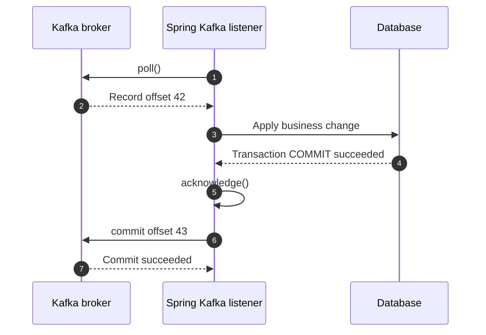
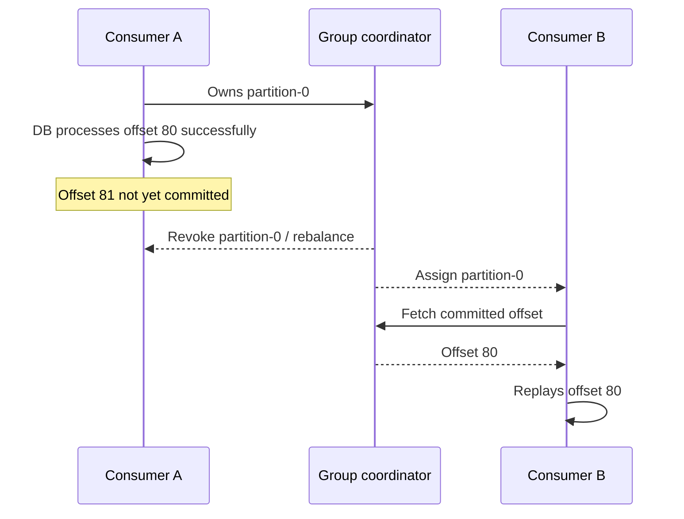

# Offsets, Acknowledgments, and Commit Timing in Apache Kafka

In a Spring Boot application consuming events from Apache Kafka, the key question is not merely *whether a message was read* but also *whether processing finished, how far progress can be confirmed, and when Kafka actually persists that progress*. The three concepts **offset**, **acknowledge**, and **commit** are closely linked yet not synonymous. Confusing them can cause lost messages, duplicate processing, stalled consumer groups, or reporting "processed" before a database transaction has even committed.

This lesson belongs to the **Apache Kafka** chapter of the **SPRING_BOOT_INTEGRATION** module. The running context is a Spring Boot service receiving order events, persisting outcomes to a database, occasionally publishing follow-up events to another topic, while managing errors, retries, deduplication, and progress observability.

## 1. Learning Outcomes

After this lesson, you will be able to:

1. Distinguish **record offset**, **consumer position**, **committed offset**, and **log end offset** per partition.
2. Explain why consumers commit offset `N + 1` after successfully processing the record at offset `N`.
3. Interpret `enable.auto.commit` and Spring for Apache Kafka `AckMode` options accurately.
4. Choose acknowledgment timing compatible with SQL transactions, HTTP services, caches, outbound Kafka sends, and deduplication strategies.
5. Analyze data-loss or duplicate-processing windows across crashes, retries, rebalances, and commit failures.
6. Design tests, metrics, and runbooks sufficient to prove correct application behavior under real failure scenarios.

## 2. Foundational Model: A Partition Is an Ordered Log

Every Kafka topic consists of one or more **partitions**. Within a partition, the broker assigns monotonically increasing offsets to records. An offset is a record's position in that log, not a unique identifier across the entire topic or system.

Suppose partition `orders.paid-0` contains these records:

```text
Topic: orders.paid, partition: 0

Offset:      40       41       42       43       44
Record:    evt-A    evt-B    evt-C    evt-D    evt-E
           |-------- processed --------| |-- pending --|

Committed offset of group billing-service = 43
Group resume point upon partition assignment = 43
```

In this example, group `billing-service` has recorded progress *up to before offset 43*. The last processed record was offset `42`; offset `43` is the next record to process if the consumer restarts without other changes.

Common misconception:

> **Committing offset 43** means "this group will resume at offset 43"—**not** "record 43 has been processed."

Keep these definitions distinct:

| Term | Meaning | Scope |
|---|---|---|
| **Record offset** | Position of a record in the log, e.g., `42` | One `topic-partition` |
| **Consumer position** | Next offset the active consumer will fetch from the broker; normally advances when `poll()` returns records | One running consumer and an assigned partition |
| **Committed offset** | Next offset persisted by a consumer group to resume upon restart or partition reassignment | One `group.id` + `topic-partition` |
| **Log end offset** | Position immediately after the end of the broker's log, used to measure consumption lag | One `topic-partition` |
| **Acknowledgment** | Spring Kafka-level signal indicating a record or batch was accepted/handled per configured policy | Listener/container |
| **Commit** | Action persisting the group's offset progress to Kafka, typically in the internal `__consumer_offsets` topic | Consumer group |

**There is no "single shared offset" for an entire consumer group.** If a group reads three partitions, it maintains three separate committed offsets. Two records in two different partitions can both have offset `42` while being completely unrelated messages.

### Position Advancing Ahead of Commit Is Normal

Consider a single `poll()` returning offsets `100, 101, 102`:

```text
T0: committed = 100; position = 100
T1: poll() returns [100, 101, 102]
    position may already be 103, even before the app processes any record
T2: record 100 succeeds
T3: record 101 succeeds
T4: commit offset 102
T5: failure processing record 102; container seeks/retries per error handler

If partition ownership is lost after T4:
    new consumer resumes at offset 102
```

Thus, **position exceeding committed offset does not mean processing finished**. Using `consumer.position()` as a substitute for committed offset in business monitoring is wrong.

## 3. Four Milestones of a Single Consumption Cycle

For a message updating SQL, the ideal sequence is:



**Committing the DB transaction** and **committing the Kafka offset** are independent in standard setups. There is always a time gap between them, however brief. If the app crashes after DB commit but before Kafka offset commit, the record can be redelivered. That is why **idempotency** is a practical requirement of *at-least-once* processing.

Conversely, if the app commits the offset *before* business data is durable and crashes, the new consumer skips that record: a **lost-processing** window.

A simple operational rule:

**Consider a record successfully processed only once all required business effects have completed per the application contract.** Only then allow the offset to advance. This reduces the risk of lost work; duplicates must be handled through idempotent design.

## 4. "Acknowledge" Has at Least Two Distinct Meanings

Kafka involves acknowledgment mechanisms on both producer and consumer sides:

| Setting / Action | Actor | What Does It Confirm? |
|---|---|---|
| Producer `acks=0/1/all` | Kafka producer and broker | Durability confirmation when **writing a new message** to the broker |
| Consumer `Acknowledgment.acknowledge()` | Application calling Spring Kafka API | Signals the **listener container** that the message was handled per the chosen ack mode |
| Consumer `commitSync()/commitAsync()` | Kafka consumer or Spring container | Persists the group's **next read position** on the broker |

Producer `acks=all` does not make consumers acknowledge processing. Conversely, calling `ack.acknowledge()` does not write a new message to Kafka and does not commit an SQL transaction.

In Spring Kafka, `acknowledge()` also **does not always trigger an immediate broker commit**. It may only mark the record as processed so the container commits at the end of the poll batch or when a threshold is met. To know the actual commit moment, you must know `AckMode`.

## 5. Two Configuration Layers: Kafka Auto-Commit and Spring Kafka AckMode

The Kafka Java consumer offers:

```properties
enable.auto.commit=true
auto.commit.interval.ms=5000
```

When auto-commit is enabled, the Kafka client periodically persists progress along its poll cycle; this mechanism has no awareness of whether a JDBC transaction, REST call, or file write actually finished. Never rely on auto-commit to guarantee "process first, confirm after" for critical side effects.

Spring Kafka listener containers have their own `AckMode` set. In modern Spring Kafka releases, containers default to setting `enable.auto.commit=false` when unspecified so the container manages commits itself; the container default is typically `AckMode.BATCH`. Always verify your exact version and effective runtime config.

A transparent configuration for a business service:

```yaml
spring:
  kafka:
    bootstrap-servers: localhost:9092
    consumer:
      group-id: billing-service
      enable-auto-commit: false
      auto-offset-reset: earliest
      max-poll-records: 100
    listener:
      ack-mode: manual_immediate
```

In this configuration:

- `enable-auto-commit: false` hands commit control to the listener container.
- `ack-mode: manual_immediate` requires the listener to call `acknowledge()` explicitly; when called on the consumer thread, the container can commit immediately per `syncCommits` settings.
- `max-poll-records` limits the records returned in a single poll to bound processing time; it does not limit total records in the topic.
- `auto-offset-reset: earliest` sets the starting point only **when the group has no valid committed offset** (or the offset has fallen out of retention); it does not "reset the group to the beginning" on every run.

Never enable Kafka auto-commit alongside Spring Kafka manual acknowledgment expecting manual ack to be the sole source of truth. For critical workloads, explicitly set `enable-auto-commit=false` and verify the effective configuration.

## 6. Seven Spring Kafka AckModes

`AckMode` lives in `ContainerProperties` and governs **when the container is eligible to commit offsets** after listener execution. Common modes:

| `AckMode` | Commit Eligibility Point | Key Detail to Remember |
|---|---|---|
| `RECORD` | After the listener succeeds for each record | Easy to reason about; more frequent commits |
| `BATCH` | After all records from a `poll()` complete | Often the default; "batch" means **poll batch**, even with a record listener |
| `TIME` | Every `ackTime` after records are processed | Checked within the container loop, not an absolute wall-clock timer |
| `COUNT` | After `ackCount` processed records | Trades larger replay window for performance |
| `COUNT_TIME` | When either `ackCount` **or** `ackTime` is reached | Combines count and time thresholds |
| `MANUAL` | Listener calls `acknowledge()`; container commits on a `BATCH`-like boundary | Calling ack does not mean immediate broker commit |
| `MANUAL_IMMEDIATE` | Listener calls `acknowledge()`; commits immediately when invoked on the **consumer thread** | Convenient for acking right after a specific business operation |

Note two important distinctions:

1. A **record listener** (`@KafkaListener` receiving one record at a time) can still run under `AckMode.BATCH`. The container invokes the listener per record but commits only after all records from the poll finish, not after each invocation.
2. A **batch listener** (`@KafkaListener` receiving a `List` of records) describes the listener's input shape; it does not automatically equate to `AckMode.BATCH`.

With `TIME`/`COUNT`/`COUNT_TIME`, commits still depend on container loop progress. If a listener hangs for a long time, setting `ackTime=5s` does not spawn a background thread committing every five seconds.

### Comparing RECORD, BATCH, MANUAL, and MANUAL_IMMEDIATE

Suppose a `poll()` returns three consecutive records:

```text
poll() -> [10, 11, 12]

RECORD:
  process 10 -> eligible to commit 11
  process 11 -> eligible to commit 12
  process 12 -> eligible to commit 13

BATCH:
  process 10, 11, 12 successfully -> eligible to commit 13

MANUAL:
  process 10 -> acknowledge()
  process 11 -> acknowledge()
  process 12 -> acknowledge()
  container batches and commits at the poll-processing boundary

MANUAL_IMMEDIATE (ack on consumer thread):
  process 10 -> acknowledge() -> may commit 11 immediately
  process 11 -> acknowledge() -> may commit 12 immediately
  process 12 -> acknowledge() -> may commit 13 immediately
```

This is an idealized diagram to clarify **commit boundaries**. Error handlers, transactions, async acks, rebalances, and commit settings can alter exact commit timing.

### When to Choose Each Mode?

| Scenario | Starting Choice | Reason |
|---|---|---|
| Independent records; listener returns only when finished | `RECORD` | Easy-to-observe processing/commit relationship |
| High-rate fast messages; replaying the tail of a poll is acceptable | `BATCH` | Lower commit overhead |
| Explicit ack required right after each SQL transaction | `MANUAL_IMMEDIATE` | Confirms right after the transactional service returns cleanly |
| Defer confirmation until business conditions are met without per-record commits | `MANUAL` | Explicit ack control with batched commits |
| High-volume idempotent workload tuning commit frequency | `COUNT_TIME` | Threshold-based optimization; measure in practice |

No mode automatically provides exactly-once across JDBC, HTTP, or external partners. Offset commit timing must always be paired with matching deduplication.

## 7. Spring Boot Example: Ack After SQL Transaction Commit

Suppose `billing-service` consumes `OrderPaidEvent` and marks orders paid. Each message carries an immutable `eventId`, distinct from `orderId`: one order can emit multiple valid events.

### 7.1. Separating the Listener and Transactional Service

```java
import org.springframework.kafka.annotation.KafkaListener;
import org.springframework.kafka.support.Acknowledgment;
import org.springframework.stereotype.Component;

@Component
public class OrderPaidListener {

    private final BillingService billingService;

    public OrderPaidListener(BillingService billingService) {
        this.billingService = billingService;
    }

    @KafkaListener(topics = "orders.paid", groupId = "billing-service")
    public void handle(OrderPaidEvent event, Acknowledgment ack) {
        billingService.applyPayment(event);
        // Reaches here only after the transaction in BillingService commits.
        ack.acknowledge();
    }
}
```

This example assumes serializers/deserializers or message converters map payloads into `OrderPaidEvent`. Illustrative DTO:

```java
public record OrderPaidEvent(
        String eventId,
        String orderId
) {}
```

### 7.2. Idempotency via Unique Key and a Single Transaction

In PostgreSQL, create an inbox table to track completed events per business consumer:

```sql
CREATE TABLE processed_kafka_events (
    consumer_name VARCHAR(100) NOT NULL,
    event_id       VARCHAR(150) NOT NULL,
    processed_at   TIMESTAMPTZ NOT NULL DEFAULT NOW(),
    PRIMARY KEY (consumer_name, event_id)
);
```

The service performs **deduplication recording and business update in the same transaction**:

```java
import org.springframework.jdbc.core.JdbcTemplate;
import org.springframework.stereotype.Service;
import org.springframework.transaction.annotation.Transactional;

@Service
public class BillingService {

    private final JdbcTemplate jdbc;

    public BillingService(JdbcTemplate jdbc) {
        this.jdbc = jdbc;
    }

    @Transactional
    public void applyPayment(OrderPaidEvent event) {
        int inserted = jdbc.update("""
            INSERT INTO processed_kafka_events (consumer_name, event_id)
            VALUES (?, ?)
            ON CONFLICT DO NOTHING
            """, "billing-service", event.eventId());

        if (inserted == 0) {
            // Event was already processed and committed previously.
            return;
        }

        int updated = jdbc.update(
            "UPDATE orders SET paid = TRUE WHERE order_id = ?",
            event.orderId()
        );

        if (updated != 1) {
            throw new IllegalStateException(
                "Order not found or unexpected update count: " + event.orderId()
            );
        }
    }
}
```

This code illustrates **transaction and deduplication boundaries** and should be adapted to your schema. Non-PostgreSQL databases require replacing `ON CONFLICT DO NOTHING` with equivalent syntax; domains permitting multiple valid changes per order require matching update rules.

Critical requirements:

1. `billingService.applyPayment(...)` goes through a Spring proxy on **another bean**, so `@Transactional` commits before the method returns normally.
2. If any SQL statement fails and rolls back, the inbox marker rolls back too. The listener propagates the exception to the container; **it does not ack**.
3. If the same event is redelivered, the unique key confirms it was already processed; the service returns cleanly, and the listener acks the current offset.
4. The dedup key must align with the **business event**. Checking `existsById` and inserting separately without a unique constraint introduces race conditions under concurrency/retries.

### 7.3. The Trap of Putting `@Transactional` Directly on the Listener

The following snippet is **unsafe in ordering** when used with immediate ack:

```java
// Example showing a design flaw.
@Transactional
@KafkaListener(topics = "orders.paid")
public void wrong(OrderPaidEvent event, Acknowledgment ack) {
    repository.save(...);
    ack.acknowledge(); // The enclosing transaction may NOT have committed yet!
}
```

With standard Spring transactions, the interceptor commits **after the method returns**. If the offset commits when `acknowledge()` is called and the DB commit subsequently fails, the consumer group skips the event even though business data was never persisted.

Separating the listener from the transactional service as shown earlier keeps the boundary verifiable. If using specialized transaction synchronization or a Kafka transaction manager, verify actual commit order rather than inferring it from annotations.

## 8. Crash Analysis Table: When Do Replays or Data Loss Occur?

Suppose record `K` triggers database effect `E`, and committing offset `K+1` is action `C`.

| Failure Point | Effect `E` State | Commit `C` State | Outcome After Restart |
|---|---|---|---|
| Before processing starts | Absent | Absent | Record is re-read; normal |
| Mid-processing, transaction rolls back | Not persisted | Absent | Re-read for retry |
| **After DB commit, before Kafka commit** | **Present** | **Absent** | **Record re-read; idempotency required** |
| After Kafka commit succeeds | Present | Present | Resumes from next record |
| **Kafka commit before DB commit, then crash/rollback** | **Absent** | **Present** | **Record skipped; lost processing** |
| Kafka commit times out; broker state unknown | Present or absent | Uncertain | Must tolerate replay idempotently |

Concrete timeline:

```text
Record offset 714: order-881 paid

10:00:00.100  DB COMMIT: orders.paid = true
10:00:00.110  Process killed before Kafka commit
10:00:05.000  Another consumer receives partition
10:00:05.020  Re-reads offset 714
10:00:05.030  Inbox finds existing eventId -> skips duplicate business write
10:00:05.040  Commits offset 715
```

This is how **at-least-once + idempotent consumer** achieves reliable business outcomes. At-least-once describes message delivery; it never claims side effects happen once automatically.

## 9. Offset Commit Is a "Contiguous High-Water Mark," Not a Sparse List

Because a committed offset specifies a **single resume point**, it cannot express "processed `100` and `102` but not `101`" with one number.

```text
Partition 1:
Offset          100       101       102       103
Processed        ✓         ✗         ✓        pending

If 103 is committed, a new consumer skips 101.
The only safe committed offset here is 101.
```

With parallel or async processing, you may only commit once every prior offset on the same partition has finished per contract. Never blindly commit `max(processedOffset) + 1`.

Spring Kafka provides `asyncAcks` for certain out-of-order manual acknowledgment scenarios: the container tracks ack gaps, defers committing past a gap, and may pause fetching new records until missing acks arrive. This adds tracking complexity for stalled tasks and widens replay windows; never enable it merely to paper over flawed parallelization.

Visual example:

```text
ack(100)  -> can advance to 101
ack(102)  -> 101 still missing; cannot commit 103 yet
ack(101)  -> now safe to advance to 103
```

If using `asyncAcks`, check your Spring Kafka version and container config; `nack()` cannot be combined with out-of-order commits in Spring Kafka. Keeping per-partition processing sequential or offloading to a durable stateful workflow is usually simpler.

## 10. Batch Processing, Multiple Partitions, and Partial Acknowledgment

A single poll can return records from **multiple partitions**:

```text
poll()
  orders.paid-0:  [20, 21]
  orders.paid-1:  [75, 76, 77]
```

Committed offsets are stored separately:

```text
group=billing-service, orders.paid-0 -> 22
group=billing-service, orders.paid-1 -> 78
```

Ordering constraints apply **within each partition**. Two partitions can progress at different speeds. Never track a single global offset variable across partitions.

In a batch listener, calling `acknowledge()` normally marks the whole batch accepted per container policy. Newer Spring Kafka releases support **partial batch acknowledgment** via `acknowledge(index)` under specific conditions such as `MANUAL_IMMEDIATE` and record-list listeners; use this only after verifying your exact API/version and monotonically increasing index rules. Never assume identical behavior across versions.

When a record mid-batch fails, pick an explicit policy:

- **Retry the unprocessed tail:** let the error handler seek to the failing record and avoid acking the whole batch blindly.
- **Route the failing record to a DLT:** treat that record as resolved only after recovery satisfies policy (e.g., DLT send succeeded); only then allow offsets to advance.
- **Intentional skip:** apply only if the business contract allows it with an audit trail; ensure transient errors do not turn into silent data loss.

## 11. Synchronous vs. Asynchronous Commits

At the Kafka client layer, there are two main APIs:

```java
consumer.commitSync();   // Blocks for commit result or throws exception.
consumer.commitAsync();  // Non-blocking; reports result via callback.
```

Inside a listener container, calling `acknowledge()` **does not require** calling those APIs directly. Spring Kafka handles commits according to `AckMode` and container settings. The container property `syncCommits` controls commit behavior; the common default is synchronous (`true`).

| Property | `commitSync` | `commitAsync` |
|---|---|---|
| Thread waits for broker confirmation | Yes | Not blocking per commit |
| Listener latency impact | Can rise with frequent commits | Typically lower |
| Result handling | Returns or throws on timeout | Reports via callback |
| Risks to handle | Timeouts, commit failures, rebalances | Callback errors, late/out-of-order commits, lack of monitoring |
| Best suited for | Clear commit checkpoints | High throughput with well-tested failure/replay handling |

Java configuration if setting explicitly:

```java
factory.getContainerProperties().setSyncCommits(true);
```

Here `factory` is your configured `ConcurrentKafkaListenerContainerFactory`. Do not rush to async commits just chasing throughput; measure business processing time, poll sizes, DB costs, and partition counts first. With async commits, monitor failed callbacks and accept replay possibilities; never blindly retry an older failed commit after a newer offset has already succeeded.

### Never Swallow `CommitFailedException`

Suppose a consumer loses partition ownership during a rebalance: the old instance's commit may fail. Never log and assume "the message finished so it won't be read again." The safe assumption is **the offset may not be saved**, the record can be redelivered, and processing must be idempotent.

## 12. Error Handlers: Throwing an Exception Is Different from Omitting Ack

In a listener using manual ack, on failure:

```java
@KafkaListener(topics = "orders.paid")
public void onMessage(OrderPaidEvent event, Acknowledgment ack) {
    billingService.applyPayment(event); // fails -> exception escapes
    ack.acknowledge();                   // runs only on success
}
```

**Never catch every exception and return normally without acking** expecting Kafka to immediately redeliver. The Kafka client position may already have moved past the record; unless the container seeks, retries, or recovers per error-handler policy, the record may not be re-read during the current consumer session.

Common mistake:

```java
try {
    callExternalSystem(event);
} catch (Exception ex) {
    log.warn("Processing error", ex);
    // Wrong if swallowed and listener returns as if processing succeeded.
}
ack.acknowledge();
```

Instead, let the exception propagate to `DefaultErrorHandler` or the project's chosen error-handling mechanism.

### Intentional Retry and DLT

An example using `DefaultErrorHandler` and `DeadLetterPublishingRecoverer`:

```java
import org.apache.kafka.common.TopicPartition;
import org.springframework.context.annotation.Bean;
import org.springframework.context.annotation.Configuration;
import org.springframework.kafka.core.KafkaTemplate;
import org.springframework.kafka.listener.DeadLetterPublishingRecoverer;
import org.springframework.kafka.listener.DefaultErrorHandler;
import org.springframework.util.backoff.FixedBackOff;

@Bean
DefaultErrorHandler kafkaErrorHandler(KafkaTemplate<Object, Object> template) {
    var recoverer = new DeadLetterPublishingRecoverer(
        template,
        (record, exception) ->
            new TopicPartition(record.topic() + ".DLT", record.partition())
    );

    var handler = new DefaultErrorHandler(
        recoverer,
        new FixedBackOff(1_000L, 2L)
    );

    // With MANUAL_IMMEDIATE, allow committing recovered offsets
    // per DefaultErrorHandler mechanics.
    handler.setCommitRecovered(true);
    return handler;
}
```

This example targets a listener configuration using `MANUAL_IMMEDIATE`; exact retry counts follow the `BackOff` semantics of your version. Use short retries for transient errors and DLTs for records that cannot succeed immediately. The DLT topic here must have matching partitions; the DLT producer's serializer must handle both valid value types and deserialization failure bytes if configured.

Distinguish three outcomes:

1. **Listener succeeds:** listener acks and offset commits per `AckMode`.
2. **Listener throws, retries remain:** error handler preserves/resets the read position for retry; not treated as completed.
3. **Recovery succeeds per contract:** DLT/skip is treated as terminal for the failing record and the offset can advance; verify `commitRecovered` settings.

If writing to the DLT fails, the system must treat the original record as unrecovered—never silently commit and lose both the record and error context. Verify DLT producer setup, send error reporting, and recovery policies in your library version.

### When Is `nack()` Appropriate?

In Spring Kafka versions supporting it, `Acknowledgment.nack(...)` tells the container to reject progress for the current record so unprocessed items are redelivered via seek/pause mechanics. Record listener example:

```java
// Illustrative only for versions supporting this API.
ack.nack(java.time.Duration.ofSeconds(2));
```

`nack` carries key constraints:

- Must typically be called on the **consumer thread** under a compatible manual `AckMode`.
- Can pause/seek and replay remaining unprocessed records from the poll.
- Does not replace DLTs, error classification, or idempotency.
- Cannot be combined with out-of-order `asyncAcks`.

In most Spring Boot business flows, **throwing exceptions for the error handler to manage retries/DLT** is easier to reason about than scattering `nack()` calls across listeners.

## 13. Rebalances: Commits Are Tied to Partition Ownership

A partition belongs to only one consumer in a consumer group at a time, yet ownership changes when:

- Group instances scale up or down.
- A consumer crashes or misses heartbeats.
- A listener takes too long and exceeds `max.poll.interval.ms`.
- Topic partition counts or group configs change.
- The broker/group coordinator triggers rebalancing.



Even after A wrote to the DB, B must still be able to handle record `80` again. Attempting to "commit on revoke" reduces replays but cannot eliminate network/crash windows. The proper solution remains **idempotent processing**.

### `max.poll.interval.ms`, `max.poll.records`, and Processing Duration

A Kafka consumer must continue calling `poll()` within `max.poll.interval.ms`. When a listener blocks too long, the group treats the consumer as stalled and reassigns its partitions; in-flight messages may then be re-read by another consumer.

Example:

```text
max.poll.records = 500
Worst-case processing time / record = 400 ms
Max sequential processing time ~= 500 * 400 ms = 200 seconds
max.poll.interval.ms = 180 seconds
```

In the worst case, the next poll arrives too late. This is a rough boundary estimate; real systems also incur container overhead, retries, GC, and transactions. Prefer reducing records per poll, lowering downstream latency, or redesigning long tasks; raise the timeout only after understanding consumer behavior.

Do not keep a slow record hanging indefinitely simply by cranking `max.poll.interval.ms` very high; that delays failure detection and recovery when a consumer truly wedges.

## 14. Consumer Threads, Concurrency, and Async Acks

Spring Kafka listeners normally execute on the consumer container thread. Key safety rules:

1. **`KafkaConsumer` is not thread-safe.** Never pass the raw consumer instance to a worker pool for concurrent `poll/seek/commit` calls.
2. With `MANUAL_IMMEDIATE`, calling `ack.acknowledge()` on the consumer thread triggers immediate commits per config. Calling from another thread queues the ack for later handling; avoid mixing both styles in one app.
3. If a listener dispatches async work and **returns immediately**, never assume the container waits for that `CompletableFuture`; use your version's async listener/ack support or decouple work with durable progress tracking.
4. If processing concurrently within **the same partition**, track contiguous offset completion; a slow earlier record can block commits for faster later records.
5. Raising listener container `concurrency` parallelizes **across assigned partitions**, capped by available partitions for the group. Adding threads does not create independent offset streams within one partition.

An operable pattern for ordered events: partition by business key (`orderId`), process each partition sequentially, apply bounded retries, and enforce DB idempotency.

If slow asynchronous outbound APIs are unavoidable, consider decoupling into a state machine/outbox with a durable job ID before acking the input record. Acking once work is **durably persisted** can be valid when the consumption contract only requires durable intake while completion is tracked separately.

## 15. Exactly-Once: What Kafka Guarantees vs. What It Does Not

Kafka provides transactions to support **read from Kafka → process → write to Kafka** pipelines, folding consumed offsets into the same Kafka transaction. When configured properly, output records and input offset progress commit or abort together within Kafka.

Example flow:

```text
orders.paid (input)
   -> Kafka listener (transaction)
   -> invoices.requested (output)
   -> commit input offsets in the same Kafka transaction
```

Typical prerequisites:

- Producer has a `transactional.id` (commonly set via `spring.kafka.producer.transaction-id-prefix` in Spring Boot).
- The listener container is configured with the matching Kafka transaction manager/transaction mechanism for your version.
- Input offsets are attached to the transaction before the Kafka transaction commits.
- Downstream consumers use `isolation.level=read_committed` when the contract requires skipping aborted records.

Configuration outline:

```yaml
spring:
  kafka:
    producer:
      transaction-id-prefix: billing-tx-
    consumer:
      enable-auto-commit: false
      properties:
        isolation.level: read_committed
```

This configuration **illustrates only the related properties**; production setups must verify the transaction manager, container factory, producer factory, transaction timeout, and error handlers for your exact Spring Boot/Spring Kafka version. When the container manages Kafka transactions, offset commits happen via the container transaction; never mix manual ack code from JDBC examples without verifying interaction order.

What Kafka transactions **do not automatically guarantee**:

| Flow | Covered by Kafka EOS Alone? | What Else Is Needed |
|---|---|---|
| Kafka input → Kafka output in same tx | Possible when configured properly | Transactional producer + committed offsets + `read_committed` |
| Kafka input → SQL database | **No** | Inbox/unique keys/idempotency, DB transactions |
| Kafka input → third-party REST API | **No** | Idempotency keys, dedup-capable API, controlled retries |
| Kafka input → sending email/payments | **No** | State machine, outbox, unique operation IDs, reconciliation |
| SQL update + Kafka output | **Not automatically atomic across both** | Transactional outbox or suitable consistency pattern |

Two separate transactions—one in a database and one in Kafka—do not form a single atomic distributed transaction. One committing before the other fails still creates an inconsistency window; outboxes or compensating workflows address this depending on requirements.

## 16. Offset Commits When Calling HTTP, Caches, or External Services

Not every "success" is an SQL transaction.

### 16.1. Synchronous HTTP Calls

If the contract requires the target service to have received and executed the action, ack only after a successful response **whose semantics you understand**. An HTTP 200 might only mean "accepted for async processing"; if so, track completion asynchronously.

Send `Idempotency-Key: <eventId>` if the API supports it. Retrying after a timeout can otherwise duplicate actions that already succeeded on the server before the response dropped.

### 16.2. Caches

If a cache holds derived, rebuildable data, cache writes do not always have to gate acks: define the source of truth and cache recovery strategy. If the cache is business-critical state, failures there must determine whether to acknowledge.

### 16.3. Forwarding Events

If a listener reads input, calls `KafkaTemplate.send()` asynchronously, and acks immediately, enqueuing the send **does not mean the broker persisted it**. Wait for confirmation appropriately or use a Kafka transaction if binding outputs to input offsets.

### 16.4. Multiple Side Effects

If one record writes SQL and calls an external partner, "ack after the last step" still fails when SQL commits and the partner times out. Use a durable stateful model (outbox/saga/retry task) so each side effect has an independent identifier and status.

## 17. Resetting Offsets, Seeking, and Intentional Replays

`auto.offset.reset` is frequently misunderstood:

```yaml
spring:
  kafka:
    consumer:
      auto-offset-reset: earliest
```

Setting `earliest` **does not** force a group with committed offsets to re-read from the start. Kafka applies the reset policy only when no valid committed offset exists for a partition; common values are `earliest`, `latest`, and `none`.

For intentional replays, options depend on intent:

| Goal | Approach | What to Verify |
|---|---|---|
| Independent testing | Create a new `group.id` | May consume all retained data per `auto-offset-reset` |
| Recovering a production group | Stop active consumers, then use admin consumer-group tools to reset offsets | Ensure zero active members remain; audit scope and time window |
| Replaying an offset range in-app | `seek`/`ConsumerSeekAware` per version and lifecycle | Partition ownership, ordering, idempotency |
| Replaying messages parked in a DLT | Controlled DLT reprocessing pipeline | Root cause fixed, deduplication active |

Never reset a production group just to "retry one record" if doing so replays millions of subsequent events. A seek/reset can also trigger business side effects; verify idempotency and record who executed it and over which offset range.

## 18. Lag: How Far Has the Group Received vs. Processed?

In consumer group monitoring, "committed lag" is commonly approximated as:

\[
\text{lag}_{partition}
= \text{logEndOffset}_{partition}
- \text{committedOffset}_{group,partition}
\]

For example, if log end offset is `1_000` and committed offset is `960`, committed lag is `40` records. Two caveats:

1. High lag may stem from slow listeners, infrequent commits, or paused consumers; it alone does not prove the service is deadlocked.
2. Client metrics like Kafka consumer `records-lag-max` may measure fetch/consumer position rather than group committed offsets. Never swap the two lag types without reading the metric and exporter definitions.

With Kafka transactions and `read_committed`, Last Stable Offset boundaries and open transactions introduce additional nuances in end-offset lag calculations.

### What to Measure Together

| Metric / Signal | Question Answered | Warning Sign |
|---|---|---|
| Committed group lag per partition | How far behind is the group? | Continuously climbing lag |
| Successful processing rate | Is business progress occurring? | Input rises while successes flatline |
| Processing latency p95/p99 | How long does one record take? | Multiplied by batch size approaches `max.poll.interval.ms` |
| Commit latency / failures | Is the broker persisting progress? | Commit timeouts, retries, repeated rebalances |
| Retry count, DLT count | How many records are failing? | One key failing in an endless loop |
| Message age at completion | How stale is data reaching users? | Timestamp lag grows even with small commit lag |
| Inbox duplicate hits | Are replays/duplicates occurring? | Sudden spike after deploys/rebalances |
| Rebalance count and partition assignment | Are instances holding partitions steadily? | Excessive rebalances |

**Low committed lag does not prove all business effects succeeded.** If a listener acks early or swallows exceptions, lag can sit near 0 while DB state is wrong.

## 19. Optimizing Throughput Without Sacrificing Correctness

Tuning knobs interact closely:

- **`max.poll.records`:** decrease when a single poll takes too long; increase when operations are fast and proven idempotent.
- **`concurrency` and partition count:** scale with partitions and actual load; adding consumers beyond partition count adds no active readers.
- **AckMode:** `RECORD` or `MANUAL_IMMEDIATE` limits replay windows at the cost of more commits; `BATCH`/`COUNT_TIME` reduces commits while widening crash replay windows.
- **`syncCommits`:** synchronous commits are easier to reason about, though frequent commits add latency; async commits require callback handling and replay tolerance.
- **DB batching:** when writes are independent/compatible, consider SQL batching or chunked designs with explicit transactions and idempotency.
- **Transient failures:** retry with backoff to protect downstream services; avoid tight retry loops.
- **DLT:** never treat routing to a DLT as "business success"; it is an error branch requiring alerts, ownership, and a replay procedure.

Start with a verifiable configuration, measure latency/lag and failure behavior, and only then increase batching or switch to async commits.

## 20. Testing Commit Ordering and Duplicate Handling

Unit tests asserting that a listener calls `acknowledge()` do not prove crash resilience. Write integration tests against a real broker or Testcontainers/EmbeddedKafka (matching your version) plus a real test database to verify **outcomes after restarts or rebalances**.

Minimum test matrix:

| Scenario | How to Inject Fault | What to Observe |
|---|---|---|
| Happy path | Send `eventId=A`; listener commits DB and acks | DB updated; group committed offset advances |
| Crash after DB commit, before Kafka commit | Inject test hook/fault right between the two steps | Record replays; DB is not updated twice |
| DB transaction rollback | SQL throws exception | Inbox marker rolls back, offset stays uncommitted; retry works |
| Duplicate payload | Send same `eventId=A` at two distinct Kafka offsets | Each record processes/acks cleanly while business effect happens once |
| Retries exhausted | Force unrecoverable failure | DLT receives record per contract; offset advances only after recovery |
| DLT producer failure | Block topic or force producer error | Original record not lost; alert/error surfaced |
| Rebalance mid-processing | Stop/kill partition-owning instance | New instance resumes from committed offset with correct state |
| Poll interval exceeded | Inject delay beyond configured threshold | Rebalance observed; no duplicate side effects |
| Out-of-order async ack | Complete offset `n+1` before `n` | Commit never jumps past the gap |

### State-Milestone Test Scenario Example

```text
Given:
  DB has no eventId=evt-900
  Group committed offset is 90
  Offset 90 contains evt-900

When:
  Consumer A processes evt-900 -> DB commits
  Kill Consumer A before Kafka commit
  Consumer B receives the partition

Then:
  Consumer B re-reads offset 90
  Only 1 evt-900 marker exists
  orders state reflects the business effect exactly once
  Group subsequently commits offset 91
```

Never sleep a fixed time and assume a test passed. Poll concrete state with a timeout, inspecting committed offsets, business effect counts, and DLT state. Fault-injection tests must distinguish kills **before** vs. **after** broker commits to avoid false conclusions.

## 21. Runbook for Offset and Commit Incidents

When a consumer group shows rising lag or unexpected replays:

1. **Pinpoint coordinates:** `group.id`, `topic`, `partition`, committed offset, log end offset, live consumer count, and current assignments.
2. **Inspect listener errors:** identify business errors, DB/HTTP timeouts, deserialization errors, error handler behavior, or commit failures—do not stare only at lag.
3. **Check rebalances/polling:** look for `max.poll.interval.ms` violations, pod restarts, paused containers, or shifting partition assignments.
4. **Verify business evidence:** cross-check `eventId` in the inbox, DB rows, external transaction states, traces, and DLTs before deciding to replay.
5. **Apply minimal remediation:** fix data/mapping bugs, restore downstream capacity, enable controlled retries, replay DLT records, or reset an approved offset range.
6. **Verify post-fix:** processing rate rises, committed lag drops, zero duplicate side effects occur, and no failed messages are left unattended.

Example Kafka CLI diagnostic command (paths/tools vary by environment):

```bash
kafka-consumer-groups.sh \
  --bootstrap-server localhost:9092 \
  --describe \
  --group billing-service
```

Output typically includes `TOPIC`, `PARTITION`, `CURRENT-OFFSET`, `LOG-END-OFFSET`, and `LAG`. Remember these numbers reflect a point-in-time snapshot relative to business progress and shift continuously while consumers run.

## 22. Common Design Mistakes and Fixes

| Mistake | Why Dangerous | Fix |
|---|---|---|
| Assuming `poll()` returning a record means it is processed | Position can advance before listener finishes | Separate position from commit; monitor acks and business success |
| Calling ack before SQL commit | Crash after ack skips an unpersisted record | Ack only after the transactional service returns cleanly |
| Calling ack in a `finally` block | Even failed records get marked complete | Ack only on the success branch; throw exceptions on failure |
| Catching exceptions and returning normally | Container treats listener as succeeded or advances poll | Use error handlers, retries, and explicit seeks |
| Relying solely on `enable.auto.commit=true` | Auto-commit ignores business durability | Disable auto-commit; let the container manage commits |
| Assuming `MANUAL` commits immediately | Acks may wait until poll boundary | Choose `MANUAL_IMMEDIATE` when needed and mind consumer threads |
| Committing `max(processedOffset)+1` in parallel mode | Skips earlier unfinished offsets on the partition | Commit only contiguous completed ranges; track per partition |
| Missing unique key on inbox | Race conditions and duplicate side effects | Atomic insert/constraint in the same DB transaction |
| Calling `KafkaTemplate.send()` and acking before checking outcome | Outbound record may not be persisted by broker | Await send outcome or use transactions/outbox |
| Thinking `earliest` always re-reads from start | Valid committed offsets take precedence | Use controlled resets or a fresh group ID |
| Judging health solely from consumer lag | Early acks hide lost work | Track business successes, deduplication, retries, and commit failures |

## 23. Case Study Exercises

**Scenario A — Replay after restart.** A topic has offsets `50..54`. The consumer committed offset `50`, successfully committed DB updates for `50` and `51`, then crashed before the next commit. After restart, where does the consumer resume, which messages can replay, and what prevents charging twice?

*Solution outline:* resumes at committed offset `50`; both `50` and `51` can replay. An inbox unique key or idempotency key inside the same transaction as the balance update prevents duplicate side effects.

**Scenario B — Ack and transaction.** A listener has `@Transactional`, executes SQL, and calls `ack.acknowledge()` before returning. The DB fails at commit time. What is the worst-case state?

*Solution outline:* the Kafka offset may already be committed before the DB transaction rolls back; the group skips the record while DB data is absent. Move DB work into a separate transactional service so ack runs after commit, or use a verified specialized transaction design.

**Scenario C — Parallel processing.** A worker pool processes offsets `200`, `201`, `202`; `202` finishes first while `201` fails. Should `203` be committed?

*Solution outline:* no; committed offsets may advance only across a **contiguous** completed prefix. `201` must be resolved/recovered before committing past it.

**Scenario D — Low lag yet missing invoices.** Dashboard shows `lag=0`; the listener calls `kafkaTemplate.send(...)` and immediately acks. Some invoices never appear on the destination topic. What should you inspect?

*Solution outline:* inspect async send results, callback failures, serializers, broker timeouts, and transaction boundaries; calling `send` does not mean output committed. For Kafka-to-Kafka pipelines, consider transactional processing and `read_committed`.

**Scenario E — DLT holds many failed messages.** Operations wants to reset the entire group to `earliest` to retry. What is the risk?

*Solution outline:* replays already-succeeded messages, spikes load, and risks duplicate side effects; instead fix the root cause, verify idempotency, and run targeted replays from the DLT or an audited offset range.

## 24. Pre-Production Consumer Checklist

- [ ] Group ID, topic, partition strategy, and event format are explicitly documented.
- [ ] `enable.auto.commit=false` and `AckMode` are chosen deliberately.
- [ ] Documentation specifies **which exact business condition** permits acking.
- [ ] For DBs, ack occurs after transaction commit; a deduplication key shares that transaction.
- [ ] For HTTP/external partners, idempotency keys or durable job states exist.
- [ ] Bounded retries, backoff, and DLTs have owners, alerts, and replay runbooks.
- [ ] Async/parallel handlers never commit past offset gaps.
- [ ] `max.poll.interval.ms` accommodates worst-case single-poll processing duration.
- [ ] Commit failures, rebalances, per-partition lag, latency, and business successes are monitored.
- [ ] Tests cover crashes between business commit and Kafka commit, duplicates, and DLT failures.
- [ ] Safe incident diagnostic and offset-reset procedures are documented.

## 25. Summary

Offset answers **"where is this record in the log?"** Consumer position answers **"where will the active consumer fetch next?"** Committed offset answers **"where can the group resume if the current consumer is lost?"** Acknowledgment signals completion from the application to Spring Kafka; when the broker actually persists the commit still depends on `AckMode`, threads, transactions, error handlers, and commit mode.

In Spring Boot integrations pairing Kafka with SQL, the verifiable baseline is **idempotent business transaction → transaction commit succeeds → acknowledge → Kafka commits offset**. While crashes can still replay records, duplicates are handled intentionally. Evaluate every optimization—batching, async acks, or Kafka transactions—by the same standard: **never skip work silently, know when replays happen, and prove business outcomes remain accurate**.
