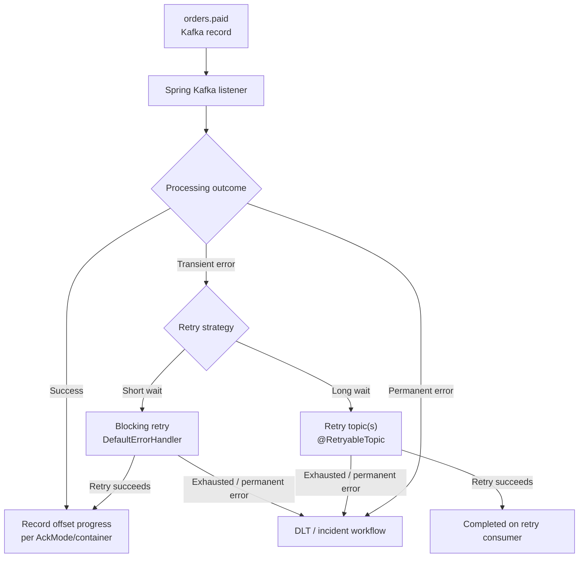
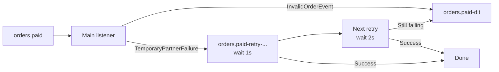

# Handling Errors, Retry Topics, or Dead-Letter Topics as Needed

## 1. Problem in a Spring Boot Integration Flow

In the **SPRING_BOOT_INTEGRATION** module, Apache Kafka serves as an asynchronous bridge between Spring Boot and databases, HTTP services, caches, and other business systems. A Kafka consumer reads an event, validates the data contract, processes business logic, and may call an external API or update a database. Any step along that chain can fail.

For example, topic `orders.paid` receives a confirmed payment event. The consumer must validate the payload, persist order status, and call a shipping-authorization service. Three completely different failures can occur:

1. The external service returns HTTP 503 for a few seconds: a **transient error** worth retrying.
2. The payload is missing `orderId` or fails schema decoding: a **data error** where retrying the exact same payload rarely helps.
3. The event is valid yet violates a business invariant—such as a mismatched payment reconciliation: requires **investigation**, neither silently skipped nor retried forever.

If every exception is retried infinitely, a *poison pill* stalls the partition. If every exception jumps straight to a dead-letter topic on the first failure, the system loses resilience against brief network blips. Thus, **retries and dead-letter topics are combined business and technical decisions**, not just two annotations.

The goal of this lesson is to choose among these strategies, implement them with Spring for Apache Kafka, and verify their consequences on ordering, offsets, idempotency, and operations:

- **Blocking retry** inside the listener container using `DefaultErrorHandler`.
- **Non-blocking retry** via retry topics, typically declared with `@RetryableTopic`.
- **Dead-letter topic (DLT)** to isolate unprocessable messages for investigation and replay.
- **Controlled stopping or isolation** when subsequent records must not proceed after a prior failure.

## 2. What Actually Happens When a Consumer Fails?

A Kafka record carries locating metadata: `topic`, `partition`, `offset`, `key`, `timestamp`, headers, and payload. Within a consumer group, each partition is assigned to one consumer at a time. Kafka guarantees **offset ordering per partition**, without guaranteeing global order across partitions.

When a listener throws an exception, the outcome depends on `CommonErrorHandler` configuration, ack/offset-commit mode, transactions, and container behavior. Spring Kafka can re-invoke the listener for the record, forward the record to another topic, or mark the record recovered and move on to later records.



**A crucial point:** committing an offset does not make a database transaction or HTTP side effect atomic with the offset. When an app crashes between **DB commit** and **offset commit**, the record can be re-read. Therefore every retry path needs an **idempotency** strategy.

### Three Concepts Never to Equate

| Concept | Meaning | What Must Not Be Inferred |
|---|---|---|
| Consumer retry | Re-attempting processing of the same record. | Does not guarantee side effects execute only once. |
| Offset commit | Broker records the consumer group's read progress. | Does not commit SQL transactions or HTTP calls. |
| Dead-letter topic | A failing record is published to an isolated topic for investigation. | Does not mean the incident is resolved or someone is monitoring the DLT. |

## 3. Classify Errors Before Picking a Mechanism

Never catch all exceptions and return normally: swallowing errors tricks the container into treating the record as processed. Conversely, not every exception deserves a retry.

| Error Category | Examples | Preferred Handling |
|---|---|---|
| Transient and fast-recovering | Brief HTTP 503, SQL deadlock, momentary connection blip | Bounded blocking retry with backoff and total time cap. |
| Transient requiring longer wait | Partner API rate limit, downstream maintenance lasting minutes | Retry topics with delay/backoff; watch for ordering shifts. |
| Invalid data | Malformed JSON, missing required field, invalid ID format | Attach reason, send to DLT or quarantine; do not loop forever on same payload. |
| Contract/version error | Older consumer hits newer schema, unknown event version | Quarantine, alert, fix compatibility, then replay. |
| Permanent business error | Order belongs to wrong tenant, forbidden state transition | DLT or dedicated business workflow; avoid endless retries. |
| Uncertain state error | Timeout after side-effecting HTTP POST; disconnect during DB commit | Check idempotency and reconcile before retrying. |
| Broad infrastructure outage | Extended DB outage, missing Kafka ACLs, uncreated topic | Circuit breaker / controlled consumption pause and alerting; mass DLT writes can overload things. |

**Never classify solely by HTTP status.** For instance, `409 Conflict` may indicate a permanent error, or that a prior attempt already succeeded. `HTTP 429` should honor `Retry-After` if the target contract permits. A `TimeoutException` after calling a payment API does not prove the API failed to process it; use a stable idempotency key or status lookup.

Clear domain exception types make configuration readable:

```java
public class TemporaryPartnerFailure extends RuntimeException {
    public TemporaryPartnerFailure(String message, Throwable cause) {
        super(message, cause);
    }
}

public class InvalidOrderEvent extends RuntimeException {
    public InvalidOrderEvent(String message) {
        super(message);
    }
}

public class UncertainExternalOutcome extends RuntimeException {
    public UncertainExternalOutcome(String message, Throwable cause) {
        super(message, cause);
    }
}
```

In real projects, split files per project conventions; these classes illustrate classification intent. When frameworks wrap exceptions, check how your Spring Kafka version's classifier traverses exception `cause` chains.

## 4. Choosing Blocking Retry, Retry Topics, or Direct DLT

| Criterion | Blocking Retry (`DefaultErrorHandler`) | Retry Topics (`@RetryableTopic`) | Direct to DLT |
|---|---|---|---|
| Suitable wait window | Short: milliseconds to a few seconds per SLO | Longer: seconds/minutes or multi-tier backoff | Unrecoverable errors |
| Resource impact | Holds partition progress at container; watch poll/liveness | Adds extra topics, consumers, storage, and scheduling | Requires DLT and operational workflow |
| Per-partition/key order | Easier to preserve since failing record isn't skipped | **Can reorder**: later records proceed while failing record moves to retry | Subsequent records continue if recovery succeeds |
| Operational complexity | Simple config, fits brief glitches | More topics, ACLs, retention, and monitoring | Requires triage, ownership, and replay |
| When exhausted | Recoverer can publish to DLT, or fail/stop | Typically routes to DLT per configuration | Investigate, fix, replay; never auto-fixes bad data |

**Pragmatic selection rules:**

1. For brief network glitches where order matters: try **bounded blocking retry** first.
2. When long waits are needed without stalling the main topic: pick **retry topics**, accepting reordering risk.
3. When payloads violate contracts or invariants: **do not retry**—isolate in a DLT.
4. When subsequent records must never overtake a failed one (e.g., strict sequential ledger entries): consider **stopping the partition/consumer for controlled intervention**. Never treat a DLT as permission to skip blindly.

Retry counts and backoffs must reflect **maximum business-tolerable latency**, downstream capacity, and outage duration. No single config fits every topic.

## 5. Blocking Retry with `DefaultErrorHandler`

`DefaultErrorHandler` is Spring Kafka's standard error handler for record listeners. It retries record delivery inside the container and invokes a `ConsumerRecordRecoverer` once attempts are exhausted. For example, if a downstream recovers within seconds, retry twice with a 1-second delay, then route to a DLT.

```java
import org.apache.kafka.common.TopicPartition;
import org.springframework.context.annotation.Bean;
import org.springframework.context.annotation.Configuration;
import org.springframework.kafka.core.KafkaTemplate;
import org.springframework.kafka.listener.CommonErrorHandler;
import org.springframework.kafka.listener.DeadLetterPublishingRecoverer;
import org.springframework.kafka.listener.DefaultErrorHandler;
import org.springframework.util.backoff.FixedBackOff;

@Configuration
public class BlockingKafkaErrorConfiguration {

    @Bean
    public CommonErrorHandler kafkaCommonErrorHandler(
            KafkaTemplate<Object, Object> kafkaTemplate) {

        var recoverer = new DeadLetterPublishingRecoverer(
                kafkaTemplate,
                (record, exception) -> new TopicPartition(
                        record.topic() + ".DLT",
                        record.partition()));

        // 1 initial attempt + up to 2 retries; 1-second delay.
        var errorHandler = new DefaultErrorHandler(
                recoverer,
                new FixedBackOff(1_000L, 2L));

        // Bad data cannot be fixed by retrying the exact same record.
        errorHandler.addNotRetryableExceptions(InvalidOrderEvent.class);
        return errorHandler;
    }
}
```

In a Spring Boot app, a `CommonErrorHandler` bean may be auto-wired into Boot's managed listener container factory depending on version/config. On manually created factories, call `factory.setCommonErrorHandler(errorHandler)`. Verify which factory your listener actually uses; declaring a bean in an unloaded config has no effect.

Notes on routing to a DLT on the same partition:

- The target topic `orders.paid.DLT` must exist with **at least as many partitions as the source topic**, or use another partition-selection strategy.
- The recoverer's producer/template must serialize **actual keys and values**. `KafkaTemplate<Object, Object>` is only a Java signature; compatible serializers must still be configured.
- If publishing to the DLT fails, **do not mark the record recovered**. Test Kafka-unavailable, missing-ACL, and broker-timeout failure paths plus publish confirmation policy.
- Recoverer/handler settings can be tailored to transactions, acks, and containers. Verify offset behavior with integration tests against your real configuration.

### Does Blocking Retry Actually "Block" the Thread?

With short backoffs, the error handler pauses/re-polls and retries, halting progress on the failing partition. Spring Kafka includes backoff variants that pause/resume the container instead of sleeping long periods, mitigating `max.poll.interval.ms` risks. Regardless of sleep vs. pause mechanics, the consumer has **not completed** the failing record and that partition should not advance unconditionally.

Never write `while(true)` loops or long `Thread.sleep` calls inside a listener to retry manually. That hides state from the container, impedes shutdown/rebalances, risks poll timeouts, and increases latency for other records.

### DLT Is Not Part of an SQL Transaction

If a listener writes to a database and fails before offset commit, the record can be redelivered; neither blocking retries nor DLTs ensure single execution of side effects. Use **event IDs/idempotency keys + unique constraints**, clear transaction boundaries, and safe replay.

## 6. Non-Blocking Retry with `@RetryableTopic`

Spring for Apache Kafka supports retrying via separate topics: when the main listener fails, the record is forwarded to a delayed retry topic and re-consumed later. This is called **non-blocking retry** because the main listener does not wait for minutes on one failing record.



Exact topic names depend on suffix settings, retry-topic reuse strategy, and Spring Kafka version; the diagram illustrates logical flow rather than mandatory topic names.

### Listener and DLT Handler Example

```java
import org.apache.kafka.clients.consumer.ConsumerRecord;
import org.springframework.kafka.annotation.DltHandler;
import org.springframework.kafka.annotation.KafkaListener;
import org.springframework.kafka.annotation.RetryableTopic;
import org.springframework.retry.annotation.Backoff;
import org.springframework.stereotype.Component;

@Component
public class PaidOrderListener {
    private final PaidOrderService service;
    private final DltIncidentService incidents;

    public PaidOrderListener(
            PaidOrderService service,
            DltIncidentService incidents) {
        this.service = service;
        this.incidents = incidents;
    }

    @RetryableTopic(
            attempts = "4",
            backoff = @Backoff(delay = 1_000, multiplier = 2.0, maxDelay = 8_000),
            include = {TemporaryPartnerFailure.class},
            exclude = {InvalidOrderEvent.class},
            retryTopicSuffix = "-retry",
            dltTopicSuffix = "-dlt",
            autoCreateTopics = "false")
    @KafkaListener(
            topics = "orders.paid",
            groupId = "fulfillment-projection")
    public void onPaidOrder(PaidOrderEvent event) {
        // Service must enforce idempotency when events arrive multiple times.
        service.applyIdempotently(event);
    }

    @DltHandler
    public void onDlt(ConsumerRecord<String, Object> record) {
        incidents.recordForInvestigation(record);
    }
}
```

This example assumes `PaidOrderEvent`, `PaidOrderService`, `DltIncidentService`, and matching converters/`Deserializer`s are defined in the app; it illustrates retry configuration rather than a standalone runnable program.

- `attempts = "4"` specifies up to **4 total processing attempts** in the retryable-topic configuration: the initial try plus up to three retries.
- `@Backoff` defines progressive delays for retries; actual execution timing depends on poll cadence, load, and consumer assignment.
- `include` restricts retries to selected exception classes; excluded or unlisted exceptions can jump directly to the DLT when enabled.
- `autoCreateTopics = "false"` fits infrastructure-managed topics; pre-create retry and DLT topics matching your topology. Lab setups may allow framework auto-creation, but production should govern partitions, replication, retention, and ACLs.
- `@DltHandler` processes records routed to the DLT. The handler must **persist/surface the incident cleanly**—never unconditionally call the same failing API or silently swallow recording errors.

Annotations and attribute names illustrate Spring Kafka 3.x. On other versions, check the exact Javadoc/reference docs, especially for topic naming, exception routing, and DLT policies.

### What Infrastructure Do Retry Topics Require?

Provision intermediate topics as real Kafka resources:

| Resource | Requirement |
|---|---|
| Retry topics | Exact names and partition counts, replication factor, retention exceeding max delay/recovery time. |
| DLT | Clear retention, ACLs, monitoring, and replay runbook. |
| Listener producer | `Write` ACLs for retry/DLT topics, matching serializers, and delivery reliability. |
| Retry consumers | `Read` ACLs, consumer groups, and compatible deserialization config. |
| Observability | Backlog metrics, oldest record age, retry counts, DLT publish failures, per-topic/group lag. |

Non-blocking retries **do not preserve original stream order**. On the same partition, record A fails and moves to a retry topic; subsequent record B can finish on the main topic before A's retry succeeds. For per-`aggregateId` state machines or versioned balances, enforce version checks, optimistic locking, serialized per-key pipelines, or blocking retries.

**Key limitation:** Spring Kafka's non-blocking retry topics cannot be combined arbitrarily with **container transactions**; Spring Kafka documentation notes limitations around non-blocking retries and transactional containers. If your pipeline relies on Kafka transactions, pick a compatible retry mechanism and test it thoroughly.

## 7. Path of a Failing Record Through Retry Topics

Suppose event `E-204` for order `O-9` triggers a shipping API call returning 503. Policy allows 4 total attempts with `1s → 2s → 4s` backoff.

| Step | Location | Outcome |
|---|---|---|
| T0 | `orders.paid` | Attempt #1 throws `TemporaryPartnerFailure`. |
| T1 | First-tier retry topic | After wait, attempt #2 fails. |
| T2 | Next-tier retry topic | Attempt #3 fails. |
| T3 | Final retry topic | Attempt #4 still fails. |
| T4 | DLT | Message routed for investigation; record incident and avoid blind replay. |

Timings are illustrative: backoff delays are not exact wall-clock deadlines, and execution depends on load, polling, and consumer scheduling. Other records on the main topic keep flowing while `E-204` waits.

If retry succeeds at T2, the record never enters the DLT. If SQL committed during attempt #1 before a later failure, attempt #2 must detect the already-applied event via idempotency.

### Do Not Confuse the Final Failure with the Root Cause

The exception on the last attempt may differ from the first failure; store event ID, original topic/partition/offset, retry count, bounded stack traces, and downstream state at failure time. Spring Kafka usually adds original record and exception metadata into DLT headers; exact header names and presence vary by version/publish strategy. Observability should retain both the **initial failure** and the **latest failure** when feasible.

## 8. Dead-Letter Topic: Isolation, Investigation, and Replay

A DLT lets the main consumer move past failing records after safely parking them. For instance, `orders.paid-dlt` holds records that could not recover within configured retries.

A well-run DLT answers:

1. **Which record failed?** Store `eventId`/business key, original topic, partition, offset, and timestamp.
2. **Why did it fail?** Exception category, error message, and schema/consumer version.
3. **What already happened?** Attempt count, side-effect status, idempotency record, and operational decision.
4. **Who owns it?** Owning consumer team, alert routing, and resolution SLA.
5. **How is it recovered?** Data fix, new consumer deployment, controlled replay, and reconciliation.

Example recording incidents in a dedicated service:

```java
import org.apache.kafka.clients.consumer.ConsumerRecord;
import org.springframework.stereotype.Service;

@Service
public class DltIncidentService {
    private final IncidentRepository repository;

    public DltIncidentService(IncidentRepository repository) {
        this.repository = repository;
    }

    public void recordForInvestigation(
            ConsumerRecord<String, ?> record) {
        // Incident uniqueness should use original record identifiers
        // and consumer name, not just the current DLT offset.
        repository.upsertIncident(
                record.topic(), record.partition(), record.offset(),
                record.key(), record.value());
    }
}
```

`IncidentRepository` is an illustrative abstraction requiring concrete implementation and its own idempotency checks. **The DLT offset is not the original topic offset**; deduplicate incidents and replays using source metadata preserved in headers or a reliable event ID.

### Replays Must Be Controlled

Recommended recovery workflow:

1. **Triage:** schema error, missing data, code bug, infrastructure outage, or business conflict.
2. **Fix the root cause:** deploy a patch, backfill missing data, or restore the downstream service.
3. **Reconcile side effects:** verify whether the event already updated a DB or called HTTP before failing.
4. **Choose a replay method:** consume from the DLT via a dedicated worker or republish to the appropriate topic, preserving event ID and business key whenever possible.
5. **Rate-limit and cap attempts:** avoid flooding a freshly recovered system with thousands of backlogged failures.
6. **Verify:** compare business state before/after, close the incident, and audit who replayed, when, and why.

Never auto-republish every DLT record back to the main topic in an endless loop; that triggers retry storms and obscures the original failure.

**A DLT is not permanent storage by default.** Topics remain subject to retention/compaction policies. For long-term auditability, persist to a dedicated audit store with proper security and retention rules.

## 9. Poison Pills and Errors Before the Listener Is Invoked

Some messages fail **before `@KafkaListener`**: invalid JSON values, incompatible schemas, classes outside trusted packages, or key deserializer exceptions. When a consumer cannot deserialize a record, catching exceptions inside the listener method will not help.

Spring Kafka provides `ErrorHandlingDeserializer` to capture deserialization errors and attach failure metadata into headers for the container error handler. Configuration example:

```yaml
spring:
  kafka:
    consumer:
      key-deserializer: org.springframework.kafka.support.serializer.ErrorHandlingDeserializer
      value-deserializer: org.springframework.kafka.support.serializer.ErrorHandlingDeserializer
      properties:
        spring.deserializer.key.delegate.class: org.apache.kafka.common.serialization.StringDeserializer
        spring.deserializer.value.delegate.class: org.springframework.kafka.support.serializer.JsonDeserializer
        spring.json.trusted.packages: com.example.integration.events
        spring.json.value.default.type: com.example.integration.events.PaidOrderEvent
        spring.json.use.type.headers: false
```

This is a **sample configuration** assuming `PaidOrderEvent` resides in that package with a stable JSON contract. Allowlist only required trusted packages; never widen to `*` without a security review. With Schema Registry/Avro/Protobuf, swap the delegate deserializer accordingly.

For records failing before object parsing, the DLT may need to publish **raw `byte[]`** instead of the expected event DTO. Thus the producer backing `DeadLetterPublishingRecoverer` must handle both normal DTO payloads and raw failure bytes—for example via `DelegatingByTypeSerializer` or dedicated templates. Otherwise, **publishing to the DLT itself fails**, leaving the record stuck in a failure loop.

**The consumer reading the DLT also needs compatible deserializers:** changing the handler signature to `ConsumerRecord<String, Object>` will not fix parsing errors. If a DLT holds raw poison-pill bytes, configure the DLT listener/consumer to read raw bytes or handle deserialization failures safely, persisting the incident instead of throwing the same error inside the DLT handler. The `@DltHandler` example in section 6 assumes deserializable records; test corrupted payloads through the DLT pipeline with integration tests.

Some deserialization exceptions are already classified as fatal/non-retryable by default in `DefaultErrorHandler` depending on version. Verify the classifier rather than assuming adding `addNotRetryableExceptions(...)` alone covers everything—specifically test malformed JSON, unknown types, null values, and bad keys.

## 10. Idempotency and State Outside Kafka

Kafka can redeliver records during consumer restarts/rebalances, uncommitted offsets, or duplicate producer publishes. Retry topics increase delivery counts further. **Never equate delivery count with how many times a business action may execute.**

PostgreSQL table example:

```sql
CREATE TABLE processed_events (
    consumer_name TEXT NOT NULL,
    event_id UUID NOT NULL,
    processed_at TIMESTAMPTZ NOT NULL DEFAULT now(),
    PRIMARY KEY (consumer_name, event_id)
);

CREATE TABLE shipment_permissions (
    order_id UUID PRIMARY KEY,
    granted_at TIMESTAMPTZ NOT NULL DEFAULT now()
);
```

Record the processed marker and apply business updates in the same DB transaction:

```java
import org.springframework.jdbc.core.JdbcTemplate;
import org.springframework.stereotype.Service;
import org.springframework.transaction.annotation.Transactional;
import java.util.UUID;

@Service
public class PaidOrderService {
    private final JdbcTemplate jdbc;

    public PaidOrderService(JdbcTemplate jdbc) {
        this.jdbc = jdbc;
    }

    @Transactional
    public void applyIdempotently(PaidOrderEvent event) {
        UUID eventId = event.eventId();
        UUID orderId = event.orderId();

        int inserted = jdbc.update("""
                INSERT INTO processed_events(consumer_name, event_id)
                VALUES (?, ?)
                ON CONFLICT DO NOTHING
                """, "fulfillment-projection", eventId);

        if (inserted == 0) {
            return; // Event was already committed on a prior attempt.
        }

        jdbc.update("""
                INSERT INTO shipment_permissions(order_id)
                VALUES (?)
                ON CONFLICT DO NOTHING
                """, orderId);
    }
}
```

This snippet uses PostgreSQL syntax and assumes `eventId` stays stable across retries/replays. **The SQL business update and inbox insert must share the same transaction.** If making HTTP calls outside the DB, enforce an idempotency key on the target service or use a transactional outbox/saga; database `@Transactional` does not enlist HTTP calls.

In the `@RetryableTopic` example above, this service completes SQL and returns normally so the record succeeds immediately. To exercise the retry branch, an external call step could throw `TemporaryPartnerFailure` after validation. If an exception is thrown inside `@Transactional` causing a rollback, the processed marker rolls back too; design side-effect boundaries explicitly.

### When Kafka Transactions Are Enabled

A Kafka transactional producer can coordinate Kafka writes and offsets across a **Kafka → Kafka** flow within platform guarantees, yet does not provide exactly-once for external databases or HTTP APIs. Non-blocking retry topics have constraints with transactional containers. Evaluate transaction managers, outbox/inbox, and consistency models explicitly rather than inferring "exactly once" from Kafka config alone.

## 11. Selecting a Strategy by Ordering Contract and Criticality

Suppose an order aggregate emits `version=1`, `version=2`, and `version=3` using `orderId` as the Kafka key:

```text
Main topic, partition P0:
  E1(version=1) -> E2(version=2) -> E3(version=3)

E1 fails and routes to a retry topic.
Main consumer may complete E2, E3 before E1's retry runs.
```

If the backend applies state sequentially, replaying E1 after E3 can **regress state** or overwrite newer data. Options:

- **Strict per-key order:** keep events in the same partition and use short controlled retries, or pause/halt the partition on unprocessable records rather than auto-skipping via DLT.
- **Versioned data:** check `eventVersion` and apply only when newer; stale events can be logged and skipped or reconciled per contract.
- **Independent idempotent events:** retry topics allow high recovery resilience without blocking main-topic traffic.
- **Windowed/aggregated events:** use proper sequence/aggregator/stream processing; a DLT alone does not resolve out-of-order arrivals.

An external API call timing out after the server **already applied** the side effect needs status verification/idempotency rather than blind retries just because an exception occurred.

## 12. Integration Testing: What Must Be Proven?

Using `@EmbeddedKafka` or Kafka Testcontainers, build isolated test scenarios. Testcontainers mirrors real brokers more closely; pick Kafka/driver versions matching your Spring Kafka version.

| Scenario | How to Inject Failure | Required Assertion |
|---|---|---|
| First-attempt success | Valid event, healthy downstream | Side effect occurs once; no records in retry/DLT. |
| Recoverable transient error | Dependency fails 1–2 times then succeeds | Exact configured attempts; event processed, not in DLT. |
| Attempts exhausted | Dependency always throws retryable error | Record lands in DLT with expected key/payload/headers; bounded attempts. |
| Permanent business error | Listener throws `InvalidOrderEvent` | Routes to DLT or incident without running full retry cycle. |
| Malformed JSON | Publish invalid raw bytes | Error handler isolates poison pill; consumer does not hang forever. |
| DLT publish failure | Missing ACL or broker failure during recovery | Record not falsely marked recovered; alert/recovery path triggered. |
| DB commit then crash before offset commit | Fault injection between SQL commit and offset commit | Event may redeliver; DB side effect happens only once. |
| Two same-key events, first fails | E1 enters long retry, E2 arrives right after | Verify actual ordering; version guard/serialization works. |
| Consumer restart/rebalance | Stop instance mid-stream | No lost data; duplicates handled idempotently. |
| Replay from DLT | Fix cause and run controlled replay | Zero duplicate side effects; incident closed post-reconciliation. |

Test skeleton with preconfigured Kafka, database, service stubs, and DLT reader helpers:

```java
@Test
void transientFailuresEventuallyGoToDlt() {
    // Arrange: dependency always throws TemporaryPartnerFailure.
    stubPartnerFailureFor("event-42");
    publish("orders.paid", "order-7", validPaidOrderEvent("event-42"));

    // Assert eventual: after bounded retries, record arrives in DLT.
    await().atMost(Duration.ofSeconds(30)).untilAsserted(() -> {
        var dltRecord = readDltRecordByEventId("event-42");
        assertThat(dltRecord).isPresent();
        assertThat(processedCount("event-42")).isZero();
    });
}
```

This is a **test skeleton**; `stubPartnerFailureFor`, `publish`, `validPaidOrderEvent`, `readDltRecordByEventId`, and `processedCount` must be implemented in your test fixture. Never use fixed `Thread.sleep` calls to guess when a record hits the DLT; use bounded polling assertions. If retry delays in tests are shortened compared to production, document that clearly to avoid misunderstanding semantics.

Tests should inspect **the broker** (topics, offsets, keys, headers) and **side effects** (DB rows/API calls), not merely log lines showing the error handler ran.

## 13. Operating and Observing Retries/DLTs in Production

Using retry topics adds operational responsibilities beyond provisioning topics:

| Signal Group | What to Monitor |
|---|---|
| Retry | Messages entering retry, retry rate, attempt counts, wait time before next attempt. |
| DLT | New events, oldest event age, incident resolution rate, replay count, and replay failure rate. |
| Broker | Lag by consumer group and partition, under-replicated partitions, publish latency, serializer/ACL errors. |
| Downstream | HTTP 429/503 rates, SQL deadlocks/timeouts, circuit breaker states, quotas, and latencies. |
| Business | Orders updated, events skipped as duplicates, version conflicts, and side effects needing compensation. |

Structured logs should carry `traceId`, `eventId`, `aggregateId`, `topic`, `partition`, `offset`, exception class, attempt number, classification reason, and target topic. Avoid logging full sensitive payloads, tokens, or payment details.

### Warning Signs Requiring Immediate Action

- DLT counts grow steadily while the team lacks a resolution runbook.
- Retry backlog grows faster than successful throughput, indicating an unrecovered downstream or overly aggressive retry config.
- Multiple same-key messages enter retries simultaneously, breaking business ordering or piling up unprocessed state.
- DLQ/DLT publishing fails due to missing permissions, insufficient partitions, or unsupported payload serializers.
- API side-effect counts exceed unique event counts, exposing missing idempotency.

**Rate limiting and jittered backoff** prevent thundering herds when upstream dependencies recover. Spring Kafka provides matching backoff options by version; test and observe them in practice rather than assuming every backoff type works in every setup.

## 14. Common Mistakes

1. **Infinite retries** on schema errors: poison pills stall partitions and inflate costs.
2. **DLT and forget**: failed records sit until retention expires with no investigation.
3. **Using non-blocking retries when strict order is required**: later records overtake failing ones.
4. **Swallowing exceptions in listeners**: the container may mark failed business work as succeeded.
5. **Missing idempotency**: retries after DB commit/HTTP success duplicate side effects.
6. **Untested DLT serializers**: deserialization-failed values are raw bytes, while the template serializes only JSON objects.
7. **DLT topic missing partitions or ACLs**: recoverer fails to publish, looping errors.
8. **Same retry count for all exceptions**: wasteful on permanent bugs, insufficient for slow infrastructure recovery.
9. **Equating DLT publish success with DLT resolution**: two separate milestones requiring distinct tracking and recovery.
10. **Assuming Kafka offsets and databases share a transaction**: loses or duplicates business updates on timely crashes.

## 15. Comprehensive Practice Exercise

**Scenario:** An `orders.paid` consumer reads 10 partitions and receives payment events. It writes SQL records and calls a shipping-authorization API. The API occasionally returns HTTP 503, and some messages carry malformed payloads.

Design two configurations to compare:

**Option A – Prioritize per-order ordering.** Producer keys by `orderId` so events for the same order stay on one partition. Listener uses short blocking retries; on prolonged failure, pause or isolate progress per policy instead of auto-skipping mandatory events. DB enforces unique constraints and idempotency keys.

**Option B – Prioritize throughput and tolerate out-of-order arrivals.** Use `@RetryableTopic` for 503s with multi-tier backoff, routing schema/validation failures straight to a DLT. Handlers enforce version guards so late retries never overwrite newer state.

Deliverables:

1. Log trace of original records, each retry attempt, outcomes, and DLT arrival timestamps.
2. Actual side-effect counts reconciled against unique event IDs.
3. Case where E1 fails while same-key E2 completes first: prove the system never regresses state.
4. Broker denying DLT publish: prove the app alerts and never silently drops the record.
5. A DLT replay runbook defining ownership, stop conditions, and post-replay verification.

### Pre-Release Checklist

- Are exceptions classified into retryable, non-retryable, and outcome-unknown?
- Was blocking vs. non-blocking chosen based on SLOs and ordering rules?
- Are attempt counts, delays, retention, and total recovery times justified by concrete requirements?
- Are retry and DLT topics, ACLs, partitions, producer serializers, retention, and monitoring ready?
- Are idempotency keys, SQL transactions, and post-crash/offset tests in place?
- Were malformed JSON, DLT serializer errors, DLT publish failures, and replays tested?
- Has the team assigned DLT on-call ownership and backlog escalation policies?

## Summary

Error handling in Spring Kafka involves interrelated decisions: **which errors warrant retry**, **where to wait**, **whether ordering may change**, and **who owns exhausted records**. `DefaultErrorHandler` fits short, controlled retries; `@RetryableTopic` fits longer backoffs when detaching from main-stream order is acceptable; DLTs isolate and support investigating unrecoverable failures. Every strategy depends on idempotency, stable data contracts, offset/lag monitoring, and tests covering crashes before commit, after commit, and during DLT publishing. That is how a Kafka integration flow in Spring Boot recovers without silently corrupting business state.

### References

- [Spring for Apache Kafka — Handling Exceptions](https://docs.spring.io/spring-kafka/reference/kafka/annotation-error-handling.html)
- [Spring for Apache Kafka — Non-Blocking Retries](https://docs.spring.io/spring-kafka/reference/retrytopic.html)
- [Spring for Apache Kafka — Dead Letter Topic](https://docs.spring.io/spring-kafka/reference/retrytopic/dlt-strategies.html)
- [Spring for Apache Kafka — ErrorHandlingDeserializer](https://docs.spring.io/spring-kafka/reference/kafka/serdes.html)
- [Apache Kafka Documentation — Consumer Configuration](https://kafka.apache.org/documentation/#consumerconfigs)
