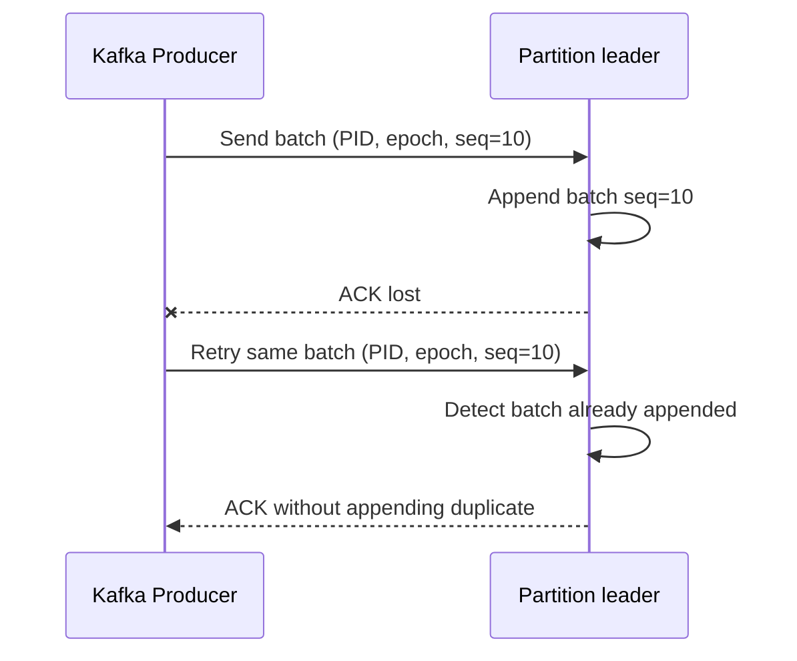
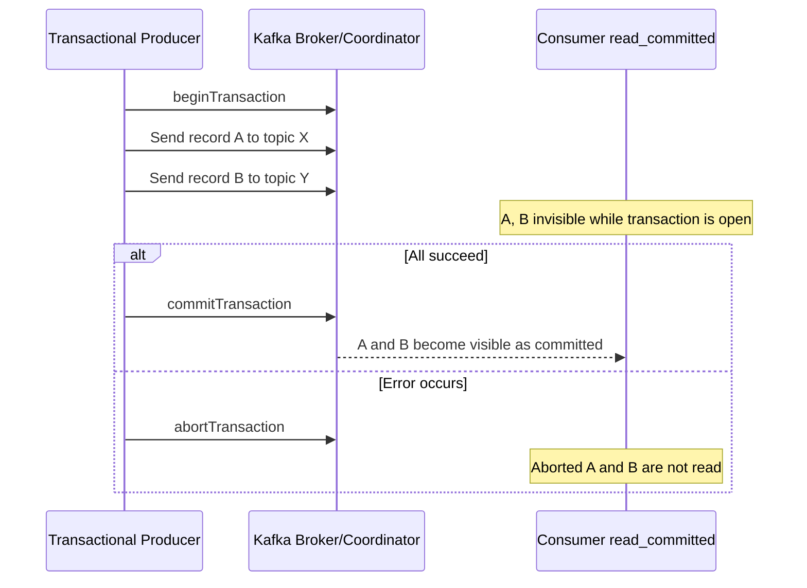
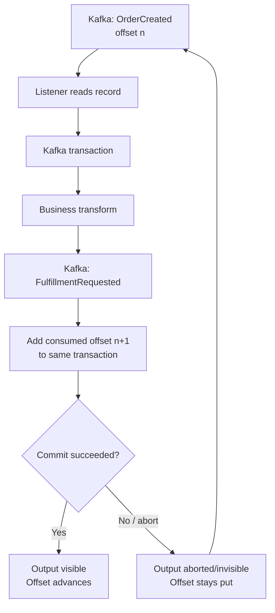
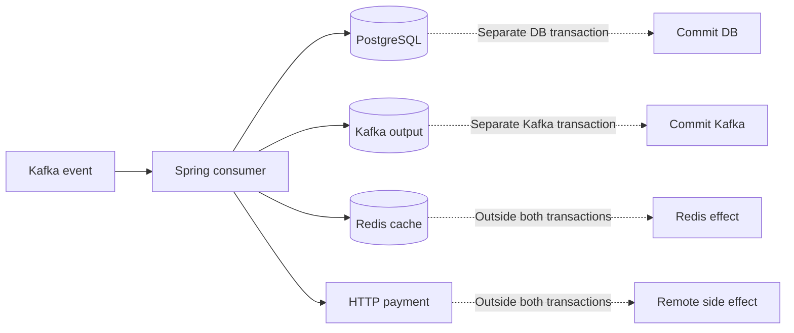

# Idempotent Producers, Transactions, and the Limits of Exactly-Once

## 1. Real-World Problem: Sending One Event, Yet the Broker May Receive It Twice

In a **Spring Boot Integration** system, an ordering service writes to PostgreSQL, makes an HTTP call to inventory, updates Redis cache, and publishes an `OrderCreated` event to Apache Kafka. A consumer reads the event, calls a payment service, and emits `PaymentRequested`. Any of these steps can experience timeouts, disconnects, consumer rebalances, or process crashes right at send/receive boundaries.

Consider a producer sending `OrderCreated`:

1. The broker appends the record to a partition.
2. The ACK from the broker is lost on the network.
3. The producer assumes the send failed and retries.
4. If the broker cannot recognize the retry, the same data can be appended as two separate records.

Conversely, if a consumer processes an event and commits to the database before crashing prior to offset commit, Kafka redelivers the record. Configuring deduplication on the producer alone **cannot stop** consumer business logic from executing a second time.

Kafka offers three related mechanisms with **different guarantee scopes**:

- **Idempotent producer:** avoids/reduces duplicate records caused by *internal retries of the same producer* writing to a partition.
- **Kafka transaction:** groups multiple Kafka writes—and optionally consumed offsets—into an atomic commit/abort unit.
- **Exactly-once processing within Kafka:** combines idempotent producers + transactions + transactional offset commits + `read_committed` consumers so **read Kafka → process → write Kafka** outputs are not published twice on retries/failures inside Kafka.

This **does not automatically extend to exactly-once across JDBC, Redis, HTTP, email, payments, or any external system**. This lesson clarifies those boundaries and how to design multi-system integrations properly.

## 2. Distinguishing Three Guarantee Levels

| Mechanism | Problem Solved | Scope | What It Does Not Solve |
|---|---|---|---|
| Default producer with retries | Retries transient send failures | Sending records | Broker may append duplicates if a prior ACK was lost, depending on config |
| **Idempotent producer** | Broker detects retries of the same producer batch/sequence | Producer ID + partition + sequence | App independently sending two logical records, consumer reprocessing, DB effects |
| **Kafka transaction** | Atomically commits/aborts a group of Kafka writes; can include consumed offsets | Topics/partitions in the same Kafka cluster and participating offsets | External DB or HTTP transactions |
| **Consumer `read_committed`** | Hides records from aborted transactions; exposes records only after tx commit | Reading Kafka data | Deduplicating independent records outside the same transaction |
| **Idempotent consumer / inbox** | Prevents repeating business side effects for the same event | Single consumer and its dedup state store | External systems lacking matching commit/reconciliation |

Two separate questions to ask:

1. **Will the broker append the same record twice due to producer retries?** → Idempotent producer.
2. **After a crash, will reprocessing a Kafka record cause duplicate side effects?** → Kafka transactions for Kafka-to-Kafka; idempotency/inbox/outbox for other systems.

An API client sending two `CreateOrder` requests with identical content as **two fresh calls** is a business problem. Kafka's idempotent producer cannot know those two commands share intent; you need a stable `idempotencyKey` or `commandId` and API/service-level deduplication.

## 3. How Does an Idempotent Producer Work?

When `enable.idempotence=true`, the Kafka producer attaches a Producer ID (PID), producer epoch, and sequence number so the broker recognizes retries of a batch per partition. The broker discards retries already appended without creating duplicate log entries. Required settings include `acks=all`, `retries > 0`, and `max.in.flight.requests.per.connection <= 5` on modern Kafka producers.



### 3.1. Spring Boot Configuration for an Idempotent Producer

Example for **Spring Boot 3.x / Spring Kafka 3.x**; verify exact property names against your project version:

```yaml
spring:
  kafka:
    bootstrap-servers: "${KAFKA_BOOTSTRAP_SERVERS:localhost:9092}"
    producer:
      key-serializer: org.apache.kafka.common.serialization.StringSerializer
      value-serializer: org.apache.kafka.common.serialization.StringSerializer
      acks: all
      properties:
        enable.idempotence: true
        max.in.flight.requests.per.connection: 5
        delivery.timeout.ms: 120000
        request.timeout.ms: 30000
```

Modern Kafka producers often enable idempotence by default unless conflicting settings override it; **declaring it explicitly** makes intent auditable and prevents other properties from silently disabling it. `delivery.timeout.ms` bounds total time the producer spends on a record across queueing, retries, and sends; it must exceed `request.timeout.ms` plus `linger.ms`. Raising `retries` without bounding deadlines and load does not improve fault tolerance.

For `acks=all` to provide real durability, the topic needs an appropriate replication factor, `min.insync.replicas`, and broker placement. If synchronized replicas drop below the threshold, writes are rejected rather than accepted without redundancy. Even with broker ACKs, data loss remains possible under severe infrastructure failures or poor operational policies.

### 3.2. Service Event Publishing Example

```java
import java.util.UUID;
import org.springframework.kafka.core.KafkaTemplate;
import org.springframework.stereotype.Service;

record OrderCreated(String eventId, String orderId, long version) {}

@Service
class OrderEventPublisher {
    private final KafkaTemplate<String, String> kafka;
    private final com.fasterxml.jackson.databind.ObjectMapper json;

    OrderEventPublisher(KafkaTemplate<String, String> kafka,
                        com.fasterxml.jackson.databind.ObjectMapper json) {
        this.kafka = kafka;
        this.json = json;
    }

    void publish(String orderId, long version) throws Exception {
        OrderCreated event = new OrderCreated(
                UUID.randomUUID().toString(), orderId, version);

        // KafkaTemplate.send() is async; callback/Future reflects send outcome.
        kafka.send("orders.created.v1", orderId,
                json.writeValueAsString(event));
    }
}
```

This snippet illustrates **transport idempotence**, not reliable post-DB-commit publishing. Calling `publish()` **twice** generates two fresh `eventId`s and sends two independent records: the producer does not treat that as an internal retry. In production, generate `eventId` when the business event is created, persist it durably (e.g., in an outbox), and reuse the exact same `eventId` when republishing.

`KafkaTemplate.send()` returns `CompletableFuture<SendResult<K,V>>` in Spring Kafka 3.x. Never equate "called send" with broker persistence. Handle completion/failure via callbacks or await results where confirmation is truly required, using overall timeouts and domain error handling.

### 3.3. Key Limitations of Producer Idempotence

- Deduplicates only retries within the **same producer session/batch sequence** managed by the Kafka producer; does not merge two separate `send()` calls for the same logical event.
- The guarantee is partition-scoped. It does not unify records sent to different topics or partitions.
- If the application retries by reconstructing new records, swapping producers, or changing keys/event IDs, producer idempotence cannot replace business deduplication.
- Does not solve "DB committed but Kafka missed the event," or "Kafka committed but DB rolled back."
- Does not prevent consumers from re-reading records when offsets are uncommitted or during replays.
- Does not replace payload validation, schema versioning, authorization, or partition-key policies.

**Distinction summary:** `acks=all` governs broker ACKs/replication; `enable.idempotence=true` prevents retry duplicates; `transactional.id` and transactions commit/abort groups of records atomically. They complement rather than replace each other.

## 4. Kafka Transactions: Atomicity Across Multiple Kafka Writes

Kafka transactions use a producer with a `transactional.id` and a transaction coordinator to manage commit or abort state. Within one transaction, a producer can write multiple records across partitions/topics in the **same Kafka cluster**. Consumers configured with `isolation.level=read_committed` read only records from committed transactions; aborted transaction records are hidden from application consumption.



**Atomic visibility** does not mean a single consumer reads two topics at the exact same instant. It means transactional records commit or abort together under Kafka's protocol; when a `read_committed` consumer reaches those offsets, it will not receive uncommitted or aborted records.

### 4.1. Transactional ID and Fencing

Every transactional producer has a `transactional.id` used by Kafka to identify a logical producer across restarts and **fence** an older incarnation if a new producer starts with the same transactional ID. Once fenced, the old producer is barred from committing as if it still owned the transaction.

In multi-instance deployments:

- **Concurrently running** transactional producers need non-colliding transactional IDs if they operate independently.
- When a logical instance is replaced, manage identity/prefixes so the restarted instance fences the old one; never generate random IDs per message.
- In Spring Kafka, `transaction-id-prefix` is used by the factory to build transactional IDs for managed producers; pick prefixes aligned with instance/deployment identity and restart strategy.
- Fencing triggers a fatal error on the active transaction; **never reuse a fenced producer** or catch the exception and pretend the commit succeeded.

In Kubernetes, design identities per pod/logical owner and test rolling deployments. Sharing one prefix across all replicas risks transactional ID collisions in certain setups; regenerating a brand-new prefix on every restart forfeits cross-incarnation fencing. Align the choice with your Spring Kafka version's producer caching and concurrency model.

### 4.2. Enabling Transactions in Spring Boot

```yaml
spring:
  kafka:
    bootstrap-servers: "${KAFKA_BOOTSTRAP_SERVERS:localhost:9092}"
    producer:
      key-serializer: org.apache.kafka.common.serialization.StringSerializer
      value-serializer: org.apache.kafka.common.serialization.StringSerializer
      acks: all
      # Prefix must reflect the identity of the running instance.
      transaction-id-prefix: "${KAFKA_TRANSACTION_PREFIX:orders-local-tx-}"
      properties:
        enable.idempotence: true
        max.in.flight.requests.per.connection: 5
        transaction.timeout.ms: 60000
    consumer:
      key-deserializer: org.apache.kafka.common.serialization.StringDeserializer
      value-deserializer: org.apache.kafka.common.serialization.StringDeserializer
      enable-auto-commit: false
      properties:
        isolation.level: read_committed
```

In Spring Boot, setting an appropriate `spring.kafka.producer.transaction-id-prefix` enables Boot to auto-configure `KafkaTransactionManager` and wire it into the default listener container config. If the project defines custom `ConcurrentKafkaListenerContainerFactory` beans or multiple producer factories/transaction managers, **verify the transaction manager is actually attached to the container**. Setting the property while invoking a custom listener factory without a transaction manager will not provide transactional consume-process-produce.

Brokers must support transactions, the transaction coordinator, and internal transaction-state topics with suitable replication/min ISR. On a **single-broker** local Kafka, default replication settings for internal transaction topics may prevent transactional producers from initializing; adjust test setups accordingly, but never copy reduced replication/min-ISR settings into production.

### 4.3. Writing Multiple Records in One Transaction

```java
import org.springframework.kafka.core.KafkaTemplate;
import org.springframework.stereotype.Service;

@Service
class KafkaOnlyPublisher {
    private final KafkaTemplate<String, String> kafka;

    KafkaOnlyPublisher(KafkaTemplate<String, String> kafka) {
        this.kafka = kafka;
    }

    void publishPair(String orderId, String orderEventJson,
                     String auditEventJson) {
        kafka.executeInTransaction(ops -> {
            ops.send("orders.created.v1", orderId, orderEventJson);
            ops.send("orders.audit.v1", orderId, auditEventJson);
            return null;
        });
    }
}
```

This requires `KafkaTemplate` to be backed by a properly configured transactional producer factory. If sending or committing fails, the transaction aborts or throws; both records count as succeeded only upon transaction commit. `executeInTransaction` manages a standalone Kafka transaction via the template and is distinct from database `@Transactional`.

**Never place slow HTTP calls, long sleeps/backoffs, or unrelated work inside a Kafka transaction**, as keeping transactions open increases timeout, rebalance, and fencing risks. Catching errors to log is fine, but never swallow exceptions and return success when the transaction or business logic failed.

## 5. Exactly-Once for Consume → Process → Produce Within Kafka

An application reads `OrderCreated` from Kafka, transforms it into `FulfillmentRequested`, and writes back to Kafka. On crash, the consumer can re-read the input. Producer idempotence alone would still let **two separate processing attempts** emit duplicate output records.

To protect a **Kafka → Kafka** pipeline:

1. Consumer reads input with `isolation.level=read_committed` to ignore uncommitted/aborted transactional records.
2. The listener container opens a **Kafka transaction** before processing the batch/record per policy.
3. The transactional producer writes outputs within that same transaction.
4. **Input offsets are committed inside the same Kafka transaction** alongside the output records.
5. On crash/error before commit, the transaction aborts, offsets do not advance, and input is reprocessed; aborted outputs stay hidden from `read_committed` consumers.
6. On commit, outputs and offset progress commit together, so recovering after a crash will not re-emit outputs from that completed attempt.



### 5.1. Illustrative Spring Kafka Listener

This example assumes the **listener container factory is wired with `KafkaTransactionManager`** and `KafkaTemplate` uses the matching transactional producer factory. The handler only transforms data and writes to Kafka, performing **no** external side effects.

```java
import com.fasterxml.jackson.databind.ObjectMapper;
import org.springframework.kafka.annotation.KafkaListener;
import org.springframework.kafka.core.KafkaTemplate;
import org.springframework.stereotype.Component;

record OrderCreated(String eventId, String orderId, long version) {}
record FulfillmentRequested(String eventId, String sourceEventId,
                            String orderId) {}

@Component
class FulfillmentFlow {
    private final KafkaTemplate<String, String> kafka;
    private final ObjectMapper json;

    FulfillmentFlow(KafkaTemplate<String, String> kafka, ObjectMapper json) {
        this.kafka = kafka;
        this.json = json;
    }

    @KafkaListener(topics = "orders.created.v1", groupId = "fulfillment")
    void handle(String value) throws Exception {
        OrderCreated input = json.readValue(value, OrderCreated.class);
        if (input.orderId() == null || input.eventId() == null) {
            throw new IllegalArgumentException("Missing event identifiers");
        }

        // In real systems, output eventId should follow contract/dedup rules;
        // here it illustrates a simple deterministic transformation.
        String outputId = input.eventId() + ":fulfillment-requested";
        FulfillmentRequested output = new FulfillmentRequested(
                outputId, input.eventId(), input.orderId());

        kafka.send("fulfillment.requested.v1",
                input.orderId(),
                json.writeValueAsString(output));
    }
}
```

When the listener factory is configured for transactions, the container attaches consumed offsets to the transaction and commits them alongside Kafka outputs. Verify exact behavior for your **Spring Kafka 3.x** release; the `transaction-id-prefix` and `read_committed` settings from section 4 are the starting point. `KafkaTemplate.send()` returns a future; transaction commit/flush errors must still be handled, and the listener must not swallow exceptions.

Deriving the output ID **deterministically from the input event ID** illustrates stability on reprocessing. Never blindly reuse `input.eventId()` as the ID of a new domain event if the contract requires globally unique IDs per event type; the `sourceEventId + eventType` convention works for 1-to-1 transforms and needs stricter rules when one input spawns multiple outputs.

### 5.2. Crash Points and Divergent Outcomes

| Crash Point | What Kafka Observes | Consequence |
|---|---|---|
| After reading input, before sending output | Uncommitted offset, no committed output | Next run re-reads input |
| Output sent, before Kafka commit | Output sits in uncommitted/aborted tx | `read_committed` hides aborted output; offset stays put |
| Transaction commits, app crashes immediately | Output visible and offset committed together | Group will not reprocess that offset due to crash |
| App fails after DB write before Kafka commit | DB side effect exists, Kafka offset unchanged | DB can receive side effect again on reprocessing |
| App emits two logical events with different IDs | Two independent events commit | Kafka EOS does not deduplicate business logic |

**Crucial:** Spring Kafka's transactional listener coordinates offsets and Kafka outputs within a Kafka transaction; it does **not** promise the Java handler method itself **executes only once**. Handlers can be re-invoked after crashes/aborts. Any non-Kafka side effect inside the handler still requires dedicated idempotency.

### 5.3. Commonly Overlooked Prerequisites

- Listeners use **consumer groups** and partition assignment; changing `group.id` can cause Kafka to read from another offset per reset policy rather than representing a new business event.
- Offsets advance on transaction commit; `enable-auto-commit=false` is needed so offsets never commit independently of the transaction. Spring Kafka normally disables auto-commit on listener containers by default, yet explicit configuration aids auditing.
- Downstream consumers must set `read_committed` to ignore aborted data.
- Transactions have timeouts and can abort on producer fencing, leader changes, failovers/rebalances, or send errors.
- Non-transactional messages on a topic are still readable by `read_committed` consumers; isolation level is not a data-validation or business-dedup filter.
- Error handling on listener rollback (retries, backoff, seeks, DLTs) must be tested; DLT sends or DB writes outside the transaction carry distinct semantics.
- Kafka Streams has its own EOS support (e.g., `processing.guarantee=exactly_once_v2` in supported versions) covering state stores/changelogs and Kafka outputs; it still does not atomically commit external side effects.

## 6. Why Is There No Exactly-Once Across Kafka, DB, Redis, and HTTP?

A Kafka transaction governs only Kafka records and offsets enlisted in it. Spring's `@Transactional` with `DataSourceTransactionManager` governs a separate JDBC transaction. They are **two independent commit coordinators** unless a real distributed coordination protocol bridges them; standard Spring configuration does not produce atomic commits across both systems.



Example service consuming `PaymentConfirmed`:

1. Consumer updates `orders.status = PAID` in the database and commits.
2. App crashes before committing the Kafka consumer offset.
3. `PaymentConfirmed` is redelivered upon restart.
4. If the consumer blindly sends an email or charges money on every delivery, side effects repeat.

A Kafka transaction protects **Kafka** outputs emitted by a properly configured listener, yet cannot roll back a sent email or a completed HTTP payment. Redis `SETNX`/locks are not end-to-end guarantees either if TTLs expire, keys evict, or failovers drop writes.

### 6.1. Clarifying Overused Terms

| Phrase | Recommended Interpretation |
|---|---|
| `Exactly once delivery` | Must state transport/consumer scope explicitly; avoid blanket claims |
| `Exactly once processing in Kafka` | Kafka-to-Kafka outputs and offsets commit atomically inside a Kafka transaction |
| `Exactly once business effect` | State/external target changes once per business action; typically requires idempotency/DB constraints and reconciliation |
| `At least once` | Messages may be redelivered/reprocessed; consumers must tolerate duplicates |
| `At most once` | Data loss is possible if progress is marked before completion |
| `Idempotent operation` | Repeating the same logical action yields the same contract state without extra side effects |

Even within Kafka, transactions add overhead from transaction state, broker quorum, partition lag, and `read_committed`; adopt EOS for **verified consistency needs**, not because the label sounds comforting.

## 7. Transactional Outbox: DB Commit and Event Publishing

For **write DB then publish to Kafka**, a pragmatic pattern is the **transactional outbox**. Both the business record and pending event record commit in the same database transaction.

```sql
CREATE TABLE orders (
    order_id VARCHAR(80) PRIMARY KEY,
    status VARCHAR(32) NOT NULL
);

CREATE TABLE outbox_events (
    event_id UUID PRIMARY KEY,
    aggregate_id VARCHAR(80) NOT NULL,
    event_type VARCHAR(120) NOT NULL,
    payload JSONB NOT NULL,
    created_at TIMESTAMPTZ NOT NULL DEFAULT now(),
    published_at TIMESTAMPTZ
);
```

Inside one DB transaction:

```sql
BEGIN;
INSERT INTO orders(order_id, status)
VALUES ('ORD-421', 'CREATED');

INSERT INTO outbox_events(event_id, aggregate_id, event_type, payload)
VALUES (
  'b9b574a3-c643-4a77-b188-3929dd12fcc9',
  'ORD-421',
  'OrderCreated',
  '{"eventId":"b9b574a3-c643-4a77-b188-3929dd12fcc9","orderId":"ORD-421"}'
);
COMMIT;
```

A background publisher (or CDC tool like Debezium when fitting) reads outbox rows and sends them to Kafka. After Kafka confirms receipt, it sets `published_at` or advances a reliable checkpoint.

**Note:** A crash can happen **after Kafka persists the record but before the DB marks the outbox row sent**. The publisher will resend the same `eventId`, so consumers must deduplicate. The outbox guarantees **no lost events once the DB commits** (assuming proper publisher recovery); it does not turn delivery into exactly-once across external sinks.

To preserve per-aggregate event order, use an appropriate record key (usually `orderId`), manage source versions/sequences, and control publish order. Never assume concurrent outbox pollers naturally preserve DB timestamp order; design an explicit ordering or partitioning strategy.

## 8. Inbox / Idempotent Consumer: Blocking Duplicate Side Effects

A consumer must deduplicate by **logical event ID** scoped by consumer/handler name (and tenant if needed). PostgreSQL example:

```sql
CREATE TABLE processed_events (
    consumer_name VARCHAR(100) NOT NULL,
    event_id UUID NOT NULL,
    processed_at TIMESTAMPTZ NOT NULL DEFAULT now(),
    PRIMARY KEY (consumer_name, event_id)
);
```

Inside the **same DB transaction** as the business update:

```sql
BEGIN;
-- Only the first processor to insert proceeds with the business update.
INSERT INTO processed_events(consumer_name, event_id)
VALUES ('payment_projection', 'b9b574a3-c643-4a77-b188-3929dd12fcc9')
ON CONFLICT DO NOTHING;

-- If INSERT affected 1 row: apply the business update.
-- If 0 rows affected: skip side effects for the already-processed event.
-- Checking the row count and updating happen in the same transaction.
COMMIT;
```

In real code, **inspect the inserted row count** and apply updates only when 1 row was inserted. If the business update fails, roll back **both the dedup insert and the update**. Never issue HTTP/email calls mid-DB-transaction since they cannot roll back; instead persist an outbox command/saga state and dispatch post-commit, or call targets with an enforced idempotency key.

### 8.1. Choosing the Right Deduplication Key

| Key | Meaning | Suitable? |
|---|---|---|
| `eventId` | One logical event stable across redeliveries/replays | Yes, for event consumers |
| `(consumerName, eventId)` | One consumer processed one logical event | Usually ideal; avoids blocking other consumers |
| `(tenantId, consumerName, eventId)` | Multi-tenant deduplication | Required when event IDs are not globally unique or tenant isolation applies |
| `commandId` / `idempotencyKey` | One logical action preserved across retries | Suitable for side-effecting commands/APIs |
| `correlationId` | A workflow spanning multiple events/actions | **No**—would accidentally drop valid subsequent events |
| Kafka offset | Record position in one partition | Useful for checkpoints/diagnostics; fails if event republishes at a new offset |
| `traceId` | Observability trace ID; can change across retries/replays | **No**—does not identify business work |

If using Redis for deduplication, evaluate TTLs, eviction, failover loss, and atomicity. When strong correctness is required, a DB unique constraint inside the business transaction provides stronger guarantees than an independently expiring Redis key.

## 9. Combining Kafka Transactions with Database `@Transactional`

In Spring, `@Transactional` selects one specific transaction manager; it **does not automatically merge** disparate resources (Kafka and JDBC) into an atomic transaction.

### 9.1. Misleading Pattern

```java
@org.springframework.transaction.annotation.Transactional
public void saveAndPublish(Order order) {
    orderRepository.save(order);             // DB transaction
    kafkaTemplate.send("orders.created.v1", order.getId(), "..."); // Kafka
}
```

If this method uses the DB transaction manager, calling `send()` does not roll back the Kafka record alongside the database. Depending on configuration and Spring transaction synchronization, commit order and failure modes vary; a **window where one commits and the other fails** always remains. Committing Kafka first and failing DB commit is equally unsafe. An outbox is generally far easier to reconcile when the DB is the source of truth.

### 9.2. Practical Guidelines

- **Kafka → Kafka:** use Kafka transactions including consumed offsets when appropriate.
- **DB → Kafka:** generally use a transactional outbox; Spring transaction synchronization may fit cases accepting best-effort risk, yet does not deliver true atomic distributed transactions.
- **Kafka → DB:** idempotent consumer/inbox + DB transaction. Commit Kafka offset after DB success; tolerate redelivery and deduplicate.
- **Kafka → HTTP payment:** pass command IDs/idempotency keys to the payment service, support status queries and reconciliation; retry only when safe.
- **Kafka → Redis cache:** make cache updates re-executable; enforce versions/TTLs/invalidation and business fallbacks.

When consistency spans multiple services and steps, design **sagas**, intermediate states, compensations, outbox/inbox, and reconciliation monitoring. Transaction managers and commit ordering are only part of the solution.

## 10. Fencing, Timeouts, Retries, and Common Failures

| Incident | Meaning | Recommended Behavior |
|---|---|---|
| ACK lost during record send | Broker may have appended while producer is unsure | Let idempotent producer retry the same batch within deadline |
| Producer `TimeoutException` | Unknown if record was written without a valid final outcome | Classify status; if resending at app layer, keep same event ID/idempotency |
| `ProducerFencedException` | Stale transactional producer lost ownership of its transactional ID | Halt producer/transaction; never attempt to continue committing |
| Transaction timeout | Transaction aborted or failed to commit | Shorten processing, investigate broker/latency, reprocess with dedup |
| Consumer rebalance during slow handler | Partition assignment/offsets may shift | Bound processing duration, manage poll interval, enforce idempotency |
| Broker lost quorum / low ISR | Cannot meet durability requirement | Backoff/circuit breaker; never weaken `acks` arbitrarily |
| Serialization/schema error | Data cannot be sent or parsed | Classify as permanent; route to DLT/quarantine per contract |
| Listener throws exception | Kafka transaction aborts/rolls back if container manages it | Bounded retries, proper error handler, never swallow exceptions |
| DLT publisher failure | Cannot safely park failing record | Design recovery transactions and valid checkpoints |
| Outbox publisher crash | Event not marked published even though Kafka may have it | Republish with same event ID; consumer deduplicates |

### 10.1. A Timeout Does Not Mean the Operation Definitely Failed

A timeout on an HTTP client, producer send, or job call only indicates **the caller received no response before its deadline**. The target may have completed the change. Retries must distinguish "never executed" from "outcome unknown." Never generate a new `eventId` when resending the same outbox event.

### 10.2. Curbing Retry Storms

Budget timeouts and retries end-to-end with jittered backoff and attempt caps. Kafka producers handle internal retries up to delivery timeout; never wrap `KafkaTemplate.send()` in an unbounded retry loop. On consumers, separate transient errors (slow broker/DB) from permanent errors (bad schema) so one record cannot trap a partition in a tight retry loop.

## 11. Observing Transactions and Duplicates

Monitor at minimum:

- **Producer:** send success/failure rates, latency, retry rates, delivery timeouts, batch sizes, request latency, in-flight counts, record errors.
- **Kafka transactions:** transaction duration, abort/commit errors, fencing events, transaction coordinator health, abnormally long open transactions.
- **Consumer:** lag by group/partition, rebalance counts, per-record processing times, rollbacks/retries/DLTs, backpressure levels.
- **Business:** outbox backlog and oldest unpublished event age, dedup hits, idempotency conflicts, records needing reconciliation.
- **Infrastructure:** under-replicated partitions, ISR, broker/network errors, topic replication/min ISR, disk saturation.

In Spring Boot, Micrometer/Actuator and Spring Kafka metrics can be enabled via dependencies and runtime config. Never assume metric names stay identical across Kafka/Spring versions; verify actual meters in your project's environment.

**Avoid high-cardinality metric labels:** never tag metrics with `eventId`, `orderId`, `correlationId`, per-request `transactional.id`, raw payloads, or user IDs. Stick to bounded labels like `topic_family`, `consumer_group` (when controlled), `operation`, and `outcome`. Granular IDs belong in access-controlled, masked, retention-bounded structured logs and traces.

When debugging a record, correlate `eventId`, business ID, input topic/partition/offset, output topic/partition/offset, and transaction outcome. `traceId`/`correlationId` stitch steps together yet are **not deduplication keys**.

## 12. Tests Proving the Scope of Exactly-Once

Mocking `KafkaTemplate` cannot prove broker transactions, fencing, or `read_committed`. Run against a real Kafka broker/test cluster in Testcontainers or an isolated test environment. For transactions, ensure internal transaction-state topics/quorum are configured cleanly. Assert **broker outputs** and **DB state** after fault injection—not merely Java method invocation counts.

| Scenario | Fault Injection | What to Verify |
|---|---|---|
| Idempotent producer retry | Induce flaky network / dropped ACK in test | Retried batch does not append duplicate records |
| Two `send()` calls | Deliberately send two independent logical records | Kafka receives both; business dedup relies on `eventId` |
| Transaction commit | Send two outputs in one transaction | `read_committed` sees both after commit |
| Transaction abort | Send record then abort | `read_committed` never sees aborted record |
| Consumer crash before commit | Halt handler after sending output, before offset tx commit | Next run reprocesses input; aborted output stays hidden |
| Crash after commit | Stop app after tx commit | Output and offset stay consistent; no replay from that crash |
| Producer fencing | Start a new producer with the same transactional ID | Old producer is fenced and cannot commit |
| DB commit before Kafka commit | Commit DB then crash before Kafka offset commit | Input redelivers; unique constraint/dedup blocks second DB effect |
| Outbox ACK lost | Kafka persists record yet outbox stays unmarked | Publisher resends same `eventId`; consumer deduplicates |
| Payment retry timeout | Target succeeds while response drops | Idempotency key prevents double charging |
| `read_uncommitted` consumer | Read topic containing aborted transactions | Demonstrates visibility difference vs. `read_committed` |
| Multiple partitions/instances | Scale concurrency, trigger rebalances/rolling restarts | Per-aggregate ordering, non-colliding tx prefixes, idempotency hold |

### 12.1. Exercise: How Far Does "Exactly Once" Hold?

Consider:

```text
Kafka orders.created
    -> Spring @KafkaListener
    -> PostgreSQL update order
    -> HTTP POST /payments/charge
    -> Kafka payments.requested
```

The app enables `enable.idempotence=true`, `transaction-id-prefix`, and `read_committed`. After HTTP payment returns success, the process crashes before committing the Kafka transaction. On restart, the input redelivers.

**Analysis:**

1. The uncommitted Kafka output can abort and stay hidden from `read_committed` consumers.
2. Because the input offset did not commit, the record redelivers.
3. The PostgreSQL update **may already have committed** if executed in a separate DB transaction.
4. The HTTP payment **may already have charged the customer**, even though the Kafka transaction aborted.
5. Therefore, enabling Kafka transactions is **insufficient** to guarantee "charge only once."

A stronger design pairs a stable `paymentCommandId`, an idempotent payment-service API, a consumer inbox/unique constraint, an outbox for emitted events, and status reconciliation if HTTP responses drop. Specific designs vary with SLAs and transaction models, yet must prove **side effects** stay safe under replay.

## 13. Common Mistakes

- **Enabling idempotence and claiming business exactly-once:** producer handles only its own transport retries, not redeliveries or duplicate app calls.
- **Enabling transactions while consumers stay `read_uncommitted`:** consumers still read aborted outputs.
- **Omitting offsets from the Kafka transaction in consume-process-produce:** offsets and outputs retain separate failure windows.
- **Marking offsets before DB/HTTP processing:** crashes mid-flight lose side effects.
- **Wrapping DB and Kafka under one `@Transactional` assuming atomicity:** two transaction managers do not form a distributed atomic commit.
- **Generating a new event ID on each outbox retry:** prevents consumers from recognizing replays.
- **Using correlation/trace IDs as dedup keys:** one workflow legitimately emits multiple distinct events sharing a correlation ID.
- **Replicas sharing colliding transactional IDs:** producers continuously fence one another and stall traffic.
- **Holding Kafka transactions open across slow API calls:** triggers transaction timeouts and aborts.
- **Relying on Kafka Streams `exactly_once_v2` to make HTTP charges once-only:** Kafka Streams does not control external payment gateways.
- **Lowering `acks`/min ISR to silence send errors:** trades away business-critical durability.
- **Testing only happy paths with mocks:** fails to prove fencing, abort isolation, transactional offsets, or DB duplicate prevention.

## 14. Spring Boot Integration Implementation Checklist

- [ ] Exact requirement identified: transport retry dedup, Kafka-to-Kafka EOS, or idempotent business side effects.
- [ ] Producers use valid idempotence settings: `enable.idempotence`, `acks=all`, `retries`, `max.in.flight <= 5`, sensible `delivery.timeout.ms`.
- [ ] Topics have appropriate replication factors, ISR, and security; broker transaction coordinator is healthy.
- [ ] If using Kafka transactions, `transaction-id-prefix` is managed per instance/lifecycle and tested for fencing.
- [ ] `KafkaTemplate` uses the transactional producer factory; listener factories attach `KafkaTransactionManager` where required.
- [ ] Consumers skipping aborted outputs set `isolation.level=read_committed`.
- [ ] Input offsets commit within the Kafka transaction alongside outputs in Kafka-to-Kafka flows.
- [ ] Listeners never swallow exceptions and falsely commit; recovery/retry/DLT policies are tested under crashes.
- [ ] Event/command IDs stay immutable across retries; partition keys and per-aggregate ordering are explicit.
- [ ] DB → Kafka uses an outbox when consistency is required; Kafka → DB uses an idempotent consumer/inbox with unique constraints.
- [ ] HTTP/Redis/payment/email paths have independent idempotency and reconciliation; never rely on Kafka transactions to roll back external calls.
- [ ] Timeouts/backoffs, bounded retries, monitoring for aborts/fencing/rebalances, outbox backlogs, and dedup hits are in place.
- [ ] Integration tests against a real broker verify abort/commit, crashes before/after offset commits, producer fencing, and DB side effects.

**Desired takeaway:** Designers clearly distinguish **producer retries**, **Kafka transactions**, and **business side effects**. The system uses Kafka transactions to coordinate offsets with Kafka outputs, and outboxes/inboxes plus idempotency for databases and external systems—making every "exactly-once" claim across integration flows explainable and testable.
