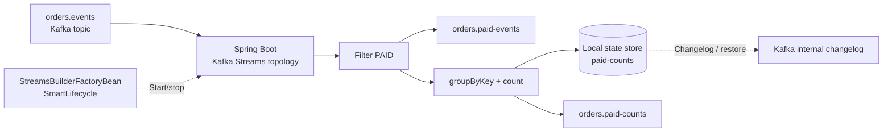
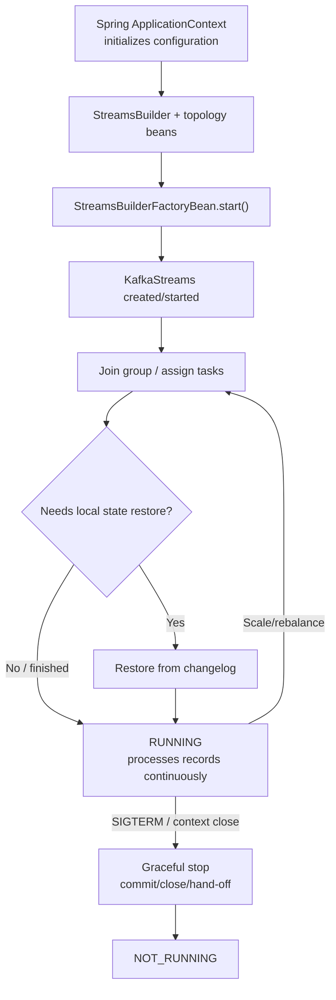

# Integrating Kafka Streams and Stream-Processing Application Lifecycle

## 1. Why Is Kafka Streams More Than Just a Kafka Consumer?

In the **SPRING_BOOT_INTEGRATION** module, a Spring Boot application coordinates HTTP clients, SQL databases, caches, message brokers, and Spring Integration adapters. Some business use cases require more than consuming individual Kafka records and calling a service. For example, a system may need to **aggregate state**, **count events per order**, **join data across multiple topics**, or **compute continuous windowed results** to feed a read model.

**Kafka Streams** is a stream-processing library embedded inside a Java process. The application declares a **topology** of processing steps (filter, map, group, aggregate, join, window, etc.), and Kafka Streams handles reading input topics, assigning tasks per partition, writing output topics, maintaining local state stores, checkpointing/recovery, and rebalancing.

In Spring Boot, Spring for Apache Kafka integrates with `StreamsBuilder`, `StreamsBuilderFactoryBean`, and related configuration properties. A vital distinction: **a topology is a long-running workload tied to the application lifecycle**. You should never instantiate a new Kafka Streams instance per HTTP request, nor assume a `@Bean` method returning a `KStream` has "finished processing the data."

### Illustrative Scenario

Topic `orders.events` is keyed by `orderId`; the initial value is a simple test status string such as `PAID`, `CANCELLED`, or `CREATED`. The application needs to:

1. Read the event stream by partition and key.
2. Forward valid payment events to `orders.paid-events`.
3. Count **received `PAID` records** per order, maintain recoverable local state, and emit counts to `orders.paid-counts`.
4. Run continuously until the application is stopped, restarted, or rolled out to a new version.



**Semantic note:** the count in this example counts **records**, not "unique payment transactions." If a producer emits the same event again with a different ID or an upstream consumer writes duplicates, the count still increases. Counting unique payments requires a business deduplication key and tracking processed IDs.

### Lesson Objectives

After completing this lesson, you will be able to:

- Choose Kafka Streams over `@KafkaListener` when stateful stream processing is needed.
- Configure Spring Boot for Kafka Streams, `application.id`, `bootstrap.servers`, serdes, and state directories.
- Define topologies using `StreamsBuilder` and distinguish `KStream`, `KTable`, and `GlobalKTable`.
- Understand tasks/partitions, state stores, changelogs, repartition topics, restoration, and processing guarantees.
- Manage **startup, pause/stop, shutdown, restarts, rolling deployments, thread errors, and rebalances**.
- Test topologies in isolation and end-to-end against real brokers, and define metrics, health checks, and recovery plans.

## 2. Where Does Kafka Streams Fit Relative to Listeners and Spring Integration?

| Integration Style | When to Use | Who Coordinates Lifecycle? | Notes |
| --- | --- | --- | --- |
| `@KafkaListener` | Imperative record handling, SQL/HTTP calls, or event forwarding | Spring Kafka listener container | You design retries, ACKs, concurrency, and idempotency |
| **Kafka Streams** | Continuous transformations, joins, grouping, aggregations, windowing, stateful projections | Kafka Streams runtime via `StreamsBuilderFactoryBean` | Topologies, tasks, state stores/changelogs, and offsets are managed by Streams |
| Spring Integration Kafka adapter | Wiring Kafka into `IntegrationFlow`, channels, transformers, routers | Spring Integration endpoint/flow lifecycle | Great for Enterprise Integration Patterns; does not replace Kafka Streams' stateful DSL |
| Kafka Connect | Moving data between Kafka and external systems via connectors | Kafka Connect workers | Optimized for source/sink movement, not arbitrary business DSL processing |

Kafka Streams is a **Java client library**, not a dedicated server cluster like Kafka Connect. It runs against existing Kafka brokers and scales across multiple Spring Boot replicas. Replicas sharing the same `application.id` form one distributed processing application; task assignment and local state are managed by the library.

Never attach both `@KafkaListener` and Kafka Streams to process the same business event **without defining clear ownership**: doing so can create duplicate side effects, competing consumer groups, or conflicting offset policies. When combining them, separate topics, groups, state, and event-emission responsibilities cleanly.

## 3. `KStream`, `KTable`, and State Store Model

### Three Core Abstractions

| Abstraction | Interpretation | Example |
| --- | --- | --- |
| `KStream<K,V>` | Stream of immutable event records; records with the same key remain separate occurrences | `OrderPaid` events over time |
| `KTable<K,V>` | Changelog-backed state table; newer records update the value for that key | Latest payment status per order |
| `GlobalKTable<K,V>` | Table replicated in full to every processing instance | Small reference table used to enrich events |

**Do not treat every topic as having the same semantics.** For append-only event topics, `KStream` is natural. For compacted topics holding latest state per key, `KTable` models an updating table; records with `null` values normally act as **tombstones** deleting keys. With global tables, each instance holds the entire dataset, so weigh data size and restoration cost carefully.

### Why Are State Stores Created?

For example, `groupByKey().count()` must remember counts per key across polls. Kafka Streams keeps state in a local **state store** (typically RocksDB for persistent disk-backed stores) and writes a **changelog topic** to restore state after crashes, task migrations, or new replica startups.

```text
orders.events [partition 0]   -> Stream Task 0 -> local store shard 0
orders.events [partition 1]   -> Stream Task 1 -> local store shard 1
orders.events [partition 2]   -> Stream Task 2 -> local store shard 2
                                       |
                                       +--> changelog topic(s)
```

A **state store is not automatically an external business database**. Durability and recovery of Kafka Streams local state rely on Kafka logs/internal topics and state/changelog configs. If HTTP APIs need to query state across all partitions, you must account for **which instance owns the task/key**, or push results to an output topic/shared read-model store.

### Repartitioning When Changing Keys

Kafka Streams creates **internal repartition topics** when a topology re-keys records, such as `selectKey(...)` followed by `groupByKey()`, or `groupBy(...)` on a new key. Repartitioning adds network and broker storage overhead, introduces stage boundaries, and affects ordering and throughput.

- Use a stable aggregate key (`orderId`) right from the producer whenever possible.
- Avoid changing keys repeatedly just for DSL convenience without assessing repartition costs.
- Monitor partition counts, data skew, and overly "hot" keys.
- Topology optimizations can change internal names/structure; treat state store names and internal topics as managed upgrade artifacts.

## 4. Dependencies and Spring Boot Configuration

Examples target **Java 17+, Spring Boot 3.x, compatible Spring for Apache Kafka, and Kafka Streams APIs from the BOM-managed client line**. On newer major releases, consult the version matrix and run integration tests; never force an incompatible `kafka-streams` version over `kafka-clients`.

```groovy
dependencies {
    implementation 'org.springframework.boot:spring-boot-starter'
    implementation 'org.springframework.kafka:spring-kafka'
    implementation 'org.apache.kafka:kafka-streams'

    testImplementation 'org.springframework.boot:spring-boot-starter-test'
    testImplementation 'org.springframework.kafka:spring-kafka-test'
    testImplementation 'org.apache.kafka:kafka-streams-test-utils'
}
```

Gradle uses versions controlled by Spring Boot dependency management/BOM; test dependencies must match the Kafka API line. A Kafka Streams app does not strictly need `spring-boot-starter-web` if it exposes no HTTP endpoints, though real integration services often add Actuator for health/metrics and APIs.

### Sample Application Configuration

```yaml
spring:
  kafka:
    bootstrap-servers: ${KAFKA_BOOTSTRAP_SERVERS:localhost:9092}
    streams:
      application-id: orders-paid-projection-v1
      auto-startup: true
      state-dir: ${KAFKA_STREAMS_STATE_DIR:/tmp/orders-paid-projection}
      properties:
        num.stream.threads: 2
        processing.guarantee: at_least_once
        auto.offset.reset: earliest
```

In this configuration:

- `spring.kafka.bootstrap-servers` points to the Kafka brokers.
- `spring.kafka.streams.application-id` is the **Kafka Streams application identity**, governing consumer group ID, internal topic names, state stores, and offset progress. It is not a bean name or HTTP service name.
- `spring.kafka.streams.auto-startup` controls whether Streams starts automatically with the Spring lifecycle.
- `spring.kafka.streams.state-dir` is the local state directory for Kafka Streams. Ensure writable permissions and sufficient disk space; `/tmp` is suitable only for labs, not production defaults.
- `num.stream.threads` sets stream threads **per instance**, not replica count, and does not split one partition across unlimited threads.
- `processing.guarantee` picks the Streams guarantee mode, **without guaranteeing exactly-once for external SQL/HTTP calls**.
- `auto.offset.reset=earliest` works well in labs or for a brand-new `application.id`; it **does not force a group with existing committed offsets to re-read from the start**. Replays require controlled offset resets or versioning.

Never commit SASL passwords or TLS private keys into YAML in repositories. For secured clusters, configure `spring.kafka.properties.*` or `spring.kafka.streams.properties.*` (`SASL_SSL`, SASL mechanism, JAAS, SSL trust) per organizational security policy and your Spring Boot/Kafka version. Never log full configs containing JAAS credentials.

### `application.id` Is an Operational Key

| Action | Consequence to Evaluate |
| --- | --- |
| Add **replicas with the same `application.id`** | Share task assignments; increases scale and triggers rebalances |
| Change `application.id` from `-v1` to `-v2` | Kafka treats it as a brand-new logical app: separate group/offsets/internal topics/state |
| Upgrade topology while **keeping** `application.id` | Resumes prior state/group if topology stays compatible; verify store names/serialization |
| Run tests using production's `application.id` | Disrupts production groups/tasks/state on shared clusters; strictly avoid |

Never swap `application.id` as a "quick reset" in production without a plan: the new app may replay historical data, duplicate outputs, and expose downstream consumers to both streams. Manage `application.id` like a **migration contract**.

## 5. Building a Topology with `StreamsBuilder`

In Spring Boot, add `@EnableKafkaStreams` to enable Spring for Apache Kafka's Streams support and define topologies on the provided `StreamsBuilder`. The example below keeps values as `String` to focus on lifecycle and state stores rather than JSON serializer boilerplate.

```java
import org.apache.kafka.common.serialization.Serdes;
import org.apache.kafka.streams.StreamsBuilder;
import org.apache.kafka.streams.kstream.Consumed;
import org.apache.kafka.streams.kstream.Grouped;
import org.apache.kafka.streams.kstream.KStream;
import org.apache.kafka.streams.kstream.Materialized;
import org.apache.kafka.streams.kstream.Produced;
import org.apache.kafka.streams.state.KeyValueStore;
import org.apache.kafka.common.utils.Bytes;
import org.springframework.context.annotation.Bean;
import org.springframework.context.annotation.Configuration;
import org.springframework.kafka.annotation.EnableKafkaStreams;

@Configuration
@EnableKafkaStreams
public class PaidOrdersStreamsTopology {

    @Bean
    public KStream<String, String> paidOrderStream(
            StreamsBuilder streamsBuilder) {

        KStream<String, String> source = streamsBuilder.stream(
                "orders.events",
                Consumed.with(Serdes.String(), Serdes.String()));

        KStream<String, String> paidEvents = source
                .filter((orderId, status) ->
                        orderId != null && "PAID".equals(status));

        // Forward PAID records as-is, preserving orderId as key.
        paidEvents.to(
                "orders.paid-events",
                Produced.with(Serdes.String(), Serdes.String()));

        paidEvents.groupByKey(
                        Grouped.with(Serdes.String(), Serdes.String()))
                .count(Materialized
                        .<String, Long, KeyValueStore<Bytes, byte[]>>as(
                                "paid-counts-store")
                        .withKeySerde(Serdes.String())
                        .withValueSerde(Serdes.Long()))
                .toStream()
                .mapValues(count -> Long.toString(count))
                .to("orders.paid-counts",
                        Produced.with(Serdes.String(), Serdes.String()));

        return source;
    }
}
```

In this example, `("O-204", "PAID")` flows to both the filtered events topic and the per-key counter. `count` materializes a **state-store-backed `KTable`**; whenever the count updates, the new value can be emitted to `orders.paid-counts`.

**Prerequisites for running in practice:**

- Brokers have `orders.events`, `orders.paid-events`, and `orders.paid-counts` provisioned, or an explicit topic-provisioning policy applies.
- Kafka principals hold read/write ACLs for topics, consumer groups, internal repartition/changelog topics, and transactional IDs when EOS is enabled.
- Real keys/values conform to `String` serdes; if upstream emits JSON/Avro/Protobuf, swap in matching serdes. Never consume real structured data with `StringSerde` assuming schema validation occurred.
- Executing the `@Bean` method only **builds the topology graph**—it does not consume records. The Streams runtime processes continuously once started.
- Receiving duplicate `PAID` records from upstream increments the count multiple times. To maintain total **unique** paid orders or monetary balances, add explicit deduplication; `exactly_once_v2` does not remove business duplicates emitted by producers as distinct valid records.

### Avoid Side Effects During Topology Construction

A `@Bean` declaring a topology must never execute HTTP calls, SQL writes, or active Kafka publishes during `ApplicationContext` creation. Those belong in runtime processors/transformers or separate services with retry/transaction policies. Putting side effects into topology construction fires them before Streams starts and breaks restart predictability.

## 6. `KTable`, Windowing, and Joins: Moving from Stateless to Stateful

| Operation | Integration Flow Example | Risks to Control |
| --- | --- | --- |
| `filter/mapValues` | Normalize statuses / drop irrelevant events | Contracts and malformed payload handling |
| `groupByKey/count` | Count events per order | State stores, changelogs, and duplicate events |
| `aggregate/reduce` | Sum totals by key | Overflow, event ordering, tombstones, and idempotency |
| Windowed aggregation | Count payments in 5-minute windows | Event-time, timestamps, late arrivals, grace/retention |
| Stream-table join | Enrich events from a state table | Key/co-partitioning requirements, update lag, availability |
| Stream-stream join | Pair correlated events within a window | Window state, out-of-order events, memory/disk |
| `suppress` | Wait for window close before emitting | Buffer sizing, latency, and final emission timing |

Kafka Streams manages state stores and internal topics for stateful operators. However, **Kafka Streams does not inherently know which business payment event to ignore**: code must still check versions, event IDs, and sources—especially for out-of-order arrivals.

For instance, when a `KTable` receives status updates keyed by `orderId`, `null` values normally act as tombstones deleting keys. Filtering out all nulls indiscriminately before materialization can break deletion semantics. Null semantics vary across operators and input sources; verify explicitly with test fixtures.

### Timestamps and Event Time

Default windowing relies on record timestamps produced by a timestamp extractor, which need not match when an HTTP request hit the server. Late-replayed events can land in historical windows. Define explicitly:

- Does the timestamp come from the Kafka record or an event payload field?
- How are timezones and timestamp validity normalized?
- What is the grace period for late events?
- Are window/topic retentions long enough for restores and replays?
- How are "final" results and post-grace adjustments defined?

Never treat a "5-minute window" as an exactly-once guarantee if the contract lacks event IDs or versions.

## 7. Kafka Streams Lifecycle Inside Spring Boot

Spring for Apache Kafka manages `StreamsBuilderFactoryBean`, which integrates with Spring's `SmartLifecycle`. Understand the lifecycle at two levels:

1. **`ApplicationContext` lifecycle:** Spring registers beans/configs, builds the topology, starts lifecycle beans, and orchestrates graceful shutdown.
2. **`KafkaStreams` runtime lifecycle:** Kafka Streams connects to brokers, assigns tasks, restores state, runs stream threads, rebalances, and closes.



**Never assume Streams is ready for queries just because Spring Boot logged "Started Application."** `KafkaStreams` may still be `REBALANCING`, restoring state, or awaiting task assignments. Readiness policies must check **actual runtime state and functional capability**, not merely JVM liveness.

### States to Know

| Kafka Streams State | Application-Level Meaning | Appropriate Action |
| --- | --- | --- |
| `CREATED` | Streams instance created, not running yet | Wait for startup; check configs and topology |
| `REBALANCING` | Reassigning tasks or restoring state | Do not assume all local stores are queryable yet |
| `RUNNING` | Actively processing in operational state | Readiness can pass if mandatory dependencies are also healthy |
| `PENDING_SHUTDOWN` | Closing; stopping new work per lifecycle | Remove instance from traffic if serving queries |
| `NOT_RUNNING` | Runtime stopped | Never treat as an active consumer |
| `ERROR` and intermediate error states (per Kafka version) | Unrecoverable runtime error | Alert, investigate, and restart/recover cleanly |

Exact enum values and state transitions can differ across Kafka Streams releases; verify against Javadoc for your active version. Observe state transitions rather than relying on a static boolean flag.

### What Does `auto-startup: false` Do?

Setting `spring.kafka.streams.auto-startup=false` prevents the Streams factory bean from starting automatically with `ApplicationContext`. The topology is still registered, yet **zero records are processed merely because a `KStream` bean exists**. Manual start/stop must go through the Spring-managed factory bean lifecycle; never instantiate a second rogue `KafkaStreams` via `new KafkaStreams(...)` alongside `StreamsBuilderFactoryBean`.

Manual startup helps when:

- Waiting for credentials/certificates or schema/index/state dependencies to become ready.
- Gating processing behind rollout/canary steps.
- Temporarily halting a topology causing harmful side effects during investigation.

**Never abuse `auto-startup: false` to hide broken configs** while reporting the app as healthy despite consuming nothing. If Streams not running violates business expectations, readiness must reflect it.

## 8. Controlling Start/Stop and Observing the `KafkaStreams` Runtime

Spring Kafka lets you configure `StreamsBuilderFactoryBean`, attach `KafkaStreams` listeners/customizers, and inspect the managed Streams instance. Exact hooks depend on your Spring Kafka/Spring Boot version; the example below shows observation via `StreamsBuilderFactoryBeanConfigurer` in supporting Boot versions:

```java
import org.slf4j.Logger;
import org.slf4j.LoggerFactory;
import org.springframework.boot.autoconfigure.kafka.StreamsBuilderFactoryBeanConfigurer;
import org.springframework.context.annotation.Bean;
import org.springframework.context.annotation.Configuration;

@Configuration
public class KafkaStreamsLifecycleConfig {
    private static final Logger log =
            LoggerFactory.getLogger(KafkaStreamsLifecycleConfig.class);

    @Bean
    StreamsBuilderFactoryBeanConfigurer streamsStateLogging() {
        return factory -> factory.setStateListener(
                (newState, oldState) ->
                        log.info("Kafka Streams state {} -> {}",
                                oldState, newState));
    }
}
```

This is an **illustrative extension point**. Verify the exact class/hook and auto-configuration loading in your target Boot version; if declaring a manual `StreamsBuilderFactoryBean`, register listeners directly on that factory. Never print SASL JAAS strings or passwords into logs when tracing state changes.

In Kafka Streams versions supporting `StreamsUncaughtExceptionHandler`, decide how uncaught stream-thread exceptions behave:

| Conceptual Response | When to Consider | Risk |
| --- | --- | --- |
| Replace stream thread | Isolated transient failure recoverable without data changes | Endless thread-replacement loop on permanent errors |
| Shut down Streams client | Instance cannot continue safely | Process/health must report unready for orchestrator action |
| Shut down entire Streams app | Must prevent partial processing across instances | Impacts healthy tasks/instances too |

Depending on Kafka Streams version, response enums typically correspond to `REPLACE_THREAD`, `SHUTDOWN_CLIENT`, or `SHUTDOWN_APPLICATION`. **Never handle every exception with "log and CONTINUE"** if doing so drops payment events or corrupts state-store invariants. Kafka Streams' exception handler is not equivalent to `@KafkaListener`'s `DefaultErrorHandler`.

### Never Call `close()` Arbitrarily from Processing Threads

Closing/restarting Kafka Streams is a lifecycle operation involving group leaves, commits, and closing state stores. Avoid calling `KafkaStreams#close()` directly from inside a stream processor or HTTP request handler to "pause a record": doing so risks deadlocks, races, or breaking Spring's managed lifecycle.

For controlled shutdowns:

1. Stop inbound HTTP work on the instance if it serves APIs.
2. Stop the factory/lifecycle with a tested timeout policy.
3. Wait for threads/tasks to drain, close state stores, and release file locks.
4. Restart only through supported lifecycle controls, verifying a fresh `KafkaStreams` instance can initialize before serving traffic.

Pausing a partition, maintaining state, and stopping the entire topology are **three separate concerns**. For stateful topologies, "temporarily halting" typically requires supported pause/stop controls or scaling down the deployment; never assume Kafka Streams shares the exact same pause/resume API as every `KafkaListenerContainer`.

## 9. State Directory, Changelogs, and Crash Recovery

In stateful applications, disk lifecycle matters as much as JVM lifecycle:

- `state.dir` stores local state, checkpoints, and active/standby task metadata.
- Kafka changelog topics enable state restoration when a new instance acquires a task or local storage is lost.
- Repartition topics serve internal shuffling for re-keyed grouping and joins.
- File locks and directory permissions affect starting multiple Streams instances on the same host/container.

**Note:** local state is generally **reconstructible**, yet restoration can be slow. Wiping `state.dir` on errors is not a default fix; first check for corruption, changelog retention expiry, full disks, file permissions, topology changes, or serialization version mismatches.

### Ephemeral Volumes vs. Persistent Volumes

| Local State Storage | Advantage | Trade-off |
| --- | --- | --- |
| Ephemeral pod filesystem | Easy deployment; state disappears on pod replacement | Every migration/restart may trigger large changelog restores |
| Instance-bound persistent volume | Speeds up recovery when a pod reattaches valid local state | Requires managing volume attachment, lifecycle, disk capacity, and task reassignment |
| Standby replicas | Keeps warm state copies for faster failover | Consumes extra I/O, disk, and replica capacity |

Never let two processes share **the same writable state directory**: RocksDB/state locks and task metadata will collide. Every instance needs its own isolated writable directory/volume.

### Retention and Internal Topics

State stores restore from compacted **changelog topics**, while window/repartition internal topics use retention policies matching the topology. Manually altering internal topic policies without understanding their semantics risks losing recoverability or corrupting data.

Kafka Streams can auto-create internal topics when permitted; clusters need compatible policies and ACLs. In locked-down environments without topic auto-creation, **pre-provision exact internal topic names, partition counts, replication factors, and cleanup policies** or configure required permissions before startup.

Especially during topology upgrades:

- Materialized **store names** like `paid-counts-store` anchor recovery/query infrastructure. Renaming them creates brand-new internal changelog topics.
- Changing state-store serializers/schemas without a migration plan breaks deserialization of existing state.
- Resizing partitions on input/repartition topics alters task assignments and requires verifying co-partitioning.
- Setting overly short retention on non-compacted replay sources prevents a new `application.id` from rebuilding full historical read models.

## 10. Scale-Out, Rebalances, and Rolling Deployments

Kafka Streams scales across multiple instances of a logical application. If an input topic has 6 partitions and total stream threads across replicas exceed useful tasks, throughput will not scale linearly: a single partition's task cannot be split arbitrarily across threads.

```text
orders.events: partitions P0 P1 P2 P3 P4 P5

Pod A: stream-thread-1 -> task P0, P1
Pod A: stream-thread-2 -> task P2
Pod B: stream-thread-1 -> task P3, P4
Pod B: stream-thread-2 -> task P5

When Pod C starts:
  group rebalance -> moves task(s) and restores/activates local state
```

This illustrates a plausible assignment, not a guaranteed deterministic layout. Real deployments also involve standby tasks, multiple subtopologies, partition co-location, and version-specific assignment rules.

### Safe Rollout Procedure

1. Verify schemas, serdes, internal topics, and state stores of the new version are **compatible** with the old version.
2. Run a canary or rolling update bounding unavailable instances.
3. On shutdown start, drop readiness / stop HTTP traffic if applicable; let the Streams runtime close within its configured timeout.
4. Expect temporary lag spikes during rebalances/restores. Watch `RUNNING` state, lag, restoration progress, consumer groups, and output accuracy.
5. Drain remaining old replicas only after new replicas stabilize and pass checks.
6. For breaking topology migrations, run a controlled **blue/green rollout with a new `application.id`** rather than letting incompatible versions share state/changelogs.

Never rely solely on Kubernetes pod `Running` status. A pod can be up while Streams sits in `ERROR` or restores state. Conversely, brief `REBALANCING` during scaling is normal rather than an outage; base health/readiness thresholds on SLOs.

### When to Keep vs. Change `application.id`

Keep `application.id` across compatible rollouts to continue existing progress and state. Change `application.id` when spinning up **a new logical application**, such as running a new topology in parallel to compare outputs, provided you:

- Separate output topics or downstream consumers to avoid duplicate side effects.
- Define the new group's starting offset and verify historical retention suffices.
- Provision quota for duplicate internal topics and state storage.
- Define cutover timing and reconciliation between v1 and v2.
- Account for broker permissions and cost while both apps read inputs simultaneously.

Renaming a Kafka Streams application is effectively a **data migration**, not merely relabeling a service.

## 11. Exactly-Once Processing: Its True Scope

Kafka Streams supports processing guarantees such as `at_least_once` and `exactly_once_v2` (depending on Streams/broker version). For Kafka-to-Kafka topologies with state stores, EOS coordinates **Kafka outputs, processing state, and consumer offsets** using Kafka transactions within platform capabilities.

```yaml
spring:
  kafka:
    streams:
      application-id: orders-paid-projection-eos-v1
      properties:
        processing.guarantee: exactly_once_v2
```

Never flip one property and assume infrastructure is ready for EOS. You must ensure:

- Kafka brokers and client versions support transactions/`exactly_once_v2`.
- Broker transaction-state/internal topics have proper replication and availability—beware single-broker test defaults vs. multi-broker production clusters.
- Producer/consumer principals hold ACLs for transactional IDs, groups, and topics.
- Downstream consumers enforce matching semantics, typically `isolation.level=read_committed` to skip aborted transactional writes.
- Real crash/rebalance tests confirm zero partial commits within Kafka and clean state restoration.

### What Exactly-Once Does **Not** Automatically Guarantee

| Side Effect | Covered by Kafka-to-Kafka EOS? | What Else Is Needed |
| --- | --- | --- |
| Emitting Kafka output records from Kafka Streams | **Possible**, within Kafka transactions when properly configured | Test producer/consumer isolation and broker failures |
| Kafka Streams state stores/changelogs | Coordinated under Streams semantics and Kafka transactions | Still test state restoration, migrations, and durability |
| `UPDATE` in PostgreSQL | **No**—outside Kafka transactions | Idempotency, inbox/outbox, SQL transactions |
| HTTP POST to payment gateway | **No** | Idempotency keys, reconciliation, timeout policies |
| Sending emails/SMS | **No** | Delivery tracking, deduplication, safe retries |
| Upstream producer emits same business event twice | **No**—two valid records are not filtered | Event IDs, business keys, version guards |

For instance, if an upstream producer writes `OrderPaid` as **two records** at different offsets sharing the same event ID, EOS processes each record faithfully within Kafka yet **cannot know** they represent one business duplicate. A topology computing "unique paid orders" must explicitly check and store idempotency keys.

### Handling Side Effects Outside Kafka

Avoid issuing HTTP POSTs or side-effecting SQL updates directly inside `peek(...)` expecting Streams to roll them back if a Kafka transaction aborts. `peek` is suited for limited observation, not critical side effects needing exactly-once guarantees.

When an application must update SQL and emit Kafka events:

1. Consider a **transactional outbox** when SQL is the source of truth.
2. For Kafka → SQL, persist durable idempotency keys inside the same transaction as SQL side effects.
3. For Kafka → external APIs, use idempotency keys and reconcile uncertain outcomes.
4. Keep ownership of Kafka transactions, SQL transactions, and HTTP calls strictly separated.

## 12. Deserialization Errors, Poison Pills, and Exception Handlers

Kafka Streams reads records via key/value serdes. Unparseable records fail **before business logic runs**; even validly parsed JSON can still violate contracts (missing event ID, wrong tenant, negative amount).

Distinguish at least three failure stages:

| Failure Stage | Examples | Policy Decision Required |
| --- | --- | --- |
| **Deserialization** | Bytes fail JSON/Avro schema, wrong key serde | Halt, or skip/quarantine with audit evidence? |
| **Processing** | Exception inside filter/transform/aggregate/state store | Fail topology, classify bad data, retry, or repair? |
| **Production** | Kafka output write fails, transaction commit fails | Retry/close/restart per Kafka Streams semantics |

Kafka Streams provides dedicated deserialization, processing, and production exception handlers depending on version; never copy `@KafkaListener`'s `DefaultErrorHandler` into Streams expecting equivalent behavior. Verify defaults and API hooks for your active release.

**Dangerous choice:** skipping unparseable records just to keep moving when that record is a mandatory payment event. If an app configures `CONTINUE`/skip, enforce a clear error contract, capture traceable evidence, raise alerts, and run a replay workflow—never just log a line and call it done.

A structured strategy for invalid payloads:

1. Read raw bytes via controlled serdes when the architecture requires explicit parsing control.
2. Validate schema, size, event ID, version, and tenant before aggregations.
3. Route permanent errors to a dedicated quarantine/DLT topic with ACLs and retention, avoiding leaking tokens/PII.
4. Never create infinite retry loops between the source topic and DLT.
5. Commit/advance only once quarantine persistence satisfies the designed reliability boundary.

Kafka Streams has no built-in `@RetryableTopic` annotation like Spring Kafka listeners; multi-tier retries require custom **retry-topic topologies or source-side handling**, carefully accounting for ordering and transaction semantics.

## 13. Readiness, Liveness, and Querying State Stores

A Kafka Streams process that both serves an HTTP API and maintains local state has two distinct health concerns:

- **Liveness:** is the process alive and recoverable via standard orchestration?
- **Readiness:** is this instance currently ready to serve the traffic/queries it owns?

If an HTTP endpoint queries a local state store, an instance in `REBALANCING` or restoring state may lack the needed shards/partitions. Never report "ready" just because a `KStream` bean exists in `ApplicationContext`.

### Queryable Local State

Kafka Streams exposes state-store query APIs (e.g., `KafkaStreams#store(...)` with `StoreQueryParameters`/`QueryableStoreTypes` in supporting versions). Yet each instance holds only **store shards for its active tasks**, not the full dataset across every partition.

```text
HTTP GET /orders/O-204
   |
   v
Query key metadata / routing
   |
   +--> Pod A owns O-204's partition -> read local state
   |
   +--> Pod B does not own it -> forward to owning instance
```

Interactive queries require **metadata/host routing**, readiness checks, error handling during task migration, and bounded retries during rebalances. Configured `application.server` host/port metadata must match real service discovery; if Pod A moves on redeploy, callers must handle topology metadata updates.

To avoid building an RPC routing layer, an alternative is **emitting `KTable` updates to a Kafka output topic** and materializing them into a shared SQL/Redis/NoSQL store—trading off separate idempotency, ordering, and eventual consistency management on the read model.

### Example Readiness Rules

A stateful service might define:

| Condition | Assessment |
| --- | --- |
| `ApplicationContext` started, Streams not yet `RUNNING` | Not ready for APIs needing local state |
| Streams briefly `REBALANCING` | May mark local-state endpoints unready; avoid aggressive liveness kill-loops |
| Streams `RUNNING`, state stores queryable | Ready if mandatory downstream dependencies are also healthy |
| Kafka Streams `ERROR` or unexpected stop | Not ready and alert; controlled restart/rollback |
| Brief broker disconnect | Evaluate via lag, SLOs, and recovery rather than constant liveness kills |

Spring Boot Actuator helps aggregate health, yet **custom readiness indicators verifying exact runtime/store state** are often needed. Never assume Spring Boot provides out-of-the-box Kafka Streams health checks matching your business rules across every version.

## 14. Observability: What to Inspect When Streams Slows Down or Stops

Kafka Streams exposes metrics covering threads, tasks, processing, polling, records, state stores, commits, and restoration depending on version. Pair application metrics with Kafka broker/consumer-group and JVM metrics:

| Group | Metrics and Signals |
| --- | --- |
| Kafka Streams lifecycle | `RUNNING/REBALANCING/ERROR` states, state transition timestamps, restart counts |
| Threads/tasks | Active/standby task counts, stream threads, task migrations, rebalance durations |
| Consumer progress | Records lag, consumer group offsets, processed counts, wait times |
| State stores | Store sizes, RocksDB I/O, restore progress, disk usage, changelog lag |
| Brokers | Under-replicated partitions, topic throughput, auth failures, transactional errors |
| Application | Serialization errors, invalid event rates, business duplicate counts, output latency |
| JVM/host | CPU, heap, GC pauses, open file descriptors, disk latency, cgroup memory limits |

**Never equate zero Kafka input lag with end-to-end business completion.** If output records still await downstream consumers or HTTP read models lag, business state remains stale. Correlate event IDs and timestamps across services.

### Non-Leaking Log Examples

```text
service=order-projection event=STREAMS_STATE old=REBALANCING new=RUNNING
service=order-projection event=TASK_RESTORED task=0_2 durationMs=1470
service=order-projection event=EVENT_REJECTED reason=UNKNOWN_SCHEMA_VERSION
service=order-projection event=EOS_TRANSACTION_ERROR action=SHUTDOWN_CLIENT
```

Never log raw events containing secrets, tokens, PII, or financial details. Keep sensitive `orderId`s out of high-cardinality metric tags. For retries/poison pills, never copy raw payloads into error topics or traces without strict ACLs and retention controls.

### Suggested Alert Triggers

- Topology fails to reach `RUNNING` within expected startup/restore time.
- Continuous rebalances, frequent task migrations, pod restarts, or excessive thread replacements.
- `state.dir` disk filling up, high RocksDB compaction latency, or stalled restores.
- Growing Kafka lag with low CPU: check blocked I/O, transaction commits, brokers, and task assignments.
- High CPU, a hot key, partition skew, or unbounded queries.
- Missing changelog/internal topics, ACL denials, or inability to initialize transactional IDs.
- Rapidly growing DLT/quarantine counts or unhandled invalid payloads.

## 15. Brokerless Topology Testing with `TopologyTestDriver`

Kafka Streams provides `TopologyTestDriver` to test topologies against simulated inputs without a live Kafka broker. It excels at quickly verifying **filters, mappings, aggregations, state stores, and window semantics**. However, it **does not test** networking, rebalances, broker transactions, ACLs, or recovery after a real process crash.

Example test for `PaidOrdersStreamsTopology` from section 5:

```java
import static org.junit.jupiter.api.Assertions.assertEquals;
import static org.junit.jupiter.api.Assertions.assertTrue;
import java.util.Properties;
import org.apache.kafka.common.serialization.StringDeserializer;
import org.apache.kafka.common.serialization.StringSerializer;
import org.apache.kafka.streams.StreamsBuilder;
import org.apache.kafka.streams.StreamsConfig;
import org.apache.kafka.streams.TopologyTestDriver;
import org.apache.kafka.streams.TestInputTopic;
import org.apache.kafka.streams.TestOutputTopic;
import org.apache.kafka.streams.state.KeyValueStore;
import org.junit.jupiter.api.Test;

class PaidOrdersTopologyTest {

    @Test
    void filtersPaidAndCountsRecordsByOrder() {
        var builder = new StreamsBuilder();
        new PaidOrdersStreamsTopology().paidOrderStream(builder);

        Properties props = new Properties();
        props.put(StreamsConfig.APPLICATION_ID_CONFIG, "paid-orders-test");
        props.put(StreamsConfig.BOOTSTRAP_SERVERS_CONFIG, "dummy:9092");
        // Disable caching so tests observe each output update deterministically.
        // Verify exact property name against your project's Kafka Streams version.
        props.put("statestore.cache.max.bytes", "0");

        try (var driver = new TopologyTestDriver(builder.build(), props)) {
            TestInputTopic<String, String> input =
                    driver.createInputTopic(
                            "orders.events",
                            new StringSerializer(),
                            new StringSerializer());

            TestOutputTopic<String, String> paid =
                    driver.createOutputTopic(
                            "orders.paid-events",
                            new StringDeserializer(),
                            new StringDeserializer());

            TestOutputTopic<String, String> counts =
                    driver.createOutputTopic(
                            "orders.paid-counts",
                            new StringDeserializer(),
                            new StringDeserializer());

            input.pipeInput("O-204", "CREATED");
            assertTrue(paid.isEmpty());
            assertTrue(counts.isEmpty());

            input.pipeInput("O-204", "PAID");
            assertEquals("PAID", paid.readValue());
            assertEquals("1", counts.readValue());

            input.pipeInput("O-204", "PAID");
            assertEquals("PAID", paid.readValue());
            assertEquals("2", counts.readValue());

            KeyValueStore<String, Long> store =
                    driver.getKeyValueStore("paid-counts-store");
            assertEquals(2L, store.get("O-204"));
        }
    }
}
```

This standalone test requires `kafka-streams-test-utils`, JUnit, and matching Kafka Streams dependencies. Setting `statestore.cache.max.bytes` yields deterministic output emission in supporting Kafka versions; cache property names evolved across Kafka releases, so verify your version's supported property name rather than relying on defaults.

**This test deliberately demonstrates two `PAID` records yielding `count = 2`.** That is why record counting cannot replace `eventId`-based deduplication. If business logic requires "an order can be paid at most once," design state/tables with unique business keys and test that two identical `PAID` records produce one effect.

### Additional Cases to Test

- Null keys, null/tombstone values, empty strings, and unknown status enums.
- Multiple distinct keys, multiple partitions, and varied record arrival orders.
- Duplicate event IDs, older event versions, and missing sequences.
- Window close/grace periods, late arrivals, and watermarks/record timestamps.
- Serde errors and exceptions thrown inside aggregators.
- Full state stores or write failures when fault-injection hooks are available.

For time-windowed topologies, `TopologyTestDriver` lets you pass explicit record timestamps and advance wall-clock/stream time directly; never use `Thread.sleep` to guess when windows close.

## 16. Integration Testing: Lifecycle and Recovery Require a Real Broker

`TopologyTestDriver` lacks real consumer groups and Kafka broker transactions. Therefore, pair it with integration tests against Kafka Testcontainers or `EmbeddedKafka` (plus a separate app process/container when simulating hard crashes).

| Test Case | What to Prove |
| --- | --- |
| Normal startup | Topology starts, reaches `RUNNING`, consumes inputs, and emits expected outputs |
| Missing topic / ACL | Clear failure surfaced; startup/readiness never falsely reports healthy |
| Scale 1 → 2 → 3 replicas | Rebalance, task redistribution, and zero lost output per policy |
| Adding a replica with state stores | Changelog restoration works; state queries succeed on owning instance |
| Controlled stop of one replica | Remaining replicas absorb tasks; latency/lag recover |
| Killing process mid-processing | State and offsets recover cleanly; assert actual outputs |
| Enabling `exactly_once_v2` | Kafka outputs/offsets commit atomically per Streams semantics; `read_committed` hides aborted data |
| Temporary broker outage | Retries or halts per policy without endless crash-restart loops |
| Serde/parser errors | Blocked/quarantined/alerted per policy without silently dropping critical events |
| Topology/store rename | Migration/restoration behaves cleanly without wiping production state |
| Changing `application.id` | New app gets isolated group/state, replays, and outputs |
| Shutdown mid-rebalance | Zero lock/state corruption; instance restarts cleanly |

### Simulating Crashes at Sensitive Boundaries

When a stream processor or downstream triggers external side effects, the strongest test combines **failpoints + a real separate process**:

1. Start Kafka and dependencies in Testcontainers or isolated test infrastructure.
2. Launch the stream-processing application as a **separate process/container**.
3. Publish an event with a fixed `eventId` and wait for DB/outbox confirmation that the side effect committed.
4. Hold the process at a **barrier after the side effect, before Kafka progress commits** in a controlled test setup.
5. Force-kill the process; restart the instance and await task assignment/state restoration.
6. Verify the record may be reprocessed while the **business side effect occurred once**—no lost events or duplicate charges.

Never throw an exception **before DB transaction commit** and claim you tested "committed yet un-ACKed": the transaction may roll back, testing a different case entirely. In Kafka Streams, offsets/commits are managed internally by the runtime, so verify the barrier via real telemetry/transaction state rather than assuming an `acknowledge` method like `@KafkaListener`.

For Kafka-to-Kafka EOS, inspect results with a **consumer configured with `isolation.level=read_committed`** and verify commit vs. abort behavior across crashes. A "send output" log line does not prove the output committed.

## 17. Operating Topology and Stateful Data Upgrades

A topology is more than Java code; across deployments it leaves behind **internal topics, state stores, processor names, serde formats, local disk files, and checkpoints**. When evolving an aggregation from counting `PAID` events to summing monetary totals, choose intentionally:

- Reuse the same state store only when **state schemas and semantics remain compatible**.
- Create a new store name and migrate/replay whenever value schemas or types change.
- When changing `application.id`, replay from source topics or rebuild read models from complete snapshots.
- If a source topic retains only 7 days, do not assume you can recompute two years of historical aggregates from scratch.
- If old and new topologies write to the same output topic simultaneously, downstream consumers receive mixed streams in unpredictable order.

### Blue/Green Scenario

```text
Blue:  application.id=orders-projection-v1
       input=orders.events
       output=orders.projection.v1

Green: application.id=orders-projection-v2
       input=orders.events
       output=orders.projection.v2

1. Run Green in parallel to backfill/restore state.
2. Compare outputs by event ID, key, and window/version.
3. Switch downstream to Green outputs only once validation criteria pass.
4. Stop Blue, retaining rollback plans and topic retention during the cutover window.
```

Never declare cutover "done" just because Green lag hits 0: verify **source data completeness**, state consistency, output schemas, and business effects match. When internal topic names change, follow the Kafka Streams upgrade/migration guide for your exact version; administrative application resets trigger **reprocessing and potential side effects** and must be tightly controlled.

## 18. Common Mistakes

1. **Treating `@Bean KStream` as a batch job:** the bean only builds the topology; the Streams runtime runs continuously after startup.
2. **Changing `application.id` casually:** creates a brand-new group/state and triggers unwanted data replays.
3. **Sharing one `state.dir` across multiple pods:** collides on RocksDB locks and corrupts state.
4. **Equating Spring Boot startup with Kafka Streams `RUNNING`:** rebalances, restores, and auth/topic errors still happen.
5. **Confusing `KStream` with `KTable`:** leads to misunderstanding tombstones, updates, and aggregations.
6. **Treating a KV state store as a cluster-wide database:** each instance holds only its assigned active task shards.
7. **Skipping internal topic provisioning, ACLs, or replication:** breaks state restoration or EOS.
8. **Renaming state stores casually:** spawns new changelog topics, stranding old restore paths or requiring migration.
9. **Enabling `exactly_once_v2` and assuming SQL/HTTP become exactly-once:** external systems still require idempotency.
10. **Using `peek` for side-effecting API calls:** re-executes on reprocessing and never rolls back with Kafka transactions.
11. **Skipping malformed events just for throughput:** violates business contracts and hides corrupt data.
12. **Responding to every exception with `REPLACE_THREAD`:** loops forever on schema or permission errors.
13. **Expecting `auto.offset.reset=earliest` to rewind an existing group:** committed offsets for existing applications remain authoritative.
14. **Testing solely with `TopologyTestDriver`:** misses rebalances, restores, ACLs, broker transactions, and process crashes.
15. **Over-provisioning stream threads:** exceeding partition/task counts wastes CPU and coordination overhead without raising throughput.

## 19. Practice Exercise: Building a Lifecycle-Aware Kafka Streams Service

**Context:** A Spring Boot app `orders-projection` consumes events keyed by `orderId`, builds order-status summaries for a dashboard, and must stay healthy across scaling and restarts. The system also has SQL and HTTP APIs; critical business updates must survive redeliveries.

### Requirements

1. Configure `application.id`, `bootstrap.servers`, serdes, `state.dir`, `num.stream.threads`, and environment-specific security policies.
2. Build a topology reading `orders.events`, filtering `PAID`, counting records per key, and writing `orders.paid-counts` as in the example.
3. Provision input/output topics and ACLs for internal changelog, repartition, and transactional IDs matching the active mode.
4. Write `TopologyTestDriver` tests for 0/1/2 `PAID` records and other statuses; assert state-store values.
5. Run an integration test against real Kafka; observe lifecycle transitions from startup through rebalance/restore to `RUNNING`.
6. Run two replicas, scale up to three, then scale down to one; observe lag, tasks, and local state movement.
7. Switch from `at_least_once` to `exactly_once_v2` in test; compare behavior when killing the process right while emitting outputs.
8. Add event IDs and deduplication rules; prove duplicate business events do not inflate business counts.
9. For projections writing SQL or calling HTTP, use inbox/outbox or idempotency keys and test crashes after side effects but before Kafka offset progress.
10. Propose a readiness/health policy covering `RUNNING` and restores, plus dashboards for state stores, internal topics, lag, Kafka errors, and disk.
11. Practice evolving a store schema/name: write a migration/blue-green plan rather than deleting `state.dir`.

### Acceptance Criteria

| Item | Expected Outcome |
| --- | --- |
| Dependencies/versions | Kafka Streams and Spring Kafka align cleanly with no `kafka-clients` conflicts |
| Topology | Accurate output records and `KTable`/state-store updates |
| Lifecycle | Start/stop/restore/rebalance logged clearly with accurate readiness |
| Internal topics | Proper partitions, replication, ACLs, and restore behavior |
| Duplicates | Business events never duplicate side effects; record counts vs. unique events distinguished |
| EOS | Within supported Kafka-to-Kafka scope, `read_committed` never sees aborted outputs |
| Failure/restart | Zero data loss within delivery guarantees; clean recovery on process/broker faults |
| Operations | Metrics for threads/tasks/lag/stores, alerts, and rollback plan |

## 20. Self-Check Questions

1. How does Kafka Streams differ from `@KafkaListener` in execution model and offset/state management?
2. What distinct roles do `StreamsBuilder` and `StreamsBuilderFactoryBean` serve?
3. Why does a `@Bean` returning `KStream` not mean records have finished processing?
4. How does `application.id` tie into consumer groups, internal topics, and state directories?
5. Where can a lost state store restore from after a pod dies, and when can restoration fail?
6. Which problems suit `KStream`, `KTable`, and `GlobalKTable` respectively?
7. When grouping by a new key, why can Kafka Streams require a repartition topic?
8. Why is an instance in `REBALANCING` state not guaranteed ready to serve interactive queries?
9. Does `exactly_once_v2` guarantee an HTTP POST runs only once? Why or why not?
10. When a consumer commits SQL and crashes before Kafka progress commits, what strategy is needed?
11. Why does `auto.offset.reset=earliest` not reprocess data for an application group that already has offsets?
12. What can `TopologyTestDriver` test, and what can it not test?
13. Why can renaming a state store or changing its materialization serde require a migration?
14. When scaling from two to four pods, what factors can cap throughput gains?
15. Why must `RUNNING` state be monitored alongside backlog, restoration, liveness, and readiness separately?

## Summary

**Kafka Streams** in Spring Boot is a **stateful stream-processing application with its own lifecycle**, not merely a specialized Kafka listener. `StreamsBuilder` declares the topology, `StreamsBuilderFactoryBean` integrates startup/shutdown with Spring's lifecycle, and Kafka Streams orchestrates tasks, state stores, changelogs, repartitioning, rebalances, and recovery. Across SQL, HTTP, cache, and broker flows in **SPRING_BOOT_INTEGRATION**, explicitly design `application.id`, schemas/serdes, `state.dir`, Kafka-scoped EOS, external idempotency, error handling, and readiness. Combining topology tests with real broker/crash tests, migration plans, and monitoring keeps services resilient through restarts, scaling, and upgrades.

### References

- [Spring Boot Reference — Apache Kafka](https://docs.spring.io/spring-boot/reference/messaging/kafka.html)
- [Spring for Apache Kafka — Kafka Streams Support](https://docs.spring.io/spring-kafka/reference/streams.html)
- [Apache Kafka — Kafka Streams Documentation](https://kafka.apache.org/documentation/streams/)
- [Apache Kafka — Streams Developer Guide](https://kafka.apache.org/documentation/streams/developer-guide/)
- [Apache Kafka — Streams Configuration](https://kafka.apache.org/documentation/streams/developer-guide/config-streams.html)
- [Apache Kafka — Streams Testing](https://kafka.apache.org/documentation/streams/developer-guide/testing.html)
