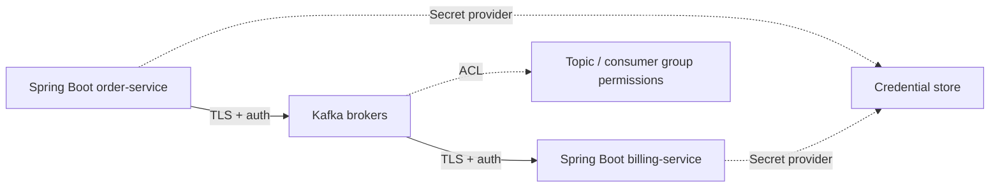
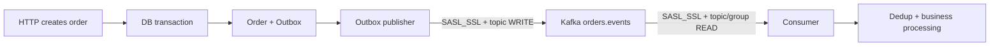

# SSL, SASL, and Credential Protection in Apache Kafka

## 1. Why Must Kafka Connections Be Secured?

In the **SPRING_BOOT_INTEGRATION** module, Apache Kafka serves as a message broker connecting Spring Boot applications with other systems: an HTTP request may emit an event, a database transaction may be pushed to a topic via an outbox, or a consumer may receive an event to update a cache, call a partner API, and persist records. These flows often carry order IDs, payment statuses, customer details, or operational data requiring protection.

Suppose `order-service` publishes events to `orders.events`, and `billing-service` consumes them:



A secure connection must answer **three distinct questions**:

1. **Am I talking to the right broker and is data encrypted in transit?** → TLS (Kafka uses the config prefix `SSL`).
2. **How does the broker identify which client is connecting?** → SASL or client certificates in mutual TLS (mTLS).
3. **What actions is the authenticated client permitted to perform?** → ACLs / authorization policies on the broker or managed Kafka platform.

**SSL/TLS, SASL, and ACLs complement each other; none replaces the others.** Having TLS does not verify client identity or restrict permissions. Having a valid username/password does not authorize reading every topic. And a properly secured connection still gets compromised if an app leaks passwords in repositories, logs, or container images.

## 2. Distinguishing TLS, SASL, ACLs, and Connection Protocols

### 2.1. Kafka Uses the Name "SSL" While Implementing TLS

Property names such as `security.protocol=SSL`, `ssl.truststore.location`, and `ssl.keystore.location` retain "SSL" for historical reasons. In deployment, enforce **modern TLS versions** supported by the broker, JVM, and organizational policy, avoiding legacy SSL protocols or weak ciphers. TLS provides an encrypted channel and lets clients verify broker identity via certificates.

| `security.protocol` | Channel Encryption | Typical Client Authentication | Usage Guidance |
| --- | --- | --- | --- |
| `PLAINTEXT` | No | None at Kafka transport layer | Suitable only for strictly isolated test environments |
| `SSL` | Yes, via TLS | Optional client certificates if broker requires mTLS | When authenticating via client certificates |
| `SASL_PLAINTEXT` | No | SASL | Avoid in any environment carrying real credentials or data |
| `SASL_SSL` | Yes, via TLS | SASL, e.g., SCRAM or OAuth | Standard choice for Spring Boot apps connecting to authenticated Kafka |

In `SASL_SSL`, TLS secures the transport first, then SASL authenticates the client to the broker. SASL **does not encrypt message payloads on its own**. Using `SCRAM-SHA-512` over `SASL_PLAINTEXT` leaves payloads unencrypted on the wire. `PLAIN` requires TLS even more urgently because its credentials are not separately encrypted at the SASL layer.

**ACLs (Access Control Lists)** enforce authorization after authentication: principal `User:orders-producer` can `WRITE` to `orders.events` yet cannot `READ` topics belonging to another system. Brokers need an appropriate authorizer/authorization policy; exact mechanisms depend on self-managed Apache Kafka vs. managed Kafka services.

### 2.2. Protection Boundaries

| Layer | Protects Against | Does Not Automatically Protect |
| --- | --- | --- |
| TLS | Eavesdropping/tampering on client–broker links; verifies broker certificates | Data at rest on broker disks, messages already decoded by consumers, topic permissions |
| SASL | Identifies client using a broker-supported mechanism | Resource authorization, secrets leaked into logs |
| mTLS | Client certificate proves connecting identity when required by broker | Fine-grained permissions without an authorizer |
| ACL/RBAC | Limits producer, consumer, and admin actions per resource | Transport or storage encryption |
| Secret management | Securely stores, issues, distributes, and revokes credentials | Disabled hostname verification or overly broad permissions |
| Business data hygiene | Limits PII exposure across messages, logs, DLQs, DBs, and caches | Securing an unencrypted Kafka connection |

## 3. TLS: Broker Authentication and Transport Encryption

### 3.1. How Does the Client Authenticate the Broker?

When connecting to `broker1.kafka.example.net:9093`, the Kafka client opens a TLS handshake and checks:

- The broker certificate is valid and chains to a trusted CA.
- The connected hostname matches an entry in the broker certificate's **Subject Alternative Name (SAN)**.
- The TLS protocol and cipher suite are accepted by both broker and JVM.

Kafka uses `ssl.truststore.*` (or equivalent trust certificate settings) to specify trusted CAs. **Truststores** hold certificates used to trust brokers; **keystores** hold the client's certificate and private key for mTLS. Never confuse the two.

Example Kafka client using a PKCS12 truststore:

```properties
security.protocol=SSL
ssl.truststore.type=PKCS12
ssl.truststore.location=/run/secrets/kafka/client-truststore.p12
ssl.truststore.password=<provided-at-runtime>
ssl.endpoint.identification.algorithm=https
```

`ssl.endpoint.identification.algorithm=https` enables HTTPS-style hostname verification for TLS. Keep this active; **never clear it to an empty string** to silence certificate errors in production. If hostnames mismatch, fix the certificate SANs, the `bootstrap.servers` hostnames, or the broker's `advertised.listeners`.

`/run/secrets/...` illustrates a file mounted from a secret manager; `<provided-at-runtime>` is a placeholder, not a real password. Never commit truststores, keystores containing private keys, or their passwords to repositories.

### 3.2. Mind `advertised.listeners` and All Cluster Brokers

`bootstrap.servers` is only the initial entry point for fetching cluster metadata; Kafka clients subsequently connect to **every broker address advertised in that metadata**. Security therefore applies far beyond the first host.

For instance, a client bootstraps via `kafka-entry.example.net:9093`, and metadata returns `broker-1.example.net:9093` and `broker-2.example.net:9093`. DNS, firewalls, and TLS certificates on **every host the client actually connects to** must match. Never disable hostname verification when metadata returns internal names absent from certificates.

Behind load balancers, ingresses, proxies, or Kubernetes, inspect listeners, SNI, DNS, SANs, and actual network paths. Restrict egress at the network layer if untrusted hosts shouldn't be reachable; `bootstrap.servers` alone is not an allowlist constraining broker addresses returned by metadata.

### 3.3. mTLS: When the Client Also Presents a Certificate

When brokers set `ssl.client.auth=required` on a TLS listener, clients must present a valid certificate. The client then needs a **keystore** containing its certificate and private key, in addition to the truststore verifying the broker.

```properties
security.protocol=SSL
ssl.truststore.type=PKCS12
ssl.truststore.location=/run/secrets/kafka/truststore.p12
ssl.truststore.password=<truststore-password>
ssl.keystore.type=PKCS12
ssl.keystore.location=/run/secrets/kafka/client-keystore.p12
ssl.keystore.password=<keystore-password>
ssl.key.password=<private-key-password>
ssl.endpoint.identification.algorithm=https
```

Values inside `<...>` are placeholders. `ssl.key.password` reflects how the private key is protected inside the keystore; do not assume a shared password when unneeded. With mTLS, brokers must trust the issuing client CA, map certificate identities to principals, and enforce ACLs for those principals.

If a listener authenticates via SASL, do not assume merely adding a keystore enables mTLS; broker listeners, security protocols, and principal mapping must align. `SSL` + mTLS above is a common standalone setup.

### 3.4. Certificate Lifecycle

TLS certificates expire. Track expirations and automate renewal, revocation, and rotation. In multi-broker clusters, use CAs/certificates accepted by clients and maintain an overlap window when rotating CAs to avoid outages. Verify how your Kafka client version and infrastructure reload truststores/keystores: some updates apply only to new connections or require client re-creation depending on version and configuration.

When certificate issues arise, fix the root cause in issuance or deployment—never disable TLS or hostname verification.

## 4. SASL: Authenticating Clients to Kafka Brokers

**SASL (Simple Authentication and Security Layer)** is an authentication framework; Kafka supports multiple mechanisms depending on broker and client configuration.

| SASL Mechanism | How It Authenticates | When to Consider |
| --- | --- | --- |
| `PLAIN` | Username/password sent in PLAIN exchange | TLS-protected environments where broker/provider requires it |
| `SCRAM-SHA-256` / `SCRAM-SHA-512` | Challenge–response using stored salted secrets | Per-service accounts; generally prefer `SHA-512` where supported |
| `OAUTHBEARER` | Bearer tokens issued by an identity provider | Environments integrated with OAuth/OIDC with proper token handlers/validators |
| `GSSAPI` | Kerberos | Organizations running Kerberos infrastructure |

Supported mechanisms depend on the broker listener and identity system; a client **cannot force a mechanism the broker has not enabled**.

### 4.1. SCRAM over `SASL_SSL`

With SCRAM, brokers must support `SCRAM-SHA-512` and accounts must be created/authorized. Clients pass credentials via `sasl.jaas.config`.

```properties
security.protocol=SASL_SSL
sasl.mechanism=SCRAM-SHA-512
sasl.jaas.config=org.apache.kafka.common.security.scram.ScramLoginModule required username="orders-service" password="<injected-secret>";
```

This JAAS string illustrates *syntax*, not a value allowed in source code. In real deployments, inject the entire sensitive configuration or construct it in memory from a secret provider. Note that `"` and `\` characters in secrets must be escaped per JAAS syntax; never concatenate untrusted input into JAAS strings.

SCRAM enables password-based authentication yet **does not encrypt payloads in place of TLS**. Always pair it with `SASL_SSL` even though SCRAM avoids sending raw passwords on the wire. Never treat `SHA-512` as proof the connection is encrypted.

### 4.2. How PLAIN, OAuth, and Kerberos Differ

- **PLAIN:** credentials appear in the authentication exchange; requires TLS channel protection. Never use `SASL_PLAINTEXT` with real credentials.
- **OAUTHBEARER:** requires configuring token acquisition, transmission, and broker-side validation of signatures, issuer, audience, expiry, and scopes. Setting the mechanism name alone does not secure an OAuth broker; matching callback handlers/extensions for your platform are required. Tokens are secrets—prevent logging and manage refresh lifecycles.
- **GSSAPI:** requires managing principals, keytabs/tickets, and Kerberos synchronization. Keytabs are as sensitive as private keys—never bake them into container images or log them.

Assign a dedicated identity per service or business role rather than sharing a Kafka admin account. If `order-service` only needs to publish to `orders.events`, granting it read/write access across every topic turns a single password leak into a cluster-wide breach.

## 5. Configuring Spring Boot to Connect to Kafka via `SASL_SSL`

With Spring Boot and Spring for Apache Kafka, Kafka client properties can be configured under `spring.kafka.properties`. Shared properties apply to producers, consumers, and related Kafka clients initialized by Boot unless overridden specifically.

### 5.1. `application.yml` Example

```yaml
spring:
  kafka:
    bootstrap-servers: ${KAFKA_BOOTSTRAP_SERVERS}
    properties:
      "[security.protocol]": SASL_SSL
      "[sasl.mechanism]": SCRAM-SHA-512
      "[sasl.jaas.config]": ${KAFKA_SASL_JAAS_CONFIG}
      "[ssl.truststore.type]": PKCS12
      "[ssl.truststore.location]": ${KAFKA_TRUSTSTORE_LOCATION}
      "[ssl.truststore.password]": ${KAFKA_TRUSTSTORE_PASSWORD}
      "[ssl.endpoint.identification.algorithm]": https
    producer:
      acks: all
    consumer:
      group-id: orders-billing-sync
      auto-offset-reset: earliest
```

Quoted square brackets **preserve dotted Kafka client property keys** when Spring Boot binds the `properties` map. This is an illustrative configuration, not a one-size-fits-all security template: if your Kafka service uses PEM certificates, non-PKCS12 truststores, or IAM/OAuth instead of SCRAM, adjust client settings per your provider.

The application receives these values at runtime from its environment or secret provider:

| Parameter | Content | Management |
| --- | --- | --- |
| `KAFKA_BOOTSTRAP_SERVERS` | List of `host:port` bootstrap brokers | Environment config; restrict allowed hosts |
| `KAFKA_SASL_JAAS_CONFIG` | Full JAAS string containing username/password from secret store | Secret manager or protected secret injection |
| `KAFKA_TRUSTSTORE_LOCATION` | Path to mounted truststore file | Non-secret path configuration |
| `KAFKA_TRUSTSTORE_PASSWORD` | Truststore password if required | Secret manager |

Example shape of the `KAFKA_SASL_JAAS_CONFIG` **secret value**:

```text
org.apache.kafka.common.security.scram.ScramLoginModule required username="orders-service" password="<secret-at-runtime>";
```

Never place that string with real passwords into `application.yml`, `application.properties`, committed `.env` files, Gradle tasks, Dockerfiles, tickets, or internal docs. When passing secrets via environment variables, remember operators/diagnostic tools or process dumps may inspect them; secure your secret manager and platform injection mechanisms accordingly.

In practice, teams may choose PEM SSL configs over PKCS12—for instance, supplying CA certificates via `ssl.truststore.certificates` in PEM format; avoid mixing incompatible truststore file properties simultaneously. Exact properties depend on your Kafka client version, broker, and managed service.

### 5.2. Which Beans and Producers/Consumers Use This Config?

With `spring-kafka`, Spring Boot auto-configures `KafkaTemplate`, `ProducerFactory`, `ConsumerFactory`, and listener containers from `spring.kafka`. Example:

```java
@Service
class OrderEventPublisher {
    private final KafkaTemplate<String, String> kafkaTemplate;

    OrderEventPublisher(KafkaTemplate<String, String> kafkaTemplate) {
        this.kafkaTemplate = kafkaTemplate;
    }

    CompletableFuture<SendResult<String, String>> publish(
        String orderId, String jsonPayload
    ) {
        return kafkaTemplate.send("orders.events", orderId, jsonPayload);
    }
}
```

This snippet illustrates where the producer uses the connection config: the app needs matching String serializers (if not already provided by Boot defaults). Handle the `CompletableFuture` result at the business layer to detect send success/failure. When events originate alongside a DB transaction, design an outbox or dedicated coordination; **TLS and SASL do not provide DB–Kafka atomicity**.

On the consumer side, a `@KafkaListener` sharing the client config receives messages once its identity holds `READ` permissions on the topic and group. Consumers still need deduplication because Kafka/Spring Kafka deliveries can repeat; SSL/SASL does not provide business idempotency.

When producers and consumers need **different identities or permissions**, isolate them under `spring.kafka.producer.properties`, `spring.kafka.consumer.properties`, or separate factories. Never place a high-privilege identity into shared `spring.kafka.properties` for every client merely for convenience.

### 5.3. Configuring TLS Client Certificates (mTLS) in Spring Boot

When brokers authenticate via client certificates instead of SASL on a TLS listener, configuration looks like:

```yaml
spring:
  kafka:
    bootstrap-servers: ${KAFKA_BOOTSTRAP_SERVERS}
    properties:
      "[security.protocol]": SSL
      "[ssl.truststore.type]": PKCS12
      "[ssl.truststore.location]": ${KAFKA_TRUSTSTORE_LOCATION}
      "[ssl.truststore.password]": ${KAFKA_TRUSTSTORE_PASSWORD}
      "[ssl.keystore.type]": PKCS12
      "[ssl.keystore.location]": ${KAFKA_KEYSTORE_LOCATION}
      "[ssl.keystore.password]": ${KAFKA_KEYSTORE_PASSWORD}
      "[ssl.key.password]": ${KAFKA_KEY_PASSWORD}
      "[ssl.endpoint.identification.algorithm]": https
```

This is an **alternative** to SCRAM above, not extra boilerplate to layer onto every SASL deployment. Brokers must configure a listener supporting client certificate auth and proper principal mapping. Never fall back to `security.protocol=PLAINTEXT` or `SASL_PLAINTEXT` as a temporary workaround for TLS handshake errors.

## 6. Protecting Credentials Throughout Their Lifecycle

### 6.1. Where Can Credentials Leak?

| Risk Surface | Scenario | Prevention |
| --- | --- | --- |
| Repository and Git history | Password committed to `application-prod.yml` and deleted in a later commit | Never commit secrets; scan Git history; rotate immediately if ever exposed |
| Container images / build logs | `ARG` or `RUN` embeds credentials; CI build prints them | Inject secrets only at runtime via secure channels; scrub CI/CD logs |
| Files on runtime host | JAAS files, keytabs, or PKCS12 files have world-readable permissions | Mount read-only; restrict file ownership/mode to the app user |
| Environment variables | Operators/debug dumps inspect process env and read JAAS strings | Enforce RBAC, restrict diagnostic dumps, prefer secret mounts/injectors |
| App logs and exceptions | Dumping `KafkaProperties` or raw client configs; stack traces expose secrets | Mask `sasl.jaas.config`, passwords, tokens, private keys; never dump raw config |
| Monitoring / Actuator | `env` endpoint or monitoring UI exposes properties | Restrict/disable endpoints, enable sanitization/masking, enforce auth |
| Backups, snapshots, crash dumps | Secrets captured in memory/disk snapshots | Encrypt backups, restrict access/retention, monitor exposure events |

While Kafka clients treat some sensitive properties as `Password` types, **never assume every logger, dashboard, debug endpoint, or custom helper masks them**. Never print full config objects or unredacted exception dumps.

### 6.2. Secret Management Principles

1. Give each service and environment an independent identity; issue least-privilege secrets.
2. Store secrets in a secret manager, platform secret store, or protected volume mount; inject only into processes that need them.
3. Never put passwords/tokens into URLs, metric labels, message payloads, topic names, consumer group IDs, filenames, or CLI arguments.
4. Establish rotation schedules plus emergency revocation/rotation runbooks. After rotation, verify clients reconnect with new credentials—which may require reinitializing Kafka producers/consumers or rolling pods.
5. For client certificates: restrict private key read permissions; for OAuth: validate issuer, audience, scope, and expiry, and never log bearer tokens.
6. Separate broker/ACL admin privileges from runtime producer/consumer identities. Audit changes to ACLs, principals, listeners, and secret access.

For example, when rotating a SCRAM password, do not expect open TCP connections to pick it up automatically. Coordinate credential updates on the broker/provider and client deployments—using dual-credential overlap if supported to avoid downtime. If a secret may have leaked, **revoke and rotate the actual credential**; deleting logs or amending commits never invalidates an exposed secret.

## 7. Kafka Access Control: Principle of Least Privilege

Authentication tells the broker **who** is connecting. Authorization decides **what** they may do on topics, consumer groups, or other resources.

Access design for two services:

| Identity | Required Permissions | Should Not Be Granted by Default |
| --- | --- | --- |
| `orders-producer` | `WRITE` on topic `orders.events`, plus required metadata permissions per authorizer | `READ` on all topics, topic create/delete, cluster admin |
| `billing-consumer` | `READ` on topic `orders.events`; `READ` on consumer group `billing-sync` (plus metadata permissions) | `WRITE` to unrelated topics, ACL modification rights |
| `kafka-ops` | Audited operational admin rights per workflow | Shared as an application runtime account |

Consumers typically require permissions on both the **topic** and the **consumer group**. Exact operation/resource names and granting mechanisms vary by authorizer, Kafka version, and managed service; always test with the real service identity after provisioning ACLs.

Never grant wildcard permissions just to "make errors go away." On authorization failures, inspect the authenticated `principal`, exact topic/group names, and policy—then grant only the missing scoped resource. Broker access control also does not sanitize payload sensitivity: govern schemas, data classification, retention, dead-letter topics (DLTs), backups, downstream sinks, and log access.

## 8. Distinguishing TLS, SASL, ACL, and Network Errors

Many failures surface on producers or consumers as generic timeouts or metadata errors, yet their causes and fixes differ sharply.

| Common Symptom | Possible Cause | Remediation |
| --- | --- | --- |
| `SSLHandshakeException`, `PKIX path building failed` | Client does not trust broker CA/certificate | Verify truststore, cert chain, expiration; never disable TLS verification |
| `No subject alternative DNS name matching ...` | Connected host does not match certificate SAN | Check `bootstrap.servers`, `advertised.listeners`, and broker certificates |
| `SaslAuthenticationException` | Wrong username/password, wrong mechanism, expired token, or broker misconfig | Verify identity/mechanism with operators; rotate if leaked; never log secrets |
| `TopicAuthorizationException` | Principal lacks topic ACL | Grant proper topic ACL; never switch to an admin account |
| Consumer group authorization error | Missing permissions on the group | Check group ID and group ACLs |
| `TimeoutException` fetching metadata or sending | Unreachable broker, DNS/firewall block, overloaded broker, wrong `advertised.listeners`, network policy | Verify actual target endpoints, DNS, routes, listeners, TLS/SASL, and metrics; don't just say "Kafka is slow" |
| Connections rejected after secret rotation | Client holds stale credentials or un-reloaded truststore | Verify rotation rollout, active config, and reinitialize clients if required |

**Never apply infinite retries to configuration or authentication failures.** Bad truststores, wrong passwords, and missing ACLs are permanent errors; tight retry loops generate load and log noise without fixing anything. For brief network glitches, Kafka clients handle internal reconnects/retries; applications should enforce deadlines, backoff, and monitoring rather than stacking arbitrary retry layers.

Specifically, never configure an automatic fallback from `SASL_SSL → SASL_PLAINTEXT` or `SSL → PLAINTEXT` on connection errors. Downgrading security exposes credentials and payloads on the wire.

## 9. Kafka Security in Real Integration Flows

### 9.1. DB → Kafka Transaction Example

When processing an order, `order-service` writes to the DB and emits `OrderCreated`. If DB commit succeeds and publishing fails due to a Kafka outage, TLS/SASL cannot guarantee transactional delivery. Use a **transactional outbox**: the DB transaction saves the order and outbox row; a worker holding topic `WRITE` permission publishes from the outbox; an idempotent consumer handles redeliveries.



Here:

- TLS protects bytes over the wire between publishers/consumers and brokers.
- SASL and ACLs separate publisher and consumer identities and permissions.
- Outbox, idempotency, offset handling, and retries deliver business reliability—they are **not solved by TLS/SASL**.
- Logs and DLTs must avoid storing raw PII or secrets; retention and DLT ACLs must also be governed.

### 9.2. Data Inside Topics and Downstream Systems

TLS protects **in-transit connections**, not necessarily bytes at rest on disk or after a consumer decodes them. Where stricter protection applies, enforce at-rest encryption on brokers/volumes/backups, retention bounds, topic/DLT read ACLs, and application-level payload encryption per producer–consumer agreement.

Never embed HTTP bearer tokens, DB passwords, or Vault secrets into Kafka messages to "pass them to another service." Each consuming service should obtain its own scoped credentials. When publishing events, follow data minimization; avoid serializing full objects full of sensitive fields just for convenience.

### 9.3. Operational Observability Without Leaking Credentials

Measure:

- Connection failure rates by stage (TLS, SASL, authorization, network).
- Publish latency, retry counts, failed records, and metadata/connection health.
- Consumer lag and group membership changes; safe indicators of approaching credential/certificate expiration.
- ACL modification counts, secret issuance/revocation events, and TLS certificate expiry dates.

Use sanitized service names, logical cluster names, non-sensitive topic/group names, and standardized error codes. **Never place usernames/passwords, tokens, private keys, JAAS strings, or sensitive payloads into metric tags, trace attributes, or logs.** Example error log: `service=order-service kafka_cluster=orders-prod stage=authentication result=failed`—without `sasl.jaas.config`.

## 10. Testing Security Configuration Before Deployment

Unit testing a message handler **cannot prove** TLS handshakes, SCRAM authentication, or ACLs work. Run integration tests against a TLS/SASL-enabled broker mirroring production (in staging or preconfigured container/test infrastructure).

| Scenario | Test Action | Expected Outcome |
| --- | --- | --- |
| Valid connection | Client has valid CA, host, mechanism, credentials, and ACLs | Producer/consumer connect and process allowed events |
| Wrong CA | Truststore does not trust broker CA | Handshake fails; never falls back to `PLAINTEXT` |
| Wrong SAN/hostname | Connect to a host absent from SAN | Client rejects handshake; hostname verification remains active |
| Wrong username/password | Invalid SCRAM credentials | Auth fails; logs reveal no password or JAAS string |
| Wrong mechanism | Client uses `SCRAM-SHA-512` unsupported by listener | Controlled connection failure; mechanism not silently downgraded |
| Missing `WRITE` permission | Producer lacks topic ACL | Publish rejected; no record written |
| Missing `READ`/group permission | Consumer lacks ACLs | Cannot read data; never widen to wildcards |
| Credential/certificate rotation | Execute active rotation procedure | Clients reconnect cleanly per plan without lowering security |
| Bad host in broker metadata | Simulate wrong `advertised.listeners` DNS/SAN or egress block | Connection failure clearly detected and pinpointed; TLS stays enabled |
| No secrets in logs | Use a synthetic secret with a unique canary token | Scanning logs/traces/metrics/exports finds zero occurrences |

For transactional pipelines, also test temporary Kafka outages: outbox retains pending rows, producer recovers, and consumers deduplicate—a **separate** correctness requirement from security testing. On managed Kafka platforms, IAM/SASL setup and ACL semantics can differ from self-hosted Kafka; test with production-equivalent identities per platform guidance.

## 11. Pre-Operations Checklist

- [ ] Using `SASL_SSL` or `SSL` matching the chosen auth mechanism; no cleartext credential protocols.
- [ ] Truststore holds the right CA; hostname verification stays enabled; SANs cover all advertised broker hosts.
- [ ] If using mTLS, keystore/private key readable only by the authorized process; broker verifies certificate identity.
- [ ] If using SASL, mechanism matches broker; credentials/tokens belong to dedicated identities and never live in source code.
- [ ] Secrets are injected at runtime with rotation, revocation, and access auditing.
- [ ] Producers, consumers, and admins use least-privilege identities; topic/group ACLs tested with real identities.
- [ ] `sasl.jaas.config`, passwords, tokens, keytabs, private keys, and sensitive payloads never appear in logs/dumps.
- [ ] Monitoring tracks TLS/SASL/authorization failures and separates config errors from network blips.
- [ ] Retry/reconnect logic never downgrades security or duplicates business actions.
- [ ] Data in topics, DLQs, backups, caches, and DBs has dedicated protection policies and governed contracts.

### Self-Check Questions

1. Why is `security.protocol=SASL_PLAINTEXT` unsafe even when using `SCRAM-SHA-512`?
2. What distinct purposes do a truststore and a keystore serve? When does a Kafka client need a keystore?
3. A Kafka client passes the TLS handshake, yet the producer gets `TopicAuthorizationException`. Where should you inspect and fix?
4. Why is valid DNS for `bootstrap.servers` not enough to guarantee all Kafka connections succeed?
5. If a SCRAM password accidentally leaks into logs, what actions are required beyond deleting the log lines?
6. Do TLS and SASL solve the problem of a DB commit succeeding while publishing the Kafka event fails? Name the complementary mechanism.

**Key Takeaway:** For Kafka in Spring Boot, build connection security in layers: **TLS verifies brokers and encrypts traffic → SASL/mTLS authenticates clients → ACLs restrict actions → secret management protects credentials**. Only on top of that foundation do transactions, retries, deduplication, and observability fulfill business reliability requirements.
