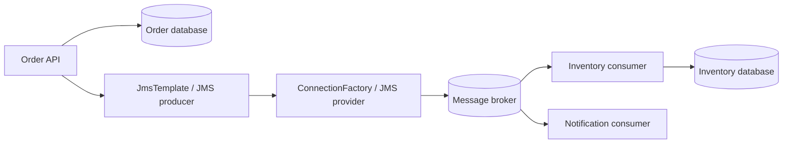
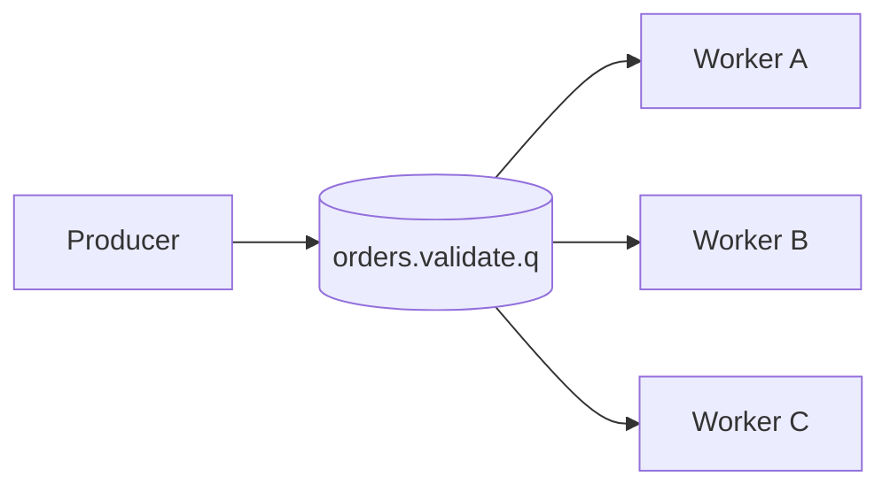
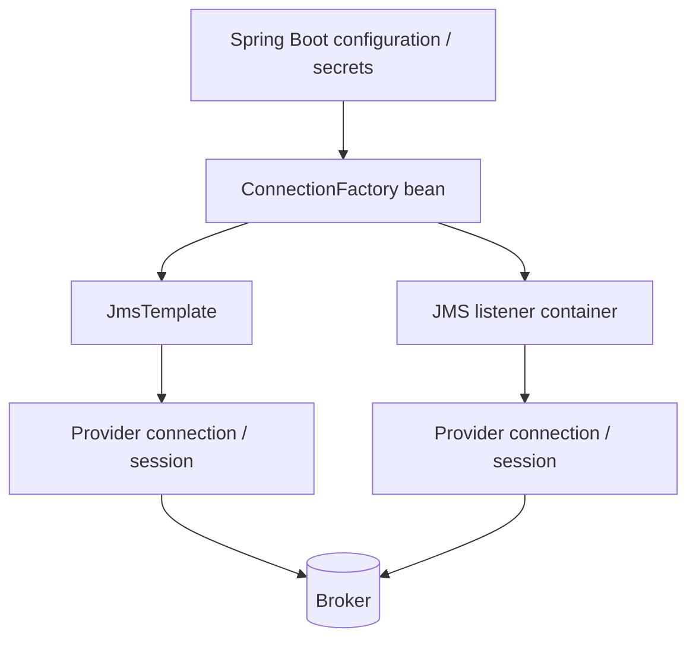

# Jakarta JMS, Broker, and ConnectionFactory

## 1. The integration problem: why does a Spring Boot service need JMS?

In **SPRING_BOOT_INTEGRATION**, many systems exchange data via HTTP clients or databases, but not every task is suited for synchronous calls. For example, once an order has been recorded, the system may need to send notifications, update inventory, or push data to a shipping service. If each service is called sequentially over HTTP, the response time and availability of the ordering API depend on the downstream services.

**Jakarta Messaging (Jakarta JMS)** is the standard Java API for sending and receiving messages through a messaging system. Instead of knowing the direct HTTP URL of each consumer, a producer puts a message into a **destination** managed by a broker; a consumer processes the message when ready. This decouples the time of sending from the time of processing, while also introducing questions about transactions, duplicates, ordering, retries, security, and observability.

Example integration flow:



The diagram illustrates the components involved. If both inventory and notifications need to receive **every event**, you cannot by default use a single queue with two consumers; you need a topic and appropriate subscriptions, or broker-side routing/fan-out into separate queues depending on broker capabilities.

**Learning objectives:** understand Jakarta JMS as an API contract, distinguish it from a message broker and network protocol, know the role of `ConnectionFactory`, choose between queues and topics, configure Spring Boot, implement producers/consumers, control acknowledgment, redelivery, idempotency, and write integration tests.

## 2. Jakarta JMS is an API; a broker is the runtime system

Jakarta JMS defines a set of Java interfaces and programming semantics for messaging, including `ConnectionFactory`, `Destination`, `Queue`, `Topic`, `JMSContext`, `Message`, `JMSProducer`, `JMSConsumer`, and classic APIs such as `Connection`, `Session`, `MessageProducer`, and `MessageConsumer`.

A **Broker** is the software or service responsible for accepting, routing, queuing, storing, and distributing messages. A broker also provides policies for authentication, authorization, persistence, redelivery, dead-letter queues, resource limits, and monitoring. These details depend on the actual product and configuration.

| Component | Responsibility | Example |
| --- | --- | --- |
| Producer application | Creates message content, attaches identifiers and metadata | Order Service |
| Jakarta JMS API | Standardizes Java code to create connections, send, and receive messages | `jakarta.jms.ConnectionFactory` |
| JMS client/provider | Implements the API, connects to the broker over a supported protocol | Artemis JMS client |
| Broker | Manages destinations, stores and distributes messages | ActiveMQ Artemis, ActiveMQ Classic, or IBM MQ |
| Consumer application | Reads messages, executes business logic, decides completion or failure | Inventory Service |

Common misconceptions:

- **JMS is not a universal network wire protocol.** Just because two brokers "support JMS" does not mean the client of broker A can automatically connect to broker B; the client and wire-level protocol must be compatible.
- **A broker is not a Maven dependency.** Adding a starter provides the client library and Spring configuration, but the application still needs a running broker with granted access.
- **JMS is not synonymous with Kafka or AMQP.** Some brokers support multiple protocols, but each API has different semantics and clients. Do not assume a broker that only supports AMQP can be used directly via JMS without a compatible provider.
- **Spring JMS sits on top of Jakarta JMS.** Spring reduces resource-management boilerplate and integrates listeners, while message storage and delivery guarantees still depend on the broker and business design.

Starting with Jakarta EE 9, the JMS package moved from `javax.jms.*` to **`jakarta.jms.*`**. Spring Boot 3.x / Spring Framework 6 applications use the Jakarta namespace; when migrating from Boot 2.x, you must check the API, client, and broker versions together. Do not mix legacy `javax.jms` dependencies into a configuration intended for `jakarta.jms` and expect binary compatibility between the two.

## 3. Queues, topics, and delivery behavior

JMS defines two fundamental destination models:

### 3.1. Queue: load sharing across consumers

A **Queue** is used for tasks that a group of workers can share. Multiple consumers reading from the same queue typically act as *competing consumers*: a message is delivered to one consumer for processing at a time; if processing fails, the broker can redeliver it according to its redelivery policy.



Increasing the number of consumers does not mean each message is delivered to all three workers. A consumer may see redelivered copies after errors, so duplicate-processing protection is still required even with queues.

### 3.2. Topic: broadcasting events to multiple subscriptions

A **Topic** fits when multiple independent groups want to receive the same event. For example, `orders.created.topic` serves an inventory subscription and a notification subscription. Each subscription is a separate receiving group according to the broker configuration.

- **Non-durable subscription** typically receives messages only while the subscription is active; periods when the subscriber is absent can cause it to miss events.
- **Durable subscription** allows the broker to retain matching messages while a subscriber is disconnected according to durable subscription rules; it requires configuring a client ID, subscription name, and corresponding provider constraints.
- **Shared subscription** allows multiple consumers to share load within the same subscription if the broker/provider and API support it.

**Message persistence** and **durable subscription** are two different concepts. A persistent message does not automatically turn every topic subscription into a durable one.

| Need | Common choice |
| --- | --- |
| A task processed by one of many workers | Queue |
| Each business system needs its own copy of an event | Topic with appropriate subscriptions, or broker-side fan-out |
| Long-term replay and multiple independent groups reading history | Consider an event log/streaming platform; a plain JMS queue does not inherently retain history for replay |
| Every message must take effect in the database exactly once | Queue/topic alone is not enough; requires idempotency and transaction/outbox/inbox |

Destination names like `orders.created.q` or `orders.created.topic` are only naming conventions. How a broker creates addresses, queues, or bindings depends on the provider; you should not treat application "auto-creation" of destinations in development as the default production provisioning mechanism.

## 4. How does `ConnectionFactory` connect Spring Boot code to the broker?

`jakarta.jms.ConnectionFactory` is a **factory** that creates connections or `JMSContext` instances for a JMS provider. The factory carries the information needed to open connections: endpoints, security, timeouts, reconnect/failover policies, and client-specific options. Spring Boot can create the factory via auto-configuration; the application injects it as a dependency.

Typical chain of responsibility:



Distinguish lifecycles and sharing rules:

| Object | Role | Usage principle |
| --- | --- | --- |
| `ConnectionFactory` | Configures/creates connections to the provider | Usually a singleton bean that can be injected into multiple components |
| `Connection` | Logical connection from application to broker | Opened/closed per API/provider rules; Spring may cache or reuse it |
| `Session` | Context for sending/receiving and JMS acknowledgment/transactions | Do not arbitrarily share concurrently across multiple threads |
| `JMSContext` | Simplified API combining Connection + Session | Has a lifecycle that must be closed; do not treat as a shared thread-safe singleton |
| `JmsTemplate` | Spring abstraction for sending/receiving and managing resources | Reusable once configured; application code does not need to open a session per call |
| Listener container | Manages consumers, sessions, and listening lifecycle | Responsible for concurrency, acknowledgment, transactions, and recovery |

**ConnectionFactory is not the broker**: having a factory bean does not prove the broker is connected or ready. Many providers establish connections lazily; errors may surface only when a producer/consumer performs an operation. Likewise, a successful startup is not enough to prove network paths, ACLs, and destinations are all valid.

When multiple brokers or multiple tenants with different configurations are needed, you can define multiple factories with explicit bean names and wire them specifically to each `JmsTemplate` or listener container. Do not apply a single default factory to every flow if flows have separate security, QoS, or permission requirements.

## 5. Practical integration with Spring Boot and ActiveMQ Artemis

The examples in this lesson use **Spring Boot 3.x**, the `jakarta.jms` package, and a **standalone ActiveMQ Artemis broker**. Artemis is chosen for illustration; the JMS principles also apply to other JMS brokers, though connection properties and broker capabilities may vary.

### 5.1. Dependency

Maven projects have versions managed through the Spring Boot parent/BOM:

```xml
<dependency>
    <groupId>org.springframework.boot</groupId>
    <artifactId>spring-boot-starter-artemis</artifactId>
</dependency>
```

The starter provides Spring JMS and the Artemis client libraries needed for typical integration. There is no need to declare JMS clients for multiple brokers at the same time "just to be safe." If your organization uses ActiveMQ Classic or IBM MQ, choose the compatible provider/starter and follow that provider's configuration guide.

### 5.2. Client configuration for an external broker

Example `application.yml`:

```yaml
spring:
  artemis:
    mode: native
    broker-url: tcp://localhost:61616
    user: ${ARTEMIS_USERNAME}
    password: ${ARTEMIS_PASSWORD}
```

- `mode: native` means connecting to a separate running broker. Running the broker and declaring destinations belong to infrastructure configuration.
- `broker-url` and port are illustrative values; replace them with the actual endpoint, network policy, and provider-supported protocol.
- Credentials are supplied via environment variables or a secret manager. In production, enable TLS and certificate verification as required by the network architecture.
- If the application runs in a container, `localhost` refers to the application container, not automatically the broker container. Use the appropriate DNS/service name in the deployment network.
- `spring.artemis.*` configuration is specific to Artemis; it cannot be copied verbatim to other JMS providers.

In Spring Boot with matching auto-configuration conditions, the application can inject `ConnectionFactory` and `JmsTemplate`, as well as declare `@JmsListener`. When multiple factories exist, specify explicitly which bean is used.

### 5.3. Sending messages with `JmsTemplate`

Communication between services should pass **versioned data contracts** rather than passing Java objects directly via native object serialization. For example, the application serializes a DTO to JSON using Jackson at the application layer, then sends a `TextMessage` with `JmsTemplate`:

```java
import org.springframework.jms.core.JmsTemplate;
import org.springframework.stereotype.Service;

@Service
public class OrderEventPublisher {
    private final JmsTemplate jmsTemplate;

    public OrderEventPublisher(JmsTemplate jmsTemplate) {
        this.jmsTemplate = jmsTemplate;
    }

    public void publishOrderCreated(
            String eventId, String correlationId, String jsonBody) {

        jmsTemplate.convertAndSend("orders.created.q", jsonBody, message -> {
            message.setStringProperty("eventType", "OrderCreated");
            message.setStringProperty("schemaVersion", "1");
            message.setStringProperty("eventId", eventId);
            message.setJMSCorrelationID(correlationId);
            return message;
        });
    }
}
```

`jsonBody` must be built from a DTO with a clear schema and validated. By default, `JmsTemplate` converts a Java `String` into a JMS `TextMessage` through its basic message converter. Avoid relying on native `ObjectMessage` to exchange domain objects across systems: Java types, class versions, deserialization safety, and interoperability become tight couplings.

Useful headers and properties:

- `JMSMessageID`: an identifier assigned by the provider to the message; useful for tracing transport delivery, but does not replace a business event ID.
- `JMSCorrelationID`: links a message to a request or business flow; you can explicitly propagate a trace/correlation ID.
- `JMSReplyTo`: reply destination when the application uses request-reply.
- `JMSRedelivered`: provider flag indicating the message may have been delivered previously; not sufficient to decide whether the business processing succeeded.
- Application properties such as `eventId`, `eventType`, and `schemaVersion`: support dispatching, idempotency, and data contract evolution.

A successful send call **does not prove the consumer has finished processing**. It only reflects the send operation result at the producer/provider layer under the configured delivery and transaction settings. For order workflows, distinguish between "event sent to broker" and "inventory deducted."

### 5.4. Receiving messages with `@JmsListener`

A basic consumer:

```java
import org.springframework.jms.annotation.JmsListener;
import org.springframework.stereotype.Component;

@Component
public class OrderCreatedListener {
    private final OrderProcessingService processingService;

    public OrderCreatedListener(OrderProcessingService processingService) {
        this.processingService = processingService;
    }

    @JmsListener(destination = "orders.created.q")
    public void onOrderCreated(String jsonBody) {
        processingService.process(jsonBody);
    }
}
```

The Spring JMS listener container converts the incoming message into the method argument, manages connections/sessions, and handles exceptions. If `process` fails, how the message is acknowledged, rolled back, retried, or redelivered depends on the **container and broker** configuration, not solely on throwing an exception.

In real applications, the consumer should parse JSON into a DTO based on `schemaVersion`, validate schema/values, verify the appropriate source, use the business event ID to guard against duplicate processing, and record idempotency state together with business data within an appropriate transaction boundary.

## 6. Plain Jakarta JMS API and Spring's role

Outside Spring, Jakarta JMS provides a direct API. The following illustration requires a provider-configured `ConnectionFactory`:

```java
import jakarta.jms.ConnectionFactory;
import jakarta.jms.JMSContext;
import jakarta.jms.Queue;

public class DirectJmsSender {
    public void send(ConnectionFactory factory, String jsonBody) {
        try (JMSContext context =
                 factory.createContext(JMSContext.AUTO_ACKNOWLEDGE)) {
            Queue queue = context.createQueue("orders.created.q");
            context.createProducer().send(queue, jsonBody);
        }
    }
}
```

`JMSContext` combines creating and using connections/sessions in the simplified Jakarta JMS API. The `try-with-resources` block closes the context to release provider resources. However, when using Spring, `JmsTemplate` and listener containers fit most use cases better because Spring integrates resource lifecycles, exception translation, and transactions.

Do not create a `JMSContext` and store it in a singleton service for concurrent access by multiple threads. If you need to control connection pooling, session caching, or client failover, manage them through the factory/provider and measure with realistic workloads instead of implementing custom connection logic in every controller.

## 7. Acknowledgment, transactions, and duplicate delivery

This is the part that determines the reliability of an integration flow. Messaging should not be assumed to mean "put a message in a queue and it is guaranteed to be processed exactly once."

### 7.1. What is acknowledgment?

**Acknowledgment** tells the provider/broker that the consumer has received/completed the message under the active policy. JMS defines session modes such as:

| Mode | Practical meaning | Risks to watch |
| --- | --- | --- |
| `AUTO_ACKNOWLEDGE` | Provider/container automatically acknowledges according to API/container boundaries | Behavior when a listener throws an exception depends on how the container manages the session |
| `CLIENT_ACKNOWLEDGE` | Application explicitly acknowledges via the API | Session-level acknowledgment can cover multiple received messages; it is not automatically per-message ack |
| `DUPS_OK_ACKNOWLEDGE` | Provider may delay acknowledgment and allow redelivery | Consumer must be idempotent |
| Transacted session | Commit/rollback determines send/receive outcomes within the JMS session | Does not cover database or external HTTP service transactions |

These modes are **API-level JMS concepts**; a Spring listener container may add a transaction manager, auto-recovery, and error handling. Do not look only at `@JmsListener` and guess how a message will be retried.

### 7.2. Choosing a transacted session intentionally

Example of creating a dedicated listener container factory to explicitly use JMS session transactions:

```java
import jakarta.jms.ConnectionFactory;
import org.springframework.boot.autoconfigure.jms.DefaultJmsListenerContainerFactoryConfigurer;
import org.springframework.context.annotation.Bean;
import org.springframework.context.annotation.Configuration;
import org.springframework.jms.config.DefaultJmsListenerContainerFactory;

@Configuration
public class JmsListenerConfiguration {
    @Bean
    DefaultJmsListenerContainerFactory orderListenerFactory(
            ConnectionFactory connectionFactory,
            DefaultJmsListenerContainerFactoryConfigurer configurer) {

        var factory = new DefaultJmsListenerContainerFactory();
        configurer.configure(factory, connectionFactory);
        factory.setSessionTransacted(true);
        factory.setConcurrency("2-4");
        return factory;
    }
}
```

Bind this bean to the listener:

```java
@JmsListener(
    destination = "orders.created.q",
    containerFactory = "orderListenerFactory"
)
public void onOrderCreated(String jsonBody) {
    processingService.process(jsonBody);
}
```

With a local JMS session transaction, a successful listener execution leads to committing the session per container mechanics; if an exception is thrown, the session can roll back and the broker applies redelivery. Redelivery count, backoff, poison-message handling, and dead-letter routing are configured per **broker/provider** and must be tested.

The concurrency value is illustrative: increasing parallel consumers can improve throughput but weakens ordering expectations across messages. If a business key requires ordering, you must design appropriate partitioning/grouping or serialization.

**Important transaction boundary:** a local JMS transaction is not automatically atomic with a PostgreSQL/MySQL transaction. For example, if a listener commits the DB and crashes before the JMS ack: the broker may redeliver the message and the consumer runs the DB update again. Adding `@Transactional` for the database does not by itself resolve the boundary between the two systems.

### 7.3. Consumer idempotency

A typical strategy: the producer provides a stable `eventId` for a business event; the consumer stores a processed-event/inbox record with a unique constraint in the **same database transaction** as the business update. When the message is redelivered, the duplicate key is detected and the consumer can complete safely without applying the update a second time.

Logical steps:

1. Receive the message and validate the data contract.
2. Start a database transaction.
3. Insert a `(consumerName, eventId)` marker protected by a unique constraint; if it already exists, skip side effects.
4. Perform the business update and commit the database.
5. Return successfully so the container commits/acks JMS.

If the process dies between steps 4 and 5, redelivery hits the processed marker and finishes safely. Do not rely solely on `JMSMessageID` for business idempotency across producer retries or newly constructed messages.

### 7.4. Outbox when both writing to DB and sending to JMS

Suppose the order API executes:

```text
1. INSERT order into database
2. Send orders.created message to broker
```

If the DB commit succeeds but sending to the broker fails, the system has an order with no event. If you reverse the order, the consumer may receive an event for an order that has not committed or has rolled back.

**Transactional outbox** solves this by writing `orders` and `outbox_events` in the same database transaction, after which a separate publisher reads the outbox to send to JMS, marks it as sent, and retries on failure. This approach can still emit duplicate messages if the publisher crashes between sending and updating the outbox, so consumers still need idempotency.

XA/JTA mechanisms can coordinate distributed transactions in some environments, but they require infrastructure and provider support and come with operational trade-offs; do not treat them as automatically enabled when using `ConnectionFactory`.

## 8. Redelivery, dead-letter queues, and retries

A consumer can fail due to network timeouts, unavailable dependencies, malformed messages, or business bugs. These failures need different handling:

| Failure type | Example | Strategy |
| --- | --- | --- |
| Transient | Temporary database outage, downstream service timeout | Bounded redelivery/backoff; monitor retries |
| Unprocessable | Malformed JSON, unsupported schemaVersion | Route to dead-letter/parking queue and alert for investigation |
| Business invalid | Order already canceled, missing reference | Handle per contract: reject, wait for dependency, or acknowledge and skip |
| Duplicate event | `eventId` already recorded in inbox | Complete successfully after confirming no additional side effects |
| Broker/connection error | Authentication failure, network interruption | Connection recovery, metrics, and alerts; avoid unbounded custom retry loops |

**Dead-letter queue (DLQ)** is typically a broker feature rather than a standard fixed-name destination defined by Jakarta JMS. With Artemis, address settings can specify max delivery attempts, redelivery delay, and dead-letter address; exact configuration belongs to broker operations.

Do not write infinite retry loops inside a listener with `while(true)` because it ties up processing threads, increases load, and prevents the broker from applying redelivery properly. Bounding retries and isolating bad messages prevents a poison message from blocking other work indefinitely.

A message whose TTL expires on the broker does not mean the business workflow has expired; message TTL, order processing deadlines, and DLQ retention are three separate policies to design.

## 9. Security, data contracts, and observability

### 9.1. Securing the connection path

- Use dedicated users/credentials and destination permissions following least privilege; restrict producers to send rights and consumers to receive rights as needed.
- Enable encrypted connections and certificate verification per infrastructure policy, and manage secrets outside source control.
- Do not put unnecessary sensitive information into payloads/headers, logs, or DLQs; brokers may persist messages to disk.
- Manage destinations and ACLs via reviewed deployment configuration/version control, and restrict broad auto-create permissions in production.

### 9.2. Message contracts

A JSON event envelope might look like this:

```json
{
  "eventId": "2cb309cc-a12c-43c3-8fc1-b8e778e19aa1",
  "eventType": "OrderCreated",
  "schemaVersion": 1,
  "occurredAt": "2026-11-21T03:00:00Z",
  "orderId": "ord-1024",
  "totalAmount": "125000.00",
  "currency": "VND"
}
```

This is an example data structure, not a mandatory JMS schema. When multiple services share messages, standardize field semantics, UTC timestamps, currency/decimal types, unknown-field handling, backward compatibility, and versioning rules. `eventId` must remain stable across resends of **the same business event**.

### 9.3. Operational observability

Suggested metrics and logs:

- **Producer:** successful/failed message sends, send latency, timeouts, authentication errors, and outbox backlog status.
- **Broker:** queue depth, enqueue/dequeue rates, age of oldest message, consumer count, in-flight/unacknowledged messages, redeliveries, DLQ size, disk/memory usage.
- **Consumer:** throughput, processing latency, failed message count, duplicate skips, retry count, dependency wait time, schema error count.
- **Tracing:** propagate correlation/trace context via controlled headers or application properties; link producer, broker, and consumer spans according to instrumentation capabilities.

A dashboard showing low queue depth does not by itself prove the system is healthy: the producer may have stopped sending. High queue depth is not necessarily an error if consumers are processing an expected batch. Monitor arrival rate, processing rate, lag/age, and error rates together, with alert thresholds aligned to SLAs.

## 10. Testing JMS with a real broker

Mocking `JmsTemplate` is a fast way to unit-test business logic, but it does not verify connections, permissions, destinations, serializers, persistence, redelivery, or transaction configuration. For Spring Boot integration, you should have integration tests connecting to **the same broker type** close to production, such as an Artemis broker running in a dedicated container for test/CI.

A basic smoke test in an environment with a test broker and auto-configured `JmsTemplate`:

```java
import static org.assertj.core.api.Assertions.assertThat;

import org.junit.jupiter.api.Test;
import org.springframework.beans.factory.annotation.Autowired;
import org.springframework.boot.test.context.SpringBootTest;
import org.springframework.jms.core.JmsTemplate;

@SpringBootTest
class JmsRoundTripTest {
    @Autowired
    JmsTemplate jmsTemplate;

    @Test
    void canSendAndReceiveTextMessage() {
        jmsTemplate.setReceiveTimeout(2000);

        String queue = "integration.test.roundtrip.q";
        String payload = "test-" + java.util.UUID.randomUUID();

        jmsTemplate.convertAndSend(queue, payload);

        Object received = jmsTemplate.receiveAndConvert(queue);
        assertThat(received).isEqualTo(payload);
    }
}
```

This test requires a broker granting send/receive permissions on `integration.test.roundtrip.q`, the template configured in **queue mode**, and no other consumer competing on the test queue. In larger test suites, isolate destinations per test (e.g., unique queue names), manage cleanup, avoid mutating shared `JmsTemplate` state when tests run in parallel, and set timeouts suitable for CI.

Additional cases to test beyond round-trip:

1. Producer send fails when credentials/ACLs are invalid or the broker is unavailable.
2. Consumer receives the expected `TextMessage` and event metadata; older contract versions are handled per policy.
3. Listener throws an exception: broker redelivers per configuration; after exceeding retry limits, the message moves to the DLQ.
4. Consumer commits DB update then crashes before JMS ack: redelivered event produces no duplicate side effects.
5. Topic with two independent subscriptions: both receive event copies according to configured durability.
6. Broker restart/failover: client reconnects properly, does not hang requests indefinitely, and metrics surface the disruption.
7. Increased load: consumer count/concurrency, latency, queue depth, and processing order remain within practical requirements.

Do not use an embedded broker setup as proof that a production native broker, ACLs/TLS, failover, and DLQ will behave identically. When using Testcontainers, pin the image version to match the production broker and explicitly configure addresses/queues in tests.

## 11. When JMS fits and how to choose in integration systems

JMS is well suited when a Java/Spring Boot system needs message queues or pub/sub over a broker supporting Jakarta JMS and wants to leverage Spring `JmsTemplate`, listener containers, session transactions, and existing vendor operational practices. JMS is especially common in enterprise ecosystems running Artemis, ActiveMQ, or IBM MQ.

If you need a long-term replayable event log, very high data volumes, and multiple independent consumer groups reading history by offset, evaluate streaming systems like Kafka. If the architecture requires AMQP with specific routing topologies, compare Spring AMQP/RabbitMQ or the deployed broker's native protocol. These options differ in API and operational model; JMS does not inherently provide all of their features.

### Practical scenario: publishing order events

With Order Service persisting orders in PostgreSQL and notifying Inventory and Notification:

1. Write the order and outbox event in the same database transaction.
2. Publisher reads the outbox event, builds JSON with a stable `eventId`, and sends it to a JMS destination designed for fan-out or separate queues.
3. Broker stores/distributes the message according to persistence, subscription, and redelivery settings.
4. Each consumer maintains an idempotency inbox in its own database transaction.
5. Consumers experiencing transient errors are retried with limits; permanent failures go to the DLQ for investigation.
6. Dashboards monitor outbox backlog, message age, delivery latency, processing errors, and DLQ depth.

**Pre-deployment checklist:**

- Verify the broker/provider and client libraries are compatible with `jakarta.jms` and the Spring Boot version in use.
- Decide between queue and topic based on receiver groups, durability, and ordering requirements; provision destinations deliberately.
- Use a managed `ConnectionFactory`, explicitly configuring client endpoints, TLS, ACLs, timeouts, reconnects, and session caching/pooling as needed.
- Standardize payloads, schema versions, event IDs, correlation IDs, and valid headers.
- Define session transaction/acknowledgment, redelivery, retry limits, and DLQ with explicit configuration.
- Ensure consumer idempotency and an outbox if consistency between the database and broker is required.
- Run integration tests against a real broker, observing producer, broker, and consumer together.

**Key takeaway:** Jakarta JMS provides the API vocabulary for Java applications; the broker implements message storage and delivery; `ConnectionFactory` is the configured bridge for Spring Boot to create and manage connections to the provider. The reliability of a JMS flow depends simultaneously on message design, transactions, retries, deduplication, and broker operations.
