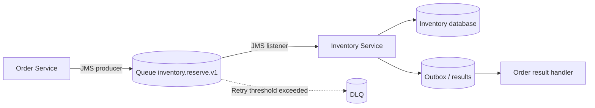
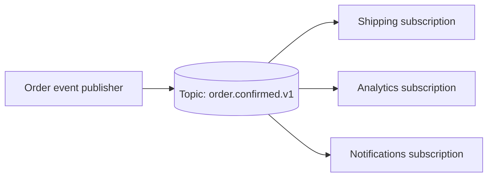
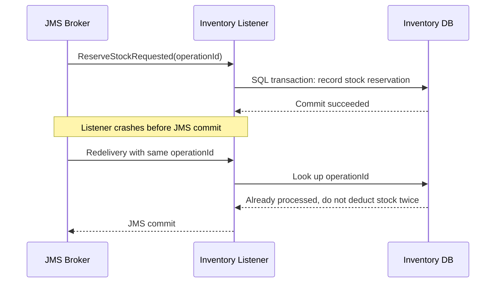
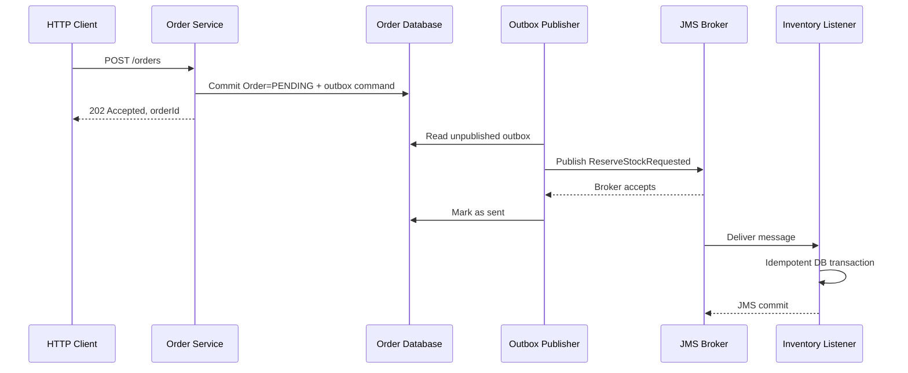

# Integrating ActiveMQ Classic or ActiveMQ Artemis in Spring Boot

## 1. What problem does JMS solve?

When Order Service calls Inventory Service over HTTP to reserve stock, Order depends on Inventory being available at that moment. For tasks that do not require an immediate response, a **message broker** lets the sender record the request and the receiver process it later. **JMS (Jakarta Messaging, formerly Java Message Service)** is a standard API in the Java ecosystem for communicating with a broker. **ActiveMQ Classic** and **ActiveMQ Artemis** are two broker families that can execute JMS operations, though their architectures and configurations differ.

This lesson belongs to the **JMS** chapter of the **SPRING_BOOT_INTEGRATION** module. This module studies how to organize system integration in Spring Boot across HTTP clients, databases, caches, brokers, and Spring Integration adapters; it emphasizes **configuration management, data contracts, transactions, error handling, deduplication, testing, and observability** in real flows.

After this lesson, you will be able to:

- Distinguish JMS API, Spring JMS, ActiveMQ Classic, and Artemis; choose the right starter/driver and broker URL.
- Write a producer with `JmsTemplate`, a consumer with `@JmsListener`, and versioned JSON contracts.
- Understand queues/topics, session transactions, acknowledgment, redelivery, and dead-letter queues (DLQ).
- Design duplicate handling using `operationId`, unique constraints, and a transactional outbox.
- Configure TLS security, send/receive permissions, and test against a real broker.

> **Version note:** Examples use Java 17+, Spring Boot 3.2+, and `jakarta.jms.*`. ActiveMQ Classic, Artemis, the Spring JMS client, and the Jakarta Messaging API must be version-compatible. When changing Boot or broker versions, re-verify dependencies, transports, TLS configuration, and broker features. Common Java `import` statements are omitted in the examples.

### End-to-end scenario

Order Service receives an order, saves status `PENDING`, and publishes a `ReserveStockRequested` command to the `inventory.reserve.v1` queue. Inventory Service processes the command, updates its database, and emits a result event. When Inventory is temporarily stopped, messages can accumulate in the broker for later processing according to durability policies.



JMS transports messages, but it does not by itself prove the order's stock was reserved successfully. The application still needs business state and a reconciliation process.

## 2. JMS components and choosing a broker

### 2.1. JMS is an API; the broker provides delivery mechanics

| Concept | Role |
|---|---|
| Jakarta Messaging (JMS) | API for connections, sessions, destinations, messages, producers/consumers, and acknowledgments |
| `ConnectionFactory` | Creates connections to the JMS broker, not a JDBC `DataSource` |
| Queue | Point-to-point: each message is typically delivered to **one** consumer in a competing consumer group |
| Topic | Publish/subscribe: each eligible subscription can receive a copy of the message |
| `JmsTemplate` | Spring API for sending/receiving messages, managing connection/session resources |
| `@JmsListener` | Listener method invoked by a Spring listener container when a message arrives |
| ActiveMQ Classic / Artemis | Broker that stores, routes, redelivers, moves to DLQ, and manages destinations |

JMS provides `TextMessage`, `BytesMessage`, `MapMessage`, and other types. In these examples, we use **JSON inside `TextMessage`** because it has a clear data contract, is compatible across Java versions, and interoperates with other systems. Avoid sending arbitrary Java objects via `ObjectMessage` due to class compatibility and deserialization risks.

In Spring Boot 3+, the JMS API resides in the **`jakarta.jms`** namespace. Legacy clients supporting only `javax.jms` may be incompatible. Do not try to work around this by randomly mixing `javax.jms` and `jakarta.jms` or forcing incompatible client versions on the same classpath.

### 2.2. ActiveMQ Classic vs. ActiveMQ Artemis

| Criterion | ActiveMQ Classic | ActiveMQ Artemis |
|---|---|---|
| Common context | Traditional JMS systems with existing Classic configuration/operations | New systems or workloads needing Artemis features/throughput |
| Architecture | Traditional ActiveMQ broker family | Separate broker family with **address** and **queue** model |
| Protocol | Known for OpenWire; also supports other configured transports | Can support Artemis Core, AMQP, OpenWire, MQTT, STOMP depending on configuration |
| Spring Boot starter | `spring-boot-starter-activemq` | `spring-boot-starter-artemis` |
| Configuration namespace | `spring.activemq.*` | `spring.artemis.*` |
| Delivery/DLQ | Classic redelivery policy and dead-letter strategy | Artemis address settings, redelivery delay, and dead-letter address |
| What to verify | Jakarta client version, broker URL/protocol, persistence | Address/routing type, auto-create, protocol, persistence |

If an application runs stably on Classic, you can keep it and upgrade in a controlled manner. For new projects, Artemis is often worth considering if it fits operational capabilities, protocols, clustering/HA, and target throughput. **Do not treat the two brokers as drop-in replacements** just because both can listen on the same port number, such as `61616`.

In this lesson, choose **one** starter for **one** broker. If an application needs to connect to both, you must configure multiple explicitly named `ConnectionFactory`, `JmsTemplate`, and container factory beans rather than relying on a single default auto-configuration.

## 3. Dependencies and connection configuration

### 3.1. Option A — ActiveMQ Classic

Maven with Spring Boot parent/BOM:

```xml
<dependency>
    <groupId>org.springframework.boot</groupId>
    <artifactId>spring-boot-starter-activemq</artifactId>
</dependency>
```

```yaml
# application-classic.yml
spring:
  activemq:
    broker-url: ${JMS_BROKER_URL:tcp://localhost:61616}
    user: ${JMS_USERNAME}
    password: ${JMS_PASSWORD}

integration:
  jms:
    reserve-queue: inventory.reserve.v1
```

`tcp://localhost:61616` is an example for an isolated development environment; it is not a production TLS configuration. Verify that the URI uses the OpenWire transport and a client compatible with the deployed Classic version.

### 3.2. Option B — ActiveMQ Artemis

Swap the dependency and configuration properties:

```xml
<dependency>
    <groupId>org.springframework.boot</groupId>
    <artifactId>spring-boot-starter-artemis</artifactId>
</dependency>
```

```yaml
# application-artemis.yml
spring:
  artemis:
    mode: native
    broker-url: ${JMS_BROKER_URL:tcp://localhost:61616}
    user: ${JMS_USERNAME}
    password: ${JMS_PASSWORD}

integration:
  jms:
    reserve-queue: inventory.reserve.v1
```

`spring.artemis.mode: native` explicitly selects connecting to an **external Artemis broker**. An embedded broker is a different option with its own dependencies and operational requirements; do not assume the two modes are equivalent. The two YAML examples are **mutually exclusive alternatives**—do not enable both starters/property groups and expect Spring Boot to guess the right broker.

### 3.3. Preparing the broker

Before running the examples:

1. The broker is running, reachable by the client on the right host/port/protocol, and the JMS client schema is compatible with the broker version.
2. A dedicated Order account has **send** permission and an Inventory account has **consume** permission on the queue; avoid admin accounts.
3. The destination `inventory.reserve.v1`, routing, persistence, capacity limits, DLQ, and redelivery policy are defined on the broker.
4. Broker and client have TLS/CA, credentials, and secret management appropriate for the environment.
5. Alerts for queue backlog, DLQ growth, and low broker disk space are in place.

ActiveMQ Artemis uses an **address + queue** model. `ANYCAST` routing corresponds roughly to point-to-point queues; `MULTICAST` corresponds roughly to fan-out/topics. Some brokers support destination auto-creation, but production should explicitly declare addresses/queues and access permissions in a planned manner rather than relying on uncontrolled defaults.

## 4. Message contract: version, identity, and event type

Example payload:

```json
{
  "schemaVersion": 1,
  "operationId": "reserve-O-1001",
  "orderId": "O-1001",
  "sku": "SKU-42",
  "quantity": 2
}
```

```java
// ReserveStockCommand.java
public record ReserveStockCommand(
        int schemaVersion,
        String operationId,
        String orderId,
        String sku,
        int quantity
) {}
```

| Field | Meaning |
|---|---|
| `schemaVersion` | Allows the consumer to identify the message structure |
| `operationId` | Stable identity of **one business command** for duplicate handling |
| `orderId` | Order associated with the command |
| `sku` | Product code per shared contract |
| `quantity` | Quantity to reserve; must be positive |

`JMSMessageID` is typically assigned by the broker/client for each sent message; resending the same command can receive a new message ID. `JMSCorrelationID` links requests, results, and logs. Neither **replaces** an immutable `operationId` stored in the database. The contract should also specify content type, event type, schema version, status/error list, and backward-compatible upgrade rules.

## 5. Producers and consumers in Spring Boot

### 5.1. Configuring the JSON converter and listener container

`MappingJackson2MessageConverter` can convert a Java DTO into a JMS `TextMessage` containing JSON. Restricting type-ID mappings prevents an arbitrary broker header from specifying which Java class gets deserialized.

```java
// InventoryJmsConfiguration.java — imports omitted
@Configuration(proxyBeanMethods = false)
@EnableJms
public class InventoryJmsConfiguration {

    @Bean
    public MessageConverter inventoryMessageConverter() {
        MappingJackson2MessageConverter converter =
                new MappingJackson2MessageConverter();
        converter.setTargetType(MessageType.TEXT);
        converter.setTypeIdPropertyName("_type");
        converter.setTypeIdMappings(Map.of(
                "reserve-stock-v1", ReserveStockCommand.class
        ));
        return converter;
    }

    @Bean
    public JmsTemplate inventoryJmsTemplate(
            ConnectionFactory connectionFactory,
            MessageConverter inventoryMessageConverter
    ) {
        JmsTemplate template = new JmsTemplate(connectionFactory);
        template.setMessageConverter(inventoryMessageConverter);
        template.setPubSubDomain(false); // queue
        template.setExplicitQosEnabled(true);
        template.setDeliveryMode(DeliveryMode.PERSISTENT);
        return template;
    }

    @Bean
    public DefaultJmsListenerContainerFactory inventoryListenerFactory(
            ConnectionFactory connectionFactory,
            MessageConverter inventoryMessageConverter,
            DefaultJmsListenerContainerFactoryConfigurer configurer
    ) {
        DefaultJmsListenerContainerFactory factory =
                new DefaultJmsListenerContainerFactory();
        configurer.configure(factory, connectionFactory);
        factory.setMessageConverter(inventoryMessageConverter);
        factory.setSessionTransacted(true);
        factory.setConcurrency("2-6");
        factory.setPubSubDomain(false);
        return factory;
    }
}
```

The main types come from `jakarta.jms.ConnectionFactory` / `DeliveryMode`, `org.springframework.jms.core.JmsTemplate`, `org.springframework.jms.annotation.EnableJms`, `org.springframework.jms.config.DefaultJmsListenerContainerFactory`, `org.springframework.jms.support.converter.*`, and `org.springframework.boot.autoconfigure.jms.DefaultJmsListenerContainerFactoryConfigurer`.

`setSessionTransacted(true)` lets the listener container roll back the JMS session on failure and commit on success; it does **not** mean a shared transaction with the database. `concurrency("2-6")` creates multiple competing consumers, so you must size it alongside the DB pool and ordering requirements. `DeliveryMode.PERSISTENT` requests persistent delivery, though actual durability depends on broker persistence/HA. To apply explicit delivery mode in `JmsTemplate`, the example enables `setExplicitQosEnabled(true)`.

### 5.2. Command producer

```java
// ReserveStockPublisher.java
@Service
public class ReserveStockPublisher {
    private final JmsTemplate template;
    private final String queue;

    public ReserveStockPublisher(
            @Qualifier("inventoryJmsTemplate") JmsTemplate template,
            @Value("${integration.jms.reserve-queue}") String queue
    ) {
        this.template = template;
        this.queue = queue;
    }

    public void publish(ReserveStockCommand command) {
        if (command.operationId() == null
                || command.operationId().isBlank()) {
            throw new IllegalArgumentException(
                    "operationId must not be blank");
        }
        template.convertAndSend(queue, command, message -> {
            message.setJMSCorrelationID(command.operationId());
            message.setStringProperty(
                    "eventType", "ReserveStockRequested");
            return message;
        });
    }
}
```

The Spring converter writes `_type=reserve-stock-v1` per the mapping and serializes JSON. `JmsTemplate` can be auto-configured by Spring Boot, but the example declares a dedicated bean to illustrate exact converter/delivery-mode configuration. With multiple beans of the same type, use `@Qualifier` to disambiguate.

### 5.3. Command listener

```java
// ReserveStockListener.java
@Component
public class ReserveStockListener {
    private final ReservationApplicationService service;

    public ReserveStockListener(ReservationApplicationService service) {
        this.service = service;
    }

    @JmsListener(
            destination = "${integration.jms.reserve-queue}",
            containerFactory = "inventoryListenerFactory"
    )
    public void receive(ReserveStockCommand command) {
        if (command.schemaVersion() != 1
                || command.operationId() == null
                || command.operationId().isBlank()
                || command.sku() == null
                || command.sku().isBlank()
                || command.quantity() <= 0) {
            throw new InvalidReservationCommandException(
                    "Invalid ReserveStockCommand");
        }
        service.handle(command);
    }
}
```

`ReservationApplicationService` and `InvalidReservationCommandException` are assumed application/domain classes that you define separately. The consumer must distinguish **permanent business errors** (invalid order, out of stock) from **transient errors** (DB timeout). With `setSessionTransacted(true)`, if the listener throws an exception, the broker typically redelivers per policy. If you catch the exception, just log, and return, the container may commit the message as processed successfully; control this carefully.

JSON decoding errors can also occur **before** `receive` runs. Therefore, you cannot handle malformed messages solely with a `try/catch` inside the method; you need broker redelivery and DLQ policies.

## 6. Queues, topics, durable subscriptions, and ordering

### 6.1. Queues fit commands

`inventory.reserve.v1` is a queue. If Inventory Service has multiple replicas or a listener factory allows multiple consumers, the broker can deliver messages to competing consumers. Normally **each message is received by one consumer at a time**, but if a consumer fails or acknowledgment fails, the message may be redelivered.

Do not infer that business completion order always matches enqueue order. With concurrency `2-6`, multiple messages run in parallel; redelivery, message priority, or failover can also alter observed order. If ordering is needed for a given `orderId`, you can use **message groups** such as `JMSXGroupID` when supported by the broker, or design partitioning/locking by order and test with a real broker.

### 6.2. Topics fit fan-out

When Order Service emits `OrderConfirmed` for Shipping, Analytics, and Notifications, using a topic is one option:



For topics, both producer and listener container must be configured with `pubSubDomain=true` on their respective beans. Avoid flipping a global flag without checking other queue listeners; if the application uses both queues and topics, create separate factories/templates per destination type.

**Durable subscriptions** allow the broker to retain messages as configured when a subscriber is temporarily offline. You must define the client ID, subscription name, retention duration, and subscription policy when deploying multiple replicas. Do not assign a single `clientId` to multiple independent connections if the broker forbids it. Shared durable subscriptions have provider-specific requirements and limits that must be verified against the running Classic or Artemis broker.

## 7. JMS transactions, acknowledgment, and consistency

### 7.1. When is a message acknowledged?

| Mechanism | Meaning | Things to watch |
|---|---|---|
| `AUTO_ACKNOWLEDGE` | Provider/container acknowledges per session semantics and callback lifecycle | Failure behavior depends on the listener container and configuration |
| `CLIENT_ACKNOWLEDGE` | Client explicitly acknowledges; may acknowledge messages already processed in the same session | Easy to misjudge scope or timing when managed manually |
| JMS local transaction | `commit` on completion, `rollback` on failure | Scoped to JMS session only; **does not automatically include SQL** |
| Broker redelivery / DLQ | Broker redelivers or routes to dead-letter per policy | JMS does not standardize retry counts, delays, and DLQs globally |

The example uses `sessionTransacted=true`. When the listener succeeds and the container commits, the message is acknowledged; when the listener throws an exception and the transaction rolls back, the broker can redeliver. When a callback **swallows the error and returns**, the container may commit, losing the chance for automatic recovery. Every exception must be classified properly.

### 7.2. Why can a SQL transaction succeed while the message is still redelivered?



Spring `@Transactional` with JDBC/JPA manages only the database transaction; a JMS local transaction manages only messages. If one transaction commits and the other has not committed, state can diverge. Therefore, practical designs rely on **at-least-once delivery + idempotent processing**, together with reconciliation, rather than assuming exactly-once across broker and DB.

### 7.3. Database-backed idempotency

A straightforward approach in PostgreSQL:

```sql
CREATE TABLE stock_item (
    sku VARCHAR(80) PRIMARY KEY,
    available BIGINT NOT NULL CHECK (available >= 0)
);

CREATE TABLE reservation_request (
    operation_id VARCHAR(100) PRIMARY KEY,
    order_id VARCHAR(100) NOT NULL,
    sku VARCHAR(80) NOT NULL,
    quantity BIGINT NOT NULL CHECK (quantity > 0),
    status VARCHAR(24) NOT NULL
);
```

Inside a SQL transaction coordinated by `ReservationApplicationService.handle`:

1. Check/record `operationId`. Use a **unique constraint** as the final barrier so two consumers cannot create the same reservation concurrently. For duplicate commands, read and return the existing result instead of updating inventory again.
2. For a new command, insert a `PENDING` reservation.
3. Decrement inventory with a conditional SQL statement, for example:

   ```sql
   UPDATE stock_item
      SET available = available - :quantity
    WHERE sku = :sku
      AND available >= :quantity;
   ```

4. If affected rows = 1, set status `RESERVED`. If = 0, record `REJECTED` or inspect further to distinguish an unknown SKU from out-of-stock. This is a **business outcome**, not something to retry endlessly.
5. Record an outbox event for the result in **the same SQL transaction** to publish after commit. When the database encounters a transient error, roll back and let the exception propagate so JMS handles redelivery.

With PostgreSQL, if an `INSERT` violates a unique constraint, the current transaction enters an aborted state. Use `INSERT ... ON CONFLICT DO NOTHING` and check affected rows, or the equivalent mechanism for your database, then query the existing result. Do not simply catch a duplicate exception and continue in a broken transaction.

**A conditional `UPDATE` alone does not provide idempotency**: it prevents check-then-act stock races, but the same command could still be applied twice if stock remains sufficient. It must be paired with a unique `operationId`.

If true distributed XA transactions are required, you must have a transaction coordinator plus XA-capable broker, DB, and client; operational and configuration overhead is significantly higher. For most service flows, idempotency, outbox, intermediate states, and compensation are easier to control.

## 8. Error handling, redelivery, and dead-letter queues

### 8.1. Classifying errors to avoid misguided retries

| Scenario | Error type | Response |
|---|---|---|
| Database unavailable, temporary connection error | Transient | Roll back JMS; bounded redelivery with backoff |
| Unreadable JSON, unsupported schema version | Contract/permanent | After limit, route to DLQ/quarantine for investigation |
| Insufficient stock | Business outcome | Save `REJECTED`, emit result, commit message |
| Unique operation ID conflict from already-processed message | Duplicate command | Read previous result, do not deduct stock again, commit |
| Broker out of disk, queue over limit | Infrastructure | Alert, apply flow control/backpressure, do not mask send errors |
| DB deadlock/serialization conflict | Possibly transient | Bounded retry with the same operation ID in a new transaction |

A **poison message** is a message that keeps getting redelivered but cannot be processed, such as malformed JSON. Because converter errors can occur before the `@JmsListener` method is invoked, broker-side DLQ policies are essential.

### 8.2. Redelivery is the broker's responsibility

- **Classic:** redelivery policy and dead-letter strategy depend on client/broker configuration; can use a shared or per-destination DLQ.
- **Artemis:** `address-settings` allow configuring redelivery delay, max delivery attempts, and dead-letter address.
- Do not assume every broker comes preconfigured with a queue named `DLQ`, three retries, or a fixed delay. Values must be provisioned, verified, and documented in runbooks.
- `JMSRedelivered` and `JMSXDeliveryCount` (if supported by the provider) help with analysis but are **not reliable idempotency keys for business commands**.

When a DLQ grows, inspect the root cause, schema, operation ID, database state, and prior attempts. Replay must be controlled, duplicate-safe, and monitored; never blindly replay an entire DLQ to production without fixing the root cause.

### 8.3. Timeouts, TTL, and overload

JMS decouples send and receive times, but resources remain finite:

- Producers must handle connection/send failures; do not mark an event "published" merely because a method was invoked if sending failed.
- Brokers need policies for message TTL/expiry, queue/address max-size, disk, persistence, and flow control.
- Consumer concurrency should match the DB connection pool, CPU operations, and processing SLA.
- Reservation commands **with business deadlines** must check timestamps/expiration per the contract; an expired message should not be executed blindly just because it sat in the queue.

Queue depth grows when send rate exceeds processing rate. Track **oldest message age**, enqueue/dequeue rates, processing latency, and redelivery to identify whether the bottleneck lies in the producer, broker, consumer, or database.

## 9. Security when connecting to Classic or Artemis

Username/password **does not ensure the transport is encrypted**. Earlier `tcp://localhost:61616` URIs are strictly local examples. In production you need TLS with proper hostname/certificate verification, paired with per-destination broker permissions.

| Aspect | Classic | Artemis |
|---|---|---|
| TLS transport | SSL transport/connector per Classic documentation | Artemis TLS connector/acceptor and SSL options |
| Trust material | CA/truststore matching client and broker | CA/truststore matching client and broker |
| Mutual TLS | Client certificate when required by broker | Client certificate when required by broker |
| ACL | Permissions per destination and broker configuration | Permissions per address/queue and security settings |
| Secret management | Never commit passwords/tokens/private keys | Same |

SSL URL syntax, keystores, truststores, and hostname verification vary by Classic/Artemis client and version. Check the transport configuration of the **actual broker/client**; do not copy `ssl://...` or SSL options verbatim from one family to the other without testing. Test valid CA, invalid CA, wrong hostname, and expired certificates. Never use trust-all or disable hostname verification to bypass handshake errors.

Restrict service privileges: Order should normally only have send access to the command queue; Inventory should only consume from that queue and send to result events if needed. Never use a broker admin account in applications. Never log sensitive payloads, credentials, or full connection URLs containing secrets.

## 10. Testing against a real broker

### 10.1. Three levels of testing

| Test layer | What it verifies | Suggested tools |
|---|---|---|
| Unit test | Logic for valid messages, duplicate operation IDs, out-of-stock, DB errors | Mock/fake application services and repositories |
| Contract test | Queue, headers, JSON schema/version, correlation ID, and DTO mapping | Converter tests, broker tests |
| Integration test | Broker connection, persistence, ack/rollback, redelivery, DLQ, TLS, concurrency | Classic/Artemis test broker, Testcontainers, or CI broker |

Mocking `JmsTemplate` helps verify the publisher calls the right API, but it **does not prove** the broker persists messages, redelivers, routes to DLQ, or validates TLS. For provider-specific behavior, run integration tests against the same broker family and production-like configuration.

### 10.2. Test sending and reading from a test queue

The example below requires an active test broker under a Classic **or** Artemis profile. Auto-started listeners are disabled in the test so no other consumer steals the message:

```java
// ReserveStockMessagingIT.java — imports omitted
@SpringBootTest(properties = {
        "spring.jms.listener.auto-startup=false",
        "integration.jms.reserve-queue=it.inventory.reserve.v1"
})
class ReserveStockMessagingIT {
    @Autowired
    ReserveStockPublisher publisher;

    @Autowired
    @Qualifier("inventoryJmsTemplate")
    JmsTemplate template;

    @Test
    void sendsJsonAndCorrelationId() throws JMSException {
        ReserveStockCommand command = new ReserveStockCommand(
                1, "op-test-202", "O-202", "SKU-42", 2);

        publisher.publish(command);

        template.setReceiveTimeout(2_000L);
        Message message = template.receive("it.inventory.reserve.v1");

        assertNotNull(message);
        assertInstanceOf(TextMessage.class, message);
        assertEquals("op-test-202", message.getJMSCorrelationID());
        assertEquals("ReserveStockRequested",
                message.getStringProperty("eventType"));
        assertTrue(((TextMessage) message).getText()
                .contains("\"operationId\":\"op-test-202\""));
    }
}
```

Imports include `org.springframework.boot.test.context.SpringBootTest`, `org.springframework.beans.factory.annotation.Autowired`, `org.springframework.beans.factory.annotation.Qualifier`, `org.springframework.jms.core.JmsTemplate`, `jakarta.jms.*`, and JUnit 5. When running for real, supply the test broker URL/credentials, an isolated queue, and appropriate destination creation policies. You can use Testcontainers with a pinned image version while configuring DLQ/redelivery and TLS per broker; this lesson does not assume a test broker is already running.

### 10.3. Integration test matrix

1. **Happy path:** JSON is handled cleanly by the converter; listener succeeds and the queue drains.
2. **Transient DB error:** listener throws an exception; message is redelivered with the same operation ID.
3. **Crash after DB commit:** message returns, yet no duplicate reservation or second stock deduction occurs.
4. **Malformed payload / unsupported version:** eventually reaches the configured DLQ with an alert.
5. **Out of stock:** `REJECTED` outcome persisted and message committed, no infinite redelivery.
6. **Broker offline:** producer raises an observable error; outbox retains unpublished records.
7. **TLS/ACL:** valid CA connects; invalid CA, wrong hostname, or missing permissions are rejected.
8. **Concurrency:** multiple commands for the same SKU or same operation ID never drive stock negative.
9. **Durable topic:** offline subscriber reconnects and receives messages per contract; replicas do not collide on client ID.
10. **TTL/DLQ replay:** expired messages do not trigger stale actions; replay preserves idempotency.

To test redelivery and DLQ policies, configure the policies **on the test broker**. Calling `@JmsListener` directly or mocking messages cannot verify how the broker decides retries, delivery counts, or restart persistence.

## 11. Connecting JMS with HTTP, databases, caches, and outbox

A common mistake is writing an order to SQL and calling `jmsTemplate.convertAndSend` directly inside the same `@Transactional` method while believing both commit or roll back together. In reality, if the DB commits and the producer crashes, the message may never be sent; if the broker accepts the message and the DB rolls back, Inventory may process a nonexistent order.

**Transactional outbox** closes this gap by saving the order state and the outbound record in the same SQL transaction. A dedicated worker reads the outbox and sends messages; duplicate sends can still happen if the process crashes after the broker send but before marking the outbox record sent.



Marking the outbox after sending **still leaves a duplicate-publish window**; that reinforces why consumers must be idempotent. An API returning `202 Accepted` should clearly indicate the order is awaiting completion rather than reporting stock already reserved. Later, Order Service can consume result events or let clients query status via HTTP.

An inventory cache/Redis should only support fast lookups with an explicit staleness policy; it must not replace the Inventory reservation transaction. Spring Integration can use channels, transformers, routers, and JMS inbound/outbound adapters to organize complex flows, yet it also does not magically provide ACID transactions across JMS, SQL, Redis, and HTTP.

## 12. Observability and operations

Monitor both the broker and the application:

| Group | Metrics to observe |
|---|---|
| Queue | Depth, oldest-message age, enqueue/dequeue rate, consumer count |
| Reliability | Redelivery rate, DLQ depth, expired messages, duplicate operation ID count |
| Consumer | p95/p99 processing time, DB errors, throughput, concurrency |
| Producer | Send latency, connect/auth/TLS errors, outbox backlog |
| Business | Reservations `PENDING`, `RESERVED`, `REJECTED` and reconciliation time |

Spring Boot Actuator/Micrometer can export application metrics; the broker has its own management console/tools/exporters depending on installation. Correlate logs with correlation ID and operation ID **after applying data-protection policies**; do not put SKU, order ID, or operation ID into high-cardinality metric tags. Distributed tracing across JMS requires proper instrumentation and context propagation; do not assume JMS automatically forwards HTTP trace headers.

Alert when backlog or message age rises continuously, when DLQ spikes after a deploy, when the broker runs low on disk or becomes unavailable, when producer sends fail while APIs still report success, or when the same operation ID creates multiple reservations.

## 13. Common errors and review questions

| Symptom | Possible cause | Resolution |
|---|---|---|
| Cannot create `ConnectionFactory` | Wrong starter, URL/protocol, missing client | Check dependency tree, profile, broker |
| `ClassNotFound` or API mismatch | Mixing `javax.jms` and `jakarta.jms` | Use Jakarta client compatible with Boot 3+ |
| Producer sends but listener receives nothing | Wrong queue/topic, routing, ACL, or stopped listener | Inspect broker console, destination, factory |
| JSON fails to map to DTO | Wrong `_type`, schemaVersion, converter | Verify mapping/schema and consumer contract |
| Message redelivered continuously | Exception, poison message, retry policy | Classify errors, add idempotency, DLQ, and alerts |
| Messages lost after restart | Missing persistence/durable subscription | Configure broker persistence and test restarts |
| Inventory processes a command twice | Missing unique operation ID | Persist idempotency key inside DB transaction |
| High queue backlog | Slow consumer/DB, low concurrency, or broker limits | Profile load, optimize SQL, tune concurrency |
| TLS error | Wrong CA, SAN, SSL URI, or permissions | Check broker/client transport, keep validation enabled |

### Self-check questions

1. Is JMS an API or a broker? What role does `ConnectionFactory` play?
2. When do you use a queue vs. a topic? Do multiple consumers on a queue each receive a copy of every message?
3. Why must you choose the right Classic/Artemis starter and check the `jakarta.jms` namespace?
4. What are `MappingJackson2MessageConverter` and the `_type` header used for?
5. When a listener throws an exception in a JMS transacted session, what can the broker do?
6. Why can a database commit succeed while the broker still redelivers the message?
7. How does `operationId` differ from `JMSMessageID` and `JMSCorrelationID`?
8. How does malformed JSON reach a DLQ? What controls the number of redelivery attempts?
9. Why does a transactional outbox still require an idempotent consumer?
10. Which tests must run against a real broker to verify TLS, persistence, and DLQs?

**Remember:** Integrating ActiveMQ Classic or Artemis in Spring Boot requires **the right starter/broker, `ConnectionFactory`, `JmsTemplate`, `@JmsListener`, message contracts, and operational policies**. Sending JSON is only the first step; reliability depends on transactions/acks, redelivery/DLQs, **database-backed idempotency**, outbox, TLS, testing against a real broker, and visibility into backlogs and errors.
