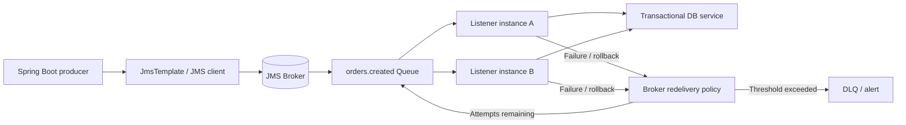
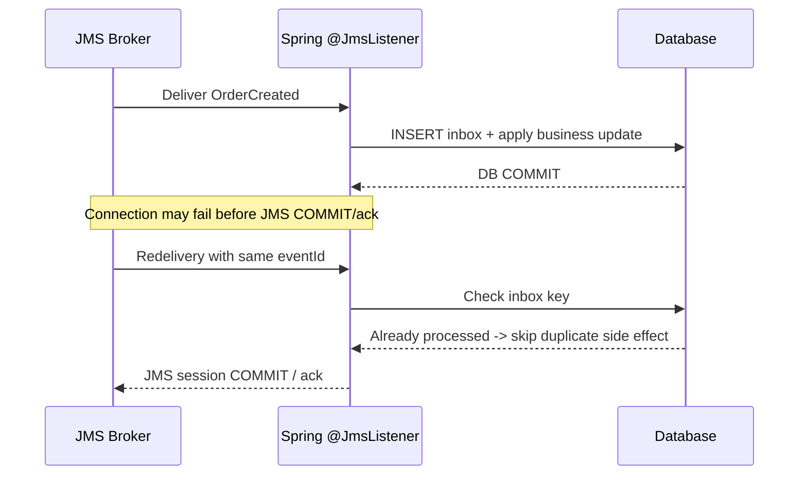

# Configuring spring.activemq.*, spring.artemis.*, and Choosing a Broker

> **Chapter:** JMS  
> **Scope:** In the **SPRING_BOOT_INTEGRATION** module, Spring Boot can exchange messages with external systems via HTTP clients, databases, caches, message brokers, and Spring Integration adapters. This lesson focuses on **JMS connection configuration**, distinguishing **ActiveMQ Classic** from **ActiveMQ Artemis**, choosing a broker, and controlling data contracts, transactions, errors, duplicate handling, testing, and observability.

## 1. First, JMS is not the name of a broker

**JMS** (*Java Message Service*, known in Jakarta releases as Jakarta Messaging) is an **API/specification for Java applications** to send and receive messages. JMS defines concepts such as `ConnectionFactory`, `Destination`, `Queue`, `Topic`, `Message`, and `Session`. It does **not** implement a message broker itself.

A Spring Boot architecture typically has four layers:

| Layer | Example | Responsibility |
| --- | --- | --- |
| **Application** | `@JmsListener`, `JmsTemplate`, business services | Produces/receives messages and decides processing outcomes |
| **Spring JMS / Boot** | Listener containers, message converters, auto-configuration | Bridges application APIs with the JMS provider; configures beans, listeners, and transactions |
| **JMS client library** | ActiveMQ Classic client, Artemis Jakarta client | Opens TCP/TLS connections, authenticates, and speaks to the matching broker |
| **Broker server** | ActiveMQ Classic, ActiveMQ Artemis, or another JMS provider | Stores/routes messages, handles delivery, redelivery, queues/topics, security, and HA |

**ActiveMQ Classic and ActiveMQ Artemis are two different broker products.** They are not merely two names for the same server or two interchangeable URL values. Although both can expose a JMS API to Java applications, they differ in architecture, client drivers, broker configuration, operations, and protocol features.

In Spring Boot, two property groups reflect that difference:

- `spring.activemq.*`: configures the client connecting to **ActiveMQ Classic** via its auto-configuration.
- `spring.artemis.*`: configures the client connecting to **ActiveMQ Artemis** via its auto-configuration.
- `spring.jms.*`: **shared** properties for the Spring JMS layer, such as listeners, templates, caching, and send/receive modes.

Do not configure both driver families at once in the same application just because a broker has not been decided yet. Choose the right broker, starter/client, connection factory, and target infrastructure before tuning listeners.

## 2. JMS Queues, Topics, and practical guarantees

| Concept | Meaning | Integration notes |
| --- | --- | --- |
| **Queue (point-to-point)** | A message is delivered to one consumer among competing consumers per broker policy | Typically used as a **work queue**; if a consumer dies or fails to ack, the message can be redelivered |
| **Topic (publish-subscribe)** | A message is broadcast to matching subscriptions | Must distinguish standard, durable, and shared subscriptions when consumers go offline |
| **Persistent delivery** | Broker is requested to handle messages using persistent delivery mode | Depends on broker config, storage, HA, and confirmation policy; does not mean "never lost" |
| **Acknowledgment / commit** | Signals that the listener/container accepted the message or the JMS transaction committed | Does **not** prove external database or HTTP side effects completed |
| **Redelivery** | Message can be resent by the broker on session rollback, disconnect, or consumer failure | Consumers must tolerate duplicates |
| **Dead-letter queue (DLQ)** | Where the broker or app routes unprocessable messages after retry policies | Must be configured per broker; adding a JMS starter does not automatically apply business DLQ rules |

**Queues do not guarantee strict ordering under all conditions**: multiple consumers, message priority, redelivery, or retries can cause observed order to differ from producer send order. If processing for a single order must stay ordered, design partitioning/grouping/keys, consumer concurrency, and business versioning suited to the chosen broker.



## 3. Choosing ActiveMQ Classic, Artemis, or another JMS provider?

### 3.1. Selection criteria

| Question | ActiveMQ Classic | ActiveMQ Artemis | Decision needed |
| --- | --- | --- | --- |
| **Existing broker** | Fits if the organization already operates Classic with matching expertise/tooling | Fits if the platform already uses Artemis or is making a greenfield choice | Prioritize compatibility with existing infrastructure; do not switch brokers just to rename property prefixes |
| **JMS client** | Needs Classic client with matching version and Jakarta/Spring Boot support | Needs Artemis client matching Jakarta/Spring Boot | Check `jakarta.jms` namespace and compatibility matrix |
| **Protocols and bridges** | Has Classic-specific protocol capabilities and connectors | Has Artemis-specific protocol capabilities and connectors | Verify actual STOMP/AMQP/OpenWire/JMS requirements and connection setup |
| **Performance, HA, and storage** | Depends on topology, storage, tuning, and version | Depends on topology, storage, tuning, and version | Benchmark real workloads with message size, durable mode, consumer concurrency, and failover |
| **Migration cost** | Likely minimal change if already on Classic | May require migrating queues/addresses, client URLs, security, failover, and policies | Assess migration, operations, and rollback feasibility |
| **Vendor independence** | JMS API hides part of the differences | JMS API hides part of the differences | Broker-specific headers, DLQs, failover, and admin APIs still differ |

There is no rule that "JMS always requires Artemis" or "Classic is always slower." For new systems, consider support/maintenance status and operational requirements for the **exact version being deployed**, backed by practical testing. For systems running Classic stably, upgrading or moving to Artemis is **a migration project**, not simply changing `spring.activemq.*` to `spring.artemis.*`.

### 3.2. Do not confuse JMS with Kafka, RabbitMQ, or HTTP

- **JMS** is a Java API; **ActiveMQ Classic/Artemis** are brokers that can be used with JMS.
- **Kafka** organizes data around topics/partitions/offsets and does not become a JMS broker just because both handle messages.
- **RabbitMQ** typically integrates via Spring AMQP with exchanges, queues, and routing keys; that is a different API from JMS.
- **HTTP** is request-response; you need clear contracts when shifting work from synchronous HTTP to asynchronous JMS.

If the requirement is enterprise Java command processing via JMS and infrastructure already runs a supporting broker, Spring JMS is reasonable. If you need a long-term event log where multiple consumers replay by offset, evaluate brokers/event platforms against that requirement rather than assuming JMS queues satisfy it out of the box.

## 4. Spring Boot versions and the Jakarta JMS namespace

With **Spring Boot 3.x / Spring Framework 6**, applications use **`jakarta.jms.*`** types instead of `javax.jms.*` from older Java EE generations. This is a critical factor when picking ActiveMQ Classic clients, Artemis Jakarta clients, converters, or additional libraries.

Example imports used in the code snippets below:

```java
import jakarta.jms.JMSException;
import jakarta.jms.TextMessage;
import org.springframework.jms.annotation.JmsListener;
import org.springframework.jms.core.JmsTemplate;
```

A driver or starter compiled against `javax.jms.ConnectionFactory` will not turn into `jakarta.jms.ConnectionFactory` just because the app runs on Boot 3. Before upgrading, inspect the dependency tree and compatibility guide for the **exact Boot, Spring Framework, and JMS client versions**.

Examples in this lesson follow **Spring Boot 3.x conventions** and assume the version in use provides the corresponding starters/auto-configuration. Artifact names, defaults, and embedded capabilities can change across Boot lines; cross-check your application's version documentation before applying verbatim.

## 5. Dependencies: two alternatives, not two starters installed together

### 5.1. When using ActiveMQ Classic

```xml
<!-- Choose when the target broker is ActiveMQ Classic and
     your Spring Boot release supports this starter. -->
<dependency>
    <groupId>org.springframework.boot</groupId>
    <artifactId>spring-boot-starter-activemq</artifactId>
</dependency>
```

The starter places Spring JMS and the corresponding client on the classpath. Having the dependency alone does not guarantee a running broker or authenticated connections.

### 5.2. When using ActiveMQ Artemis

```xml
<!-- Choose instead of the ActiveMQ Classic starter if the broker is Artemis. -->
<dependency>
    <groupId>org.springframework.boot</groupId>
    <artifactId>spring-boot-starter-artemis</artifactId>
</dependency>
```

For both options, Spring Boot can auto-create `ConnectionFactory`, `JmsTemplate`, and listener container factories when conditions match. When the application defines its own `ConnectionFactory` bean, parts of auto-configuration **back off**. Do not deduce which beans exist solely from the starter name: check the auto-configuration report and context tests.

## 6. Configuring `spring.activemq.*` for ActiveMQ Classic

Example `application.yml` when connecting to an external Classic broker:

```yaml
spring:
  activemq:
    broker-url: ${ACTIVEMQ_BROKER_URL:tcp://localhost:61616}
    user: ${ACTIVEMQ_USER:integration_app}
    password: ${ACTIVEMQ_PASSWORD}

  jms:
    pub-sub-domain: false
    listener:
      session-transacted: true
      concurrency: 2
      max-concurrency: 8

integration:
  jms:
    orders-queue: orders.created
```

Key properties:

| Property | Role | Important notes |
| --- | --- | --- |
| `spring.activemq.broker-url` | Classic broker connection URL, e.g., `tcp://...` | URL, transport, and failover syntax must match the ActiveMQ Classic client |
| `spring.activemq.user` | JMS account | Restrict permissions per destination; never use a broker superuser |
| `spring.activemq.password` | Account secret | Load from environment/secret manager; never commit literals |
| `spring.activemq.in-memory` | Option related to embedded broker when supported by version/client/conditions | Do not use to replace a durable production broker |
| `spring.activemq.pool.*` | Client connection pooling options when a compatible pool library is present | Does not enable pooling if dependencies are missing or unneeded |

**Do not use `spring.artemis.broker-url` to configure Classic**, even though both brokers may listen on a TCP port. Having the same IP:port shape does not mean the client and server protocols match.

### 6.1. Is an embedded broker appropriate?

With certain versions and dependencies, Classic may support an embedded/in-memory broker for learning or testing. Do not assume every Boot 3.x release automatically starts an embedded broker when the URL is omitted. In production, use a separately managed broker with proper persistence, recovery, HA, monitoring, and access controls.

**In tests**, a version-matched broker container or temporary broker infrastructure catches protocol, routing, and redelivery bugs far better than a mocked `JmsTemplate`.

## 7. Configuring `spring.artemis.*` for ActiveMQ Artemis

For an externally running Artemis broker, explicitly set `mode: native`:

```yaml
spring:
  artemis:
    mode: native
    broker-url: ${ARTEMIS_BROKER_URL:tcp://localhost:61616}
    user: ${ARTEMIS_USER:integration_app}
    password: ${ARTEMIS_PASSWORD}

  jms:
    pub-sub-domain: false
    listener:
      session-transacted: true
      concurrency: 2
      max-concurrency: 8

integration:
  jms:
    orders-queue: orders.created
```

| Property | Role | Notes |
| --- | --- | --- |
| `spring.artemis.mode` | Selects `native` (external broker) or `embedded` when supported | Do not use embedded for production HA setups |
| `spring.artemis.broker-url` | Artemis broker address in native mode | Verify port, protocol, cluster/failover, TLS |
| `spring.artemis.user` / `password` | Connection credentials | Scope permissions per address/queue; manage secrets safely |
| `spring.artemis.embedded.*` | Embedded broker config in supported environments, such as startup queues/topics | Takes effect only when the server module and embedded mode are present |
| `spring.artemis.pool.*` | Pooling properties when using a compatible pool mechanism | Verify client/pool dependencies and lifecycle |

Artemis models **addresses, queues, and routing types** at the broker layer. Spring JMS works with `Queue`/`Topic`, while whether a destination is auto-created, how it is named, and which address/queue it maps to depend on broker security and auto-create configuration. In production, manage topology via broker infrastructure/migration configs rather than relying on implicit auto-creation.

### 7.1. Embedded mode

An **illustrative** configuration for an embedded environment:

```yaml
spring:
  artemis:
    mode: embedded
    embedded:
      queues: orders.created,orders.dead
      persistent: false
```

This mode requires an Artemis server dependency compatible with Jakarta JMS and your Boot release, such as the Artemis Jakarta server module supported by that version. Merely changing `mode` does not guarantee embedded execution works. Tests for broker restarts, persistent delivery, failover, and security **should not rely solely on a non-persistent embedded broker**.

## 8. `spring.jms.*`: shared settings for listeners and templates

`spring.jms.*` properties serve the Spring JMS abstraction and are largely independent of choosing Classic or Artemis.

| Property | Meaning | Recommendation |
| --- | --- | --- |
| `spring.jms.pub-sub-domain` | Default destination domain: topic (`true`) or queue (`false`) for components using this setting | Workers using queues should set `false` |
| `spring.jms.listener.auto-startup` | Auto-start listeners when the application is ready | Can be disabled temporarily for controlled maintenance |
| `spring.jms.listener.concurrency` | Initial/minimum concurrent consumers per container | Measure throughput and impact on ordering/DB |
| `spring.jms.listener.max-concurrency` | Upper bound on concurrent listener workers | Account for total instances and broker/downstream capacity |
| `spring.jms.listener.session-transacted` | Requests the listener container to use JMS session transactions where supported | Use deliberately when exceptions should trigger rollback/redelivery |
| `spring.jms.listener.acknowledge-mode` | Acknowledgment mode when not using session transactions | Distinct from `session-transacted`; understand container semantics |
| `spring.jms.template.default-destination` | Default send destination when `JmsTemplate` is called without one | Useful for producers targeting a single queue |
| `spring.jms.cache.*` | JMS connection/session caching configuration | Caching differs from pooling; do not stack mechanisms blindly |

**A listener property does not replace broker-side policies.** The broker controls many aspects of redelivery delay, max delivery attempts, DLQ, persistence, and expiry. For example, `session-transacted: true` lets an exception roll back the JMS session; after rollback, the broker decides whether to redeliver immediately, wait, or move to a DLQ per its configuration.

Do not pick `CLIENT_ACKNOWLEDGE`, `AUTO_ACKNOWLEDGE`, or session transactions based solely on their names. **The Spring listener container** affects ack timing, exception handling, and shutdown behavior; test against a real provider.

## 9. Spring Boot example: producer and consumer with JSON TextMessage

Suppose the event contract is:

```json
{
  "eventId": "evt-7421",
  "sourceSystem": "checkout",
  "orderId": "ORD-0042",
  "amountMinor": 125000,
  "currency": "VND"
}
```

Using JSON in a `TextMessage` aids debugging; you can use a JMS/Jackson converter to send objects directly, provided type mappings and trusted types are agreed across services. **Do not accept Java-serialized `ObjectMessage` payloads from untrusted sources** without explicit deserialization safety policies.

### 9.1. Shared contract DTO

```java
package com.example.integration.jms;

public record OrderCreated(
        String eventId,
        String sourceSystem,
        String orderId,
        long amountMinor,
        String currency
) {}
```

In real systems, DTOs require validation: non-blank `eventId`, allowed `sourceSystem`, `amountMinor >= 0`, valid currency, and explicit schema version. Successfully parsing JSON does not prove the business contract is satisfied.

### 9.2. Producer using JmsTemplate

```java
package com.example.integration.jms;

import com.fasterxml.jackson.core.JsonProcessingException;
import com.fasterxml.jackson.databind.ObjectMapper;
import org.springframework.beans.factory.annotation.Value;
import org.springframework.jms.core.JmsTemplate;
import org.springframework.stereotype.Service;
import jakarta.jms.TextMessage;

@Service
public class OrderEventPublisher {
    private final JmsTemplate jmsTemplate;
    private final ObjectMapper objectMapper;
    private final String queue;

    public OrderEventPublisher(
            JmsTemplate jmsTemplate,
            ObjectMapper objectMapper,
            @Value("${integration.jms.orders-queue}") String queue) {
        this.jmsTemplate = jmsTemplate;
        this.objectMapper = objectMapper;
        this.queue = queue;
    }

    public void send(OrderCreated event, String correlationId)
            throws JsonProcessingException {
        String json = objectMapper.writeValueAsString(event);

        jmsTemplate.send(queue, session -> {
            TextMessage message = session.createTextMessage(json);
            message.setStringProperty("eventType", "order.created");
            message.setIntProperty("schemaVersion", 1);
            message.setJMSCorrelationID(correlationId);
            return message;
        });
    }
}
```

Here, `JmsTemplate.send(...)` uses the `ConnectionFactory` Boot configured for the selected broker. A successful send on the client side **does not confirm that a separate DB transaction committed**, nor does it indicate the consumer finished business processing.

If the producer both updates a database and sends a JMS message, do not assume `@Transactional` with `JpaTransactionManager` commits both resources atomically. The outbox and transaction-boundary section in section 11 addresses this.

### 9.3. Consumer using @JmsListener

```java
package com.example.integration.jms;

import com.fasterxml.jackson.core.JsonProcessingException;
import com.fasterxml.jackson.databind.ObjectMapper;
import jakarta.jms.JMSException;
import jakarta.jms.TextMessage;
import org.springframework.jms.annotation.EnableJms;
import org.springframework.jms.annotation.JmsListener;
import org.springframework.stereotype.Component;

@Component
public class OrderEventListener {
    private final ObjectMapper mapper;
    private final OrderProjectionService orderService;

    public OrderEventListener(
            ObjectMapper mapper,
            OrderProjectionService orderService) {
        this.mapper = mapper;
        this.orderService = orderService;
    }

    @JmsListener(destination = "${integration.jms.orders-queue}")
    public void receive(TextMessage message)
            throws JMSException, JsonProcessingException {
        OrderCreated event =
                mapper.readValue(message.getText(), OrderCreated.class);

        // Validation and idempotency are handled in the service.
        orderService.applyOnce(event);
    }
}
```

When enabling annotation-based listeners explicitly, place `@EnableJms` on a `@Configuration` class in the application. With Boot auto-configuration, verify which listener container factory is selected and whether `spring.jms.listener.*` settings are applied. Do not call `receive()` directly in a unit test and conclude broker ack/rollback works.

To handle different message types, a consumer can accept `jakarta.jms.Message` and check for `TextMessage` before decoding; the example above assumes the destination contains only JSON `TextMessage` payloads per contract. If the broker receives another message type, conversion/dispatch errors must follow the DLQ policy to avoid infinitely retrying an undecodable payload.

## 10. Acknowledgment and JMS transactions: when is a message redelivered?

**The easiest mistake in JMS integration is treating "the listener ran once" as an exactly-once guarantee.** When a listener succeeds, the broker needs to know it can mark the message consumed. If the listener or connection fails before the right confirmation point, the message can be redelivered.



### 10.1. JMS session transactions

When the listener container uses a **transacted JMS session**, normal listener completion typically allows the session to commit; when an uncaught exception escapes, the container can roll back the session so the broker redelivers per policy. Verify this behavior with your Spring Boot version, listener container, and JMS provider.

**Do not treat `session-transacted: true` as a distributed transaction**: it manages acknowledgments/sends within the JMS session, and does not automatically roll back JDBC/JPA database transactions. If the DB committed while the JMS session rolled back due to disconnect, redelivery still occurs. Hence consumers must be idempotent.

### 10.2. Non-transacted acknowledge modes

If the session is not transacted, `AUTO_ACKNOWLEDGE`, `CLIENT_ACKNOWLEDGE`, or other modes each have distinct behaviors. Spring's `DefaultMessageListenerContainer` and `SimpleMessageListenerContainer` differ in lifecycle details; do not assume every listener exception under auto-ack forces broker redelivery. If you need processing errors to drive redelivery, choose a transaction/ack policy deliberately and test it against a real broker.

### 10.3. DLQs and poison messages

Unparseable JSON payloads, unknown event types, or breaking schemas usually cannot be fixed by retrying a few seconds later. Without classification, a *poison message* can loop indefinitely:

- **Transient:** flaky broker, database timeout, HTTP 503 → bounded retries with backoff.
- **Permanent:** malformed JSON/schema, missing required fields, unauthorized → send to DLQ/quarantine per policy, notify producer to fix.
- **Unknown outcome:** side effect may have succeeded while response/ack was lost → query state by business/idempotency key before retrying.

ActiveMQ Classic and Artemis have **different broker-level DLQ/redelivery configurations**. Connection properties `spring.activemq.*` and `spring.artemis.*` **are not enough to define poison-message policies**. Design DLQ queues, read permissions, retention, alerts, and replay per operational infrastructure.

## 11. Writing to a database from a JMS listener: transactions and idempotency

Suppose the consumer persists an order projection into PostgreSQL. We guard side effects with an **inbox** table and a database unique constraint.

### 11.1. SQL schema

```sql
CREATE TABLE processed_events (
    consumer_name VARCHAR(80) NOT NULL,
    source_system VARCHAR(80) NOT NULL,
    event_id VARCHAR(160) NOT NULL,
    processed_at TIMESTAMPTZ NOT NULL DEFAULT CURRENT_TIMESTAMP,
    PRIMARY KEY (consumer_name, source_system, event_id)
);

CREATE TABLE order_projection (
    source_system VARCHAR(80) NOT NULL,
    external_order_id VARCHAR(120) NOT NULL,
    amount_minor BIGINT NOT NULL CHECK (amount_minor >= 0),
    currency VARCHAR(3) NOT NULL,
    PRIMARY KEY (source_system, external_order_id)
);
```

The inbox key scopes by `consumer_name` because multiple independent business consumers can process the same event. `source_system + event_id` must remain stable when the same event is redelivered. The business key on `order_projection` further protects against a producer accidentally emitting **two different event IDs** for the same order.

### 11.2. Short transactions in Spring JDBC

```java
package com.example.integration.jms;

import org.springframework.jdbc.core.JdbcTemplate;
import org.springframework.stereotype.Service;
import org.springframework.transaction.annotation.Transactional;

@Service
public class OrderProjectionService {
    private final JdbcTemplate jdbc;

    public OrderProjectionService(JdbcTemplate jdbc) {
        this.jdbc = jdbc;
    }

    @Transactional
    public void applyOnce(OrderCreated event) {
        if (event.eventId() == null || event.eventId().isBlank()
                || event.sourceSystem() == null
                || event.sourceSystem().isBlank()
                || event.orderId() == null || event.orderId().isBlank()
                || event.amountMinor() < 0) {
            throw new IllegalArgumentException(
                    "Invalid OrderCreated contract"
            );
        }

        int claimed = jdbc.update("""
            INSERT INTO processed_events (
                consumer_name, source_system, event_id
            ) VALUES ('order-projection', ?, ?)
            ON CONFLICT DO NOTHING
            """,
            event.sourceSystem(), event.eventId()
        );

        if (claimed == 0) {
            return; // Redelivery of the same event; DB already committed earlier.
        }

        jdbc.update("""
            INSERT INTO order_projection (
                source_system, external_order_id,
                amount_minor, currency
            ) VALUES (?, ?, ?, ?)
            ON CONFLICT (source_system, external_order_id)
            DO NOTHING
            """,
            event.sourceSystem(), event.orderId(),
            event.amountMinor(), event.currency()
        );
    }
}
```

This is a **create event** example. In real systems, if `external_order_id` already exists with a different amount/currency, do not ignore it silently. Compare a fingerprint/version or raise a conflict and route the message for investigation. The example focuses on the principle of **sharing one DB transaction for the inbox and business update**.

If writing the projection fails, the DB transaction rolls back the inbox row too; let the exception escape the listener so the JMS session can roll back/redeliver per configuration. If the DB commit succeeds but JMS commit/ack fails, the broker can redeliver; next time `claimed == 0` and side effects are skipped.

**Never catch an exception and just log** inside a listener if you still expect the container to roll back/redeliver. If you catch to classify errors, provide a durable handling path and matching acknowledgment policy.

### 11.3. Producer: DB then JMS is not automatically atomic

A service doing "write order to DB then send JMS" risks crashing between the two steps:

```text
SQL TX: INSERT order -> COMMIT
Process crashes before jmsTemplate.send(...)
Result: order exists, message was not published
```

The **transactional outbox** pattern:

1. Within **one SQL transaction**, store business state and an outbox row with standardized event ID/payload.
2. After commit, a worker reads the outbox and sends JMS messages to the broker.
3. If the publisher crashes after broker receipt but before updating the outbox, the message may be sent again **with the same event ID**.
4. Consumers have inbox/idempotency to handle duplicates, and the publisher has its own retry/DLQ state.

Do not assume `@Transactional` using `JpaTransactionManager` covers the JMS connection. If distributed XA transactions are genuinely required, you need a transaction manager, XA-capable resources, specialized configuration, and testing; that comes with high complexity and is not automatically better than an outbox.

## 12. Message contracts, headers, and payload conversion

JMS provides standard headers/metadata such as message ID, correlation ID, reply-to, delivery mode, timestamp, expiration, priority, and application properties. Do not mix up their purposes:

| Field | Where does it come from? | How should it be used? |
| --- | --- | --- |
| `JMSMessageID` | Usually assigned by the provider to a JMS message | Delivery tracing; **not** guaranteed stable if the producer constructs a new message on retry |
| `JMSCorrelationID` | Set by producer/flow per contract | Correlates request-reply, logs, and traces across a journey |
| `JMSReplyTo` | Set by producer when a reply is expected | Identifies reply destination, though timeouts and correlation must still be defined |
| `JMSRedelivered` | Broker/provider hint that the message was redelivered | Useful for observability, **insufficient** as a deduplication mechanism |
| `JMSXDeliveryCount` | Delivery count property when supported by provider | Can assist alerts/policies; do not rely on a property not guaranteed by your provider |
| `eventId` / `sourceSystem` in payload | Business contract | Used for durable deduplication with an agreed scope |
| `schemaVersion` / `eventType` | Property or envelope per contract | Selects serializer/validator and protects consumers during schema evolution |

**When bridging between JMS and HTTP/Kafka/Spring Integration**, preserve the correlation ID and business event ID across adapters. A single send's JMS MessageID does not replace the business event ID when transforming or republishing.

### 12.1. TextMessage, BytesMessage, and ObjectMessage

- **`TextMessage`:** convenient for JSON/XML and easy to inspect, though schema validation is still required.
- **`BytesMessage`:** suited for binary payloads with an agreed codec/schema such as Protobuf; enforce size limits, schema IDs, and serializers.
- **`ObjectMessage`:** relies on Java serialization and class compatibility; **do not accept untrusted ObjectMessages** without strict allowlists and deserialization controls.

Do not assume a JSON object with a new field name is automatically compatible: consumers might reject unknown fields or new enum values. For sensitive data, avoid writing full payloads into unprotected logs or DLQs.

## 13. Connection caching, pooling, and concurrency

Spring Boot can use Spring JMS caching, such as `CachingConnectionFactory`, to reuse connections/sessions via `spring.jms.cache.*`. Another option is a **JMS connection/session pool** from a compatible library wired through `spring.activemq.pool.*` or `spring.artemis.pool.*`.

**Caching differs from pooling:**

- **Caching** reuses a connection and some idle sessions/producers/consumers, reducing creation churn.
- **Pooling** caps and manages borrowed/returned resources across callers, typically with max connections/sessions and wait timeouts.
- **Listener concurrency** governs how many listener consumers run in parallel, which is distinct from physical connection count.

Only enable pooling if the dependencies and configuration match your broker driver; do not treat a `pool.enabled` property as a guarantee that pooling is active. Maximum resource counts must be calculated **across all replicas** during scaling or rolling deployments.

Example Spring JMS cache configuration:

```yaml
spring:
  jms:
    cache:
      enabled: true
      session-cache-size: 5
```

Do not assume "cache session-size 5" caps every listener at 5 consumers. Listener containers can manage their own connections/sessions; measure connection count, consumer count, queue depth, and concurrency impact under load tests.

### 13.1. Timeouts and load throttling

- Set timeouts on downstream HTTP/DB calls; listeners must not hold JMS transactions open indefinitely waiting on external sockets.
- If queue backlog rises, raising consumer concurrency can overload the DB or partners. Apply concurrency caps and application-level backpressure (pools, semaphores, bulkheads, rate limits).
- Retries after failure need appropriate backoff/jitter or redelivery delay. Immediately retrying thousands of messages while the DB is down triggers cascading failures.
- Check message expiration/TTL: expired messages may not be delivered or may move to an expiry address per broker policy; TTL is not the application's idempotency retention period.

## 14. Security and production broker deployment

`tcp://localhost:61616` is strictly for local/dev use. For production:

1. **TLS:** pick the TLS connector/URI matching your provider; verify certificates and hostnames, never treating plain TCP as safe.
2. **Authentication and authorization:** users may only send/receive on required queues/topics; never use shared admin credentials.
3. **Topology:** provision queues/addresses, durable subscriptions, DLQs, expiry queues, and security rules through versioned, owned broker infrastructure.
4. **HA/failover:** configure per broker/client version and test node loss, restarts, DNS changes, and post-reconnect redelivery.
5. **Message size and storage:** cap payload sizes; for large files, store in object storage and send metadata/references instead of stuffing unbounded files into queues.
6. **Secrets:** load from environment variables or a secret manager; never log passwords or sensitive payloads in debug output.
7. **Upgrades:** verify Jakarta JMS clients, protocol compatibility, broker persistence, and policies before upgrading Spring Boot, drivers, or brokers.

Simply changing URLs or adding failover syntax does not yield HA unless the broker has replication/persistence configured and consumers handle duplicates.

## 15. Observing failures and message state

| Signal | Question it answers |
| --- | --- |
| Queue depth and oldest-message age | Are consumers keeping up with producers? |
| Enqueue/dequeue/ack rates | Is the flow making progress? |
| Consumer count and unacknowledged/in-flight | Are consumers stuck waiting on DB or HTTP? |
| Redelivery rate and delivery count | Are there transient errors, poison messages, or ack failures? |
| DLQ depth and growth rate | Is there a schema mismatch or ongoing outage requiring investigation? |
| Connection/reconnect/auth failures | Network, TLS, credential, or failover issues? |
| Listener exceptions and processing duration | Failures in business handlers, converters, transactions, or downstream? |
| Inbox duplicate rate | Is the broker redelivering heavily or is the producer publishing duplicates? |
| Outbox backlog | Did the DB commit intent while the JMS publisher failed to send? |

You can use Spring Boot Actuator, Micrometer, and the **broker's own metrics/exporters**. Many broker metrics do not appear automatically just by adding `spring-boot-starter-actuator`. Never attach `eventId`, `orderId`, or JMS MessageID as metric tags due to high cardinality; stick to bounded tags like operation, queue, error category, and status.

When receiving an invalid message, record the error code, source, schema version, timestamp, attempt count, and a safe payload reference instead of logging the full content. Every DLQ needs a verification procedure before replay; never replay blindly bypassing idempotency/inbox checks.

## 16. Testing Classic, Artemis, and reliability

### 16.1. Test layers

| Test group | What to verify | Suggested tools |
| --- | --- | --- |
| **Auto-configuration** | When one starter is used, the right `ConnectionFactory`/`JmsTemplate` is created with matching prefixes | Context tests |
| **Connection** | Bad URL/TLS/password fails clearly without infinite listener retry loops | Integration tests |
| **Queue routing** | Producer sends to the right destination; one valid consumer receives per contract | Integration tests |
| **Topic subscription** | Each expected subscription receives the message; durable/offline semantics match config | Broker tests |
| **Message conversion** | JSON/`TextMessage`, schema version, property types, unknown fields, and malformed input | Converter and contract tests |
| **Listener transaction** | Exceptions propagate; broker rolls back/redelivers per policy; no premature ack | Real broker integration tests |
| **Inbox** | Redelivery with the same `eventId` does not write duplicate projections | DB + broker tests |
| **Crash after DB commit before JMS ack** | Redelivery happens without repeating side effects | Fault-injection tests |
| **Outbox** | DB commits while publisher has not sent yet are retried; duplicate publishes stay safe | DB + broker tests |
| **Poison messages and DLQ** | Exceeding retry limits routes to DLQ with metrics and diagnostics | Broker tests |
| **Failover/restart** | Queue messages and consumer state survive broker restarts/node loss | Broker chaos/integration tests |
| **Concurrency/backlog** | Multiple listeners do not violate ordering/business keys or overload DB/HTTP | Load tests |

**Never mock `JmsTemplate` to claim ack, redelivery, or message durability works.** For integration tests, run a real broker in the test environment (an ActiveMQ Classic or Artemis container matching your project). Testcontainers can manage broker lifecycle and inject dynamic `spring.activemq.broker-url`/`spring.artemis.broker-url` properties. Await events using latches/queues with deadlines rather than long `Thread.sleep()` calls.

### 16.2. Two scenarios worth practicing

**Scenario A — database rollback:**

1. Producer emits `OrderCreated(eventId=evt-1)` to `orders.created`.
2. Inside the listener, intentionally fail the second SQL statement after inserting into the inbox.
3. Verify the DB transaction rolls back both the inbox and projection rows.
4. Verify the JMS session rolls back so the broker redelivers after failure.
5. Fix the cause and verify redelivery succeeds exactly once.

**Scenario B — message processed but ack lost:**

1. Consumer receives `evt-2` and commits the DB successfully.
2. Simulate a disconnect before the broker records the ack/session commit.
3. Broker redelivers the same event ID.
4. Inbox detects the duplicate; the service skips repeating side effects.
5. Listener completes normally so the broker can ack the message after redelivery.

These two tests illustrate why **independent JMS and DB transactions** still achieve *at-least-once delivery + idempotent processing* without promising system-wide "exactly once."

## 17. Pitfalls to avoid

1. **"JMS is ActiveMQ."** False: JMS is an API; Classic and Artemis are distinct brokers/providers.
2. **"Classic and Artemis share the same properties."** False: `spring.activemq.*` differs from `spring.artemis.*`.
3. **"Just changing `broker-url` switches from Classic to Artemis."** False: you must switch clients, verify protocols, destination topology, security, and plan a migration.
4. **"Spring Boot 3 accepts all legacy javax.jms clients."** False: you need Jakarta-compatible clients/APIs matching your Boot version.
5. **"Once a listener returns, the message can never arrive again."** False: crashes or lost acks can trigger redelivery.
6. **"A JMS session transaction covers PostgreSQL."** False: they share a transaction only when XA/distributed transactions are explicitly configured.
7. **"Setting `spring.jms.listener.session-transacted=true` gives exactly-once."** False: business-level inbox/idempotency is still required.
8. **"Enabling pooling always increases throughput."** False: throughput also depends on broker, DB/HTTP downstream, session transactions, payloads, and concurrency.
9. **"Starter auto-config means queues, DLQs, and HA are safely created."** False: those require environment-specific broker configuration.
10. **"JMSMessageID is always the best idempotency key."** False: a producer may build a new message with a new JMSMessageID for the same business intent.
11. **"Using JMSTextMessage means no schema is needed."** False: JSON can omit fields or change semantics; validation and versioning are still needed.

## 18. Broker selection and deployment checklist

1. **Confirm the actual broker type** running: ActiveMQ Classic, Artemis, or another provider.
2. **Select the matching starter/client** and verify compatibility across Spring Boot, Jakarta JMS, Java, and the broker.
3. **Use the right property prefix:** `spring.activemq.*` or `spring.artemis.*`, plus `spring.jms.*` for shared listener/template settings.
4. **Define queues/topics and topology:** delivery mode, ack, subscriptions, concurrency, ordering, DLQ, and retention.
5. **Lock down contracts:** payload schema, version, event ID, source, correlation ID, timeouts, retries.
6. **Choose transaction boundaries:** JMS session transactions, separate DB transactions, outbox/inbox for cross-system side effects.
7. **Design error handling:** transient/permanent/unknown outcomes, broker redelivery, DLQs, and controlled replay procedures.
8. **Bound resources:** connection/session caching/pooling, listener counts, message size, downstream thread/DB pools.
9. **Enforce security:** TLS, least-privilege accounts, secrets, access control, and auditing.
10. **Test thoroughly:** real broker, startup/config, duplicates, crash after commit, failover, rollback, and observability.

### Self-check questions

1. Is JMS a programming interface or a broker? How do ActiveMQ Classic and Artemis differ?
2. Which clients/brokers use `spring.activemq.broker-url` vs. `spring.artemis.broker-url`?
3. What does `spring.jms.listener.session-transacted` solve, and why is it insufficient for exactly-once?
4. Why can the same `eventId` appear multiple times even when a producer intentionally sends only once?
5. If a listener commits PostgreSQL and then the JMS session rolls back, how does an inbox table prevent inconsistency?
6. Which JMS header fields are useful for tracing, and which are insufficient for deduplication?
7. If a producer writes to the DB and calls `jmsTemplate.send()`, why can events still be lost?
8. When a consumer receives schema-invalid JSON and the broker retries endlessly, which policies should be fixed?
9. What must be tested before migrating from Classic to Artemis or upgrading major Spring Boot versions?
10. If broker queue depth rises while consumer count also rises, which bottlenecks outside JMS should you inspect?

**Remember:** `spring.activemq.*` configures ActiveMQ Classic; `spring.artemis.*` configures Artemis; `spring.jms.*` configures the shared Spring JMS layer. Broker selection should rest on existing infrastructure, compatibility, HA, topology, and real operations. In Spring Boot, JMS decouples producers and consumers, **but it does not create a shared transaction with SQL or HTTP**; reliability comes from well-configured ack/redelivery policies, outbox/inbox, durable idempotency, DLQs, testing against a real broker, and comprehensive observability.
