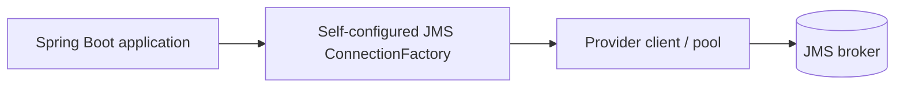
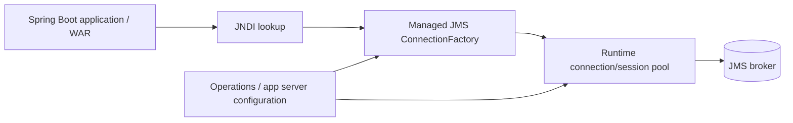
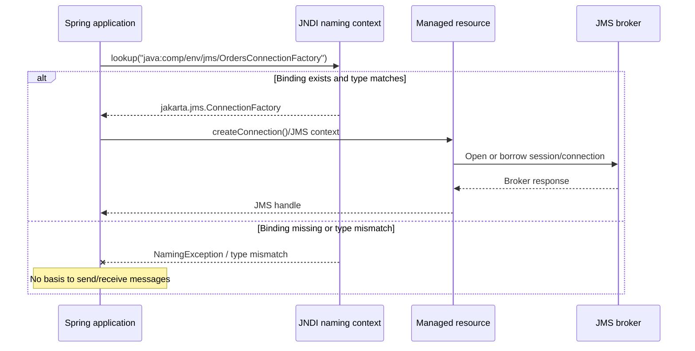
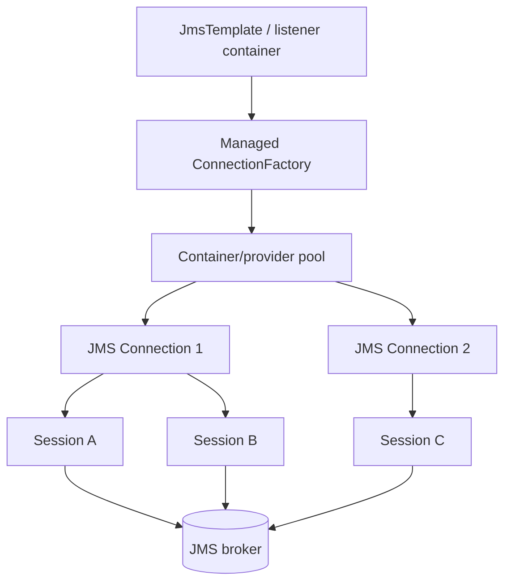
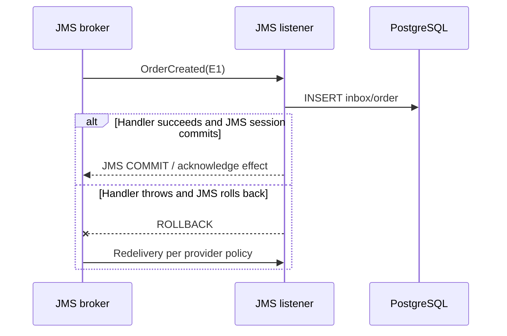
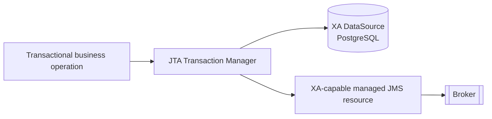
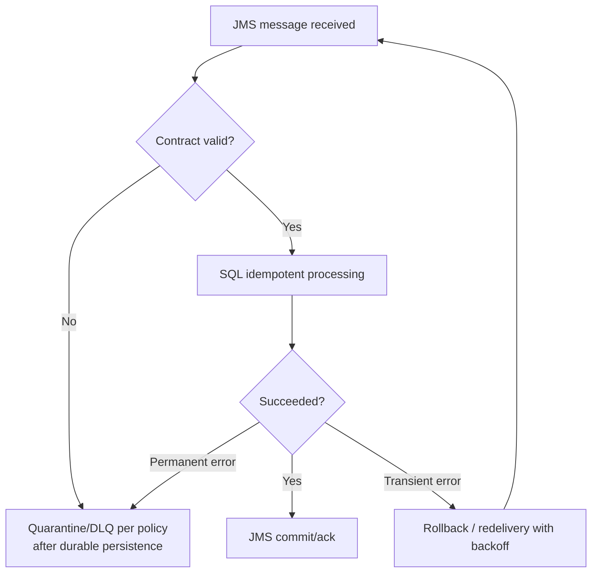
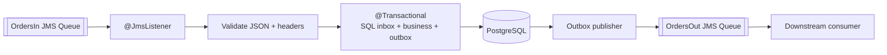
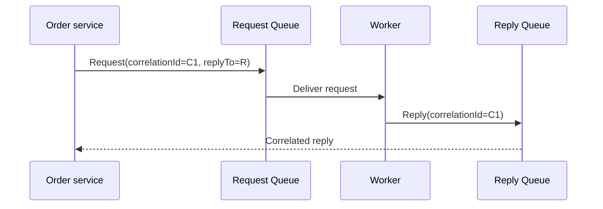
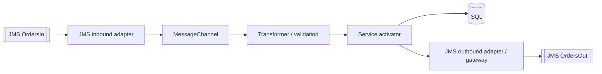

# JNDI ConnectionFactory and Environment-Managed Resources

In a standalone Spring Boot application, developers often declare the message broker address, username, and password and create a `ConnectionFactory` inside the application. However, in many enterprise environments, those details **are not owned by the application**: an application server or managed integration runtime has already created a JMS `ConnectionFactory`, configured the broker, TLS, pooling, transactions, and access policies. The application simply **looks up the resource via JNDI**.

Consider a system that consumes `OrderCreated` events from a JMS queue and writes orders to SQL. When moving from development to an application server, the operations team provides a JNDI name `java:comp/env/jms/OrdersConnectionFactory` instead of a broker URL. If Spring Boot tries to create a second connection factory, the app may connect to the wrong broker, bypass the runtime-managed pool, fail to participate in transactions as expected, or fail to start due to `javax.jms`/`jakarta.jms` library conflicts.

This lesson belongs to the **JMS** chapter of the **SPRING_BOOT_INTEGRATION** module. The focus is how Spring Boot connects systems via HTTP clients, SQL, caches, message brokers, and Spring Integration adapters while managing **configuration, data contracts, transactions, errors, deduplication, testing, and observability**. Therefore, we will not stop at a single JNDI lookup call: we need to understand **who owns the resource, who manages its lifecycle, what transactions cover sending/receiving messages, and what happens when the broker or runtime fails**.

> **Example scope:** Java 17+, Spring Boot 3.x/Spring Framework 6.x, Spring JMS, and **Jakarta Messaging/Jakarta JMS** (`jakarta.jms.*`). JNDI names, transaction managers, pooling mechanics, and packaging depend on the application server/broker (such as WildFly, WebLogic, WebSphere Liberty, or an equivalent Jakarta EE runtime). Do not use these snippets to conclude that every application server shares the same JNDI namespace. For Spring Boot 4.x/Jakarta Messaging or other provider generations, consult the version-specific documentation.

## 1. Learning objectives

After this lesson, you will be able to:

1. Explain how **JMS ConnectionFactory**, **JNDI**, **administered objects**, and **resource references** differ.
2. Distinguish application-created JMS connections from a `ConnectionFactory` managed by a runtime/application server.
3. Look up a `jakarta.jms.ConnectionFactory` via JNDI in Spring Boot using configuration properties or Java beans.
4. Use JNDI resources with `JmsTemplate`, `@JmsListener`, and `DefaultJmsListenerContainerFactory`.
5. Understand connection/session/pool lifecycles and avoid stacking unverified caching/pooling layers.
6. Distinguish **JMS session transactions**, **JDBC transactions**, and **JTA/XA distributed transactions**.
7. Design error handling, redelivery, DLQs, idempotency, and acknowledgments along the right boundaries.
8. Test against a local broker and a real JNDI environment, including startup, TLS/auth, failover, and access permissions.
9. Operate with metrics, health checks, access controls, and recovery procedures.

## 2. Foundational concepts

### 2.1. JMS is an API, not the name of a broker

**Jakarta Messaging (JMS)** defines the Java API for sending and receiving messages:

- `ConnectionFactory`: creates connections/`JMSContext` per provider API.
- `Connection`: logical connection between the application and the messaging provider.
- `Session`: context for creating, sending, receiving, acknowledging, and managing local transactions.
- `MessageProducer` / `MessageConsumer`: sends/receives messages.
- `Queue` / `Topic`: destinations for point-to-point or publish/subscribe models.
- `Message`, `TextMessage`, `BytesMessage`...: message formats.

JMS is **not a broker**. Artemis, IBM MQ, and compatible providers supply different implementations of the JMS API. Spring JMS code can stay fairly provider-independent, yet queue setup, credentials, redelivery, and transaction configuration still have **vendor/runtime-specific** parts.

### 2.2. What is JNDI used for?

**Java Naming and Directory Interface (JNDI)** provides a mechanism to look up an object by **name in a naming context**. Instead of writing:

```java
ConnectionFactory cf = new VendorSpecificConnectionFactory(
        "tcp://broker.internal:61616");
```

the application can perform a lookup:

```java
ConnectionFactory cf =
        (ConnectionFactory) new InitialContext()
                .lookup("java:comp/env/jms/OrdersConnectionFactory");
```

Here:

- `ConnectionFactory` is the `jakarta.jms` interface.
- `InitialContext` and `NamingException` belong to Java SE's `javax.naming`; the fact that Java Naming still lives in `javax.naming` does **not** mean the project may use `javax.jms`.
- `java:comp/env/jms/OrdersConnectionFactory` is an **example name bound/aliased by the application server**; it exists only when the runtime has configured that binding.
- JNDI **does not automatically create a broker**, nor does it guarantee that the looked-up object supports every feature or participates in XA.

### 2.3. What are administered objects?

In Jakarta EE environments, administrators declare a **JMS administered ConnectionFactory** and **Destination** and bind them into the JNDI namespace for applications to consume.

| Resource | Typical owner | What the application does |
| --- | --- | --- |
| JMS `ConnectionFactory` | Application server/runtime/broker admin | Looks up and uses via Spring JMS |
| JMS `Queue` / `Topic` | Broker admin/application server | Looks up destinations or references names per contract |
| JMS connection/session pool | Runtime/provider | Borrows/returns handles per contract |
| TLS/credentials | Secret manager/application server | Does not hardcode if injected by runtime |
| JTA transaction coordinator | Application server/transaction platform | Participates when configured properly |
| SQL `DataSource` | Runtime or Spring Boot | Uses via JDBC/JPA with the matching transaction manager |

**A JNDI name is a deployment contract**, not a universal constant across vendors. `java:comp/env` commonly holds component-environment resource references; another server may expose `java:/JmsXA`, `java:jboss/...`, `jms/OrdersCF`, or an equivalent mapping.

## 3. Two ConnectionFactory provisioning models

### 3.1. Application creates its own connection factory

In standalone Spring Boot deployments (fat JAR/container image), the application can use Spring Boot auto-configuration or a vendor client:



The application/deployment typically manages:

- Broker URL, authentication, and TLS.
- Creating the `ConnectionFactory` and/or an appropriate pool.
- Configuring sessions, retries, destinations, threads, and listener lifecycles.
- Tuning per environment via properties/secrets.

This is a sound choice when services deploy independently on Kubernetes or VMs without a server-provided naming service or JNDI resource.

### 3.2. Runtime manages the connection factory

When deployed to an application server or centrally managed JMS runtime:



The application needs to:

1. Know the provided **JNDI name**.
2. Look up the exact **`jakarta.jms.ConnectionFactory`** type.
3. Pass that object into Spring JMS without creating a second client/pool unnecessarily.
4. Respect the environment's transactions, session limits, and permission policies.

**Key point:** Binding an object into JNDI does not automatically mean the runtime manages everything about it. A **self-created vendor factory** can also be bound in a test naming context; pooling, lifecycle management, and JTA participation depend on **how the resource is provisioned**, not merely on calling `lookup`.

### 3.3. Quick comparison

| Criterion | Self-configured | JNDI managed resource |
| --- | --- | --- |
| Who picks the broker endpoint? | Application/deployment | Runtime/operations |
| Who supplies `ConnectionFactory`? | Spring Boot/vendor configuration | Environment JNDI binding |
| Pooling | Application must configure appropriately | May already be managed by runtime |
| Credentials | Application secrets/config | May reside entirely within runtime |
| Transactions/XA | Must integrate explicitly | May be provided by runtime, **not automatic** |
| Unit testing | Easy to inject mocks/in-memory brokers | Easy to mock abstraction, but real JNDI must be tested in target environment |
| Portability | Depends on vendor client config | Depends on JNDI names and server resource mappings |
| Standalone runtime | Usually convenient | Requires a naming provider or custom setup |

## 4. JNDI lookup flow and when failures occur

### 4.1. Lookup flow



There are two distinct failure points:

- **Lookup failure:** missing name, naming context not ready, insufficient permissions, or wrong object type.
- **Broker connection failure:** JNDI lookup succeeds, but using the factory later reveals the broker is down, auth/TLS is wrong, or the pool is exhausted.

Do not lump every exception under "JNDI is broken." An application can start up fine when lookup is lazy or the resource object exists, only for the listener to fail when opening an actual connection.

### 4.2. Names and namespaces

Examples you might encounter across docs/environments:

```text
java:comp/env/jms/OrdersConnectionFactory
java:/JmsXA
jms/OrdersConnectionFactory
java:global/jms/OrdersCF
```

**Do not** treat those four names as automatic aliases for the same object. Each application server has its own naming namespaces and conventions. Operations should supply all of:

- The JNDI name **the application actually looks up**.
- The JNDI name **bound on the server**, if resource-reference mapping is used.
- The object type, e.g., `jakarta.jms.ConnectionFactory`.
- Corresponding destination names/bindings.
- Transaction mode, pool limits, security identity, and failover documentation.

### 4.3. Resource references and JNDI mapping

Server configuration can map an application-local reference `java:comp/env/jms/OrdersConnectionFactory` to a server-managed broker resource. This mapping lives in application server deployment descriptors or admin consoles/configs; no Spring Boot property can create server-side resources on its own.

If a WAR is deployed to another server, **the reference name inside the app can stay unchanged** as long as the target server defines the matching mapping. That is one benefit of environment-managed resources.

## 5. Jakarta JMS compatibility and ClassLoader

### 5.1. javax.jms is not jakarta.jms

Spring Boot 3.x/Spring Framework 6.x uses the **`jakarta.jms.*`** namespace for modern JMS APIs. Older provider clients or servers may only expose `javax.jms.*`.

Two incompatible interface types:

```java
jakarta.jms.ConnectionFactory    // Used by Spring Framework 6.x
javax.jms.ConnectionFactory      // Legacy Java EE/JMS generation
```

Even though both are named "ConnectionFactory," the JVM **does not treat them as the same interface**. A JNDI lookup returning an object implementing `javax.jms.ConnectionFactory` cannot be cast to `jakarta.jms.ConnectionFactory`. The result will be a `ClassCastException` or a linkage/classloading error.

**This is a platform compatibility issue**, not something fixed merely by renaming Java imports in application code.

### 5.2. Maven dependencies for server-managed environments

Example dependencies for a Spring Boot 3.x application packaged as a WAR (requiring the proper parent/BOM):

```xml
<dependencies>
    <dependency>
        <groupId>org.springframework</groupId>
        <artifactId>spring-jms</artifactId>
    </dependency>

    <dependency>
        <groupId>jakarta.jms</groupId>
        <artifactId>jakarta.jms-api</artifactId>
        <scope>provided</scope>
    </dependency>

    <dependency>
        <groupId>org.springframework.boot</groupId>
        <artifactId>spring-boot-starter-jdbc</artifactId>
    </dependency>
</dependencies>
```

`provided` here is strictly an **example when the runtime actually provides a compatible Jakarta JMS API**. If the app runs standalone, scopes and dependencies must change to supply the required API/implementation at runtime. Never bundle both Jakarta and legacy javax JMS clients on the classpath "as a fallback."

When deploying to an application server, check classloader policies and server-provided libraries:

- Does the runtime support the right Jakarta EE/JMS version?
- Does the bound `ConnectionFactory` actually implement `jakarta.jms`?
- Does the app accidentally bundle API/provider JARs duplicating server modules?
- Is the vendor client managed by the server or packaged inside the application?

Not every new Spring Boot version is compatible with every older application server; check support matrices and deployment models before choosing JNDI.

## 6. Configuring Spring Boot with spring.jms.jndi-name

In Spring Boot versions supporting JMS JNDI auto-configuration, `spring.jms.jndi-name` looks up the `ConnectionFactory` by the name provided by the environment.

Example `application-managed.yml`:

```yaml
spring:
  jms:
    jndi-name: ${ORDERS_JMS_CF_JNDI:java:comp/env/jms/OrdersConnectionFactory}
    cache:
      enabled: false

integration:
  jms:
    inbound-destination: ${ORDERS_JMS_INBOUND:java:comp/env/jms/OrdersIn}
    outbound-destination: ${ORDERS_JMS_OUTBOUND:java:comp/env/jms/OrdersOut}
```

Meaning:

- `spring.jms.jndi-name` is a **lookup name**; Spring Boot does not create bindings or resources if the server has not provisioned them.
- `spring.jms.cache.enabled: false` is a **deliberate choice in this container-managed example** to avoid automatically wrapping a server-pooled, transaction-managed factory with an extra Spring cache layer. It is **not a universal rule** for every provider; measure performance, listener/session usage, and app-server support.
- The destinations here are **JNDI names**; if passing them by name to `JmsTemplate`/listeners, configure how names resolve to `Destination` objects.
- The default URI value is just an **example deployment contract**, not a JNDI resource automatically created by Spring Boot.

If the application already declares another `ConnectionFactory` bean, auto-configuration conditions may pick that bean instead of JNDI. Inspect the runtime bean graph/logs whenever two factories are suspected.

### 6.1. Why spring.jms.jndi-name alone may not be enough

A standalone app launched via:

```bash
java -jar orders-app.jar
```

usually **does not have a `java:comp/env` naming context** like a Jakarta EE application server. Lookups will fail even if the property syntax is valid.

Pick one of these patterns:

1. Deploy into a runtime that provides the matching JNDI bindings.
2. Supply a supported, secure naming provider/context for standalone execution.
3. If no real JNDI exists, **configure a vendor ConnectionFactory directly** instead of forcing a managed-resource pattern.

Never ship a test mock JNDI provider into production to mask unprovisioned deployment resources.

## 7. Manual lookup with JndiTemplate

### 7.1. When is an explicit bean needed?

Use Java configuration when:

- Multiple JMS providers or connection factories exist.
- Specific `@Qualifier` names are required.
- You want strict environment-specific lookup/fail-fast error handling.
- Container configuration differs from Spring Boot's auto-configuration.
- A custom `DestinationResolver` or dedicated transaction/listener factory must share the same resource.

Example:

**`ManagedJmsResourceConfiguration.java`**

```java
package com.example.integration.jms;

import jakarta.jms.ConnectionFactory;
import javax.naming.NamingException;

import org.springframework.beans.factory.annotation.Value;
import org.springframework.context.annotation.Bean;
import org.springframework.context.annotation.Configuration;
import org.springframework.jndi.JndiTemplate;

@Configuration
public class ManagedJmsResourceConfiguration {

    @Bean("ordersConnectionFactory")
    ConnectionFactory ordersConnectionFactory(
            @Value("${integration.jms.connection-factory-jndi}") String name)
            throws NamingException {

        return new JndiTemplate().lookup(name, ConnectionFactory.class);
    }
}
```

Matching configuration:

```yaml
integration:
  jms:
    connection-factory-jndi: ${ORDERS_JMS_CF_JNDI}
```

**Important:** Choose **one** bean management strategy: either Spring Boot auto-lookup via `spring.jms.jndi-name` or an explicit lookup bean as above. Avoid accidentally creating two factories or injecting the wrong bean due to competing primaries/qualifiers. With multiple providers, name them clearly and inject with `@Qualifier`.

### 7.2. JndiObjectFactoryBean and lazy lookup

Spring also provides `JndiObjectFactoryBean` for JNDI lookups/proxies in some setups. It helps if you want property-driven or lazy lookups, with trade-offs:

- Startup lookup fails fast if the resource is missing.
- Lazy lookup lets the app start successfully and fail on the first request/consumer run.
- Caching lookup objects is not the same as caching physical JMS connections/sessions.
- If server rebinding or failover replaces objects, understand proxy/cache lifecycles in your runtime.

Do not assume enabling lazy lookup gives automatic failover. Those are two separate concerns.

### 7.3. Environment-supplied JNDI names, never from requests

`JndiTemplate.lookup(...)` must only receive names controlled by deployment configuration. **Never take a JNDI name directly from an HTTP parameter, event payload, or message header** for arbitrary lookup, as it creates risks of out-of-scope resource access, privilege escalation, and attack surface expansion.

If supporting multiple tenants/partners, maintain an allowlist of bindings with server-side authorization mapping; never let users steer JNDI namespace lookups.

## 8. Environment-managed destinations

### 8.1. Physical queue name vs. JNDI name

Example:

```text
JNDI name:       java:comp/env/jms/OrdersIn
Physical queue:  ORDERS.IN
Broker address:  orders.in
```

These can be **three distinct concepts** depending on the JMS provider. `JmsTemplate` accepts a `String destinationName`, and how that string gets interpreted depends on **`DestinationResolver`**:

- `DynamicDestinationResolver` asks the provider for a destination handle by **physical name**.
- `JndiDestinationResolver` looks up a `jakarta.jms.Destination` in the naming context.
- Some servers require queues/topics to be pre-provisioned and disallow dynamic destination creation.

Do not assume `convertAndSend("java:comp/env/jms/OrdersIn", ...)` automatically performs a JNDI lookup without configuring the appropriate destination resolver.

### 8.2. JndiDestinationResolver

Example Spring configuration:

```java
package com.example.integration.jms;

import org.springframework.context.annotation.Bean;
import org.springframework.context.annotation.Configuration;
import org.springframework.jms.support.destination.DestinationResolver;
import org.springframework.jms.support.destination.JndiDestinationResolver;

@Configuration
public class ManagedJmsDestinationConfiguration {

    @Bean
    DestinationResolver managedJmsDestinationResolver() {
        JndiDestinationResolver resolver = new JndiDestinationResolver();
        resolver.setCache(true);

        // Only accept destinations already provisioned in JNDI.
        resolver.setFallbackToDynamicDestination(false);

        return resolver;
    }
}
```

With `fallbackToDynamicDestination(false)`, a misspelled name raises an error instead of silently falling back to a dynamic destination named like the JNDI string.

Caching in `JndiDestinationResolver` caches only **Destination object lookups**, not a pool of JMS connections. When the server performs rebinding/migration, define an invalidation policy per server/provider capabilities.

## 9. Using JmsTemplate with a managed ConnectionFactory

`JmsTemplate` encapsulates JMS operations such as opening/closing connections and sessions under Spring JMS contracts and converting messages.

Example explicit bean configuration:

```java
package com.example.integration.jms;

import jakarta.jms.ConnectionFactory;

import org.springframework.beans.factory.annotation.Qualifier;
import org.springframework.context.annotation.Bean;
import org.springframework.context.annotation.Configuration;
import org.springframework.jms.core.JmsTemplate;
import org.springframework.jms.support.destination.DestinationResolver;

@Configuration
public class JmsClientConfiguration {

    @Bean
    JmsTemplate ordersJmsTemplate(
            @Qualifier("ordersConnectionFactory") ConnectionFactory factory,
            DestinationResolver managedJmsDestinationResolver) {

        JmsTemplate template = new JmsTemplate(factory);
        template.setDestinationResolver(managedJmsDestinationResolver);

        return template;
    }
}
```

A publisher:

```java
package com.example.integration.jms;

import org.springframework.jms.core.JmsTemplate;
import org.springframework.stereotype.Component;

@Component
public class OrderEventPublisher {

    private final JmsTemplate jmsTemplate;

    public OrderEventPublisher(JmsTemplate jmsTemplate) {
        this.jmsTemplate = jmsTemplate;
    }

    public void publish(String orderCreatedJson) {
        jmsTemplate.convertAndSend(
                "java:comp/env/jms/OrdersOut",
                orderCreatedJson);
    }
}
```

This example sends a **String**; the default converter can produce an appropriate JMS `TextMessage`. It does not guarantee that the payload conforms to JSON Schema or that downstream business logic processed the message successfully.

### 9.1. Do not serialize arbitrary Java objects

Avoid relying on Java native serialization/`ObjectMessage` as an integration contract across apps without shared class/version lifecycles:

- Introduces classpath, compatibility, and deserialization security risks.
- Couples tightly to Java class structures.
- Hard for non-Java partners to consume.

Prefer managed data contracts like **JSON/Avro/Protobuf** with explicit schema versions, content types, event IDs, and validation. If using a Jackson converter, carefully manage `type-id` mappings and trusted types—never allow payloads to specify arbitrary classes from untrusted namespaces.

### 9.2. Message metadata

In JMS, messages can carry:

| Attribute | Purpose | Notes |
| --- | --- | --- |
| `JMSMessageID` | Provider-assigned message identifier | Does not replace a business event ID in all contexts |
| `JMSCorrelationID` | Links request/reply or trace flows | Not an idempotency key by default |
| `JMSReplyTo` | Destination for responses | Requires access permissions and timeout policies |
| `JMSRedelivered` | Hint that the message was redelivered | Provider/semantics dependent |
| `JMSExpiration` | Message expiration timestamp | Expired messages may never be seen by consumers |
| `JMSPriority` | Provider-level priority | Not an absolute SLA guarantee |
| Custom properties | `eventType`, `schemaVersion`, `tenantId`... | Contract must specify types and authorization |

When business retry logic republishes an event by creating a new JMS message, **`JMSMessageID` can change**. Always include a stable `eventId` or operation ID in the payload/headers per business contract.

## 10. @JmsListener and listener containers

### 10.1. Listeners do not repeat JNDI lookups per message

Spring JMS uses `@JmsListener` to receive messages via a message listener container that maintains appropriate consumers and sessions.

Example:

```java
package com.example.integration.jms;

import org.springframework.jms.annotation.JmsListener;
import org.springframework.stereotype.Component;

@Component
public class OrderInboundListener {

    private final OrderEventHandler handler;

    public OrderInboundListener(OrderEventHandler handler) {
        this.handler = handler;
    }

    @JmsListener(
        destination = "${integration.jms.inbound-destination}",
        containerFactory = "managedJmsListenerFactory"
    )
    public void onMessage(String json) {
        handler.handle(json);
    }
}
```

`OrderEventHandler` is a project-defined application service. In practice, it parses JSON, validates the contract, records SQL/idempotent inbox state, and decides when processing counts as successful.

### 10.2. Listener factory sharing the same resource

Example configuration for a **JMS local transaction**:

```java
package com.example.integration.jms;

import jakarta.jms.ConnectionFactory;

import org.springframework.beans.factory.annotation.Qualifier;
import org.springframework.context.annotation.Bean;
import org.springframework.context.annotation.Configuration;
import org.springframework.jms.config.DefaultJmsListenerContainerFactory;
import org.springframework.jms.support.destination.DestinationResolver;

@Configuration
public class ManagedJmsListenerConfiguration {

    @Bean("managedJmsListenerFactory")
    DefaultJmsListenerContainerFactory managedJmsListenerFactory(
            @Qualifier("ordersConnectionFactory") ConnectionFactory factory,
            DestinationResolver managedJmsDestinationResolver) {

        var listenerFactory = new DefaultJmsListenerContainerFactory();

        listenerFactory.setConnectionFactory(factory);
        listenerFactory.setDestinationResolver(
                managedJmsDestinationResolver);

        // Local JMS session transaction.
        listenerFactory.setSessionTransacted(true);

        // Effective concurrency is also bounded by runtime/provider limits.
        listenerFactory.setConcurrency("2-5");

        return listenerFactory;
    }
}
```

This example configures a **local JMS session transaction**, **not an assertion that JMS and SQL share an XA transaction**. If the runtime manages JTA/XA, the listener factory must be wired with the appropriate transaction manager and resource enlistment verified; never copy `setSessionTransacted(true)` and assume distributed transactions.

### 10.3. Concurrency and container resources

`setConcurrency("2-5")` specifies a consumer range for the listener container, though actual capacity depends on the broker, connection factory, session limits, and application server resources.

If the server's pool allows at most 3 sessions while the listener attempts to run 5 consumers, the application may hit pool wait/exceptions or miss expected throughput. Tune these together:

- Number of listener consumers.
- JMS connections/sessions permitted by the runtime.
- DB connection pool used by the listener.
- Per-message processing duration.
- Redelivery/retry rate.
- Downstream HTTP and SQL capacity.

Do not increase concurrency when the bottleneck is SQL lock contention or a downstream API returning HTTP 429.

## 11. Connections, Sessions, and pool lifecycles

### 11.1. A JMS connection is not synonymous with one session

A provider may multiplex multiple JMS sessions over one connection or dispense separate connections via a pooled factory. Under JMS contracts, a `Session` must not be used concurrently from multiple threads arbitrarily.



The diagram is **conceptual**; not every provider allocates sessions and connections identically. Read server documentation on session limits, recovery, and reconnects.

### 11.2. Who closes resources?

With `JmsTemplate` or listener containers, Spring manages JMS resource usage according to its abstractions. With a **managed ConnectionFactory**, calling handle `close()` typically returns the resource to the runtime pool rather than closing the physical connection.

Principles:

- Never retain connections/sessions long-term inside business singletons arbitrarily.
- Never cache a `Session` as a shared multi-threaded object.
- Close/reuse resources per Spring JMS and provider contracts.
- During container shutdown, stop listeners and release resources before the app server undeploys the resource.
- Do not call `close()` on `ConnectionFactory` itself unless an implementation/ownership contract explicitly calls for it; `ConnectionFactory` is a factory.

### 11.3. Should you add CachingConnectionFactory?

Spring offers `CachingConnectionFactory` to reuse JMS Connections/Sessions/Producers. A runtime-managed JMS factory **may already pool**. Wrapping it in an extra cache layer is not always beneficial:

- Can alter how sessions return to the server pool.
- Can hold resources longer than expected.
- Can interfere with transaction enlistment or state cleanup if misconfigured.
- Can mask credential rotation/failover events or retain stale handles.
- Can create stacked metrics that obscure which pool is saturated.

That is why the managed example earlier disabled Boot's automatic caching. However, **do not assume caching is always wrong**: some providers recommend caching in specific modes, and listener containers have their own cache settings. Test with your actual app server and JMS provider before changing defaults.

### 11.4. Failover and stale JMS connections

A successful JNDI lookup does not guarantee connections last forever. Broker restarts, failover, idle timeouts, credential rotation, or network partitions can break JMS sessions.

When that happens:

1. The listener/container or provider receives an exception.
2. Resources may be invalidated/evicted from the pool.
3. The container/provider recovers connections/sessions per policy.
4. Uncommitted/unacked messages may be redelivered.
5. Business handlers must safely tolerate duplicates.

Never turn network errors into silent successes or acknowledge messages unless SQL state is known to be committed.

## 12. Transactions: local JMS vs. JDBC vs. JTA/XA

This is the most critical area when a JMS flow also writes SQL and calls HTTP.

### 12.1. Local JMS transaction

With `sessionTransacted = true`, a listener can use a **JMS Session transaction** to commit or roll back message receipt with the provider.

Example:



However, if SQL uses a separate **JDBC transaction**, the two transactions are not automatically atomic:

- SQL can commit and then JMS commit fails → message is redelivered.
- JMS can commit when SQL failed to commit due to misconfiguration → lost work.
- Broker outage right after SQL commit → duplicates are normal.

**`sessionTransacted=true` does not mean a transaction wraps every database call inside the handler.**

### 12.2. @Transactional on a SQL service does not enlist the broker

Example:

```java
@Service
public class OrderEventHandler {

    private final OrderInboxService inbox;

    public OrderEventHandler(OrderInboxService inbox) {
        this.inbox = inbox;
    }

    public void handle(String json) {
        inbox.processIdempotently(json);
    }
}

@Service
public class OrderInboxService {

    @Transactional
    public void processIdempotently(String json) {
        // Validate payload, INSERT inbox, update order, INSERT outbox...
    }
}
```

`@Transactional` (with a JDBC/JPA transaction manager) ensures **SQL operations on the same datasource** commit/roll back consistently. It does not automatically roll back a message broker, Redis cache, or HTTP API.

Even after the SQL transaction commits, the listener can crash before JMS acknowledgment; the broker will redeliver the message. Designing an **idempotent consumer** remains mandatory in most systems.

### 12.3. What is JTA/XA?

When an application server supplies a **JTA transaction manager** and both SQL and JMS resources are **XA-capable**, they can join a distributed transaction coordinated via two-phase commit.



Non-negotiable requirements:

1. The transaction manager must genuinely be an appropriate **JTA manager**.
2. The SQL datasource must actually enlist in JTA/XA.
3. The JMS resource must actually be XA-capable and enlisted as supported by the server.
4. Configure recovery logs, transaction timeouts, in-doubt recovery, and heuristic outcome handling.
5. Never take a local-only connection factory and assume having `XA` in the JNDI name satisfies item 3.

**An object looked up from JNDI does not automatically become XA.** Transaction configuration must be verified on a real runtime.

### 12.4. When to avoid XA?

XA carries operational cost: transaction coordinators, recovery logs, in-doubt transactions, resource contention, and complex failure modes. For many microservice architectures, **SQL outbox + idempotent consumer** is a more practical fit for coordinating SQL, brokers, and external HTTP.

Choose XA when:

- Infrastructure/runtime and resources explicitly support it.
- Strict atomicity across distributed-transaction-capable resources is required.
- Operations is equipped to manage recovery and in-doubt states.
- Integration/fault tests and observability are in place.

Never try to stretch XA to cover external HTTP APIs that do not participate in distributed transactions; it **cannot resolve the unknown outcome of an HTTP POST**.

### 12.5. Comparison table

| Model | What resources are covered? | Key takeaway |
| --- | --- | --- |
| Local JDBC `@Transactional` | Usually one datasource/transaction manager | Does not automatically ack JMS |
| Local JMS transacted session | Message receive/send within JMS session | Does not automatically commit/roll back SQL |
| JTA/XA | Resources properly enlisted in the global transaction | Requires runtime/coordinator and recovery |
| Outbox + inbox | SQL state + outbound intent in one tx, consumer dedup | At-least-once delivery and effectively-once side effects |
| Saga/compensation | Multiple independent system steps | Business compensation, not global ACID rollback |

## 13. Acknowledgment, redelivery, and DLQ

### 13.1. JMS acknowledgment modes

In JMS, acknowledgment marks a message consumed according to session mechanics.

Common modes:

| Mode | General meaning | Spring listener notes |
| --- | --- | --- |
| `AUTO_ACKNOWLEDGE` | Provider/container acks automatically per API/container rules | Ack timing varies by listener container; **does not default to redelivery when a listener throws** |
| `CLIENT_ACKNOWLEDGE` | Client/consumer explicitly acknowledges via API | Can ack multiple messages in the session depending on semantics; understand the container |
| `DUPS_OK_ACKNOWLEDGE` | Allows lazy acks and duplicates per contract | Unsuitable when strict guarantees are required |
| Transacted session | Session commit/rollback governs message disposition | Often useful when listeners need rollback/redelivery |

In Spring's `DefaultMessageListenerContainer`, `AUTO_ACKNOWLEDGE` can result in **acknowledging before invoking the listener**; thus a listener exception will not necessarily cause broker redelivery. That is why you should **deliberately choose a listener factory and transaction/ack policy** instead of relying on untested defaults.

### 13.2. SessionTransacted does not guarantee proper bounded retries

When a listener throws in a transacted JMS session, session rollback can trigger redelivery. Attempt count, delay, DLQ, and backoff **depend on provider/broker configuration**.

A permanent schema error can loop indefinitely without bounded policies:



Separate failure types:

- **Transient error:** broker/SQL/HTTP temporarily unavailable; safe to retry if idempotent.
- **Permanent contract error:** invalid payload, unknown enum, missing business ID; route to quarantine/DLQ.
- **Intentional business rejection:** commit the rejected status rather than retrying forever.
- **Unknown outcome:** SQL/HTTP may have committed; verify before retrying.

### 13.3. JMSRedelivered is only a hint

`JMSRedelivered` indicates the message may have been delivered earlier. However:

- Never use this flag as the sole condition for duplicate handling.
- A business event may be republished as a brand-new JMS message, distinct from provider redelivery of the same message.
- A producer may resend the same payload with a new `JMSMessageID`.
- The unit of idempotency must be a **stable business event ID / operation ID**.

### 13.4. DLQs do not rescue data by themselves

A broker can route poison messages to a dead-letter queue after the redelivery threshold. To actually recover, you need:

1. Retained raw payload, source metadata, and bounded error details.
2. Permissions/workflow status to replay after fixing code or data.
3. Never replay messages whose SQL state already committed while bypassing idempotency.
4. Never expose secrets or sensitive data on DLQ dashboards.
5. Track oldest message age, retry counts, and DLQ volume.

## 14. Idempotency with a SQL inbox

### 14.1. Why JNDI does not solve duplicates

JNDI only hands back a resource. Pools and JMS session transactions protect send/receive operations at the messaging provider level, yet the system still faces:

```text
Consumer receives OrderCreated(eventId=E-100)
  -> writes SQL successfully
  -> JMS connection drops before ack/commit
  -> broker redelivers E-100
  -> consumer runs again
```

If the consumer relies only on `JMSMessageID` or assumes "this message arrived once," two runs can create two orders or call a partner API twice.

### 14.2. SQL inbox table pattern

```sql
CREATE TABLE jms_inbox (
    source_system VARCHAR(64) NOT NULL,
    event_id      VARCHAR(128) NOT NULL,
    payload_hash  CHAR(64) NOT NULL,
    processed_at  TIMESTAMPTZ NOT NULL DEFAULT CURRENT_TIMESTAMP,
    PRIMARY KEY (source_system, event_id)
);
```

Within a single SQL transaction, the consumer can:

1. Validate `eventId`, source/tenant, schema version, and payload.
2. Check/insert the (`source_system`, `event_id`) key **atomically**.
3. If new: update business state and write to outbox.
4. If duplicate: verify payload hash/identity policy and skip duplicate side effects.
5. Commit SQL.
6. Then complete the JMS transaction/ack per listener mechanics.

PostgreSQL SQL example:

```sql
INSERT INTO jms_inbox (source_system, event_id, payload_hash)
VALUES (:sourceSystem, :eventId, :payloadHash)
ON CONFLICT (source_system, event_id) DO NOTHING;
```

Inspect the inserted row count to distinguish new vs. duplicate events. However, if the same event ID carries different content, **do not silently treat it as a valid duplicate**; that may indicate a contract violation or security issue.

### 14.3. Failures between the two transactions

If SQL commits and JMS ack fails, the event is redelivered, and the inbox prevents duplicate business processing. If SQL rolls back and JMS accidentally acks, work can be lost. Therefore code and listener factories must define explicit **commit/ack ordering** and retry policies.

**Never execute a remote HTTP call with side effects directly inside a SQL transaction assuming JMS rollback will undo that call.** For HTTP reservations/payments, require operation IDs and reconciliation/outbox/sagas per contract.

## 15. A JMS → SQL → outbox flow

### 15.1. Overall design



Layering:

- **JMS listener:** receives messages, manages exception propagation, and honors listener container policies.
- **Application service:** validates business IDs, state transitions, transactions, and idempotency.
- **JDBC/JPA layer:** uses the datasource paired with the matching transaction manager.
- **Outbox publisher:** emits events after SQL commit with retries and reconciliation.
- **Remote HTTP adapter:** passes idempotency keys for external side effects.

### 15.2. Do not send JMS directly inside a SQL transaction without guarantees

Anti-pattern:

```java
@Transactional
public void createOrder(String orderId) {
    orderRepository.insert(orderId);
    jmsTemplate.convertAndSend(
            "java:comp/env/jms/OrdersOut",
            "{\"orderId\":\"" + orderId + "\"}");
}
```

If JMS send succeeds and SQL rolls back, the message describes an order that does not exist. Conversely, if SQL commits and JMS send fails, downstream never receives the event.

With properly configured JTA/XA, behavior differs; however, `@Transactional` above **does not prove both resources share one transaction**.

### 15.3. Outbox prevents lost events

```sql
CREATE TABLE order_outbox (
    event_id      VARCHAR(128) PRIMARY KEY,
    aggregate_id  VARCHAR(64) NOT NULL,
    event_type    VARCHAR(64) NOT NULL,
    payload_json  TEXT NOT NULL,
    published_at  TIMESTAMPTZ
);
```

Write the order and outbox row in **the same SQL transaction**. A worker polls unpublished rows, sends via `JmsTemplate`, and sets `published_at`.

One residual failure window remains:

```text
1. JMS broker accepts the event.
2. Worker dies before marking published_at.
3. After restart, worker resends the same eventId.
```

Hence an outbox provides **at-least-once intent delivery** by common design, not end-to-end exactly-once. Consumers still need inbox/idempotency.

## 16. JNDI-managed XA transactions: verify instead of guessing

### 16.1. Having XA in a JNDI name is not enough

A server might expose two connection factories:

```text
java:/JmsConnectionFactory
java:/JmsXA
```

The name hints at intent, **but is not proof** that the application uses XA transactions. Verify runtime/provider documentation and the active transaction manager.

With JTA:

- `jakarta.transaction.TransactionManager` or an equivalent abstraction may be supplied by the server.
- Spring uses `JtaTransactionManager` or container-supported integration.
- Both JMS resource and SQL datasource must enlist as XA participants.
- Application code must not commit/roll back local resources behind the transaction coordinator's back.
- Recovery must be operated and tested.

### 16.2. Listener configuration example when the server provides JTA

The snippet below is a **conceptual template**, applicable only once the server provides a `JtaTransactionManager` and properly XA-enabled JMS resource:

```java
@Bean("jtaManagedJmsListenerFactory")
DefaultJmsListenerContainerFactory jtaManagedJmsListenerFactory(
        ConnectionFactory jmsConnectionFactory,
        JtaTransactionManager jtaTransactionManager) {

    var factory = new DefaultJmsListenerContainerFactory();
    factory.setConnectionFactory(jmsConnectionFactory);

    // Container accepts transaction manager to coordinate per policy.
    factory.setTransactionManager(jtaTransactionManager);

    return factory;
}
```

Matching imports:

```java
import jakarta.jms.ConnectionFactory;
import org.springframework.jms.config.DefaultJmsListenerContainerFactory;
import org.springframework.transaction.jta.JtaTransactionManager;
```

Do not register both `managedJmsListenerFactory` and `jtaManagedJmsListenerFactory` for the same listener without knowing clearly which one runs. Under JTA/XA, acknowledgment, session transaction, and connection caching properties must follow **server/provider recommendations**, not be copied mechanically from local JMS transaction examples.

### 16.3. Testing commit failures

An XA integration test cannot stop at "send/receive works." Inject faults:

- Broker down before prepare.
- Database down before prepare/commit.
- Coordinator restart mid 2-phase commit.
- Transaction timeout.
- Recovery logs containing in-doubt transactions.
- Resource reporting a heuristic decision.

**Never claim XA removes all operational risk.** It shifts part of atomicity onto a transaction coordinator and recovery machinery that must be configured and managed.

## 17. JMS request/reply, correlation, and timeouts

JMS is not limited to event publishing. Spring can use JMS request/reply when awaiting a response from another service, e.g., via `JmsTemplate.sendAndReceive(...)` or a Spring Integration outbound gateway.

### 17.1. One request/reply involves multiple timeouts



Required elements:

- Consistent `JMSCorrelationID` across request and reply.
- Access permissions on the reply destination.
- Receive timeout / business deadline.
- Cleanup policy upon timeout.
- Idempotency if the caller retries after timeout.
- Distinguishing "reply not received yet" from "worker never acted."

### 17.2. A timeout does not prove the operation failed

If `receiveTimeout` expires, the caller received no reply, yet the worker may already have completed the side effect. Retrying with a new ID risks creating two reservations/payments. Keep operation IDs stable and provide status lookup capabilities.

Do not confuse `JmsTemplate`'s `receiveTimeout` with connection-pool borrow wait time, physical broker connection creation time, or message TTL/expiration.

## 18. Environment-managed resources in Spring Integration

Spring Integration JMS provides inbound/outbound adapters and gateways built atop Spring JMS abstractions using the same configured `ConnectionFactory`.

An integration flow might look like:



Checks when using managed resources:

- Is the adapter injecting **the right JNDI `ConnectionFactory` bean**?
- Does the adapter/DSL `JmsTemplate` share the same `DestinationResolver`?
- Is the channel a `DirectChannel` or an async `ExecutorChannel`? Does the thread-bound transaction context apply as expected?
- Do errors propagate back to the listener container or route to `errorChannel`?
- Who decides ack/rollback when a downstream handler fails?
- If the flow touches both JMS broker and SQL, is it using JTA/XA or two separate local transactions?

**Common pitfall:** A flow using an async channel lets the JMS listener return success **before** downstream handlers write SQL. The message can be acked prematurely without durable handoff or transaction coordination. Never assume a transaction or thread-bound resource automatically crosses an internal queue.

## 19. Testing across environments

### 19.1. Unit tests do not need JNDI

Business services should depend on injected abstractions rather than calling `new InitialContext()` inside every method. In unit tests:

- Mock `OrderEventHandler` to verify routing.
- Mock the publisher or `JmsTemplate` to verify method arguments.
- Test JSON schema, eventId, tenant, timestamps, and mapping independently of the broker.
- Never simulate "XA success" using only a mock transaction manager.

### 19.2. Integration tests with a local broker

For standalone Spring Boot tests, you can spin up **Apache ActiveMQ Artemis** or a compatible JMS broker using Testcontainers or a suitable embedded test runtime. Define a direct test `ConnectionFactory` to avoid depending on an application server just to test business flows.

Example internal gateway interface:

```java
public interface EventBus {
    void publishOrderCreated(String json);
}
```

The production adapter uses `JmsTemplate`/JNDI; tests can use a test broker without faking a full JNDI server for every case.

Tests should verify:

1. Producing a `TextMessage` with valid JSON.
2. Listener receiving the payload and writing SQL.
3. Redelivering the same eventId produces no duplicate side effects.
4. SQL failures trigger JMS redelivery per listener policy.
5. Poison messages route to DLQ/quarantine after configured attempts.
6. Broker restarts and application recovery.
7. Timeouts on slow replies and reconciliation by operation ID.

### 19.3. Testing the JNDI contract in a real application server

Some things **cannot be verified** with a Testcontainers broker alone:

- Does the real `java:comp/env/jms/...` binding actually exist?
- Does the server return an object of type `jakarta.jms.ConnectionFactory`?
- Do classloaders conflict with bundled API/driver JARs?
- Does the server-managed pool enforce documented limits?
- Does managed JTA/XA actually enlist the resources?
- Do environment TLS, credentials, and authorization work?
- Do failover/undeploy release connections/sessions cleanly?

Therefore you need a **deployment integration test** or smoke test on a production-like runtime with properly provisioned JNDI resources.

### 19.4. A minimal JNDI smoke test

You can include a Spring component active only under a dedicated profile/test:

```java
package com.example.integration.jms;

import jakarta.jms.ConnectionFactory;
import javax.naming.NamingException;

import org.springframework.jndi.JndiTemplate;

public final class JndiSmokeCheck {

    public static ConnectionFactory lookup(String jndiName)
            throws NamingException {

        return new JndiTemplate()
                .lookup(jndiName, ConnectionFactory.class);
    }
}
```

The test verifies lookup type and then executes a JMS operation **that does not alter production data** in an authorized test environment (such as send/receive on an isolated test queue). A successful lookup only proves the naming binding and type; **it does not prove the broker, network, or transactions work**.

Never build a test that "sends to a production queue to check" without dedicated environments and contracts for test messages.

## 20. Operations, health checks, and observability

### 20.1. Key signals

| Signal | What it isolates |
| --- | --- |
| JNDI lookup success/failure | Naming bindings / resource configuration |
| Connection/session pool active/idle/wait | Pool exhaustion and resource leaks |
| Broker connect/auth/TLS errors | Network, security identity, credentials |
| Listener startup and container state | Whether subscribers are actually active |
| Queue depth / oldest message age | Backlogs and whether consumers keep up |
| Consumer throughput and processing latency | Bottlenecks in SQL/HTTP or listeners |
| JMS redelivery count and DLQ size | Failures, poison messages, duplicates |
| SQL inbox duplicate/conflict count | Whether idempotency is protecting the system |
| JTA in-doubt/recovery count | Distributed transaction failures |
| Outbox oldest unpublished age | SQL committed but not yet published |
| Correlation/event/trace IDs | End-to-end flow tracing across HTTP → SQL → JMS |

Do not assume Spring Boot Actuator/Micrometer automatically exposes every vendor JMS pool metric. With managed resources, part of the telemetry lives in the **application server, broker, or JTA coordinator**, not inside the Spring app.

### 20.2. Liveness and readiness

- **Liveness:** process is alive and capable of recovering. Do not blindly restart the entire application just because the broker briefly disconnected.
- **Readiness:** whether the service can handle work needing JMS. You can separate inbound receive, outbound send, read-only HTTP, and SQL writes by capability.
- **Deep health:** probing brokers, queues, resource bindings, permissions, and capacity can be expensive; avoid running deep probes too frequently on every pod.

An app can **pass JNDI lookup while the JMS broker is down**. Readiness checks should reflect real operational usability rather than simply checking for non-null objects.

### 20.3. Structured logging

Example:

```text
operation=jms-consume-order
provider=managed-jms
destination=OrdersIn
eventType=OrderCreated
schemaVersion=2
eventId=evt-2034
deliveryAttempt=3
processingState=ROLLED_BACK
errorCategory=SQL_TIMEOUT
correlationId=trace-91a7
```

Do not log:

- JMS usernames/passwords or credentials inside JNDI provider properties.
- Full raw messages containing PII/payment data.
- JNDI environment secrets or serialized `ConnectionFactory` objects.
- Arbitrary message bodies inside metric labels.

Metric tags should use low-cardinality values like operation, destination alias, and error category; `eventId` belongs in access-controlled logs and traces.

## 21. Security and JNDI/JMS permissions

### 21.1. Least privilege

The application's account or managed identity should have strictly scoped permissions:

- Look up only authorized connection factory/destination JNDI bindings.
- Connect to the broker over TLS/auth per policy.
- Send to authorized outbound queues or consume from authorized inbound queues.
- No admin/purge/delete queue rights unless required.
- No access to JNDI resources of other applications or tenants.

Never allow HTTP callers to supply arbitrary destination/JNDI names. If tenant-based routing is needed, use server-managed allowlists and permission maps, always validating the tenant from the security context.

### 21.2. Remote JNDI and classloading

Remote naming providers require additional factory/provider properties and enlarge the attack surface. Avoid configuring lookups against untrusted JNDI endpoints or accepting provider URLs from user requests. In container-managed environments, prefer local contexts/bindings provisioned by the runtime.

Also:

- Patch the application server, JMS provider, and client libraries per advisories.
- Do not bundle conflicting legacy JNDI providers.
- Verify certificates/hostnames when the runtime connects to the broker.
- Separate test and production JNDI bindings and broker credentials.
- Test secret rotation and how pooled JMS sessions behave afterward.

## 22. Troubleshooting common failures

| Symptom | Possible cause | Check first |
| --- | --- | --- |
| `NameNotFoundException` | Resource not bound or wrong JNDI name | Server namespace/config, deployment mapping |
| `NoInitialContextException` | No JNDI provider/context | Does the runtime actually provide JNDI, or is this a standalone fat JAR? |
| `ClassCastException` on lookup | Wrong object type, javax/jakarta mismatch | JMS API namespace, classloader, server version |
| Missing `ConnectionFactory` bean | Auto-config overridden/missing dependency | Bean graph, conditional config, profile |
| Lookup passes but listener fails to start | Broker/auth/TLS/destination failure | Listener logs, broker health, provider pool |
| `InvalidDestinationException` | Destination unprovisioned or wrong resolver | JNDI destination name vs. physical name |
| Pool/session exhausted | Listener concurrency too high or leaked handles | Server pool metrics, listener count, processing latency |
| Consumer receives message twice | Redelivery/crash after SQL commit before JMS ack | Inbox, eventId, ack policy |
| No redelivery when listener throws | `AUTO_ACKNOWLEDGE` or listener config | Container acknowledgment/transaction mode |
| Endless poison-message loop | Bad contract + unbounded retries | DLQ, backoff, schema validation |
| SQL rolls back but JMS already sent | Two independent transactions | Transaction manager, outbox, or XA |
| JTA enabled but only one resource enlists | Non-XA resource or wrong bean | Server enlistment/recovery logs |
| Listener hangs after failover | Stale sessions, provider reconnect policy | Broker failover config, pool health |
| Local tests pass, production WAR fails | Different JNDI/classloader/provider | Deployment smoke test and support matrix |

### 22.1. Procedure for debugging a JNDI error

1. Verify the application is running on the **intended runtime** and profile.
2. Verify the exact JNDI name looked up by the application, including prefix and resource mapping.
3. Verify the server has provisioned the binding and lookup permissions.
4. Verify the object actually implements **`jakarta.jms.ConnectionFactory`**.
5. Verify two `ConnectionFactory` beans do not exist causing wrong injection.
6. Verify whether the destination resolver expects JNDI names or physical names per contract.
7. Test opening a connection and sending/receiving on an appropriate test queue.
8. Inspect transaction manager, XA enlistment, and listener ack policies.
9. Run fault tests for broker restarts/redelivery and SQL duplicates.
10. Document approved configs for rollout, rollback, and operations.

Never catch `NamingException` and silently fall back to another production broker URL: doing so easily routes events to the wrong system.

## 23. Pre-deployment checklist

- [ ] Spring Boot/Spring JMS/Jakarta JMS versions match the application server.
- [ ] JNDI `ConnectionFactory` is provisioned with the right namespace and type.
- [ ] No accidental `javax.jms` usage in Spring Boot 3.x.
- [ ] One clear ConnectionFactory bean strategy: Boot JNDI auto-config **or** explicit lookup bean.
- [ ] JNDI queue/topic names and physical destinations are clearly distinguished.
- [ ] `DestinationResolver` has a safe fallback policy that avoids unintended dynamic queues.
- [ ] Listener concurrency fits the session pool and database capacity.
- [ ] No stacked caching/pooling violating runtime recommendations.
- [ ] TLS/auth and resource references follow least privilege, with no secrets in source.
- [ ] JMS local transactions, SQL local transactions, and JTA/XA are documented separately.
- [ ] Ack/redelivery/DLQ are tested with real errors.
- [ ] Idempotency keys, SQL inbox/outbox, and duplicate handling policies exist.
- [ ] No side-effecting JMS/HTTP calls inside SQL transactions without matching guarantees.
- [ ] JSON/event schema contracts and validation run before business processing.
- [ ] Broker integration tests and real-runtime JNDI deployment smoke tests exist.
- [ ] Runbooks cover broker failover, pool exhaustion, credential rotation, and DLQ replay.
- [ ] Metrics track queue age, listener state, redeliveries, duplicates, outbox lag, and JTA recovery if XA is used.

## 24. Self-check questions

1. Are a JMS `ConnectionFactory` and a JNDI name the same kind of concept? Why or why not?
2. Does a successful `JndiTemplate.lookup(...)` prove the JMS broker is ready to send/receive?
3. Why do fat JAR applications usually lack a `java:comp/env` JNDI context like an application server?
4. Can `jakarta.jms.ConnectionFactory` be cast from `javax.jms.ConnectionFactory`?
5. In the managed resource model, who configures broker URLs, pooling, and access rights?
6. Does `spring.jms.jndi-name` automatically create queues or connection factories on the application server?
7. Why check `spring.jms.cache.enabled` when the runtime already pools JMS sessions?
8. When is `JndiDestinationResolver` needed, and why consider `fallbackToDynamicDestination(false)`?
9. Does a `@JmsListener` with `sessionTransacted=true` guarantee the SQL transaction commits atomically with JMS?
10. When can JTA/XA coordinate SQL and JMS? What are the enlistment requirements?
11. Why don't `JMSRedelivered` and `JMSMessageID` replace a business `eventId`?
12. If the broker redelivers after SQL committed but before acknowledgment, what should the consumer do?
13. Is a listener using `AUTO_ACKNOWLEDGE` guaranteed to redeliver when code throws an exception?
14. Why must an application never accept arbitrary JNDI names from HTTP requests?
15. Which tests must run on a real application server rather than mocking `ConnectionFactory`?
16. How can a Spring Integration async channel shift the ack/commit boundary?
17. With XA enabled, can an external HTTP POST be treated as a rollbackable participant?
18. When `NameNotFoundException` occurs, should the app silently fall back to another broker? Why or why not?
19. Which metrics separate JNDI lookup errors, broker outages, pool exhaustion, and SQL business failures?
20. Why does "JMS exactly-once" not equate to end-to-end exactly-once business side effects?

### Hands-on exercise

Design a Spring Boot application receiving `OrderCreated` from an application server's JMS queue, updating PostgreSQL, and emitting `OrderAccepted`:

1. Define the JNDI bindings for `ConnectionFactory`, `OrdersIn`, and `OrdersOut`.
2. Configure Boot's `spring.jms.jndi-name` **or** a `JndiTemplate.lookup(...)` bean, verifying the app uses only one factory.
3. Configure `JndiDestinationResolver` with dynamic fallback disabled for misspelled names.
4. Create `JmsTemplate` and `@JmsListener` with a listener factory stating explicit transaction/ack mode.
5. Design a JSON contract with `eventId`, `orderId`, `tenantId`, `schemaVersion`, and `occurredAt`.
6. Create SQL inbox/outbox tables and save order + inbox + outbox in one local SQL transaction.
7. Simulate a crash after SQL commit but before JMS ack: verify the event is redelivered without creating duplicate orders.
8. Simulate a malformed-schema poison message: verify it goes to quarantine/DLQ per policy without infinite retries.
9. Simulate broker restart, credential rotation, and a session pool smaller than the listener count.
10. Test against a standalone test broker; then deploy to a real JNDI runtime to verify bindings/types/pooling/JTA.
11. If experimenting with XA, verify both SQL and JMS enlist, recovery logs work, and commit failures are tested.
12. Measure queue age, redeliveries, DLQ, listener concurrency, SQL duplicate count, and outbox lag.

**Completion criteria:** The application does not hardcode broker endpoints in managed mode, looks up the right Jakarta JMS factory/destinations, handles errors and redelivery cleanly, avoids duplicate SQL side effects, and proves transactions/resources operate properly in the target deployment environment.

## 25. Key takeaways

- A **JMS ConnectionFactory** creates JMS connections; **JNDI** looks up objects by name; they are distinct concepts.
- **Managed resources** supplied by a runtime/application server can include the ConnectionFactory, destinations, pools, credentials, and JTA transaction coordinator.
- In Spring Boot 3.x, **`jakarta.jms`** differs from legacy **`javax.jms`**; verify application server and classloader compatibility.
- **`spring.jms.jndi-name` or `JndiTemplate.lookup`** supplies the environment-managed ConnectionFactory. Successful lookup does not prove the broker is reachable.
- **`JndiDestinationResolver`** is required when destination names in code are JNDI bindings; do not confuse them with physical queue names.
- **Server pools and Spring caches** can overlap; manage session lifecycles, concurrency, and failover explicitly.
- **JMS local transactions, JDBC transactions, and JTA/XA differ**; only properly enlisted resources belong to a global transaction.
- **Redelivery, DLQs, event IDs, and SQL inbox/outbox** matter far more than assuming messages are processed once.
- In **SPRING_BOOT_INTEGRATION**, JNDI JMS must be tested alongside SQL, HTTP, and Spring Integration flows, because connecting is only step one; the whole pipeline still requires data contracts, resilience, and observability.

### References

1. [Spring Boot — JMS](https://docs.spring.io/spring-boot/reference/messaging/jms.html)
2. [Spring Framework — JMS](https://docs.spring.io/spring-framework/reference/integration/jms.html)
3. [Spring Framework — JNDI](https://docs.spring.io/spring-framework/reference/integration/ejb.html)
4. [Spring Integration — JMS Support](https://docs.spring.io/spring-integration/reference/jms.html)
5. [Jakarta Messaging Specification](https://jakarta.ee/specifications/messaging/)
6. [Spring Framework — Transaction Management](https://docs.spring.io/spring-framework/reference/data-access/transaction.html)
7. [Spring Framework — JndiTemplate API](https://docs.spring.io/spring-framework/docs/6.2.0/javadoc-api/org/springframework/jndi/JndiTemplate.html)

**Conclusion:** In enterprise environments, a JMS `ConnectionFactory` is not always created by Spring Boot. An application server may expose the resource via JNDI and take responsibility for endpoints, security, pooling, or JTA. The application must look up **the right object, in the right namespace, under the right classloader**, configure appropriate Spring JMS adapters/listeners, respect transaction boundaries, and handle redelivery with idempotency. Only with real-runtime testing and full queue/pool/SQL observability is the integration flow resilient to environment changes and distributed failures.
