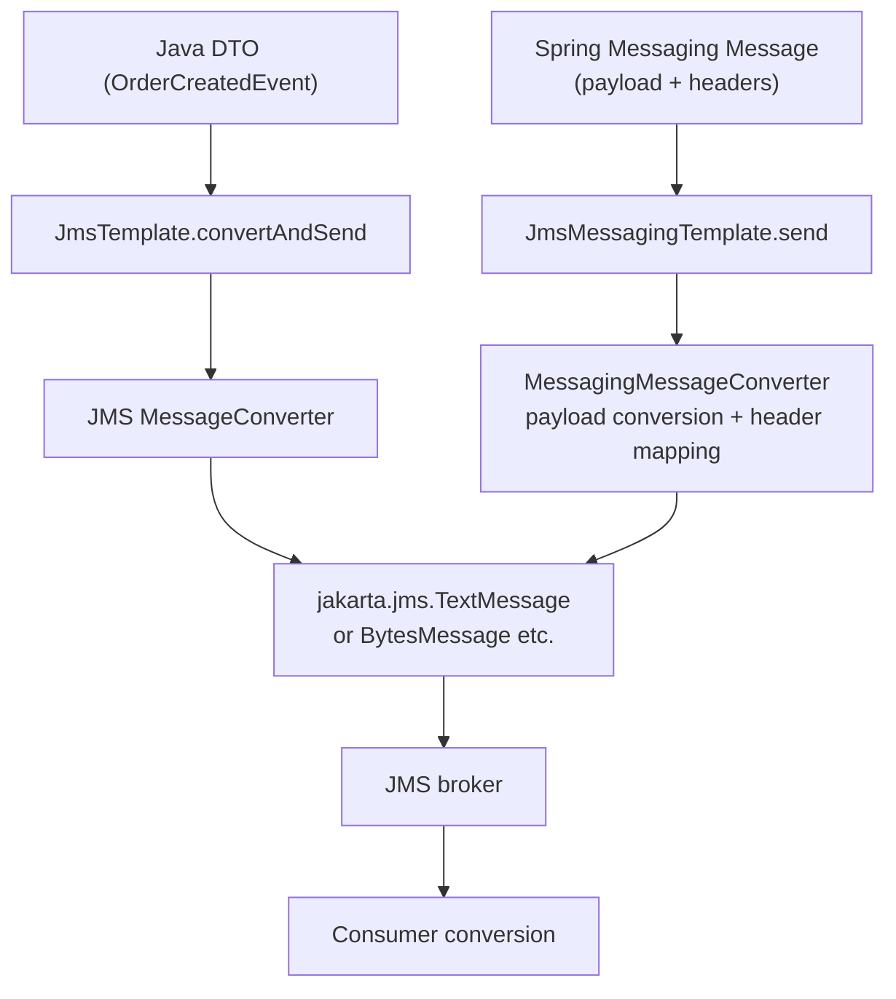
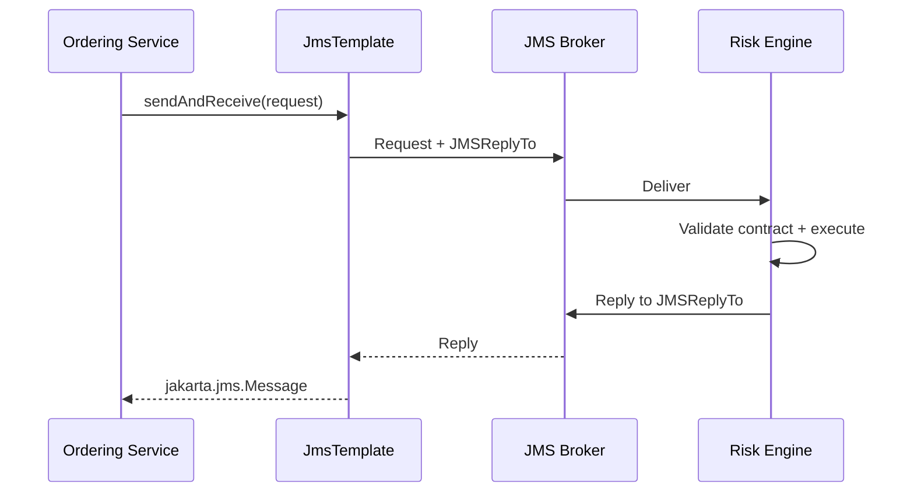
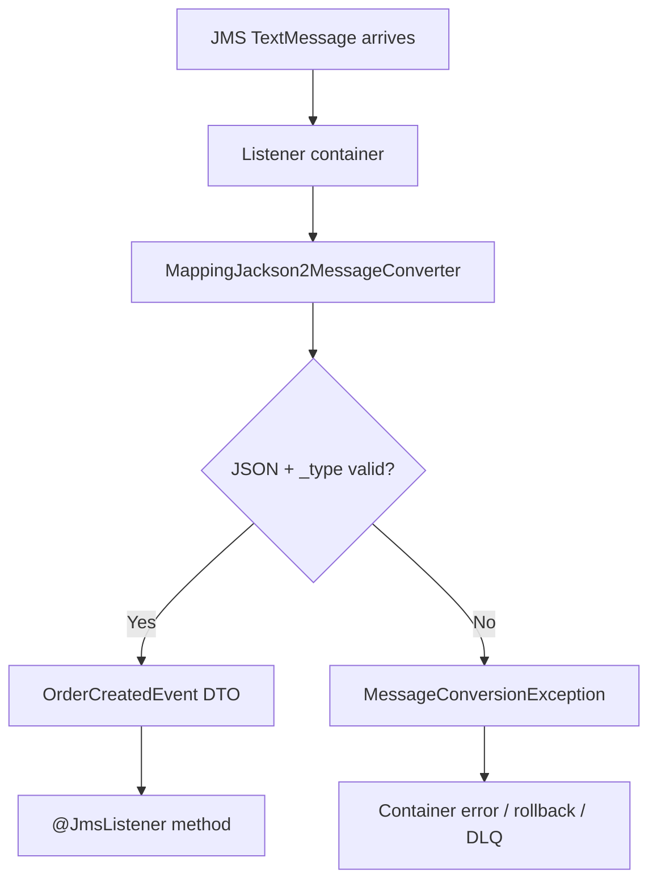
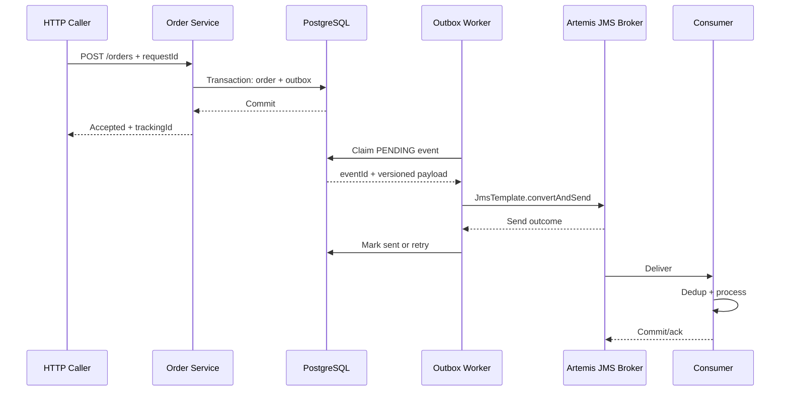
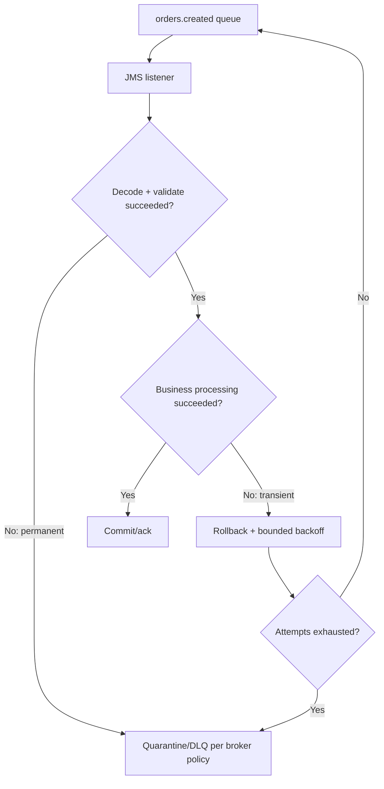
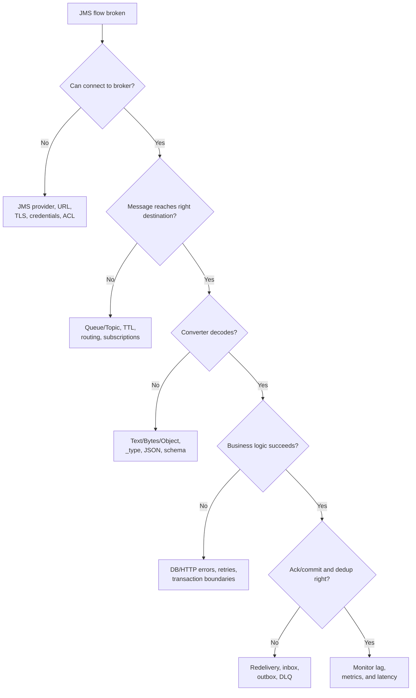

# JmsTemplate, JmsMessagingTemplate, and Message Conversion

## 1. The role of JMS in Spring Boot Integration

In the **SPRING_BOOT_INTEGRATION** module, a Spring Boot application can receive HTTP requests, persist state to a database, use a cache, and send events to another system through a broker. **Jakarta Messaging (JMS)** provides a standard API for asynchronous messaging between a Java application and a JMS-compatible message broker such as **Apache ActiveMQ Artemis**.

For example, after saving an order, the system needs to notify the shipping service:

```text
HTTP POST /orders
   |
   v
Order Service -> PostgreSQL (order + outbox)
                         |
                         v
                   Outbox Worker
                         |
                   JmsTemplate / JmsMessagingTemplate
                         |
                    JMS Broker
                         |
                   @JmsListener
                         |
                  Shipping Service
                         |
                  HTTP Carrier API
```

The problem is not just "calling `convertAndSend()`." Producer and consumer must agree on data representation, destination names, headers, schema versions, Java/JSON types, size limits, conversion error handling, ack timing, and recovery when failures happen.

**Three core concepts**:

1. `JmsTemplate`: Spring JMS API oriented toward sending/receiving `jakarta.jms.Message` or converted objects.
2. `JmsMessagingTemplate`: an adapter using the `org.springframework.messaging.Message<?>` model (`payload` + `headers`) layered on top of JMS.
3. `MessageConverter`: rules for converting between application data and JMS messages. There are payload converters and Spring Messaging header converters/mappers; do not conflate the two layers.

### Objectives

After this lesson, you will be able to:

- Configure Spring Boot as a JMS client connecting to an out-of-process broker.
- Distinguish sending a native JMS `Message`, sending a POJO with `JmsTemplate`, and sending a Spring Messaging `Message<?>`.
- Understand `SimpleMessageConverter`, `MappingJackson2MessageConverter`, `MessageType.TEXT`, and type-id mappings.
- Use headers/correlation IDs, destinations, and queues/topics with accurate semantics.
- Design versioned message formats and guard against dangerous deserialization flaws.
- Handle converter errors, transactions, redelivery, DLQs, idempotency, and testing against a real broker.
- Decide when to choose `JmsTemplate`, `JmsMessagingTemplate`, or a Spring Integration JMS adapter.

> Examples are based on Java 17+, Spring Boot 3.x, Spring Framework 6.x, Jakarta Messaging 3.x, and ActiveMQ Artemis. This lesson covers **standard JMS** in an integration context; do not assume a particular broker's configuration syntax or features are available on every JMS provider. Newer Spring Boot versions may change auto-configuration and BOM dependencies.

## 2. JMS is an API, not the name of a message broker

**JMS/Jakarta Messaging** is a Java contract for sending/receiving messages. The actual broker supplies connection factories, destinations, persistence, and delivery behavior. Therefore:

- **JMS API** defines `ConnectionFactory`, `Session`, `Message`, `Destination`, `Queue`, `Topic`, `MessageProducer`, and `MessageConsumer`.
- **Spring JMS** provides `JmsTemplate`, `JmsMessagingTemplate`, `@JmsListener`, listener containers, and message conversion mechanisms.
- **Brokers** such as Artemis/IBM MQ handle addresses/queues, durable storage, authorization, routing, redelivery, expiry, and DLQs according to concrete configuration.
- **Applications** remain responsible for event schemas, business identity, idempotency, transactions outside JMS, and business recovery.

Spring JMS **does not turn JMS into HTTP, Kafka, or RabbitMQ AMQP**. Those technologies have different protocol models and failure semantics. ActiveMQ Artemis can support multiple protocols, yet clients using the JMS API must still understand queues/topics and that broker's characteristics.

## 3. Queues and Topics: two destination domains to distinguish

| Criterion | Queue (point-to-point) | Topic (publish/subscribe) |
| --- | --- | --- |
| Purpose | Distribute work to competing consumers | Broadcast messages to multiple subscriptions |
| Multiple consumers on the same destination | Typically each message is delivered to one consumer in the competing group | Each eligible subscription can receive a logical copy |
| Offline subscriber | Messages can wait per retention/persistence/broker policy | Depends on subscription type, durable/shared settings, and broker policy |
| Typical use | Shipment creation commands, background jobs | Notifications / business event fan-out |
| Decisions required | Redelivery, DLQ, concurrency, ordering | Subscription identity, durability, fan-out, expiry |

JMS does not guarantee system-wide **exactly-once business effects**. A broker can redeliver if a consumer dies before ack/commit, so consumers must prevent duplicate side effects.

`JmsTemplate` operates in queue mode by default. To use a topic, you must configure the **publish-subscribe domain**, destination, and listener factory properly; **do not** just rename a queue to "topic."

## 4. Jakarta Messaging and the javax.jms vs. jakarta.jms difference

This is critical when upgrading an application to Spring Boot 3:

| Generation | Common imports | Meaning |
| --- | --- | --- |
| Spring Boot 2 / Spring Framework 5 | `javax.jms.*` | Legacy JMS API |
| Spring Boot 3 / Spring Framework 6 | `jakarta.jms.*` | Modern Jakarta Messaging |

Correct imports for Spring Boot 3:

```java
import jakarta.jms.ConnectionFactory;
import jakarta.jms.Message;
import jakarta.jms.Session;
import jakarta.jms.TextMessage;
```

A `javax.jms.ConnectionFactory` from an older client library **is not** the `jakarta.jms.ConnectionFactory` expected by Spring Boot 3. Mixing the two API generations causes class/method errors, bean mismatches, or runtime exceptions.

Do not try to "fix" this by adding both `javax.jms-api` and `jakarta.jms-api` to the classpath without checking provider compatibility. Select a **Jakarta-compatible driver/provider client** and starters aligned with the Spring Boot BOM.

## 5. Dependencies: Spring JMS and broker client

Maven example using ActiveMQ Artemis with Spring Boot:

```xml
<dependencies>
    <dependency>
        <groupId>org.springframework.boot</groupId>
        <artifactId>spring-boot-starter-artemis</artifactId>
    </dependency>
</dependencies>
```

Gradle equivalent:

```groovy
dependencies {
    implementation 'org.springframework.boot:spring-boot-starter-artemis'
}
```

The starter configures the Artemis client and Spring JMS infrastructure. When using a different JMS provider, select a **Jakarta Messaging-compatible JMS client dependency** and configure the provider's `ConnectionFactory`; do not force another provider through the Artemis starter.

You can use `org.springframework:spring-jms` directly when configuring infrastructure manually. However, adding the Spring JMS library **does not start a broker**, declare destinations, or validate broker credentials.

### JMS is not the Kafka starter

`spring-boot-starter-artemis` and Spring JMS do not replace `spring-kafka`. If a system uses Kafka, use Kafka's client APIs and semantics rather than treating `JmsTemplate` as a Kafka producer.

## 6. Configuring Spring Boot to connect to an external Artemis broker

Example `application.yml` for dev/staging:

```yaml
spring:
  artemis:
    mode: native
    broker-url: ${ARTEMIS_BROKER_URL:tcp://localhost:61616}
    user: ${ARTEMIS_USERNAME}
    password: ${ARTEMIS_PASSWORD}
  jms:
    template:
      default-destination: orders.created
      receive-timeout: 2s
```

Explanation:

- `spring.artemis.mode=native` selects connecting to a broker outside the JVM in Artemis configuration.
- `broker-url` uses the broker-supplied endpoint; `tcp://localhost:61616` fits only when the app truly runs on the same host/network namespace.
- Credentials must come from runtime secrets/config; never commit real passwords to the repository.
- `spring.jms.template.default-destination` helps operations that omit an explicit destination. In multi-workflow integrations, **prefer passing explicit destinations** when publishing business events.
- `receive-timeout` bounds synchronous receive waits; it does **not** replace connect timeout, producer send timeout, broker expiry, or workflow deadlines.

When running inside a Docker container, `localhost` points to **the application container**, not automatically the broker container. Use the service DNS/hostname matching your topology. When the broker requires TLS/mTLS, configure connectors/truststores/certs per provider and environment.

### Which beans does Spring Boot typically provide?

Depending on dependencies and conditions, Spring Boot can configure:

- `jakarta.jms.ConnectionFactory` for the JMS provider.
- `JmsTemplate` for producing/receiving.
- `JmsMessagingTemplate` for the Spring Messaging model.
- `DefaultJmsListenerContainerFactory` for `@JmsListener`.
- `MessageConverter` integration when a converter bean is present.

If you define custom `ConnectionFactory`, multiple `JmsTemplate`, or custom listener factory beans, parts of auto-configuration may **back off** conditionally. Do not assume a Boot property applies to **every custom bean**. Inspect runtime bean definitions and conditions when needed.

## 7. What is JmsTemplate and at which layer does it work?

`org.springframework.jms.core.JmsTemplate` is the core Spring JMS component, hiding most boilerplate around opening connections/sessions, creating producers/consumers, translating exceptions, and releasing resources.

It provides several groups of operations:

| Group | Typical API | Data handled |
| --- | --- | --- |
| Send native JMS | `send(..., MessageCreator)` | `jakarta.jms.Message` |
| Send POJO/primitive | `convertAndSend(..., Object)` | Java object encoded by `MessageConverter` |
| Receive native JMS | `receive(...)` | JMS `Message` |
| Receive converted object | `receiveAndConvert(...)` | Java object after conversion |
| Adjust outgoing message | `convertAndSend(..., MessagePostProcessor)` | Allows modifying JMS headers/properties |
| Request/reply | `sendAndReceive(...)` | JMS request and reply, typically blocking |
| QoS/broker behavior | TTL, priority, persistent delivery | Subject to JMS spec/provider support |

**Do not confuse `JmsTemplate` with a durable queue.** It is a client-side template. A `convertAndSend()` call completing does not mean the consumer has finished its business transaction.

## 8. Sending a TextMessage with the native JMS API

When you need full control over JMS headers/properties or integration with a legacy system expecting a fixed message format, use `JmsTemplate.send`:

```java
import jakarta.jms.TextMessage;
import org.springframework.jms.core.JmsTemplate;
import org.springframework.stereotype.Component;

@Component
public class LegacyOrderPublisher {

    private final JmsTemplate template;

    public LegacyOrderPublisher(JmsTemplate template) {
        this.template = template;
    }

    public void publishJson(
            String eventId,
            String payloadJson) {

        template.send("orders.created", session -> {
            TextMessage msg =
                session.createTextMessage(payloadJson);

            msg.setJMSCorrelationID(eventId);
            msg.setStringProperty("eventType", "order.created");
            msg.setIntProperty("schemaVersion", 1);
            msg.setStringProperty(
                "contentType", "application/json"
            );
            return msg;
        });
    }
}
```

Key points:

1. The callback receives a `jakarta.jms.Session` managed by `JmsTemplate` and returns a `jakarta.jms.Message`.
2. `TextMessage` carries text. That it is JSON is **an application contract**, not something JMS interprets itself.
3. `JMSCorrelationID` is a standard JMS header useful for request/reply or tracing; **it does not replace a business event ID**.
4. `eventType`, `schemaVersion`, and `contentType` here are custom message properties; producer and consumer must agree on names and types.
5. `JMSMessageID` is typically assigned by the provider upon send; never use it as a long-term business idempotency key when messages can be recreated.
6. If the broker is unavailable or authentication fails, `send` can throw Spring's `JmsException`; classify errors and define retry policies.

When sending to queue `orders.created`, the destination must resolve properly on the broker/provider. Some brokers auto-create queues while others require pre-provisioning. **The JMS API does not require every provider to auto-create destinations with identical naming policies.**

## 9. convertAndSend: convenient, yet dependent on MessageConverter

For simple payloads:

```java
template.convertAndSend(
    "ops.notifications",
    "Order ORD-501 has been created"
);
```

With the default simple converter, a `String` becomes a `TextMessage`. However, the snippet below **should not automatically be assumed to produce JSON**:

```java
OrderCreatedEvent event =
    new OrderCreatedEvent(
        "evt-1001", "ORD-501", "C-501", 125000L
    );

template.convertAndSend("orders.created", event);
```

Why? `convertAndSend` invokes the configured converter. If `SimpleMessageConverter` is active and the DTO implements `Serializable`, it may produce an **`ObjectMessage`** (Java serialization), not JSON. If the DTO cannot be converted, the app can fail with `MessageConversionException`.

**Conclusion:** `convertAndSend` does not specify the wire format by its method name. The format depends on the **`MessageConverter`**. If you want schema-defined JSON text, configure a JSON converter and verify producer/consumer behavior against a real broker.

## 10. Receiving messages with JmsTemplate: avoid blocking threads indefinitely

Synchronous JMS receive can wait for a message:

```java
import jakarta.jms.Message;
import org.springframework.jms.core.JmsTemplate;

public Message receiveNative(JmsTemplate template) {
    return template.receive("ops.notifications");
}
```

Or receive and convert:

```java
public Object receiveConverted(JmsTemplate template) {
    return template.receiveAndConvert("ops.notifications");
}
```

This is a **blocking receive**, not a Reactive `Mono`/`Flux` publisher. Always configure a suitable receive timeout, as some configurations default to waiting indefinitely.

On timeout, `receive` can return `null` when no message arrives; distinguish:

- **No message before deadline** → `null`; does not mean the broker lost messages.
- **Native receive succeeded** → JMS `Message` with headers/properties.
- **Conversion failed** → exception, not an "empty queue."
- **Broker/network error** → exception/connection failure; recover without marking business work done.

In production servers consuming continuously, **`@JmsListener` + listener container** is usually far better than a hand-rolled `while(true) receive` loop. Synchronous receive is useful for certain tests, legacy adapters, or bounded polling needs, provided shutdown and concurrency are controlled.

## 11. JmsMessagingTemplate: using Spring Messaging Message<?>

`org.springframework.jms.core.JmsMessagingTemplate` provides an API built on the `org.springframework.messaging.Message<T>` abstraction—**payload + headers**—alongside object-conversion overloads.

Example sending a Spring Messaging message:

```java
import org.springframework.jms.core.JmsMessagingTemplate;
import org.springframework.jms.support.JmsHeaders;
import org.springframework.messaging.Message;
import org.springframework.messaging.support.MessageBuilder;
import org.springframework.stereotype.Component;

@Component
public class OrderMessagingPublisher {

    private final JmsMessagingTemplate messaging;

    public OrderMessagingPublisher(
            JmsMessagingTemplate messaging) {
        this.messaging = messaging;
    }

    public void publish(OrderCreatedEvent event) {
        Message<OrderCreatedEvent> message =
            MessageBuilder.withPayload(event)
                .setHeader(
                    JmsHeaders.CORRELATION_ID,
                    event.eventId()
                )
                .setHeader("sourceSystem", "checkout")
                .setHeader("schemaVersion", 1)
                .build();

        messaging.send("orders.created", message);
    }
}
```

This assumes `OrderCreatedEvent` is a defined DTO and the **payload converter** can serialize it into the agreed format. `JmsMessagingTemplate` does not invent a JSON format for every class.

Unlike native `jakarta.jms.Message`, the object here is `org.springframework.messaging.Message<OrderCreatedEvent>`. When sending, Spring translates both the payload and eligible headers into the JMS message structure.

### Using convertAndSend

```java
messaging.convertAndSend(
    "orders.created",
    event,
    java.util.Map.of("sourceSystem", "checkout")
);
```

With the convenience API, payload and headers still pass through conversion/mapping. Specify the message converter and header policy explicitly if the service talks to non-Spring systems.

### When to use which API?

| Need | Prefer |
| --- | --- |
| Legacy system requiring native TextMessage/BytesMessage | `JmsTemplate.send` |
| Sending plain DTOs with an explicit JSON converter | `JmsTemplate.convertAndSend` |
| Leveraging Spring Messaging payload/header abstraction | `JmsMessagingTemplate.send` |
| Spring Integration flow with MessageChannels, routers, transformers | Spring Integration JMS outbound/inbound adapters |
| Continuous server-side consumption | `@JmsListener` instead of polling indefinitely on request threads |

## 12. Two conversion layers: payload converter and MessagingMessageConverter

This is the most common source of confusion when comparing the two templates:



**First layer: Spring JMS `MessageConverter`**

Typical interface:

```java
package org.springframework.jms.support.converter;

public interface MessageConverter {
    jakarta.jms.Message toMessage(
        Object object, jakarta.jms.Session session
    ) throws jakarta.jms.JMSException,
             org.springframework.jms.support.converter.MessageConversionException;

    Object fromMessage(jakarta.jms.Message message)
        throws jakarta.jms.JMSException,
               org.springframework.jms.support.converter.MessageConversionException;
}
```

This is an **illustrative signature to explain the API**, not code you need to declare yourself. The converter encodes **payload object ↔ JMS Message**.

**Second layer: `MessagingMessageConverter`**

In Spring Messaging, a converter/adapter maps `Message<?>` to a JMS `Message`, including:

- Extracting `payload` and delegating to the underlying JMS payload converter.
- Mapping eligible `headers` to standard JMS headers/properties via a header mapper.
- Reading a received JMS message to build a Spring Messaging `Message<?>`.

Not every Java header object is allowed as a JMS property. JMS properties support specific scalar types; a complex `List<OrderItem>` or `HttpHeaders` value should not be stuffed directly into a JMS property without explicit encoding rules.

**How to verify:** in integration tests, inspect the *actual received JMS message* (subtype, body, custom properties, and correlation ID), rather than only asserting Mockito calls to `messaging.send(...)`.

## 13. What types does SimpleMessageConverter handle?

Spring JMS `SimpleMessageConverter` converts common data types:

| Input Java object | Typical JMS message created | On receive |
| --- | --- | --- |
| `String` | `TextMessage` | `String` |
| `byte[]` | `BytesMessage` | `byte[]` |
| `Map` | `MapMessage` | `Map` |
| `Serializable` object | `ObjectMessage` | Deserialized Java object |

Exact behavior depends on the converter/provider and concrete data.

### Key limitations

1. `MapMessage` is not a JSON object; it is a **dedicated JMS message type** with JMS type/value rules.
2. `ObjectMessage` uses Java serialization; producer and consumer classes must match. Deserializing Java objects from untrusted sources carries security risks.
3. A DTO record does not necessarily implement `Serializable`; if not, the default converter cannot convert it.
4. Renaming packages/classes/versions can render older `ObjectMessage` payloads unreadable.
5. Non-Java partners struggle to consume `ObjectMessage` even if the broker supports JMS.

For cross-service and cross-language events, **JSON `TextMessage`** or an agreed schema-based format is far easier to version and test than Java serialization. However, you must design that format deliberately; calling `convertAndSend` alone does not make it JSON.

## 14. MappingJackson2MessageConverter: converting DTOs to JSON TextMessage

Spring JMS provides `MappingJackson2MessageConverter` to use Jackson for JSON payload serialization/deserialization. Configuration example:

```java
import java.util.Map;

import com.fasterxml.jackson.databind.ObjectMapper;
import org.springframework.context.annotation.Bean;
import org.springframework.context.annotation.Configuration;
import org.springframework.jms.support.converter.MappingJackson2MessageConverter;
import org.springframework.jms.support.converter.MessageConverter;
import org.springframework.jms.support.converter.MessageType;

@Configuration(proxyBeanMethods = false)
public class JmsConversionConfiguration {

    @Bean
    MessageConverter jmsMessageConverter(
            ObjectMapper objectMapper) {

        MappingJackson2MessageConverter converter =
            new MappingJackson2MessageConverter();

        converter.setObjectMapper(objectMapper);
        converter.setTargetType(MessageType.TEXT);
        converter.setTypeIdPropertyName("_type");
        converter.setTypeIdMappings(
            Map.of("order-created-v1", OrderCreatedEvent.class)
        );
        return converter;
    }
}
```

**Meaning**:

- `setObjectMapper` reuses the application's Jackson configuration (Java Time, naming policy, parser limits...). Ensure settings align with the *wire contract*; global mapper changes can impact messages.
- `setTargetType(MessageType.TEXT)` tells the converter to produce a `TextMessage` containing JSON text.
- `setTypeIdPropertyName("_type")` specifies the JMS property holding the type alias for deserialization.
- `setTypeIdMappings(...)` maps stable aliases like `order-created-v1` to allowlisted Java classes.
- Consumers using `receiveAndConvert()` or DTO listeners must share **the same type-id convention and allowlist**.
- A legacy system sending JSON text **without `_type`** may not automatically deserialize with this converter; build a dedicated decoder/adapter per contract.

### Example JSON wire format

DTO:

```java
public record OrderCreatedEvent(
    String eventId,
    String orderId,
    String customerId,
    Long totalAmount
) {}
```

Payload represented as JSON (illustrative; Jackson output details depend on configuration):

The example uses `Long` instead of `long` so missing fields deserialize as `null` and are caught explicitly during validation. Jackson converting a DTO **does not mean** the data is valid; listeners/services still need to verify required fields, non-negative amounts, and schemaVersion before writing data.

```json
{
  "eventId": "evt-1001",
  "orderId": "ORD-501",
  "customerId": "C-501",
  "totalAmount": 125000
}
```

The JMS Message also carries the **property** `_type=order-created-v1` so the consumer knows which Java DTO to map to. The type property **is not placed inside the JSON payload by default**. A consumer in another language may only need `schemaVersion` and `eventType`, without caring about Java class names.

### Verifying the converter is actually wired

Declaring a `MessageConverter` bean can be picked up by Boot's auto-configured templates and listener factories **when conditions match**. However, if the service defines manual templates/factories or multiple converters, verify the wiring explicitly. The best test is sending a DTO to a test queue, receiving the native message, and asserting it is a `TextMessage` with the expected JSON and `_type`.

## 15. Never confuse type aliases with internal class names

An unsafe design uses a sender-chosen Java class name in the type property:

```text
_type = com.example.internal.admin.RemoveEverythingCommand
```

If a consumer blindly deserializes arbitrary class names, it opens deserialization risks and unintended behavior. Even with Jackson safeguards, **never** treat broker type metadata as an open class loader.

Do:

1. Use an **alias allowlist** like `order-created-v1`, `shipment-requested-v2`.
2. Maintain an explicit alias → DTO class map.
3. Validate `eventType` and `schemaVersion` in the payload or envelope per contract.
4. Never treat the `_type` JMS property as proof of an authenticated producer.
5. Enforce bounds on payload bytes, JSON nesting depth, string sizes, collection lengths, and header counts.
6. Never deserialize `ObjectMessage` payloads from untrusted sources merely because the broker connection succeeded.
7. When receiving an unsupported alias, treat it as a **contract error/quarantine** rather than infinitely retrying the same message.

**A type alias is technical metadata; it does not replace a schema registry, event contract, or versioning.**

## 16. Binary conversion: BytesMessage and non-JSON contracts

Not every integration uses JSON. Legacy systems may emit bytes holding Protobuf, Avro, XML, or proprietary binary formats.

For raw bytes:

```java
byte[] payloadBytes = encodeWithSchema(event);

jmsTemplate.convertAndSend(
    "orders.binary",
    payloadBytes
);
```

`encodeWithSchema` is an application-defined method, not built into Spring JMS. With the simple converter, `byte[]` produces a `BytesMessage`. However, if `MappingJackson2MessageConverter` is registered globally, behavior can differ: select the right converter/gateway per **destination/format**.

To send bytes with explicit framing, construct a native `BytesMessage`:

```java
jmsTemplate.send("orders.binary", session -> {
    var message = session.createBytesMessage();
    message.writeBytes(payloadBytes);
    message.setStringProperty(
        "contentType", "application/x-protobuf"
    );
    message.setIntProperty("schemaVersion", 2);
    return message;
});
```

The receiver must know:

- The exact content type and serialization schema.
- Whether compression or encryption is used, per contract headers.
- Maximum allowed message bytes and decompressed size bounds.
- Compatibility rules when adding/removing fields.
- Never decode binary data using `new String(bytes)` with the default charset.

**JMS only transports messages; the binary format is owned by the application and the producer/consumer contract.**

## 17. JMS headers and properties: key fields to know

A JMS message contains standard headers and application properties:

| Header/property | Role | Remember |
| --- | --- | --- |
| `JMSMessageID` | Provider-assigned ID for a sent message | Not a durable business ID across republishes |
| `JMSCorrelationID` | Links request/reply or traces | Agree on semantics; can hold an app-level ID |
| `JMSReplyTo` | Destination for replies | Request/reply often uses temporary or fixed destinations |
| `JMSType` | Logical JMS message type per provider/contract | Does not automatically replace JSON schema version |
| `JMSDeliveryMode` | Persistent/non-persistent per JMS | Does not make DB and broker commits atomic |
| `JMSPriority` | Send priority | Brokers do not guarantee global strict ordering in all cases |
| `JMSExpiration` | Expiration timestamp from TTL | Expired messages may no longer be processed |
| `JMSRedelivered` | Provider hint of redelivery | Insufficient as an idempotency key |
| `JMSXDeliveryCount` | Delivery count when supported by provider | How it is exposed/incremented varies by provider |
| `eventId` (custom) | Business event ID | Used for deduplication |
| `schemaVersion` (custom) | Payload version | Must be checked alongside JSON and consumer logic |

JMS headers have specific naming and type rules; an arbitrary Spring Messaging `Map` cannot always be copied directly as JMS properties.

If an application needs large structured metadata (such as nested JSON), put it in a schema-governed envelope/payload or serialize per contract instead of stuffing arbitrary Java objects into custom headers.

## 18. Mapping Spring Messaging headers to JMS

When calling `JmsMessagingTemplate.send`, payloads and headers pass through the converter and header mapper into JMS.

Example Spring Message:

```java
import org.springframework.jms.support.JmsHeaders;
import org.springframework.messaging.Message;
import org.springframework.messaging.support.MessageBuilder;

Message<OrderCreatedEvent> springMessage =
    MessageBuilder.withPayload(event)
        .setHeader(JmsHeaders.CORRELATION_ID, event.eventId())
        .setHeader("sourceSystem", "checkout")
        .setHeader("schemaVersion", 1)
        .build();
```

Distinguish:

- `JmsHeaders.CORRELATION_ID` is the Spring Messaging header key mapped to `JMSCorrelationID`.
- `sourceSystem` and `schemaVersion` are application metadata, eligible as JMS message properties if mappable.
- Spring Messaging's `MessageHeaders.ID` and `MessageHeaders.TIMESTAMP` are **not** identical in semantics to `JMSMessageID`/JMS timestamps.
- A `replyTo` header from another framework does not automatically become `JMSReplyTo` without the right mapper.
- Some incoming JMS headers are set by the provider on send; you cannot override all standard headers from a Spring Message.

When interoperating across languages or providers, document a **wire-level header contract** and test with a native JMS client on the receiving side rather than asserting Spring Message headers before conversion.

## 19. MessagePostProcessor: adjusting JMS metadata when sending POJOs

`JmsTemplate.convertAndSend` has an overload accepting a `MessagePostProcessor`, letting you add JMS headers/properties after the converter builds the message:

```java
import org.springframework.jms.core.JmsTemplate;
import org.springframework.stereotype.Component;

@Component
public class OrderJsonPublisher {

    private final JmsTemplate template;

    public OrderJsonPublisher(JmsTemplate template) {
        this.template = template;
    }

    public void publish(OrderCreatedEvent event) {
        template.convertAndSend(
            "orders.created",
            event,
            jmsMessage -> {
                jmsMessage.setJMSCorrelationID(
                    event.eventId()
                );
                jmsMessage.setStringProperty(
                    "eventId", event.eventId()
                );
                jmsMessage.setIntProperty(
                    "schemaVersion", 1
                );
                return jmsMessage;
            }
        );
    }
}
```

**Works only if the active converter can encode `OrderCreatedEvent`.** Paired with the JSON converter from section 14, this sends a JSON `TextMessage` with stable metadata.

Never set `schemaVersion` to 1 in the header while sending a schema-2 payload. When they disagree, the consumer must enforce a clear rule (reject/quarantine) rather than trusting either blindly.

**Never perform network calls or database writes inside a `MessagePostProcessor`**: the callback exists strictly to configure the outgoing JMS Message, not to run workflow transaction logic. Keep it short, deterministic, and free of side effects beyond setting message properties.

## 20. Comparing send APIs on the same message

Suppose `event` is `OrderCreatedEvent` and both producer and consumer use the JSON converter:

| API | Example | Expected result |
| --- | --- | --- |
| Native JMS | `template.send(queue, session -> session.createTextMessage(json))` | Hand-crafted `TextMessage` |
| Converted Java object | `template.convertAndSend(queue, event)` | JMS Message produced by converter (JSON if configured) |
| Converted + headers | `template.convertAndSend(queue, event, postProcessor)` | JMS Message + native properties |
| Spring Messaging Message | `messaging.send(queue, MessageBuilder.withPayload(event)...build())` | Payload + Spring headers via messaging converter |
| Convenience Messaging | `messaging.convertAndSend(queue, event, headers)` | Payload + map headers via messaging converter |

**The same DTO does not guarantee the same wire bytes/message type** if two gateways use different converters. Applications with multiple `JmsTemplate`s, manual `JmsMessagingTemplate`s, or custom listener container factories must test the **entire converter pipeline**.

For smooth operations, every destination should have an explicit format contract: `contentType`, `messageType`, `schemaVersion`, required headers, type aliases, and charset.

## 21. Sending to a queue vs. topic: templates and listeners must match

A `JmsTemplate` defaults to **queue domain** unless reconfigured. When targeting a `Topic`, create a dedicated template with publish/subscribe enabled:

```java
import jakarta.jms.ConnectionFactory;
import org.springframework.beans.factory.annotation.Qualifier;
import org.springframework.context.annotation.Bean;
import org.springframework.context.annotation.Configuration;
import org.springframework.jms.core.JmsTemplate;
import org.springframework.jms.support.converter.MessageConverter;

@Configuration(proxyBeanMethods = false)
class JmsDestinationsConfiguration {

    @Bean("topicJmsTemplate")
    JmsTemplate topicJmsTemplate(
            ConnectionFactory factory,
            MessageConverter converter) {

        JmsTemplate template = new JmsTemplate(factory);
        template.setPubSubDomain(true);
        template.setMessageConverter(converter);
        return template;
    }
}
```

Inject `@Qualifier("topicJmsTemplate")` when publishing events to a topic, and configure a matching listener factory for topics. Each JMS provider maps destination names to internal addresses/queues differently; verify against a real broker rather than guessing from the string `orders.events`.

For topics, **subscription durability** and identity determine whether an offline consumer receives missed messages upon reconnecting. A non-durable subscriber can miss messages sent while absent; a durable subscription requires proper configuration and lifecycle management. Never claim "topics always keep all messages" without specifying subscription and broker policies.

If Spring Boot has only a single `JmsTemplate` bean, pub/sub properties may apply via Boot configuration depending on version. However, a custom template bean does not automatically inherit settings meant for Boot's auto-configured template.

## 22. TTL, priority, and persistent delivery: QoS, not business guarantees

JMS supports several Quality of Service (QoS) parameters on send:

```java
import java.time.Duration;
import org.springframework.jms.core.JmsTemplate;

void configureShortLivedNotifications(JmsTemplate template) {
    template.setExplicitQosEnabled(true);
    template.setDeliveryPersistent(true);
    template.setTimeToLive(
        Duration.ofMinutes(5).toMillis()
    );
    template.setPriority(4);
}
```

The setup above illustrates **a specialized template**; do not apply short-lived notification settings to all business events. Meaning of these methods:

- `setExplicitQosEnabled(true)` instructs Spring to apply your QoS values on send.
- **Persistent delivery** requests the JMS provider to handle messages persistently; real durability depends on broker storage, availability, and confirmation/transaction settings.
- **TTL** defines message lifetime from send time. An expired event can be discarded before a consumer runs, even if the producer saw no exception.
- **Priority** does not guarantee global strict ordering across multiple producers/consumers, especially with retries, partitioning/routing, or concurrent processing.

For payment, shipment creation, or mandatory inventory sync commands, setting a 5-minute TTL can drop incomplete business work from the queue. When deadlines are needed, implement **business expiration and reconciliation states** explicitly instead of relying solely on broker expiry.

## 23. Request/reply via JmsTemplate: when is it appropriate?

Some legacy integrations use **JMS request/reply** instead of HTTP:



An example:

```java
import jakarta.jms.Message;
import jakarta.jms.TextMessage;
import org.springframework.jms.core.JmsTemplate;

public Message validateRisk(
        JmsTemplate template,
        String requestId,
        String requestJson) {

    return template.sendAndReceive(
        "risk.validation.requests",
        session -> {
            TextMessage message =
                session.createTextMessage(requestJson);
            message.setJMSCorrelationID(requestId);
            return message;
        }
    );
}
```

`sendAndReceive` supports JMS-based request/reply, often using a temporary reply destination and waiting for a response. **Avoid using it for long-running workflows**; the call is usually **blocking** and returns `null` if the wait times out. Configure `receiveTimeout`/deadlines carefully and verify provider/Spring behavior.

Risks:

1. Slow brokers or slow responders tie up request threads for a long time.
2. A timeout **does not prove** the risk engine failed to process the request.
3. A reply may arrive after the temporary reply consumer stopped listening.
4. If the request has side effects, retrying with a new ID can trigger duplicate actions.
5. `JMSCorrelationID` on replies must be propagated consistently by the consumer per contract; never assume the provider solves all business correlation automatically.
6. Request/reply inside an uncommitted JMS transaction can hang forever because the request is not visible to consumers until commit; never combine transaction scopes without testing.

For multi-minute jobs or crash-recoverable workflows, choose **command queue + correlation ID + durable reply/outcome store** rather than holding an HTTP request and temporary JMS queue open continuously.

## 24. @JmsListener: where conversion happens on the consumer side

A Spring consumer typically uses `@JmsListener`:

```java
import org.springframework.jms.annotation.JmsListener;
import org.springframework.stereotype.Component;

@Component
public class OrderEventListener {

    private final OrderEventProcessor processor;

    public OrderEventListener(OrderEventProcessor processor) {
        this.processor = processor;
    }

    @JmsListener(
        destination = "orders.created",
        containerFactory = "orderJmsListenerFactory"
    )
    public void onOrderCreated(OrderCreatedEvent event) {
        processor.process(event);
    }
}
```

`OrderEventProcessor` is a project-defined business service. This method assumes the listener container is configured with a `MessageConverter` capable of reading `OrderCreatedEvent` from incoming JMS messages.

Example listener container factory:

```java
import jakarta.jms.ConnectionFactory;

import org.springframework.context.annotation.Bean;
import org.springframework.context.annotation.Configuration;
import org.springframework.jms.annotation.EnableJms;
import org.springframework.jms.config.DefaultJmsListenerContainerFactory;
import org.springframework.jms.support.converter.MessageConverter;

@Configuration(proxyBeanMethods = false)
@EnableJms
class OrderJmsConsumerConfiguration {

    @Bean("orderJmsListenerFactory")
    DefaultJmsListenerContainerFactory orderJmsListenerFactory(
            ConnectionFactory connectionFactory,
            MessageConverter converter) {

        DefaultJmsListenerContainerFactory factory =
            new DefaultJmsListenerContainerFactory();

        factory.setConnectionFactory(connectionFactory);
        factory.setMessageConverter(converter);
        factory.setConcurrency("2-6");
        factory.setSessionTransacted(true);
        return factory;
    }
}
```

Explanation:

- `@EnableJms` enables `@JmsListener` infrastructure. Spring Boot can auto-configure this conditionally; declare it explicitly when customizing.
- `factory.setMessageConverter` ensures the listener shares the same payload converter contract as the producer.
- `setConcurrency("2-6")` sets concurrent consumer bounds per container/provider; do not assume only one message runs at a time.
- `setSessionTransacted(true)` enables a **local JMS session transaction** for receive/process/ack in the listener container. It does not mean PostgreSQL transactions automatically participate.
- When a processing error rolls back the transaction, the broker can redeliver; DLQs and idempotency are still needed.

A `@JmsListener` returning `void` does not mean the message succeeded across external side effects. Ack/commit depends on **listener container transactions and exception handling**.

## 25. Converter errors before the listener method is invoked

Suppose a producer sends a `TextMessage` with valid JSON but omits `_type`, while the listener uses `MappingJackson2MessageConverter` configured to require a type-id.

What happens:



**`onOrderCreated` never runs** if the converter fails before method invocation. Therefore a `try/catch` inside the method cannot catch all message conversion failures. Test:

- Listener container error handling and transaction/requeue policies.
- Whether conversion failures are classified as **permanent** or **transient**.
- After how many deliveries the broker moves poison messages to a dead-letter address/queue.
- Whether valid messages queued behind them still process normally.
- Whether safe error codes/metadata are logged without dumping raw payloads.
- Whether business messages could be lost if DLQ/quarantine is unavailable.

**Never hot-retry schema-invalid JSON thousands of times**; the payload will not magically heal across redeliveries. For unsupported newer schemas, quarantine records can be replayed after consumer upgrades under clear ownership and controlled procedures.

## 26. Using custom MessageConverters for partner-specific wire contracts

Legacy partners may send JSON text without Spring's `_type`, or require an envelope carrying `eventType`/`schemaVersion` to pick the DTO. Options include:

1. **Native `TextMessage` + ObjectMapper** inside an adapter that checks version and decodes via an allowlist.
2. **Custom `MessageConverter`** implementing `toMessage`/`fromMessage` around a versionable wire contract.
3. **Spring Integration transformer:** accepts raw `Message<byte[]>`/`Message<String>`, validates schema, maps to a domain command, and routes.
4. Separate `JmsTemplate`/listener factories per destination, each with its own converter if multiple formats coexist.

Conceptual custom converter example:

```java
import jakarta.jms.JMSException;
import jakarta.jms.Message;
import jakarta.jms.Session;
import jakarta.jms.TextMessage;

import org.springframework.jms.support.converter.MessageConversionException;
import org.springframework.jms.support.converter.MessageConverter;

public class ContractAwareJmsConverter
        implements MessageConverter {

    private final OrderEventCodec codec;

    public ContractAwareJmsConverter(OrderEventCodec codec) {
        this.codec = codec;
    }

    @Override
    public Message toMessage(Object value, Session session)
            throws JMSException, MessageConversionException {
        if (!(value instanceof OrderCreatedEvent event)) {
            throw new MessageConversionException(
                "Unsupported event type"
            );
        }
        TextMessage msg = session.createTextMessage(
            codec.encode(event)
        );
        msg.setStringProperty("eventType", "order.created");
        msg.setIntProperty("schemaVersion", 1);
        return msg;
    }

    @Override
    public Object fromMessage(Message message)
            throws JMSException, MessageConversionException {
        if (!(message instanceof TextMessage text)) {
            throw new MessageConversionException(
                "Expected TextMessage"
            );
        }
        int version = text.getIntProperty("schemaVersion");
        if (version != 1) {
            throw new MessageConversionException(
                "Unsupported schema version"
            );
        }
        return codec.decode(text.getText());
    }
}
```

`OrderEventCodec` is a project-defined abstraction. A real implementation must use a JSON parser with limits, validate required fields, enforce type-alias allowlists, and translate parsing errors into `MessageConversionException` with safe messages. Never include raw text in exception messages.

**Never write a custom converter just to dodge versioning.** The goal is an explicit contract so Java DTOs can evolve while the wire event stays stable.

## 27. Handling headers when consumers need origin and correlation IDs

A consumer can inspect a native JMS `Message` directly:

```java
import jakarta.jms.Message;
import jakarta.jms.TextMessage;

public void inspect(Message incoming) throws Exception {
    String correlationId = incoming.getJMSCorrelationID();
    String sourceSystem =
        incoming.getStringProperty("sourceSystem");
    int schemaVersion =
        incoming.getIntProperty("schemaVersion");

    // Validate metadata according to contract before processing.
}
```

With `@JmsListener`, you can inject `@Header` or a Spring Messaging `Message<?>` if supported by the listener adapter/header mapper:

```java
import org.springframework.jms.annotation.JmsListener;
import org.springframework.jms.support.JmsHeaders;
import org.springframework.messaging.handler.annotation.Header;
import org.springframework.stereotype.Component;

@Component
class CorrelatedOrderListener {

    @JmsListener(
        destination = "orders.correlated",
        containerFactory = "orderJmsListenerFactory"
    )
    void accept(
        OrderCreatedEvent event,
        @Header(JmsHeaders.CORRELATION_ID)
        String correlationId) {

        // Correlation is observability metadata,
        // not proof of sender identity.
    }
}
```

However, if `JMSCorrelationID` is absent, a required `@Header` can fail argument resolution before the method runs. The contract must define whether headers are required or optional, default values, and error behavior.

**Never trust a self-declared `sourceSystem` header as authenticated identity.** Broker ACLs, connection identities, tenant isolation, and payload signatures where applicable provide real authentication.

### Message selectors

JMS consumers can use **message selectors** to filter by properties:

```java
@JmsListener(
    destination = "orders.events",
    selector = "schemaVersion = 1",
    containerFactory = "orderJmsListenerFactory"
)
public void onV1(OrderCreatedEvent event) {
    // Process only version-1 messages matching selector.
}
```

Here `schemaVersion` must be an **integer** JMS property. Selectors cannot inspect `schemaVersion` inside a JSON body; the producer must set matching metadata. Selectors should not be your sole schema-compatibility mechanism: messages of other versions could sit unconsumed in the queue or require separate consumers.

## 28. JMS exceptions and contract errors are two distinct groups

| Group | Examples | Suggested handling |
| --- | --- | --- |
| Broker/network | TCP disconnect, connection refused, auth/TLS failure | Inspect provider cause; bounded retries when transient |
| Destination/config | Missing queue, permission denied, invalid address | Fix configuration/provisioning; do not hot-retry forever |
| Conversion | Invalid JSON, missing `_type`, Java type mismatch | Non-retryable; quarantine/DLQ as needed |
| Header contract | Missing `eventId`, wrong `schemaVersion` type | Reject with error code; do not invent new IDs |
| Business validation | Duplicate event, invalid state transition | Idempotent outcome or domain rejection |
| Downstream dependency | PostgreSQL unavailable, HTTP 503 | Bounded retry/backoff + durable state |
| Ambiguous outcome | Timeout after send/commit | Reconciliation and stable event ID |
| Resource limit | Oversized message, queue quota, memory pressure | Admission control, size caps; avoid retry storms |

Spring `JmsTemplate` translates many `jakarta.jms.JMSException` errors into the unchecked `org.springframework.jms.JmsException` hierarchy. **That does not mean every error in a listener/service is a JmsException**: converter failures throw `MessageConversionException`, while domain/SQL/HTTP errors belong to separate hierarchies.

When retrying, determine whether the failure happened **before or after the broker accepted the message**. A `JmsException` alone does not prove whether the message was persisted. Rely on idempotency and publish-outcome tracking per provider/transaction.

## 29. Local JMS transactions, @Transactional, and PostgreSQL boundaries

JMS provides local session transactions, and Spring offers `JmsTransactionManager` for managing JMS resources when configured. However:

**A JMS transaction does not automatically make PostgreSQL and JMS commits atomic.**

Consider this pattern:

```java
@Transactional
public void createOrder(OrderCommand command) {
    orderRepository.save(command.toEntity());
    jmsTemplate.convertAndSend(
        "orders.created",
        command.toEvent()
    );
}
```

This is an illustrative snippet; `OrderCommand`, `orderRepository`, and `toEvent()` are hypothetical application code. If `@Transactional` binds to a JDBC/JPA transaction manager, `jmsTemplate.convertAndSend()` does not join a distributed transaction by default.

Failure windows:

1. SQL commit succeeds, broker send fails → order exists, but no event reaches consumers.
2. Broker receives message, SQL rolls back afterward → consumers observe an event for a nonexistent order.
3. Producer disconnects right during send/commit → outcome may be ambiguous.
4. Consumer finishes business logic and crashes before JMS commit/ack → broker can redeliver.
5. A transacted `@JmsListener` receives a message, then calls a remote HTTP API with side effects → rolling back the JMS session **does not undo** the HTTP call.

When a project defines multiple transaction managers, specify which manager `@Transactional` targets to avoid binding to the wrong JDBC/JMS manager. XA/JTA can coordinate across resources in specially designed deployments, but introduces operational cost, limited support scope, and complex failure recovery; **it is not Spring Boot's default**.

## 30. Transactional outbox: publishing JMS messages recoverably

For critical commands, instead of sending JMS directly inside a SQL transaction, use a **transactional outbox**:



Example table:

```sql
CREATE TABLE integration_outbox (
    event_id VARCHAR(120) PRIMARY KEY,
    destination VARCHAR(120) NOT NULL,
    event_type VARCHAR(80) NOT NULL,
    schema_version INTEGER NOT NULL,
    payload_json TEXT NOT NULL,
    status VARCHAR(24) NOT NULL DEFAULT 'PENDING',
    attempt_count INTEGER NOT NULL DEFAULT 0,
    next_attempt_at TIMESTAMPTZ,
    created_at TIMESTAMPTZ NOT NULL DEFAULT CURRENT_TIMESTAMP
);

CREATE INDEX idx_integration_outbox_due
    ON integration_outbox(status, next_attempt_at, created_at);
```

Worker behavior:

1. Claim a bounded batch using DBMS-appropriate concurrency/leases/locks.
2. Send the JMS message with **stable `eventId`, `schemaVersion`, and payload bytes**.
3. Mark `SENT` only after confirming send/commit outcome per policy.
4. When broker receipt is uncertain, keep it retryable without generating a new `eventId` for the same event.
5. If published twice, idempotent consumers handle duplicates via the business key.
6. Quarantine records whose payloads fail schema serialization or violate destination policies instead of hot-retrying forever.
7. Monitor backlog, outbox age, rejected events, and last attempt outcomes.

**An outbox does not guarantee exactly-once delivery.** It persists durable intent in the DB and enables **at-least-once delivery + idempotent business effects** when producer and consumer are properly designed.

## 31. Consumer idempotency: redelivery must not double side effects

JMS brokers can redeliver messages after rollbacks, connection losses, or consumer crashes. `JMSRedelivered` is not a unique business key: a producer may republish a new message with a different `JMSMessageID` carrying the same `eventId`.

An inbox table in PostgreSQL:

```sql
CREATE TABLE processed_message (
    source_system VARCHAR(80) NOT NULL,
    event_id VARCHAR(120) NOT NULL,
    processed_at TIMESTAMPTZ NOT NULL DEFAULT CURRENT_TIMESTAMP,
    PRIMARY KEY (source_system, event_id)
);
```

An ideal consumer should:

- Validate `eventId` is non-null/non-blank and `sourceSystem` is trusted.
- Use a **unique constraint** to prevent concurrent workers from processing twice.
- Write business state and the processed marker **inside the same database transaction** when sharing one DB.
- Avoid `existsByEventId()` followed by `save()` without a unique key; that introduces a race condition.
- On detecting a duplicate, return an idempotent outcome rather than republishing or charging twice.
- When JMS ack/commit occurs after DB commit, handle crashes gracefully on redelivery.
- For HTTP side effects, require a stable idempotency key at the partner or implement reconciliation.

An incoming message reusing an `eventId` with a different payload must be investigated; never silently treat conflicting content as a harmless duplicate if the contract forbids ID reuse.

## 32. Redelivery, retries, and DLQs: who decides?

The **JMS specification** defines delivery/ack/transactions, whereas **redelivery delay, max attempts, dead-letter addresses/queues, and expiry addresses** are features and settings of providers such as ActiveMQ Artemis.



Decisions to make:

| Failure | Policy |
| --- | --- |
| Missing/invalid `_type` | Poison message: route to DLQ/quarantine, no hot requeue |
| Invalid JSON syntax | Permanent contract failure |
| Missing JMS property / unsupported version | Do not hot-retry; park for replay after consumer upgrade if appropriate |
| DB unavailable | Bounded retries with backoff, preserving message |
| Downstream HTTP 429/503 | Retry within quota/deadline, keeping business idempotency |
| Business duplicate | Complete idempotently; do not route to DLQ simply for being a duplicate |
| Ongoing schema migration | Quarantine/park by version with a replay plan |
| Broker outage | Producer leaves outbox `PENDING`; never fake success |

**Difference from RabbitMQ:** policy names, nack/reject semantics, and DLQs are not interchangeable across brokers. With Artemis, verify address settings (dead-letter address, expiry address, max delivery attempts/redelivery delay) and bindings. `@JmsListener` does not automatically provision that topology.

With `sessionTransacted=true`, a throwing listener normally rolls back the JMS session and lets the broker apply redelivery policy. However, if code swallows exceptions, the transaction can commit/ack despite failed business logic. Never turn every error into "log and return."

## 33. Message size, encoding, and deserialization security

A message can look small in raw bytes yet contain deeply nested JSON, huge arrays, multi-megabyte strings, or compressed bombs. Enforce limits across **multiple layers**:

| Layer | Suggested limit |
| --- | --- |
| Broker address/queue | Max message size, storage/quota, producer admission |
| Consumer inbound | Byte limits before deserialization and max contract bounds |
| Jackson parser | Max nesting depth, string/number token limits |
| DTO/Bean Validation | Required fields, array counts, field lengths |
| Worker concurrency | Max concurrent listeners, downstream rate limits |
| Quarantine | Quotas, retention, metadata/refs instead of unbounded raw payload storage |

Java `ObjectMessage` carries extra risk when deserializing untrusted classes; if a broker accepts messages from multiple systems, prefer JSON `TextMessage` with a type allowlist or a tightly controlled wire format. Enforce producer/consumer authorization and TLS/ACLs at the broker rather than trusting a self-declared `sourceSystem` property.

When consuming `BytesMessage`, never assume UTF-8 JSON. Content type, charset, and schema must follow the contract. If an adapter inspects raw bytes itself, keep in mind the JMS client may already buffer the message in memory; application-level size checks do not replace broker/network limits.

## 34. Testing converters: verifying the real JMS wire format

Mocking `JmsTemplate` with Mockito only proves `convertAndSend` was invoked; it does not prove the payload became a **JSON `TextMessage`**, carried the right `_type`, or mapped headers accurately. An integration test needs an isolated broker.

Example `@SpringBootTest` with a configured test broker and a **dedicated queue with no competing listeners**:

```java
import static org.assertj.core.api.Assertions.assertThat;

import java.util.UUID;

import jakarta.jms.Message;
import jakarta.jms.TextMessage;
import org.junit.jupiter.api.Test;
import org.springframework.beans.factory.annotation.Autowired;
import org.springframework.boot.test.context.SpringBootTest;
import org.springframework.jms.core.JmsTemplate;

@SpringBootTest
class JmsWireContractIT {

    @Autowired
    JmsTemplate template;

    @Test
    void jsonConverterProducesTextMessageWithAlias()
            throws Exception {

        String queue = "test.orders." + UUID.randomUUID();
        OrderCreatedEvent event = new OrderCreatedEvent(
            "evt-1", "ORD-1", "C-1", 125000L
        );

        template.convertAndSend(queue, event);
        Message received = template.receive(queue);

        assertThat(received).isInstanceOf(TextMessage.class);
        TextMessage text = (TextMessage) received;
        String decodedId =
            new com.fasterxml.jackson.databind.ObjectMapper()
                .readTree(text.getText())
                .path("eventId")
                .asText();
        assertThat(decodedId).isEqualTo("evt-1");
        assertThat(text.getStringProperty("_type"))
            .isEqualTo("order-created-v1");
    }
}
```

Requirements for a meaningful test:

1. The `MessageConverter` bean must be the JSON converter configured in section 14.
2. The broker must be provisioned and reachable; some brokers require pre-creating destinations rather than auto-creating arbitrary random names.
3. Configure a finite `receiveTimeout` so misconfigured tests fail instead of hanging forever.
4. No other listener/service must consume from the test queue before assertions run.
5. JSON string assertions should check parsed fields rather than depending on serializer whitespace or field order.
6. Tests must clean up brokers/containers and test destinations per environment policy.
7. With production-like security, test ACLs/TLS/credentials without printing secrets in test logs.

The snippet above illustrates wire-level verification; in real projects, parse `text.getText()` with `ObjectMapper.readTree` and assert fields rather than demanding identical formatting.

### Verifying the receive path

Another test case:

```java
template.convertAndSend(queue, event);
Object decoded = template.receiveAndConvert(queue);

assertThat(decoded)
    .isInstanceOf(OrderCreatedEvent.class);
assertThat(((OrderCreatedEvent) decoded).eventId())
    .isEqualTo("evt-1");
```

Here `queue` and `event` are variables from the test above. This verifies converter **round-trip**; still write **cross-version/cross-language tests** if production consumers do not share the same Java DTO converter.

## 35. Testing with an isolated broker: what else to verify beyond JSON?

You can use **Testcontainers** with Apache ActiveMQ Artemis or a CI-managed test broker, ensuring image/client versions match Jakarta Messaging and the Spring Boot BOM. With containers, host ports are dynamically mapped; wire Spring Boot via connection details or test properties instead of hardcoding `localhost:61616` in parallel CI runs.

Minimum test matrix:

| Case | What to verify |
| --- | --- |
| Native TextMessage → consumer | Payload, properties, and correlation ID read accurately |
| JmsTemplate.convertAndSend DTO | Broker receives JSON TextMessage with expected type alias |
| JmsMessagingTemplate.send Spring Message | Header mapping matches wire contract |
| Converter missing `_type` | Rejected/quarantined without invoking business listener |
| Unsupported schema version | No hot retry; metadata retained for replay |
| `receiveTimeout` | Empty queue returns `null` within deadline |
| Producer sends while broker is down | Outbox stays `PENDING`, no false success |
| Listener throws transient DB error | JMS transaction rolls back with bounded redelivery |
| Consumer dies after DB commit before ack | Redelivered event deduplicated safely |
| Poison message + valid message behind it | Poison isolated; valid flow keeps moving |
| Expired TTL | Broker expiry behavior matches policy |
| Offline topic subscriber | Durable/non-durable semantics verified |
| Request/reply timeout | Caller exits at deadline without duplicate commands |
| Security deny | Cannot send/receive on destinations outside ACL |

**Never call a passing send/receive test "exactly-once verified."** Inject failures at the DB-commit/JMS-ack boundary or broker reconnect and assert business state is never duplicated.

## 36. Metrics, logging, and tracing across send/receive steps

With JMS, observe both client-side and broker-side signals:

| Signal | Meaning |
| --- | --- |
| Producer sends/success/failure | Is the app publishing or encountering exceptions? |
| Send latency | Is the broker/network slow or the connection pool saturated? |
| Queue depth and oldest message age | Are backlogs exceeding SLAs? |
| Consumer concurrency | How many listeners are actively processing? |
| Conversion errors | Type alias, schema, binary, or JSON errors |
| Redelivery count | Repeated processing failures or downstream outages? |
| DLQ/quarantine size | Unprocessable messages being isolated |
| Inbox duplicate count | How often consumers suppress duplicate business effects |
| Outbox pending/age/retry count | Intents stuck after DB commit? |
| Correlation/event ID | Per-job tracing without high-cardinality metric labels |

Spring Boot Actuator/Micrometer can emit instrumentation when dependencies and observability configs are enabled. However, **not every provider/template emits identical metric names**. Inspect runtime metrics and add business telemetry at producer/consumer boundaries.

**Protecting log data:** never log full `TextMessage.getText()`, `ObjectMessage`, or JMS properties containing PII/tokens. Log sanitized metadata only: logical destination, `schemaVersion`, event type, error category, and trace/correlation ID (sanitized). Never place `eventId` or per-customer destinations in time-series metric tags.

## 37. Troubleshooting by symptom

| Symptom | Likely cause | Check first |
| --- | --- | --- |
| `No qualifying bean of type JmsTemplate` | Missing starter/ConnectionFactory, or auto-config backed off | Dependencies, conditions, custom beans |
| `No qualifying bean of type JmsMessagingTemplate` | Spring Messaging/auto-config conditions unmet | Starters, bean definitions, classpath |
| `javax.jms.ConnectionFactory` fails to inject in Boot 3 | Legacy client/provider API | Switch to a Jakarta-compatible provider artifact |
| `Connection refused` / auth failure | Broker down, wrong URL/user | DNS, port, credentials, TLS/ACL |
| Producer sends but consumer sees nothing | Wrong queue/topic, routing, TTL expiry | Domain, bindings, broker console/metrics |
| `convertAndSend` produces ObjectMessage | Default converter is not JSON | `MessageConverter` bean, wire message subtype |
| Consumer fails to map DTO | Missing `_type` / wrong alias / type mismatch | Type-id mappings, listener factory |
| `MessageConversionException` before listener | Converter failure | Error handler, DLQ, schema |
| JMS property missing at consumer | Header mapper skipped it or wrong name/type | Native JMS properties, message selectors |
| Request/reply hangs | Reply destination/timeouts/consumer issue | `JMSReplyTo`, receive timeout, transaction state |
| Same event processed twice | JMS redelivery / re-publish | Business `eventId`, inbox, DB unique key |
| Queue stuck, DLQ rising | Poison schema or DB failure | Error classification and broker redelivery policy |
| Message vanishes after 5 minutes | TTL/expiry | Explicit QoS, broker expiry settings |
| Offline topic consumer misses events | Non-durable subscription | Subscription durability/identity |
| DB committed but JMS never sent | Missing outbox or stalled worker | SQL outbox backlog, producer errors |
| Template sends OK but JSON handler never runs | Listener factory uses a different converter | Bean wiring, qualifiers, type aliases |

### Decision diagram



## 38. Anti-patterns to avoid

1. **Assuming `convertAndSend` means JSON:** the default converter can produce `ObjectMessage`/`MapMessage`.
2. **Using `ObjectMessage` for untrusted events:** Java deserialization introduces security risks and classpath coupling.
3. **Using arbitrary Java class names as type aliases:** exposes internal models and creates allowlist-bypass risks.
4. **Letting producer and consumer converters drift in configuration:** causes type-id, JSON format, or header-mapping failures.
5. **Attaching arbitrary complex objects to JMS properties:** may fail conversion to valid JMS property types.
6. **Treating `JMSMessageID` as a business `eventId`:** producer retries generate new JMSMessageIDs, breaking deduplication.
7. **Omitting `JMSCorrelationID` and reply deadlines:** makes request/reply hard to trace and prone to hanging indefinitely.
8. **Calling unbounded `receive()` inside HTTP request threads:** exhausts server threads.
9. **Switching queue to topic merely by renaming it:** listener domain and subscription setup remain wrong.
10. **Believing topics automatically buffer for offline subscribers:** non-durable subscribers miss messages.
11. **Swallowing exceptions in transacted listeners:** broker acks/commits despite failed business logic.
12. **Retrying malformed JSON endlessly:** creates poison-message loops and swells queue backlogs.
13. **Omitting broker DLQ configuration:** leads to infinite rollback/retries or silent drops per policy.
14. **Sending JMS inside a JDBC transaction assuming atomicity:** distributed commit is not enabled by default.
15. **Returning 202 without writing an outbox first:** crashes lose promised events.
16. **Lacking a unique constraint on `eventId`:** redelivery duplicates business side effects.
17. **Using short TTLs on critical events:** brokers may expire messages before workers execute.
18. **Skipping wire-level JMS Message tests:** mocked services miss schema/header/format mismatches.
19. **Logging raw payloads or sensitive JMS properties:** leaks PII and credentials.
20. **Not monitoring queue depth/age, conversion errors, DLQs, and outbox lag:** incidents linger undetected.

## 39. Synthesis scenario: sending order events to a shipping service

A Spring Boot project receives `POST /orders`, writes to PostgreSQL, and publishes to JMS `orders.created` for the shipping service to process.

Initially, the team:

- Called `JmsTemplate.convertAndSend(queue, orderDto)` without configuring a JSON converter.
- Produced `ObjectMessage` because the DTO implemented `Serializable`.
- Built a new consumer expecting JSON `TextMessage`, causing conversion errors.
- Added `MappingJackson2MessageConverter` without aligning `_type`.
- Triggered continuous broker redeliveries of the poison message while workers held long DB transactions.
- Called the producer directly inside PostgreSQL `@Transactional`, leaving committed orders without events when the broker was down.
- Created duplicate shipments when a consumer crashed after calling the shipment API but before JMS ack.

### Redesign plan

**Step 1 — Lock down the wire contract.** Mandate JSON `TextMessage`, `contentType=application/json`, `_type=order-created-v1`, `schemaVersion=1`, stable `eventId`, max payload size, and required fields.

**Step 2 — Pick the producer API.** Use `JmsTemplate.convertAndSend` with a JSON `MessageConverter` and `MessagePostProcessor` for metadata; or `JmsMessagingTemplate` when flows already carry Spring Messaging headers. Avoid reusing one converter blindly across destinations with different formats without testing.

**Step 3 — Align the consumer.** Use `@JmsListener` with a listener factory holding the matching `MessageConverter`. Route missing `_type` or invalid schemas to DLQ/quarantine instead of hot-retrying.

**Step 4 — Make producer resilient.** Write **order + outbox event** inside the PostgreSQL transaction instead of sending JMS directly. A worker publishes once the broker recovers, with retry/backoff and metrics.

**Step 5 — Deduplicate.** Consumer uses `eventId` with a unique inbox constraint. Outbound HTTP shipment requests pass a stable idempotency key because JMS rollbacks cannot undo remote HTTP calls.

**Step 6 — Throttle load.** Bound JMS consumer concurrency and outbound HTTP quotas. Let the broker buffer backlogs rather than pulling unbounded messages into memory or creating retry storms.

**Step 7 — Test.** Use a real test broker to assert native `TextMessage`, headers, type aliases, missing-type DLQ routing, redelivery, and duplicate suppression. Use a PostgreSQL container to test outbox commits and unique constraints.

**Step 8 — Observe.** Measure JMS send errors, converter failures, queue oldest age, DLQ size, outbox pending/age, and duplicate counts, propagating correlation IDs across HTTP → DB → JMS → consumer.

Target outcome: an event may be sent multiple times due to network glitches or worker crashes, yet **each business effect executes idempotently**, bad messages never clog the whole queue, and business intent survives restarts.

## 40. JMS message conversion deployment checklist

- [ ] Broker/provider verified compatible with Jakarta Messaging and the Spring Boot version.
- [ ] No mixing of `javax.jms` and `jakarta.jms` clients.
- [ ] `ConnectionFactory`, broker URL, TLS, credentials, ACLs, and destination provisioning are explicit.
- [ ] Queue vs. topic chosen per delivery model; durable subscriptions configured if needed.
- [ ] `JmsTemplate` chosen for native/converted payloads or `JmsMessagingTemplate` for Spring Messaging semantics.
- [ ] Outgoing message type defined (`TextMessage`, `BytesMessage`, `MapMessage`, or `ObjectMessage`); `ObjectMessage` avoided for untrusted data.
- [ ] JSON/schema-based converter and type-id alias allowlist configured when mapping DTOs.
- [ ] Producer and consumer aligned on `_type`, `schemaVersion`, `contentType`, charset, required fields, and version compatibility.
- [ ] JMS headers/properties verified post-conversion; correlation ID kept distinct from business `eventId`.
- [ ] `@JmsListener` and listener factory actually use the intended converter—not configured solely on the producer template.
- [ ] Pre-method conversion failures handled cleanly; poison messages routed to DLQ/quarantine.
- [ ] Permanent errors never retried infinitely; transient errors bounded with backoff, attempt limits, and deadlines.
- [ ] Session/transaction semantics verified; JMS and PostgreSQL are not treated as committing atomically.
- [ ] Outbox/inbox/unique constraints, stable event IDs, and consumer idempotency in place.
- [ ] Timeouts set for synchronous `receive`/request-reply; TTL and persistent delivery aligned with business SLA.
- [ ] Payload/parser bounds, listener concurrency, and downstream rate limits enforced.
- [ ] Real-broker tests verify `TextMessage`/headers/type IDs/converter/ack/redelivery/DLQ.
- [ ] Fault test simulating crash between DB commit and JMS ack confirms zero duplicate business effects.
- [ ] Send latency/errors, queue depth/age, retries, DLQs, outbox lag, and duplicate counts monitored.
- [ ] Logs contain only safe metadata, never raw JMS payloads/credentials/PII.
- [ ] Wire compatibility and migration plan verified before upgrading Spring, Jackson, or the JMS provider.

**Remember:** `JmsTemplate` works close to **Jakarta JMS Message** and underpins sending/receiving; `JmsMessagingTemplate` layers on the **Spring Messaging payload/header abstraction**; and `MessageConverter` determines the wire data format. Neither template automatically guarantees JSON, cross-system transactions, or exactly-once business processing. A solid JMS pipeline in **SPRING_BOOT_INTEGRATION** requires **clear wire contracts, controlled conversion, durable intent, idempotency, DLQs, and real-broker tests**.

## References

- [Spring Framework Reference – JMS (Jakarta Messaging)](https://docs.spring.io/spring-framework/reference/integration/jms.html): `JmsTemplate`, `JmsMessagingTemplate`, converters, listener containers, transactions, and messaging.
- [Spring Framework Javadoc – JmsTemplate](https://docs.spring.io/spring-framework/docs/current/javadoc-api/org/springframework/jms/core/JmsTemplate.html): send, receive, convertAndSend, QoS, and request/reply APIs.
- [Spring Framework Javadoc – JmsMessagingTemplate](https://docs.spring.io/spring-framework/docs/current/javadoc-api/org/springframework/jms/core/JmsMessagingTemplate.html): Spring Messaging abstraction over JMS.
- [Spring Framework Javadoc – MappingJackson2MessageConverter](https://docs.spring.io/spring-framework/docs/current/javadoc-api/org/springframework/jms/support/converter/MappingJackson2MessageConverter.html): JSON TextMessage, type aliases, and mapping.
- [Spring Boot Reference – JMS](https://docs.spring.io/spring-boot/reference/messaging/jms.html): Artemis integration, `ConnectionFactory`, `JmsTemplate`, and listener auto-configuration.
- [Jakarta Messaging Specification](https://jakarta.ee/specifications/messaging/): JMS/Jakarta Messaging standard, messages, sessions, destinations, and acks.
- [Apache ActiveMQ Artemis Documentation](https://activemq.apache.org/components/artemis/documentation/): broker addresses, queues, redelivery, dead-letter addresses, expiry, and security.
- [Spring Integration Reference – JMS Support](https://docs.spring.io/spring-integration/reference/jms.html): inbound/outbound JMS adapters, message channels, and gateway patterns.
- [Testcontainers for Java](https://java.testcontainers.org/): running isolated message brokers in integration tests.

Documentation may show newer APIs or behavior than your deployed version. Before adopting code or settings verbatim, cross-check your Spring Boot BOM, Spring JMS, Jackson, and JMS provider versions, and verify message types, converter wiring, and broker policies with real integration tests.
