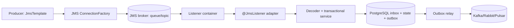
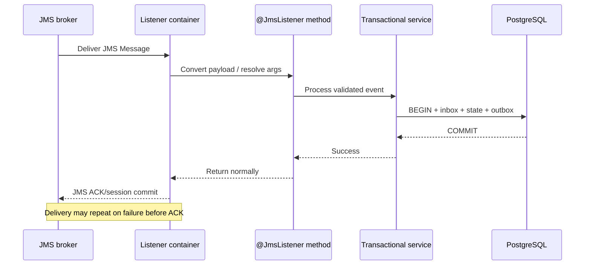
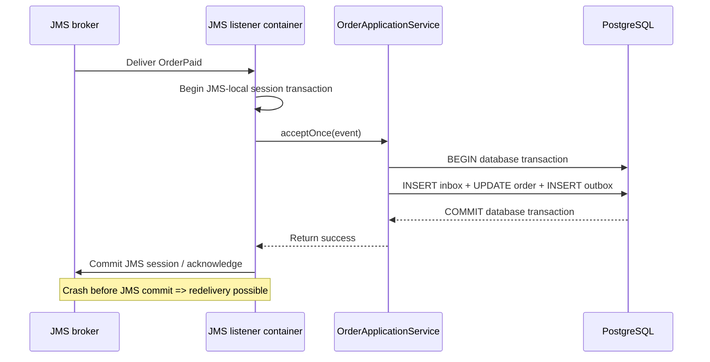
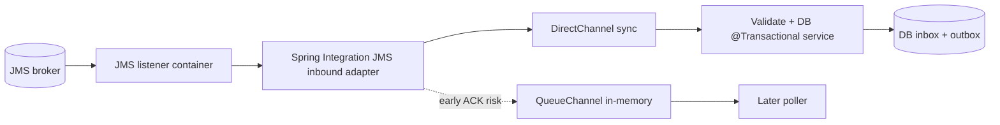
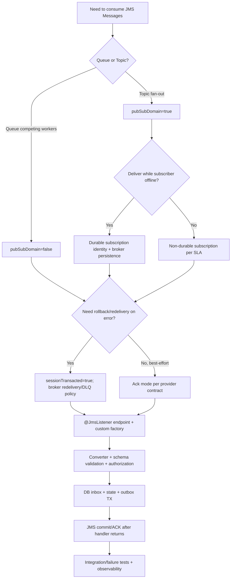

# @JmsListener and Listener Container Factory Configuration

> **Chapter:** JMS  
> **Module:** `SPRING_BOOT_INTEGRATION` — organizing system integration in Spring Boot across HTTP clients, databases, caches, message brokers, and Spring Integration adapters. Emphasis is placed on configuration management, data contracts, transactions, errors, duplicate prevention, testing, and observability in real integration flows.
>
> **Example scope:** Java 17+, Spring Boot 3.x, Spring Framework 6.x, Spring JMS, and Jakarta Messaging (`jakarta.jms.*`). The illustrative broker is Apache ActiveMQ Artemis via JMS; exact ports, TLS, redelivery, DLQ, and message groups must be checked against your deployed broker/client version. Business interfaces such as `OrderPaidDecoder`, `OrderApplicationService`, and `InboxRepository` are application-defined. This lesson never treats a listener "not throwing an exception" as proof of exactly-once delivery.

## 1. The problem: the broker delivered OrderPaid, now how does the system handle it?

Order Service receives a message from JMS queue `order.paid.v1`. The consumer must validate the data contract, check the tenant, update a PostgreSQL orders table, and write an outbox record to publish events to Kafka/RabbitMQ. You can use `@JmsListener`:

```java
@JmsListener(destination = "order.paid.v1")
public void onMessage(String body) {
    orderService.process(body);
}
```

The code looks simple, yet operational questions are harder:

- Who creates the threads and broker connections?
- If 4 pods run with `concurrency=5` each, how many consumers exist?
- If a message has malformed content, will it redeliver endlessly?
- If the DB committed but the JMS acknowledgment was lost, will business logic execute twice?
- If the handler catches an exception and returns normally, how is the message ACKed/committed?
- Should queues and topics share the same `listener container factory`?
- Does PostgreSQL `@Transactional` bring the broker into the same transaction?
- When the broker disconnects, who reconnects, backs off, and records metrics?
- Can a single listener be paused or started operationally?

**`@JmsListener` declares the receiving endpoint; `listener container factory` builds the container that manages connections, sessions, threads, acknowledgments, transactions, recovery, and dispatching.** Configuring the annotation while ignoring the container easily leads to data corruption or overload.

### Learning objectives

After this lesson, you will be able to:

1. Distinguish the JMS API, provider/broker, Spring `JmsTemplate`, listener endpoint, `ConnectionFactory`, and listener container.
2. Configure `@EnableJms`, `@JmsListener`, and `DefaultJmsListenerContainerFactory` beans.
3. Use `DefaultJmsListenerContainerFactoryConfigurer` to preserve Spring Boot defaults before customizing.
4. Choose queues vs. topics, standard, durable/shared subscriptions, and suitable consumer concurrency.
5. Design `MessageConverter`, versioned JSON contracts, metadata, tenant validation, and correlation.
6. Distinguish `AUTO_ACKNOWLEDGE`, `CLIENT_ACKNOWLEDGE`, `DUPS_OK_ACKNOWLEDGE`, and JMS-local session transactions.
7. Classify transient errors, poison messages, redelivery policies, and DLQs without swallowing exceptions.
8. Write PostgreSQL inbox/outbox tables with unique keys to keep consumers idempotent on redelivery.
9. Test listeners, broker restarts, rolling deploys, DB failures, TLS/auth errors, and monitor throughput/lag.
10. Draw clear boundaries with Spring Integration channels, Redis, and downstream brokers.

## 2. Where do JMS, Jakarta Messaging, and Spring JMS sit?

JMS (*Java Message Service*, now Jakarta Messaging) is the Java contract for sending/receiving messages; implementations are provided by brokers/providers.



Components to distinguish:

| Component | Role | What it does NOT do automatically |
|---|---|---|
| `jakarta.jms.ConnectionFactory` | Creates connections/sessions per JMS provider | Does not govern DB business transactions |
| Broker/provider | Stores, routes, ACKs/redelivers per config | Does not validate application JSON schemas |
| `JmsTemplate` | Synchronous Spring abstraction for JMS send/receive | Is not a durable broker |
| `@JmsListener` | Marks a message-receiving method/endpoint | Does not fully define resource limits or retry policies |
| Listener container | Manages connection/session/consumer lifecycles, receives and invokes handlers | Does not create exactly-once business effects |
| Listener container factory | Builds containers from configuration for each endpoint | Does not migrate databases/inboxes |
| `JmsListenerEndpointRegistry` | Manages lifecycles of listener endpoints | Does not replace broker consumer groups |
| `MessageConverter` | Converts JMS Message ↔ Java object | Does not enforce authorization or contract evolution |
| Application service | Validates contracts, transactions, idempotency | Does not ACK JMS merely by touching the DB |
| Outbox relay | Publishes committed intents to external systems | Does not turn JMS/DB into a distributed transaction |

A JMS `Message` can be `TextMessage`, `BytesMessage`, `MapMessage`, or another type. In Spring Boot 3+, use the **`jakarta.jms`** namespace; never import `javax.jms` from legacy code and mix it within the same application.

### 2.1. Queues and topics vs. Spring Integration channels

- A JMS **Queue** uses competing consumers: each message is dispatched to one consumer per broker contract, though it can be redelivered.
- A JMS **Topic** uses publish–subscribe: subscriptions receive messages per subscriber/durable/shared policies.
- Spring Integration's `DirectChannel`, `QueueChannel`, and `PublishSubscribeChannel` are **in-application channels**. An in-JVM channel does not become a durable JMS broker just because its name includes `queue`.

## 3. How @JmsListener works from startup to handler invocation

General sequence:

1. Spring instantiates configuration beans and `ConnectionFactory`.
2. Annotation-driven JMS scanning discovers `@JmsListener` methods.
3. Each endpoint binds to a listener container factory.
4. The factory creates and configures a container, registering it in `JmsListenerEndpointRegistry`.
5. The container starts per lifecycle policy and connects JMS consumers.
6. When a message arrives, the container fetches the JMS Message and delegates to an adapter to resolve listener method arguments.
7. The listener executes logic and either returns or throws an exception.
8. The container/provider applies ACK/commit/rollback and configured redelivery policies.



The diagram shows **JMS-local transaction/ack after handler success**, not every acknowledgment mode. When Spring manages the handler, conversion/validation/argument-resolution steps can throw exceptions **before the method body executes**; factor those into retry/DLQ policies.

### 3.1. An annotation is not a manual while(true) loop

`@JmsListener` does not require manually spawning threads or polling `Consumer.receive()`. The container receives messages, invokes handlers, and reconnects when configured. Never embed a manual polling loop inside a listener method that blocks container threads or breaks lifecycle shutdown.

## 4. Spring Boot dependencies for JMS listeners

With ActiveMQ Artemis as the JMS provider, a common Gradle setup:

```gradle
dependencies {
    implementation("org.springframework.boot:spring-boot-starter-artemis")
    implementation("org.springframework.boot:spring-boot-starter-validation")
    implementation("org.springframework.boot:spring-boot-starter-jdbc")
    runtimeOnly("org.postgresql:postgresql")

    testImplementation("org.springframework.boot:spring-boot-starter-test")
    testImplementation("org.testcontainers:junit-jupiter")
}
```

The Spring Boot BOM should align Spring JMS, the provider client, and the Jakarta Messaging API. When using ActiveMQ Classic, IBM MQ, or another JMS provider, dependencies, connection properties, TLS, and provider behavior **differ**. Never drop multiple JMS provider JARs of differing versions onto the classpath without understanding auto-configuration and type conflicts.

### 4.1. Example application.yml with an external Artemis broker

```yaml
spring:
  artemis:
    mode: native
    broker-url: ${ARTEMIS_BROKER_URL:tcp://localhost:61616}
    user: ${ARTEMIS_USERNAME}
    password: ${ARTEMIS_PASSWORD}

app:
  jms:
    order-paid-queue: order.paid.v1
    order-events-topic: order.events.v1
```

This is a development/staging example; `localhost` is not the broker's hostname when the app runs in its own Kubernetes pod. Production needs appropriate endpoints/DNS/TLS/secrets. Never commit real credentials. `app.jms.*` are **custom application properties**, not a Spring Boot namespace that auto-provisions queues/topics.

### 4.2. Having a bean does not prove the broker is reachable

Boot can instantiate `ConnectionFactory` and listener containers at startup while broker connection errors surface only when containers start or reconnect. Monitor **listener readiness, last successful receive, connection failures, and business progress** rather than merely checking that the app started.

## 5. Enabling annotation listeners with @EnableJms

In an explicitly configured application:

```java
import org.springframework.context.annotation.Configuration;
import org.springframework.jms.annotation.EnableJms;

@Configuration(proxyBeanMethods = false)
@EnableJms
public class JmsListenerConfiguration {
}
```

`@EnableJms` activates Spring JMS `@JmsListener` processing. In some Spring Boot auto-configuration combinations, annotation-driven support is enabled automatically; declaring it explicitly makes the dependency obvious without registering duplicate registrars/annotations.

### 5.1. Default bean name jmsListenerContainerFactory

By annotation-driven Spring JMS convention, if `@JmsListener` omits `containerFactory`, the framework looks for a default factory named `jmsListenerContainerFactory` (unless a custom registrar overrides it).

Example:

```java
@JmsListener(destination = "order.paid.v1")
public void onMessage(String payload) { /* ... */ }
```

Do not assume a custom factory named `ordersListenerContainerFactory` will be chosen automatically just because the bean exists. Either specify `containerFactory = "ordersListenerContainerFactory"` on the annotation or intentionally configure the default factory bean.

### 5.2. Why pick factories by consumer workload?

One application may serve:

- Payment queue: transacted + moderate concurrency.
- Audit topic: durable/shared subscription and different throughput.
- Email queue: low concurrency bounded by provider quotas.
- Legacy query queue: special timeouts and error policies.

**Each workload can use its own factory**, avoiding global `sessionTransacted`/`concurrency` tweaks that unintentionally impact other listeners.

## 6. Simplest @JmsListener: receiving a String payload

Spring Boot service receiving JSON text:

```java
import org.springframework.jms.annotation.JmsListener;
import org.springframework.stereotype.Component;

@Component
public class OrderPaidJmsListener {

    private final OrderPaidDecoder decoder;
    private final OrderApplicationService service;

    public OrderPaidJmsListener(
            OrderPaidDecoder decoder,
            OrderApplicationService service) {
        this.decoder = decoder;
        this.service = service;
    }

    @JmsListener(
        id = "orderPaidListener",
        destination = "${app.jms.order-paid-queue}",
        containerFactory = "ordersListenerContainerFactory"
    )
    public void onOrderPaid(String json) {
        OrderPaidEvent event = decoder.decodeAndValidate(json);
        service.acceptOnce(event);
    }
}
```

`OrderPaidDecoder`, `OrderPaidEvent`, and `OrderApplicationService` are application components; the decoder must validate JSON syntax, schema version, required fields, size limits, and tenant/source identity before producing side effects.

- If the service completes, the method returns normally and the container handles ACK/commit per factory configuration.
- If the decoder or service throws an exception, **do not swallow it**; the container needs to see the failure to roll back/redeliver per policy.
- Do not manually call `subscribe()`, `acknowledge()`, or create a second consumer inside this method when using a listener container.
- `id` identifies the endpoint for operations/registry; it is **not an event ID** for deduplication.

### 6.1. @Component beans and transaction proxies

Listeners are Spring beans. Calling `service.acceptOnce(event)` on a separate service bean lets Spring's transaction proxy apply `@Transactional` on public service methods. If a listener calls `this.acceptTransactional(...)` within the same bean, transaction advice is bypassed due to self-invocation.

## 7. @JmsListener attributes: destination, id, selector, subscription

Commonly used annotation attributes:

| Attribute | Effect | Notes |
|---|---|---|
| `destination` | Queue/topic name to consume | Depends on destination resolver/broker |
| `id` | Endpoint ID in registry | Must be unique in the context |
| `containerFactory` | Spring factory bean name used to build the container | Critical when multiple factories exist |
| `concurrency` | Overrides concurrency for this endpoint | Does not guarantee global ordering |
| `selector` | JMS message selector expression | Evaluates headers/properties, does not parse JSON body |
| `subscription` | Topic subscription name when needed | Essential for durable/shared topic consumers |

Example filtering messages by JMS properties:

```java
@JmsListener(
    id = "priorityOrdersListener",
    destination = "order.commands",
    containerFactory = "ordersListenerContainerFactory",
    selector = "eventType = 'ORDER_PAID' AND priority >= 5",
    concurrency = "2-4"
)
public void onPriorityOrder(String json) {
    // Decode + validate + process in service.
}
```

**Selectors inspect provider-supported JMS properties/headers**, not JSON fields inside a `TextMessage`. Producers must populate properties with matching types (`eventType` as String, `priority` as numeric). Selector syntax follows JMS's SQL-like grammar; check provider differences and mappings.

### 7.1. Annotations support placeholders

`destination = "${app.jms.order-paid-queue}"` resolves from the Spring Environment when the endpoint is registered. A wrong or missing placeholder does not auto-create queues. Never populate destination names from untrusted external user input without validation/authorization, to avoid reading the wrong queue/topic.

## 8. DefaultJmsListenerContainerFactory: where the listener container is configured

Spring provides `DefaultJmsListenerContainerFactory` to build `DefaultMessageListenerContainer`, which manages consumers, threads, recovery, and transaction/session behavior.

Example dedicated factory:

```java
import jakarta.jms.ConnectionFactory;
import org.slf4j.Logger;
import org.slf4j.LoggerFactory;
import org.springframework.boot.autoconfigure.jms.DefaultJmsListenerContainerFactoryConfigurer;
import org.springframework.context.annotation.Bean;
import org.springframework.context.annotation.Configuration;
import org.springframework.jms.config.DefaultJmsListenerContainerFactory;

@Configuration(proxyBeanMethods = false)
public class OrderJmsContainerConfiguration {

    private static final Logger log =
        LoggerFactory.getLogger(OrderJmsContainerConfiguration.class);

    @Bean("ordersListenerContainerFactory")
    DefaultJmsListenerContainerFactory ordersListenerContainerFactory(
            ConnectionFactory connectionFactory,
            DefaultJmsListenerContainerFactoryConfigurer configurer) {

        var factory = new DefaultJmsListenerContainerFactory();

        // Apply Spring Boot settings first (converter, ack, tx... if configured).
        configurer.configure(factory, connectionFactory);

        // Then override with the exact policy for the business queue.
        factory.setPubSubDomain(false);
        factory.setSessionTransacted(true);
        factory.setConcurrency("2-6");
        factory.setRecoveryInterval(5000L);

        factory.setErrorHandler(error ->
            log.error("JMS listener container reported failure: {}",
                error.getClass().getSimpleName()));

        return factory;
    }
}
```

This is a **sample configuration**, not a universal optimum for every broker. `setRecoveryInterval(5000L)` illustrates reconnect wait intervals after connection failures per the matching Spring JMS API, not per-message business retry intervals. `ErrorHandler` supports logging/observability; **it does not commit, roll back, route messages to a DLQ, or confirm recovery**.

### 8.1. Why use DefaultJmsListenerContainerFactoryConfigurer?

Instantiating a factory and setting only a few properties can silently bypass settings Spring Boot already configured (custom converters, destination resolvers, transaction managers, error handlers, session settings, or version-specific properties).

`configurer.configure(factory, connectionFactory)` applies Boot-provided defaults; any overrides **afterward** should be reviewed carefully:

1. Does the order-processing factory require JMS-local transactions?
2. Did Boot already wire a custom message converter or destination resolver?
3. Will any global transaction manager be overridden or disconnected?
4. Does error handling belong in the container or consumer/business layer?
5. Does concurrency exceed DB pool, broker license, or connection limits?

### 8.2. If you do not use the Boot configurer

You can construct the factory directly and call `setConnectionFactory(...)`, then wire required behaviors manually. This makes sense in multi-provider JMS setups, provided integration tests confirm conversion, TLS/auth, acks, and transactions.

## 9. DefaultMessageListenerContainer vs. SimpleMessageListenerContainer

Spring JMS offers multiple listener container implementations. Two common ones:

| Container | Strengths | Limits / things to check |
|---|---|---|
| `DefaultMessageListenerContainer` (DMLC) | Recovery, configurable consumer concurrency/dynamic scaling, transaction integration | Many tunables; benchmark and understand cache/session policies |
| `SimpleMessageListenerContainer` | Simple design built on asynchronous JMS consumer callbacks | Lacks DMLC's lifecycle/dynamic scaling/transaction features |
| `@JmsListener` | Endpoint annotation, **not a container type** | Relies on factory to determine implementation |

Do not switch from Default to Simple just because of the word "Simple" while assuming identical recovery/transaction guarantees. DMLC is the standard choice for production consumers needing transaction control and reconnect recovery.

### 9.1. There is no "one thread per JMS message"

Containers manage consumer sessions and task executors/polling loops. Concurrency sets the number of parallel executing consumers per instance, not an unbounded thread per message. Worker threads can still block on synchronous JDBC, HTTP, Redis, template processing, or long tasks; bound the entire pipeline.

## 10. Default factory and per-workload factories

A sample design:

```java
@Bean("auditListenerContainerFactory")
DefaultJmsListenerContainerFactory auditListenerContainerFactory(
        ConnectionFactory connectionFactory,
        DefaultJmsListenerContainerFactoryConfigurer configurer) {

    var factory = new DefaultJmsListenerContainerFactory();
    configurer.configure(factory, connectionFactory);

    factory.setPubSubDomain(true);
    factory.setSessionTransacted(true);
    factory.setConcurrency("1");
    return factory;
}
```

This factory only specifies a **topic consumer** with concurrency 1. It does not define durable/subscription identity. If audit cannot afford missed events while offline, configure a **durable subscription** and verify broker backlog/retention.

A listener using it:

```java
@JmsListener(
    id = "auditOrderEvents",
    destination = "order.events.v1",
    containerFactory = "auditListenerContainerFactory"
)
public void audit(String json) {
    // Validate contract and persist audit independently.
}
```

If multiple pods run a **non-durable** topic consumer, each pod usually receives its own copy of events for its subscription, duplicating audit records if you mistakenly thought pods formed a competing queue group. Design subscription topology intentionally.

## 11. Concurrency: what does 2-6 mean?

With `setConcurrency("2-6")`, DMLC maintains a minimum of roughly two consumers and scales up to six based on load and supported container/provider behavior. `@JmsListener(concurrency="2-4")` overrides this per endpoint.

Key points:

- **Per container / per JVM**, not cluster-wide.
- One pod with three listener containers each capped at 6 has far more consumers than one listener.
- Across 4 replicas, max consumers on a queue reach `4 × 6 = 24` for that endpoint.
- 24 concurrent SQL consumers can exhaust `Hikari maximumPoolSize` or database capacity.
- Broker prefetch/credit, consumer priority, selectors, and routing affect real distribution.
- More consumers do not guarantee linear throughput: DB locks, transaction duration, or downstream HTTP may be the bottleneck.

### 11.1. Ordering changes as consumers scale

A JMS queue may preserve enqueue order at the broker, yet multiple consumers + redelivery/retries mean **business completion order** is rarely preserved. If events for one `orderId` must stay sequential:

1. Use application-level aggregate versioning / optimistic locking / state machines.
2. Consider JMS message grouping (`JMSXGroupID`) if fully supported and tested on your broker.
3. Size concurrency/partitioning by key thoughtfully.
4. Never infer "message sent first" equals "transaction committed first."

### 11.2. Concurrency and backpressure

If receivers pull 1,000 messages/second while the DB commits 200/second, raising consumers from 4 to 20 increases latency and lock contention. Monitor consumer utilization, broker queue depth/oldest age, DB pool pending threads, and error rates; apply rate limiting/bulkheads or lower concurrency when the bottleneck is downstream.

## 12. Queue vs. Topic: pubSubDomain and destination mapping

`factory.setPubSubDomain(false)` normally selects queue semantics; `true` selects topic semantics. Because brokers also apply address/queue routing rules (such as Artemis anycast/multicast), configure broker-side addresses, destination provisioning, and policies to match.

| Scenario | Choice | Notes |
|---|---|---|
| Each `OrderPaid` processed by one worker in a pool | Queue | Competing consumers; redelivery can still occur |
| Audit and Billing each need their own copy | Topic, separate subscriptions | Independent progress per concern |
| Offline consumer must receive missed events later | Durable topic subscription | Subscription identity and broker persistence |
| Multiple pods sharing one topic subscription | Shared subscription if supported by provider/JMS version | Verify ordering and shared durable semantics |
| Live-only dashboard needing no replay | Non-durable topic consumer may suffice | Messages missed while offline |

### 12.1. Do not confuse topic fan-out with queue load balancing

If Billing and Audit read from **the same JMS queue**, each event goes to only one competing worker instead of triggering both Billing and Audit. With a topic, two **separate subscriptions** each receive the event per policy; inside a shared subscription, multiple consumers split work rather than duplicating across every consumer.

## 13. Durable topic subscriptions and shared subscriptions

JMS defines durable and shared subscriptions whose exact support depends on provider version.

- **Non-durable topic consumer:** broker does not promise retention while offline.
- **Durable subscription:** broker keeps matching messages while the client is temporarily offline, subject to persistence/retention policies.
- **Shared durable subscription:** multiple consumers share traffic within the same subscription when supported by the provider, usually with ordering trade-offs.
- `clientId`/`subscription`: unshared durable subscriptions rely on client identity and subscription name; shared subscriptions follow provider-specific identity rules.

Illustrative configuration for a **single unshared durable topic consumer**:

```java
@Bean("durableAuditContainerFactory")
DefaultJmsListenerContainerFactory durableAuditContainerFactory(
        ConnectionFactory connectionFactory,
        DefaultJmsListenerContainerFactoryConfigurer configurer) {

    var factory = new DefaultJmsListenerContainerFactory();
    configurer.configure(factory, connectionFactory);
    factory.setPubSubDomain(true);
    factory.setSubscriptionDurable(true);
    factory.setClientId("audit-service-instance-A");
    factory.setConcurrency("1");
    factory.setSessionTransacted(true);
    return factory;
}
```

```java
@JmsListener(
    id = "auditDurableSubscription",
    destination = "order.events.v1",
    subscription = "audit-events-v1",
    containerFactory = "durableAuditContainerFactory"
)
public void onOrderEvent(String json) {
    // ...
}
```

**Production warning:** `clientId` typically must be unique per active non-shared durable connection. **Never hardcode `audit-service-instance-A` across all replicas**, or replicas will fail with client ID conflicts or create duplicate subscription topologies. For shared durable subscriptions, verify factory/provider support for `setSubscriptionShared(true)` and identity rules, and test multi-pod rollouts and reconnects.

### 13.1. Durable is not infinite

Durable topic subscriptions are still bounded by broker retention, storage quotas, message expiry, dead-letter policies, and cleanup. Do not treat durable as infinite retention or business exactly-once. Monitor subscription backlog and oldest pending age.

## 14. JMS MessageConverter: from TextMessage to DTO

Spring JMS can pass `String` from a `TextMessage` using the simple converter, whereas object DTOs need an explicit serialization contract. `SimpleMessageConverter` handles standard JMS/JDK types and **does not automatically decode arbitrary JSON strings into records**.

Define the contract:

```java
import java.time.Instant;

public record OrderPaidEvent(
    String eventId,
    String tenantId,
    String orderId,
    long aggregateVersion,
    String schemaVersion,
    Instant occurredAt
) {}
```

One Spring JMS converter option for JSON text:

```java
import java.util.Map;
import org.springframework.context.annotation.Bean;
import org.springframework.context.annotation.Configuration;
import org.springframework.jms.support.converter.MappingJackson2MessageConverter;
import org.springframework.jms.support.converter.MessageType;

@Configuration(proxyBeanMethods = false)
class OrderJmsConverterConfiguration {

    @Bean
    MappingJackson2MessageConverter orderJmsMessageConverter() {
        var converter = new MappingJackson2MessageConverter();
        converter.setTargetType(MessageType.TEXT);
        converter.setTypeIdPropertyName("_type");
        converter.setTypeIdMappings(
            Map.of("order-paid-v1", OrderPaidEvent.class));
        return converter;
    }
}
```

**Version check:** Constructor/JSON mapper integration and mapping APIs on `MappingJackson2MessageConverter` depend on your Spring Framework/Spring Boot release. If customizing `ObjectMapper` (Java Time, naming, unknown fields), configure it explicitly per compatible API and write round-trip tests. Never enable Jackson polymorphic default typing on untrusted payloads just to convert arbitrary objects.

### 14.1. Why use _type mapping?

Converters often need to know which Java class to decode JSON into. Letting producers send fully qualified Java class names in a JMS header couples consumers to packages/classes/versions and widens the deserialization attack surface.

Use an **allowlisted type ID** (`order-paid-v1`) and explicit schema version rather than arbitrary upstream class names. Type IDs only help pick the DTO class; **they do not replace payload/tenant/source authentication**.

### 14.2. Formats to avoid

Avoid Java native serialized `ObjectMessage` as an untrusted inter-service protocol; Java serialization creates classpath coupling, brittle evolution, and security risks. Schema-governed JSON/Avro/Protobuf fits cross-service exchange far better.

## 15. Wiring MessageConverter to the right listener factory

A factory can accept the converter directly:

```java
@Bean("typedOrdersListenerFactory")
DefaultJmsListenerContainerFactory typedOrdersListenerFactory(
        ConnectionFactory connectionFactory,
        DefaultJmsListenerContainerFactoryConfigurer configurer,
        MappingJackson2MessageConverter orderJmsMessageConverter) {

    var factory = new DefaultJmsListenerContainerFactory();
    configurer.configure(factory, connectionFactory);
    factory.setSessionTransacted(true);
    factory.setPubSubDomain(false);
    factory.setMessageConverter(orderJmsMessageConverter);
    return factory;
}
```

Listener:

```java
@JmsListener(
    destination = "${app.jms.order-paid-queue}",
    containerFactory = "typedOrdersListenerFactory"
)
public void onOrderPaid(OrderPaidEvent event) {
    orderApplicationService.acceptOnce(event);
}
```

A producer using the same converter sets `_type=order-paid-v1`. If the producer omits the type ID, DTO conversion fails **before entering the listener method**; test real producer↔consumer contracts.

### 15.1. Factory and JmsTemplate need compatible serializers

Setting a converter on a listener factory **does not automatically configure** the same converter on a producer `JmsTemplate` in all setups. If the producer lives in the same Spring Boot app, wire the matching converter onto `JmsTemplate`, or send JSON text with manual JMS properties per contract. When services run different converters/versions, test cross-version payloads.

```java
import org.springframework.jms.core.JmsTemplate;
import org.springframework.stereotype.Service;

@Service
class OrderPaidPublisher {
    private final JmsTemplate jms;

    OrderPaidPublisher(JmsTemplate jms) {
        this.jms = jms;
    }

    void publish(String json, String eventId, String tenantId) {
        jms.convertAndSend("order.paid.v1", json, msg -> {
            msg.setStringProperty("eventId", eventId);
            msg.setStringProperty("tenantId", tenantId);
            msg.setStringProperty("schemaVersion", "1");
            msg.setStringProperty("eventType", "ORDER_PAID");
            return msg;
        });
    }
}
```

This snippet illustrates a **producer sending a JSON string**, which a `String` listener can consume without a typed JSON converter. With `typedOrdersListenerFactory`, either add the converter's type-ID property or send objects through a compatible converter. **These two flows are illustrative alternatives**—do not mix incompatible formats onto the same queue expecting every message to convert cleanly.

## 16. JMS headers, properties, and business event IDs

JMS messages carry standard headers and application properties. Key metadata:

| Field | Purpose | Do NOT use in place of |
|---|---|---|
| `JMSMessageID` | Transport ID usually assigned by provider | Absolute business idempotency key |
| `JMSCorrelationID` | Ties together request/reply/workflow | Unique identity of every business event |
| `JMSDestination` | Message destination | Tenant authorization |
| `JMSReplyTo` | Optional reply destination | ACK/commit logic |
| `JMSTimestamp` | Provider-assigned timestamp per policy | Business event `occurredAt` |
| `JMSExpiration` | Message deadline from TTL | Unchecked business deadline |
| `JMSRedelivered` | Provider redelivery indicator flag | Exact attempt counter |
| `JMSXDeliveryCount` | Provider-reported delivery count when supported | Stable cross-topology absolute counter |
| `eventId` | Application property, if set | Still needs DB validation and unique constraint |
| `schemaVersion` | Contract evolution | Does not guarantee backward compatibility by itself |

### 16.1. Reading raw JMS metadata when genuinely needed

```java
import jakarta.jms.JMSException;
import jakarta.jms.TextMessage;
import org.springframework.jms.annotation.JmsListener;

@JmsListener(
    destination = "order.paid.v1",
    containerFactory = "ordersListenerContainerFactory"
)
public void onRawTextMessage(TextMessage message) throws JMSException {
    String body = message.getText();
    String transportId = message.getJMSMessageID();
    String correlationId = message.getJMSCorrelationID();
    boolean redelivered = message.getJMSRedelivered();
    String eventId = message.getStringProperty("eventId");

    // Application-defined decoder + business service.
    // Never use transportId as the sole deduplication key.
}
```

This is an **alternative raw-message listener** to the String/DTO listeners on the same queue. Never register both on one queue if every event expects a single handler type; they will compete for messages.

### 16.2. Provider compatibility of JMSXDeliveryCount

`JMSXDeliveryCount` is a JMS-defined property often provided for delivery counts. However, semantics across failover, DLQ moves, bridges, or replays vary; never use it as a business idempotency key. Log attempts with safe correlation and let broker redelivery/DLQ policies enforce retry caps.

## 17. Validation and security at the listener boundary

Even with broker TLS/SASL/user ACLs, treat incoming messages as **external integration input**. Consumers should check:

1. Payload size and accepted JMS Message subtype.
2. Content encoding/JSON syntax, duplicate keys, and structure.
3. `schemaVersion` and event type within an allowlist.
4. Required fields: `eventId`, `tenantId`, `aggregateVersion`, `occurredAt`.
5. Source principal/queue authorization for the tenant/resource, if required by contract.
6. Business invariants and event ordering.
7. An event must never "switch tenants" based solely on an unverified upstream JSON property.

Example Bean Validation on a DTO:

```java
import jakarta.validation.constraints.NotBlank;
import jakarta.validation.constraints.PositiveOrZero;

public record OrderPaidV1(
    @NotBlank String eventId,
    @NotBlank String tenantId,
    @NotBlank String orderId,
    @PositiveOrZero long aggregateVersion
) {}
```

`@Valid`/Bean Validation only runs if method validation infrastructure is wired into the listener adapter; **never assume DTO annotations automatically validate every listener**. Decoders or application services can invoke `jakarta.validation.Validator` explicitly:

```java
var violations = validator.validate(event);
if (!violations.isEmpty()) {
    throw new InvalidMessageException("OrderPaid schema invalid");
}
```

`validator` is an injected bean and `InvalidMessageException` is an application exception. For poison payloads, use **bounded quarantine/DLQ**, not infinite redeliveries that block the queue.

### 17.1. Never replace schema validation with JMS selectors

A selector like `eventType = 'ORDER_PAID'` only routes on a property. A sender can attach that property while putting a different event or broken JSON in the body. Application contract validators remain mandatory.

## 18. Acknowledgment: when does the container confirm receipt?

JMS offers multiple ways to confirm receipt to the broker. Distinguish **JMS ACK** from **database commit** and **downstream business completion**.

| Mechanism | General meaning | Risks |
|---|---|---|
| `Session.AUTO_ACKNOWLEDGE` | Provider/container ACKs automatically per JMS delivery semantics | On callback exceptions, redelivery reliability depends on container/provider; do not rely on it to protect DB side effects |
| `Session.CLIENT_ACKNOWLEDGE` | Client invokes `acknowledge()` per session semantics | ACK can cover multiple messages delivered on the same session, not per-message by default |
| `Session.DUPS_OK_ACKNOWLEDGE` | Allows lazy/relaxed ACK per provider | Higher duplicate rate; unsuitable when strict control is needed |
| `sessionTransacted=true` | Uses JMS-local transaction; success commits, failure rolls back | **Does not share a transaction with PostgreSQL automatically** |
| External JTA/XA | Coordinates multiple transactional resources when properly configured | Complex, high overhead, driver/provider dependent; not present by default |

### 18.1. Why many workloads choose JMS-local transactions

With a broker queue and an application service writing to an idempotent DB, a pragmatic strategy is:

- Container sets `sessionTransacted=true`.
- `@Transactional` application service writes inbox + state + outbox.
- Service commits DB and the listener returns.
- Container commits/ACKs the JMS session.
- If the consumer crashes after DB commit but before JMS commit, the broker redelivers and the DB inbox unique key makes the retry a no-op.

This achieves **at-least-once delivery + idempotent business processing**, not exactly-once transport or an atomic JMS+DB transaction.

### 18.2. Never call manual ACK on raw Messages inside a transacted session

In a JMS-local transacted session, `commit/rollback` governs disposition; calling `message.acknowledge()` manually does not replace transaction semantics. Avoid mixing ACK modes in one listener without verifying container behavior.

## 19. A JMS-local transaction is not a database transaction

With `factory.setSessionTransacted(true)`, the JMS provider/container coordinates `Session.commit()` or `Session.rollback()` for the **JMS session**. Calling a `@Transactional` Spring service against PostgreSQL normally opens a **separate transaction** managed by the DB transaction manager.



This is the **typical sequence** in a synchronous listener calling a separate transactional service. If the service throws:

- The Spring DB transaction rolls back per `@Transactional` rules.
- The exception exits the listener.
- The JMS container rolls back the session so the broker can redeliver.
- The broker applies configured delay, max attempts, DLQ, and expiration.

If the DB committed while the container failed to commit the JMS session due to a crash/network drop, the message **can be redelivered**. That is not a bug in JDBC or JMS—it is the boundary between two independent systems.

### 19.1. Why doesn't @Transactional turn into XA?

`@Transactional` picks a `PlatformTransactionManager`/`ReactiveTransactionManager` based on configuration and method type. A `JpaTransactionManager` or `DataSourceTransactionManager` manages only its database resource and does not enlist the JMS session.

Atomic JMS+DB commits via **JTA/XA** require an XA-capable transaction manager, connection factory, and datasource with proper enlistment. That adds complexity and demands recovery/heuristic-outcome management. In many systems, **DB inbox/outbox + at-least-once JMS** is much simpler to operate.

### 19.2. Never hold DB transactions open across long HTTP/Redis/broker I/O

If a listener opens a DB transaction and calls Payment API/Redis/Kafka before committing, it holds JDBC connections and locks longer and increases partial side-effect risks. Instead:

1. Validate the message and business invariants.
2. Inside the **DB transaction**, write inbox/state/outbox.
3. Commit the DB.
4. Let the outbox relay handle downstream I/O after commit.
5. Return normally so the JMS container ACKs/commits.

## 20. Building PostgreSQL inbox/outbox tables for a JMS consumer

Duplicate business effects can be prevented using unique constraints. Example schema:

```sql
CREATE TABLE order_jms_inbox (
    consumer_name VARCHAR(100) NOT NULL,
    event_id VARCHAR(120) NOT NULL,
    tenant_id VARCHAR(80) NOT NULL,
    order_id VARCHAR(100) NOT NULL,
    received_at TIMESTAMPTZ NOT NULL DEFAULT CURRENT_TIMESTAMP,
    PRIMARY KEY (consumer_name, event_id)
);

CREATE TABLE order_state (
    tenant_id VARCHAR(80) NOT NULL,
    order_id VARCHAR(100) NOT NULL,
    status VARCHAR(40) NOT NULL,
    aggregate_version BIGINT NOT NULL,
    PRIMARY KEY (tenant_id, order_id)
);

CREATE TABLE order_outbox (
    id BIGINT GENERATED ALWAYS AS IDENTITY PRIMARY KEY,
    event_id VARCHAR(120) NOT NULL UNIQUE,
    event_type VARCHAR(80) NOT NULL,
    tenant_id VARCHAR(80) NOT NULL,
    aggregate_id VARCHAR(100) NOT NULL,
    payload_json JSONB NOT NULL,
    state VARCHAR(24) NOT NULL DEFAULT 'PENDING',
    created_at TIMESTAMPTZ NOT NULL DEFAULT CURRENT_TIMESTAMP
);

CREATE INDEX idx_order_outbox_pending
    ON order_outbox (state, id);
```

The inbox **idempotency key** is `(consumer_name, event_id)`, using a **stable business `eventId`**. Never use `JMSMessageID` as the unique key if events can be republished with new transport IDs.

### 20.1. Inserting into the inbox with ON CONFLICT DO NOTHING

```java
import org.springframework.jdbc.core.JdbcTemplate;
import org.springframework.stereotype.Repository;

@Repository
class JdbcOrderInboxRepository {
    private final JdbcTemplate jdbc;

    JdbcOrderInboxRepository(JdbcTemplate jdbc) {
        this.jdbc = jdbc;
    }

    boolean tryInsert(String consumer, OrderPaidEvent event) {
        int inserted = jdbc.update(
            """
            INSERT INTO order_jms_inbox(
                consumer_name, event_id, tenant_id, order_id)
            VALUES (?, ?, ?, ?)
            ON CONFLICT (consumer_name, event_id) DO NOTHING
            """,
            consumer,
            event.eventId(),
            event.tenantId(),
            event.orderId()
        );
        return inserted == 1;
    }
}
```

A unique constraint handles races across two pods safely, unlike a non-atomic `SELECT exists` followed by insert. If an `eventId` is ever reused by a different payload, store and compare payload hashes or immutable fields to catch **ID collisions/conflicts** rather than silently treating different data as valid duplicates.

### 20.2. Single application transaction

```java
import org.springframework.stereotype.Service;
import org.springframework.transaction.annotation.Transactional;

@Service
public class OrderApplicationService {

    private final JdbcOrderInboxRepository inbox;
    private final OrderStateRepository orders;
    private final OrderOutboxRepository outbox;

    public OrderApplicationService(
            JdbcOrderInboxRepository inbox,
            OrderStateRepository orders,
            OrderOutboxRepository outbox) {
        this.inbox = inbox;
        this.orders = orders;
        this.outbox = outbox;
    }

    @Transactional
    public void acceptOnce(OrderPaidEvent event) {
        String consumerName = "order-paid-projection-v1";

        if (!inbox.tryInsert(consumerName, event)) {
            return; // Already processed successfully earlier; safe to ACK JMS.
        }

        // Check version/state transition under the DB transaction.
        orders.applyPaidEventIfAllowed(event);

        // Save publish intent; do not call Kafka/HTTP directly inside the transaction.
        outbox.insertDerivedEventOnce(event);
    }
}
```

`OrderStateRepository` and `OrderOutboxRepository` are application-implemented adapters; they must share **the same datasource and transaction manager** as the inbox. If `applyPaidEventIfAllowed` detects an out-of-order event or invalid state, **throw an exception or route to quarantine per contract** rather than committing the inbox row and pretending business logic ran.

### 20.3. Why insert into the inbox before the business effect?

When a listener is invoked again, the inbox insert hits the unique constraint and skips repeating state/outbox updates. Crucially, **inbox, business state, and outbox share one transaction**: if business SQL fails, the inbox insert rolls back too, allowing redelivery to reprocess cleanly.

## 21. Crash windows and outcome model

A timeline to test:

| Crash point | DB committed? | JMS ACKed/committed? | Recovery outcome |
|---|---|---|---|
| Before processing | No | No | Broker may redeliver |
| After INSERT inbox, before DB commit | No | No | DB rolls back; redelivery reprocesses |
| After DB commit, before JMS commit | **Yes** | No / uncertain | Redelivery; inbox unique key makes it a no-op |
| After JMS commit | Yes | Yes | No redelivery for that delivery |
| After outbox publish, before marking PUBLISHED | Yes | JMS ACKed | Outbox relay may republish; downstream deduplicates |
| Broker network timeout on commit | Broker state unknown | Outcome uncertain | Inspect JMS redelivery, DB inbox, and broker state |

### 21.1. "Exactly once" must specify which layer

You can achieve **idempotent business effects** for a given event ID in a database when unique constraints and transactions are right. That does not mean:

- JMS transport delivers physically once.
- Downstream Kafka receives only one record.
- Email/HTTP side effects run only once.
- Events arrive in order with valid contents.
- A replay using a different `eventId` avoids duplicate effects.

More accurately: **at-least-once delivery, idempotent consumer, durable outbox**, with business-contract consistency.

## 22. Exception propagation: never swallow errors in @JmsListener

An anti-pattern:

```java
@JmsListener(destination = "order.paid.v1")
public void wrong(String body) {
    try {
        orderApplicationService.acceptOnce(decoder.decodeAndValidate(body));
    } catch (Exception ex) {
        log.error("Failed", ex);
    }
    // Container sees the handler return normally.
}
```

If the container's ACK/transaction mode treats normal return as success, the message gets ACKed/committed even though the DB transaction failed. Logging an error **is not retry or recovery**.

Proper pattern for JMS-local transactions:

```java
@JmsListener(
    destination = "${app.jms.order-paid-queue}",
    containerFactory = "ordersListenerContainerFactory"
)
public void correct(String body) {
    OrderPaidEvent event = decoder.decodeAndValidate(body);
    orderApplicationService.acceptOnce(event);
    // If any step fails, the exception propagates to the container.
}
```

These two snippets are **illustrative alternatives**; never register both on the same queue in one app. Production systems must also choose a policy for permanent failures before letting the broker redeliver.

### 22.1. What if exceptions are caught in another layer?

A `@Transactional` service might catch a SQL exception, log it, and return normally. Spring's transaction proxy may then commit (or fail if marked rollback-only). Never treat logging as enough; the service should:

- Throw a typed exception with a clear category.
- Or persist an auditable quarantine/invalid-event record in a separate transaction, returning success **only after that state is durable**.
- Or intentionally mark rollback-only if business work cannot complete.

## 23. Redelivery: what does the broker do on JMS rollback?

In a transacted JMS session, a failing handler triggers rollback; the broker can redeliver the message per its redelivery policy, either to the same consumer or another one.

Provider-dependent settings:

- Initial redelivery delay.
- Backoff multiplier/jitter if supported.
- Maximum delivery attempts.
- DLQ address/queue, routing type, and retention.
- Message expiry/TTL.
- Poison-message detection and transaction rollback behavior.
- Consumer prefetch/credit and in-flight distribution.
- HA/failover and broker persistence.

### 23.1. An exception does not always redeliver immediately

If the broker configures a 10-second redelivery delay, the listener will not see the message right away. Once the broker moves a message to the DLQ after max attempts, the source queue backlog drops even though business processing failed. Monitor broker metrics and DLQs, not just listener logs.

### 23.2. Do not apply one config syntax to every broker

Artemis exposes address-settings like `redelivery-delay`, `max-delivery-attempts`, and `dead-letter-address`; ActiveMQ Classic, IBM MQ, and others use different settings. Spring JMS factories configure the **client container**, not full broker-side DLQ policies.

## 24. Poison messages: broken contracts must not retry forever

A malformed JSON message:

```json
{
  "eventId": "evt-1001",
  "eventType": "ORDER_PAID",
  "aggregateVersion": -7,
  "tenantId": ""
}
```

If the decoder throws `InvalidMessageException`, endless immediate rollback/redelivery clogs the queue. Two common patterns:

1. **Broker-managed DLQ:** handler throws, JMS rolls back; broker counts up to max attempts and moves the message to a durable DLQ.
2. **Application quarantine:** write an error record containing event ID, source destination, reason code, and safely stored payload per policy, commit DB, then return normally so JMS ACKs. If crashing after quarantine commit but before JMS ACK, redelivery is deduplicated by unique key.

Never implement the second pattern by merely logging and returning; logs are not durable quarantine and hinder replay/auditing.

### 24.1. Avoiding loops between DLQ and source queue

When replaying a DLQ, preserve the stable event ID and track audit/replay attempts; if the payload is still invalid, it returns to the DLQ. Require operator approval/quarantine workflows, max replay counts, schema migrations, and verification that the root cause is fixed before requeuing.

### 24.2. Quarantine payloads must protect PII

Never log full broken JSON containing emails, addresses, access tokens, or payment details. Store quarantined payloads encrypted with strict retention and access limits, logging only safe reason codes, event IDs, and correlation IDs.

## 25. Retries: who owns the attempt count?

A flow can retry at multiple layers:

```text
JMS broker redelivery: 5 attempts
  × Spring Retry advice: 3 attempts
    × JDBC transaction retry: 3 attempts
      = up to 45 processing calls for one message
```

Without a total retry budget, a brief DB outage creates retry storms and lock contention. Pick **one primary retry owner** per failure type:

| Failure | Appropriate retry layer |
|---|---|
| Broker connection lost | Listener container reconnect/backoff |
| Database temporarily down | Broker redelivery with backoff, or bounded local retry within budget |
| Partner HTTP timeout | Never retry blindly if side effects are not idempotent |
| JSON/schema invalid | DLQ/quarantine; never keep retrying unchanged payloads |
| Wrong ACL/TLS/credentials | Fail/alert on config; no rapid retries |
| Duplicate already-committed eventId | No-op success and ACK |
| Outbox publish failure | Separate outbox relay retries; never hold source JMS unacked indefinitely |

### 25.1. Local retry for brief glitches

When adding retry advice on a listener, know whether it retries **inside one invocation** or lets the listener throw for broker redelivery. A `RetryTemplate` retries inside a single JMS delivery, whereas broker redelivery runs after container rollback; both multiply together.

Never slap `@Retryable` onto a handler and skip DLQs/idempotency; decorators do not create durable retry state or guarantee exactly-once.

### 25.2. Unknown timeout outcomes

A SQL `INSERT` or HTTP `POST` may have committed downstream while the response dropped. Retries require business keys, unique constraints, and reconciliation; `SocketTimeoutException` **never proves the initial operation failed**.

## 26. JMS acknowledgment modes: decide based on the contract

Explicit configuration for a queue doing DB business work:

```java
var factory = new DefaultJmsListenerContainerFactory();
configurer.configure(factory, connectionFactory);
factory.setSessionTransacted(true);
factory.setConcurrency("2-6");
```

Because the JMS session is transacted, do not set `Session.CLIENT_ACKNOWLEDGE` and call `message.acknowledge()` manually in the handler. To use `AUTO_ACKNOWLEDGE` or `CLIENT_ACKNOWLEDGE`, test container/provider behavior to see the true ACK point and recovery on exceptions.

### 26.1. CLIENT_ACKNOWLEDGE does not ack per message by default

Under JMS session semantics, `Message.acknowledge()` in `CLIENT_ACKNOWLEDGE` can acknowledge **all messages consumed by that session** up to that point, not solely the current event. With concurrency, session scopes, and container abstractions, manual ACK requires provider-specific testing. Never use it to mimic arbitrary Kafka offset commits.

### 26.2. AUTO_ACKNOWLEDGE does not mean "every exception retries"

Listener container and Spring JMS implementations differ by provider regarding ACK timing in synchronous vs. asynchronous consumption. Do not judge by the name `AUTO_ACKNOWLEDGE` alone and assume method exceptions guarantee rollback/redelivery. For reliable business workflows, select and test transacted sessions or JTA deliberately.

## 27. JMS selectors, schema versions, and multiple consumer versions

When upgrading from `OrderPaidV1` to `OrderPaidV2`:

- Producers can set a `schemaVersion` JMS property.
- Listener selectors can filter messages by type/version if supported by the broker.
- Consumers must parse and validate payloads for accepted versions.
- Never let V1-only and V2-only consumers compete randomly on the same queue for mixed payloads without routing.
- Rolling deploys will run both V1 and V2 consumers concurrently for several minutes.

Example selector:

```java
@JmsListener(
    destination = "order.paid.v1",
    selector = "eventType = 'ORDER_PAID' AND schemaVersion = '1'",
    containerFactory = "ordersListenerContainerFactory"
)
void onV1(String json) {
    // Decode strictly per V1 contract.
}
```

**Selectors do not automatically route messages across versioned queues.** If a V2 message lands in the same queue with no matching consumer, it sits in the queue or follows provider topology rules. Design migrations with compatibility windows, explicit routing, and rolling-upgrade tests.

### 27.1. Never encode version solely in Java class names

A JSON JMS payload needs a data contract **independent** of producer packages/classes. Versions can live in the body, JMS properties, and schema metadata. If body and property versions disagree, consumers must reject/quarantine or follow an explicit rule rather than trusting one arbitrarily.

## 28. Request/reply with @SendTo and JMSCorrelationID

JMS uses `JMSReplyTo` and `JMSCorrelationID` for request/reply patterns. Spring JMS allows listener methods to return replies using `@SendTo`.

```java
import org.springframework.jms.annotation.JmsListener;
import org.springframework.messaging.handler.annotation.SendTo;

@JmsListener(
    destination = "order.query.requests",
    containerFactory = "ordersListenerContainerFactory"
)
@SendTo("order.query.replies")
public String handleQuery(String requestJson) {
    // Synchronous example: decode + query service + serialize response.
    return queryService.handle(requestJson);
}
```

This is an illustrative pattern; running it requires `queryService`, the reply destination, and matching converters. Verify `JMSReplyTo` vs. `@SendTo` precedence and correlation propagation for your version and request/reply policies.

### 28.1. When request/reply does not fit

If processing takes minutes or needs durable side effects, holding an HTTP request open awaiting a JMS reply causes timeouts and dropped connections. Consider:

- Persisting a durable command/job and returning HTTP `202` with a job ID.
- Using correlation IDs to query status.
- Enforcing reply TTL/timeouts and cleanup for temporary destinations.
- Never treating `JMSCorrelationID` as a unique business event ID.
- Ensuring client retries stay idempotent if a reply drops after business commit.

## 29. JmsListenerEndpointRegistry: managing lifecycles by endpoint ID

Spring creates listener containers for endpoints registered via `@JmsListener`. Access them via the registry:

```java
import org.springframework.jms.config.JmsListenerEndpointRegistry;
import org.springframework.jms.listener.MessageListenerContainer;
import org.springframework.stereotype.Service;

@Service
public class JmsListenerControlService {

    private final JmsListenerEndpointRegistry registry;

    public JmsListenerControlService(
            JmsListenerEndpointRegistry registry) {
        this.registry = registry;
    }

    public boolean isRunning(String endpointId) {
        MessageListenerContainer container =
            registry.getListenerContainer(endpointId);
        return container != null && container.isRunning();
    }

    public void stop(String endpointId) {
        MessageListenerContainer container =
            registry.getListenerContainer(endpointId);
        if (container == null) {
            throw new IllegalArgumentException(
                "Unknown JMS listener endpoint");
        }
        container.stop();
    }
}
```

`endpointId` here matches the annotation's `id = "orderPaidListener"`, **not the destination name**. Exposing `stop/start` admin endpoints requires authentication, authorization, and auditing; never allow unprivileged callers to stop consumers.

### 29.1. Stopping a container does not clear the queue

If the broker persists messages, stopping a listener accumulates backlog in the queue, while expiry, storage quotas, and DLQ policies remain active. Distinguish **container stopped** from **broker unavailable** and **queue empty**.

### 29.2. Graceful shutdown and in-flight work

During rolling deploys, configure shutdown timeouts for in-flight listeners, understand transaction rollback if tasks are interrupted, and verify redelivery after pod restarts. Stopping new message intake does not prove every running transaction already committed/ACKed. Test pod termination at critical points.

## 30. Executors, session caching, and system resources

Listener containers manage JMS sessions/consumers and executor/thread pools. Key parameters:

- Min/max concurrency.
- Receive timeout / polling strategy.
- JMS provider prefetch / consumer window / credit.
- DMLC session/consumer caching level.
- ConnectionFactory caching/recovery/pooled connections.
- Database Hikari pool size.
- Outbound HTTP/Redis thread/pool limits.
- Message sizes and heap pressure.
- Broker max sessions/connections/consumer quotas.

### 30.1. Avoid stacked caching without understanding the provider

Spring Boot or JMS providers may supply `CachingConnectionFactory`/connection pooling, and DMLC has its own caching. Combining unreviewed caching/pooling layers can leave stale consumers/sessions after broker failover or hold resources longer than intended.

Never swap cache levels blindly from a snippet and claim optimization. Measure connection/session counts, reconnect behavior, throughput, and broker consumer state.

### 30.2. Consumer prefetch and fairness

Consumers may prefetch multiple messages ahead of processing. With slow handlers, brokers can distribute unevenly, raise in-flight memory, and complicate ordering/hot keys. Prefetch/consumer window settings are **provider-specific**, not a generic `@JmsListener` attribute.

## 31. Spring Boot defaults and controlled overrides

Spring Boot offers `spring.jms.listener.*` properties depending on version, such as concurrency, auto-startup, or acknowledge mode. With custom factories using `DefaultJmsListenerContainerFactoryConfigurer`, Boot applies these defaults before your overrides.

Illustrative example:

```yaml
spring:
  jms:
    listener:
      auto-startup: true
      concurrency: 2
      max-concurrency: 6
```

**Version note:** Verify property names, binding behavior, and factory defaults for your exact Spring Boot release. In this lesson's code examples, `sessionTransacted` is set **explicitly on the factory** rather than inferred from an unverified YAML property.

### 31.1. Pick one source of truth for configuration

Avoid setting `concurrency=10` on the annotation, `setConcurrency("2-6")` in the factory, and `max-concurrency: 3` in YAML so nobody knows what actually runs. Establish a clear hierarchy:

- Global defaults in Boot properties.
- Factory overrides per workload.
- Annotation overrides only for exceptional endpoints.
- Runtime logs/metrics showing active concurrent consumers.

## 32. Spring Integration JMS inbound adapters: preserve the ACK boundary

Spring Integration provides JMS inbound adapters/gateways/`Jms.messageDrivenChannelAdapter(...)` and EIP channels alongside listener containers:



If an adapter drops a message into an in-memory `QueueChannel` and returns success to the JMS container, **the broker can ACK/commit before the poller executes business logic**. A pod crash loses messages sitting in RAM even though the JMS source marked them consumed.

To stay safe:

1. Keep the path synchronous so handlers commit the DB inbox before returning/ACKing.
2. Or persist messages to a durable inbox/job store before ACKing the broker.
3. Or implement coordinated transaction/ACK handling verified under crash/recovery tests.
4. Never treat an internal `errorChannel` as a durable broker DLQ.

### 32.1. DirectChannel does not fix external side effects

Even a synchronous handler can commit DB and then hit a partner HTTP timeout; JMS rollback/redelivery will repeat the HTTP call. Inbox/outbox + downstream idempotency remain required. `DirectChannel` keeps call boundaries synchronous, not distributed-transactional.

## 33. Configuring TLS, authentication, and authorization to the JMS broker

Connection failures follow a clear chain:

```text
DNS -> TCP / port -> TLS handshake -> authentication ->
broker destination ACL -> JMS consume -> business processing
```

Common failure modes:

| Symptom | Suspected layer |
|---|---|
| `UnknownHostException` | DNS or wrong hostname |
| `Connection refused` / connect timeout | Port, routing, firewall, broker listener |
| `SSLHandshakeException` | CA, SNI, hostname, certificate, TLS protocol, mTLS |
| JMS security/auth exception | Username/password/token/certificate principal |
| `AuthorizationException` / destination denied | Queue/topic permissions |
| Listener container reconnecting continuously | Broker restart, network, credentials, configuration |
| Listener running with no messages | Queue/topic name, selector, routing type, publisher, prefetch |
| Broker queue depth rising | Stopped consumer, slow handler, DB bottleneck, DLQ/retries |

### 33.1. Provider-specific TLS

With Artemis, broker/client TLS acceptors, truststores/keystores, URI transport options, and credential mechanisms depend on provider/version. Never assume `spring.artemis.broker-url=tcp://...` is TLS-encrypted. Explicitly configure TLS mode, certificate verification, secret rotation, and test from real pods per Artemis/vendor docs.

**Never** disable hostname verification, use trust-all truststores, or open wide firewall rules as a quick fix. When CAs rotate, update trust material deliberately and verify the connection factory actually picks it up.

### 33.2. Read permissions differ from send permissions

A principal may be allowed to send to a queue yet denied consume rights, or allowed to consume yet denied creating durable topic subscriptions. Verify exact **principal + resource + action** grants; never assign admin roles just because a container failed to start.

## 34. Observability: distinguishing received, processed, committed, and ACKed

A healthy listener is more than "container running."

| Milestone | Metrics to track | Question |
|---|---|---|
| Connection | Connected/reconnects, TLS/auth errors | Is the broker reachable with valid identity? |
| Consumer startup | Listener container running, active consumers | Is the endpoint subscribed to the right queue/topic? |
| Broker queue | Depth, oldest message age, in-flight, DLQ depth | Is there backlog or a stuck head-of-line message? |
| Receive | Messages delivered, redelivery count | Is the broker redelivering heavily? |
| Validation | Schema invalid, unknown version, rejected tenant | Are senders following the contract? |
| DB inbox | Inserted vs. duplicate count | Is idempotency protecting business state? |
| Business TX | Commits/rollbacks, p95 duration, DB lock/pool wait | Is the handler applying state properly? |
| JMS commit | Ack/rollback failures | Can the broker record completion? |
| Outbox | Pending count, oldest age, publish retries | Is downstream lagging? |
| End-to-end | Event creation → business effect latency | Are real SLAs being met? |

### 34.1. Correlation and log masking

Log `eventId`, `correlationId`, authorized `tenantId`, `schemaVersion`, consumer/destination, redelivery flag, attempt/category, and trace ID per policy. Never log full payloads containing PII/secrets, and never put `eventId`/`orderId` into high-cardinality **Micrometer metric tags**.

### 34.2. @JmsListener ErrorHandler is only one signal

`factory.setErrorHandler(...)` receives container/handler errors per policy, yet logging in an error handler **does not** prove the message moved to a DLQ or that a transaction rolled back cleanly. Always observe **broker state** (queue depth, DLQ) and database state, not just exception counts.

## 35. Testing: from unit handlers to broker integration

### 35.1. Unit tests need no JMS broker

Test `OrderPaidDecoder` and `OrderApplicationService` independently of transport:

- Invalid JSON/schemas rejected.
- Blank eventId or unauthorized tenant rejected.
- Duplicate eventId is a no-op with no extra outbox rows.
- Older/out-of-order event versions handled per policy.
- DB failures roll back inbox/state/outbox together.
- DTO version upgrades/backward compatibility.

Example Jakarta Bean Validation unit test for `OrderPaidV1` from section 17 (no JMS broker required):

```java
import static org.assertj.core.api.Assertions.assertThat;
import jakarta.validation.Validation;
import org.junit.jupiter.api.Test;

class OrderPaidValidationTest {
    @Test
    void rejectsBlankEventIdAndNegativeVersion() {
        var event = new OrderPaidV1("", "shop-a", "1042", -7);
        try (var factory = Validation.buildDefaultValidatorFactory()) {
            var violations = factory.getValidator().validate(event);
            assertThat(violations).hasSize(2);
            assertThat(violations)
                .extracting(v -> v.getPropertyPath().toString())
                .contains("eventId", "aggregateVersion");
        }
    }
}
```

This test proves DTO validation annotations execute when `Validator` is invoked **explicitly**. It does not replace `OrderPaidDecoder.decodeAndValidate(...)` tests for JSON/`schemaVersion`, nor does it prove container/JMS session transactions behave properly.

### 35.2. Integration tests must use a real broker or compatible fixture

Use Testcontainers/Artemis test broker pinned to the target version, a test PostgreSQL DB, and real listener factory configurations. Assertions should cover:

1. Sending a V1 contract `TextMessage` to `order.paid.v1`.
2. Waiting for consumer completion via deadline polling, not fixed `Thread.sleep`.
3. Asserting inbox has one unique key, order state updated, and outbox has one record.
4. Resending the **same `eventId`** in a new JMS message; asserting no duplicate business effects/outbox rows.
5. Forcing a DB rollback mid-processing; asserting broker redelivery per policy.
6. Injecting poison JSON; asserting DLQ/quarantine transition after max attempts.
7. Crashing the pod between DB commit and JMS commit; asserting redelivery is a no-op.
8. Testing failover/reconnect, listener pause/stop/start, and backlogs.
9. Testing bad ACL/TLS/auth: container must not report healthy merely because the app booted.
10. For topics, testing offline durable subscriptions and multi-pod shared subscriptions.

### 35.3. Avoiding false-positive tests

Asserting `jmsTemplate.convertAndSend(...)` threw no exception does not prove the listener received or committed to DB. Querying inbox count = 1 right after the first message also does not prove **the second delivery arrived and was deduplicated**; gather proof that the duplicate attempt executed and completed (via a test probe/counter, queue drain/ACK, or metrics).

## 36. Integration test using SpringBootTest with a real producer

The skeleton below requires a test environment provisioning an isolated JMS broker, queue, and PostgreSQL; you can wire Testcontainers, configuring image/tag, auth, TLS, and queue provisioning for your broker version:

```java
import static org.assertj.core.api.Assertions.assertThat;

import java.time.Duration;
import org.junit.jupiter.api.Test;
import org.springframework.beans.factory.annotation.Autowired;
import org.springframework.boot.test.context.SpringBootTest;
import org.springframework.jdbc.core.JdbcTemplate;
import org.springframework.jms.core.JmsTemplate;
import static org.awaitility.Awaitility.await;

@SpringBootTest
class OrderPaidJmsIntegrationTest {

    @Autowired JmsTemplate jms;
    @Autowired JdbcTemplate jdbc;

    @Test
    void acceptsBusinessEventAndDeduplicatesRedelivery() {
        String eventId = "test-order-paid-1042";

        String json = """
            {
              "eventId": "test-order-paid-1042",
              "tenantId": "shop-test",
              "orderId": "1042",
              "aggregateVersion": 3,
              "schemaVersion": "1",
              "occurredAt": "2026-11-21T10:00:00Z"
            }
            """;

        jms.convertAndSend("order.paid.v1", json, message -> {
            message.setStringProperty("eventId", eventId);
            message.setStringProperty("schemaVersion", "1");
            return message;
        });

        await().atMost(Duration.ofSeconds(10)).untilAsserted(() ->
            assertThat(jdbc.queryForObject(
                """
                SELECT COUNT(*) FROM order_jms_inbox
                WHERE consumer_name = ? AND event_id = ?
                """,
                Long.class,
                "order-paid-projection-v1",
                eventId
            )).isEqualTo(1L));

        // Resend the same business event ID with a different JMS transport ID.
        jms.convertAndSend("order.paid.v1", json, message -> {
            message.setStringProperty("eventId", eventId);
            return message;
        });

        // In a complete test, wait/verify that both deliveries were processed
        // (e.g., via a test probe/counter); then assert business effect/outbox = 1.
        // A single COUNT=1 right here does NOT prove the second attempt finished.
    }
}
```

**Test preconditions:** DB seeded with matching order state; test broker configured so `JmsTemplate` and listener hit the same endpoint; `Awaitility` on the test classpath; real DTO decoder bean; unique `eventId` values when running tests in parallel. This snippet illustrates **integration setup**, not a standalone test without broker/DB fixtures.

### 36.1. Never annotate async consumer test methods with @Transactional

A `@Transactional` test method opens a transaction on the test thread; the listener runs on a separate thread and **cannot see uncommitted seed data**. Commit seed fixtures before sending messages and clean up after the worker finishes. Keep Testcontainers DB isolated and avoid reusing `eventId` across tests.

### 36.2. Redelivery tests must include container/converter failures

Conversion errors happen before the listener method runs. Testing only exceptions thrown after a DB transaction misses raw JMS Message errors, missing type IDs, converter parse failures, destination denials, and TLS errors. Cover each stage explicitly.

## 37. Quick troubleshooting for @JmsListener and factories

| Symptom | Likely cause | How to verify |
|---|---|---|
| Listener appears inactive | `@EnableJms`/scan/registry/config not applied | Inspect endpoint registry and lifecycle |
| `No bean named ...ContainerFactory` | Wrong bean name in `containerFactory` | Check `@Bean` name and annotation |
| `No message listener container configured` | Invalid factory/registrar wiring | Cross-check Spring JMS infrastructure |
| Connection refused/timeout | Wrong host/port, NetworkPolicy, or broker down | Test connectivity from the actual pod network |
| `SSLHandshakeException` | CA/hostname/mTLS/TLS version mismatch | Inspect truststore, cert, and broker listener |
| Authentication rejected | Invalid username/password/token/cert principal | Rotate/review secrets and principal |
| Destination denied | Missing broker ACL | Check role/permissions per queue/topic |
| Queue depth rising, consumer = 0 | Container stopped, bad credentials, destination mismatch | Inspect registry and broker metrics |
| Listener running but receives nothing | Wrong queue/topic, selector, routing | Inspect destination and publisher headers |
| DTO converter reports missing `_type` | Producer omitted type ID or mapping mismatch | Run cross-version converter test |
| `MessageConversionException` | Invalid payload/schema/JSON | Route to quarantine/DLQ; avoid endless retries |
| Message processed twice | Crash between DB commit and JMS commit | Inbox unique constraint / `eventId` |
| Error handler logs error yet JMS ACKed | Handler swallowed error / wrong ack policy | Check return vs. rollback and broker state |
| Queue head-of-line blocked | Poison message + endless redelivery | Configure max attempts and DLQ/quarantine |
| 24 consumers slow down DB | Replicas × concurrency too high | Tune Hikari, locks, throughput, load |
| Every pod receives topic message | Non-shared subscription topology | Configure durable/shared client identity |
| Durable subscription conflict | Duplicate `clientId` across replicas | Use shared durable or unique `clientId`s |
| Redelivery never happens | `AUTO_ACK`, swallowed exception, or broker policy | Test JMS-local TX and broker redelivery |
| Kafka/Redis side effect runs twice | JMS redelivery after partial effect | DB inbox/outbox and downstream dedup |
| Container fails to reconnect after broker restart | Connection factory/cache/recovery policy | Inspect DMLC logs, recovery interval, failover tests |
| Tests pass but production fails | Mocked converter/transactions, no real broker test | Run Testcontainers/real-provider integration tests |

Never "fix" incidents by disabling TLS verification, opening broker-wide ACLs, scaling consumers unboundedly, or catching exceptions and returning success. Those actions hide operational bugs and corrupt data.

## 38. Decision flow for selecting a listener factory



For topics, add a step to evaluate shared durable vs. non-shared identity when scaling. For business-critical queues, verify **DB transactions and JMS rollbacks** before increasing concurrency.

## 39. Pre-production review checklist

1. **Dependencies:** Are Spring Boot, Spring JMS, and the JMS provider aligned on a compatible Jakarta Messaging version?
2. **Endpoints:** Are `@JmsListener` methods scanned with unique `id`s and accurate destinations/selectors?
3. **Factories:** Does `containerFactory` point to the right bean, with no confusion over default factory names?
4. **Configurer:** Did custom factories preserve Boot settings before overriding?
5. **Queue/topic:** Do `pubSubDomain` and broker address routing match the contract?
6. **Durability:** For offline topic delivery, have subscription name, client ID, and shared policies been tested?
7. **Sessions:** Are `sessionTransacted` or ACK modes chosen explicitly rather than left to vague defaults?
8. **DB:** Do inbox/state/outbox commit in one transaction with an enforced unique event ID?
9. **JMS ACK:** Does ACK happen strictly after durable business persistence per contract?
10. **Converters:** Are JSON/schema versions/type-ID allowlists and DTO migration/round-trip tests in place?
11. **Authorization:** Are source/tenant/resource checks and least-privilege broker ACLs enforced?
12. **Errors:** Are permanent, transient, and unknown-outcome failures classified distinctly?
13. **Redelivery:** Are provider backoff/max attempts/DLQ/quarantine and replay ownership defined?
14. **Idempotency:** Do duplicate JMS deliveries/republishes avoid doubling business effects?
15. **Concurrency:** Are min/max consumers × replicas sized against DB pools and broker quotas?
16. **Ordering:** Do you rely on aggregate versions/`JMSXGroupID`/locks instead of assuming generic queue FIFO?
17. **Recovery:** Have broker restarts, pod kills, rollouts, and stale sessions been tested?
18. **Downstream:** Do Redis/Kafka/HTTP/email side effects use outbox or reconciliation where needed?
19. **Metrics:** Do you track queue depth, oldest age, redeliveries, DLQs, DB commits, outbox pending, and latency?
20. **Security:** Are TLS/CA/hostname checks, credentials, secret rotation, and payload masking enforced?
21. **Testing:** Do suites cover unit, broker integration, crash windows, poison messages, ACLs, converters, and durable subscriptions?
22. **Operations:** Are registry stop/start permissions restricted, with owned drain/replay/quarantine runbooks?

## 40. Self-check questions

**Q1:** Does `@JmsListener` alone determine consumer counts and transactions?  
**A:** Not completely. The listener container factory and annotation overrides govern concurrency and session/ACK policies, while the broker still manages routing and redelivery.

**Q2:** If a custom bean is named `ordersListenerContainerFactory`, will a `@JmsListener` that omits `containerFactory` use it automatically?  
**A:** Not by default. Convention looks up `jmsListenerContainerFactory` or whatever factory a custom registrar specifies.

**Q3:** Does `sessionTransacted=true` make PostgreSQL updates and JMS ACKs atomic?  
**A:** No. That is a JMS-local transaction; the DB uses a separate transaction unless XA is deliberately configured.

**Q4:** Why can a message be redelivered after the DB has already committed?  
**A:** A crash or network failure between DB commit and JMS commit/ACK leaves the broker unaware the consumer finished.

**Q5:** How do you prevent duplicate side effects when JMS redelivers?  
**A:** Use a stable `eventId`, a DB inbox unique key, and update business/outbox tables in the same transaction; duplicates become a no-op followed by ACK.

**Q6:** Does `@JmsListener(concurrency="2-6")` cap the entire cluster at 6 consumers?  
**A:** No, it configures the endpoint/container per application instance; cluster-wide total multiplies by replica count.

**Q7:** If two `@JmsListener` beans for different responsibilities listen to the same queue, will both receive every event?  
**A:** No, they act as competing consumers. For fan-out, use a topic with separate subscriptions or broker routing.

**Q8:** Is running a durable topic across multiple pods with the same hardcoded `clientId` always valid?  
**A:** No. Unshared durable subscriptions enforce unique active client identities; shared durable requires provider support and exact configuration.

**Q9:** Why can catching and logging an exception inside a listener lose messages?  
**A:** The container sees a normal method return and may ACK/commit even though business logic failed.

**Q10:** Is `JMSMessageID` enough for business deduplication across republishes or bridges?  
**A:** No. Business `eventId` must be stable; `JMSMessageID` is transport metadata that can change upon republishing.

**Q11:** Does a JMS selector `schemaVersion = '1'` validate the JSON payload version?  
**A:** No. Selectors inspect JMS properties only and do not verify body schema or tenant.

**Q12:** What happens if a DTO JSON listener uses `MessageConverter` but the producer omits `_type`?  
**A:** Conversion can fail before the method body runs; align producer/consumer/type-ID mappings or accept `String` and decode manually.

**Q13:** Does a factory's `ErrorHandler` automatically move poison messages to a DLQ?  
**A:** No. DLQ/redelivery belongs to broker policies or an explicit application quarantine flow.

**Q14:** Does `CLIENT_ACKNOWLEDGE` always ACK a single JMS message?  
**A:** No. Standard JMS semantics can acknowledge all messages consumed on the same session, so verify scope and provider behavior.

**Q15:** Why is a unit test calling the listener method directly insufficient?  
**A:** It skips broker connections, converters, container threads, session rollbacks, redelivery/DLQs, and ACK boundaries.

**Q16:** After a broker reconnects, does an "application running" status prove no backlog was lost?  
**A:** No. Inspect broker queue/subscription depth, redeliveries, DB inbox/outbox, and business progress.

**Q17:** When should you use a Spring Integration JMS inbound adapter instead of `@JmsListener` directly?  
**A:** When you need managed EIP flows, routing, transformers, or gateways—still verify ACK boundaries and durability.

**Q18:** Should a `@JmsListener` invoke a non-idempotent partner HTTP call with timeouts before DB commit?  
**A:** No. Persist intent to a DB outbox and perform downstream calls with idempotency/reconciliation.

**Q19:** Why can raising concurrency hurt throughput?  
**A:** It can saturate DB pools, locks, broker prefetch, or downstream quotas, increasing retries and latency.

**Q20:** When can you say "the consumer processed the message successfully"?  
**A:** Once business state/inbox/outbox committed per contract; JMS ACK completes transport separately, and downstream effects track their own state.

### Version-specific references

- [Spring Framework — JMS Annotation-driven Support](https://docs.spring.io/spring-framework/reference/integration/jms/annotated.html).
- [Spring Framework — JMS Listener Containers](https://docs.spring.io/spring-framework/reference/integration/jms/receiving.html).
- [Spring Framework — JMS Message Conversion](https://docs.spring.io/spring-framework/reference/integration/jms/sending.html).
- [Spring Boot — JMS](https://docs.spring.io/spring-boot/reference/messaging/jms.html).
- [Spring JMS — DefaultJmsListenerContainerFactory API](https://docs.spring.io/spring-framework/docs/current/javadoc-api/org/springframework/jms/config/DefaultJmsListenerContainerFactory.html).
- [Spring JMS — JmsListenerEndpointRegistry API](https://docs.spring.io/spring-framework/docs/current/javadoc-api/org/springframework/jms/config/JmsListenerEndpointRegistry.html).
- [Jakarta Messaging Specification](https://jakarta.ee/specifications/messaging/).
- [Apache ActiveMQ Artemis Documentation](https://activemq.apache.org/components/artemis/documentation/).
- [Spring Integration Reference — JMS Support](https://docs.spring.io/spring-integration/reference/jms.html).
- [Spring Framework — Transaction Management](https://docs.spring.io/spring-framework/reference/data-access/transaction.html).

Verify APIs, broker persistence, redelivery settings, TLS, and annotation properties against your **exact release** of Spring Boot, Spring Framework, and JMS provider. Code examples use application ports/interfaces to illustrate architecture and are complete only when wired and tested in a real application.

---

In the **JMS** chapter of `SPRING_BOOT_INTEGRATION`, remember: **`@JmsListener` specifies the receiving endpoint, while the listener container factory governs consumer creation, concurrency, session transactions, converters, recovery, and error handling**. When integrating with PostgreSQL, Redis, and other brokers, JMS ACK is neither a database commit nor exactly-once. The sound design is **ACK after durable business persistence**, using **inbox/outbox and idempotency**, letting the broker handle redelivery/DLQ under explicit policies, and verifying every state via integration tests and observability.
