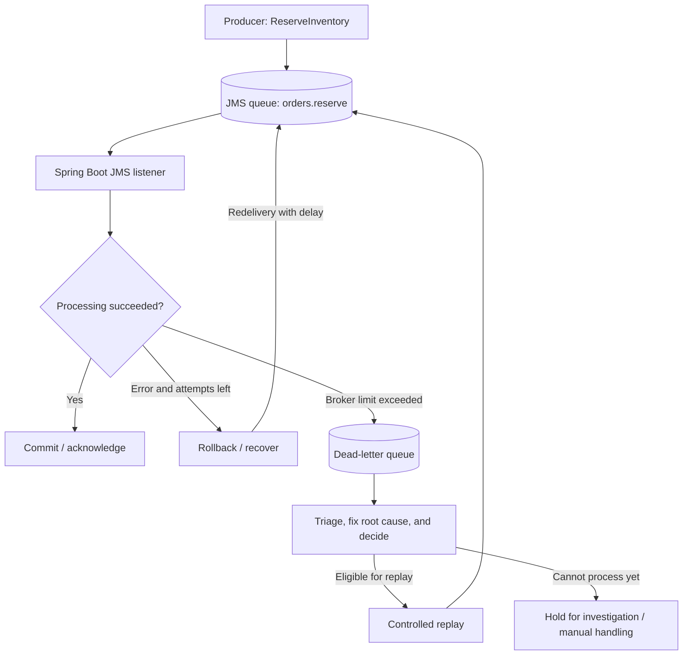

# Dead-Letter Queues and Unprocessable Messages

> **Chapter:** JMS  
> **Module:** `SPRING_BOOT_INTEGRATION` — organizing system integration in Spring Boot across HTTP clients, databases, caches, message brokers, and Spring Integration adapters. This lesson focuses on error handling, transactions, duplicate prevention, testing, and observability when a JMS message cannot be processed successfully by a consumer.

In asynchronous messaging systems, not every message succeeds on the first attempt. The database can go down briefly, an external HTTP API can return errors, incoming data can violate the contract, or a new consumer release can introduce a bug. If a consumer keeps receiving the same failing message, the queue stalls and healthy messages behind it suffer.

A **Dead-letter queue (DLQ)** holds messages that the receiving/processing pipeline cannot complete after configured conditions or redelivery limits. Instead of looping forever on a broken message, the system isolates it for investigation and recovery. A DLQ **does not fix bad data**, does not prove business side effects never happened, and does not replace idempotency design.

## 1. Learning objectives

After this lesson, you should be able to:

1. Distinguish transient errors, permanent errors, and unknown processing outcomes; decide when to retry vs. isolate.
2. Understand the relationship between JMS acknowledgment, transactions, redelivery limits, and DLQs.
3. Configure an illustrative DLQ in **ActiveMQ Artemis**, while recognizing that target names, retry policies, and metadata are broker-specific.
4. Write a Spring JMS listener where exceptions roll back the JMS transaction so the broker can redeliver.
5. Handle duplicates via database transactions and stable business event IDs during redelivery.
6. Test, measure, investigate, and replay DLQ messages safely under controlled procedures.

## 2. Where does the DLQ sit in a JMS flow?

Example: `Order Service` sends a `ReserveInventory` command to queue `orders.reserve`. A Spring Boot consumer with `@JmsListener` receives the command, updates database state, and may call an inventory HTTP service. If inventory fails to respond, the consumer needs an explicit failure policy.



**Key terms:**

- **Delivery:** one attempt by the broker to hand a message to a consumer. A message may have multiple deliveries.
- **Acknowledgment (ack):** mechanism signaling receipt/completion per active JMS mode; in a transacted session, committing the session confirms messages consumed in that transaction.
- **Rollback / recover:** returns the message to a redeliverable state depending on transaction/ack mode and broker.
- **Redelivery:** broker re-sending a message after a previous delivery was not confirmed.
- **Poison message:** a message that repeatedly causes the consumer to fail, such as malformed payload, incompatible version, or a bug unrecoverable via retries.
- **DLQ / quarantine queue:** a destination separating problematic messages from normal traffic for triage, remediation, and next steps.

**Standard boundary:** JMS specifies send/receive APIs, acknowledgments, transactions, and standard metadata; it does not standardize a universal DLQ API across brokers. DLQ names, dead-lettering triggers, retry policies, and replay interfaces come from your **JMS provider** documentation. This lesson uses ActiveMQ Artemis as an example; never assume that exact configuration applies to IBM MQ, ActiveMQ Classic, or other providers.

## 3. Classify failures before configuring retries

A policy of "retry every exception 10 times" wastes resources and delays valid messages. Classify errors by whether retrying **the same message** can change the outcome.

| Category | Examples | Handling to consider | Notes |
|---|---|---|---|
| Transient | Database timeout, HTTP `503`, brief connection pool exhaustion | Roll back so the broker redelivers with delay and finite attempts; monitor errors | Retries must be safe with respect to partial side effects. |
| Permanent data error | Malformed JSON, missing required fields, invalid ID | Isolate early or let the broker move to DLQ after a low attempt limit | Retries will not repair the payload. |
| Permanent contract/auth error | Incompatible schema, misconfigured access permissions | Route to DLQ/quarantine; fix producer, consumer, or config, then replay | Never "fix" with endless retries. |
| Business rejection needing judgment | Insufficient stock, canceled order, missing prerequisite record | Follow contract: reject definitively, wait for prerequisite, or handle manually | Out-of-stock is not always a technical error. |
| Unknown outcome | Mutating HTTP call timed out after server may have committed; DB committed before JMS ack failed | Check state by business ID / idempotency key; reconcile before retrying | Blind retries can duplicate operations. |
| Application bug | `NullPointerException`, mapper crash on a new field | Quarantine messages, log diagnostics, deploy fix before replay | Many messages may trigger the same bug. |

The guiding rule is to **classify failures by business semantics**, not solely by exception class name. For instance, an HTTP `404` from a partner API might mean "permanently nonexistent," or it might mean an event arrived ahead of entity sync. Let the contract and business state decide.

### 3.1. Questions to ask when a message fails

Before retrying, answer:

1. **Will anything change on retry?** Will the network/DB recover, or is the payload permanently broken?
2. **Could side effects have already occurred?** Did the consumer write DB rows, call HTTP, or emit another message before failing?
3. **Is there a stable ID to detect duplicates?** Such as `eventId`, `commandId`, or an idempotency key preserved across resends.
4. **Are there ordering constraints or business deadlines?** Retrying a message for hours could apply stale state after newer events.
5. **When retries run out, who owns remediation?** Operations, automated reconciliation, or an operator approving replay?

## 4. Acknowledgment and transactions determine whether redelivery occurs

In Spring JMS, failure behavior depends on the listener container configuration and JMS provider. Never assume "throwing an exception automatically moves the message to a DLQ" without knowing the ack mode, transaction setting, and broker policy.

| Consumption mode | On processing failure | Key reminders |
|---|---|---|
| JMS transacted session | Rolling back the JMS transaction enables redelivery | Fits controlled processing/confirmation; requires broker config to cap deliveries. |
| `CLIENT_ACKNOWLEDGE` | App acks or recovers per session rules | `acknowledge()` is session-scoped, not automatically single-message ack in all cases. |
| `AUTO_ACKNOWLEDGE` | Ack timing and exception behavior depend on container/provider | Never rely on exceptions for redelivery without verifying actual behavior. |
| `DUPS_OK_ACKNOWLEDGE` | May delay acks and deliver duplicates | Consumers must tolerate redelivery; unsuitable when strict confirmation is needed. |

For predictable behavior in these examples, we use **local JMS session transactions**: normal listener return commits the container; an escaping exception rolls back. The broker manages redeliveries and moves to a DLQ after the threshold. Both sides still require configuration and real-provider testing.

**Important:** a local JMS transaction coordinates only the JMS resources within that session. If the listener also writes to a database using a separate Spring JDBC/JPA transaction, the two **do not automatically form one distributed transaction**. The DB can commit while JMS rolls back due to consumer crash or ack/commit failure; the message will be redelivered. That is why DB-side idempotency remains mandatory.

## 5. Configuring a Spring Boot consumer for redelivery

Examples use Spring Boot with Spring JMS, a Jakarta Messaging (`jakarta.jms.*`) compatible provider, and ActiveMQ Artemis. In Spring Boot 3+/Spring Framework 6+, JMS imports belong to `jakarta.jms.*`. Legacy Spring releases used `javax.jms.*`; never mix both APIs in the same application.

### 5.1. Defining a transacted listener container

```java
import jakarta.jms.ConnectionFactory;
import org.springframework.context.annotation.Bean;
import org.springframework.context.annotation.Configuration;
import org.springframework.jms.annotation.EnableJms;
import org.springframework.jms.config.DefaultJmsListenerContainerFactory;

@Configuration(proxyBeanMethods = false)
@EnableJms
class JmsConsumerConfiguration {

    @Bean
    DefaultJmsListenerContainerFactory reliableJmsListenerFactory(
            ConnectionFactory connectionFactory) {
        var factory = new DefaultJmsListenerContainerFactory();
        factory.setConnectionFactory(connectionFactory);

        // One local JMS transaction per message receive/process cycle.
        factory.setSessionTransacted(true);
        factory.setConcurrency("1-4");
        return factory;
    }
}
```

`setSessionTransacted(true)` is what governs commit/rollback semantics here. `1-4` concurrency is illustrative and must be tuned against processing duration, available connections, and ordering rules. For queues with strict business ordering, parallel consumers need message grouping, state versioning, or serialization by business key.

### 5.2. Listener letting failures propagate outward

```java
import jakarta.jms.JMSException;
import jakarta.jms.TextMessage;
import org.springframework.jms.annotation.JmsListener;
import org.springframework.stereotype.Component;

@Component
class ReserveInventoryListener {
    private final InventoryCommandProcessor processor;

    ReserveInventoryListener(InventoryCommandProcessor processor) {
        this.processor = processor;
    }

    @JmsListener(
        destination = "orders.reserve",
        containerFactory = "reliableJmsListenerFactory")
    public void onMessage(TextMessage message) throws JMSException {
        String eventId = message.getStringProperty("eventId");
        if (eventId == null || eventId.isBlank()) {
            throw new IllegalArgumentException("Missing eventId");
        }

        String payload = message.getText();
        processor.process(eventId, payload);
    }
}
```

`InventoryCommandProcessor` is your application business service that validates data, enforces rules, and persists state. When it throws an exception, the listener does not mask the failure. With a transacted container, the JMS transaction rolls back and the broker can redeliver per policy. When the method returns normally, the container commits the JMS transaction, confirming receipt at the JMS layer.

**Never "handle errors" like this:**

```java
// Dangerous if the JMS session commits after the method returns.
@JmsListener(destination = "orders.reserve")
public void onMessage(String payload) {
    try {
        process(payload);
    } catch (Exception ex) {
        log.error("Failed", ex); // Logs only and returns.
    }
}
```

If a listener swallows the exception and returns normally, the container may confirm the message despite business failure, dropping it silently without reaching the DLQ. Let exceptions escape **or** implement an explicit quarantine flow with a guaranteed commit and test its transaction boundaries.

Never rely on a container `ErrorHandler` or logging callback as the sole driver of rollback/commit. Those aid observability, whereas redelivery depends on transactions/acks and the provider.

### 5.3. Producer must provide a stable business identifier

```java
import org.springframework.jms.core.JmsTemplate;
import org.springframework.stereotype.Service;

@Service
class ReserveInventoryPublisher {
    private final JmsTemplate jmsTemplate;

    ReserveInventoryPublisher(JmsTemplate jmsTemplate) {
        this.jmsTemplate = jmsTemplate;
    }

    void publish(String eventId, String correlationId, String jsonPayload) {
        jmsTemplate.convertAndSend("orders.reserve", jsonPayload, message -> {
            message.setStringProperty("eventId", eventId);
            message.setStringProperty("schemaVersion", "1");
            message.setJMSCorrelationID(correlationId);
            return message;
        });
    }
}
```

`eventId` should be generated when the event/command originates and **preserved across every retry or replay**. `JMSMessageID` is typically provider-assigned and changes when recreating a message; never use it as the unique key to deduplicate business operations. `JMSCorrelationID` links logs/traces across steps and does not have to equal `eventId`.

A producer's successful send does not guarantee the consumer completed business processing. If publishing JMS depends on committing an orders database, use an outbox or proper consistency coordination; a regular JPA transaction does not cover JMS publishing.

## 6. Configuring a Dead-Letter Queue in ActiveMQ Artemis

The JMS listener triggers rollback; the **broker** decides how many times to redeliver and where to send the message once limits expire. Below is an *illustrative* snippet for Artemis `broker.xml`, not a complete configuration file. Structure and destination names must match your deployed topology.

```xml
<addresses>
    <address name="orders.reserve">
        <anycast>
            <queue name="orders.reserve"/>
        </anycast>
    </address>
    <address name="DLQ.orders.reserve">
        <anycast>
            <queue name="DLQ.orders.reserve"/>
        </anycast>
    </address>
</addresses>

<address-settings>
    <address-setting match="orders.reserve">
        <dead-letter-address>DLQ.orders.reserve</dead-letter-address>
        <max-delivery-attempts>5</max-delivery-attempts>
        <redelivery-delay>1000</redelivery-delay>
        <redelivery-multiplier>2.0</redelivery-multiplier>
        <max-redelivery-delay>30000</max-redelivery-delay>
    </address-setting>
</address-settings>
```

Understanding the parameters per **broker policy**:

| Artemis setting | Meaning |
|---|---|
| `dead-letter-address` | Target address for messages exceeding delivery limits, here `DLQ.orders.reserve`. |
| `max-delivery-attempts` | Maximum delivery attempts before dead-lettering. `5` typically includes the initial delivery. |
| `redelivery-delay` | Base delay before redelivery, in milliseconds. |
| `redelivery-multiplier` | Backoff multiplier between attempts, when supported by provider and configuration. |
| `max-redelivery-delay` | Upper cap on redelivery delay. |

In real deployments, verify `address-setting match` rules, address/queue topology, routing types, access permissions, persistence, and HA/cluster propagation. If the DLQ address or queue does not exist and auto-create is disabled, messages may fail to route as expected. Simply naming a DLQ does not mean recovery works.

Some providers call similar concepts a `backout queue`, `poison-message policy`, or per-destination/subscription settings. The Artemis XML above **is not Spring Boot YAML** and cannot be pasted into `application.yml`.

### 6.1. Distinguishing DLQs from expiry queues

Messages with a **TTL** that expire are distinct from messages delivered repeatedly and failing processing. In Artemis, expired messages route to an `expiry-address` if configured; they do not automatically share the DLQ. The two cases need separate metrics, retention policies, and triage procedures:

- **Dead-letter:** could not complete after delivery attempts or error-routing rules.
- **Expiry:** exceeded lifetime; the business operation may no longer be valid.

If DLQ retention is too short, messages vanish before investigation. If unlimited without quotas and alerts, DLQs fill disks. Define appropriate retention, backups, and handling for sensitive data.

## 7. Preserving JMS state and metadata

When messages redeliver or land in a DLQ, retain enough metadata so investigators can **reconstruct the root cause** and decide whether replay is safe.

| Field / trace | Purpose | Notes |
|---|---|---|
| Application-assigned `eventId` or `commandId` | Business deduplication and completion lookup | Keep stable across redeliveries/replays. |
| `JMSMessageID` | Traces a single broker publish | Can change if replay builds a new message. |
| `JMSCorrelationID` | Links requests and async steps | Do not treat as an idempotency key unless specified by contract. |
| `JMSRedelivered` | Provider flag indicating redelivery | Do not infer exact attempt count from a boolean. |
| `JMSXDeliveryCount` | Tracks delivery count when exposed as expected by provider | Verify exact semantics in real broker tests; never use as a business ID. |
| `schemaVersion`, `eventType`, business timestamp | Chooses parser and checks post-replay validity | Versioning needs compatibility rules. |
| Original destination, last error, DLQ timestamp | Explains provenance and triage priority | May come from broker-specific metadata or observability stores. |

The system property recording the original address/queue on dead-lettering varies by broker, with no universal portable JMS property name. Artemis exposes internal metadata for original destination; replay tooling must match your running broker version and explicitly verify target destinations instead of guessing from DLQ names.

Avoid stuffing huge stack traces or sensitive payloads into message properties solely for DLQs. Keep compact error codes and correlation IDs on messages, storing detailed diagnostics in access-controlled logs/tracing with proper retention.

## 8. Redelivery, DB transactions, and deduplication

This is the easiest edge case to miss when a JMS consumer writes to a database:

```mermaid
sequenceDiagram
    participant B as JMS broker
    participant L as Spring JMS listener
    participant D as Orders DB
    B->>L: Deliver eventId=E1
    L->>D: BEGIN; persist business update; COMMIT
    D-->>L: Commit succeeded
    Note over L: Consumer fails before JMS commit
    L--xB: JMS session rollback / connection lost
    B->>L: Redeliver eventId=E1
    L->>D: Check processed marker for E1
    D-->>L: E1 already processed
    L-->>B: JMS commit, skip duplicate side effect
```

The DB transaction and JMS transaction can commit at different instants. Hence consumers must be idempotent even with DLQs and bounded retries.

### 8.1. Recording processed events in the same DB transaction

PostgreSQL example:

```sql
CREATE TABLE processed_messages (
    consumer_name VARCHAR(100) NOT NULL,
    event_id UUID NOT NULL,
    processed_at TIMESTAMPTZ NOT NULL DEFAULT NOW(),
    PRIMARY KEY (consumer_name, event_id)
);
```

Inside the consumer's database transaction:

```sql
INSERT INTO processed_messages (consumer_name, event_id)
VALUES (:consumer_name, :event_id)
ON CONFLICT DO NOTHING;
```

If **1** row is inserted, the consumer applies the business state update **in the same DB transaction** and commits. If **0**, the event was already processed by that consumer; skip local business updates and let the listener return to commit the JMS session. If the business step fails, the DB transaction rolls back the marker as well, letting the next redelivery retry.

Database unique constraints guard against races when two deliveries run concurrently. A "SELECT then INSERT" pattern without proper unique constraints/locking suffers race conditions.

**Limitation:** a DB marker does not protect external HTTP calls to inventory or messages published to another broker. When external side effects exist, require downstream idempotency keys, outbox tables, or reconcilable request states. A JMS broker with a DLQ cannot guarantee system-wide exactly-once execution on its own.

### 8.2. Retrying at the right boundary

Two common retry styles:

- **Broker redelivery:** listener throws, JMS transaction rolls back; broker applies delay, tracks attempts, and eventually dead-letters. This is our primary approach here.
- **In-application retry:** retries an operation within the same delivery, suitable for very brief glitches on idempotent steps. Risks holding JMS sessions/threads too long, obscuring true attempt counts, and amplifying load on dependencies.

Never stack multi-layer retries without tracking **total effective calls**. For example, 5 broker deliveries × 4 in-listener HTTP retries = up to 20 downstream calls per event, before any manual replay later.

## 9. Routing permanent errors to the DLQ immediately

Malformed messages need not wait through all 5 redeliveries. Two options, both requiring verification on your broker:

1. **Broker policy:** use provider-specific dead-letter/quarantine/redelivery settings to lower delivery limits for specific queues or failure modes. Exact config is broker-specific.
2. **Application parking:** the listener detects a permanent error, sends a copy with business metadata to a quarantine queue, and confirms the original message **within a transaction guaranteeing both steps**. Never assume "`jmsTemplate.convertAndSend(...)` succeeded then return" is atomic if the send and receive happen on separate sessions/transactions.

For application parking, if the broker supports **one transacted JMS Session** covering both receive and send on the same resource, you can send to quarantine on that session and commit: if commit fails, both receive and send roll back per provider semantics. Across disparate resources or external services, use an outbox, reconciliation, or proper transaction coordination, guarding against duplicate quarantine writes on mid-step crashes.

Also define strictly **which errors are permanent**. Completely corrupt JSON usually belongs in quarantine immediately; an inventory mismatch caused by an unsynced inventory database might need delayed redelivery. Misclassifying errors pushes recoverable messages into the DLQ prematurely.

## 10. DLQ investigation workflow

A DLQ is an **actionable work queue**, not a forget-and-archive bucket. An operational runbook should include:

1. **Detection:** alert on abnormal DLQ depth spikes, high message age, or surges in redeliveries/consumer failures.
2. **Grouping:** cluster by event type, schema version, exception class, source destination, deployment version, and time window to separate systemic bugs from isolated bad records.
3. **Side-effect verification:** check business IDs, databases, downstream HTTP, outboxes, and logs to see if any step already committed.
4. **Root-cause remediation:** fix schema/producer/consumer bugs, restore downstream capacity, fix ACLs, or backfill missing data; never purge messages merely to zero out metrics.
5. **Disposition:** replay, resolve manually, hold for investigation, or discard with audit trails per retention policy and business requirements.
6. **Post-replay verification:** confirm replayed messages reach the target business state without creating duplicates or bouncing back into the DLQ.

Restrict access to view payloads and trigger replays: DLQs often hold sensitive business data. Audit who acted, when, why, message count, and outcome.

### 10.1. Metrics to monitor

| Metric / signal | Operational meaning |
|---|---|
| Source queue and DLQ depth | Is normal processing backed up or is error handling accumulating? |
| DLQ ingress rate per minute | Did a new failure start right after a code or config change? |
| Oldest message age in DLQ | Are failed messages sitting untriaged too long? |
| Redelivery, retry, and rollback counts/reasons | Are transient errors causing a retry storm? |
| Post-replay success/duplicate/failure counts | Did remediation actually finish? |
| Consumer throughput and p95/p99 latency | Are consumers stalled on slow tasks or failing dependencies? |
| DB pool, HTTP timeouts, broker disk/memory | Which infrastructure resource is driving prolonged failures? |

Use Spring Boot Actuator, Micrometer, structured logging/tracing, and broker admin/metrics tools; exact metric names depend on integration and exporter versions. Attach `eventId`, `correlationId`, and destination to structured logs when allowed by security policy; avoid logging raw payloads.

## 11. Safe replay after fixing the root cause

Replaying an entire DLQ the instant a broker recovers can spike load and re-trigger failures. Start replay only once root cause, desired outcome, and duplicate protection are verified. Safe workflow:

| Step | Action | Why |
|---|---|---|
| Sample selection | Select by event type, time range, fixed error, and a few representative messages | Avoid pushing poorly understood data back into production. |
| State check | Cross-check event ID and business ID to see if side effects already completed | Prevent double-executing already-succeeded transactions. |
| Preserve identity | Keep `eventId`, schema version, and needed correlation context; attach replay metadata if appropriate | Enables consumer deduplication and lineage tracing. |
| Target destination | Restore to the exact original business queue per trusted metadata | Prevent routing messages to the wrong handler. |
| Rate control | Replay in small batches with rate/concurrency limits and stop conditions | Avoid retry storms, DB locks, and downstream overload. |
| Monitor | Verify business state, source queue, DLQ, and error rates after each batch | Halt immediately if failures return or data looks wrong. |
| Audit | Record operator/command, reason, counts, and success/failure totals | Maintains accountability for reconciliation and audits. |

**Atomicity note:** when replay tooling **consumes** from the DLQ and **publishes** to the target queue, prefer broker-native management APIs with clear move semantics or a single JMS transaction covering receive and send on the same session/provider. Non-atomic move scripts can drop or duplicate messages if interrupted mid-flight; build fallback and deduplication.

Some broker "retry/move messages" tools modify headers, delivery counts, TTL, message IDs, or ordering. Test them in a staging environment matching production before automating replay. For order-sensitive workflows, replaying an older message after newer ones can regress state; enforce versions/sequences or verify current state before applying.

### 11.1. Why replaying even after fixing a bug still carries risk

Suppose `ReserveInventory(eventId=E42, orderId=O100)` called an inventory API. Inventory reserved the stock successfully, yet the response timed out, causing the JMS listener to roll back repeatedly until the message hit the DLQ. After fixing the timeout bug, replaying the message **without an idempotency key** reserves stock a second time. Before replaying, query inventory by `orderId`/`eventId` or call the API with a stable idempotency key per contract.

For payments, refunds, or shipment creation commands, enforce even stricter controls: require explicit approval and transaction reconciliation before replay.

## 12. Testing against a real broker

Pure unit tests verify exception classification, not redelivery counts, JMS rollbacks, ack timing, or DLQ routing. Those require **integration tests against the real JMS provider and production-like policies**, such as Testcontainers/Artemis or a dedicated test broker.

| Scenario | How to trigger | Expectations to verify |
|---|---|---|
| Happy path | Send valid payload | Listener finishes; message leaves queue and never enters DLQ. |
| Transient failure then recovery | Processor throws twice, succeeds on attempt 3 | Redelivery occurs with reasonable delay and one final business result. |
| Poison message | Send unparseable JSON or missing `eventId` | Listener rolls back; after limit, broker moves to DLQ with key data/metadata intact. |
| Consumer restart | Stop consumer after DB commit before JMS commit (fault injection) | Redelivery may occur; idempotency marker blocks duplicate writes. |
| Broker reconnect | Drop connection mid-processing | Message is not falsely marked done; recovery obeys provider semantics. |
| Connection pool/HTTP error | Downstream times out or returns `503` | Retries stay bounded; backlogs and error metrics are observable. |
| Expiry | Send short-TTL message without consuming | Expired per `expiry-address`/policy; not confused with processing DLQ. |
| Replay after fix | Move an approved message from DLQ back to source queue | Correct result, no duplicates, replay provenance recorded. |
| Premature replay | Replay an unfixed message | Rate limits or monitoring catch recurring errors and halt the batch. |

Especially test **message conversion before the listener method runs**: a payload that breaks converter argument resolution hits the listener container's error path directly. Prove the container rolls back and the broker routes per policy in that case rather than testing only exceptions thrown inside the method body.

When testing redelivery, do not merely count handler invocations. Verify the full lifecycle: receive → error → rollback → redelivery → DLQ or commit. On brokers exposing delivery-count metadata, inspect the count directly to catch misconfigured attempt limits.

## 13. Common mistakes

**"Naming a queue DLQ makes JMS route failed messages there automatically."** A name is not enough; the broker needs routing, addresses, attempt limits, and retention policies.

**"Throwing an exception always triggers retries."** Behavior depends on the container, acknowledgment mode, transactions, and JMS provider. For critical listeners, configure transacted sessions explicitly and verify against the broker.

**"Logging and returning handles the error."** If the container acks upon normal return, the failed task is marked done and loses redelivery.

**"A message in the DLQ never touched the database."** Partial side effects may have committed before the JMS transaction failed. Always check actual state before replaying.

**"Raising `max-delivery-attempts` fixes poison messages."** Bad payloads or permanent bugs do not heal with retries; higher limits only waste time and capacity.

**"Replay always restores the exact original message."** Replay tools may assign a new `JMSMessageID`, alter metadata, or reset delivery counts. Preserve business/event IDs and verify tool behavior.

**"DLQs guarantee exactly-once."** DLQs provide isolation and recovery; idempotency, transaction boundaries, data contracts, and reconciliation handle duplicates and ambiguous outcomes.

## 14. Comprehensive hands-on exercise

Implement the `orders.reserve` flow in a Spring Boot application with JMS and a database:

1. Build a producer sending `ReserveInventory` with a stable `eventId`, `orderId`, `schemaVersion`, and `correlationId`.
2. Build a Spring JMS listener using `DefaultJmsListenerContainerFactory` with `sessionTransacted=true`. Have the listener delegate to a business service and let exceptions propagate when incomplete.
3. In Artemis, configure the source queue, DLQ, a five-attempt limit, and redelivery delay. Verify how the broker counts deliveries.
4. Create `processed_messages` keyed uniquely by consumer + `eventId`; update business state and the marker in one DB transaction.
5. Send valid messages, malformed JSON messages, and messages hitting transient DB errors. Observe the source queue, DLQ, delivery counts, and database state.
6. Simulate DB commit before JMS commit via fault injection. Verify redelivery does not duplicate updates.
7. Fix the root cause of a DLQ message, replay a small batch, and verify business state, queue counts, and audit logs.
8. Add dashboards/alerts for DLQ depth, age, broker redeliveries, consumer error rates, and pending workload.

**Acceptance criteria:** Valid messages succeed; transient failures recover within bounded attempts; unprocessable messages reach the DLQ with diagnostic identifiers; consumers stay duplicate-safe; replay runs safely without double side effects; and operational metrics reflect every state.

## 15. Self-assessment questions

**1. How many times should a malformed JSON message be retried?**  
It depends on policy and whether the error can self-heal. For clearly invalid JSON, repeated retries achieve nothing; isolate early or cap deliveries low and fix the producer.

**2. What is the difference between JMS rollback and JPA rollback?**  
JMS rollback returns the message for potential broker redelivery; JPA rollback reverts changes within that DB transaction. Two local transactions do not automatically bind into one atomic commit.

**3. Why shouldn't you deduplicate by `JMSMessageID`?**  
Because replays or republishes can assign a brand-new `JMSMessageID` while representing the exact same business event. Use stable business identifiers like `eventId`/`commandId`.

**4. How does a DLQ differ from an expiry queue?**  
A DLQ captures messages failing delivery/error policies; an expiry queue captures messages whose TTL elapsed. They have different causes, operations, and replay decisions.

**5. When is it safe to replay a message from a DLQ?**  
Once the root cause is fixed, business state has been reconciled, consumers/downstreams are idempotent, and replay is bounded, monitored, and audited.

A DLQ is most effective when treated as **part of an owned recovery workflow**—spanning broker policies and transactions through failure testing, idempotency, observability, and reconciliation. In Spring Boot JMS, the goal is not piling messages into a DLQ, but keeping valid traffic flowing while giving failing messages a clear, safe path to resolution.
