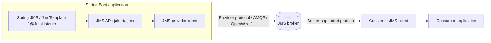
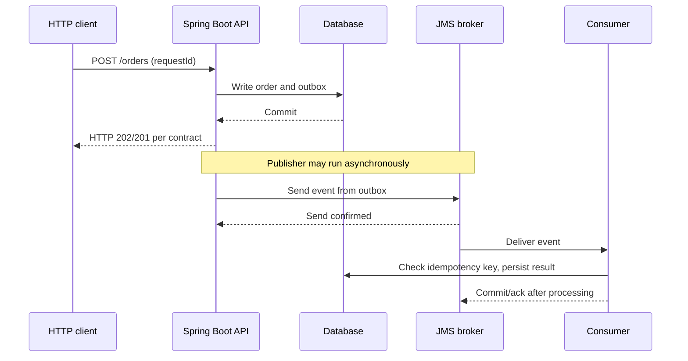

# Jakarta Client Compatibility, Broker Versions, and Underlying Libraries

In a Spring Boot application integrating over JMS, compiling cleanly and instantiating a `ConnectionFactory` are only the initial conditions. In deployment, the app must also use the right `jakarta.jms` APIs, the right JMS provider library, communicate with the broker version over a supported protocol, and preserve data contracts alongside transaction, acknowledgment, retry, and duplicate-handling behavior.

This lesson explains how to evaluate **Jakarta client compatibility, broker versions, and underlying libraries** for Spring Boot, from dependency management to real-connection testing. Emphasis is placed on practical integration flows such as HTTP → JMS → consumer → database, where a minor mismatch in client or broker can break production after deployment.

## 1. Learning objectives and practical problem

After this lesson, you will be able to:

- Distinguish the **JMS API**, **JMS provider/client**, **broker wire protocol**, and **message contract**.
- Recognize the shift from `javax.jms` to `jakarta.jms` when upgrading Spring Boot.
- Build a compatibility matrix across Spring Boot, Spring Framework, JMS driver, broker, and Java runtime.
- Use BOMs and dependency trees to spot legacy libraries, duplicate dependencies, and classpath conflicts.
- Establish JMS connectivity in Spring Boot via a Jakarta Messaging-compatible client.
- Test against a real broker: connection, send/receive, payload conversion, acknowledgments, transactions, redelivery, and dead-letter queues (DLQ).
- Plan safe client/broker upgrades for live message-processing systems.

**End-to-end scenario:** a Spring Boot service receives orders over HTTP, writes state to a database, and emits `order.placed` events over JMS. An independent consumer receives the event and calls a payment service. Even when producer and consumer run different Spring Boot versions, both must share the same message format, destination types, and JMS clients compatible with the broker.

## 2. Four compatibility layers to verify separately

The diagram shows where each piece sits:



| Layer | What to verify | Common failures |
|---|---|---|
| **Java API** | `jakarta.jms` vs. `javax.jms`; `ConnectionFactory`, `Message`, and `JMSContext` interfaces | Compile errors or `ClassCastException` when provider implements wrong namespace |
| **Provider library** | Artifact, version, supported Java, transitive dependencies, client config | `NoSuchMethodError`, `AbstractMethodError`, missing classes, conflicting drivers |
| **Protocol and broker** | Does the broker support the client's protocol/version, TLS, auth, destinations, topology? | Handshake refused, timeouts, dropped connections, or broker permission denials |
| **Message contract** | JSON/schema/version, headers, correlation ID, selectors, queue/topic, TTL, redelivery | Connects fine, yet consumer cannot parse payloads or loses messages |

JMS is a **Java programming API**, not a shared wire protocol that every JMS provider uses interchangeably. Two clients both implementing `jakarta.jms.ConnectionFactory` can speak completely different wire protocols. To switch providers, verify the broker supports the new client's protocol.

Conversely, a producer on `javax.jms` and a consumer on `jakarta.jms` **can exchange messages through the same broker** provided each uses a broker-compatible JMS client and a message contract independent of internal Java classes. Java namespaces do not travel raw over the wire; payloads and message properties are what must align.

## 3. Understanding the `javax.jms` to `jakarta.jms` transition

### 3.1. Source- and binary-level differences

Applications on Spring Boot 2.x / Spring Framework 5 typically use the `javax.jms` namespace. From Spring Boot 3.x / Spring Framework 6 onward, Spring JMS uses `jakarta.jms` to align with Jakarta EE.

This is a **package and Java type change**, not merely cosmetic import edits. The two interfaces are completely separate types:

```java
// Legacy application line (Spring Boot 2.x):
import javax.jms.ConnectionFactory;
import javax.jms.Message;

// Modern application line (Spring Boot 3.x):
import jakarta.jms.ConnectionFactory;
import jakarta.jms.Message;
```

A factory implementing `javax.jms.ConnectionFactory` cannot satisfy an injection point requiring `jakarta.jms.ConnectionFactory`. Dropping `jakarta.jms-api` onto the classpath does not turn a `javax.jms`-only provider library into a Jakarta provider.

Beyond direct Java code, audit:

- Spring JMS and integration/adapter libraries invoking `JmsTemplate`, `DefaultMessageListenerContainer`, or `@JmsListener`.
- Configuration beans for `ConnectionFactory`, `MessageConverter`, `DestinationResolver`, transaction managers, and pooling wrappers.
- Any third-party library with method signatures referencing `javax.jms.Message`/`Session`.
- Serializers/transformers or handlers inspecting JMS headers and converting message bodies.
- Custom listeners, exception handlers, or interceptors referencing legacy-package exceptions.

### 3.2. Jakarta Messaging 3.x and broker versions are not the same thing

Jakarta Messaging 3.x uses `jakarta.jms`, while older JMS APIs used `javax.jms`. Even when a vendor advertises "Jakarta Messaging 3.0/3.1," that describes **API/client compliance**, not that the broker server must share a `3.x` version number or change its wire protocol accordingly.

For example, a new Jakarta client can connect to an older broker **if** the vendor documents or verifies wire-protocol compatibility. Never assume "an older broker cannot use Jakarta" or "matching version numbers guarantee compatibility."

### 3.3. Namespace transition matrix

| Application | Selected provider client | Assessment |
|---|---|---|
| Spring Boot 2.x using `javax` Spring JMS | Compatible `javax.jms`-only client | Right choice for legacy apps |
| Spring Boot 3.x using `jakarta` Spring JMS | `jakarta.jms`-compatible client and matching library set | Right choice for modern apps |
| Spring Boot 3.x | Legacy client implementing only `javax.jms.ConnectionFactory` | **Incompatible at the Java API layer** |
| Spring Boot 2.x | Client implementing only `jakarta.jms.ConnectionFactory` | **Incompatible at the Java API layer** |
| Legacy `javax` producer + modern `jakarta` consumer | Each side uses its own broker-compatible client | Can interoperate if wire protocol and message contract align |
| Newer Spring Boot releases | Client and Spring JMS confirmed by BOM, vendor, and project | Must check exact release compatibility guides |

Never run bulk namespace search-and-replace across a codebase without checking versions of Spring Integration, dependent adapters, and providers. For Spring Boot 4.x or newer majors, verify that release's BOM and official documentation rather than assuming 100% of Boot 3.x configs carry over unchanged.

## 4. Distinguishing broker types and selecting a JMS client

JMS does not require all broker products to share one wire protocol. Common examples:

| Ecosystem | What to check when picking a client | Risk if conflated |
|---|---|---|
| **Apache ActiveMQ Artemis** | Has multiple client/API variants and broker protocols; choose the `jakarta.jms` artifact published for your broker version | Picking legacy `javax`-only client or a protocol disabled on the broker listener |
| **ActiveMQ Classic** | Has historic `javax` clients and separate Jakarta lines; verify exact artifact, major version, and OpenWire compatibility | Treating Classic and Artemis as interchangeable providers during upgrades |
| **IBM MQ** | Select the IBM MQ Jakarta client matching your Spring and Java versions, plus matching MQ server channels/TLS | Using outdated MQ JARs, wrong namespace, or missing native/provider dependencies |
| **AMQP 1.0 JMS clients**, e.g. Qpid JMS | Client must support the app's JMS API; broker must enable AMQP 1.0 and needed features | Assuming any "JMS-capable" broker accepts AMQP 1.0 connections |
| **Third-party JMS-compatible broker services** | Read vendor feature/limit tables: transactions, selectors, durability, redelivery, DLQs | Connection succeeds, yet required features are unsupported or behave differently |

**Note on Artemis artifacts:** across Artemis release lines, artifacts include variants like `artemis-jms-client` and `artemis-jakarta-client`. Verify exact artifact names, API level, and transitive dependencies for your version; "JMS client" in a name does not reveal the namespace. Likewise with ActiveMQ Classic, never swap `activemq-client` and Jakarta variants without checking the compatibility matrix.

Brokers can expose multiple protocols across different acceptors/listeners, yet transport-level support does not ensure identical JMS semantics. Verify queues/topics, durable subscriptions, selectors, priority, expiry, transactions, redelivery, and DLQs explicitly.

## 5. Managing dependencies via BOM and avoiding conflicts

Libraries in a Spring Boot JMS integration typically include:

- Spring Boot and Spring Framework: auto-configuration, `spring-jms`, lifecycles, transaction management.
- JMS API `jakarta.jms-api`: interfaces and exceptions.
- **JMS provider client:** `ConnectionFactory` implementation, protocol codecs, connection/session handling.
- JSON serializers, `MessageConverter`, validation, or shared data-contract libraries.
- Pooling if used: `CachingConnectionFactory`, provider pools, or JCA connection management depending on architecture.

In a Gradle project on Spring Boot 3.x with ActiveMQ Artemis, typical declarations look like:

```groovy
dependencies {
    implementation 'org.springframework.boot:spring-boot-starter-artemis'
    implementation 'org.springframework.boot:spring-boot-starter-json'

    testImplementation 'org.springframework.boot:spring-boot-starter-test'
}
```

This follows the **Spring Boot 3.x** ecosystem; actual starter versions and artifact sets are governed by your project's BOM. If `spring-boot-starter-web` is already present, JSON libraries are usually pulled in transitively, making the extra JSON starter optional. When using another broker vendor, swap in that vendor's starter/client rather than keeping Artemis just to mirror the example.

**Never add both** `javax.jms-api`, `jakarta.jms-api`, and multiple client variants hoping the runtime picks the right one. Both namespaces can coexist validly on a classpath, yet Spring can only inject the factory type it expects, and competing providers risk class collisions or conflicting auto-configurations.

### 5.1. Inspecting dependency trees

Useful Gradle commands for investigation (not needed on every test run):

```bash
./gradlew dependencies --configuration runtimeClasspath

./gradlew dependencyInsight --dependency jakarta.jms-api --configuration runtimeClasspath
./gradlew dependencyInsight --dependency javax.jms-api --configuration runtimeClasspath
./gradlew dependencyInsight --dependency artemis --configuration runtimeClasspath
./gradlew dependencyInsight --dependency spring-jms --configuration runtimeClasspath
```

With Maven:

```bash
mvn dependency:tree
mvn dependency:tree -Dincludes=jakarta.jms:jakarta.jms-api
```

Always inspect the **runtime classpath**, not just compile classpath. A transitive library brought in at runtime can trigger `NoSuchMethodError` even when the IDE compiles cleanly.

Cross-check:

1. Which Spring Boot version and BOM govern `spring-jms`?
2. How many JMS provider clients and `javax`/`jakarta` variants sit on `runtimeClasspath`?
3. Does the client actually support your Java runtime, broker version, and target protocol?
4. Were drivers, commons, Netty, logging, or JSON libraries forced onto mismatched versions?
5. Does an older adapter/framework dependency pull in `javax.jms-api` or a legacy provider client?

When overriding a BOM version for a security advisory or vendor requirement, bump only verified compatible artifacts, re-check the dependency tree, and re-run integration tests. Never exclude a transitive library blindly just because its name looks unused: some providers require companion modules at runtime.

## 6. Spring Boot 3.x example connecting to ActiveMQ Artemis via Jakarta JMS

The example below targets a pre-configured Artemis broker accepting JMS connections. All JMS Java imports belong to `jakarta.jms`.

### 6.1. Connection configuration

```yaml
spring:
  artemis:
    mode: native
    broker-url: tcp://localhost:61616

app:
  messaging:
    orders-queue: orders.events
```

In production, supply the broker URI, username, and password via externalized config or a secret manager—never hardcode them in source. `native` mode connects to an out-of-process broker. Ports, protocols, acceptors, queue/topic names, and producer/consumer ACLs must match the broker's configuration.

### 6.2. Defining a message contract and JSON converter

To let producers and consumers evolve independently, use JSON and versioned message type identifiers instead of default Java serialization.

```java
package example.jms;

import java.time.Instant;

public record OrderPlaced(
        String eventId,
        String orderId,
        Instant occurredAt
) {}
```

Configuring the converter and listener container:

```java
package example.jms;

import com.fasterxml.jackson.databind.ObjectMapper;
import jakarta.jms.ConnectionFactory;
import java.util.Map;
import org.springframework.context.annotation.Bean;
import org.springframework.context.annotation.Configuration;
import org.springframework.jms.annotation.EnableJms;
import org.springframework.jms.config.DefaultJmsListenerContainerFactory;
import org.springframework.jms.support.converter.MappingJackson2MessageConverter;
import org.springframework.jms.support.converter.MessageConverter;
import org.springframework.jms.support.converter.MessageType;

@Configuration
@EnableJms
class MessagingConfiguration {

    @Bean
    MessageConverter jmsMessageConverter(ObjectMapper mapper) {
        MappingJackson2MessageConverter converter =
                new MappingJackson2MessageConverter();
        converter.setObjectMapper(mapper);
        converter.setTargetType(MessageType.TEXT);
        converter.setTypeIdPropertyName("_type");
        converter.setTypeIdMappings(Map.of(
                "order.placed.v1", OrderPlaced.class
        ));
        return converter;
    }

    @Bean
    DefaultJmsListenerContainerFactory jmsListenerContainerFactory(
            ConnectionFactory connectionFactory,
            MessageConverter jmsMessageConverter) {

        DefaultJmsListenerContainerFactory factory =
                new DefaultJmsListenerContainerFactory();
        factory.setConnectionFactory(connectionFactory);
        factory.setMessageConverter(jmsMessageConverter);
        factory.setSessionTransacted(true);
        factory.setConcurrency("1-3");
        return factory;
    }
}
```

`@EnableJms` activates `@JmsListener` detection. `setSessionTransacted(true)` runs message processing inside a JMS session transaction so listener errors can trigger rollback and redelivery per broker configuration. **It does not create a distributed transaction** across JMS and MongoDB, PostgreSQL, or HTTP.

Note: `MappingJackson2MessageConverter` matches the Jackson/Spring Framework generation of Spring Boot 3.x. When moving to another Spring Boot/Spring Framework generation, verify the supported JSON converter and dependencies for that release.

### 6.3. Sending and receiving messages

```java
package example.jms;

import java.time.Instant;
import java.util.UUID;
import org.springframework.jms.core.JmsTemplate;
import org.springframework.jms.annotation.JmsListener;
import org.springframework.stereotype.Component;

@Component
class OrderEventPublisher {

    private final JmsTemplate jmsTemplate;

    OrderEventPublisher(JmsTemplate jmsTemplate) {
        this.jmsTemplate = jmsTemplate;
    }

    void publish(String orderId) {
        OrderPlaced event = new OrderPlaced(
                UUID.randomUUID().toString(),
                orderId,
                Instant.now()
        );
        jmsTemplate.convertAndSend("orders.events", event, message -> {
            message.setJMSCorrelationID(event.eventId());
            message.setStringProperty("eventType", "order.placed");
            message.setIntProperty("schemaVersion", 1);
            return message;
        });
    }
}

@Component
class OrderEventConsumer {

    @JmsListener(
            destination = "orders.events",
            containerFactory = "jmsListenerContainerFactory"
    )
    void consume(OrderPlaced event) {
        // Check idempotency with event.eventId() before side effects.
        // Return normally only after processing succeeds.
    }
}
```

When Spring Boot auto-configures `JmsTemplate` and picks up the declared `MessageConverter` bean, the publisher sends a JSON text body with `_type=order.placed.v1` so the consumer maps back to `OrderPlaced`. This is an **agreement between the two apps**, not a mandatory JMS convention. If a consumer runs on another platform without Spring/Jackson, publish the JSON schema, header semantics, and version rules so it can parse directly.

Two easily overlooked details:

- `@JmsListener` consumes with destination semantics governed by the broker. If two consumers read a **queue**, each message normally goes to one consumer; on a **topic**, subscriptions determine who receives it. Never pick queue vs. topic solely by destination string name.
- `JMSCorrelationID` links steps in a flow; it does not deduplicate automatically. Idempotency requires a stable key and constraint at the consumer's state store.

## 7. Compatibility testing: test with a real broker

An app booting without errors does not prove all four compatibility layers work. Run integration tests against **the exact target broker type and version**, via Testcontainers or a CI-managed test broker.

### 7.1. Minimum smoke test

A smoke test should verify end to end:

1. Start the broker with the target image/version and wait for its acceptor to be ready.
2. Boot the app using test-supplied URI and credentials.
3. Instantiate the provider's `jakarta.jms.ConnectionFactory` bean and open a connection.
4. Send a JSON `TextMessage` carrying `eventId`, `schemaVersion`, and `JMSCorrelationID`.
5. Receive the message via listener and assert payload, headers, and destination.
6. Verify timeouts and clean connection release when the broker stops or the test ends.

You can use `JmsTemplate.receiveSelected` or a dedicated consumer for request/reply checks, always configuring finite receive timeouts and assertion deadlines rather than hanging forever.

### 7.2. Change-based test matrix

| Planned change | Mandatory test cases | What to observe |
|---|---|---|
| Upgrade Spring Boot/Spring JMS | Boot context with `jakarta.jms` factory, JSON converter, listener | Zero injection, classloader, or method-signature errors |
| Swap JMS provider artifact | Connect/send/receive against current broker | Handshake, protocol, selectors, message mapping |
| Upgrade broker version | Old/new producers and consumers against upgraded broker | Compatibility of protocol, destinations, TLS, auth, and transactions |
| Switch queue ↔ topic | Multiple consumers receiving under expected semantics | Unintended load-sharing vs. broadcasting |
| Change payload or converter | Older consumer handles new schema per version policy | Message types, optional fields, numeric precision, timestamps |
| Enable transacted listeners | Handler errors roll back/redeliver | Delivery counts, retry policies, DLQ |
| Enable connection pooling/caching | Concurrent producers/consumers + restarts | Session reuse, listener recovery, stale connections |
| Enable TLS/authz | Production-like certificates and permissions | Handshake, truststores, send/consume ACLs |

Never test only `JmsTemplate.convertAndSend()` with mocks. Mocks verify API calls; only a real broker verifies wire protocols, destinations, transactions, and redelivery rules.

## 8. JMS features that often differ by provider/broker

### 8.1. Queues, topics, and durable subscriptions

JMS defines queues, topics, consumers, and subscriptions, while brokers map destinations differently. Moving from ActiveMQ Classic to Artemis, or onto an AMQP-backed provider, check:

- Are destinations auto-created or must they be pre-provisioned?
- How do addresses and routing types map to queues vs. topics?
- Do durable subscriptions require client IDs and subscription names?
- Are shared subscriptions supported, and with what limits?
- Do selectors filter headers/properties accurately on the broker?

A successful producer send does not prove consumers are subscribed properly. On some brokers, messages can land on an unintended address or be dropped if no durable subscription was registered first.

### 8.2. Acks, transactions, redelivery, and DLQs

JMS listeners support multiple acknowledgment and transaction strategies. In Spring JMS, `DefaultMessageListenerContainer` can use JMS session transactions or integrate with a transaction manager depending on config. Test **actual provider outcomes**, specifically:

- When a listener throws an exception, is the message redelivered?
- Who governs redelivery count, delay, and backoff?
- Once limits are exceeded, which DLQ receives the message and with what metadata?
- If a consumer commits its database and fails before JMS ack, are duplicate side effects prevented?
- If a session disconnects during commit, how do producer and consumer determine the outcome?

**At-least-once delivery** is the safe design baseline whenever redelivery is possible: consumers must deduplicate at the business write boundary. Never assume `sessionTransacted=true` gives exactly-once processing across broker and database.

### 8.3. Message headers and wire-level portability

Separate standard JMS fields from application message properties:

| Component | Role | What to verify during integration |
|---|---|---|
| `JMSMessageID` | Provider-assigned message ID | Do not use in place of a stable business event ID |
| `JMSCorrelationID` | Links message to a request or flow step | Agree on format and length limits |
| `JMSReplyTo` | Reply destination in request/reply | Broker routing for reply queue/topic and access permissions |
| `JMSDeliveryMode` | Persistent or non-persistent per provider | Actual durability across restarts/failovers |
| `JMSExpiration` and TTL | Message expiration time | Broker expiry, delay, and dead-letter policies |
| `JMSType` and custom properties | Classification, selectors, schema version | Property names, data types, converters, and case sensitivity |
| `JMSXDeliveryCount` | Delivery count when reported by provider | Never assume identical numbering/exposure across all brokers |

Avoid sending Java-serialized objects across application versions unless strictly required and tightly locked down. `ObjectMessage` couples to Java classes and deserialization, complicating schema evolution and widening security exposure on untrusted inputs. Schema-governed JSON/Avro/Protobuf fits cross-service integration far better.

## 9. Consistency across HTTP, databases, and brokers

A common integration flow:



Even when Spring Boot and the broker are 100% compatible at the API layer, failures happen across transaction boundaries:

- DB commits, JMS publish fails → order exists with no event.
- Broker accepts event, app crashes before marking outbox sent → event gets published again.
- Consumer commits DB then disconnects before ack → message redelivered.
- Newer client deserializes fine yet misinterprets `schemaVersion` → wrong business behavior.

A common solution is a **transactional outbox** storing business state and outbound records in one DB transaction, paired with idempotent consumers. A local JMS transaction never covers databases, HTTP, or caches. If true distributed transactions are required, evaluate XA/JTA, provider support, recovery, and operational cost separately—never flip it on as a default just to handle retries.

## 10. Symptoms of version conflicts and how to resolve them

| Symptom | Likely cause to check | Resolution |
|---|---|---|
| `ClassNotFoundException: javax.jms.*` | Legacy library referencing old JMS namespace | Identify owning dependency and switch to a Jakarta variant or upgrade |
| `ClassNotFoundException: jakarta.jms.*` | Missing Jakarta JMS API on runtime classpath | Include the right starter/provider client in BOM; verify packaging |
| `ClassCastException` between `ConnectionFactory` types | Provider implements `javax.jms`, Spring expects `jakarta.jms` | Use the right Jakarta client; never force casts |
| `NoSuchMethodError` or `AbstractMethodError` | API/provider version skew or shadowed class from another JAR | Inspect `dependencyInsight` and explicitly exclude conflicting dependencies |
| App boots yet fails to connect | Wrong URL, acceptor/protocol, TLS, credentials, or Java compatibility | Check URI, broker logs, and actual wire protocol |
| Send succeeds, consumer receives nothing | Different queue/topic, routing type, selector, durable subscription, or ACL | Trace true destination and consumer setup |
| `MessageConversionException` | JSON schema, type header, converter, or Java type mismatch | Standardize message contract; test backward/forward compatibility |
| Message processed twice | Redelivery, ack after side effects, connection timeout, or outbox republish | Consumer idempotency, transaction/ack checks, DLQ |
| Tests pass yet production fails | Embedded/mock tests, different broker version/topology, or send-only tests | Run integration tests matching broker/version/TLS/auth and features |

When debugging, start with the **full stack trace + dependency tree + broker handshake logs**. Resist blindly adding API JARs upon seeing "class not found": you may simply be masking a `javax` vs. `jakarta` clash instead of installing the right provider.

## 11. Planning a safe client or broker upgrade

### Step 1: Record the baseline

Document everything currently running:

- Java runtime, Spring Boot, Spring Framework/Spring JMS.
- Artifacts and versions for **JMS API**, provider client, pooling adapter, and serialization.
- Broker name, broker version, wire protocol, acceptor/TLS/auth configuration.
- List of destinations, subscriptions, DLQs, TTLs, selectors, and redelivery policies.
- Message contracts, schema versions, consumer groups, and error/duplicate rates.

### Step 2: Build a test matrix of combinations

Test relevant combinations:

| Old consumer | New producer | Broker | Goal |
|---|---|---|---|
| Current `javax.jms` client | Target `jakarta.jms` client | Current broker | Verify zero-downtime per-service rollout |
| Current consumer | New producer | New broker version | Verify whether broker upgrades before or after apps |
| New consumer | Current producer | Target broker | Verify payload backward compatibility |
| New producer & consumer | Target TLS/ACL config | Target broker | Test production-like security parameters |

Not every combination is supported by vendors; drop unsupported upgrade paths from the plan rather than relying on a single lucky connection test.

### Step 3: Validate with integration tests and canary deploys

Run real-broker tests covering send/receive, durable subscriptions, selectors, JSON schemas, transaction rollbacks, redelivery, DLQs, failover/reconnects, and mixed-version compatibility. In production, roll out a small canary and watch send/receive latencies, connection errors, queue depths, DLQs, and duplicate counts.

For rollback readiness, check whether the newer broker persists formats or state unreadable by older clients. Define the exact upgrade/rollback order across **broker, provider client, producer, and consumer** before starting.

### Step 4: Configuration and operational hygiene

- Pin versions and BOM update rules; track Spring and vendor security advisories.
- Externalize URLs, credentials, client IDs, destinations, and TLS config; keep secrets out of source control.
- Monitor broker connection health, session/consumer counts, queue depth, DLQs, throughput, latency, and redeliveries.
- Alert on sustained backlog growth, expired messages, disconnected consumers, and abnormal retry spikes.
- Support transition windows with versioned message contracts whenever changing converters or schemas.
- Never log tokens, passwords, sensitive raw payloads, or connection strings containing credentials.

## 12. Pre-release compatibility checklist

- [ ] Application uses `jakarta.jms` or `javax.jms` matching its Spring Boot/Spring JMS version.
- [ ] Provider client is on `runtimeClasspath` with a verified compatible artifact and version.
- [ ] No JAR conflicts across JMS API, provider, pooling adapters, and Spring dependencies.
- [ ] Java runtime version meets Spring Boot and provider client requirements.
- [ ] Broker supports the **exact wire protocol**, security settings, destinations, and client version.
- [ ] Integration tests run against a real broker of the matching family and version.
- [ ] Producer and consumer agree on message format, schema versions, headers, and idempotency keys.
- [ ] Queues/topics, selectors, durable subscriptions, and request/reply are tested if used.
- [ ] Acks, transactions, redelivery, DLQs, and timeouts/reconnects are tested.
- [ ] HTTP–database–JMS flows have a clear consistency strategy when any system fails.
- [ ] Mixed old/new client combinations are tested with a documented rollback plan.
- [ ] Logging/metrics distinguish API, dependency, broker, and message-contract failures.

**Key takeaway:** "Jakarta JMS support" solves only one compatibility layer. In Spring Boot integration, verify **Java API, provider client, wire protocol/broker, and message processing contract** together. A resilient system keeps operating accurately even when messages redeliver, networks drop, schemas evolve, or producers and consumers upgrade on independent schedules.
