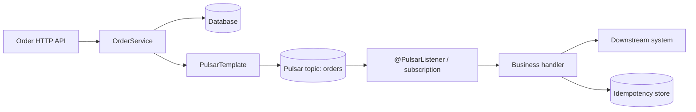
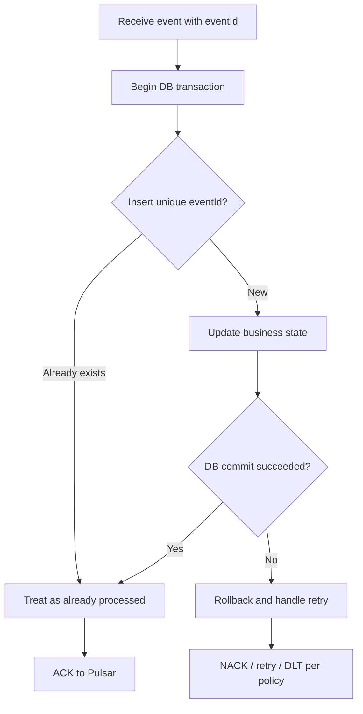

# Integrating Spring for Apache Pulsar Using the Boot-Compatible Starter

> **Chapter:** Apache Pulsar  
> **Module:** SPRING_BOOT_INTEGRATION — system integration in Spring Boot via HTTP clients, databases, caches, message brokers, and adapters; focusing on configuration, data contracts, transactions, errors, deduplication, testing, and observability.

## 1. Objectives and Context

Apache Pulsar is a messaging and event streaming platform built on a publish/subscribe model. A Spring Boot service can publish an `OrderCreated` event to a topic, and one or more other applications register a *subscription* to process it asynchronously. **Spring for Apache Pulsar** provides the Spring integration layer: `PulsarTemplate`, `@PulsarListener`, factories, schema support, transaction support, and client/consumer/producer customization. **Spring Boot** provides starters and auto-configuration to reduce boilerplate setup code.

After this lesson, you will be able to:

- Choose the Spring for Apache Pulsar dependency and version corresponding to the Spring Boot line in use.
- Distinguish between the imperative starter, reactive starter, and Apache Pulsar Java client.
- Configure broker/admin connections, and send and receive messages with `PulsarTemplate` and `@PulsarListener`.
- Understand bean initialization conditions, schemas, subscriptions, acknowledgments, redelivery, dead-lettering, transactions, and duplicate-prevention guarantees.
- Build a testing and observability strategy for a real integration flow.

Basic flow:



The diagram only illustrates the components: **writing to the DB and publishing to Pulsar do not automatically become an atomic transaction**. For high-reliability requirements, consider a transactional outbox or a purposefully designed consistency mechanism.

## 2. Choosing the Starter by Spring Boot Version

The most important point is to **choose the matching version line**, rather than arbitrarily adding the latest Spring Pulsar version to an older Boot version. The Spring Pulsar documentation publishes the following matrix (referencing supported lines, not a requirement to lock every patch release):

| Spring Boot | Spring for Apache Pulsar | Pulsar Java client in compatibility matrix | Java |
| --- | --- | --- | --- |
| 3.2.x | 1.0.x | 3.0.x or 3.1.x | 17+ |
| 3.3.x | 1.1.x | 3.2.x | 17+ |
| 3.4.x / 3.5.x | 1.2.x | 3.3.x; supports 4.0.x per official notes | 17+ |
| 4.0.x | 2.0.x | 3.3.x, 4.0.x, or 4.1.x | 17+ |

Matrix source: [Spring Pulsar — Version Compatibility](https://docs.spring.io/spring-pulsar/reference/appendix/version-compatibility.html). **Do not assume** this table applies unchanged to newer Boot lines; check the BOM and version-specific documentation when upgrading. Java client compatibility also does not mean every older broker version has been tested and supported: check compatibility separately between the client, broker, and features you need.

### 2.1. Dependency Selection

| Mode | Artifact to declare in a Boot application | API used |
| --- | --- | --- |
| Imperative / synchronous | `org.springframework.boot:spring-boot-starter-pulsar` | `PulsarTemplate<T>`, `@PulsarListener` |
| Reactive | `org.springframework.boot:spring-boot-starter-pulsar-reactive` | `ReactivePulsarTemplate<T>`, `@ReactivePulsarListener` |
| Direct Java client usage | `org.apache.pulsar:pulsar-client` | `PulsarClient`, `Producer`, `Consumer` |

For most Spring Boot applications using standard listeners, start with the **imperative** starter. Only choose reactive when the entire processing model, load profile, and pipeline truly fit reactive programming. If using the Java client directly, the application must manage additional details that the starter normally provides (factories, configuration, lifecycle, and listeners).

Gradle example for **Spring Boot 3.5.x**, with the Boot plugin and BOM/dependency management configured in the build:

```groovy
dependencies {
    implementation 'org.springframework.boot:spring-boot-starter-pulsar'
    testImplementation 'org.springframework.boot:spring-boot-starter-test'
}
```

Maven equivalent:

```xml
<dependency>
    <groupId>org.springframework.boot</groupId>
    <artifactId>spring-boot-starter-pulsar</artifactId>
</dependency>
```

If you are actively building reactive flows, replace the dependency with `spring-boot-starter-pulsar-reactive`; there is no need to add both just because the application already includes Spring WebFlux.

**Proper version management:**

1. Identify the actual Spring Boot version in the build.
2. Let the BOM of **that exact Boot version** manage `spring-pulsar` and the Pulsar client.
3. Do not pin a separate version for `spring-boot-starter-pulsar` unless there is a clear reason and compatibility has been verified.
4. Only override `spring-pulsar.version` or `pulsar.version` when there is a supported requirement, after verifying the dependency tree and re-running integration tests. Override instructions are provided in [Spring Pulsar — Override Spring Boot Dependencies](https://docs.spring.io/spring-pulsar/reference/appendix/override-boot-dependencies.html).

For example, **do not** arbitrarily pick `spring-pulsar:2.0.x` for Boot 3.2 just because it is newer: they belong to different compatibility lines.

## 3. What Does Auto-Configuration Initialize?

When `org.springframework.pulsar:spring-pulsar` is on the classpath, Spring Boot can auto-configure the imperative components:

| Component | Role | What to check if the bean is missing |
| --- | --- | --- |
| `PulsarClient` | Client connecting to the broker using the Pulsar protocol | Starter/classpath, service URL, TLS/auth |
| `PulsarTemplate<T>` | Sends messages; backed by a producer factory | Starter, auto-configuration, custom beans |
| `PulsarProducerFactory` | Creates and caches producers | Producer properties and producer cache |
| `PulsarListenerContainerFactory` and consumer factory | Creates consumers for `@PulsarListener` | Classpath conditions, consumer/listener config, subscription |
| `PulsarAdministration` | Topic administration operations via the HTTP admin endpoint | Admin URL, admin permissions |

When the reactive dependency is present, Boot can auto-configure `ReactivePulsarClient`, `ReactivePulsarTemplate`, and the corresponding reactive listener components. The reactive client uses the underlying broker configuration from the Pulsar client.

Spring Boot creates these beans based on **classpath, properties, existing bean types, and auto-configuration conditions**. If the user has already defined a custom bean, the default configuration may *back off*. Check the *Conditions Evaluation Report* if a bean is missing, rather than assuming that adding the starter always creates every object.

**Having a bean does not mean the connection is ready:** the broker may be unreachable, the broker may return an authentication error, the topic may not exist yet, or the listener may fail to register the subscription. Some failures only surface when initializing a producer/consumer or when processing a message.

## 4. Broker Connection and Administration Address

### 4.1. Two URLs with Different Protocols

```yaml
# application.yml — example configuration for Spring Boot 3.5.x
spring:
  pulsar:
    client:
      service-url: ${PULSAR_BROKER_URL:pulsar://localhost:6650}
    admin:
      service-url: ${PULSAR_ADMIN_URL:http://localhost:8080}
```

- `spring.pulsar.client.service-url` uses the **Pulsar binary** protocol, e.g., `pulsar://broker:6650`; when TLS is enabled, `pulsar+ssl://...` can be used if the broker is configured accordingly.
- `spring.pulsar.admin.service-url` uses **HTTP/HTTPS** to call the administration API, typically port 8080 in a standalone environment.
- `localhost` refers to the machine/network namespace of the **application process**. When the application runs inside a container, that is usually the container itself, not a broker on the host machine. Use routable hostnames/DNS between services.
- The admin section may not be needed directly in every application, but it must be configured properly when using auto-created topics or administration tasks.

Do not confuse `http://localhost:8080` with the broker URL, and do not put `pulsar://...` into the admin property.

### 4.2. Authentication, TLS, and Secrets

In production environments, the broker may require an authentication plugin such as token or OAuth2. Spring Boot supports `spring.pulsar.client.authentication.plugin-class-name` and the `spring.pulsar.client.authentication.param.*` parameter map. Specific parameters depend on the plugin in use, so you must consult your Pulsar cluster's authentication documentation.

OAuth2 configuration example per the Spring Boot documentation:

```yaml
spring:
  pulsar:
    client:
      authentication:
        plugin-class-name: org.apache.pulsar.client.impl.auth.oauth2.AuthenticationOAuth2
        param:
          issuerUrl: ${PULSAR_ISSUER_URL}
          privateKey: ${PULSAR_PRIVATE_KEY_URI}
          audience: ${PULSAR_AUDIENCE}
```

For the `authentication.param.*` map, keys must use the **exact casing required by the plugin**, such as `issuerUrl` and `privateKey`. This map does not use the same relaxed binding mechanism as regular Spring Boot properties; changing it to `issuer-url` can prevent the plugin from receiving the parameter. If HTTP admin also requires authentication, configure it separately under `spring.pulsar.admin.authentication`.

Never store real tokens, private keys, or passwords in the repository. TLS requires properly configuring the broker, trust/certificates, and client; simply changing the URL scheme does not make the connection secure if the rest is misconfigured.

### 4.3. Topic Naming

A fully qualified Pulsar topic name has the form:

```text
persistent://public/default/orders-created
```

Here `persistent` describes the topic type, `public` is the tenant, `default` is the namespace, and `orders-created` is the local name. Short topic names like `orders-created` work in some cases, but omitting the tenant/namespace makes you dependent on default configuration.

In strictly controlled environments, provision tenants, namespaces, topics, partitions, and access permissions using provisioning/Infrastructure as Code tools. Do not unconditionally rely on broker auto-topic creation. With a `PulsarTopic` bean, Spring Boot has a mechanism to create topics at startup when the admin service and permissions are appropriate; that is **infrastructure administration**, which is different from sending a message.

## 5. Sending and Receiving Messages with the Imperative Starter

The consistent examples below assume a **Spring Boot 3.5.x**, Java 17+ application using `spring-boot-starter-pulsar` with an available broker. To focus on connectivity, the initial payload is `String`.

### 5.1. Producer: `PulsarTemplate`

```java
import org.springframework.pulsar.core.PulsarTemplate;
import org.springframework.stereotype.Service;

@Service
public class OrderEventPublisher {
    private static final String TOPIC =
            "persistent://public/default/orders-created";

    private final PulsarTemplate<String> template;

    public OrderEventPublisher(PulsarTemplate<String> template) {
        this.template = template;
    }

    public void publish(String orderId) {
        template.send(TOPIC, orderId);
    }
}
```

`PulsarTemplate.send(topic, payload)` is a **synchronous** call: a successful send result means the broker has accepted/stored the message according to the configured send semantics; **it does not mean the consumer has successfully processed the business logic**. The `sendAsync` API enables asynchronous sending via `CompletableFuture`, and failure results must be handled in a callback or in the calling pipeline.

In most systems, an event should include `eventId`, `occurredAt`, `orderId`, a schema version, and appropriate attributes for tracing. Using `String` in this example only serves to highlight configuration and bean registration.

### 5.2. Consumer: `@PulsarListener`

```java
import org.apache.pulsar.client.api.SubscriptionType;
import org.springframework.pulsar.annotation.PulsarListener;
import org.springframework.stereotype.Component;

@Component
public class OrderEventListener {

    @PulsarListener(
            topics = "persistent://public/default/orders-created",
            subscriptionName = "shipping-service",
            subscriptionType = SubscriptionType.Shared)
    public void onMessage(String orderId) {
        // Replace with idempotent logic, timeouts, and explicit error handling.
        System.out.println("Received order " + orderId);
    }
}
```

`subscriptionName` identifies the reading progress for a consumer group; two different subscriptions can receive the same event to serve different business purposes. Choose `Shared` when you want consumers in the same subscription to load-balance messages; if the business logic requires ordering by key, consider `Key_Shared` along with key configuration and batching requirements.

**Ack behavior depends on the listener container mode.** In Spring for Apache Pulsar's default mode, the container receives messages and acknowledges them after successful processing in batches; on processing failure, negative ack/redelivery may occur. Do not treat finishing the listener method as a transaction commit across external systems.

### 5.3. Default Configuration, One Subscription Per Purpose

| Component | Recommended implementation convention | Reason |
| --- | --- | --- |
| Topic | `persistent://tenant/namespace/domain.event.v1` | Avoid relying on the default namespace; separate event types |
| Subscription | `shipping-service`, `analytics-service` | Each application maintains an independent processing cursor |
| Payload | Event with ID and version | Supports deduplication and schema evolution |
| Producer | Use template and explicitly configured topics | Easy to control routing |
| Consumer | Listener receives payload and calls business service | Separates broker connectivity from business logic |
| Retry/ack | Choose a bounded strategy | Prevent infinite loops or duplicate processing |

If publishing from an HTTP request or a database transaction, you must determine the **timing of publication**. Never assume SQL writes and Pulsar sends succeed or roll back together.

## 6. Data Contracts, Schemas, and Versioning

When producer and consumer are two independent services, message content is a **data contract**. This agreement needs to make clear:

| Field | Meaning | Example |
| --- | --- | --- |
| `eventId` | Unique ID of a logical event to prevent duplicate processing | UUID |
| `eventType` | Event type | `OrderCreated` |
| `schemaVersion` | Payload structure version | `1` |
| `orderId` | Business ID and candidate for message key | `ord-1001` |
| `occurredAt` | Timestamp when the event was created | ISO-8601 UTC |
| `trace/correlationId` | Links steps across multiple systems | ID from the originating request |

Example JSON payload for inter-service exchange:

```json
{
  "eventId": "6dcb82b7-4803-4d5d-92aa-07c782c739fd",
  "eventType": "OrderCreated",
  "schemaVersion": 1,
  "orderId": "ord-1001",
  "occurredAt": "2026-11-21T08:00:00Z"
}
```

With Spring for Apache Pulsar, `Schema.STRING` can be used for strings, while complex data has schema mechanisms such as JSON, Avro, or Protobuf. The framework provides schema inference for common types and supports explicit schema declarations for DTOs.

Example specifying a schema via `application.yml` (replace `com.example.events.OrderCreatedEvent` with the actual fully qualified class name):

```yaml
spring:
  pulsar:
    defaults:
      type-mappings:
        - message-type: com.example.events.OrderCreatedEvent
          schema-info:
            schema-type: JSON
```

This is a mapping configuration supported by Spring for Apache Pulsar; another option is `@PulsarMessage(schemaType = SchemaType.JSON)` on the data type. When changing an event contract, check backward compatibility, the ability to process older data on the topic, and cluster schema rules, rather than just editing a Java record.

**Distinguish three easily confused items:**

- **Message key:** helps select partitions/routing and per-key processing with appropriate subscription types; it is not `eventId` by default.
- **Event ID:** identifies the same logical event even if a message is redelivered or republished.
- **Pulsar MessageId:** identifies the message position in the broker; it is not a business key for deduplicating multiple publications of the same logical event.

When migrating schemas from JSON to Avro or changing field structures, test both new producer/old consumer and old producer/new consumer against published compatibility rules; plan deployment timing and rollback appropriately.

## 7. Subscriptions, Acks, Retries, and Deduplication

### 7.1. Choosing a Subscription Type by Requirement

| Type | Key characteristics | Use case | Points to watch |
| --- | --- | --- | --- |
| `Exclusive` | A single active consumer on a subscription/topic | Simple sequential processing | Does not scale out with multiple consumers on the same subscription in a load-sharing manner |
| `Failover` | Standby consumers available, one active consumer per corresponding partition | Needs continuity and cares about ordering | Consumer failover can cause redelivery; must still be idempotent |
| `Shared` | Multiple consumers receive messages distributed from the subscription | Work-queue load sharing | Does not guarantee global ordering |
| `Key_Shared` | Distributes by key and preserves per-key ordering characteristics under appropriate conditions | Processing by order/customer ID | Requires stable keys; proper batching and ordering configuration |

There is no single best subscription type for every use case. If you need to process the same `orderId` in order, design the message key, subscription type, partitions, and concurrency together as a cohesive set, then verify in practice. If you only need throughput for independent tasks, `Shared` is usually easier to start with.

### 7.2. Ack Confirms Consumer Progress, Not a Business Transaction

Spring for Apache Pulsar supports acknowledgment modes such as `BATCH`, `RECORD`, and `MANUAL`. For single records in default mode, the container may process messages individually and ack in batches. With `MANUAL`, the application is responsible for ack/nack; forgetting to ack can cause message backlog buildup or redelivery depending on configuration.

Example of a listener that manually acknowledges based on processing outcome:

```java
import org.springframework.pulsar.annotation.PulsarListener;
import org.springframework.pulsar.listener.AckMode;
import org.springframework.pulsar.listener.Acknowledgement;
import org.springframework.stereotype.Component;

@Component
public class ManualOrderListener {
    private final OrderProcessingService service;

    public ManualOrderListener(OrderProcessingService service) {
        this.service = service;
    }

    @PulsarListener(
            topics = "persistent://public/default/orders-created",
            subscriptionName = "manual-order-consumer",
            ackMode = AckMode.MANUAL)
    public void handle(String orderId, Acknowledgement acknowledgement) {
        try {
            // The service must commit business changes/dedup key before ack.
            service.processIdempotently(orderId);
            acknowledgement.acknowledge();
        } catch (RuntimeException ex) {
            // Redelivery/nack policy must have limits and appropriate backoff.
            acknowledgement.nack();
        }
    }
}

interface OrderProcessingService {
    void processIdempotently(String orderId);
}
```

This is a basic model to show the ack control point. `OrderProcessingService` is an application contract that **must have a real implementation** with transactions and duplicate checks; `orderId` alone only works as a deduplication key if each order truly generates only one event of that type. In systems with multiple events per order, use `eventId` in the payload. In real systems, never swallow errors without logging/metrics; distinguish transient errors from permanent data errors and ensure the handler has an explicit retry or dead-letter policy.

**Situations that cause redelivery** can include a consumer dying before ack, negative acknowledgment, ack timeout if enabled, or connection interruption. Therefore, even if the publisher sends once, the consumer must be prepared for duplicate delivery.

### 7.3. Idempotent Consumer

A practical approach to deduplication is storing `eventId` in a processing table with a **unique constraint**:

```sql
CREATE TABLE processed_event (
    consumer_name VARCHAR(100) NOT NULL,
    event_id VARCHAR(100) NOT NULL,
    processed_at TIMESTAMP NOT NULL,
    PRIMARY KEY (consumer_name, event_id)
);
```

The flow should execute inside the **same database transaction**: insert the unique processing key, update business data, commit; then ack Pulsar. If the key already exists, treat it as an already-completed event and ack according to policy.

Crucial rule: never commit the "processed" record **before** the business change if the two actions belong to separate transactions; crashing in between will drop the work. If the DB commit succeeds but the ack fails, the broker redelivers and the unique key lets the consumer skip the duplicate operation.



For side effects outside the DB (HTTP calls, sending emails, publishing other events), a unique key in the DB is **not sufficient** to guarantee end-to-end exactly-once. Design an idempotency key on the receiving system, or use an outbox/inbox depending on context.

### 7.4. Retry, Negative Ack, and Dead-Lettering

- **Ack timeout:** when enabled and expired without an ack, the message may be redelivered; set the timeout large enough for expected processing time to avoid unwanted overlapping executions.
- **Negative ack:** indicates the consumer could not process the message; the broker may redeliver according to the configured delay and backoff.
- **Dead-letter topic (DLT/DLQ):** holds messages that failed after a bounded number of attempts for investigation/replay. Pulsar documentation describes the native dead-letter policy for `Shared` subscriptions; for other types, Spring for Apache Pulsar provides framework-level error handling mechanisms that must be configured separately.
- **Permanent data errors:** such as invalid schema or missing required fields should not be retried indefinitely; log safe diagnostic information and route to an appropriate handling flow.

Example configuring a dead-letter policy on a listener (illustrating how to attach the policy; choose values based on load and processing capacity):

```java
import org.apache.pulsar.client.api.DeadLetterPolicy;
import org.apache.pulsar.client.api.SubscriptionType;
import org.springframework.context.annotation.Bean;
import org.springframework.context.annotation.Configuration;
import org.springframework.pulsar.annotation.PulsarListener;

@Configuration
class OrderDeadLetterConfiguration {
    @Bean
    DeadLetterPolicy orderDeadLetterPolicy() {
        return DeadLetterPolicy.builder()
                .maxRedeliverCount(5)
                .deadLetterTopic("persistent://public/default/orders-dlt")
                .build();
    }
}

// Place inside a Spring-managed @Component/@Service:
// @PulsarListener(
//     topics = "persistent://public/default/orders-created",
//     subscriptionName = "shipping-with-dlt",
//     subscriptionType = SubscriptionType.Shared,
//     deadLetterPolicy = "orderDeadLetterPolicy",
//     properties = {"ackTimeoutMillis=60000"})
// void consume(String message) { ... }
```

For partitioned topics, explicitly setting the dead-letter topic name avoids generating different default DLT names per partition. Retry/ack timeout, redelivery count, and dead-letter mechanisms can also interact; verify behavior with an integration test against a compatible broker.

## 8. Pulsar Transactions and the Database Boundary

Spring for Apache Pulsar supports transactions when using `PulsarTemplate` and `@PulsarListener`. With Spring Boot 3.5.x, configure:

```yaml
spring:
  pulsar:
    transaction:
      enabled: true
```

When conditions are met and the cluster supports/enables Pulsar transactions, Boot can configure `PulsarTransactionManager` and integrate transactional templates and listeners. In a **consume → transform → produce** flow within Pulsar, input ack and output publish operations can be included in a Pulsar transaction as configured. Make sure to verify the transactional listener mode and publish operations in the actual code.

**Transaction scope:** a Pulsar transaction does not automatically merge into an ACID transaction with PostgreSQL, MySQL, or an HTTP API. For example:

| Scenario | Risk |
| --- | --- |
| Save order to SQL then process crashes before publishing `OrderCreated` | DB has the order, broker has no event |
| Publish event succeeds but DB rolls back | Consumer receives an event for a non-existent order |
| Consumer commits SQL then crashes before ack | Broker redelivers; data may be processed twice |

For **producers** requiring DB → Pulsar consistency, a transactional outbox is a common choice: write business data and the outbox record in a single SQL transaction, then have an independent publisher send the message and mark its status, accepting potential redelivery and using `eventId` for deduplication. For **consumers**, combine a DB transaction with an idempotent inbox/processed-event table.

According to Boot 3.5.x documentation, transactions are not supported across the corresponding **reactive** variants; when this model is needed, consult the documentation for your exact version rather than assuming behavior matches the imperative model.

## 9. When Do You Need the Reactive Starter?

Reactive mode has distinct APIs:

```groovy
dependencies {
    implementation 'org.springframework.boot:spring-boot-starter-pulsar-reactive'
}
```

Example:

```java
import reactor.core.publisher.Mono;
import org.springframework.pulsar.reactive.core.ReactivePulsarTemplate;
import org.springframework.stereotype.Service;

@Service
public class ReactiveOrderPublisher {
    private final ReactivePulsarTemplate<String> template;

    public ReactiveOrderPublisher(ReactivePulsarTemplate<String> template) {
        this.template = template;
    }

    public Mono<Void> publish(String orderId) {
        return template.send("persistent://public/default/orders-created", orderId)
                .then();
    }
}
```

In a reactive pipeline, **return the publisher to the caller** so it decides when to subscribe and how to handle errors. Calling `subscribe()` inside the service and discarding the result easily loses failure signals and lifecycle control. Do not choose the Reactive starter merely because "asynchronous is faster": you must also account for backpressure, schedulers, broker resources, consumer concurrency, and transaction needs.

## 10. Layered Integration Testing

You do not need to run a broker for every test. Choose the test type based on what you want to prove:

| Test layer | Approach | Verifies |
| --- | --- | --- |
| Unit | Mock application service, publisher interface | Payload, topic, event ID, error-handling logic |
| Spring context | Appropriate context/slice, mock external dependencies | Starter and auto-configuration create beans as expected |
| Integration | Real Pulsar broker in Testcontainers or isolated test environment | Publish, subscribe, schema, ack, redelivery, DLT |
| End-to-end | HTTP → SQL/outbox → Pulsar → consumer → downstream | Transactions, duplicates, timeouts, metrics, and recovery |

With **Boot 3.5.x**, Spring Boot Testcontainers provides service connection support for `PulsarContainer`. Test dependencies can include:

```groovy
dependencies {
    testImplementation 'org.springframework.boot:spring-boot-starter-test'
    testImplementation 'org.springframework.boot:spring-boot-testcontainers'
    testImplementation 'org.testcontainers:junit-jupiter'
    testImplementation 'org.testcontainers:pulsar'
}
```

Example container declaration (placed in the test class; the image tag must be chosen according to the verified client/broker matrix):

```java
import org.junit.jupiter.api.Test;
import org.testcontainers.containers.PulsarContainer;
import org.testcontainers.junit.jupiter.Container;
import org.testcontainers.junit.jupiter.Testcontainers;
import org.testcontainers.utility.DockerImageName;
import org.springframework.boot.test.context.SpringBootTest;
import org.springframework.boot.testcontainers.service.connection.ServiceConnection;

@Testcontainers
@SpringBootTest
class OrderPulsarIntegrationTest {

    @Container
    @ServiceConnection
    static final PulsarContainer pulsar =
            new PulsarContainer(
                    DockerImageName.parse("apachepulsar/pulsar:3.3.2"));

    @Test
    void contextStartsWithPulsarServiceConnection() {
        // Add event publishing, wait for listener consumption, and assert side effects.
    }
}
```

**Scope limitation:** the example test verifies context startup with the broker container; publish/consume verification is marked as needing implementation. To prove a message was processed, send a real event, await the result with a timeout, and assert against observable state. Do not use fixed `Thread.sleep` calls instead of condition-based synchronization.

At minimum, test these branches:

1. A valid event is recorded exactly once in terms of **side effects**, even when sent again with the same `eventId`.
2. Network errors or consumer crashes before ack result in the expected recovery/redelivery.
3. Schema-violating events are handled by a bounded policy; the DLT holds the data needed for safe investigation.
4. When the broker temporarily loses connectivity, the application applies appropriate timeouts/retries and does not report false success.
5. With transactions/outbox, simulate crashing between the two steps to verify no business event is lost.

If Testcontainers runs inside CI, ensure the Docker runtime, port mapping, and container image are available. Never share tenants/namespaces/topics with production.

## 11. Observability and Troubleshooting

### 11.1. Tracking from Producer to Consumer

Key metrics to watch:

- **Producer:** send count, send rate, latency, publish errors, message size, and timeouts.
- **Broker/topic:** throughput, backlog, quotas, resources, partition and topic health.
- **Subscription:** backlog, unacked messages, redelivery rate, active consumer count.
- **Application:** events processed successfully/failed, duplicates skipped, events routed to DLT, end-to-end time from publish to business completion.
- **Trace/log:** event ID, message key, topic, subscription, correlation ID, processing outcome; filter out sensitive payloads and secrets.

Micrometer/Actuator are useful for application monitoring, but do not claim all broker metrics appear automatically just by adding the starter: specific metrics depend on the registry, instrumentation, configuration, and Pulsar client/broker version. Combine application metrics with broker administration/monitoring tools for holistic diagnosis.

### 11.2. Common Troubleshooting Table

| Symptom | Likely cause | What to check |
| --- | --- | --- |
| `PulsarTemplate` not found | Wrong starter, classpath, version, or overridden auto-configuration | Dependency tree, Conditions Evaluation Report, `--debug` |
| Client tries to connect to `localhost:6650` inside container | Default URL used with wrong network | `spring.pulsar.client.service-url` and container DNS |
| Producer fails to send but admin UI works | Broker binary URL differs from admin HTTP URL, or permissions/TLS differ | Separately verify ports 6650/8080 and auth credentials |
| Producer succeeds but listener does not run | Wrong topic/tenant/namespace, subscription, permissions, or broker config | Topic name, subscriptionName, listener logs |
| Listener receives duplicates | Redelivery after crash/nack/ack timeout; producer retries | eventId, ack mode, unique key, and backoff |
| Backlog growing | Slow consumer, consecutive errors, skewed key distribution, downstream overload | Lag/backlog, processing latency, concurrency |
| Poison message causes infinite retries | Missing retry/DLT limit or schema validation | Dead-letter policy, error handler, event contract |
| OAuth2 configuration has no effect | Wrong camelCase key in `authentication.param.*` | Match plugin parameter names exactly |
| `NoSuchMethodError` or API error after upgrade | Mixed Boot/Spring Pulsar/Pulsar client versions | Check compatibility matrix and BOM |

In development environments, you can run:

```bash
java -jar app.jar --debug
```

The *Conditions Evaluation Report* shows which auto-configurations matched or were excluded. Do not substitute startup reports for real send/receive tests, as network and contract failures often occur after beans are created.

## 12. Hands-On Exercise and Self-Check Questions

**Exercise:** build an application that receives HTTP `POST /orders`, writes the order to a database, and publishes `OrderCreated` to Pulsar. A consumer named `shipping-service` receives the event, records it in the `processed_event` table, and simulates calling a shipping partner. Use Testcontainers to prove that publishing an event twice does not trigger two shipping tasks.

Suggested sequence:

1. Identify the Boot version and starter, let the BOM manage libraries, and configure broker/admin URLs.
2. Create the topic in the test environment via provisioning or a controlled administration policy.
3. Create an event contract with `eventId`, `schemaVersion`, `orderId`; choose a message key.
4. Write the producer and listener; decide on subscription, ack/retry, DLT, and idempotency.
5. Verify crash/retry, backlog, and logs/metrics; if writing to DB and publishing in the same business operation, evaluate an outbox.

Self-check questions:

1. Why shouldn't Spring Boot 3.2.x be arbitrarily paired with Spring for Apache Pulsar 2.0.x?
2. What is the difference between `spring-boot-starter-pulsar` and `spring-boot-starter-pulsar-reactive`? Why shouldn't you call `subscribe()` and ignore the result?
3. How do `spring.pulsar.client.service-url` and `spring.pulsar.admin.service-url` differ?
4. What does a successful `PulsarTemplate.send(...)` prove, and what does it not prove?
5. Why does a consumer need `eventId`, a unique constraint, and a DB transaction even though Pulsar provides `MessageId`?
6. When should you choose `Shared` versus `Key_Shared`? What factors can affect ordering?
7. If a consumer commits to the DB and then crashes before ack, how do you prevent double side effects?
8. Does a Pulsar transaction automatically replace a transactional outbox for writing to PostgreSQL and then publishing to Pulsar?

**Key takeaway:** choose the starter according to your **Boot line and BOM**; configure **broker protocol and admin HTTP** separately; use `PulsarTemplate`/`@PulsarListener` to exchange messages; and treat **schemas, acks, redelivery, idempotency, transaction boundaries, testing, and observability** as integral parts of the integration contract.

### References

- [Spring for Apache Pulsar — Compatibility matrix](https://docs.spring.io/spring-pulsar/reference/appendix/version-compatibility.html).
- [Spring Boot 3.5 — Apache Pulsar Support](https://docs.spring.io/spring-boot/3.5/reference/messaging/pulsar.html).
- [Spring Boot 3.5 — Testcontainers and Service Connections](https://docs.spring.io/spring-boot/3.5/reference/testing/testcontainers.html).
- [Spring for Apache Pulsar — Message Production](https://docs.spring.io/spring-pulsar/reference/reference/pulsar/message-production.html).
- [Spring for Apache Pulsar — Message Consumption](https://docs.spring.io/spring-pulsar/reference/reference/pulsar/message-consumption.html).
- [Spring for Apache Pulsar — Transactions](https://docs.spring.io/spring-pulsar/reference/reference/pulsar/transactions.html).
- [Spring for Apache Pulsar — Override Boot Dependencies](https://docs.spring.io/spring-pulsar/reference/appendix/override-boot-dependencies.html).
