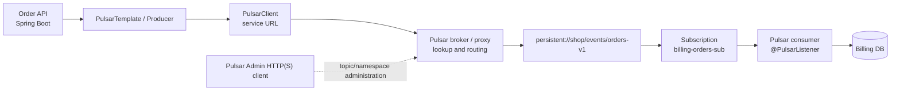
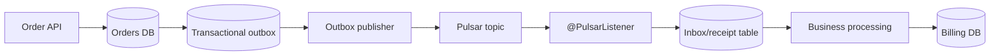

# Configuring Service URLs, Clients, and `spring.pulsar.*` Properties

## 1. The Apache Pulsar Integration Problem

Suppose a Spring Boot application receives orders via a REST API, persists changes to a database, and publishes events so that billing, shipping, and analytics services can process them independently. The system uses **Apache Pulsar** as its message broker; the application needs to know **where to connect**, **which client to use**, **how to choose topics/subscriptions**, and **how to behave when network errors occur or the broker is unavailable**.

In the **SPRING_BOOT_INTEGRATION** module, configuring Pulsar is more than pointing to a broker address. Configuration directly ties into data contracts, wait timeouts, transactions, duplicate events, access permissions, testing, and observability of real integration flows.

After this lesson, you will be able to:

1. Distinguish **Pulsar service URL** from **Pulsar Admin HTTP URL**, and understand how clients discover brokers.
2. Add the right starter and use `PulsarClient`, `PulsarTemplate`, and `@PulsarListener` auto-configured by Spring Boot.
3. Organize `application.yml`, profiles, environment variables, and the `spring.pulsar.client.*`, `admin.*`, `producer.*`, `consumer.*`, `listener.*`, and `defaults.*` property groups.
4. Use `PulsarClientBuilderCustomizer` when default properties fall short, especially for TLS.
5. Distinguish connection/authentication errors from message-processing errors, and design retries, idempotency, and testing against a real broker.

> **Version scope:** examples are based on Java 17+ and the **Spring Boot 3.5.x** line, integrating **Spring for Apache Pulsar** managed by Spring Boot. Some properties, packages, or APIs may differ in Spring Boot 3.2–3.4 or 4.x. When upgrading, verify the version-specific documentation, dependency BOM, and running Pulsar broker version.

## 2. Seeing the Components Along the Connection Path

Pulsar uses the **tenant → namespace → topic** hierarchy. A topic can be persistent or non-persistent, can be partitioned into multiple partitions, and can have one or more subscriptions serving consumers.



Responsibility layers:

| Component | Role | Connection path |
| --- | --- | --- |
| `PulsarClient` | Pulsar protocol client; creates producers/consumers/readers and performs lookups | `pulsar://...` or `pulsar+ssl://...` |
| `PulsarTemplate` | Convenient Spring API to send messages; uses producer factory and producer cache | Uses `PulsarClient` |
| `@PulsarListener` | Declares a message listener; container and consumer factory manage consumer lifecycle | Uses `PulsarClient` |
| `PulsarAdministration` / Admin client | Administrative operations such as topic creation, when permitted | `http://...` or `https://...` |
| Topic | Logical address where producers write and consumers read | `persistent://tenant/namespace/topic` |
| Subscription | Read/ack state of a consumer group | Bound to a topic and subscription name |

Common pitfall: **the service URL is not a REST API URL**. The Pulsar client connects via the Pulsar protocol to a broker or proxy; the admin URL connects to the administrative HTTP(S) endpoint. Changing the admin URL **does not fix** the producer/consumer service URL.

## 3. Choosing Dependencies and Letting Spring Boot Manage Versions

Applications sending and receiving messages in imperative style use the starter:

```xml
<!-- Maven; project uses Spring Boot parent/BOM -->
<dependency>
    <groupId>org.springframework.boot</groupId>
    <artifactId>spring-boot-starter-pulsar</artifactId>
</dependency>
```

When using Gradle:

```groovy
dependencies {
    implementation 'org.springframework.boot:spring-boot-starter-pulsar'
}
```

The starter brings in the required Spring for Apache Pulsar components and related dependencies. When `spring-pulsar` is on the classpath and auto-configuration is active, Spring Boot creates appropriate beans such as `PulsarClient`, `PulsarTemplate`, the producer factory, the listener factory, and supporting components.

For applications genuinely using the reactive model, the dedicated starter is:

```xml
<dependency>
    <groupId>org.springframework.boot</groupId>
    <artifactId>spring-boot-starter-pulsar-reactive</artifactId>
</dependency>
```

Reactive supports `ReactivePulsarClient`, `ReactivePulsarTemplate`, and `@ReactivePulsarListener` when the corresponding auto-configuration conditions are met. Do not add the reactive starter merely to increase consumer count; imperative listeners can also configure concurrency.

**Version principle:** use the chosen Spring Boot BOM/parent version to align Spring Pulsar and the Pulsar Java client. If you must override the client for a feature or security patch, check compatibility with Spring Pulsar, the Java runtime, and the broker. Do not claim client and broker must share the exact same version, nor assume every new feature works on an older broker.

## 4. Two Endpoints You Must Distinguish

### 4.1. `spring.pulsar.client.service-url`

This is the Pulsar **binary protocol** endpoint used by producers, consumers, and readers. Spring Boot 3.5 default:

```yaml
spring:
  pulsar:
    client:
      service-url: pulsar://localhost:6650
```

Format:

```text
pulsar://<host>:<port>
pulsar+ssl://<host>:<tls-port>
```

Typical examples (ports depend on cluster configuration):

| Environment | Service URL | Meaning |
| --- | --- | --- |
| Local standalone | `pulsar://localhost:6650` | Pulsar protocol without TLS |
| Internal cluster | `pulsar://pulsar-broker.internal.example:6650` | Connects to broker/proxy over internal network, no TLS |
| TLS-protected cluster | `pulsar+ssl://pulsar.internal.example:6651` | Pulsar protocol over TLS |

`pulsar+ssl` **does not guarantee** that CA trust and hostname verification are configured properly. Verify certificates, hostnames, authentication methods, and client APIs for your exact version.

### 4.2. `spring.pulsar.admin.service-url`

This is the **HTTP(S)** endpoint for administrative operations, such as querying metadata or creating topics when the application has permission. Default:

```yaml
spring:
  pulsar:
    admin:
      service-url: http://localhost:8080
```

When administering over TLS:

```yaml
spring:
  pulsar:
    admin:
      service-url: https://pulsar-admin.internal.example:8443
```

The two addresses may point to the **same cluster** over different protocols/ports. Configure **both** if the application uses `PulsarAdministration` and the cluster is not at the local defaults.

### 4.3. Boot Auto-Configures the Client but Does Not Provision a Broker

Spring Boot does not spin up a Pulsar cluster just because the starter is present. An application can create the client bean successfully and only fail when sending a message or when a listener looks up a topic; therefore, "application context started successfully" is **not enough** to conclude producers/consumers can reach the broker.

Beyond the initial bootstrap address, the Pulsar client performs lookups and receives the address of the broker owning the topic. If those advertised broker addresses are not resolvable from the application's network, the client can reach the entrypoint yet fail during publish/subscribe. Check proxies, DNS, advertised addresses/listeners, and network routing in the real runtime environment.

## 5. Basic and Environment-Specific Configuration Examples

### 5.1. Local Development

```yaml
# src/main/resources/application-local.yml
spring:
  pulsar:
    client:
      service-url: pulsar://localhost:6650
      connection-timeout: 10s
      operation-timeout: 30s
    admin:
      service-url: http://localhost:8080

integration:
  pulsar:
    order-topic: persistent://public/default/orders-v1
    billing-subscription: billing-orders-sub
```

The `integration.pulsar.*` block is **application-defined custom configuration**, distinct from `spring.pulsar.*` which Spring Boot binds to Pulsar components. Choose topic and subscription names by business semantics rather than letting services guess topics from message data.

With this example, run a local Pulsar broker separately on the appropriate ports. Do not use `localhost` when Spring Boot runs in a different container from the broker: inside a container, `localhost` is that container itself.

### 5.2. Staging/Production Configuration

```yaml
# application.yml: endpoints supplied by deployment environment
spring:
  pulsar:
    client:
      service-url: ${PULSAR_SERVICE_URL}
      connection-timeout: 10s
      operation-timeout: 30s
    admin:
      service-url: ${PULSAR_ADMIN_URL}

integration:
  pulsar:
    order-topic: ${ORDER_EVENTS_TOPIC}
    billing-subscription: ${BILLING_SUBSCRIPTION:billing-orders-sub}
```

Example environment variables:

```text
PULSAR_SERVICE_URL=pulsar+ssl://pulsar.example.internal:6651
PULSAR_ADMIN_URL=https://pulsar-admin.example.internal:8443
ORDER_EVENTS_TOPIC=persistent://shop/events/orders-v1
BILLING_SUBSCRIPTION=billing-orders-sub
```

The addresses in the example are illustrative; replace them with valid cluster endpoints. The configuration above is **not sufficient for production with TLS and authentication**. Security requires adding trust material/client auth as shown in Section 11, and never disabling certificate verification.

Do not commit real usernames, tokens, private keys, or passwords in `application.yml`. Use a secret manager, Kubernetes Secret, least-privilege runtime mounts, or equivalent protection.

### 5.3. Using Profiles Deliberately

| Profile | Service URL | Policy |
| --- | --- | --- |
| `local` | `pulsar://localhost:6650` or test broker | Declare test topics, mock/sample data |
| `test` | Broker endpoint provided by test framework | Independent of real clusters; test errors and acks |
| `staging` | Test cluster with TLS/auth | Test configuration close to production |
| `prod` | Production cluster with ACLs and observability | Do not auto-create topics via broad admin privileges unless intentionally designed |

Always verify the active profile and final resolved property values during deployment. A leftover environment variable from local development can cause a service to attempt connecting to `localhost` or select the wrong topic.

## 6. Overview of `spring.pulsar.*` Property Groups

Not all Pulsar Java client options have properties in Spring Boot. **Only a subset** is mapped through `PulsarProperties`; additional settings should use a customizer for the appropriate client/factory type. The table below focuses on properties available in Spring Boot 3.5.

| Group | Representative properties | Responsibility |
| --- | --- | --- |
| `spring.pulsar.client.*` | `service-url`, `connection-timeout`, `lookup-timeout`, `operation-timeout`, `threads.io`, `threads.listener` | General connectivity and client resources |
| `spring.pulsar.client.authentication.*` | `plugin-class-name`, `param.*` | Broker authentication method |
| `spring.pulsar.client.failover.*` | `backup-clusters`, `delay`, `check-interval`, `switch-back-delay` | Cluster failover if supported by version/cluster |
| `spring.pulsar.admin.*` | `service-url`, `connection-timeout`, `read-timeout`, `request-timeout`, `authentication.*` | Pulsar HTTP(S) admin connection |
| `spring.pulsar.producer.*` | `topic-name`, `send-timeout`, `batching-enabled`, `compression-type`, `message-routing-mode` | Producer behavior |
| `spring.pulsar.producer.cache.*` | `enabled`, `maximum-size`, `expire-after-access` | Caching of factory-created producers |
| `spring.pulsar.consumer.*` | `topics`, `subscription.*`, `retry-enable`, `dead-letter-policy.*` | Consumer and subscription behavior |
| `spring.pulsar.listener.*` | `concurrency`, `schema-type`, `observation-enabled` | Listener container |
| `spring.pulsar.defaults.*` | `topic.tenant`, `topic.namespace`, `type-mappings` | Default topic coordinates and type-to-schema mappings |
| `spring.pulsar.template.*` | `observations-enabled` | Observability of `PulsarTemplate` operations |
| `spring.pulsar.transaction.*` | `enabled` | Pulsar transaction support in compatible configurations |

### 6.1. Defaults That Easily Affect System Behavior

Per Spring Boot 3.5 metadata:

| Property | Notable default | Impact |
| --- | --- | --- |
| `spring.pulsar.client.service-url` | `pulsar://localhost:6650` | May accidentally point to local inside containers |
| `spring.pulsar.admin.service-url` | `http://localhost:8080` | Admin client requires its own URL |
| `spring.pulsar.client.connection-timeout` | `10s` | Bounds broker connection establishment |
| `spring.pulsar.client.operation-timeout` | `30s` | Bounds certain client operations |
| `spring.pulsar.producer.send-timeout` | `30s` | Bounds waiting for broker send acknowledgment |
| `spring.pulsar.producer.batching-enabled` | `true` | Enables batching, impacting throughput and latency |
| `spring.pulsar.producer.cache.enabled` | `true` | Producers are reused via the factory |
| `spring.pulsar.producer.cache.maximum-size` | `1000` | Check if there are very many topics/schemas/keys |
| `spring.pulsar.consumer.subscription.type` | `exclusive` | Multiple consumers on the same subscription can conflict under Exclusive |
| `spring.pulsar.consumer.subscription.initial-position` | `latest` | New subscriptions usually start at new messages |
| `spring.pulsar.consumer.subscription.mode` | `durable` | Subscription cursors can persist beyond client lifecycle |
| `spring.pulsar.consumer.retry-enable` | `false` | Do not assume retry topics work by default |
| `spring.pulsar.listener.observation-enabled` | `false` | Do not assume listener tracing/metrics are enabled |
| `spring.pulsar.transaction.enabled` | `false` | Pulsar transactions are not enabled by default |

Distinguish `connection-timeout`, `lookup-timeout`, `operation-timeout`, and `send-timeout`: they measure **different stages**. Do not set them all to the same value just because "timeouts should be 5 seconds." Determine your latency budget, network behavior, retry behavior, and real load before tuning.

## 7. Topic Names, Tenants, and Namespaces

Fully qualified Pulsar names generally follow:

```text
persistent://<tenant>/<namespace>/<topic>
non-persistent://<tenant>/<namespace>/<topic>
```

Examples:

```text
persistent://shop/events/orders-v1
persistent://shop/events/payment-results-v1
persistent://platform/audit/http-call-events
```

In Spring Boot 3.5, the defaults:

```yaml
spring:
  pulsar:
    defaults:
      topic:
        enabled: true
        tenant: public
        namespace: default
```

allow the framework to resolve short topic names when default topic resolution is enabled. However, in multi-tenant production environments, **prefer fully qualified topic names** to avoid accidentally publishing into `public/default` due to missing configuration.

Do not confuse a **Pulsar tenant** with a business tenant inside a message payload. Pulsar tenants/namespaces help manage resources, ACLs, and retention, whereas per-record business authorization must still be enforced in the service.

### 7.1. Creating Topics via the Admin API

Pulsar may allow automatic topic creation in some environments, depending on broker policy. Spring for Apache Pulsar supports `PulsarTopic` beans to create topics at application startup if the admin client is configured with sufficient permissions.

Production typically requires standardizing tenant, namespace, partition, retention, TTL, backlog quota, and permission management through infrastructure workflows. Letting dozens of application replicas simultaneously try to create topics on startup can make operational permissions hard to govern. Only use startup topic creation if cluster policy allows it and idempotent behavior has been verified.

### 7.2. Partitioned Topics and Routing

If a topic is partitioned, the producer determines the partition based on the message key or routing policy; a multi-partition topic cannot be treated as a single globally ordered queue.

- **A stable key** routes messages for the same entity consistently according to the configured hash/routing policy.
- **Ordering** depends on partitions, subscription type, and concurrency; global ordering is not promised across multiple partitions/consumers.
- **Changing the partition count** can alter routing for new messages; verify whether the application requires per-aggregate ordering.

Properties such as `spring.pulsar.producer.message-routing-mode` and `hashing-scheme` should be adjusted only after understanding partition and key assumptions; do not use them arbitrarily to patch business-level ordering bugs.

## 8. Externalized Configuration Example for Sending and Receiving Events

A minimal runnable example assuming an existing cluster/topic with publish/consume permissions.

### 8.1. Application Configuration

```yaml
# application.yml: example for an existing local broker
spring:
  pulsar:
    client:
      service-url: ${PULSAR_SERVICE_URL:pulsar://localhost:6650}
    admin:
      service-url: ${PULSAR_ADMIN_URL:http://localhost:8080}
    producer:
      send-timeout: 15s
    consumer:
      subscription:
        type: shared
        initial-position: earliest

integration:
  pulsar:
    order-topic: persistent://public/default/orders-v1
    billing-subscription: billing-orders-sub
```

`initial-position: earliest` only determines the starting point of a **new subscription** per Pulsar semantics; it does not cause every restart to replay the entire topic once a durable subscription already has a cursor. `type: shared` lets multiple consumers on the same subscription distribute messages; processing must still be idempotent and does not guarantee global ordering.

### 8.2. Producer Adapter

```java
package example.integration.pulsar;

import org.springframework.beans.factory.annotation.Value;
import org.springframework.pulsar.core.PulsarTemplate;
import org.springframework.stereotype.Component;

@Component
public class OrderEventPublisher {

    private final PulsarTemplate<String> template;
    private final String topic;

    public OrderEventPublisher(
            PulsarTemplate<String> template,
            @Value("${integration.pulsar.order-topic}") String topic) {
        this.template = template;
        this.topic = topic;
    }

    public void publish(String jsonPayload) {
        template.send(topic, jsonPayload);
    }
}
```

`PulsarTemplate` is configured by Boot on top of `PulsarClient` and the producer factory. Defining an adapter with a `publish` method keeps topic naming and the Pulsar SDK out of business services. In the example, the payload is a JSON string produced by the business layer according to the contract.

A synchronous send call may wait for broker confirmation and throw an error on failure. Therefore, if called inside an HTTP request, include send latency in your latency budget and maintain a clear error-handling strategy. In production, consider adding a message key, event ID, schema version, and an outbox to avoid states where the database committed but publishing failed.

### 8.3. Consumer Adapter

```java
package example.integration.pulsar;

import org.springframework.pulsar.annotation.PulsarListener;
import org.springframework.stereotype.Component;

@Component
public class BillingOrderEventListener {

    private final BillingOrderService billingOrderService;

    public BillingOrderEventListener(BillingOrderService billingOrderService) {
        this.billingOrderService = billingOrderService;
    }

    @PulsarListener(
            topics = "${integration.pulsar.order-topic}",
            subscriptionName = "${integration.pulsar.billing-subscription}")
    public void onOrderCreated(String jsonPayload) {
        billingOrderService.handleOrderEvent(jsonPayload);
    }
}
```

In the code above, `BillingOrderService` is an **application-provided business interface/service**, for example:

```java
package example.integration.pulsar;

public interface BillingOrderService {
    void handleOrderEvent(String jsonPayload);
}
```

The example illustrates separating the message adapter from business logic; to run end-to-end, the application must implement this interface and have a real broker/topic. The service itself must validate the JSON contract, ensure idempotency, manage transactions, and classify business errors.

**Ack/nack:** `@PulsarListener` and the listener container handle acknowledgments according to the configured mode. Do not assume every exception triggers a single retry and then automatically lands in a DLQ. Read the exact ack/nack, retry/DLQ, and negative acknowledgment semantics of your Spring Pulsar version, then verify with an integration test.

## 9. Configuring `PulsarClient` and Extending via Customizers

Spring Boot registers a `PulsarClient` automatically when the starter and auto-configuration conditions match. If you want to inspect or use the Pulsar API directly:

```java
package example.integration.pulsar;

import org.apache.pulsar.client.api.PulsarClient;
import org.springframework.stereotype.Component;

@Component
public class ClientHolder {
    private final PulsarClient client;

    public ClientHolder(PulsarClient client) {
        this.client = client;
    }

    public PulsarClient client() {
        return client;
    }
}
```

However, most business code **does not need to directly call** `PulsarClient.builder().serviceUrl(...).build()`. If you instantiate a second client manually, you must manage auth/TLS, retries, connection resources, and client shutdown yourself; moreover, doing so may bypass Boot-managed configuration and observability.

### 9.1. Three Customization Levels

| Level | Mechanism | Scope |
| --- | --- | --- |
| Boot configuration | `spring.pulsar.client.*`, `producer.*`, `consumer.*` | Corresponding auto-configured components |
| Builder customizer | `PulsarClientBuilderCustomizer` | Global client created by the factory |
| Producer/consumer customizer | `ProducerBuilderCustomizer`, `ConsumerBuilderCustomizer` | Factory producers/consumers, or per-instance scope if supported by annotation/template |

Choose `PulsarClientBuilderCustomizer` when you need to fine-tune **client-level connectivity** that `PulsarProperties` does not expose directly. If you only need to change producer batching, do not replace the entire `PulsarClient`. Similarly, an individual subscriber can be configured via listener annotation attributes or a consumer customizer without altering all subscribers.

### 9.2. Client Customizer Example for Specifying Trust CA

When a cluster uses TLS with a private CA, trust material is required in addition to `pulsar+ssl://`:

```java
package example.integration.pulsar;

import org.springframework.context.annotation.Bean;
import org.springframework.context.annotation.Configuration;
import org.springframework.pulsar.core.PulsarClientBuilderCustomizer;

@Configuration(proxyBeanMethods = false)
public class PulsarTlsConfiguration {

    @Bean
    PulsarClientBuilderCustomizer pulsarTlsCustomizer() {
        return builder -> builder
                .tlsTrustCertsFilePath(
                        "/etc/order-service/tls/pulsar-root-ca.pem")
                .enableTlsHostnameVerification(true)
                .allowTlsInsecureConnection(false);
    }
}
```

This example follows the Pulsar Java Client and compatible Spring Pulsar APIs in the Boot 3.5 line. Verify that the file path is mounted, the certificate is valid, and the endpoint is actually configured as `pulsar+ssl://...`. If the environment uses JKS/PKCS12 or mTLS, configuration differs and must be checked against the driver/Pulsar client.

**Never substitute `allowTlsInsecureConnection(true)` or disable hostname verification** just to silence TLS errors. Doing so weakens broker identity verification. With a Pulsar proxy/cluster, the broker hostnames accessed by the client must also match the certificate and TLS configuration.

### 9.3. Administration Requires Separate Configuration

`PulsarClientBuilderCustomizer` configures the **Pulsar binary client** and does not automatically apply all settings to the Admin HTTP client. When administering over HTTPS with a private CA, evaluate `PulsarAdminBuilderCustomizer` along with the TLS/keystore methods appropriate for your API version. Admin authentication also has its own `spring.pulsar.admin.authentication.*` group.

## 10. Producer: Topic, Timeout, Batching, and Cache

Example focused on balancing latency and throughput:

```yaml
spring:
  pulsar:
    producer:
      send-timeout: 15s
      batching-enabled: true
      cache:
        enabled: true
        maximum-size: 500
        expire-after-access: 2m
```

Explanation:

- `send-timeout`: maximum time the Pulsar producer waits for a broker acknowledgment for a message per client semantics; a timeout **does not always prove the message was not written**.
- `batching-enabled`: groups multiple messages to reduce overhead and increase throughput. Batching can increase send wait latency and alter memory load.
- `producer.cache.enabled`: the Spring Pulsar producer factory caches producers to avoid repeated creation. Too large a cache can hold resources for rarely used topics; too small can cause constant producer creation/closing.
- `producer.topic-name`: sets a default topic for the producer if the application has one primary topic; when sending to multiple topics by business logic, pass the topic explicitly in the adapter.

`PulsarTemplate<String>.send(topic, payload)` suffices for basic examples. In production, data should carry **event ID, aggregate ID, event version, schema version, and correlation ID** in appropriate payload fields or properties. Verify schema compatibility between producer and consumer rather than relying solely on broker acceptance.

### 10.1. Timeouts and Duplicate Publishing

Scenario:

```text
1. Producer sends OrderCreated(eventId=E1).
2. Broker persists E1, but the ACK response is delayed or lost.
3. Producer reports a send timeout.
4. Application resends E1.
5. Consumer may observe two deliveries of E1.
```

Although Pulsar offers broker/producer deduplication settings and transactions within their supported scopes, applications must not assume **every retry is business-level exactly-once**. For order-related events, the consumer must define a strong idempotency key and transaction boundary.

### 10.2. Batching and Backpressure

When increasing throughput via batching or async publishing, you must also control the number of messages awaiting acknowledgment. If the producer is called faster than the broker can handle, buffers can fill up, timeouts spike, and the app risks resource exhaustion.

Workload-dependent mitigations include limiting concurrency/in-flight sends, upstream backpressure, bounded queues, appropriate timeouts, retries with backoff/jitter, and observing send latency. Never blindly raise every timeout or cache limit to "fix" congestion.

## 11. Consumer: Subscriptions and Initial Position

### 11.1. Subscription Types

| Type | General characteristics | When to consider |
| --- | --- | --- |
| `Exclusive` | One exclusive consumer on a subscription | Single processor or simple needs without multi-consumer scaling |
| `Failover` | One active consumer, others on standby per Pulsar mechanics | High availability when one active consumer per scope is desired |
| `Shared` | Distributes messages across multiple consumers on the same subscription | Scaling independent processing without needing global ordering |
| `Key_Shared` | Distributes by key to preserve per-key ordering affinity under Pulsar conditions | Processing per aggregate/customer ID with compatible key and batching settings |

In Spring Boot 3.5, `spring.pulsar.consumer.subscription.type` defaults to `exclusive`. If you run multiple listener replicas with the same subscription name without changing the subscription type, new replicas may fail to attach as expected.

Example scaling a group of independent consumers:

```yaml
spring:
  pulsar:
    consumer:
      subscription:
        name: billing-orders-sub
        type: shared
        mode: durable
        initial-position: earliest
```

If `@PulsarListener(subscriptionName = "...")` also sets a name, understand the precedence between the annotation and factory defaults. Clear, consistent configuration prevents multiple groups from accidentally reading the topic under different subscription names.

### 11.2. `initial-position` Is Not an "Offset Reset" Button

`latest` and `earliest` apply when a **new subscription/cursor** is created. Once a durable subscription already exists, the broker persists its read/ack cursor. Changing `initial-position` and restarting the listener normally **does not rewind** an existing cursor.

For controlled replay, you need cursor administration/subscription reset mechanisms or a new subscription, along with an understanding of retention and backlog. This operation can generate heavy load, redeliver old data, and trigger side effects; it requires idempotent processing and operational authorization.

### 11.3. Retry and Dead-Letter Policy

Spring Boot exposes `spring.pulsar.consumer.retry-enable` and `spring.pulsar.consumer.dead-letter-policy.*`. However, flipping a flag does not replace proper error design:

- **Transient errors:** database timeouts, slow HTTP services; retry finitely with delay/backoff and monitor retry rates.
- **Data errors:** invalid schema, missing required fields; repeating the same message rarely helps.
- **Permission/TLS errors:** cannot be fixed by resending the same invalid credentials.
- **Poison messages:** require a dead-letter/parking-lot mechanism capable of investigation and post-fix replay.

Illustrative configuration example; test actual behavior against your version and cluster policy:

```yaml
spring:
  pulsar:
    consumer:
      retry-enable: true
      dead-letter-policy:
        max-redeliver-count: 5
        dead-letter-topic: persistent://shop/events/orders-dlq
```

Do not assume `max-redeliver-count=5` means the method executes exactly five times across all ack/subscription modes. Broker redelivery, retry letter topics, negative acknowledgments, network failures, and container policies all affect the observed attempt count. Test against a real broker and track message IDs/event IDs.

## 12. Authentication, TLS, and Authorization

A production cluster typically rejects anonymous clients. In Spring Boot, authentication configuration is split into two separate groups for **client** and **admin**:

```yaml
spring:
  pulsar:
    client:
      service-url: pulsar+ssl://pulsar.internal.example:6651
      authentication:
        plugin-class-name: org.apache.pulsar.client.impl.auth.AuthenticationToken
        param:
          token: ${PULSAR_CLIENT_TOKEN}
    admin:
      service-url: https://pulsar-admin.internal.example:8443
      authentication:
        plugin-class-name: org.apache.pulsar.client.impl.auth.AuthenticationToken
        param:
          token: ${PULSAR_ADMIN_TOKEN}
```

This configuration illustrates token auth and TLS; **you must also configure CA trust/SSL for both client and admin according to the environment**. `plugin-class-name` depends on the chosen plugin, such as token, OAuth2, Athenz, or mTLS. Verify that the plugin is present on the classpath for your Pulsar client version.

### 12.1. Auth Parameter Names Are Case-Sensitive

A common pitfall: keys in `spring.pulsar.client.authentication.param.*` are passed directly to the authentication plugin and often require **exact camelCase names** like `issuerUrl`, `privateKey`, and `audience`. Spring Boot does not guarantee relaxed binding for these **map key names**:

```yaml
spring:
  pulsar:
    client:
      authentication:
        plugin-class-name: org.apache.pulsar.client.impl.auth.oauth2.AuthenticationOAuth2
        param:
          issuerUrl: ${OAUTH_ISSUER_URL}
          privateKey: ${OAUTH_CREDENTIAL_FILE_URI}
          audience: ${OAUTH_AUDIENCE}
```

`issuer-url` or `issuerurl` are **not equivalent** to `issuerUrl` if the plugin expects that exact key. Environment variables that lowercase map keys can also prevent the plugin from recognizing settings; keep camelCase key names in YAML and **only source values** from environment variables.

### 12.2. A URL Alone Does Not Configure TLS Completely

Verification steps:

1. Broker/proxy actually has TLS enabled on the specified port.
2. Service URL uses `pulsar+ssl://`; Admin URL (if TLS-enabled) uses `https://`.
3. CA/truststore matches the broker and Admin endpoint certificates; SAN matches the hostname used by the client.
4. For mTLS, a corresponding client certificate and private key are provided and accepted by the server.
5. The auth token/role is granted **publish** on the target topic and **consume** per subscription policy; admin permissions are granted only if needed.

Spring Boot 3.x does not have a complete set of TLS properties covering every Pulsar scenario like JDBC does. You may need `PulsarClientBuilderCustomizer` for the binary client and `PulsarAdminBuilderCustomizer` for the Admin client. Do not copy Kafka TLS configuration directly into Pulsar: the two clients have different APIs, schema properties, and auth mechanisms.

## 13. Timeouts, Lookups, Failover, and Multi-Broker Connections

Configuration can start with:

```yaml
spring:
  pulsar:
    client:
      service-url: ${PULSAR_SERVICE_URL}
      connection-timeout: 10s
      operation-timeout: 30s
      lookup-timeout: 30s
      threads:
        io: 4
        listener: 4
    producer:
      send-timeout: 15s
```

The numbers above are **examples only**, not suitable for all workloads. When tuning `threads.io`/`threads.listener`, consider connection count, topic count, CPU limits, message load, and latency. Do not arbitrarily increase thread counts to mask broker timeouts.

### 13.1. Timeout Classification

| Timeout | Stage | What to check on failure |
| --- | --- | --- |
| `client.connection-timeout` | Establishing broker connection | DNS, firewall, proxy, TLS, broker load |
| `client.lookup-timeout` | Looking up metadata/topic owner | Broker/metadata service, permissions, topic existence |
| `client.operation-timeout` | Certain client operations | Cluster availability, metadata, and responsiveness |
| `producer.send-timeout` | Broker acknowledgment of sent message | Backpressure, batching, broker/storage, and duplicate risk |
| `admin.connection-timeout/read-timeout/request-timeout` | HTTP Admin API stages | Admin endpoint, TLS/auth, heavy admin operations |

An HTTP endpoint with a 500 ms p95 SLA should not block request threads for tens of seconds waiting to publish an event. You may need to offload publishing to a transactional outbox/background publisher and return a response matching your contract.

### 13.2. Cluster Failover

Spring Boot 3.5 includes `spring.pulsar.client.failover.*` properties for automatic cluster-level failover when supported by the Pulsar client version and cluster setup. Configurable fields include `backup-clusters`, `check-interval`, `delay`, and `switch-back-delay`.

**Do not conflate:**

- The client reconnecting to another broker **within the same cluster**.
- Switching to a **standby cluster** that has matching namespaces, topics, and data.
- DR/replication keeping data synchronized between two clusters.

Cross-cluster failover requires provisioning topics, ACLs, schemas, retention, producer/consumer semantics, and data replication policies; merely adding a backup URL does not prevent lost events or duplicate processing. Rehearse failover and failback under realistic workloads.

## 14. Data Transactions, Idempotency, and Spring Integration

In integration architectures, messages frequently cause side effects in databases or external systems.



### 14.1. Why Not Just Call `save()` Then `send()`?

Suppose:

```java
orderRepository.save(order);
pulsarTemplate.send("orders-v1", payload);
```

If the database commits but Pulsar loses connectivity, the order exists without an emitted event. If publishing succeeds and the application crashes before confirming status, a retry may re-emit the event. JDBC `@Transactional` **does not automatically create an atomic transaction** spanning both database and broker.

A common solution is the **transactional outbox**: persist the order and an outbox record in the same database transaction, then let a worker publish the outbox with retries and record status. The consumer needs idempotency to handle duplicate deliveries.

### 14.2. Pulsar Transactions Have a Bounded Scope

Spring Boot 3.5 provides `spring.pulsar.transaction.enabled` (default `false`). When enabled on a compatible broker, Spring Pulsar supports Pulsar-scoped transactions for `PulsarTemplate` and `@PulsarListener` with the corresponding transaction manager.

**Pulsar transactions do not automatically include JDBC/JPA transactions**, and in the referenced documentation line transaction support does not behave identically across reactive variants. Do not treat this property as an "end-to-end exactly-once" promise for money, orders, or partner systems. Define exact commit, ack, and rollback boundaries for every flow.

### 14.3. Relationship to Spring Integration

Spring Integration structures message flows via channels, transformers, filters, routers, and service activators. When integrating Pulsar:

```text
Pulsar consumer / Spring Pulsar listener
    → validate event contract
    → transform to internal message
    → message channel / service activator
    → database / HTTP / cache adapter
    → decide ack/retry/DLQ
```

Do not assume a `MessageChannel` automatically controls Pulsar acknowledgments. If deploying a gateway/service activator, explicitly define **who owns the message lifecycle**, when work is considered complete, which exceptions trigger retries, and how recovery behaves after a process crash.

## 15. Testing Configuration Against a Real Broker

### 15.1. Test Layering

| Test type | Verifies | Cannot prove |
| --- | --- | --- |
| Adapter unit test | Topic routing logic, business errors, and mapping contracts | TLS/auth, lookup, or broker acks |
| Spring context test | Property binding, bean creation, `PulsarTemplate`/listener injection | Successful connectivity in all scenarios |
| Integration test with real Pulsar | Publish/consume, schema, subscription, ack, redelivery, permissions | Production cluster policies and routing |
| Staging | TLS/certificates, advertised broker addresses, ACLs, throughput, partitions, quotas | All production failures under different data/load |
| Failure/recovery test | Broker restart, timeouts, duplicates, DLQ, replay, outbox recovery | Cross-cluster outages if DR has not been rehearsed |

Use an isolated Pulsar broker for CI (such as Testcontainers or a managed test environment), assign dedicated topics/subscriptions, and **await conditions with a timeout** instead of fixed `Thread.sleep(...)` calls to confirm message receipt.

### 15.2. Configuration Scenarios to Test

1. Wrong `service-url`: producer fails explicitly; application emits appropriate metrics/alerts.
2. Valid Admin URL but wrong client service URL: admin operations may succeed while publishing still fails.
3. Client reaches bootstrap broker, but lookup returns an unresolvable endpoint: publish/consume fails.
4. Valid token lacking consume permission: listener fails to attach to the subscription.
5. TLS with valid CA but mismatched hostname: handshake must be rejected.
6. Existing durable subscription: changing `initial-position` does not automatically reset the cursor.
7. Two consumers on an `Exclusive` subscription: behaves per Exclusive semantics; `Shared` can scale.
8. Publish times out after the broker has persisted the message: consumer does not apply business side effects twice.
9. Schema-invalid message: retry/DLQ/parking mechanism and post-fix replay capability exist.
10. Restart/rebalance: ack responsibility is not lost and uncontrolled duplicate updates do not occur.

### 15.3. Topic/Subscription Configuration in Tests

Example test profile:

```yaml
spring:
  pulsar:
    client:
      service-url: ${TEST_PULSAR_URL}
    admin:
      service-url: ${TEST_PULSAR_ADMIN_URL}
    consumer:
      subscription:
        type: shared
        initial-position: earliest
integration:
  pulsar:
    order-topic: persistent://public/default/orders-test
    billing-subscription: billing-orders-test
```

The test framework or test broker supplies both URLs; never use a real cluster. When tests run in parallel, use isolated topic/subscription names or controlled cleanup; sharing a durable subscription can pollute tests with leftover cursors and messages from prior runs.

## 16. Observability and Handling Configuration Errors

For event-driven integration flows, monitor at minimum:

| Signal | Purpose |
| --- | --- |
| Producer send success/error and p95/p99 latency | Detect slow brokers, timeouts, or backpressure |
| Connection/lookup failure count | Identify DNS, proxy, broker metadata, or network issues |
| Consumer backlog/lag per subscription | Detect slow processing or listeners failing to attach |
| Message redeliveries, retries, and DLQ | Detect poison messages, DB errors, contract errors |
| Schema decode failures | Detect incompatible producers/consumers |
| Subscription count, partitions, topic storage | Assess load and quotas |
| TLS/auth failures, token expiry | Detect expired credentials/certificates |
| Outbox age and inbox dedup | Measure completeness of business update flows |

Spring Boot provides Actuator/Micrometer and observation support depending on version. Flags like `spring.pulsar.listener.observation-enabled` or `spring.pulsar.template.observations-enabled` may need to be enabled for corresponding observations; **do not assume** all metrics appear just by adding the starter.

Telemetry tags should use `topic`, `subscription`, outcome, and error category with controlled cardinality. Do not place raw payloads, tokens, credentials, or unbounded customer IDs into metric labels/logs. Use trace/correlation IDs appropriately to follow `HTTP → DB → outbox → Pulsar → consumer`.

### Quick Troubleshooting Table

| Symptom | Possible cause | First check |
| --- | --- | --- |
| Client tries calling `localhost:6650` in pod/container | `spring.pulsar.client.service-url` not overridden | Active profile, env vars, and final resolved config |
| Admin API works, producer still times out | Admin URL and service URL use different protocols; broker lookup/network error | Binary port, broker/proxy address, and metadata |
| `AuthenticationException` / `NotAuthorized` | Wrong token/plugin or missing topic/namespace ACL | Plugin parameters, token expiry, and publish/consume permissions |
| TLS handshake/certificate failure | Wrong CA trust, SAN/hostname mismatch, or plaintext endpoint | Cert chain, actual hostname, `pulsar+ssl`, and admin HTTPS |
| Listener does not receive old messages | Durable cursor is at the end or `initial-position=latest` on new subscription | Subscription name, cursor position, and retention |
| Second replica fails to attach | `subscription.type=exclusive` | Switch to `Shared`/`Key_Shared` if semantics allow |
| Consumer receives duplicate messages | Nack/retry, missing ack, restart, or redelivery | Event ID, ack policy, retry/DLQ, and idempotency |
| Producer creates too many resources | Producers cached per topic/schema/key growing unbounded | `producer.cache.*`, topic count, and send patterns |
| String sends succeed, POJO decode fails | Mismatched schemas | Schema type, schema compatibility, and type mappings |
| Changing `initial-position` has no effect | Subscription already exists with a cursor | Replay plan or new subscription |

A "topic not found" error does not always mean the topic was not created; it can stem from a wrong tenant/namespace, disabled broker auto-creation, or missing principal permissions. Verify the full topic name and cluster policy before enabling auto-topic creation in production.

## 17. Deployment Workflow and Checklist

When promoting from local to staging/production:

1. **Identify cluster and URLs:** specify binary `pulsar://`/`pulsar+ssl://`, admin `http://`/`https://`, DNS, and ports.
2. **Select starter and version:** let the Spring Boot BOM manage Spring Pulsar/Pulsar client, verify broker compatibility.
3. **Plan topics:** tenant, namespace, fully qualified topic, partitions, schema, retention, backlog, TTL, and ACLs.
4. **Separate environment configuration:** `spring.pulsar.*` for the framework, `integration.pulsar.*` for business config; source secrets from a secret manager.
5. **Verify auth/TLS:** plugin, auth parameter case sensitivity, CA/hostname verification, and independent Admin configuration.
6. **Tune based on measurement:** timeouts, batching, cache, thread counts, listener concurrency, subscription type.
7. **Event contracts:** ID, key, version, schema evolution, correlation ID, backward compatibility.
8. **Error semantics:** ack/nack, retry, DLQ, idempotency, outbox/inbox, and transaction boundaries.
9. **Test on a real broker:** happy paths as well as wrong URL, invalid token, invalid TLS, replay, broker restart, and duplicates.
10. **Observability/rollout:** backlog, p95 send latency, timeouts, auth errors, outbox age, and recovery capability.

### Practice Scenario

**Scenario:** a `billing` service runs three replicas, each configured with:

```yaml
spring:
  pulsar:
    client:
      service-url: pulsar://localhost:6650
    consumer:
      subscription:
        name: billing-sub
        type: exclusive
```

When deployed to Kubernetes, the replicas fail to connect to the broker, and after fixing the URL only one replica receives messages.

Answer the following:

1. Why doesn't `localhost` inside a pod resolve to the Pulsar broker?
2. What format must `service-url` be changed to if the broker only accepts TLS?
3. Why is `exclusive` unsuitable when all three replicas should process messages in one subscription?
4. Does switching to `shared` preserve global ordering? If per-order-ID ordering is needed, which key and subscription would you evaluate?
5. If the producer reports a timeout while the broker actually persisted the event, what must the consumer design include to avoid charging twice?
6. Does a working HTTPS Admin URL prove that the listener will subscribe successfully?

## 18. References

- [Spring Boot 3.5 — Apache Pulsar Support](https://docs.spring.io/spring-boot/3.5/reference/messaging/pulsar.html): auto-configuration, service/admin URLs, template, listener, customizers, and transactions.
- [Spring Boot 3.5 — Common Application Properties](https://docs.spring.io/spring-boot/3.5/appendix/application-properties/index.html): property names, meanings, and defaults for `spring.pulsar.*`.
- [Spring Pulsar — Pulsar Client](https://docs.spring.io/spring-pulsar/reference/reference/pulsar/pulsar-client.html): TLS, authentication plugins, client connectivity, and extended options.
- [Apache Pulsar Documentation](https://pulsar.apache.org/docs/): topics, subscription types, security, message delivery, brokers, and cluster operations. Select the documentation version matching your running cluster.

## Conclusion

Configuring Pulsar in Spring Boot begins with specifying the **right Pulsar service URL** for producers/consumers and the **right Admin HTTP(S) URL** for administrative tasks. `spring-boot-starter-pulsar` along with `spring.pulsar.*` manages `PulsarClient`, producers, consumers, listeners, topic defaults, timeouts, and authentication; advanced TLS or tuning options may require customizers. In real integration systems, pair this configuration with **message contracts, idempotency, transactions/outbox, broker-backed testing, and operational observability** to avoid lost events, duplicate processing, or cross-environment misrouting.
