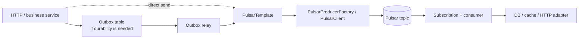
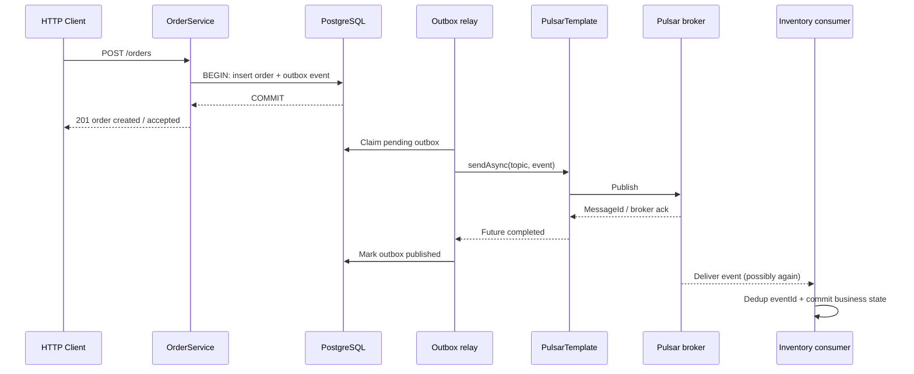
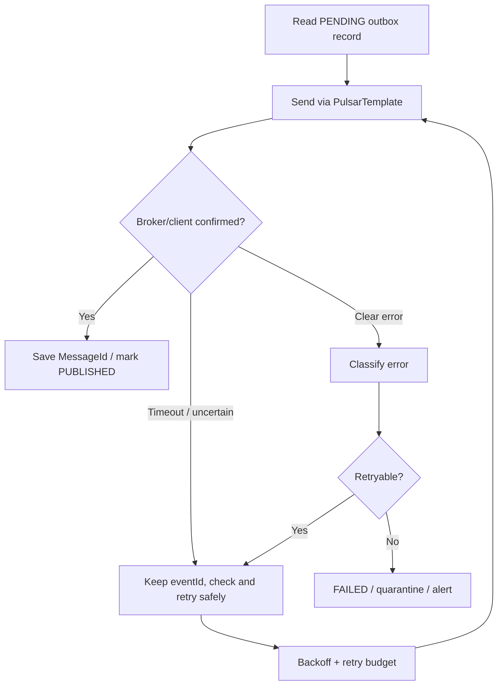

# PulsarTemplate and Sending Messages to Topics

> **Chapter:** Apache Pulsar  
> **Module:** `SPRING_BOOT_INTEGRATION` — organizing system integration in Spring Boot via HTTP clients, databases, caches, message brokers, and Spring Integration adapters; focusing on configuration, data contracts, transactions, error handling/deduplication, testing, and observing integration flows.
>
> **Example scope:** API `org.springframework.pulsar.core.PulsarTemplate` from **Spring for Apache Pulsar** supported by Spring Boot. Artifact names, packages, auto-configurations, and properties may differ in other library branches/versions; verify your project version's documentation before copying code. Topics, addresses, and payloads below are illustrative data.

## 1. The Problem: Creating an Order in the Database and Publishing an Event

An order management service receives HTTP `POST /orders`. After persisting the order successfully, the system must emit an `OrderPlaced` event so inventory, notifications, and reporting can perform their own tasks. Making direct HTTP calls to each system couples order creation to the latency and failures of those systems; sending events via **Apache Pulsar** enables message-driven communication across parties.

In a Spring Boot application, `PulsarTemplate<T>` provides the API for a **producer to send payloads to a topic** without manually writing Pulsar producer lifecycle and client communication code in every service.

However, a successful send call does not answer all questions:

- Has the order **committed** before emitting `OrderPlaced`?
- Does the topic already exist, belong to the right **tenant/namespace**, and have proper permissions?
- Which **schema** does the payload use; can older consumers still read it after a contract upgrade?
- Which **message key** does the producer send to preserve per-order ordering when needed?
- If `sendAsync(...)` fails after the HTTP response was already returned to the user, who knows and retries?
- If the broker persisted the message but the producer missed the confirmation, does a retry create **two messages**?
- When a consumer receives a duplicate, does the inventory system reserve stock twice?

This lesson focuses on `PulsarTemplate` and the **message publishing path to a topic**, tied closely to transactions, idempotency, retries, and observability so the integration flow is reliable.

### Learning Objectives

After this lesson, you will be able to:

1. Explain the roles of the Pulsar broker, topic, producer, `PulsarTemplate`, and `PulsarProducerFactory`.
2. Configure Spring Boot to connect to Pulsar and select topics explicitly.
3. Distinguish synchronous `send(...)` from `sendAsync(...)` and understand the meaning of `MessageId`.
4. Send String/JSON messages or payloads with `Schema<T>`; attach keys and properties.
5. Structure an outbox and deduplication when sending messages after a database transaction.
6. Diagnose publish errors, measure outcomes, and test against a real broker.

## 2. Where PulsarTemplate Fits in the Architecture

Apache Pulsar is a pub/sub messaging platform featuring **tenants**, **namespaces**, **topics**, producers, subscriptions, and consumers. Topics can be partitioned or non-partitioned; brokers and the storage tier coordinate to ingest and dispatch messages.

In a Spring Boot system, responsibilities are separated as follows:

| Component | Responsibility | Does not automatically guarantee |
|---|---|---|
| `OrderService` | Decides when an order is created and which event to emit | Does not replace the broker or schema registry |
| `PulsarTemplate<T>` | Spring API to send messages to a topic, synchronously or asynchronously | Does not guarantee consumer business processing |
| `PulsarProducerFactory` | Creates/manages producers per configuration, usually cached for reuse | Does not decide when the order commits |
| `PulsarClient` | Connects to the cluster, communicates with brokers, executes sends | Does not run PostgreSQL transactions on behalf of the app |
| **Pulsar broker/topic** | Accepts, persists/routes messages per cluster topology and policies | Does not automatically deduplicate consumer side effects |
| `@PulsarListener` / consumer | Receives messages and invokes processing logic | Does not automatically make HTTP/DB side effects exactly-once |
| **Integration application** | Contracts, unique keys, outbox/inbox, retries, metrics | Must be designed and tested |



Easily confused terms:

- **PulsarTemplate** is the Spring API for **the producer side**, not a topic or queue.
- A **Topic** is the logical destination where messages are written; a **subscription** determines how consumers track and receive messages.
- **MessageId** is assigned by Pulsar to a published message; **eventId/commandId** is a business identifier created by the application. The two IDs solve different problems.

## 3. Topics, Tenants, Namespaces, and Topic Naming

A fully qualified topic name takes the form:

```text
persistent://<tenant>/<namespace>/<topic>
```

Example:

```text
persistent://public/default/order-events
```

In test environments, you may encounter the shorthand `order-events`; the Pulsar client and configuration can resolve it to the default tenant/namespace. In multi-environment or multi-tenant systems, **declaring the fully qualified name** makes the destination contract explicit.

| Name part | Purpose |
|---|---|
| `persistent://` | Topic with durable persistence per Pulsar configuration |
| `public` | Example tenant; production typically uses dedicated tenants with permissions |
| `default` | Example namespace holding relevant policies |
| `order-events` | Specific topic where the producer writes messages |

Pulsar also supports **non-persistent topics** with different storage/delivery characteristics. For business events that must recover from failures, select an appropriate topic type and durability policy; do not assume every topic provides the same guarantees.

### 3.1. Topic Existence and Publish Permissions

For production, define clearly who **creates topics**, partition counts, quotas/retention, authentication, and ACLs. Do not merely rely on the broker auto-creating a topic on the producer's first send, as environments may disable auto-topic creation or require controlled provisioning.

Spring Boot can integrate with Pulsar Admin and declare topics via corresponding configuration, but administrative actions require the HTTP admin service URL and separate permissions. The **client service URL** and **admin service URL** use different protocols and serve different purposes: `pulsar://...` is for the messaging client, while admin is typically `http(s)://...`.

### 3.2. Partitioned Topics and Message Keys

Partitioned topics split data across multiple partitions to scale throughput. A stable **key** such as `orderId` helps route events belonging to the same order to the appropriate partition under the configured routing policy, forming the basis for per-aggregate ordering. However:

- There is no global order across all events in multiple partitions.
- The order observed by consumers also depends on subscription type, redelivery, and concurrency.
- With `Key_Shared`, batching/key-based batching must be compatible if per-key ordering needs to be preserved.
- Key routing does not replace checking `aggregateVersion` and idempotency when events arrive late or are redelivered.

## 4. Preparing Dependencies and Spring Boot Configuration

### 4.1. Starter

For a Spring Boot project using `org.springframework.pulsar`, the typical starter is:

```gradle
dependencies {
    implementation("org.springframework.boot:spring-boot-starter-pulsar")
    implementation("org.springframework.boot:spring-boot-starter-web")
    implementation("org.springframework.boot:spring-boot-starter-validation")
    implementation("org.springframework.boot:spring-boot-starter-actuator")

    testImplementation("org.springframework.boot:spring-boot-starter-test")
}
```

The example uses **Gradle Groovy DSL** and assumes the build manages dependency versions via the corresponding Spring Boot BOM/plugin. Do not randomly mix incompatible major versions of Spring Boot/Spring Pulsar/Pulsar Java client. Newer branches in the Apache Pulsar ecosystem have **different artifacts and packages**; pick **one compatible integration stack** for your target release.

If the flow includes a **transactional outbox in PostgreSQL**, add the JDBC or Spring Data starter, driver, and migrations per your design; `PulsarTemplate` itself does not require JPA to send messages.

### 4.2. application.yml

```yaml
spring:
  pulsar:
    client:
      service-url: ${PULSAR_SERVICE_URL:pulsar://localhost:6650}
    admin:
      service-url: ${PULSAR_ADMIN_URL:http://localhost:8080}

integration:
  pulsar:
    order-topic: persistent://public/default/order-events
```

`spring.pulsar.client.service-url` is the property specifying the Pulsar messaging service address. `spring.pulsar.admin.service-url` is for Pulsar Admin if the application performs administrative tasks; it is **not** the message publishing endpoint. `integration.pulsar.order-topic` is an **application-defined custom property** that only takes effect if your code reads it and passes it to the template.

In production, additionally configure TLS, client and admin authentication methods, tokens/credentials from a secret manager, timeouts, tenants/namespaces, and least-privilege permissions. In Pulsar, certain authentication plugin parameter maps have case-sensitive names; check the plugin documentation rather than assuming all nested keys receive relaxed binding.

### 4.3. Auto-Configuration and Custom Beans

When dependencies and conditions are met, Spring Boot can provide:

- `PulsarClient` for connecting to the broker;
- `PulsarProducerFactory` for creating/caching producers per configuration;
- `PulsarTemplate` for injection into services;
- Consumer-side infrastructure when using `@PulsarListener`.

Settings under groups such as `spring.pulsar.client.*`, `spring.pulsar.producer.*`, and `spring.pulsar.producer.cache.*` tune the corresponding behavior depending on version.

If you manually declare a custom `PulsarTemplate`, `PulsarProducerFactory`, or replacement client, **parts of auto-configuration may back off** according to bean conditions. That can alter authentication, caching, observability, or which properties are applied. When you only need to customize topic selection or sending rules, prefer injecting the Boot-provided template and writing your own **publisher service** rather than recreating the entire infrastructure.

## 5. Sending Synchronous Messages with PulsarTemplate.send()

The Spring Pulsar API supports sending directly to a topic. The easiest example to test sends a `String`:

```java
import org.apache.pulsar.client.api.MessageId;
import org.springframework.beans.factory.annotation.Value;
import org.springframework.pulsar.core.PulsarTemplate;
import org.springframework.stereotype.Service;

@Service
public class SimpleOrderPublisher {
    private final PulsarTemplate<String> pulsarTemplate;
    private final String topic;

    public SimpleOrderPublisher(
            PulsarTemplate<String> pulsarTemplate,
            @Value("${integration.pulsar.order-topic}") String topic) {
        this.pulsarTemplate = pulsarTemplate;
        this.topic = topic;
    }

    public MessageId publishJson(String json) {
        return pulsarTemplate.send(topic, json);
    }
}
```

`send(topic, message)` is a **blocking** call per the API contract. Once the broker/client confirms publication under the configured semantics, the method returns the Pulsar `MessageId`. If sending fails, errors propagate according to the library's exception mechanism.

**Never interpret `MessageId` as proof that a consumer has read the message or updated a database**. Nor is it a business deduplication key, because republishing the same event can generate a different Pulsar MessageId.

### 5.1. When Should You Use send()?

- Admin/CLI tools or simple batch steps that must immediately know whether the broker acknowledged the write.
- Low-volume integration steps where the caller can afford to wait with an appropriate timeout.
- Connectivity tests or producer smoke tests.

If `send()` is called directly inside an HTTP request, the servlet thread can remain blocked until sending completes or times out. Under high load, consider `sendAsync()` or persisting work durably and publishing via a relay. Synchronous sending **does not solve** committing the database before the broker.

## 6. Sending Asynchronous Messages with PulsarTemplate.sendAsync()

`sendAsync(topic, payload)` typically returns a `CompletableFuture<MessageId>`. You can observe publish success/failure without blocking the caller while waiting for the broker response.

```java
import java.util.concurrent.CompletableFuture;
import org.apache.pulsar.client.api.MessageId;
import org.springframework.beans.factory.annotation.Value;
import org.springframework.pulsar.core.PulsarTemplate;
import org.springframework.stereotype.Service;

@Service
public class AsyncOrderPublisher {
    private final PulsarTemplate<String> pulsarTemplate;
    private final String topic;

    public AsyncOrderPublisher(
            PulsarTemplate<String> pulsarTemplate,
            @Value("${integration.pulsar.order-topic}") String topic) {
        this.pulsarTemplate = pulsarTemplate;
        this.topic = topic;
    }

    public CompletableFuture<MessageId> publish(String json) {
        return pulsarTemplate.sendAsync(topic, json);
    }
}
```

Caller handles the result:

```java
publisher.publish(json).whenComplete((messageId, failure) -> {
    if (failure != null) {
        recordPublishFailure(eventId, failure);
    } else {
        recordPublishAck(eventId, messageId);
    }
});
```

`recordPublishFailure(...)` and `recordPublishAck(...)` are **illustrative methods implemented by the application**. For critical publications, status tracking needs durable storage and an appropriate retry policy; an in-memory callback is not guaranteed to run after a process crash.

### 6.1. Asynchronous Does Not Mean "Safe Fire-and-Forget"

```java
// Unsuitable if this event must be published reliably:
pulsarTemplate.sendAsync(topic, json);
return ResponseEntity.ok("Synchronization completed");
```

The snippet discards the future. Publishing can fail after the HTTP response has been returned, and consumers have certainly not confirmed completion. Define the exact **milestone of success**:

- "Request accepted": should rely on durably persisted data if processing must survive a crash.
- "Broker confirmed publish": requires awaiting/observing the future or relay status.
- "Downstream completed business processing": requires an application-level status or acknowledgment, not `MessageId` as a proxy.

### 6.2. Future Timeouts and Cancellation

`CompletableFuture.orTimeout(...)` completes the future exceptionally after the chosen deadline, but **does not guarantee** canceling an already-dispatched publish, stopping the broker from storing the message, or rolling back consumer side effects. Actual producer/operation timeouts must also be configured for the Pulsar client and environment.

If the future fails due to a lost response, the producer may not know whether the broker persisted the message. Retries must keep a **stable event ID**, and consumers must deduplicate.

### 6.3. Chaining Steps After Publish

You can compose subsequent processing steps:

```java
CompletableFuture<MessageId> sent = publisher.publish(json);

CompletableFuture<String> status = sent
    .thenApply(id -> "PUBLISHED:" + id)
    .exceptionally(error -> "FAILED:" + error.getClass().getSimpleName());
```

This is only a composition example; `exceptionally(...)` turns an error into a normal value. For critical business flows, never swallow an error and mark `PUBLISHED` without a publish acknowledgment. Callbacks may run on threads chosen by the library/future; avoid heavy blocking I/O inside callbacks without a dedicated executor.

## 7. Sending to Which Topic? Explicit Topic vs Default Topic

Common API calls:

| Call | Meaning |
|---|---|
| `template.send(topic, payload)` | Synchronous send to an explicit topic |
| `template.sendAsync(topic, payload)` | Asynchronous send to an explicit topic |
| `template.send(payload)` | Synchronous send to the topic determined by the resolver/default configuration |
| `template.sendAsync(payload)` | Asynchronous send to the topic determined by the resolver/default configuration |
| `template.newMessage(payload)...send()` | Fluent API to configure topic, key, properties, schema, then send synchronously |
| `template.newMessage(payload)...sendAsync()` | Fluent API, asynchronous send |

Variants **without a topic parameter** depend on the library/configuration's default resolution mechanism, which may look at template settings, message-type mappings, or other defaults. In flows with multiple topics and consumers, **specifying the topic explicitly** makes code reviews clearer:

```java
pulsarTemplate.send(
    "persistent://public/default/order-events",
    json
);
```

In large systems, never take an arbitrary topic name from an HTTP parameter and pass it straight to the template. Callers could cause producers to publish into the wrong tenant/namespace, proliferate producers/topics, or leak data. Use a **topic allowlist per event type** and enforce broker permissions at the security layer.

### 7.1. Naming Topics by Semantics and Contract Version

A possible convention:

```text
persistent://shop/integration/order-events-v1
persistent://shop/integration/inventory-commands-v1
```

The names above are illustrative; organizations do not have to encode versions into topic names. You can use a schema version inside the payload/registry, or versioned topics to isolate incompatible consumers. Decide based on contract lifecycle and migration needs, and avoid accidental renames that separate producers and consumers into different namespaces.

## 8. Sending JSON and Schemas with PulsarTemplate<T>

Pulsar stores data with **schemas**. For simple payloads like `String`, Spring Pulsar can infer the appropriate schema. For complex payloads, the framework can support resolvers, per-class mappings, and schemas such as JSON, Avro, or Protobuf depending on version.

### 8.1. Approach 1: Serialize JSON to String

```java
import com.fasterxml.jackson.core.JsonProcessingException;
import com.fasterxml.jackson.databind.ObjectMapper;
import org.apache.pulsar.client.api.MessageId;
import org.springframework.pulsar.core.PulsarTemplate;
import org.springframework.stereotype.Service;

public record OrderPlacedEvent(
    String eventId,
    String orderId,
    long amountMinor,
    String currency,
    int schemaVersion
) {}

@Service
public class JsonOrderEventPublisher {
    private final ObjectMapper objectMapper;
    private final PulsarTemplate<String> template;

    public JsonOrderEventPublisher(ObjectMapper objectMapper,
                                   PulsarTemplate<String> template) {
        this.objectMapper = objectMapper;
        this.template = template;
    }

    public MessageId publish(OrderPlacedEvent event)
            throws JsonProcessingException {
        String payload = objectMapper.writeValueAsString(event);
        return template.send(
            "persistent://public/default/order-events", payload);
    }
}
```

Strength: the application explicitly controls the schema and JSON envelope. However, note: the topic receives the payload under the **Pulsar String schema**, **it does not automatically receive a Pulsar JSON schema for `OrderPlacedEvent`** just because the string contains JSON. Consumers must decode the String and parse JSON according to the agreed contract.

If you require broker-managed schema validation/compatibility, choose a typed schema or appropriate registry solution rather than relying on JSON inside Strings.

### 8.2. Approach 2: Send Objects with Schema.JSON

Example POJO with a no-args constructor to avoid depending on record serialization quirks across client versions:

```java
public class OrderPlacedPayload {
    public String eventId;
    public String orderId;
    public long amountMinor;

    public OrderPlacedPayload() {
    }

    public OrderPlacedPayload(String eventId,
                              String orderId,
                              long amountMinor) {
        this.eventId = eventId;
        this.orderId = orderId;
        this.amountMinor = amountMinor;
    }
}
```

```java
import org.apache.pulsar.client.api.MessageId;
import org.apache.pulsar.client.api.Schema;
import org.springframework.pulsar.core.PulsarTemplate;

public MessageId sendTyped(
        PulsarTemplate<OrderPlacedPayload> template,
        String topic,
        OrderPlacedPayload payload) {

    return template.send(
        topic,
        payload,
        Schema.JSON(OrderPlacedPayload.class)
    );
}
```

`Schema.JSON(...)` is a Pulsar client schema, distinct from serializing data into a String before sending. **Producers and consumers must agree on the topic's schema/compatibility policy**. An existing topic with an incompatible schema can prevent the producer from sending even if the JSON looks valid.

### 8.3. Schema Choice Must Account for Upgrades

| Choice | Suitable when | What to check |
|---|---|---|
| `Schema.STRING` | Events/commands are standardized as text under a custom contract | No typed Pulsar schema validation of the DTO |
| `Schema.JSON(MyType.class)` | You want a schema declared from the data type | Field mapping, compatibility, client serialization |
| `Schema.AVRO(MyType.class)` | Avro contracts with disciplined schema evolution | Field/default compatibility, generated types, and migration |
| `Schema.PROTOBUF(...)` / equivalent | Standardized on protobuf | Version, field numbers, codecs, and corresponding libraries |
| `Schema.BYTES` | Binary data under an external contract | Consumers must know how to decode; no built-in structured schema |

Exact supported schema types depend on the Spring Pulsar/Pulsar Client version in use. For monetary amounts, prefer `BigDecimal` or integer minor units with currency instead of `double`. For timestamps, transmit explicit UTC/`Instant` formats rather than relying on OS timezones.

### 8.4. Do Not Confuse a Schema Registry with a Business Contract

A schema registry can help enforce certain structural changes, but it **does not** replace validations such as:

- `eventId` must be present and remain unchanged across retries;
- `orderId` must belong to a valid tenant;
- total amount must be non-negative or include a currency code;
- the event may only be emitted once the order state has committed;
- type/`schemaVersion` is valid for a specific consumer.

Those checks must be enforced by producer and consumer applications.

## 9. Message Keys and Properties via the Fluent API

When attaching metadata, `PulsarTemplate.newMessage(...)` lets you configure per-message details without manually creating a raw Pulsar `Producer`.

```java
import java.util.concurrent.CompletableFuture;
import org.apache.pulsar.client.api.MessageId;
import org.springframework.pulsar.core.PulsarTemplate;

public CompletableFuture<MessageId> publishWithKey(
        PulsarTemplate<String> template,
        String topic,
        String json,
        String orderId,
        String eventId,
        String correlationId) {

    return template.newMessage(json)
        .withTopic(topic)
        .withMessageCustomizer(builder -> builder
            .key(orderId)
            .property("eventId", eventId)
            .property("correlationId", correlationId)
            .property("contentType", "application/json"))
        .sendAsync();
}
```

Here:

- `withTopic(topic)` specifies the destination topic explicitly.
- `key(orderId)` attaches a key for per-order routing/grouping.
- `property("eventId", eventId)` lets consumers extract the deduplication key per contract.
- `correlationId` enables tracing across HTTP → database → Pulsar → consumer.
- `contentType` is merely **application metadata**; it does not automatically turn `Schema.STRING` into `Schema.JSON(MyClass.class)`.

If sending with a typed schema, the fluent API can also use `withSchema(schema)` before sending, depending on your version's API.

### 9.1. Which Metadata Is Stable?

`MessageId`, `eventId`, `correlationId`, `key`, and `publishTime` are not synonymous:

| Attribute | Generated by | Used for |
|---|---|---|
| `MessageId` | Pulsar after publish | Tracking broker message position/identity, technical diagnostics |
| `eventId` | Business producer | Deduplication and identifying the event across republications |
| `commandId` | Business producer | Deduplicating the same action request |
| `correlationId` | Workflow initiator or tracing layer | Correlating related steps |
| `key/orderId` | Producer per contract | Routing and per-aggregate affinity |
| `publishTime` | Timestamp when message was published | Latency analysis, does not replace business `occurredAt` |

If the same `OrderPlaced` is published a second time due to an uncertain timeout, **keep the same `eventId`**, even though the broker may assign a new `MessageId`. Consumers must deduplicate by event ID and not treat a new MessageId as a new business event.

### 9.2. Be Careful with Sensitive Metadata

Do not place access tokens, passwords, card numbers, or unnecessary personal data in message properties. Properties can be retained long-term, forwarded across subscribers, or appear in logs/traces. Use controlled technical IDs and correlation IDs; enforce retention policies and permissions on tenants/namespaces.

## 10. ProducerBuilderCustomizer and Producer Configuration

`PulsarTemplate` uses `PulsarProducerFactory` to obtain/create the underlying Pulsar producer. Spring Boot supports producer property groups and producer caching depending on version, reducing the overhead of repeatedly creating producers.

### 10.1. Should You Declare Your Own PulsarTemplate?

Normally **no** if you only want to:

- Send to a specific topic.
- Set keys, properties, or schemas per message.
- Adjust supported producer properties.
- Add logging/metrics in a publisher service.

Inject the Boot-configured template. Only build a custom `PulsarClient`, producer factory, or template for a **concrete reason**, and re-verify that configured properties, authentication, caching, and observations still apply.

### 10.2. Per-Message/Producer Customizer

The fluent API can accept a customizer for the underlying producer:

```java
template.newMessage(json)
    .withTopic(topic)
    .withProducerCustomizer(builder -> builder
        .enableChunking(true)
        .enableBatching(false))
    .send();
```

This is an **API example**, not a recommendation to enable chunking. Chunking and batching have distinct compatibility requirements and throughput/ordering trade-offs; do not toggle them simply because payloads are large without benchmarking.

**Warning:** the producer factory may cache producers based on configuration and customizers. A newly instantiated lambda customizer on every send can make cache reuse unpredictable if cache-key equality relies on identity/closures. For shared settings, prefer properties or a **reusable bean customizer** per your version's guidance.

### 10.3. Parameters to Consider

| Area | Operational question |
|---|---|
| Batching | Need high throughput or low latency? Does it affect per-key ordering? |
| Compression | Measured bandwidth/CPU impact; can consumers with the same schema decode it? |
| Send timeout | After how long is publish outcome considered uncertain? |
| Pending messages | Is the producer memory queue bounded; how is backpressure handled when the broker slows? |
| Producer cache | Do too many topics/schemas/customizers cause cache bloat? |
| Routing | Do partitions/keys satisfy per-aggregate ordering? |
| Authentication/TLS | Connecting to the right tenant/namespace with environment-appropriate secrets? |
| Schema | Compatible with the schema already registered on the topic? |

Do not copy a YAML producer tuning snippet from another version without checking property names, time units, and defaults. Especially in deployments with many replicas, the total number of producers and pending messages across pods can be significantly higher than on a single pod.

## 11. Connecting Database Transactions with Pulsar: Transactional Outbox

A common mistake:

```java
@Transactional
public void createOrder(CreateOrderCommand command) {
    orderRepository.save(toEntity(command));
    pulsarTemplate.send(orderTopic, toJson(command));
}
```

This code suffers from **two transaction boundaries**:

- If Pulsar writes the message successfully but the database transaction subsequently rolls back, consumers see `OrderPlaced` for a non-existent order.
- If the database commits and the application crashes before the publish step (under another ordering), the event can be lost.
- Even though Pulsar supports broker transactions under certain conditions, **broker transactions do not automatically commit/roll back with JDBC transactions**.

### 11.1. The Outbox Pattern to Avoid Losing Publish Intent



An outbox is a **table/workflow designed by the application**, not an automatic feature gained simply by adding `spring-boot-starter-pulsar`.

An outbox record might store:

```json
{
  "eventId": "evt-order-88",
  "eventType": "order.placed.v1",
  "aggregateId": "order-88",
  "topic": "persistent://shop/integration/order-events-v1",
  "payload": {
    "orderId": "order-88",
    "amountMinor": 12550,
    "currency": "USD"
  },
  "correlationId": "checkout-88"
}
```

### 11.2. What Guarantees Are Achieved?

Within **one database transaction**, write the order data and the outbox record. After commit, the relay reads pending records and publishes them. That prevents losing **publish intent** on a crash between the database and broker.

However, the relay can still:

1. Publish successfully; the broker stores the message.
2. Lose connection before receiving `MessageId` or before updating `PUBLISHED`.
3. Restart and publish **again**.

Therefore, an outbox yields **at-least-once delivery + consumer idempotency**, rather than magically turning HTTP–PostgreSQL–Pulsar into end-to-end exactly-once.

### 11.3. Pulsar Transactions Differ from Database Transactions

Some Pulsar versions support **broker transactions** for specific publish/ack operations when the cluster and client are configured accordingly. Do not infer that a Pulsar transaction encompasses `orderRepository.save(...)` over JDBC. For cross-system consistency, use an outbox, saga/compensation, job state tracking, or proven coordination patterns.

## 12. Consumers Reading Topics: Understanding Producer Ack Limits

Although this lesson focuses on producers, reviewing a minimal consumer helps verify **messages were published to the right topic**:

```java
import org.springframework.pulsar.annotation.PulsarListener;
import org.springframework.stereotype.Component;

@Component
public class InventoryOrderConsumer {

    private final InventoryService inventoryService;

    public InventoryOrderConsumer(InventoryService inventoryService) {
        this.inventoryService = inventoryService;
    }

    @PulsarListener(
        topics = "persistent://public/default/order-events",
        subscriptionName = "inventory-service"
    )
    public void onOrderEvent(String json) {
        inventoryService.applyOnce(json);
    }
}
```

`InventoryService.applyOnce(...)` is an **application-implemented service**: it parses JSON, validates the schema, uses `eventId` to deduplicate, and writes to the database transactionally. Topic, subscription, schema, and consumption settings must be compatible with the producer.

### 12.1. Subscriptions and Work Distribution

Pulsar provides subscription types such as:

| Type | General meaning | Guidance |
|---|---|---|
| **Exclusive** | One consumer holds the subscription at a time | When a single consumer should handle that stream topology |
| **Failover** | Active/standby consumers on the same subscription | When failover is needed if the active consumer fails |
| **Shared** | Multiple consumers split messages on the same subscription | When scaling out and accepting different ordering constraints |
| **Key_Shared** | Per-key distribution to consumers on the subscription | When assigning by key with compatible batching/routing |

Independent functional groups such as inventory and notifications typically need **different subscription names** so each system receives events under its own contract; two instances on the same subscription share delivery depending on the subscription type.

A listener returning normally may be ACKed by the container per its configured mode; if it throws an exception, retry/redelivery/DLQ behavior depends on the listener/container and broker policy. Never claim "Pulsar will always retry N times and automatically move to a DLQ" unless explicitly configured.

### 12.2. Why Do Consumers Need Idempotency?

A scenario:

```text
Producer publishes event E with eventId=evt-88
Pulsar persists E
Consumer commits to DB successfully
Consumer dies before broker records ACK
Pulsar may redeliver E
```

If `ReserveInventory` is not idempotent, inventory could be reserved twice. Consumer design should record `(consumerName,eventId)` with a unique constraint and apply business updates **in the same DB transaction**, then ACK based on completion.

**Do not deduplicate using the broker's `MessageId`** if the goal is preventing duplicate business events across republications; each publish can receive a different MessageId.

## 13. Retries and Uncertain Publish Outcomes

### 13.1. Three Failure Categories

| Category | Examples | Handling approach |
|---|---|---|
| **Configuration/permission errors** | Wrong service URL, missing token, no produce permission, missing topic/tenant | Fix configuration; do not retry indefinitely |
| **Contract/schema errors** | Wrong payload type, schema incompatible with topic | Classify and quarantine, fix schema or producer |
| **Transient/uncertain outcomes** | Broker unavailable, timeout, lost publish response | Retry with backoff and budget; keep eventId stable, consumer dedups |

Distinguish synchronous errors while preparing to send (e.g., unable to create producer or serialization failure) from asynchronous errors completing the future. With `sendAsync(...)`, do not merely wrap the call in `try/catch` and ignore the future.

### 13.2. Publish Error Handling Flow



"Mark PUBLISHED" must perform a durable update with claim/lease coordination to prevent multiple relays from racing on the same record. When multiple relays run concurrently, unique keys, locks, or optimistic updates are necessary. Never rely on in-memory callbacks to guarantee a record will be retried after a crash.

### 13.3. Broker Deduplication vs Business Idempotency

Pulsar provides **broker-side message deduplication** mechanisms when enabled and configured, which can rely on producer identity/sequence per Pulsar's design. However, those mechanisms **do not replace** a business-layer `eventId` key, especially when an application recreates producers or a relay republishes the same event across restarts.

A task may be published successfully twice yet should only be **applied to business state once** on the consumer. Design both layers when needed: efficient transport and accurate business results.

## 14. Batching, Throughput, Ordering, and Backpressure

When sending many messages, Pulsar producers can support batching, pending queues, compression, and partition routing as configured. Throughput optimization must be paired with latency policies and resilience.

| Phenomenon | Consideration |
|---|---|
| Sending messages one-by-one with `send()` inside HTTP requests | Caller thread waits for confirmation; high load can tie up servlet threads |
| Sending many messages with `sendAsync()` | Must track futures and bound pending counts |
| Batching | Reduces overhead, but affects latency and interacts with key/ordering |
| Producer cache | Avoids recreating producers; too many topics/schemas/customizers still consume resources |
| Partition routing | Choose a stable per-aggregate key; understand ordering limits within subscriptions |
| Slow broker/consumer | Needs rate limits, queue caps, and overload responses |
| Topic retention/backlog | Set appropriate quotas, TTL/retention, and alerts per tenant/namespace policy |

`sendAsync()` **does not allow unbounded sending**. When the pending buffer fills, the client may block, error, or reject depending on configuration. Therefore, bound outstanding messages and evaluate CPU, memory, connection/producer counts, and broker quotas.

For large messages, do not blindly enable chunking and disable batching without checking consumer support, payload limits, and throughput impact. Often it is better to store large files in object storage and send a **reference and checksum** via Pulsar, while designing object lifecycle and access permissions.

## 15. Security Configuration for Producers

Pulsar supports authentication and TLS mechanisms per infrastructure setup. In production:

1. Use the **correct protocol service URL**, typically `pulsar+ssl://...` when TLS is configured on the cluster.
2. Supply tokens/credentials via secret management; never hard-code them in source or JSON payloads.
3. Grant publish ACLs scoped to the right tenant/namespace/topic; do not grant admin permissions to every producer.
4. Separate Pulsar Admin API permissions if the application does not need to manage topics.
5. Protect dead-letter and retained data with the same rigor as regular business data.
6. Validate payload size, schemas, and producer identity; do not treat every message on a topic as unconditionally trusted.
7. Never log raw tokens, headers containing PII, or sensitive payloads.

When using Spring Boot authentication properties, plugin parameters may require **exact key names**; changing camelCase to kebab-case can silently break authentication while the YAML still looks valid.

## 16. Observing Publishing: From HTTP Request to Pulsar and Consumer

An integration flow is only operable when you know which stage a message is in. Attach the same `eventId`, `orderId`, and `correlationId` to logs and metadata appropriately.

```text
HTTP request accepted
    → Database transaction committed
    → Outbox record pending
    → Publish attempted
    → Pulsar MessageId confirmed
    → Consumer delivered
    → Consumer business transaction committed
    → Business result observed
```

Each milestone needs its own state/metric. Never infer from a `MessageId` that an email was sent or inventory was reserved.

| Location | Metrics/logs worth measuring | Issues detected |
|---|---|---|
| Business service | `order.created`, `eventId`, transaction failures | Were events created at the right time? |
| Outbox | Pending count, oldest pending age, retry count | Lost publish attempts or stalled relay? |
| PulsarTemplate/producer | Send attempts, successes, failures, latency, pending queue, producer cache | Slow broker or misconfigured producer? |
| Broker/namespace | Publish rate, backlog/retention, storage, quotas, connections | Is the broker overloaded? |
| Consumer subscription | Unacked/backlog, redeliveries, DLQ, processing latency | Are consumers keeping up and ACKing properly? |
| End-to-end | Correlation ID, event ID, schema version, business status | At which boundary did the event stall? |

Spring Boot Actuator/Micrometer and Spring Pulsar observation support can provide a subset of metrics depending on version and registry. Do not assume every metric or trace appears automatically: verify instrumentation, header propagation, and exporters in the real runtime environment.

A duplicate-published event should emit a **deduplicated/ignored** metric on the consumer. Do not turn expected duplicates into system error alerts every time, though an unusual spike in duplicate rate can indicate a retry storm.

## 17. Testing PulsarTemplate Publishing

### 17.1. Unit Testing the Publisher: Contracts and Callbacks

In unit tests, you can mock `PulsarTemplate<String>` to check the target topic, payload, `CompletableFuture` interactions, and error paths. Never merely verify `sendAsync` was called and conclude the broker actually received the message.

Assertions to verify:

- The topic is chosen correctly from configuration, not arbitrary input.
- The payload contains the required eventId, type/schema version, and aggregate ID.
- The message key remains stable across retries.
- Failed futures are handled; never mark `PUBLISHED` without confirmation.
- Appropriate logging/metrics are recorded without leaking tokens/PII.

### 17.2. Integration Testing Against a Real Broker

Use a test Pulsar environment or Testcontainers compatible with your project's versions. Example smoke test against a running broker and dedicated test topic:

```java
import static org.assertj.core.api.Assertions.assertThat;

import org.apache.pulsar.client.api.MessageId;
import org.junit.jupiter.api.Test;
import org.springframework.beans.factory.annotation.Autowired;
import org.springframework.boot.test.context.SpringBootTest;
import org.springframework.pulsar.core.PulsarTemplate;

@SpringBootTest
class PulsarPublishingIntegrationTest {

    @Autowired
    private PulsarTemplate<String> pulsarTemplate;

    @Test
    void publishesToTopic() {
        MessageId id = pulsarTemplate.send(
            "persistent://public/default/order-events-test",
            "{\"eventId\":\"test-evt-1\",\"type\":\"order.placed.v1\"}"
        );

        assertThat(id).isNotNull();
    }
}
```

This test **does not start a broker, create a topic, or prove consumer processing succeeded**. It assumes an accessible broker/test namespace, properly configured topic, publish permissions, and suitable cleanup. If no broker is running, provision one via test infrastructure/Pulsar Admin as agreed.

### 17.3. End-to-End Tests Must Also Verify the Consumer

A stronger test must:

1. Write the order/outbox in the test DB and commit.
2. Have the relay publish via `PulsarTemplate` to the test topic.
3. Have a test subscription/consumer receive the message with the expected schema.
4. Assert `eventId` is preserved and business side effects happen only once.
5. When the broker or consumer is temporarily unavailable, verify outbox records remain for retry.
6. Simulate a successful publish with a lost ack/callback, then retry with the same event ID.
7. Assert the consumer deduplicates when two different Pulsar MessageIds carry the same event ID.

### 17.4. Failure Scenario Test Matrix

| Scenario | Passing criteria |
|---|---|
| Wrong service URL or broker down | Publish fails informatively; outbox is not lost |
| Missing publish permission | Clear authentication/authorization error, no infinite retry |
| Missing topic / auto-create disabled | Fails per policy; dedicated topic provisioning verified |
| Incompatible schema | Producer does not silently emit contract-violating payloads |
| Async send succeeds | Future yields `MessageId`; publish status updates |
| Async send fails | Failed future observed; reasonable retry/backoff |
| Lost ack after broker persisted | Retry keeps same eventId; consumer does not repeat business action |
| Broker lag / pending queue full | No unbounded RAM growth; backpressure/quotas hold |
| Multiple events for same order | Key/ordering and versioning verified |
| Consumer crashes after DB commit before ACK | Redelivery does not duplicate side effects |
| Schema change during rolling deploy | New producer and old consumer follow compatibility policy |
| Spring Boot/Spring Pulsar upgrade | Template bean, properties, schemas, and customizers still work |

## 18. Troubleshooting Common Issues

| Symptom | Root-cause areas to check | Resolution |
|---|---|---|
| Cannot inject `PulsarTemplate` | Missing starter, version mismatch, unmet auto-config conditions, custom bean | Check dependencies, Condition Evaluation Report, and actual beans |
| Connection to `pulsar://localhost:6650` fails | Broker not running or wrong address in container/Kubernetes | Use a service URL reachable from **where the app runs** |
| Producer lacks permissions | Wrong auth plugin/ACL/TLS | Verify token/tenant/namespace and produce permissions |
| Messages go to unexpected topic | Default topic resolution or misconfiguration | Specify topic explicitly, test property binding |
| Send succeeds but listener does not receive | Wrong topic/subscription, schema mismatch, broker backlog, ACL/listener not started | Inspect topology and consumer status independently |
| `MessageId` returned but downstream DB unchanged | Broker ack does not equal consumer ack | Monitor subscription/consumer and business status |
| Schema exception | Topic has a different schema, serializer class changed | Version contracts, inspect schema registry/producer |
| Publish timeout | Network, slow broker, producer buffer, or auth | Classify error, bounded timeout/retry; do not assume unwritten |
| Memory/producer count growing | Too many dynamic topics/customizers, poor cache reuse | Bound topics, reuse stable customizers, inspect cache |
| Duplicate events on consumer | Retries/redelivery or duplicate relay publishing | Inbox/unique constraint on `eventId` |
| Processing order differs from publish order | Partitions/subscription/concurrency/redelivery | Use keys/`aggregateVersion` and suitable subscription type |
| Logs missing correlation | Metadata not propagated or instrumentation disabled | Attach headers/properties and test trace propagation across broker |

### 18.1. Do Not "Fix" Bugs by Disabling Retries

When duplicates appear, disabling producer retries can cause **message loss** during transient failures. The proper solution is defining the delivery contract (usually at-least-once), keeping IDs stable, bounding retries, and making consumers idempotent. Similarly, forcing every send to be synchronous does not eliminate the DB–broker gap.

### 18.2. Check Library Versions Before Copying Code

The Pulsar–Spring ecosystem has gone through multiple library generations and package branches. Code snippets here use `org.springframework.pulsar.*` matching the Spring Boot/Spring for Apache Pulsar documentation for that line. If your project uses another artifact (e.g., the Apache Pulsar support for Spring branch), check the exact imports/namespaces and migration guide; never mix APIs across generations in one codebase.

## 19. Design Checklist Before Publishing an Event

1. **Business truth:** Is `OrderPlaced` emitted only after the order commits?
2. **Pulsar choices:** Which persistent/partitioned topic, tenant/namespace, and subscriptions are required?
3. **Boot configuration:** Are `spring.pulsar.client.service-url`, auth/TLS, permissions, and topic properties bound properly?
4. **API choice:** `send()` waiting for confirmation, or `sendAsync()` with durable callbacks/status?
5. **Schema contract:** Is the message a JSON String or typed Pulsar schema? Can older consumers read it after upgrades?
6. **Identity:** Is `eventId`/`commandId` stable across retries, while `MessageId` is used only for broker tracking?
7. **Keys and routing:** Does using `orderId` as the key fit ordering/partition/subscription needs?
8. **Outbox:** If committing to DB and then publishing, should an outbox record be written in the same transaction?
9. **Retries:** Are errors classified, with backoff, budgets, and reconciliation on uncertain timeouts?
10. **Consumer:** Are inbox/deduplication, transactions, and post-completion ACK in place?
11. **Security:** Least-privilege permissions, secret management, no sensitive data in logs?
12. **Overload protection:** Are pending messages, producer cache, and broker quotas bounded?
13. **Observability:** Are publish latency, errors, outbox age, consumer backlog, and correlation/event IDs tracked?
14. **Testing:** Have real broker, schema, lost-ACK, duplicate, recovery, and rolling-upgrade tests been run?

## 20. Self-Check

**Question 1:** `template.send(topic, json)` returns a `MessageId`. Can we tell the user that inventory has been successfully reserved?

**Answer:** No. `MessageId` confirms the Pulsar publish milestone; inventory reservation is only confirmed after the consumer processes the event and persists the corresponding state.

**Question 2:** What can happen if `sendAsync(...)` is called without tracking the returned future?

**Answer:** Publishing can fail after the caller continues, leaving the application with no way to record the error or retry. Critical flows need callbacks/error handling and durable state.

**Question 3:** Are a String containing JSON and `Schema.JSON(OrderPlacedPayload.class)` equivalent?

**Answer:** No. Sending a JSON string under the String schema does not create a typed Pulsar JSON schema for the class. Producer and consumer schema contracts must be defined explicitly.

**Question 4:** Does republishing the same event keep the same `MessageId`?

**Answer:** Never assume so. It may receive a different MessageId; the business deduplication key must be a stable `eventId`.

**Question 5:** If `@Transactional` and `PulsarTemplate` are used in the same method, do the database and Pulsar share a single transaction?

**Answer:** Not by default. You need an outbox or a properly designed and verified consistency coordination mechanism.

**Question 6:** If two consumers share the same subscription name, does each consumer definitely receive every event?

**Answer:** No. That depends on the subscription type and distribution semantics. Two independent downstream systems should generally use separate subscriptions.

**Question 7:** When the broker is temporarily unavailable, should a new `eventId` be generated on every retry?

**Answer:** No. Retrying the same business event must preserve a stable `eventId` so consumers can deduplicate.

### Version Reference Documentation

- [Spring Boot — Apache Pulsar Support](https://docs.spring.io/spring-boot/reference/messaging/pulsar.html).
- [Spring for Apache Pulsar — Message Production](https://docs.spring.io/spring-pulsar/reference/reference/pulsar/message-production.html).
- [Spring for Apache Pulsar — Message Consumption](https://docs.spring.io/spring-pulsar/reference/reference/pulsar/message-consumption.html).

Official documentation may display a **different version** than your learning project; check dependencies and migration guides before adopting new annotations, packages, or properties.

---

In the **Apache Pulsar** chapter of `SPRING_BOOT_INTEGRATION`, remember: `PulsarTemplate` is the **gateway for sending messages from a Spring Boot application to a Pulsar topic**, not a system-wide transaction guarantee. `send` and `sendAsync` differ in how they await broker confirmation; both require clear schema, topic, key, error-handling, and observability contracts. Whenever a message is tied to data committed in a database, design an outbox and idempotent consumers so you never equate "published" with "business completed."
