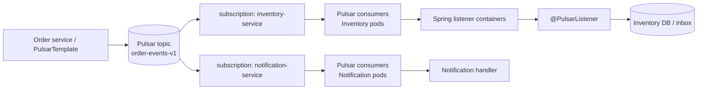
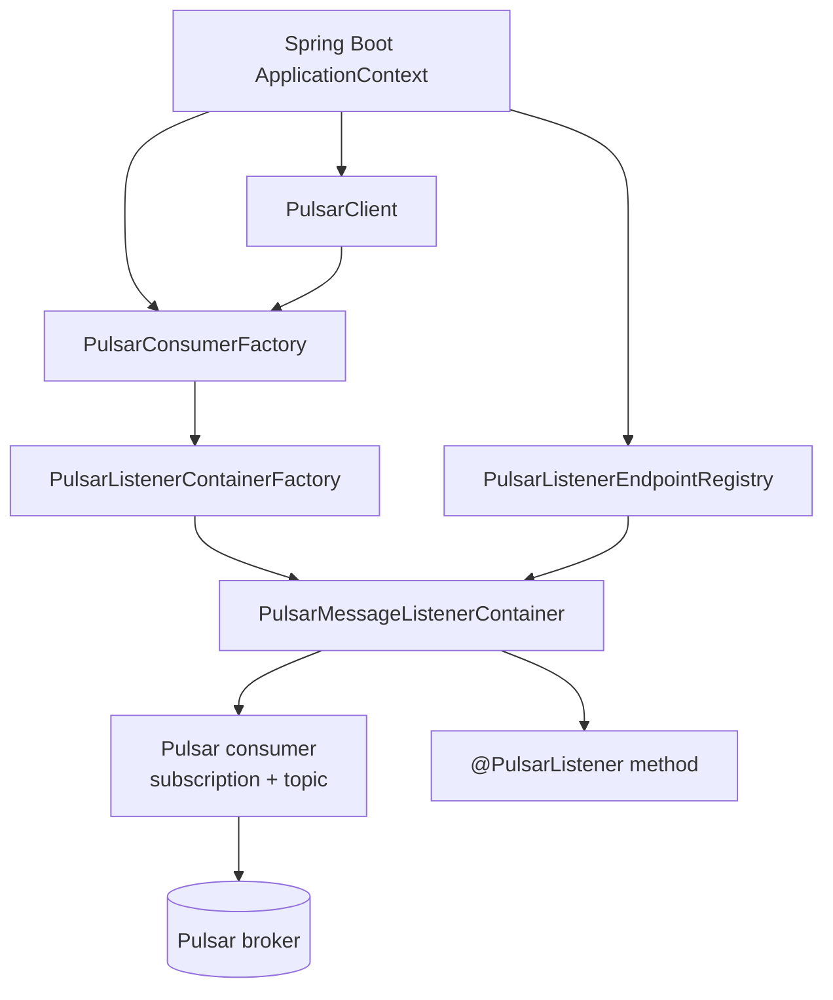
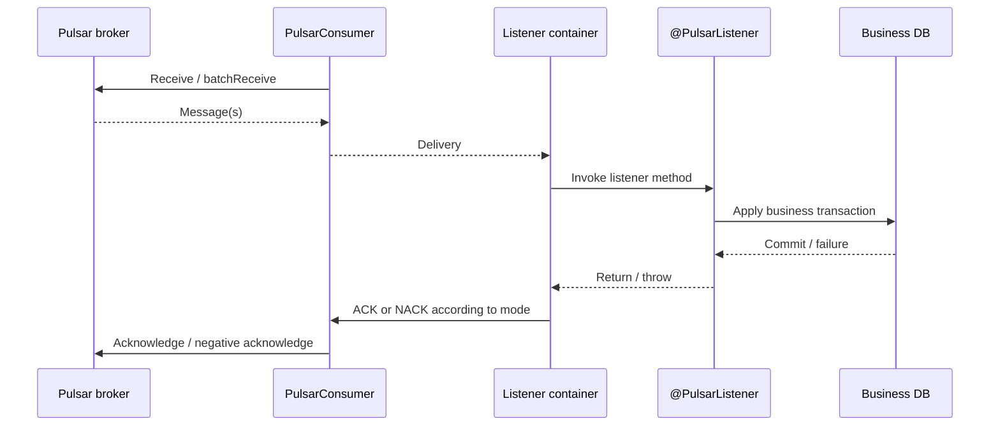
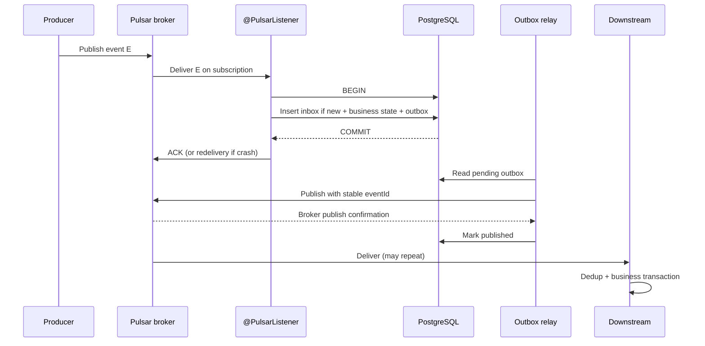

# @PulsarListener, Subscriptions, and Listener Containers

> **Chapter:** Apache Pulsar  
> **Module:** `SPRING_BOOT_INTEGRATION` — organizing system integration in Spring Boot via HTTP clients, databases, caches, message brokers, and Spring Integration adapters. Focuses on configuration, data contracts, transactions, errors, deduplication, testing, and observing real integration flows.
>
> **Version scope:** Examples use **Spring for Apache Pulsar** APIs in package `org.springframework.pulsar.*` and Spring Boot's `spring-boot-starter-pulsar`. Other generations of Apache Pulsar Spring integration libraries use different packages; do not mix APIs. Configuration, container types, ACK attributes, and retry mechanisms must be verified against the exact Spring Boot/Spring Pulsar/Pulsar Java client versions deployed. Topic, subscription, tenant, and payload names are illustrative data.

## 1. The Problem: One Event, Multiple Consumers, and Duplicate Processing Risk

An e-commerce system has an Order service that handles HTTP `POST /orders`, writes orders to PostgreSQL, and publishes `OrderPlaced` to Apache Pulsar. The Inventory Service must reserve stock, Notification Service sends alerts, and Analytics Service aggregates data.

All three services must **receive the same event for their own responsibilities**, whereas replicas of a **single** service typically split the workload among themselves. If the Inventory Service loses its database connection while processing a message, it must not mark the message completed. If a consumer crashes after committing to the database but before sending an ACK, the broker may redeliver the same event; reserving stock a second time would be a business bug.

Spring for Apache Pulsar provides `@PulsarListener` to declare a **listener method** that receives messages. Behind the annotation stand a **listener container** and a **Pulsar consumer** created, managed, and configured for a **subscription**. Five questions must be kept distinct:

1. **Which topic** holds the messages to read?
2. **Which subscription** represents consumption progress and message distribution mode?
3. **Which consumer/container** receives from the broker and invokes the Java method?
4. **When to ACK/NACK**, and what happens if the business transaction fails?
5. **On redelivery**, do the database, cache, and downstream HTTP remain consistent?

The goal of this lesson is to design a Pulsar listener with explicit configuration, pick the right subscription type, understand the listener container lifecycle, control ACKs and retry bounds, and combine inbox/outbox, testing, and observability.

## 2. Distinguishing Topic, Subscription, Consumer, Listener, and Container

| Concept | Responsibility | Example |
|---|---|---|
| **Topic** | Where producers publish messages; can be persistent/partitioned. | `persistent://shop/integration/order-events-v1` |
| **Subscription** | Consumption identity holding progress/cursor and distribution mode to consumers. | `inventory-service` |
| **Pulsar consumer** | Client connecting to the broker on a subscription and receiving/ACKing messages. | Consumer created by the container |
| **`@PulsarListener`** | Method or listener endpoint mapping messages to Java code. | `onOrderPlaced(...)` |
| **Listener container** | Manages consumers, threads, message reception, listener invocation, ACK/NACK, and lifecycle. | `ConcurrentPulsarMessageListenerContainer` |
| **Consumer factory** | Creates Pulsar consumers based on client and configuration. | `PulsarConsumerFactory` |
| **Listener container factory** | Creates listener containers for endpoints per configuration. | `ConcurrentPulsarListenerContainerFactory` |
| **Endpoint registry** | Tracks and controls containers of listeners with IDs. | `PulsarListenerEndpointRegistry` |

Remember: **a topic is not a subscription**; one topic can have many independent subscriptions. **A listener container is not the broker**: it runs inside the Spring Boot application, creates consumers, and coordinates calls to your method.

### 2.1. Consumption Flow Diagram



Consumers belonging to the same subscription can **share delivery or run active/standby** depending on the subscription type. Different subscriptions maintain separate cursors and can read the same events for independent business purposes.

### 2.2. MessageId Differs from eventId

`MessageId` is assigned by Pulsar to identify a message in the broker; `eventId` is created by the application for a **business event**. If a producer resends the same `OrderPlaced` after a timeout, **two different MessageIds** can carry the same event ID. Therefore, inbox/deduplication should rely on `(consumerName,eventId)` or an appropriate business key, not solely on MessageId.

## 3. How Spring Boot Initializes @PulsarListener

Spring Boot auto-configures Spring Pulsar infrastructure when the proper dependencies and conditions are satisfied:



This is a role diagram, not a guaranteed internal method invocation order across all versions.

- Boot auto-configures `PulsarClient` and consumer/listener infrastructure.
- `@PulsarListener` is detected and registered as an endpoint in the context when `@EnablePulsar` is active; with the compatible Spring Boot starter, Boot enables the necessary infrastructure automatically.
- `PulsarConsumerFactory` creates Pulsar consumers per configuration; the listener container uses those consumers to receive messages.
- `PulsarListenerEndpointRegistry` manages containers registered from annotations, including start/stop/pause/resume per supported APIs.

Do not declare a slew of infrastructure beans just to change a topic, subscription, or concurrency. A custom bean can cause parts of auto-configuration to **back off** and alter which properties, authentication, or metrics are applied. When specialized customization is needed, check the **Condition Evaluation Report** and actual bean wiring.

## 4. Minimal Dependencies and Spring Boot Configuration

### 4.1. Gradle Groovy DSL

```gradle
dependencies {
    implementation("org.springframework.boot:spring-boot-starter-pulsar")
    implementation("org.springframework.boot:spring-boot-starter-jdbc")
    runtimeOnly("org.postgresql:postgresql")

    testImplementation("org.springframework.boot:spring-boot-starter-test")
}
```

`spring-boot-starter-jdbc`/PostgreSQL is only needed when the listener writes an inbox or business state to a database. If a consumer performs pure computation or forwards to another adapter, the Pulsar starter does not require JDBC. Use the BOM/dependency management of a **compatible Spring Boot–Spring Pulsar pair**, rather than mixing client versions randomly.

### 4.2. application.yml

```yaml
spring:
  pulsar:
    client:
      service-url: ${PULSAR_SERVICE_URL:pulsar://localhost:6650}
  datasource:
    url: ${DB_JDBC_URL}
    username: ${DB_USERNAME}
    password: ${DB_PASSWORD}

integration:
  pulsar:
    order-topic: persistent://shop/integration/order-events-v1
    inventory-subscription: inventory-service
```

`spring.pulsar.client.service-url` is the address where the client connects to the broker, not the Pulsar Admin HTTP URL. `integration.pulsar.*` are **application-defined properties** specifying the topic and subscription; they do not automatically create a topic without code or listener configuration referencing them.

In production, provision tenants/namespaces/topics, consume permissions, TLS/authentication security, and retention/subscription policies ahead of time. Do not put credentials in source control, do not use `localhost` as a production endpoint, and do not allow HTTP requests to arbitrarily choose topic or subscription names.

## 5. First @PulsarListener: A Method Receiving String

```java
import org.springframework.pulsar.annotation.PulsarListener;
import org.springframework.stereotype.Component;

@Component
public class OrderEventLogListener {

    @PulsarListener(
        id = "inventory-order-listener",
        topics = "${integration.pulsar.order-topic}",
        subscriptionName = "${integration.pulsar.inventory-subscription}"
    )
    public void onOrderPlaced(String json) {
        // Example only demonstrates the listener method; no business logic yet.
        validateEnvelope(json);
    }

    private void validateEnvelope(String json) {
        if (json == null || json.isBlank()) {
            throw new IllegalArgumentException("Empty event");
        }
    }
}
```

When the container receives a matching message from the topic and subscription, it invokes the method. The `id` attribute identifies the **listener container/endpoint** for management via the registry; it is neither an event ID nor the subscription name.

### 5.1. Why Explicitly Specify subscriptionName?

If `subscriptionName` is omitted, the framework may generate a subscription name automatically. For a consumer that must durably resume progress across restarts/rolling deployments, a **fixed `subscriptionName`** preserves subscriber identity and avoids accidentally creating a fresh subscription on every deploy with unexpected replay or backlog.

If an application has multiple independent listeners on the same topic, clarify:

- Same subscription: messages are distributed according to the subscription type; not every listener receives every message.
- Different subscriptions: each system maintains independent progress and can process the same events.
- Changing the subscription name in production is not like renaming a Java method: the broker may treat it as a brand-new subscriber with a different cursor.

### 5.2. Fully Qualified Topic Names

A persistent topic name generally takes the form:

```text
persistent://<tenant>/<namespace>/<topic>
persistent://shop/integration/order-events-v1
```

Short names may be resolved by the Pulsar client against a default tenant/namespace, but in multi-tenant environments use fully qualified names to prevent publishing/reading in the wrong place. Distinguish persistent from non-persistent topics whenever durability or recovery is required.

## 6. Receiving Raw Payloads, Pulsar Messages, or Spring Messages

A listener can accept various parameter forms:

| Method parameter | Convenient for | Notes |
|---|---|---|
| `String` / `Integer` / POJO | Only needing the converted payload | Schema must match |
| `org.apache.pulsar.client.api.Message<T>` | Needing key, MessageId, properties, event time, redelivery count | Distinguish broker metadata from business data |
| `org.springframework.messaging.Message<T>` | Wanting Spring Messaging headers | Header mapping depends on framework/serialization |
| `@Header(...)` | Extracting a specific metadata field | Use the exact header name from infrastructure |
| `List<T>` when `batch = true` | Processing multiple records in one call | Batch-wide ACK and retry behavior must be understood |
| `Acknowledgement` in `MANUAL` mode | Deciding explicitly when to ACK/NACK | Must handle error paths too |

Example receiving a Pulsar message to access metadata:

```java
import org.apache.pulsar.client.api.Message;
import org.springframework.pulsar.annotation.PulsarListener;
import org.springframework.stereotype.Component;

@Component
class OrderMetadataListener {

    @PulsarListener(
        topics = "${integration.pulsar.order-topic}",
        subscriptionName = "inventory-audit"
    )
    void receive(Message<String> message) {
        String payload = message.getValue();
        String eventId = message.getProperty("eventId");
        String key = message.getKey();
        var brokerMessageId = message.getMessageId();

        auditAccepted(eventId, key, brokerMessageId.toString(), payload);
    }

    private void auditAccepted(
            String eventId, String key, String messageId, String payload) {
        // Illustrative adapter; avoid logging raw payloads/PII in production.
    }
}
```

The method reads metadata, yet fields like `eventId`, `key`, and `payload` still must be **validated**. If `eventId` is only inside the payload and not in properties, `message.getProperty("eventId")` will have no value; producer and consumer must agree on the contract.

## 7. JSON Schema and Listener Conversion

Pulsar supports schemas at the topic/client level. Spring Pulsar can infer a schema from the listener's argument type when supported; for complex payloads, default inference often leans toward JSON, but **never assume** every record/POJO remains compatible across version upgrades.

Example Java POJO suitable for an illustrative JSON contract:

```java
public class OrderPlacedPayload {
    public String eventId;
    public String orderId;
    public String tenantId;
    public int schemaVersion;

    public OrderPlacedPayload() {
    }
}
```

```java
import org.apache.pulsar.common.schema.SchemaType;
import org.springframework.pulsar.annotation.PulsarListener;
import org.springframework.stereotype.Component;

@Component
class TypedOrderListener {

    @PulsarListener(
        topics = "${integration.pulsar.order-topic}",
        subscriptionName = "inventory-typed",
        schemaType = SchemaType.JSON
    )
    void listen(OrderPlacedPayload event) {
        if (event.eventId == null || event.orderId == null) {
            throw new IllegalArgumentException("Missing required event fields");
        }
    }
}
```

This is a **standalone demo listener**; in a real application, do not add a parallel `inventory-typed` subscription alongside `inventory-service` just to test a payload type, as both listeners executing side effects would process the same event twice.

### 7.1. A String Containing JSON Is Not Pulsar Schema.JSON

A producer sending JSON under `Schema.STRING` with a listener receiving `String` and parsing JSON in application code is a different contract from a producer sending a POJO with `Schema.JSON(OrderPlacedPayload.class)`. Producer and consumer schemas must match the topic's compatibility policy.

When a consumer fails during decoding/schema handling before the method is invoked, the error handler path may differ from an exception thrown **inside** the listener. Test both paths with real messages rather than unit testing only the method.

### 7.2. Schema Evolution

During rolling deploys of new producers and old consumers:

- Does the event carry `schemaVersion` and a backward-compatibility policy?
- Are new fields optional or required? How do older consumers handle unknown fields?
- Do Avro/Protobuf/JSON apply the right compatibility rules?
- Can an event sitting in backlog for days still be decoded after an upgrade?
- Do retry/DLQ topics preserve message metadata and version well enough for reprocessing?

A schema registry/serializer does not replace business validation: `orderId` and `eventId` must still match the tenant, valid state, and idempotency key.

## 8. Subscription Types: Exclusive, Failover, Shared, and Key_Shared

Pulsar provides four common subscription types with distinct semantics:

| Subscription type | How the broker dispatches | Ordering and scaling |
|---|---|---|
| **Exclusive** | Only one consumer may attach to the subscription at a time. | Simple; does not scale out across multiple consumers on the same subscription. |
| **Failover** | Active/standby consumers; on partitioned topics, active consumers can be assigned per partition. | Useful for failover and per-partition ordering; throughput scales with partitions. |
| **Shared** | Multiple consumers on the same subscription split messages. | Easy to scale; **does not guarantee ordering** across multiple consumers. |
| **Key_Shared** | Dispatches messages by key to consumers in the subscription. | Supports per-key processing, but requires compatible producer batching/routing settings. |

Phrases like "guarantees ordering" here must be understood **within Pulsar's scope and conditions**. There is no total global ordering across multiple partitions or multiple aggregates; redelivery and business retries can still cause out-of-order business outcomes unless the application checks versions.

### 8.1. Choosing the Type for Your Problem

- Simple task needing only a single consumer: `Exclusive` may fit.
- Need standby or active consumer per partition: `Failover`.
- Need multiple independent workers processing order-independent commands: `Shared`.
- Need scale while preserving affinity by `orderId`/`aggregateId`: `Key_Shared` with properly designed message keys and batching.

**A Kafka consumer group is not the exact same construct as a Pulsar subscription.** They serve overlapping goals, yet differ in offsets, ACKs, partition assignment, and read history mechanics.

### 8.2. Shared Subscription Example

```java
import org.apache.pulsar.client.api.SubscriptionType;
import org.springframework.pulsar.annotation.PulsarListener;
import org.springframework.pulsar.listener.AckMode;

@PulsarListener(
    topics = "${integration.pulsar.order-topic}",
    subscriptionName = "inventory-service",
    subscriptionType = SubscriptionType.Shared,
    concurrency = "4",
    ackMode = AckMode.RECORD
)
void process(String json) {
    inventoryService.applyOnce(json);
}
```

The example assumes the method resides in a Spring bean with `inventoryService` injected. `concurrency = "4"` instructs the container to create multiple consumers per deployment capabilities; it does not mean each message is processed exactly once and does not eliminate the consumer's unique constraint.

### 8.3. Key_Shared Requires Real Keys

If the producer does not set a stable key, or producer batching is incompatible with `Key_Shared`, you have no per-order ordering guarantee. Test with a **partitioned topic, multiple consumers, multiple events for the same `orderId`**, and redelivery; do not test only the nominal path.

## 9. Subscription Names, Cursors, and Initial Startup

A subscription is a durable identity on the broker when created with the corresponding policy. It holds the consumption **cursor/progress**. Key points to distinguish:

- **New subscription:** starting position depends on `SubscriptionInitialPosition` and consumer/broker configuration; deliberately choose `Earliest` vs `Latest` per requirements.
- **Existing subscription:** consumers normally resume from the subscription's existing cursor/state; changing startup settings does not automatically reset history.
- **Changing `subscriptionName`:** can create a new subscriber/cursor and replay or skip history depending on initial position.
- **Deleting a subscription:** can wipe progress and break replay capability; only perform via an owned runbook.
- **Retention and backlog:** messages past their retention policy may no longer be replayable as expected.

For consumers handling payments/orders, **do not rely on auto-generated subscription names**. Choose stable names aligned with business responsibility, such as `inventory-service` or `accounting-projection-v1`. For major contract changes, subscription migrations require explicit decisions on replay, idempotency, and cutover.

### 9.1. Two Downstream Systems Need Two Subscriptions

If Inventory and Notification each need to receive every event, give them two separate subscriptions. Two Inventory replicas on the same `Shared` subscription split the work rather than each replica receiving every event.

Changing `subscriptionName` to "fix a consumer not receiving messages" without inspecting backlog/topic/schema can create **two parallel processing flows** or skip older data.

## 10. What Does the Listener Container Do Behind the Annotation?

`PulsarMessageListenerContainer` is the contract wrapping the listener and managing consumers. Spring Pulsar includes typical implementations/variants:

- `DefaultPulsarMessageListenerContainer`: a single Pulsar consumer.
- `ConcurrentPulsarMessageListenerContainer`: coordinates multiple consumers/receivers according to concurrency.
- `PulsarRecordMessageListener`: processes a single record.
- `PulsarAcknowledgingMessageListener`: processes a record with `Acknowledgement`.
- `PulsarBatchMessageListener`: processes a collection of records.
- `PulsarBatchAcknowledgingMessageListener`: batch processing with manual acknowledgement.

Internally, the container can receive a **batch** from the consumer via `batchReceive`, then invoke the listener record-by-record when the method takes `String`/`Message<T>`, or pass the whole collection when `batch = true`. This is why `AckMode.BATCH` differs from writing a `List<T>` method yourself.



Do not assume the container manages the **entire database transaction**: it manages message consumption; the database transaction depends on your service and configured `PlatformTransactionManager`.

### 10.1. Factories and Registries Are Separate

`PulsarConsumerFactory` creates **Pulsar consumers**, `PulsarListenerContainerFactory` creates **listener containers**. `PulsarListenerEndpointRegistry` manages containers created from listener endpoints, which are generally not treated as application beans to inject directly by type.

To control a specific container, set `id` on the annotation and look it up through the registry rather than querying arbitrary `PulsarMessageListenerContainer` beans from the context.

## 11. Concurrency, Partitions, and Actual Consumer Count

Suppose you use `subscriptionType = SubscriptionType.Shared` and `concurrency = "4"`. The container can create four consumers inside one app instance (in addition to consumers on other pods).

If you deploy 3 pods each with concurrency 4, total client consumers can reach 12 for the same subscription. This does **not** mean throughput scales 12x: limits still apply from the broker, topic partitions, DB connection pools, serialization, network, and business locks.

Key points:

1. `Exclusive` does not support concurrency greater than one consumer on the same subscription.
2. `Failover` can maintain standby consumers; on a **non-partitioned** topic, raising concurrency may simply add idle standby consumers.
3. `Shared` distributes across many consumers without ordering guarantees.
4. `Key_Shared` needs compatible keys and batching policies; a single "hot key" can become a bottleneck.
5. Multiple listener methods in one JVM create **multiple containers/subscriptions** per configuration; they do not automatically merge just because they share a topic.
6. Message redelivery can re-run partial work; high concurrency **increases the demand for idempotency**.

### 11.1. Avoid Long-Running Slow API Calls on Consumer Threads

If `@PulsarListener` calls a partner HTTP endpoint taking several seconds while holding a DB connection open in the same transaction, backlog and pool contention can spike. A better approach is usually:

- Validate and persist the work into an inbox/job table **in a short transaction**.
- ACK once the work is durably stored per contract, not when merely queued in RAM.
- Let a separate worker/relay call HTTP with timeouts, a retry budget, and an idempotency key.
- Enforce rate limiting/backpressure across total pod count rather than simply raising concurrency.

## 12. ACK, NACK, and When a Message Is Considered Done

**ACK (acknowledgement)** confirms consumption progress to the broker. **NACK (negative acknowledgement)** signals that redelivery is needed per the configured mechanism and delay. An ACK is not proof that all downstream systems have updated if the listener only persisted an outbox task.

Spring Pulsar has three common **AckMode** values:

| AckMode | Basic behavior | When to use |
|---|---|---|
| `BATCH` | Container processes received records and ACKs/NACKs based on the received batch outcome. | Default commonly used for record listeners when throughput matters. |
| `RECORD` | ACKs/NACKs each record individually after invoking the listener. | When per-record outcomes are wanted and commit boundaries should be straightforward. |
| `MANUAL` | Application explicitly calls `Acknowledgement.acknowledge()/nack()`. | When custom ACK policy, per-item handling, or commit coordination is required. |

In Spring Pulsar branches with this API, **`BATCH` is typically the default** for listener containers. Do not confuse it with `batch = true` on the annotation:

- `ackMode = BATCH`: **ACK strategy**.
- `batch = true`: **method invocation shape** receiving a collection.
- `subscriptionType = Shared`: **broker message distribution**.
- `concurrency = "4"`: **container-side consumer count**.

These four settings govern different layers.

### 12.1. ACK Does Not Prevent All Duplicates

Suppose:

```text
Consumer receives event E
→ PostgreSQL commits successfully
→ Process dies before ACK reaches broker
→ Broker redelivers E
```

The DB state is committed, yet the broker never recorded the ACK. The second delivery must recognize that `eventId` was already processed and **not repeat side effects**. Thus, accurate ACKs and inbox idempotency complement each other rather than replacing one another.

## 13. AckMode.RECORD: Processing Record by Record

When you want the framework to ACK each message after the listener completes successfully, specify:

```java
import org.apache.pulsar.client.api.SubscriptionType;
import org.springframework.pulsar.annotation.PulsarListener;
import org.springframework.pulsar.listener.AckMode;
import org.springframework.stereotype.Component;

@Component
public class InventoryRecordListener {

    private final InventoryApplicationService service;

    public InventoryRecordListener(InventoryApplicationService service) {
        this.service = service;
    }

    @PulsarListener(
        id = "inventory-record-listener",
        topics = "${integration.pulsar.order-topic}",
        subscriptionName = "inventory-service",
        subscriptionType = SubscriptionType.Shared,
        ackMode = AckMode.RECORD
    )
    public void receive(String eventJson) {
        service.applyOnce(eventJson);
    }
}
```

Here `InventoryApplicationService.applyOnce` is an **application-implemented service**: it parses/validates the event, checks `eventId`, and writes the inbox alongside business changes in a single DB transaction. When the service returns normally after commit, the framework can ACK; if it throws an exception, the container handles failure/NACK per policy.

**Never catch every exception, log it, and return normally**: the framework will treat the method as successful and ACK, silently dropping failed work. Classify domain errors: duplicates can count as success; transient DB errors must allow retry; poison messages need a quarantine/DLQ policy.

### 13.1. Note on @Async Inside Listeners

If a listener calls an `@Async` method, gets a `CompletableFuture`, and **returns immediately** without durable persistence, the container can ACK before the async worker finishes. If the JVM crashes, the message will not be redelivered even though side effects never ran.

To decouple processing, persist a task/inbox record before ACKing, or choose an acknowledgement/asynchronous model verified on your exact version.

## 14. AckMode.MANUAL and Acknowledgement

Manual ACK lets the application decide exactly when to ACK/NACK. In **Spring for Apache Pulsar** `org.springframework.pulsar.*`, the interface is named **`Acknowledgement`** (spelled with an `e` before `ment`), unlike prose explanations that use "Acknowledgment".

```java
import org.apache.pulsar.client.api.Message;
import org.apache.pulsar.client.api.SubscriptionType;
import org.springframework.pulsar.annotation.PulsarListener;
import org.springframework.pulsar.listener.AckMode;
import org.springframework.pulsar.listener.Acknowledgement;
import org.springframework.stereotype.Component;

@Component
public class InventoryManualAckListener {

    private final InventoryApplicationService service;

    public InventoryManualAckListener(InventoryApplicationService service) {
        this.service = service;
    }

    @PulsarListener(
        id = "inventory-manual-listener",
        topics = "${integration.pulsar.order-topic}",
        subscriptionName = "inventory-manual-service",
        subscriptionType = SubscriptionType.Shared,
        ackMode = AckMode.MANUAL
    )
    public void receive(Message<String> message, Acknowledgement acknowledgment) {
        try {
            service.applyOnce(message.getValue());
            // Only ACK after the service finishes a durable transaction.
            acknowledgment.acknowledge();
        } catch (RuntimeException failure) {
            // Bounded redelivery/DLQ configured on the consumer.
            acknowledgment.nack();
        }
    }
}
```

**The example uses a separate subscription `inventory-manual-service` to teach manual ACK; do not deploy it concurrently alongside `inventory-service` for the same business side effect unless intentional.**

This illustrates ACK/NACK, though production must classify exceptions before NACKing:

- **Transient:** DB timeout, temporary network glitch → NACK and retry with backoff/budget.
- **Non-retryable:** bad schema, invalid tenant → do not NACK forever; route to quarantine/DLQ per policy.
- **Already-committed duplicate:** handle idempotently and ACK success without reapplying side effects.

In `MANUAL` mode, the framework **does not ACK for you**. If execution follows a branch that calls neither ACK nor NACK, the message can remain unacked until ack timeout/redelivery or lifecycle events intervene. When calling `acknowledge`/`nack` itself fails, log and apply a clear policy; never use an empty catch block.

### 14.1. Per-MessageId ACK

The API also supports variants such as:

```java
acknowledgment.acknowledge(message.getMessageId());
acknowledgment.nack(message.getMessageId());
```

These calls represent **two alternative branches**, never to be called back-to-back on the same message in real code. In a batch listener, you can ACK/NACK per `MessageId`. MessageId serves technical broker operations and must not be used as a business deduplication key.

### 14.2. When Not to Use MANUAL

Manual ACK increases control at the cost of more error paths to manage. If your logic is simply calling a synchronous service, committing to the DB, and returning/throwing, `AckMode.RECORD` is usually simpler. Choose manual when there is a clear reason, such as partial success in a batch, coordinating special durable persistence, or actively calling NACK.

## 15. batch = true Differs from ackMode = BATCH

A Pulsar consumer can receive multiple messages in one poll. A record listener is still called by the container **message by message**; with `batch = true`, the listener method receives a collection.

```java
import java.util.List;
import org.apache.pulsar.client.api.SubscriptionType;
import org.apache.pulsar.common.schema.SchemaType;
import org.springframework.pulsar.annotation.PulsarListener;

@PulsarListener(
    topics = "persistent://shop/integration/order-events-v1",
    subscriptionName = "batch-audit-service",
    subscriptionType = SubscriptionType.Shared,
    schemaType = SchemaType.JSON,
    batch = true
)
void receiveBatch(List<OrderPlacedPayload> payloads) {
    for (OrderPlacedPayload event : payloads) {
        auditService.validateAndStore(event);
    }
}
```

The example assumes the method is inside a Spring bean, `OrderPlacedPayload` is compatible with the Pulsar JSON schema, and `auditService` is application-defined.

### 15.1. Auto-ACK with Batch Listeners

With a batch listener and `AckMode.BATCH`, if the **entire method** finishes, the framework can ACK the received batch; if an exception occurs, the batch may be NACKed and redelivered. This is a classic source of duplicates: if the first 9 items commit and the 10th throws, redelivery can replay all 10 items.

Therefore, you need:

- Idempotent writers keyed by event ID.
- Clear transaction/chunk boundaries.
- Rules for poison items and partial success.
- Bounded batch/fetch sizes so one bad item does not trigger overly large batch retries.

In the described Spring Pulsar branch, `AckMode.RECORD` **is not used with `batch = true`**; if you need to ACK individual messages within a batch, use `AckMode.MANUAL` and check the supported API on your version.

### 15.2. Partial ACK in a Batch: Illustration

```java
import java.util.List;
import org.apache.pulsar.client.api.Message;
import org.springframework.pulsar.annotation.PulsarListener;
import org.springframework.pulsar.listener.AckMode;
import org.springframework.pulsar.listener.Acknowledgement;

@PulsarListener(
    topics = "persistent://shop/integration/order-events-v1",
    subscriptionName = "inventory-batch-service",
    subscriptionType = org.apache.pulsar.client.api.SubscriptionType.Shared,
    batch = true,
    ackMode = AckMode.MANUAL
)
void receiveBatch(List<Message<String>> messages,
                  Acknowledgement acknowledgement) {
    for (Message<String> message : messages) {
        try {
            inventoryService.applyOnce(message.getValue());
            acknowledgement.acknowledge(message.getMessageId());
        } catch (RuntimeException ex) {
            acknowledgement.nack(message.getMessageId());
        }
    }
}
```

This is a conceptual example of **partial ACK** for a supporting listener container and version. In production, classify errors, bound redeliveries, avoid catching every error into infinite NACKs, and verify real batch ACK semantics, especially when the producer uses different batching settings.

Do not confuse **consumer receive batch** with **producer batch**: the two groupings can have different boundaries.

## 16. Redelivery: Negative Ack, Ack Timeout, and Retries

A message can reappear in several ways:

1. The listener throws an exception; the container handles the failure and NACKs per `AckMode`/error handler.
2. The application explicitly calls `Acknowledgement.nack()`.
3. The consumer fails to ACK in time and **acknowledgement timeout** is configured.
4. The consumer/container disconnects or the pod crashes before ACK.
5. The producer republishes the same event after an uncertain publish outcome.

Each mechanism has **different timing, delays, and scopes**. Do not loosely say "the framework retries 3 times" without inspecting native Pulsar consumer settings, the Spring Pulsar error handler, and broker policies.

### 16.1. Negative Acknowledgement Redelivery

A Pulsar consumer can use a negative-ack redelivery delay or backoff. In some Spring Pulsar versions, this can be customized via the consumer builder or `properties` on `@PulsarListener`. Illustrative native Pulsar consumer property example:

```java
@PulsarListener(
    topics = "persistent://shop/integration/order-events-v1",
    subscriptionName = "inventory-service",
    subscriptionType = SubscriptionType.Shared,
    properties = { "negativeAckRedeliveryDelay=10s" }
)
void receive(String payload) {
    inventoryService.applyOnce(payload);
}
```

Entries in `properties = {...}` are **native Pulsar consumer properties**, not `spring.pulsar.consumer.*` keys. Accepted names/units and values can vary by Pulsar client version; test this example against your real client rather than assuming `10s` is valid in every release. When precision is required, use the version-matched customizer/`RedeliveryBackoff` API and observe redelivery timings.

### 16.2. Acknowledgement Timeout

If ACK timeout is enabled, messages unacked past the configured duration can be redelivered per policy. An ACK timeout shorter than normal business processing triggers duplicate deliveries even when the pod is healthy. Do not "fix" this by setting an infinite timeout and ignoring stalled workers; use bounded processing, HTTP/DB timeouts, and message-age metrics.

### 16.3. Application-Level Retries Differ from Broker Retries

If a service uses Resilience4j/Spring Retry to retry a transient DB error **inside the listener**, it may execute multiple times before throwing out of the method. Then the broker may redeliver several more times. The effective total attempts can multiply across both retry layers, causing a retry storm.

Assign a clear retry owner: brief glitches can use bounded local retries, while longer delays/replays belong to the broker/job table/DLQ with backoff and alerts.

## 17. Dead-Letter Topics and Poison Message Handling

An event with a permanent schema or validation error must not be NACKed forever. Pulsar supports **`DeadLetterPolicy`** in compatible subscription modes/versions. Example with `Shared`:

```java
import org.apache.pulsar.client.api.DeadLetterPolicy;
import org.apache.pulsar.client.api.SubscriptionType;
import org.springframework.context.annotation.Bean;
import org.springframework.context.annotation.Configuration;
import org.springframework.pulsar.annotation.PulsarListener;

@Configuration(proxyBeanMethods = false)
class InventoryDeadLetterConfiguration {

    private final InventoryApplicationService inventoryService;

    InventoryDeadLetterConfiguration(
            InventoryApplicationService inventoryService) {
        this.inventoryService = inventoryService;
    }

    @Bean
    DeadLetterPolicy inventoryDeadLetterPolicy() {
        return DeadLetterPolicy.builder()
            .maxRedeliverCount(5)
            .deadLetterTopic(
                "persistent://shop/integration/order-events-inventory-dlq")
            .build();
    }

    @PulsarListener(
        topics = "persistent://shop/integration/order-events-v1",
        subscriptionName = "inventory-dlq-service",
        subscriptionType = SubscriptionType.Shared,
        deadLetterPolicy = "inventoryDeadLetterPolicy"
    )
    void receive(String json) {
        inventoryService.applyOnce(json);
    }
}
```

This snippet **illustrates** linking a policy bean to the annotation; the service is constructor-injected, while topics/permissions must be provisioned and verified in a real environment. Subscription types supporting native DLQ and redelivery counting can vary by version; Spring Pulsar 1.2 documentation describes native DLQ configuration for `Shared`. **Do not assume `Exclusive`/`Failover` behave identically** without checking.

### 17.1. A DLQ Is Not "Resolved"

A DLQ requires:

- A persistent topic with retention/ACLs and safe error metadata storage.
- Alerting an owner when new messages arrive.
- Triage workflows: bad payload, schema change, lost permissions, logic bug, unavailable dependency.
- Replay tooling preserving the **original event ID**, without generating new business events for retries.
- Idempotency guarantees during replay to avoid doubling side effects.
- Controlled retry counts and delays so the broker is not overwhelmed.

For messages that cannot be decoded into a DTO, errors can happen **before the listener method runs**. Inspect the error handler/container/serializer; a `try/catch` inside the method will not catch deserialization errors thrown before invocation.

### 17.2. Spring Pulsar Error Handler vs Native DLQ

Spring Pulsar provides framework-level error handling such as `PulsarConsumerErrorHandler` in supported versions. It does not have to be combined with every native DLQ policy simultaneously. If combining layers, define which layer owns retries, recovery, ACK/NACK, and DLT publishing so failed messages are not routed to two places or ACKed before durable recovery.

## 18. Inbox and Idempotency: A Consumer Can Receive an Event Multiple Times

A consumer handling `OrderPlaced` needs a unique key in the database. PostgreSQL example:

```sql
CREATE TABLE processed_message (
    consumer_name VARCHAR(120) NOT NULL,
    event_id VARCHAR(160) NOT NULL,
    processed_at TIMESTAMPTZ NOT NULL DEFAULT CURRENT_TIMESTAMP,
    PRIMARY KEY (consumer_name, event_id)
);

CREATE TABLE inventory_reservation_request (
    command_id VARCHAR(180) PRIMARY KEY,
    order_id VARCHAR(120) NOT NULL,
    status VARCHAR(24) NOT NULL
);
```

Making `event_id NOT NULL` in the business key is critical: an event without a stable ID cannot be reliably deduplicated. The `command_id` column must also stay stable across redeliveries.

### 18.1. Service Persisting Inbox and Business State in One Transaction

```java
import org.springframework.jdbc.core.JdbcTemplate;
import org.springframework.stereotype.Service;
import org.springframework.transaction.annotation.Transactional;

@Service
public class InventoryApplicationService {

    private final JdbcTemplate jdbc;
    private final OrderEventParser parser;

    public InventoryApplicationService(
            JdbcTemplate jdbc, OrderEventParser parser) {
        this.jdbc = jdbc;
        this.parser = parser;
    }

    @Transactional
    public void applyOnce(String json) {
        OrderPlacedEvent event = parser.parseAndValidate(json);

        int inserted = jdbc.update(
            """
            INSERT INTO processed_message (consumer_name, event_id)
            VALUES (?, ?)
            ON CONFLICT (consumer_name, event_id) DO NOTHING
            """,
            "inventory-service",
            event.eventId()
        );

        if (inserted == 0) {
            return; // Already processed duplicate; ACK normally.
        }

        jdbc.update(
            """
            INSERT INTO inventory_reservation_request
                (command_id, order_id, status)
            VALUES (?, ?, 'PENDING')
            ON CONFLICT (command_id) DO NOTHING
            """,
            "reserve-" + event.eventId(),
            event.orderId()
        );
    }
}
```

`OrderEventParser` and `OrderPlacedEvent` are application-defined types. `parseAndValidate` must verify eventId, orderId, tenant, schema version, and contract before writing. Both tables require migrations; service and listener must share the same database/transaction manager.

Because `@Transactional` is on a Spring service method called by the listener through a Spring proxy, when the method **returns normally**, the transaction has typically committed. If the transaction rolls back due to an exception, the listener must not ACK it as a success.

### 18.2. Why SELECT-Then-INSERT Fails

```text
Consumer A: SELECT sees eventId absent
Consumer B: SELECT sees eventId absent
Consumer A: INSERT + updates inventory
Consumer B: INSERT + updates inventory
```

Without a unique constraint, two consumers can both trigger side effects. Let the database arbitrate via `PRIMARY KEY/UNIQUE` and idempotent insert/upsert **in the same transaction** as business changes. Do not rely solely on subscription type or concurrency settings to prevent duplicates.

### 18.3. ACK After Database Commit Before Downstream HTTP?

If the service writes a `PENDING` request to the DB and then ACKs, you have only guaranteed **durable work acceptance**, not that the warehouse actually received the HTTP call or reserved stock. Another worker/relay must complete the step and update state. APIs/metrics must distinguish `accepted`, `queued`, `processed`, `failed`, and `downstream confirmed`.

## 19. Pulsar Transactions and JDBC Transactions Are Separate Boundaries

Some Pulsar/Spring Pulsar versions support **Pulsar transactions** for broker publish/ack when cluster and configuration permit. Spring Boot includes transaction properties such as `spring.pulsar.transaction.enabled` in compatible lines. However:

- It does not turn `@Transactional` JDBC into a distributed transaction between PostgreSQL and Pulsar.
- A Pulsar ACK does not roll back committed SQL if a broker transaction fails.
- A SQL rollback does not undo an HTTP call or external Redis cache mutation.
- If a listener both writes to a DB and emits a broker message, account for uncertain crash outcomes.

### 19.1. Inbox + Outbox Pattern



If the relay publishes and crashes before updating `PUBLISHED`, it may publish again. Hence downstream must still deduplicate. **ACKing the input** can be completely valid once the next step is safely persisted in the DB; it does not prove every downstream action has finished.

### 19.2. Choose a Single Owner for Each State

Do not let one service update the DB, an async callback mark ACK, and another scheduler emit messages without consistent boundaries. Assign clear state owners: the listener ingests and commits the inbox, the relay publishes the outbox, the downstream consumer deduplicates and commits, and operators monitor retries/DLQ.

## 20. Managing Listener Containers: IDs, Lifecycle, Pause/Resume

Spring Pulsar manages listener containers with the application lifecycle. Setting `id` on the annotation lets you look up the container via the registry:

```java
import org.springframework.pulsar.config.PulsarListenerEndpointRegistry;
import org.springframework.pulsar.listener.PulsarMessageListenerContainer;
import org.springframework.stereotype.Service;

@Service
public class PulsarListenerControl {

    private final PulsarListenerEndpointRegistry registry;

    public PulsarListenerControl(PulsarListenerEndpointRegistry registry) {
        this.registry = registry;
    }

    public void pauseInventory() {
        PulsarMessageListenerContainer container =
            registry.getListenerContainer("inventory-order-listener");

        if (container == null) {
            throw new IllegalStateException("Listener container not registered");
        }
        container.pause();
    }

    public void resumeInventory() {
        PulsarMessageListenerContainer container =
            registry.getListenerContainer("inventory-order-listener");

        if (container == null) {
            throw new IllegalStateException("Listener container not registered");
        }
        container.resume();
    }
}
```

`pause/resume` methods are supported by Spring Pulsar in relevant branches, though exact signatures/lifecycle behavior must be verified per version. **Do not expose this control endpoint to the public internet**. Only authorized operators should pause listeners; log audit trails, status, reason, and backlog alerts.

### 20.1. Pause Does Not Delete Messages

Pausing temporarily suspends the container's receive/poll loop as supported; messages remain on the broker per retention/subscription policy. On resume, the consumer continues from its subscription cursor. During pause, backlog can grow; monitor metrics and limit pause duration.

`stop()` and `pause()` are distinct operational actions. Stopping may close/restart the consumer per lifecycle; pausing typically keeps the container structure while halting consumption. Test behavior during shutdown, rolling deploys, and broker reconnects.

### 20.2. Startup Failure Policy

In versions supporting `StartupFailurePolicy`, the container can:

- **Stop:** fail startup if the listener cannot start (default in some versions).
- **Continue:** log the error and leave the container stopped while the application may still start.
- **Retry:** attempt restarting with bounded retries and leave it stopped if still failing.

Do not pick `Continue`/`Retry` merely to get a "green pod" when a vital listener is down. If a service's sole purpose is consuming Pulsar, readiness should reflect that the listener is not running; if it also ingests HTTP into an inbox while Pulsar is down, a degraded mode may make sense. Startup policy and readiness probes must align.

## 21. Customizers, Listener Factories, and Layered Configuration

Spring Boot supports property groups such as:

- `spring.pulsar.client.*`: Pulsar client connecting to the broker.
- `spring.pulsar.consumer.*`: consumer factory/client configuration.
- `spring.pulsar.listener.*`: listener container behavior.
- `integration.pulsar.*`: application-defined properties.

When customizing a specific listener, `@PulsarListener` offers attributes such as `subscriptionType`, `ackMode`, `concurrency`, `batch`, `consumerCustomizer`, `containerFactory`, and `properties` depending on version.

Example consumer property on a listener:

```java
@PulsarListener(
    id = "inventory-tuned-listener",
    topics = "persistent://shop/integration/order-events-v1",
    subscriptionName = "inventory-tuned",
    subscriptionType = SubscriptionType.Shared,
    properties = { "receiverQueueSize=500" }
)
void receive(String payload) {
    inventoryService.applyOnce(payload);
}
```

`receiverQueueSize` is a Pulsar consumer property; this limit affects receive buffering and memory/performance. Size it for your workload rather than leaving demo values as production defaults.

### 21.1. Global Customizer vs Per-Listener Customizer

- A global `ConsumerBuilderCustomizer` affects **every consumer** created by the consumer factory.
- `PulsarListenerConsumerBuilderCustomizer` attached via `consumerCustomizer` targets a specific listener.
- `PulsarContainerFactoryCustomizer<ConcurrentPulsarListenerContainerFactory<?>>` customizes the Boot auto-configured container factory in supported Spring Boot lines.
- `containerFactory` on the annotation selects a named factory when one app needs multiple distinct configurations.

Do not conflate **consumer builder** with **listener container factory**. Changing `receiverQueueSize` is consumer-level; configuring container startup policy or ACK behavior belongs to another layer.

### 21.2. Avoiding Deprecated APIs on Upgrade

Older methods such as `ConcurrentPulsarListenerContainerFactory.setConcurrency(...)` were deprecated in Spring Pulsar 1.2 and removed in Spring Pulsar 2.0. For straightforward concurrency, declaring `@PulsarListener(concurrency = "...")` per version is cleaner; for global policies, use supported customizer/container properties APIs.

Do not copy classes/namespaces from "Apache Pulsar support for Spring" if your project uses "Spring for Apache Pulsar" under `org.springframework.pulsar`; those modules have different naming/APIs.

## 22. Security and Tenant/Namespace Isolation

Consumers have permission to read messages carrying business data and require strict security policies:

1. Grant consume permissions scoped to the exact tenant/namespace/topic; never use a cluster-wide admin token.
2. Configure TLS and authentication for your infrastructure; never place tokens in source, logs, or message properties.
3. Use provisioned topics and subscriptions; never accept topic names from untrusted input.
4. Validate `tenantId` inside payloads instead of trusting only the topic name, preventing cross-tenant processing.
5. Secure DLQs and retention: failed messages can contain the same sensitive data as originals.
6. Validate schemas/versions before calling domain code; avoid blindly deserializing untrusted data.
7. Cap payload/batch sizes, receiver queues, and concurrency to protect against OOM/backpressure.
8. When a service hosts multiple listeners, audit which beans are permitted to subscribe to which topics.

If a topic carries multi-tenant data, `(consumerName,eventId)` may not suffice if event IDs are only unique **within a single tenant**. In that case use `(consumerName,tenantId,eventId)` with a constraint and validate the tenant before writing; do not assume global uniqueness of event IDs unless guaranteed by contract.

## 23. Observability: Subscription Backlog, Redelivery, and Business Processing

In multi-service environments, a metric saying "listener method invoked" is insufficient. Measure across boundaries:

| Layer | Metrics/logs to monitor | Detects |
|---|---|---|
| Broker/topic | Publish rate, backlog, retention, storage, quotas | Overloaded broker, growing backlog |
| Subscription | Unacked, redeliveries, subscription type, active consumer count | Slow processing or dropped consumers |
| Listener container | Running/paused/stopped, startup errors, concurrency | Container down despite healthy pod |
| Message conversion | Schema decode errors, unknown versions | Producer/consumer contract drift |
| Business service | Processed, rejected, duplicates, transaction rollbacks | Failed side effects or duplicate events |
| Database | Lock waits, active pool, statement duration | Consumer bottlenecked on DB |
| DLQ/quarantine | Count, oldest age, reason category | Unresolved poison messages |
| Outbox/downstream | Oldest pending age, publish failures, downstream result | Incomplete work after input ACK |

Fields to include in structured logs:

```text
eventId, correlationId, subscriptionName, topic,
consumerName, messageId, schemaVersion,
attempt/redeliveryCount, businessStatus, failureCategory
```

- `eventId` is the business deduplication key; `correlationId` links multiple steps.
- `messageId` aids broker diagnostics but never replaces event ID.
- Never log raw payloads/PII, passwords, tokens, or card numbers.
- High-cardinality labels like event ID/message ID rarely belong in metrics; keep them in sampled logs/traces under proper access controls.

Spring Boot Actuator/Micrometer and Spring Pulsar instrumentation can provide partial metrics/observations depending on dependencies and configuration. Never assume all metrics appear automatically; verify registry, exposure, trace propagation, and actual listener wiring.

## 24. Testing @PulsarListener: From Unit to Real Broker

### 24.1. Unit Testing Business Logic

Separate parsing/validation and `InventoryApplicationService.applyOnce` from the annotation. Unit tests should verify:

- Events missing `eventId`/`orderId` are rejected.
- Re-running the same event ID records business side effects only once.
- Different event IDs with the same correlation ID are still processed independently.
- Transient errors throw exceptions instead of being swallowed by the listener.
- Domain errors route to quarantine per policy rather than retrying forever.

Mocking a listener method can verify service/ACK branching, yet **does not prove** a real broker delivers messages or that transactions roll back.

### 24.2. Testing Listeners with a Real Broker

Use Pulsar test infrastructure or Testcontainers compatible with your pinned version. A smoke test should:

1. Use an isolated test broker/tenant/namespace/topic.
2. Create a stable subscription name for the test with explicit initial position.
3. Publish payloads matching the schema using a producer.
4. Wait for the consumer to commit rows in a test PostgreSQL database, **not merely checking method invocation**.
5. Republish the same `eventId` and verify only one business result.
6. Stop the consumer after commit before ACK (or simulate it), restart, and verify idempotency.
7. Test `Shared` with multiple consumers and `Key_Shared` with compatible keys.
8. Test negative ack/backoff and DLQ after the configured redelivery count.
9. Test serializer failures before the listener method, monitoring, and quarantine.
10. Test pause/resume/startup policy; verify backlog after resume is processed per contract.

### 24.3. Unit Testing Manual ACK at Method Scope

Example with Mockito assuming `InventoryApplicationService` exists and the listener method is invoked directly:

```java
import static org.mockito.Mockito.*;

import org.apache.pulsar.client.api.Message;
import org.junit.jupiter.api.Test;
import org.springframework.pulsar.listener.Acknowledgement;

class InventoryManualAckListenerTest {

    @Test
    void acknowledgesAfterSuccessfulServiceCall() {
        InventoryApplicationService service =
            mock(InventoryApplicationService.class);
        InventoryManualAckListener listener =
            new InventoryManualAckListener(service);

        @SuppressWarnings("unchecked")
        Message<String> message = mock(Message.class);
        when(message.getValue()).thenReturn("{\"eventId\":\"evt-100\"}");

        Acknowledgement ack = mock(Acknowledgement.class);

        listener.receive(message, ack);

        verify(service).applyOnce(message.getValue());
        verify(ack).acknowledge();
        verify(ack, never()).nack();
    }

    @Test
    void nacksWhenServiceFails() {
        InventoryApplicationService service =
            mock(InventoryApplicationService.class);
        InventoryManualAckListener listener =
            new InventoryManualAckListener(service);

        @SuppressWarnings("unchecked")
        Message<String> message = mock(Message.class);
        when(message.getValue()).thenReturn("{\"eventId\":\"evt-101\"}");
        doThrow(new IllegalStateException("DB unavailable"))
            .when(service).applyOnce(message.getValue());

        Acknowledgement ack = mock(Acknowledgement.class);

        listener.receive(message, ack);

        verify(ack).nack();
        verify(ack, never()).acknowledge();
    }
}
```

This example tests only **method branching**; without a listener container, broker, Spring transaction, or DLQ, it does not prove end-to-end durability. Add integration tests with real PostgreSQL/Pulsar to verify commit-before-ACK and post-crash redelivery.

### 24.4. Failure and Consequence Test Matrix

| Scenario | Passing criteria |
|---|---|
| Consumer lacks subscribe permission | Clear startup/consumer error, accurate readiness |
| Wrong topic or subscriptionName | Config mismatch detected, not silently ignored |
| Topic has different schema | Decode failure classified and observed |
| DB commits then crashes before ACK | Redelivery occurs without repeating side effects |
| ACK before DB commit | Test exposes risk; design must prevent |
| Batch of 10 items fails on item 10 | No duplicate side effects thanks to idempotency |
| Broker temporarily unavailable | Listener reconnects/restarts per policy; no saved tasks lost |
| Poison message | Bounded retries, routed to right DLQ/quarantine topic |
| Shared concurrency across multiple pods | Stays within DB pool/rate limits, no business duplicates |
| Key_Shared with ordering requirement | Events with same key preserve order per contract; version-safe replay |
| Listener paused | Backlog measurable; resuming catches up |
| Outbox publisher loses ACK | Retries with stable eventId; consumer deduplicates |

## 25. Troubleshooting Common Issues

| Symptom | Causes to check | Resolution |
|---|---|---|
| `@PulsarListener` never invoked | Missing starter/auto-config, bean not scanned, wrong topic/subscription, container not started | Check startup logs, registry, beans, service URL, ACLs |
| Topic exists but old events missing | New subscription started at Latest or backlog expired retention | Check cursor/initial position and subscription name |
| Multiple services missing events | Sharing the same subscription so they split deliveries | Create separate subscriptions for independent responsibilities |
| Only one consumer active despite high concurrency | Exclusive/Failover non-partitioned or restricted distribution | Pick the right subscription type and partitioning |
| Messages processed multiple times | Redelivery, producer republish, lost ACK after commit | Inbox/unique key by event ID |
| Consumer ACKs despite processing failure | Swallowed exception or in-memory async job before returning | Rethrow errors / ACK after durable commit, test failure paths |
| Manual listener hangs / unacked grows | Forgot `acknowledge/nack` in a code branch | Audit code and timeouts, cover all branches |
| Batch listener keeps re-running whole batch | One record failed, auto BATCH NACKed entire batch | Idempotent writer, manual partial ACK if appropriate |
| DLQ stays empty | Wrong mode, policy, permissions, or redelivery count | Inspect policy bean, consumer mode, and broker stats |
| Duplicates with different MessageIds | Producer republished same event | Deduplicate by eventId, not MessageId |
| Key_Shared reorders messages | Unstable producer keys, incompatible batching/routing | Check keys, batch policy, versioning |
| Container stays down after broker outage | Startup failure policy or reconnect config | Check registry, health/readiness, retry policy |
| ACKed yet cache still stale | Listener only queued a task/outbox; async downstream still has backlog | Track end-to-end status/relay |
| Raising concurrency lowers throughput | DB pool/locks, HTTP rate limits, hot keys | Profile, bound concurrency, adjust partition strategy |
| Class/annotation errors after upgrade | Mixed Spring Pulsar and Apache Pulsar support or major API change | Pin dependencies, read migration guide, test wiring |

Never "fix" every problem by **renaming `subscriptionName`**, resetting cursors, purging backlogs, or disabling retries. Those actions can trigger unintended business replays or data loss. Record evidence first: topic/subscription, MessageId/eventId, listener container ID, ACK/NACK timestamps, DB state, and broker stats.

## 26. Production Checklist for Pulsar Listeners

1. **Topic:** fully qualified name, tenant/namespace, and persistent/partitioned settings match the contract?
2. **Subscription:** fixed name, right type, clear initial position/replay policy?
3. **Consumer topology:** separate subscriptions across services, shared delivery across same-role pods?
4. **Container:** method scanned, proper container factory/registry, clear lifecycle/readiness?
5. **Concurrency:** fits Exclusive/Failover/Shared/Key_Shared, partitions, and DB pool?
6. **Schema:** producer/consumer agree on schema type, version, JSON/Avro/Protobuf contract?
7. **Message ID:** stable eventId/commandId; never use broker MessageId for business deduplication?
8. **ACK:** deliberately chose BATCH/RECORD/MANUAL and know exact ACK/NACK timing?
9. **Exceptions:** no swallowed errors, clear transient vs permanent policy and retry budget?
10. **Batch:** if using batch listener, idempotent writer and partial failure policy?
11. **DLQ:** provisioned, permitted, alerted, and owned reprocessing workflow?
12. **Transactions:** DB commits before ACK or work durably persisted in DB?
13. **Inbox/outbox:** inbound deduplication and safe publish retries?
14. **HTTP/cache:** downstream side effects have timeouts, idempotency keys, and reconciliation?
15. **Security:** least-privilege auth/TLS/ACLs, no tokens or sensitive payloads logged?
16. **Observability:** consumer lag/backlog, unacked, redeliveries, DLQ, duplicates, and processing latency?
17. **Testing:** real broker, real DB, crash-before-ACK, concurrent consumers, poison messages, and rolling upgrades?
18. **Runbook:** documented pause/resume, restart, replay, and subscription migration without data loss?

## 27. Self-Check

**Question 1:** Do two Inventory replicas sharing subscription `inventory-service` both receive every event?  
**Answer:** Not by default. The broker distributes according to subscription type; with `Shared`, they split messages.

**Question 2:** What do Inventory and Notification need if each must receive every `OrderPlaced`?  
**Answer:** Independent subscriptions for each responsibility on the same topic/schema contract.

**Question 3:** Does `ackMode=BATCH` mean the same as `batch=true`?  
**Answer:** No. One controls the ACK strategy; the other determines whether the listener receives one record or a collection.

**Question 4:** A consumer commits to PostgreSQL and crashes before ACK. Can the broker redeliver?  
**Answer:** Yes. You need a unique constraint/inbox keyed by eventId to avoid duplicating side effects.

**Question 5:** A listener uses `AckMode.MANUAL` yet returns without calling ACK or NACK. What can happen?  
**Answer:** The message stays unacked and may be redelivered according to configured timeouts or lifecycle events.

**Question 6:** Does `subscriptionType = Shared` guarantee ordering of events for the same orderId?  
**Answer:** No. If per-key distribution and ordering are needed, consider `Key_Shared` with compatible producer keys/batching plus business version checks.

**Question 7:** Is changing `subscriptionName` to re-read older messages safe?  
**Answer:** Not automatically. It creates a different subscriber/cursor; you must evaluate initial position, retention, and replay/idempotency.

**Question 8:** Does a message landing in a DLQ mean the user was refunded or the order was processed?  
**Answer:** No. A DLQ merely holds failed messages; you need a runbook/quarantine/replay and verification of business results.

**Question 9:** Should you call a slow partner API and ACK immediately after submitting the task to an in-memory `Executor`?  
**Answer:** No, if the work must be durable. Persist a task/outbox record in the DB before ACKing, or use a verified acknowledgement mechanism.

**Question 10:** Does `@Transactional` JDBC on a listener merge Pulsar ACK and HTTP calls into one atomic transaction?  
**Answer:** No. Those are separate boundaries; use inbox/outbox, idempotency, and reconciliation.

### Official Documentation for Version Verification

- [Spring Boot — Apache Pulsar Support](https://docs.spring.io/spring-boot/reference/messaging/pulsar.html).
- [Spring for Apache Pulsar — Message Consumption](https://docs.spring.io/spring-pulsar/reference/reference/pulsar/message-consumption.html).
- [Spring for Apache Pulsar — Message Consumption, 1.2.x branch](https://docs.spring.io/spring-pulsar/docs/1.2.x/reference/reference/pulsar/message-consumption.html).
- [Spring for Apache Pulsar — Transactions](https://docs.spring.io/spring-pulsar/reference/reference/pulsar/transactions.html).
- [Apache Pulsar — Messaging concepts](https://pulsar.apache.org/docs/concepts-messaging/).

Always verify against the **exact release branch** in your build; customizer APIs, listener containers, and Spring Boot autoconfigure packages can differ between Spring Pulsar 1.x/2.x and Spring Boot generations.

---

In the **Apache Pulsar** chapter of `SPRING_BOOT_INTEGRATION`, remember: **`@PulsarListener` is the message reception method; the subscription governs identity, cursor, and distribution mode; the listener container manages consumers, receive threads, ACK/NACK, and lifecycle**. To integrate HTTP–database–cache–broker safely, bind commit boundaries tightly to ACK, use stable event IDs, inbox/outbox and consumer idempotency, bounded retries, backlog/DLQ monitoring, and real redelivery tests — never treat a single listener method invocation as a guarantee that business logic executed once.
