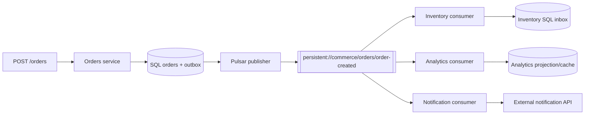
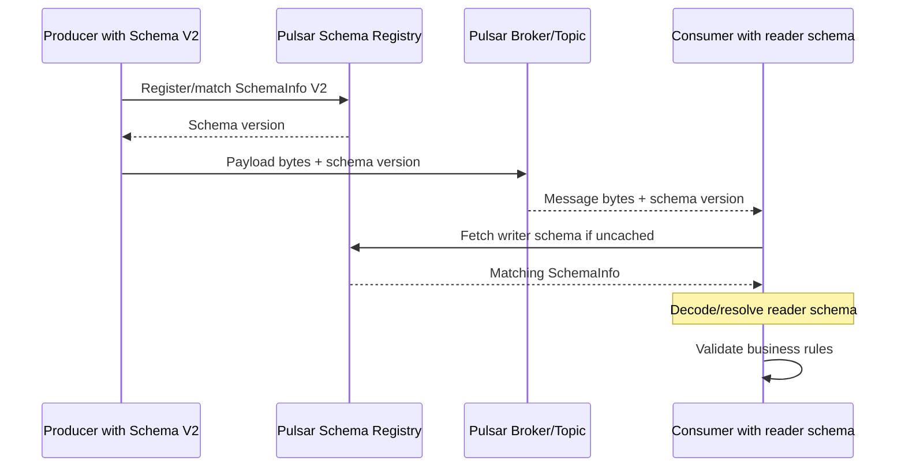
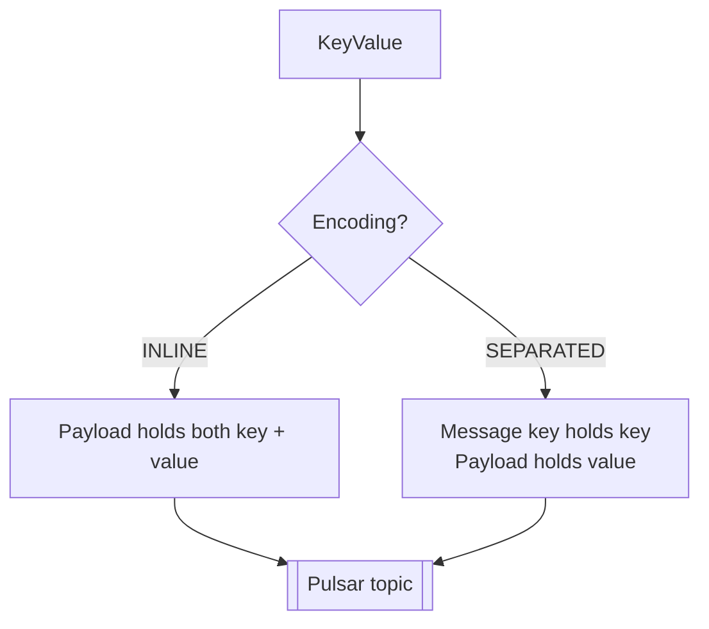
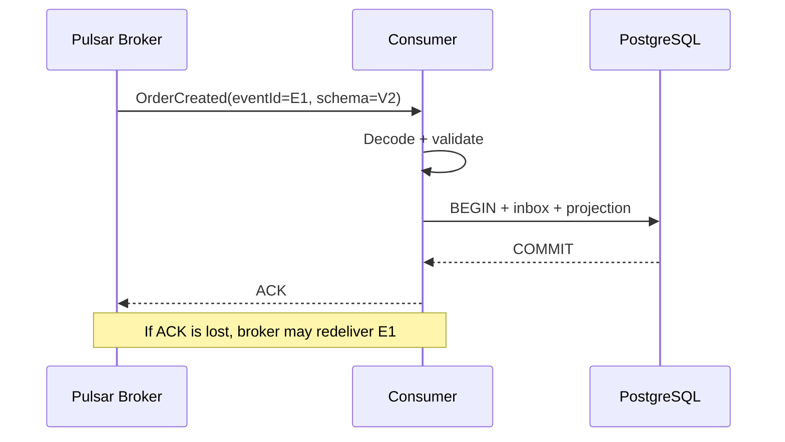

# Schemas, Data Types, and Message Compatibility

In a Spring Boot system using Apache Pulsar, a newer producer version may add a `paymentMethod` field to the `OrderCreated` event while dozens of older consumers are still running. If the producer changes structure arbitrarily, one consumer may fail to decode the message while another decodes it successfully yet interprets its **business meaning incorrectly**. The situation grows even trickier when a subscription holds a three-month-old backlog: newer consumers must still read messages written to the topic by older producers.

**Apache Pulsar Schema** solves an important part of this problem: defining payload types, managing schemas per topic, tagging messages with schema versions, and checking compatibility when schemas evolve. However, a schema registry **does not replace** versioned business contracts, business validation, controlled retries, or duplicate protection when the broker redelivers messages.

This lesson belongs to the **Apache Pulsar** chapter in the **SPRING_BOOT_INTEGRATION** module. The module focuses on organizing integration flows across HTTP clients, databases, caches, brokers, and Spring Integration adapters; paying special attention to configuration, data contracts, errors, deduplication, testing, and system observability. Accordingly, this lesson connects Pulsar schemas to **HTTP DTO → event → SQL inbox/outbox → consumer projection**, rather than merely introducing a few `Schema.JSON(...)` calls.

> **Technical scope:** Examples use Java 17+, Spring Boot 3.2+/Spring for Apache Pulsar with the Apache Pulsar Java client; brokers should be tested against the exact branch/version your organization deploys. APIs, schema checkers, default policies, and `PROTOBUF_NATIVE` support can change across Pulsar branches (3.x/4.x/5.x). All compatibility examples must be verified by testing against a real broker; do not infer from a strategy name that every data change will be safe.

## 1. Learning Objectives

After this lesson, you will be able to:

1. Explain the roles of `Schema<T>`, `SchemaInfo`, the **built-in schema registry**, and **schema versions** in Apache Pulsar.
2. Distinguish primitive schemas, `BYTES`, `STRING`, `JSON`, `AVRO`, `PROTOBUF`, `PROTOBUF_NATIVE`, `KEY_VALUE`, and `AUTO_CONSUME`/`AUTO_PRODUCE` mechanisms.
3. Describe **BACKWARD**, **FORWARD**, **FULL**, and **TRANSITIVE** variants, as well as the real meaning of `ALWAYS_COMPATIBLE` and `ALWAYS_INCOMPATIBLE`.
4. Design safe evolution when adding, removing, renaming, changing types, or altering requiredness of fields.
5. Use typed producers/consumers with the Pulsar Java client and `PulsarTemplate`/`@PulsarListener` in Spring Boot.
6. Distinguish compatibility at the **schema layer**, **wire format**, **business semantics**, and **persistence contract**.
7. Manage rollouts, backlog replay, DLQ/quarantine, redelivery, and idempotent consumers without corrupting old data.
8. Inspect schemas, policies, and versions via Pulsar Admin/CLI.
9. Test v1/v2 producers against v1/v2 consumers and fault cases on real Pulsar.
10. Observe schema registration errors, decode failures, invalid payloads, and message-processing latency in production.

## 2. Context: One Event Used by Multiple Systems

Suppose the Orders service receives an HTTP command, persists the order to SQL, and publishes an event to a Pulsar topic:



An initial `OrderCreated` version:

```json
{
  "eventId": "evt-001",
  "orderId": "ord-101",
  "tenantId": "tenant-a",
  "amountMinor": 125500,
  "currency": "VND"
}
```

After deployment, the producer wants to add `paymentMethod`, `occurredAt`, and `schemaVersion`. Consumers may be in different states:

- Inventory consumer v1 only knows `eventId`, `orderId`, and `amountMinor`.
- Analytics consumer v2 needs to read older data already stored in the topic under schema v1.
- An integration adapter is replaying older messages into a SQL projection.
- Another client uses AVRO or a non-Java language.
- A listener hits a decode error on the first message in the backlog and stalls.

**Core challenge:** New producers and old/new consumers can coexist; even after all applications upgrade, old data **still sits in the topic or DLQ**.

## 3. At Which Layer Does Schema Operate in Pulsar?

### 3.1. Message Payloads Are Always Bytes on the Wire

Brokers store and transport payloads as bytes. Producer clients use `Schema<T>` to turn Java objects into bytes; consumer clients use schemas to decode bytes into matching objects or generic records.



This is a conceptual diagram: clients may cache schemas, brokers/proxies participate differently across protocols, and not every message triggers a network call to the registry.

### 3.2. Built-In Per-Topic Schema Registry

Pulsar includes a **built-in schema registry inside the platform**; you do not need to deploy a separate Confluent Schema Registry by default to get schema evolution. The registry manages schema metadata **per topic**.

Conceptually, a `SchemaInfo` consists of:

| Component | Meaning |
| --- | --- |
| `name` | Schema name |
| `type` | Type such as `JSON`, `AVRO`, `STRING`, `PROTOBUF_NATIVE` |
| `schema` | Byte definition/descriptor appropriate for the schema type |
| `properties` | Additional key/value metadata |
| **schema version** | Version identifier managed by the registry for the topic |

**Schemas are scoped per topic**, while **policies** can be configured at cluster/namespace/topic scope depending on version capabilities. A JSON schema on `orders.created` does not automatically become the schema for `payments.authorized` even if both topics share a namespace.

### 3.3. Schema Version on Messages

When a producer uses a registered schema, messages can carry a **schema version** helping consumers identify the writer schema. In the Java API, `Message<T>.getSchemaVersion()` returns version info as bytes per the client contract.

Important distinctions:

- The schema version belongs to the **topic's registry**, not a `schemaVersion` field inside a JSON event.
- A version number in the registry does not carry the same meaning across different topics or clusters.
- If a topic's schema is administratively deleted/recreated, never assume version IDs remain unchanged.
- With raw bytes/no-schema, a full writer schema cannot be assumed for automatic decoding.
- Clients must still be able to access required schemas when replaying older data.

### 3.4. When Does the Broker Check Compatibility?

When a client attempts to register a new schema and auto-update is allowed, the broker applies a **schema compatibility checker** for the schema type and active policy before accepting the new version.

This does not mean the broker runs business validation on every field of every message. Byte-level checks, schema registration, and validation enforcement differ by schema type, client path, and broker settings.

**Never equate "schema registered" with "every payload is valid and every consumer can read it"**.

## 4. Key Data/Schema Types

| Type | Data used in application | Points to watch |
| --- | --- | --- |
| `BYTES`/`NONE` | Raw `byte[]` | Carries no field structure for automatic evolution checks |
| `STRING` | UTF-8 string | Good for text; not a field-level JSON schema |
| `BOOLEAN`, `INT8`, `INT16`, `INT32`, `INT64` | Scalar values | Must agree on width and semantics |
| `FLOAT`, `DOUBLE` | Floating-point numbers | Never use casually for exact monetary values |
| `DATE`, `TIME`, `TIMESTAMP` and other temporal types | Dates/times per client API | Support and timezone semantics vary by version |
| `JSON` | Object serialized as JSON payload | Has metadata/schema definition; **not equivalent to all JSON Schema Draft standards** |
| `AVRO` | Record serialized as Avro binary | Writer-reader resolution, field defaults/aliases per Avro |
| `PROTOBUF` | Protobuf via legacy type support path | Not assumed identical to `PROTOBUF_NATIVE` |
| `PROTOBUF_NATIVE` | Native Protobuf descriptor/wire format | Check version-specific checker/compatibility semantics |
| `KEY_VALUE` | Pair of key and value with separate schemas | `INLINE` vs `SEPARATED` changes how bytes are stored |
| `AUTO_CONSUME` | Generic consumer decoding by message schema | Suitable for bridges/inspection; does not skip business validation |
| `AUTO_PRODUCE_BYTES` | Producer sending bytes with schema validation in supported cases | Not a way to push arbitrary bytes into any typed topic |

Exact enum names and support must be verified against your **Pulsar client API branch**. Primitive/time type sets can change across major releases.

### 4.1. Primitive Schemas

Native Java client example:

```java
Producer<String> producer = client
    .newProducer(Schema.STRING)
    .topic("persistent://public/default/system-status")
    .create();

producer.send("READY");
```

`Schema.STRING` is a string contract. Sending `{"amount":125500}` as a string does **not** cause the registry to verify that the JSON contains a numeric `amount` field; managing structured payloads requires choosing a structured schema and validating the business contract.

### 4.2. BYTES Does Not Replace Typed Schemas

`Schema.BYTES` is convenient when payloads are files, images, data encrypted under an existing protocol, or bridged from another system. However, without a trusted protocol/schema identifier, consumers may not know whether the bytes represent:

- UTF-8 JSON or Avro binary?
- Which Protobuf message type?
- Which payload version?
- Whether custom compression/encryption outside Pulsar was applied?

For topics integrating multiple partners, **raw bytes must carry an explicit contract and governance**. Never use `BYTES` merely to bypass compatibility checks on breaking changes.

## 5. Pulsar JSON Schema Differs from Standalone JSON Schema

### 5.1. Schema.JSON(Class) Is a Pulsar-Managed Schema

The Pulsar Java client supports:

```java
Schema<OrderCreated> schema = Schema.JSON(OrderCreated.class);
```

For a suitable POJO, the client generates a schema definition from the object model. Pulsar stores the metadata and serializes payloads using JSON encoding.

However, **Pulsar `Schema.JSON(...)` does not automatically mean** the broker enforces all keywords from [JSON Schema Draft 2020-12](https://json-schema.org/), such as `pattern`, `oneOf`, `format`, or cross-field constraints. In common Pulsar versions, JSON schema uses an Avro-record-based definition model for schema management; enforcing business rules requires separate validation.

### 5.2. Sample Java POJO

```java
package com.example.integration.pulsar;

public class OrderCreated {
    public String eventId;
    public String orderId;
    public String tenantId;
    public long amountMinor;
    public String currency;

    public OrderCreated() {}

    public OrderCreated(
            String eventId, String orderId, String tenantId,
            long amountMinor, String currency) {
        this.eventId = eventId;
        this.orderId = orderId;
        this.tenantId = tenantId;
        this.amountMinor = amountMinor;
        this.currency = currency;
    }
}
```

The example uses public fields and a no-args constructor to keep reflective schema/serialization straightforward. Production code should pick clean DTOs, verify record/getter/Jackson/Avro support with the exact client, and avoid mutating objects after enqueueing an asynchronous send.

## 6. AVRO: Writer Schema and Reader Schema

### 6.1. Avro Record v1

Example Avro schema definition:

```json
{
  "type": "record",
  "name": "OrderCreated",
  "namespace": "com.example.contract",
  "fields": [
    {"name": "eventId", "type": "string"},
    {"name": "orderId", "type": "string"},
    {"name": "amountMinor", "type": "long"},
    {"name": "currency", "type": "string"}
  ]
}
```

The schema defines field names and types. Avro binary is not simply compressed JSON; the reader uses both writer and reader schemas to resolve fields.

### 6.2. v2 Adding an Optional/Default Field

```json
{
  "type": "record",
  "name": "OrderCreated",
  "namespace": "com.example.contract",
  "fields": [
    {"name": "eventId", "type": "string"},
    {"name": "orderId", "type": "string"},
    {"name": "amountMinor", "type": "long"},
    {"name": "currency", "type": "string"},
    {
      "name": "paymentMethod",
      "type": ["null", "string"],
      "default": null
    }
  ]
}
```

When **reader v2 reads a payload produced by writer v1**, `paymentMethod` is absent in the writer schema; the `null` default lets the Avro reader fill in the fallback per resolution rules. When reader v1 reads a payload from writer v2, it can ignore the unknown new field in cases permitted by Avro compatibility.

**Do not look only at `nullable`:** Defaults play a specific role in Avro reader schema resolution. Union branch ordering and default values must follow the Avro specification.

### 6.3. Type Changes Cannot Be Eyeballed

Avro defines certain numeric promotions, yet there is no rule that "any number converts to any other." Changes requiring explicit testing include:

- `int` → `long` can be compatible in one resolution direction.
- `long` → `int` risks overflow/narrowing; never assume it is safe.
- `string` → `long` is not a reliable automatic conversion.
- `float`/`double` for monetary values risks precision loss.
- Renaming a record's namespace/name or nested types can break resolution.
- Changing union branches, defaults, or logical types must be verified against the checker/serializer.

When migrating `amount` from decimal string to `long` `amountMinor`, it is usually safer to **add the new field**, gradually transition writers/readers, backfill, and only then remove the old field.

## 7. PROTOBUF and PROTOBUF_NATIVE

### 7.1. Protobuf Example with Stable Field Numbers

```proto
syntax = "proto3";

package commerce.orders;

message OrderCreated {
  string event_id = 1;
  string order_id = 2;
  int64 amount_minor = 3;
  string currency = 4;
}
```

Adding a field:

```proto
message OrderCreated {
  string event_id = 1;
  string order_id = 2;
  int64 amount_minor = 3;
  string currency = 4;
  optional string payment_method = 5;
}
```

In Protobuf, **field numbers are a core part of the wire contract**. Never reuse number `3` for a different meaning just because a field was renamed; older readers can misinterpret bytes as corrupted data.

### 7.2. Protobuf Rules to Remember

- Never reuse deleted field numbers; declare `reserved` numbers/names where appropriate.
- Never change a monetary field into an incompatible wire type.
- Be careful switching `int32` ↔ `int64`: protobuf wire types may align, yet bounds and consumer semantics can break.
- `proto3` has presence/default rules distinct from Avro; `optional` and wrapper types affect distinguishing "absent" from "default value."
- Moving fields into/out of `oneof` or altering `map`/`repeated` is never safe by default.
- Protobuf JSON mapping differs from binary wire encoding; test both if a JSON gateway exists.

### 7.3. Do Not Equate the Two Schema Types

Pulsar offers both `PROTOBUF` and `PROTOBUF_NATIVE` schema types in supporting versions. `PROTOBUF_NATIVE` uses native Protobuf descriptors. Support scope and compatibility checkers—especially **field-level checks for `PROTOBUF_NATIVE`**—vary across Pulsar versions and configurations.

Therefore:

1. Record the exact Pulsar broker/client version and schema type in use.
2. Test producers/consumers with real generated classes/descriptors.
3. Test changes to field numbers, types, and presence.
4. Do not treat a `FULL` policy as a promise that the broker enforces every Protobuf rule identically across all versions.
5. Never mix a `PROTOBUF` producer with a `PROTOBUF_NATIVE` consumer just because they use the same Protobuf class.

## 8. KEY_VALUE: Managing Both Key and Value Structures

### 8.1. Two Encoding Modes

Pulsar `KEY_VALUE` lets a single schema describe both key and value:

- **`INLINE`:** key and value are encoded together inside the payload using KeyValue format.
- **`SEPARATED`:** the key resides in metadata/message key while the value is the payload.



Producers and consumers must agree; do not switch encoding on the same topic and expect older consumers to decode it.

### 8.2. Java Client Example

```java
import org.apache.pulsar.client.api.Schema;
import org.apache.pulsar.common.schema.KeyValue;
import org.apache.pulsar.common.schema.KeyValueEncodingType;

Schema<KeyValue<String, String>> schema =
        Schema.KeyValue(
                Schema.STRING,
                Schema.STRING,
                KeyValueEncodingType.SEPARATED);

try (Producer<KeyValue<String, String>> producer =
        client.newProducer(schema)
              .topic("persistent://public/default/order-key-value")
              .create()) {

    producer.send(new KeyValue<>(
            "ord-101", "{\"eventId\":\"evt-001\"}"));
}
```

This example uses a **String value**, so Pulsar's registry does not verify JSON fields inside the value string. For typed values, replace the value's `Schema.STRING` with `Schema.JSON(OrderCreated.class)` or `Schema.AVRO(...)` per contract.

### 8.3. Message Key Does Not Equal Business Identity

A key may serve routing/partitioning or a `Key_Shared` subscription, yet sharing an `orderId` does not prove two messages are the same business event.

Distinguish:

- `messageKey = orderId`: grouping/routing/ordering per aggregate under subscription semantics.
- `eventId`: immutable identifier of one business change.
- `schemaVersion`: business contract version inside the payload if your organization uses one.
- `registry schema version`: schema version assigned by the broker.
- `aggregateVersion`: state sequence of the order.

Never use one of these values to replace all the others automatically.

## 9. Schema Compatibility Overview: Four Primary Directions

### 9.1. BACKWARD

**Newer readers** can read data written by **older writers**.

```text
Old writer V1 ──> New reader V2
```

Suited when consumers upgrade first or must replay older backlogs. In Avro, adding an optional field with a default is a common example, though it still depends on the entire schema, field types, and checker rules.

### 9.2. FORWARD

**Older readers** can read data written by **newer writers**.

```text
New writer V2 ──> Old reader V1
```

Useful when producers may deploy before consumers, though it **does not guarantee newer consumers can later read the whole old backlog**. In structured records, adding a field ignored by older readers may pass, whereas removing a required old field can break them.

### 9.3. FULL

The contract satisfies **both BACKWARD and FORWARD** across the compared versions.

```text
Old writer V1 ──> New reader V2
New writer V2 ──> Old reader V1
```

`FULL` eases rolling deployments. Still, `FULL` does not mean "any contract change is allowed": changing the meaning of a field while keeping its name and type can **pass the schema checker yet violate business semantics**.

### 9.4. TRANSITIVE

Strategies without the `_TRANSITIVE` suffix typically compare the new schema only against the **most recent schema**. `_TRANSITIVE` strategies require compatibility in the corresponding direction against **all prior schema versions**.

Example topic with V1, V2, V3:

```text
BACKWARD:
  V3 reader ← V2 writer

BACKWARD_TRANSITIVE:
  V3 reader ← V2 writer
  V3 reader ← V1 writer
```

This is vital when topic retention is long, DLQs are replayed, subscriptions hold multi-day backlogs, or blue/green rollbacks span multiple versions.

## 10. Eight Common Schema Compatibility Strategies

| Strategy | Directional schema guarantee | Compared against |
| --- | --- | --- |
| `ALWAYS_COMPATIBLE` | **Skips compatibility checks**, allowing many changes | Not a safety proof |
| `ALWAYS_INCOMPATIBLE` | Blocks schema evolution/changes per policy | Disallows changing schemas |
| `BACKWARD` | New reader reads old writer | Latest version |
| `BACKWARD_TRANSITIVE` | New reader reads all old writers | All prior versions |
| `FORWARD` | Old reader reads new writer | Latest version |
| `FORWARD_TRANSITIVE` | All old readers read new writer | All prior versions |
| `FULL` | Both BACKWARD and FORWARD | Latest version |
| `FULL_TRANSITIVE` | Both directions across all old versions | All prior versions |

Two critical caveats:

1. **`ALWAYS_COMPATIBLE` does not mean "always compatible"**; in many versions it effectively **disables compatibility checking**. The name is notoriously misleading.
2. **`ALWAYS_INCOMPATIBLE` does not mean a topic cannot register its first schema**; it forbids evolution once a schema exists per policy.

### 10.1. Default Policy Depends on Schema Type

Apache Pulsar 4.2.x documentation notes that default compatibility for **AVRO/JSON is typically `FULL`**, while several other schema types default to behavior equivalent to `ALWAYS_INCOMPATIBLE`. Do not assume these defaults hold permanently for Pulsar 3.x, 5.x, or operator-overridden clusters.

Always **inspect the effective policy on your target cluster**. Precedence may follow **topic > namespace > cluster**. Changing a policy does not retroactively fix payloads already published.

### 10.2. FULL Does Not Equal FULL_TRANSITIVE

Suppose:

```text
V1: {amountMinor: long}
V2: {amountMinor: long, paymentMethod: optional string}
V3: {amountMinor: long, paymentMethod: optional string, traceId: optional string}
```

If each step is accepted under `FULL`, that is good evidence. Yet with a different chain of edits where V3 is only checked against V2, **compatibility with V1 cannot be assumed**. Whenever V1 data still exists, `FULL_TRANSITIVE` and cross-version replay tests provide stronger protection.

## 11. Choosing a Strategy by Rollout Style

| Situation | Policy to consider | Primary rollout |
| --- | --- | --- |
| New consumers must replay old data | `BACKWARD_TRANSITIVE` | Upgrade readers before relying on new fields |
| Producers deploy first while old consumers still run | `FORWARD`/`FORWARD_TRANSITIVE` | Verify old readers truly ignore new fields |
| Long mixed-version windows, frequent rollbacks | `FULL_TRANSITIVE` | Change fields using defaults/optionality and test thoroughly |
| Locked contract, no automatic schema changes | `ALWAYS_INCOMPATIBLE` plus registry governance | New versions via new topics or explicit approval |
| Experimental development phase | Relaxed policy in dev namespaces only | Never accidentally promote relaxed policy to production |

**Never use a policy as a substitute for testing.** A schema change compatible on paper can still break an older Java consumer due to Jackson/Avro runtime issues, missing Java classes, exhaustive enum switches lacking a fallback, or primitive fields that cannot accept null.

## 12. Evolution Example V1 → V2 → V3

### 12.1. V1: Minimal Contract

```json
{
  "eventId": "evt-001",
  "orderId": "ord-101",
  "amountMinor": 125500,
  "currency": "VND"
}
```

### 12.2. V2: Adding Optional paymentMethod

```json
{
  "eventId": "evt-001",
  "orderId": "ord-101",
  "amountMinor": 125500,
  "currency": "VND",
  "paymentMethod": null
}
```

In Avro, the schema must declare optionality/defaults properly. With Spring JSON POJOs, inspect actual serialization/deserialization and Pulsar's generated schema definition rather than just reading sample JSON.

### 12.3. V3: Adding occurredAt Under a Stable Contract

```json
{
  "eventId": "evt-001",
  "orderId": "ord-101",
  "amountMinor": 125500,
  "currency": "VND",
  "paymentMethod": "BANK_TRANSFER",
  "occurredAt": "2026-11-21T10:00:00Z"
}
```

If v3 adds `occurredAt` unknown to consumer v2, compatibility rules may allow it. Yet:

- Is the timezone defined as UTC or arbitrary offsets?
- If the date is invalid, what does the consumer do?
- If the producer sends `occurredAt = null`, do schema and client accept it?
- If an older event lacks this field, what fallback should the new consumer use?
- Could `occurredAt` be confused with `publishedAt` or `processedAt`?

That is the **semantic contract**, beyond the schema registry.

### 12.4. V4: Changing amountMinor from long to string

```json
{
  "eventId": "evt-001",
  "orderId": "ord-101",
  "amountMinor": "125500",
  "currency": "VND"
}
```

This is a breaking type change from `long`, likely rejected by the registry or crashing consumers. To change representation, add a new field such as `amountDecimal`, keep `amountMinor` during a transition window, and deprecate on schedule.

## 13. Safety Rules for Adding/Removing/Changing Fields

| Change | Preliminary assessment | What must be tested |
| --- | --- | --- |
| Add optional field with default | Usually safer in structured schemas | V2 reads V1, V1 reads V2 |
| Add required field without default | Easily breaks BACKWARD | V2 reads V1 backlog |
| Remove field used only by new consumers | Can break FORWARD or business logic | All living readers |
| Rename field | Equivalent to delete + add | Avro aliases, adapters, consumers |
| Change `int` to `long` | May support one-way promotion | Boundary values, SQL mapping |
| Change `long` to `string` | Usually breaking | Serialization and parsers |
| Change nullability/default | Error-prone on old messages | null/missing/default handling |
| Add enum value | Can break exhaustive switches on consumers | Unknown enum fallback |
| Change nested object/array | High risk | Schema checker and payload fixtures |
| Keep name/type but alter meaning | Can pass registry yet **fail business logic** | Semantic contract tests |
| Switch encoding `JSON` → `AVRO` | Changes wire format | Topic/version migration |
| Switch key encoding `INLINE` → `SEPARATED` | Changes wire contract | Coordinated producer/consumer versioning |

**Good rule of thumb:** When a change has unclear compatibility, use a new versioned topic or a dual-publish/migration phase rather than lowering policy to `ALWAYS_COMPATIBLE` just to get past the broker.

## 14. Java Client: Typed JSON Publishing and Consuming

### 14.1. A Typed Producer

With the `OrderCreated` POJO having a no-args constructor as shown earlier:

```java
package com.example.integration.pulsar;

import org.apache.pulsar.client.api.PulsarClient;
import org.apache.pulsar.client.api.Producer;
import org.apache.pulsar.client.api.Schema;

public class PulsarJsonProducerExample {

    private static final String TOPIC =
            "persistent://public/default/order-created";

    public static void publish() throws Exception {
        try (PulsarClient client = PulsarClient.builder()
                .serviceUrl("pulsar://localhost:6650")
                .build();
             Producer<OrderCreated> producer = client
                     .newProducer(Schema.JSON(OrderCreated.class))
                     .topic(TOPIC)
                     .create()) {

            OrderCreated event = new OrderCreated(
                    "evt-001", "ord-101", "tenant-a", 125500, "VND");

            producer.newMessage()
                    .key(event.orderId)
                    .property("eventType", "OrderCreated")
                    .value(event)
                    .send();
        }
    }
}
```

**Illustrative snippet:** A local broker and topic must exist or be auto-created per policy; production also requires auth/TLS, send timeouts, retry/idempotency, and proper namespace/ACLs.

Key takeaway: `Schema.JSON(OrderCreated.class)` supplies the typed schema for the producer. The `eventType` property is merely routing metadata and does not replace the payload schema.

### 14.2. Typed Consumer

```java
package com.example.integration.pulsar;

import org.apache.pulsar.client.api.Consumer;
import org.apache.pulsar.client.api.Message;
import org.apache.pulsar.client.api.PulsarClient;
import org.apache.pulsar.client.api.Schema;
import org.apache.pulsar.client.api.SubscriptionType;

public class PulsarJsonConsumerExample {

    private static final String TOPIC =
            "persistent://public/default/order-created";

    public static void consumeOne() throws Exception {
        try (PulsarClient client = PulsarClient.builder()
                .serviceUrl("pulsar://localhost:6650")
                .build();
             Consumer<OrderCreated> consumer = client
                     .newConsumer(Schema.JSON(OrderCreated.class))
                     .topic(TOPIC)
                     .subscriptionName("inventory-projection")
                     .subscriptionType(SubscriptionType.Shared)
                     .subscribe()) {

            Message<OrderCreated> message = consumer.receive();

            // Must validate contract, check eventId, and persist SQL inbox
            // before acknowledging in a production flow.
            OrderCreated event = message.getValue();
            System.out.println(event.orderId);

            consumer.acknowledge(message);
        }
    }
}
```

**Warning:** Calling `acknowledge` right after `println` is only for API illustration. In production, acknowledge only after **business state is durably persisted** per contract; logging and ACKing can lose work if SQL has not committed.

### 14.3. Why Java Types Alone Are Not Enough

Even if producer and consumer share a class named `OrderCreated`, they may be built from different commits with:

- Different fields.
- Different defaults.
- Different serializer/Jackson annotations.
- Different packages/namespaces.
- Different Pulsar/Avro library versions.
- Different validation/business logic.

Therefore, **never use a Java class name as the contract version**. Rely on actual schema definitions, compatibility policies, contract fixtures, and cross-version tests.

## 15. Spring Boot and Spring for Apache Pulsar

### 15.1. Dependencies

For Spring Boot versions integrating Spring for Apache Pulsar (e.g., Boot 3.2+), a typical starter setup is:

```groovy
dependencies {
    implementation 'org.springframework.boot:spring-boot-starter-pulsar'
    implementation 'org.springframework.boot:spring-boot-starter-validation'

    implementation 'org.springframework.boot:spring-boot-starter-jdbc'
    runtimeOnly 'org.postgresql:postgresql'

    testImplementation 'org.springframework.boot:spring-boot-starter-test'
    testImplementation 'org.springframework.boot:spring-boot-testcontainers'
    testImplementation 'org.testcontainers:junit-jupiter'
    testImplementation 'org.testcontainers:pulsar'
    testImplementation 'org.testcontainers:postgresql'
}
```

Let the Spring Boot BOM manage compatible versions of `spring-pulsar`, the Pulsar Java client, and Jackson/Avro. Do not arbitrarily override a serialization library without verifying the compatibility matrix.

`spring-boot-starter-validation` is optional when using Jakarta Bean Validation; adding it does not mean every event is automatically validated right after deserialization. The application must invoke validation or configure the listener appropriately.

### 15.2. Endpoint Configuration

```yaml
spring:
  pulsar:
    client:
      service-url: ${PULSAR_SERVICE_URL:pulsar://localhost:6650}
    admin:
      service-url: ${PULSAR_ADMIN_URL:http://localhost:8080}
```

Locally, port 6650 is typically the Pulsar binary protocol; the HTTP admin API uses a separate port such as 8080. Production generally uses `pulsar+ssl://` and `https://` with cluster authentication/certificates.

**A reachable endpoint does not guarantee schemas are right.** Admin and messaging clients use different permissions/ports; misconfiguring service URLs typically fails right at startup.

### 15.3. Typed Event Record with Spring

```java
package com.example.integration.contract;

import org.apache.pulsar.common.schema.SchemaType;
import org.springframework.pulsar.annotation.PulsarMessage;

@PulsarMessage(schemaType = SchemaType.JSON)
public record OrderCreatedEvent(
        String eventId,
        String orderId,
        String tenantId,
        long amountMinor,
        String currency,
        String paymentMethod
) {}
```

Spring for Apache Pulsar can use `@PulsarMessage` to attach schema mappings by message type. For Java records, verify your exact framework/serializer version supports them as expected and inspect the actual schema definition registered on the topic.

Without the annotation, schema mapping can be configured via `spring.pulsar.defaults.type-mappings` or by passing the schema explicitly on publish/subscribe.

### 15.4. Producer with PulsarTemplate

```java
package com.example.integration.messaging;

import com.example.integration.contract.OrderCreatedEvent;
import org.apache.pulsar.client.api.MessageId;
import org.springframework.pulsar.core.PulsarTemplate;
import org.springframework.stereotype.Service;

@Service
public class OrderEventPublisher {

    private static final String TOPIC =
            "persistent://public/default/order-created";

    private final PulsarTemplate<OrderCreatedEvent> template;

    public OrderEventPublisher(
            PulsarTemplate<OrderCreatedEvent> template) {
        this.template = template;
    }

    public MessageId publish(OrderCreatedEvent event) {
        return template.send(TOPIC, event);
    }
}
```

In Spring Pulsar, synchronous `send(...)` returns a `MessageId` once the producer finishes sending per contract; `sendAsync(...)` returns a `CompletableFuture`. **Neither implies that an SQL transaction commits atomically with the broker**. Use an outbox whenever business rules require persisting the event alongside an SQL command.

### 15.5. Consumer @PulsarListener

```java
package com.example.integration.messaging;

import com.example.integration.contract.OrderCreatedEvent;

import org.apache.pulsar.common.schema.SchemaType;
import org.springframework.pulsar.annotation.PulsarListener;
import org.springframework.stereotype.Component;

@Component
public class OrderCreatedListener {

    private final OrderProjectionService projection;

    public OrderCreatedListener(OrderProjectionService projection) {
        this.projection = projection;
    }

    @PulsarListener(
        topics = "persistent://public/default/order-created",
        subscriptionName = "inventory-v1",
        schemaType = SchemaType.JSON
    )
    public void onOrderCreated(OrderCreatedEvent event) {
        projection.processIdempotently(event);
    }
}
```

`OrderProjectionService` is a project-implemented service. In an appropriate listener configuration, the container auto-acks upon normal method completion; if the handler throws, redelivery/error handling depends on ack mode, subscription, and container policy. **Check the exact ack mode in your Spring Pulsar version** rather than assuming every exception triggers a retry.

### 15.6. Spring Defaults Easily Overlooked

In documented Spring for Apache Pulsar versions:

- Primitive types generally have schemas inferred automatically by the framework.
- Complex types (POJOs/records) may default to JSON inference.
- For **AVRO, PROTOBUF, or KEY_VALUE**, you must specify the schema type/mapping explicitly.
- Producer and consumer must agree on the actual wire format and schema definition.
- Which complex schema types the framework supports can differ across versions.
- Spring inferring JSON **does not mean** JSON is right for a topic already holding an AVRO contract.

On an existing topic with an AVRO schema, **never** deploy a new POJO producer using the default JSON inference without checking the schema registry first.

## 16. Customizing Schema Mapping in Spring Pulsar

### 16.1. Type Mappings via Properties

Illustrative configuration:

```yaml
spring:
  pulsar:
    defaults:
      type-mappings:
        - message-type: com.example.integration.contract.OrderCreatedEvent
          schema-info:
            schema-type: JSON
```

This applies to Spring Pulsar branches supporting `spring.pulsar.defaults.type-mappings`. If the contract class changes package/name, the old mapping ceases to match.

### 16.2. SchemaResolverCustomizer When Explicit Control Is Needed

```java
@Bean
SchemaResolverCustomizer<DefaultSchemaResolver> schemaMappings() {
    return resolver -> resolver.addCustomSchemaMapping(
            OrderCreatedEvent.class,
            Schema.JSON(OrderCreatedEvent.class));
}
```

Spring/Pulsar types and imports must come from the exact library version in use. This illustrates where to customize—**it does not require combining `@PulsarMessage`, type mappings, and a customizer all at once**. Pick one primary mapping source and test the resolved schema.

### 16.3. Good Governance Rules

- Each event type has one schema source of truth per topic.
- Never configure the same Java type as JSON on the producer and AVRO on the consumer.
- Never alter global serializers just to patch one topic.
- Never take topic names from untrusted HTTP input.
- Run schema tests in CI to catch class/annotation changes before deployment.

## 17. AUTO_CONSUME and AUTO_PRODUCE_BYTES

### 17.1. AUTO_CONSUME for Bridges and Diagnostics

The Java client can consume records using the writer schema recorded in the registry without needing a fixed POJO class:

```java
Consumer<GenericRecord> consumer = client
    .newConsumer(Schema.AUTO_CONSUME())
    .topic("persistent://public/default/order-created")
    .subscriptionName("schema-inspector")
    .subscribe();
```

`GenericRecord` is imported from `org.apache.pulsar.client.api.schema.GenericRecord` per the Java API. This mechanism helps when writing bridges, schema inspectors, or mixed-version migration tools, yet **does not automatically provide a business model or validation** for your application.

### 17.2. AUTO_PRODUCE_BYTES Is a Specialized Case

Spring Pulsar illustrates:

```java
void sendRawWithValidation(
        PulsarTemplate<byte[]> template,
        byte[] alreadySerializedPayload) {
    template.send(
        "persistent://public/default/order-created",
        alreadySerializedPayload,
        Schema.AUTO_PRODUCE_BYTES());
}
```

Per documentation in supporting versions, this mode targets **already-serialized JSON/AVRO payloads** validated against the topic's schema per supported mechanisms. Do not treat it as a backdoor for pushing arbitrary Protobuf bytes or malformed JSON into a typed topic.

### 17.3. Risks When Bridging Schemas

A bridge consuming with `AUTO_CONSUME` and publishing with `AUTO_PRODUCE_BYTES` must ensure:

- Original writer schema/version is not lost.
- JSON bytes are never confused with Avro bytes.
- UTF-8, logical types, decimal scales, and timestamp representations stay intact.
- Message keys, properties, event IDs, and correlation metadata are preserved.
- Messages are never read and ACKed before the destination persists durably.
- Idempotency and reconciliation handle bridge crashes.

Often, decoding → canonical DTO → encoding to the target schema with clear contract tests is safer than copying opaque bytes without understanding semantics.

## 18. Managing Schemas with Pulsar Admin CLI

### 18.1. Inspecting the Current Schema

Example commands using Pulsar Admin with sufficient cluster permissions:

```bash
pulsar-admin schemas get persistent://public/default/order-created
```

To inspect a specific version:

```bash
pulsar-admin schemas get \
  persistent://public/default/order-created --version 0
```

Do not assume registry version `0` matches payload schema `v1` in your event DTO numbering. That is solely the **registry's** schema version; inspect the actual output.

### 18.2. Checking the Compatibility Policy

```bash
pulsar-admin topicPolicies get-schema-compatibility-strategy \
  persistent://public/default/order-created
```

And at the namespace level:

```bash
pulsar-admin namespaces get-schema-compatibility-strategy public/default
```

When checking the effective policy, note that **topic policies can override namespace/cluster policies**. If your CLI/version supports flags to print the effective/applied policy, use the exact syntax of your broker version.

### 18.3. Setting a Topic Policy Deliberately

Per Pulsar 4.2.x Admin documentation, example command syntax:

```bash
pulsar-admin topicPolicies set-schema-compatibility-strategy \
  FULL_TRANSITIVE persistent://public/default/order-created
```

Changing a policy must be reviewed like a **deployment contract change**; never run it on production merely to "experiment." Syntax and options vary by Pulsar version and CLI packaging; run `--help` for your exact cluster version before automating in CI/CD.

### 18.4. Schema Validation Enforcement vs Auto-Update

Distinguish two policy groups:

1. **Schema auto-update:** may clients register a new compatible version automatically on send?
2. **Schema validation enforcement:** does the broker require clients to use a schema and control schemaless producers?

Example namespace commands per Pulsar 4.2.x documentation:

```bash
pulsar-admin namespaces set-is-allow-auto-update-schema \
  --disable public/default

pulsar-admin namespaces set-schema-validation-enforce \
  --enable public/default
```

If auto-update is disabled, new schemas must be registered through a separate admin workflow. Enforcement reduces the risk of raw-bytes producers writing to typed topics without a schema, though it does not replace business validation or guard against every SDK/serializer error.

### 18.5. Never Delete Schema History as a "Compatibility Reset"

Pulsar Admin allows deleting a topic's schema, affecting registered versions. If a topic still holds backlog or consumers need to replay older data, deleting schemas can make them unable to decode the corresponding writer schemas.

Never run `schemas delete` in production to fix a schema registration error without backups, a topic migration plan, and retention/replay analysis. **Schema history is part of reading historical data.**

## 19. Registry Compatibility Does Not Cover Business Semantics

### 19.1. Same Types Can Still Mean Different Things

Before a change:

```json
{"amountMinor":125500,"currency":"VND"}
```

After an unintended change:

```json
{"amountMinor":125500,"currency":"USD"}
```

Both are structurally valid per schema type, yet not necessarily valid in business logic. Likewise, changing `amountMinor` from "dong" to "cents" while keeping `long` can cause financial damage even though the schema checker accepts it.

### 19.2. Five Layers of Compatibility

| Layer | Example checks |
| --- | --- |
| **Wire format** | Are the bytes Avro, JSON, or Protobuf? |
| **Structural schema** | Do field names/types/defaults/nullability resolve? |
| **Application decoding** | Can Jackson/Avro/Protobuf clients decode every version? |
| **Business semantics** | Are currency, units, enums, tenant, amount, and state transitions valid? |
| **Downstream persistence** | Do SQL mappings, indexes, unique constraints, and HTTP/cache DTOs fit? |

Passing one layer does not prove the remaining layers pass.

### 19.3. Business Validation After Decoding

A self-contained validation check:

```java
static void validate(OrderCreatedEvent event) {
    if (event.eventId() == null || event.eventId().isBlank()) {
        throw new IllegalArgumentException("Missing eventId");
    }
    if (event.orderId() == null || event.orderId().isBlank()) {
        throw new IllegalArgumentException("Missing orderId");
    }
    if (event.amountMinor() < 0) {
        throw new IllegalArgumentException("Negative amount");
    }
    if (!"VND".equals(event.currency())) {
        throw new IllegalArgumentException("Unsupported currency");
    }
}
```

This is a minimal check; production must also handle tenant authorization, version contracts, mandatory fields, time semantics, max payload sizes, and PII. Never log raw payloads containing secrets when validation errors occur.

## 20. Money, Time, Nulls, and Enums Are Classic Traps

### 20.1. Monetary Amounts

Contracts should state clearly:

```text
amountMinor: int64
currency: ISO 4217 uppercase
Semantics: minor units of the currency, not floating point
```

With `double`, many decimal values cannot be represented accurately in binary floating point. For financial values, prefer integer minor units or decimal logical types with documented and tested scale/precision.

### 20.2. Timestamps

Different timestamps serve distinct roles:

- `occurredAt`: when the business event occurred.
- `publishedAt`: when the producer/relay published it.
- `processedAt`: when the consumer persisted business state.
- Pulsar `publishTime`, `eventTime`: client/broker metadata.

Do not order business state purely by wall-clock timestamps across machines when strict ordering matters. Use `aggregateVersion` or a durably incremented sequence.

### 20.3. Null, Missing, and Default

A reference field in Java can be `null`, yet an Avro schema might declare the string required. Therefore:

- Add optional fields with explicit defaults.
- Test V2 reading V1 messages missing the field.
- Test explicit null vs missing if business logic distinguishes them.
- Avoid primitive Java `long` when you need to tell whether a field was truly "not sent."
- Never treat blank strings as equivalent to null automatically.

### 20.4. Enums

Adding an enum value `REFUNDED` can break older consumers running an exhaustive switch without a default branch. The broker only checks enum representation/metadata per format; it does not know every business branch. Use an `UNKNOWN` fallback or deliberate quarantine, and write contract tests for unknown values.

## 21. Payload Version Differs from Broker Schema Version

Define a stable event envelope when multiple services participate:

```json
{
  "eventId": "evt-001",
  "eventType": "OrderCreated",
  "eventVersion": 2,
  "aggregateId": "ord-101",
  "aggregateVersion": 1,
  "tenantId": "tenant-a",
  "occurredAt": "2026-11-21T10:00:00Z",
  "data": {
    "amountMinor": 125500,
    "currency": "VND"
  }
}
```

Explanation:

- `eventVersion`: version of the **event contract** defined by the organization.
- `aggregateVersion`: update sequence of `ord-101`.
- `Pulsar schema version`: metadata version assigned by the broker upon schema registration.
- `eventId`: business identity used for deduplication.
- `schemaType`: wire representation/how the payload is decoded.

There is no rule requiring `eventVersion` to equal the registry schema version. A change in `eventVersion` might require no new structural schema if only semantics shifted; conversely, a new technical schema field might not require changing the business event name. Define clear rules for when each version increments.

## 22. Rolling Deployments and Backlog Replay

### 22.1. Consumer-First Rollout

When adding an optional field with a default to satisfy BACKWARD compatibility:

1. Test the new reader against old writer fixtures.
2. Deploy v2 consumers capable of reading both old and new versions.
3. Confirm all required consumers have upgraded.
4. Register/enable schema v2 per policy.
5. Deploy v2 producers.
6. Monitor decode errors, redelivery, backlog, and business state.

Regardless of policy, test **mixed-version traffic** whenever services rolling-deploy and subscriptions span multiple partitions/consumers.

### 22.2. Producer-First Under FORWARD Guarantees

Certain changes and policies permit deploying new producers first, provided you verify older consumers truly accept new payloads. If an older consumer ignores a new field yet misunderstands a new enum value in an existing field, forward compatibility fails **at the business layer** even though the schema checker passes.

### 22.3. Replay Introduces Additional Constraints

When an analytics consumer performs a `seek` to the start of a topic or replays messages from a DLQ:

- It may encounter schema versions predating the current release.
- It may receive events already processed earlier (duplicates).
- Schema caches are not permanent storage if registry schemas were deleted.
- Old Java dependencies may no longer exist at runtime.
- Current SQL projections may enforce new constraints incompatible with older events.

Replays need **historical test fixtures and plans**, not just tests on the latest message shape.

### 22.4. Never Remove an Old Field in the Same Release That Adds a New One

For renaming `orderState` → `state`:

```text
Release A: add nullable state, consumers fall back to reading orderState
Release B: producers dual-write both fields per contract
Release C: backfill and switch consumers to read state
Release D: only after no old readers remain, remove orderState
```

This is a variant of **expand–migrate–contract** at the event layer. It resembles SQL schema migrations, except you must also consider **topic retention**, DLQs, and external applications on slower upgrade schedules.

## 23. Schema Errors on Producers and Consumers

### 23.1. Producer Rejected by Schema

Typical causes:

- New schema violates the compatibility policy.
- Client uses `Schema.JSON` while the topic already registered `AVRO`.
- Schema auto-update is disabled and an admin has not registered the new schema.
- Producer lacks topic/registry permissions or authentication/TLS is misconfigured.
- Broker/client version does not support the chosen schema type/definition.
- Java serialization fails before sending.

**Never retry indefinitely** on permanent incompatibility errors. Fix the contract, upgrade consumers, or move to a new topic.

### 23.2. Consumer Decode Failure

A message from v1 can fail if a newer consumer expects a required `paymentMethod` field without a default. The failure can happen **before the listener method is invoked**.

Consequence: a `try/catch` inside `onMessage(OrderCreatedEvent event)` **may not catch decode errors**. Configure a container/consumer error handler, DLQ/quarantine, or a dedicated generic/raw payload stream for investigation.

### 23.3. Business Validation Error After Decode

For example, the event decodes fine yet `amountMinor=-1`. This is an **invalid business event** and must not be retried identically forever. Instead:

- Record the failure with a classified error code.
- Route the message to quarantine/DLQ per designed policy.
- Retain `eventId`/topic/schema version/properties for investigation.
- Acknowledge or withhold acknowledgment per policy only after quarantine persistence succeeds.
- Support manual replay after fixing the root cause, still enforcing idempotency.

### 23.4. Transient SQL/HTTP Failures

If decoding and validation succeed yet PostgreSQL times out or a partner HTTP call returns 503:

- Retry with backoff and a deadline.
- Avoid letting `ackTimeout`/redelivery trigger uncontrolled concurrent processing of the same event.
- Use an SQL inbox / idempotent operation ID.
- Never treat decode success as business success.
- Monitor retry counts and DLQ age.

## 24. Ack, Negative Ack, DLQ, and Subscription Types

Pulsar supports subscription types such as `Exclusive`, `Failover`, `Shared`, and `Key_Shared`. Distribution, ordering, and redelivery vary by type and configuration.

### 24.1. Acknowledge After Durable Outcomes



With the native Java consumer, call `acknowledge(message)` after SQL commits. With `@PulsarListener`, ack timing is governed by the container/ack mode; test method exceptions, deserialization failures, and listener crashes.

### 24.2. NACK/Redelivery Increases Duplicate Risk

`negativeAcknowledge` or ack timeout causes the broker to redeliver the message. Never treat `redeliveryCount > 0` as proof SQL was already written; verify the business event ID/inbox.

### 24.3. Conditional Dead-Letter Policy

In certain versions, Spring Pulsar supports dead-letter policies via `@PulsarListener` or consumer factories. Retry/DLQ features have **constraints tied to subscription type and client version**; do not assume every setting works identically on `Exclusive`, `Failover`, or `Key_Shared` as on `Shared`.

A DLQ is not a "trash can." A proper workflow must:

1. Preserve the payload or an appropriate reference along with writer schema identification.
2. Retain `eventId`, tenant/source, topic, subscription, and error category.
3. Prevent logging raw PII.
4. Enable controlled replay after fixing the schema or consumer.
5. Guarantee replay does not duplicate side effects.

## 25. SQL Inbox and Outbox in Pulsar Flows

### 25.1. Outbox for the Producer Side

Suppose an HTTP API creates an order and the process dies before publishing to Pulsar. Never expect a schema registry to solve this; schemas only govern **message structure**.

A reliable design is typically:

```text
SQL @Transactional:
  INSERT orders
  INSERT outbox(eventId, eventType, eventVersion, payload, status)
COMMIT

Outbox relay:
  Read READY events
  Pulsar publish
  Await producer ACK per policy
  Mark PUBLISHED
```

The relay can publish duplicates if the broker persists the event and the process dies before marking `PUBLISHED`. That yields **at-least-once publishing**; consumers must be idempotent.

### 25.2. Inbox for the Consumer Side

Illustrative table:

```sql
CREATE TABLE pulsar_inbox (
    source_topic VARCHAR(255) NOT NULL,
    event_id     VARCHAR(128) NOT NULL,
    payload_hash CHAR(64) NOT NULL,
    processed_at TIMESTAMPTZ NOT NULL DEFAULT now(),
    PRIMARY KEY (source_topic, event_id)
);
```

Inside a single transaction:

1. Decode payload using matching writer/reader schemas.
2. Validate `eventId`, `eventType`, `eventVersion`, tenant, and payload.
3. Insert inbox key; unique constraint blocks duplicates.
4. If new: update projection and write any downstream outbox record.
5. If duplicate: compare payload hash/meaning; skip side effects.
6. Commit SQL.
7. Ack Pulsar per policy.

If the same `eventId` arrives with a different payload, do not treat it as a safe duplicate; quarantine and investigate the contract violation.

### 25.3. Schema Version Is Not a Deduplication Key

A business event `E1` can be replayed with the same payload re-encoded under a different schema version. If you use schema version as part of the deduplication key, replay can bypass duplicate protection. **Event identity must be stably defined by the business contract**, not assigned by the broker schema registry.

## 26. Message Ordering and State Compatibility

### 26.1. Valid Event Schemas Arriving Out of Order

```text
E1: OrderCreated, aggregateVersion=1
E2: OrderPaid, aggregateVersion=2
E3: OrderCancelled, aggregateVersion=3
```

A consumer can receive E2 before E1 under certain routing/retry paths, even when both schemas are completely compatible. If the consumer applies E1 after E2 and overwrites state, the projection regresses backward.

### 26.2. Safeguards

- Stable message key by `orderId` when partitions/subscription types are chosen for per-key ordering.
- `aggregateVersion` incremented inside the source-of-truth SQL transaction.
- Consumer stores latest processed version, rejects stale events, and detects missing gaps.
- Retry poison events per policy without indefinitely blocking entire tenants.
- Use DLQ/repair processes aware of ordering and replay.
- Never confuse schema version V3 with `aggregateVersion=3`.

Schema compatibility **does not guarantee message ordering, deduplication, or exactly-once business processing**.

## 27. Multi-Version Schema Compatibility Testing

### 27.1. Minimum Matrix

For producers V1/V2 and consumers V1/V2:

| Writer | Reader | Goal |
| --- | --- | --- |
| V1 | V1 | Baseline |
| V1 | V2 | **BACKWARD** |
| V2 | V1 | **FORWARD** |
| V2 | V2 | Latest |
| V1 | V3 | Backward transitive with old backlog |
| V3 | V1 | Forward transitive / rollback |
| Invalid payload | V2 | Quarantine/DLQ |
| Same eventId twice | V2 | Idempotent consumer |
| Schema-accepted, semantic conflict | V2 | Business validation catches error |

Do not merely assert `producer.send()` succeeds. Tests must verify the decoded object, default/null semantics, SQL state, and acknowledgment.

### 27.2. Contract Fixtures

Store **non-sensitive fixtures** representing historical versions:

```text
contracts/
  order-created/
    v1.schema.json
    v1.payload.json
    v2.schema.json
    v2.payload.json
    v3.schema.json
    v3.payload.json
```

This is a reference layout model, not a requirement to modify repository files outside the lesson. For Avro/Protobuf, also store schema definitions/descriptors and encoded fixtures in their actual formats.

**Never edit a v1 fixture to look like v2.** The whole point is testing backward compatibility against pre-existing data.

### 27.3. Spring Boot + Pulsar Testcontainers

Dependencies were listed in Section 15. You can use `PulsarContainer`:

```java
package com.example.integration.pulsar;

import org.junit.jupiter.api.Test;
import org.springframework.boot.test.context.SpringBootTest;
import org.springframework.boot.testcontainers.service.connection.ServiceConnection;
import org.testcontainers.containers.PulsarContainer;
import org.testcontainers.junit.jupiter.Container;
import org.testcontainers.junit.jupiter.Testcontainers;
import org.testcontainers.utility.DockerImageName;

@SpringBootTest
@Testcontainers
class PulsarSchemaIT {

    @Container
    @ServiceConnection
    static PulsarContainer pulsar =
            new PulsarContainer(
                    DockerImageName.parse("apachepulsar/pulsar:3.3.1"));

    @Test
    void contextStartsWithPulsar() {
        // Add real publish/consume/schema registry assertions.
    }
}
```

**Note:** The image tag in this example is illustrative, **not a recommendation to always use 3.3.1**. Check Testcontainers module and `@ServiceConnection` support for your Spring Boot version. Create appropriate namespaces/topics/test policies for each case. Never treat a context-startup-only test as proof of schema compatibility.

### 27.4. Testing Real Broker Policies

In a Pulsar test environment:

1. Create topic `persistent://public/default/order-created-test`.
2. Set the compatibility strategy, e.g., `FULL_TRANSITIVE`.
3. Register/publish with schema V1.
4. Register schema V2 adding an optional field with a default.
5. Verify V2 is accepted.
6. Attempt schema V3 changing `amountMinor` to string.
7. Verify V3 is rejected if disallowed by the checker.
8. Publish V1/V2 and consume with corresponding readers.
9. Record schema versions and decode results.
10. Upgrade/restart producers/consumers, replay backlog, and verify zero lost events.

**Important:** Some admin operations require dedicated permissions. Policies and endpoints vary by broker version, so real deployment tests must match your production binary/version.

### 27.5. Testing Pre-Listener Decode Failures

Produce a payload a typed consumer cannot decode and verify:

- The container/error handler catches the error.
- The error is classified as `SCHEMA_DECODE_ERROR` rather than an SQL error.
- It does not redeliver infinitely without alerting.
- Diagnostic data is preserved per policy.
- It is not ACKed as business-processed.
- After fixing the consumer/schema, replay processes it once per `eventId`.

### 27.6. Integration Testing with SQL and HTTP

An end-to-end test:

```text
Given:
  topic holds events with schema V1 and V2
  PostgreSQL has inbox table with unique(eventId)
  consumer V2 is deployed

When:
  Pulsar delivers V1
  Pulsar delivers V2
  Broker redelivers V1 again
  SQL temporarily times out on one attempt

Then:
  consumer decodes V1/V2 with proper defaults
  SQL retry stays within budget
  each eventId applies business effect once
  never ACK before commit
  business projection stays ordered or detects gaps
  metrics/logs record duplicates and timeouts
```

Never run destructive fault injection in production. Testcontainers gives an isolated environment, though you still need to verify auth/TLS/namespace policies in production-like staging.

## 28. CI/CD Schema Governance

A reliable event-contract deployment pipeline can enforce gates:

1. **Schema/IDL lint:** valid Avro/Protobuf/JSON metadata syntax.
2. **Compatibility check:** compare the new schema against registered versions under the topic policy.
3. **Cross-version serialization:** new producer/old reader and old producer/new reader.
4. **Business fixtures:** null/default/enum/amount/timezone/tenant.
5. **Consumer integration:** correct SQL/outbox/inbox handling.
6. **Fault tests:** redelivery, DLQ, broker restart, out-of-order.
7. **Security review:** sensitive data and ACLs.
8. **Release plan:** reader/writer upgrade sequence, rollback, and monitoring thresholds.
9. **Schema registration:** reviewed automatic registration or admin-managed per policy.
10. **Production observation:** schema failures, backlog, consumer lag, error rate.

For shared multi-service topics, **never let each team modify schemas independently without ownership**. Contracts need owners, reviewers, and a deprecation strategy.

## 29. Observing Schema Errors in Operations

| Metric/signal | What to watch |
| --- | --- |
| Schema registration failures | New producer rejected by policy |
| Schema compatibility rejections | Disallowed contract changes |
| Deserialization/reader errors | Messages failing to decode |
| Producer publish errors | Broker/auth/network or serialization issues |
| Topic/subscription backlog | Slow consumer or stalled on an old message |
| Oldest unacked message age | Is a poison event blocking progress? |
| Negative ack/redelivery count | Transient failures or decoding loops |
| DLQ/quarantine volume/age | Contract or business validation failures |
| Consumer processing latency | Post-decode SQL/HTTP bottlenecks |
| Inbox duplicate/conflict count | Redeliveries/replays vs conflicting event identities |
| Schema versions in use | How many versions currently appear in traffic |
| Outbox pending age | SQL committed without yet publishing |

Do not assume Spring Boot Actuator automatically exports every Pulsar broker/registry metric. Combine broker metrics, Pulsar Admin, Spring Micrometer instrumentation, application logs, and custom counters.

### 29.1. Structured Logging

```text
operation=pulsar-consume
topic=order-created
subscription=inventory-v1
eventType=OrderCreated
eventId=evt-001
eventVersion=2
schemaType=JSON
schemaVersion=broker-version-opaque
result=QUARANTINED
errorCategory=SCHEMA_DECODE_ERROR
redeliveryCount=3
traceId=trace-482a
```

`schemaVersion` is logged here as a **normalized diagnostic value** rather than assuming raw version bytes parse into a universal sequential integer. Never log raw payloads/PII/credentials. Never put `eventId` into high-cardinality metric labels; keep it in access-controlled logs/traces.

### 29.2. Alerts Must Look Beyond Error Counts

A schema-failing message can redeliver endlessly and stall subscription backlog even while errors per second stay low. Alert on:

- Maximum unacked message age.
- Steadily rising backlog.
- DLQ messages uninvestigated past SLA.
- Registration failures after deploying a new schema.
- First-ever consumer decode error for a schema version.
- Business conflicts where the same `eventId` carries different payloads.

## 30. Security and Multi-Tenancy

- Scope **produce/consume/admin/schema management** permissions by Pulsar tenant/namespace/topic and team.
- Never allow HTTP endpoints to specify arbitrary topics or register arbitrary schema definitions.
- Use TLS, authentication, and secret management for both the Pulsar binary client and admin API.
- Isolate dev/staging/prod environments; never allow tests to create schemas on production topics.
- Never store passwords, tokens, or unnecessary payment details inside payloads or schema properties.
- Never treat the schema registry as the home for business authorization rules.
- When multiple tenants share a topic, validate `tenantId` against identity/authorization context rather than trusting a publisher-supplied field alone.
- For long-retention topics, plan GDPR/data retention, DLQ retention, schema history, and how erased records behave during replay.
- When bridging from external systems, do not trust a partner-supplied "schema version" header without verifying provenance.

**A schema-valid message can still hold data the application is forbidden to process.** Security boundaries must remain independent of type compatibility.

## 31. Common Anti-Patterns

1. **Using `Schema.BYTES` to evade schema registration.** Consumers lose evolution safety without an external contract.
2. **Switching `JSON` to `AVRO` directly on the same topic.** That alters wire format, not merely fields.
3. **Setting `ALWAYS_COMPATIBLE` and assuming all versions read each other.** The policy name is deceptive.
4. **Comparing only V2 against V1 when V0 data still sits on the topic.** Ignores transitive/backlog needs.
5. **Adding a required field without a default**, preventing new readers from decoding older data.
6. **Changing field names/types/meanings without testing older consumers.**
7. **Using `double` for monetary amounts** and ignoring rounding/scale.
8. **Changing enum values without an unknown fallback.**
9. **Reassigning Protobuf field numbers** or reusing deleted numbers.
10. **Confusing `PROTOBUF` and `PROTOBUF_NATIVE`**, assuming identical compatibility checkers.
11. **Using `KEY_VALUE` and switching encoding from INLINE to SEPARATED** without upgrading consumers.
12. **Forgetting Spring Pulsar defaults to JSON inference for POJOs**, accidentally sending wrong types to an AVRO topic.
13. **Deleting old schema versions while topics/DLQs still contain older messages.**
14. **Treating the schema registry as business validation** for amounts, tenants, and state.
15. **ACKing messages right after decoding**, before SQL commit.
16. **Retrying schema incompatibility errors as if they were broker outages.**
17. **Failing to preserve `eventId` across replays**, breaking inbox deduplication.
18. **Testing only the latest writer/reader**, skipping rolling deployments and replay.
19. **Equating registry schema version with business `eventVersion`** and using it as an idempotency key.
20. **Leaving schema auto-update unrestricted in production** without review/CI policies.
21. **Lacking schema registry/admin permissions in staging**, causing startup auto-registration to fail in production.
22. **Dumping raw PII payloads into DLQ dashboards/logs** without access controls.
23. **Looking only at topic names while ignoring namespace policies.**
24. **Measuring schema registration success without monitoring consumer decode/business failures.**

## 32. Checklist Before Deploying a New Schema

- [ ] Identified exact broker/client/Spring Pulsar versions.
- [ ] Assigned clear ownership for the topic and schema contract.
- [ ] Aligned schema type, serializer, and encoding; never mix JSON/AVRO/PROTOBUF.
- [ ] Inspected the actual schema definition generated by the client, not just the Java DTO.
- [ ] Verified the effective policy across topic/namespace/cluster.
- [ ] Considered `_TRANSITIVE` and legacy fixtures if historical replay is required.
- [ ] Added optionality/defaults intentionally; tested null/missing/default cases.
- [ ] Never reused Protobuf field numbers.
- [ ] Did not change unit/currency/timezone/enum semantics without contract review.
- [ ] Kept broker schema version distinct from `eventVersion`.
- [ ] Verified Java producer and consumer share the exact same wire format.
- [ ] Configured `@PulsarListener` with appropriate ack mode and error handler.
- [ ] Observed schema decode errors even before the listener method runs.
- [ ] Provided DLQ/quarantine, retry budgets, and manual replay.
- [ ] Implemented `eventId`/inbox/idempotency for redelivery.
- [ ] Provided an outbox when SQL commits must emit events durably.
- [ ] Included `aggregateVersion`/ordering policy if business logic requires ordering.
- [ ] Included cross-version tests V1/V2/V3, including negative changes.
- [ ] Tested in Pulsar/Testcontainers matching your production version or equivalent.
- [ ] Configured auth/TLS/ACLs for schema admin and topics.
- [ ] Added metrics for schema failures, backlog, DLQ, and inbox conflicts.
- [ ] Prepared a rollback plan if producers/consumers become incompatible.
- [ ] Defined retention policies that avoid deleting old schemas needed for replay.

## 33. Self-Check Questions

1. How does an Apache Pulsar schema differ from a Java DTO class?
2. What components make up `SchemaInfo`?
3. Does the schema registry manage schemas per topic or per namespace?
4. Why can a message carry a valid schema version and still cause consumers to misinterpret business semantics?
5. Does `Schema.STRING` validate JSON fields inside a string payload?
6. Does `Schema.JSON(...)` enforce all JSON Schema Draft keywords?
7. How does `Schema.AVRO(...)` differ from JSON in payload format and reader resolution?
8. How does `PROTOBUF_NATIVE` differ from `PROTOBUF`, and why must you test per broker version?
9. Why should Protobuf field numbers never be reused?
10. How do `KEY_VALUE` `INLINE` and `SEPARATED` encodings differ?
11. Does `BACKWARD` compatibility mean new reads old or old reads new?
12. Does `FORWARD` compatibility guarantee new readers can read old backlogs?
13. How does `FULL` differ from `FULL_TRANSITIVE`?
14. Does `ALWAYS_COMPATIBLE` guarantee all schemas can read each other?
15. Why is adding an optional field with a default usually safer than adding a required field?
16. When changing amount from `long` to `string`, which contract layers are impacted?
17. If Spring Pulsar infers JSON for a POJO while the topic expects AVRO, what can happen?
18. Does a successful `PulsarTemplate.send` mean SQL and broker committed together?
19. Are decode errors guaranteed to pass through a `try/catch` inside a `@PulsarListener` method?
20. When should a consumer ACK a message that failed business validation?
21. Why doesn't a schema registry solve duplicates or redelivery?
22. How do outbox and inbox complement Pulsar schemas?
23. Why shouldn't the registry's `schemaVersion` serve as a business deduplication key?
24. Must `eventVersion=2` equal the registry schema version?
25. If a consumer receives `OrderPaid` before `OrderCreated`, can schema compatibility fix that?
26. Which metadata should be preserved when routing a decode-failed message to a DLQ?
27. How do schema auto-update and schema validation enforcement differ?
28. Why can deleting schema history break historical data replay?
29. Which tests should run before a rolling deployment?
30. Which metric detects a consumer stuck on an old poison message?

### Hands-On Exercise

Build a Spring Boot service receiving `CreateOrder` over HTTP, writing to PostgreSQL, and publishing `OrderCreated` via Apache Pulsar:

1. Create topic `persistent://public/default/order-created-lab` in a test Pulsar environment.
2. Choose JSON or AVRO schema type and document why.
3. Define record/POJO v1 with `eventId`, `orderId`, `amountMinor`, and `currency`.
4. Build a typed `PulsarTemplate` or Pulsar Java client producer and emit 10 v1 events.
5. Build consumer v1 with an SQL inbox having unique `eventId`; assert once-only processing.
6. Add schema v2 with an optional `paymentMethod` field and appropriate default.
7. Enable `FULL_TRANSITIVE` (if supported by your checker and version), then register/publish v2.
8. Write tests showing v2 reader reads v1 backlog and v1 reader reads v2.
9. Attempt v3 changing `amountMinor` to string; verify the registry rejects it or tests catch the incompatibility.
10. Send a schema-valid payload with `amountMinor=-1`; ensure business validation blocks it.
11. Trigger negative ack/redelivery and observe that the same `eventId` is not processed twice.
12. Force an SQL timeout before ack, confirm bounded retries, and verify the inbox protects side effects.
13. Trigger a schema decode failure **before** the typed listener method runs; verify error handling/DLQ.
14. Create V1/V2/V3 event fixtures and run a CI compatibility matrix.
15. Read schema versions/policies using the Pulsar Admin CLI.
16. Experiment with switching `KEY_VALUE` INLINE/SEPARATED in a separate test and explain why encoding changes require migration.
17. Create a demo Protobuf event, alter a field number improperly, and evaluate the risk.
18. Monitor schema rejections, consumer backlog, redeliveries, DLQ, and inbox duplicate counts.
19. Document a producer/consumer rollout plan covering rollback and 30-day replay.

**Completion criteria:** Producers and consumers resolve matching writer/reader schemas, every supported version has test fixtures, field evolution preserves business semantics, schema errors surface clearly instead of retrying infinitely, redelivery causes no duplicate side effects, and historical data remains replayable.

## 34. Key Takeaways

- **A Pulsar schema is a contract over bytes and data structure**, stored per topic in the schema registry with version metadata.
- **`JSON`, `AVRO`, `PROTOBUF`, `PROTOBUF_NATIVE`, and `KEY_VALUE`** each have distinct wire formats and compatibility rules.
- **BACKWARD = new reader reads old writer; FORWARD = old reader reads new writer; FULL = both**.
- **TRANSITIVE checks against all prior schema versions**, essential for topics with backlogs/retention and replay needs.
- **`ALWAYS_COMPATIBLE` does not mean everything is compatible**; it may disable compatibility checks altogether.
- **Optionality/defaults/nullability, field numbers, enums, timestamps, and money** are common contract-breaking traps.
- **Spring Pulsar may infer JSON for POJOs**; explicitly specify other schemas when topics use AVRO/PROTOBUF/KEY_VALUE.
- **A schema registry does not replace business validation**, idempotency, outbox/inbox, SQL transactions, ACKs, retries, or DLQs.
- **Cross-version writer/reader tests, rollout strategies, replay fixtures, and observability** prove production readiness.
- In **SPRING_BOOT_INTEGRATION**, schemas form one layer of the HTTP → SQL → Pulsar → SQL/cache/HTTP architecture; correctness checks must cover the entire flow.

### Official References

1. [Apache Pulsar — Schema overview (4.2.x)](https://pulsar.apache.org/docs/4.2.x/schema-overview/)
2. [Apache Pulsar — Understand schema, types and compatibility (4.2.x)](https://pulsar.apache.org/docs/4.2.x/schema-understand/)
3. [Apache Pulsar — Schema get started (4.2.x)](https://pulsar.apache.org/docs/4.2.x/schema-get-started/)
4. [Apache Pulsar — Manage schemas with Admin (4.2.x)](https://pulsar.apache.org/docs/4.2.x/admin-api-schemas/)
5. [Apache Pulsar — Schema compatibility (5.0.x)](https://pulsar.apache.org/docs/5.0.x/schema-understand/)
6. [Spring Boot — Apache Pulsar Support](https://docs.spring.io/spring-boot/reference/messaging/pulsar.html)
7. [Spring Pulsar — Message production](https://docs.spring.io/spring-pulsar/reference/reference/pulsar/message-production.html)
8. [Spring Pulsar — Message consumption](https://docs.spring.io/spring-pulsar/reference/reference/pulsar/message-consumption.html)
9. [Apache Avro — Specification](https://avro.apache.org/docs/current/specification/)
10. [Protocol Buffers — Language Guide](https://protobuf.dev/programming-guides/proto3/)
11. [Spring Boot — Testcontainers](https://docs.spring.io/spring-boot/reference/testing/testcontainers.html)
12. [Spring Integration — Reference](https://docs.spring.io/spring-integration/reference/)

**Conclusion:** Managing schemas in Pulsar is more than calling `Schema.JSON(...)` or toggling a broker policy. You must understand exact writer/reader schemas, version metadata, encodings, and compatibility direction; enforce business contracts over fields, enums, units, and timestamps; roll out producers and consumers deliberately; and test both historical data and real failures. Combining schema governance with SQL outbox/inbox, retries, acknowledgments, DLQs, and thorough observability lets a Spring Boot integration system evolve message formats safely without corrupting emitted events.
