# Choosing Subscription Types and Implications for Ordering and Distribution

## 1. Design Problem: Two Consumers Can Alter the Meaning of an Event

In a **SPRING_BOOT_INTEGRATION** system, a Spring Boot application typically receives HTTP requests, updates SQL, persists idempotency state, and emits events via a broker for other services to continue processing. When using **Apache Pulsar**, a critical design question is not merely "which topic do we send messages to?", but also: **which consumer receives the message, how many consumers run concurrently, how far is ordering preserved, and what happens when a consumer dies?**

For example, an order service emits events:

```text
orderId=ORD-501, seq=1, type=OrderCreated
orderId=ORD-502, seq=1, type=OrderCreated
orderId=ORD-501, seq=2, type=PaymentConfirmed
orderId=ORD-501, seq=3, type=OrderCancelled
```

The shipping service must ensure that for the **same order**, `OrderCancelled` is never processed before `OrderCreated`, while still processing **different orders in parallel** to increase throughput.

Choosing the wrong subscription type leads to problems:

- **Shared** can distribute messages of the same order across different consumers; high throughput, but does not preserve per-key delivery order.
- **Exclusive** limits active consumers and simplifies the processing path, yet can become a bottleneck.
- **Failover** provides standby consumers; with partitioned topics, active consumer ownership is scoped **per partition**, not simply "one consumer for the entire system."
- **Key_Shared** routes messages with the same key to a single consumer per key policy, suitable for **per-key ordering** provided producer, batching, rebalancing, and application code are all configured properly.

**Subscription type governs broker-side dispatch, not business side-effect ordering across SQL, HTTP, and the broker.** Redelivery, retries, multiple producers, and asynchronous application processing still demand idempotency and state guards.

### Objectives

After this lesson, you will be able to:

1. Distinguish **topic, partition, subscription, cursor, and consumer**.
2. Accurately compare **Exclusive, Failover, Shared, and Key_Shared**.
3. Understand ordering guarantee scopes: per partition, per key, per subscription, or system-wide.
4. Use **message keys** and partition routing to achieve per-business-entity ordering.
5. Understand the effects of producer batching, redelivery, acks, and consumer concurrency.
6. Configure subscription types in the Pulsar Java client and Spring for Apache Pulsar.
7. Choose modes by workload: fan-out, work queue, leader/standby, per-order serialization.
8. Design error handling, DLQs, inbox/outbox, and backlog monitoring when scaling.
9. Test with multiple consumers, partitions, restarts, and failures between DB commit and ack.
10. Diagnose symptoms often misattributed to "Pulsar reordering messages."

> This lesson uses **Apache Pulsar 3.x/4.x** and **Spring for Apache Pulsar** concepts in the Spring Boot ecosystem; API names, configurations, and defaults can vary by release. Java examples use the Pulsar client API to make semantics explicit; Spring examples follow Spring Boot 3.x conventions. Do not extrapolate Kafka consumer groups, RabbitMQ queues, or JMS subscriptions directly onto Pulsar.

## 2. Five Entities You Must Distinguish

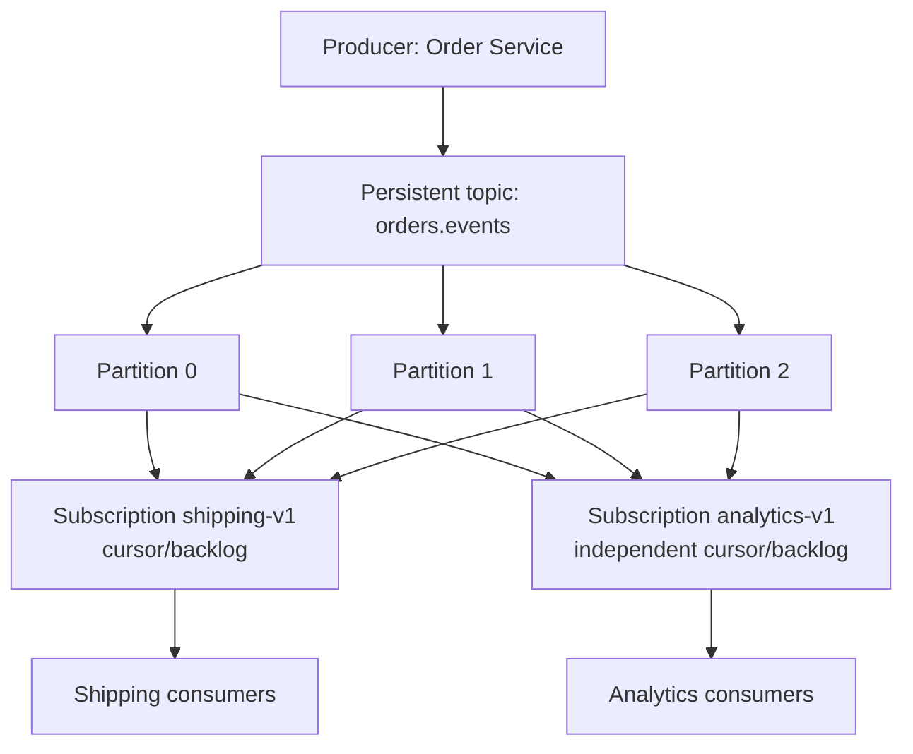

| Entity | Meaning | Do not confuse with |
| --- | --- | --- |
| **Producer** | Client publishing messages to a topic | Consumer or subscription |
| **Topic** | Named logical message log/stream, optionally having multiple partitions | Subscription or consumer group |
| **Partition** | Independently stored and dispatched unit of a topic with its own append sequence | Total ordering across all partitions |
| **Subscription** | Consumption state of a processing group: name, cursor, backlog, dispatch mode | A specific Java consumer instance |
| **Consumer** | Client receiving/acking from a subscription on a topic | A new topic or an independent copy of data |

For example, two applications using the **same topic with different subscription names**:

- `shipping-v1` consumes to issue shipments.
- `analytics-v1` consumes to update reports.

Each subscription tracks its own progress and can receive the same messages. Conversely, three Shipping Service instances sharing `shipping-v1` divide deliveries according to the **subscription type**.

A consumer calling `acknowledge` on `shipping-v1` **does not mark the message processed** for `analytics-v1`.

## 3. What Is a Subscription Type and Where Is It Chosen?

When subscribing, a consumer declares:

- Topic (or matching set/pattern of topics).
- `subscriptionName`: logical name of the consumer group.
- `subscriptionType`: one of `Exclusive`, `Failover`, `Shared`, `Key_Shared`.
- Initial position when the subscription **does not yet exist**.
- Schema, receiver queue, ack timeout, retry/redelivery, dead-letter policy, and provider options.

Example contract:

```text
topic: persistent://public/default/orders.events
subscriptionName: shipping-v1
subscriptionType: Key_Shared
message key: orderId
```

Treat `subscriptionName` as the **long-lived identity of a processing group**, not a per-pod or per-instance ID. If each deploy generates a fresh `shipping-v1-<timestamp>`, the broker creates new backlogs/cursors and each group replays data.

Within the same subscription, consumers must use a consistent mode; do not configure one instance as `Shared` and another as `Key_Shared` under the same name expecting the broker to reconcile semantics. Changing the subscription type of a group with an existing backlog is a **planned migration**, not a harmless enum tweak.

## 4. Decision Table: Exclusive, Failover, Shared, Key_Shared

| Subscription type | Consumer activity | Distribution | Expected ordering scope | Best suited for |
| --- | --- | --- | --- | --- |
| `Exclusive` | Only one valid consumer for the subscription in standard usage | One consumer receives the subscription stream | Can preserve dispatch order of one stream/partition absent redelivery or parallel processing | Simple, sequential workloads, low volume |
| `Failover` | Multiple consumers may register; primary/standby per topic/partition | Active consumer receives; switches on failover | Preserves per-partition dispatch order under normal operation, subject to redelivery/failover | High availability, active/standby |
| `Shared` | Multiple concurrent consumers | Spreads messages across consumers | **No ordering guarantee** for messages sharing a key | Independent work queues, scale-out |
| `Key_Shared` | Multiple concurrent consumers | Keys/hash ranges assigned to consumers | **Per key** under proper key/batching/rebalance/redelivery conditions | Many independent entities, each needing serialization |

Distinguish **broker dispatch order**, **consumer receive order**, **handler completion order**, and **external side-effect commit order**. No subscription type automatically turns all four into a single distributed transaction.

## 5. Exclusive: Simple, Yet Easily a Bottleneck

An **Exclusive subscription** permits one consumer on a subscription under normal usage. Another consumer attempting to attach to the same subscription as `Exclusive` cannot join as an active consumer alongside it.

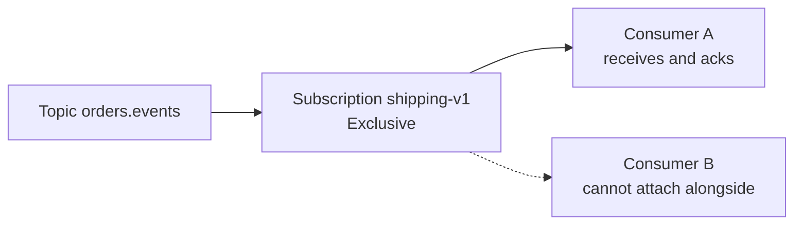

Advantages:

- Simple to debug, minimal dispatch contention within the subscription.
- Fits small workloads or tasks needing **one coordinating consumer at a time**.
- Easier to preserve processing order if the app processes synchronously one message at a time on a non-partitioned topic.

Limitations:

- One consumer may lack throughput or stall behind a slow downstream API.
- If the consumer dies, another instance must reconnect; Exclusive does not maintain a warm standby like Failover on the same subscription.
- Partitioned topics or multiple producers do not produce a **global total order**.
- A listener handing messages off to a thread pool/async pipeline can reorder business completions despite sequential broker dispatch.
- One poison message can stall the backlog if retried endlessly without DLQ/quarantine.

**Do not choose Exclusive just because it sounds like "exactly once."** It does not prevent broker redelivery or duplicate delivery after crashes; stable business event IDs are still mandatory.

## 6. Failover: Active/Standby, Not Ordered Shared

In a **Failover subscription**, multiple consumers register under the same subscription name. The broker designates the active consumer for the topic/partition per failover mechanics while the rest stand by. If the active consumer disconnects, ownership shifts to another consumer.

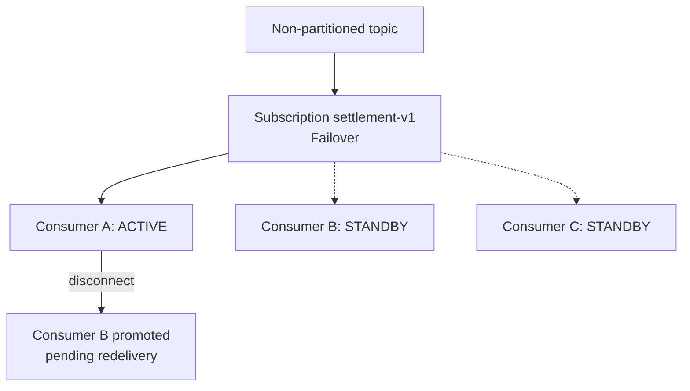

On a **partitioned topic**, multiple consumers can become active for **different partitions**. There is no rule that "only one consumer is active across the entire topic" for every topology. Inspect partition states and actual broker mappings.

Advantages:

- Consumer redundancy without custom polling or distributed scheduler locks.
- Useful for workloads needing one active consumer **per partition** with automatic recovery.
- Leverages partitions for parallelism while keeping single-stream dispatch per partition.

Limitations:

- During failover, dispatched but unacked messages can be **redelivered**, sometimes looking out of order in business logs.
- Does not equal exactly-once event processing.
- If a handler calls a partner HTTP endpoint and dies before ack, the promoted consumer may call HTTP again.
- Cross-partition ordering is not guaranteed.
- Consumer assignment, priority, and handoffs can depend on partitioning, consumer names, and broker config/version.

Choose Failover when you want HA/standby or per-partition sequence control; **do not** choose it expecting every consumer to share load evenly like `Shared`.

## 7. Shared: Work-Queue Scale-Out Without Per-Key Ordering

With a **Shared subscription**, multiple consumers attach to one subscription and the broker distributes messages across them via provider scheduling (often described as round-robin/load-balanced dispatch). Messages sharing an `orderId` are not guaranteed to reach the same consumer.

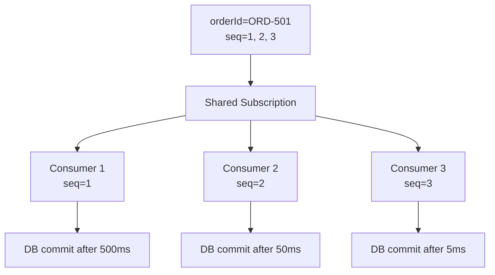

In the illustration, completion order can become `seq=3`, `seq=2`, `seq=1`. This is not a broker bug: Shared **makes no per-key ordering promise**.

Shared fits when:

- Each message can be processed independently of others.
- Tasks like sending emails, generating thumbnails, or indexing are idempotent and order-independent.
- You need higher throughput by adding consumers/pods.
- Redelivery, duplicates, and retries can be handled independently.

Shared does not fit if a business invariant requires "never cancel an order before creating it" without an additional **ordering/state guard**.

**Ack:** Shared generally uses **individual acknowledgement**; cumulative ack is unsupported under Shared semantics. If you want to "ack everything up to offset X," check whether your subscription type permits it.

## 8. Key_Shared: Key-Based Distribution, Serializing Each Entity

**Key_Shared** is the primary option when you need **parallelism across keys while maintaining per-key affinity** in dispatch. The broker assigns keys/hash ranges to consumers in the subscription; messages with the same key route to one consumer at a time per policy, subject to corresponding ordering conditions.

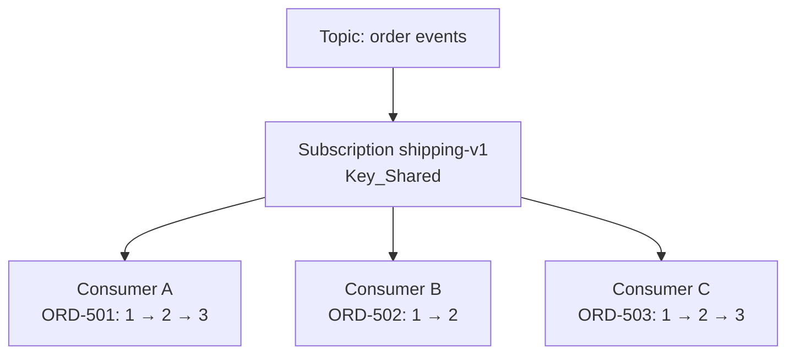

Benefits:

- Multiple orders process concurrently.
- Messages for **one `orderId`** group onto one consumer, simplifying per-order state machines.
- Consumer count can scale with key count and backlog instead of funneling all events through one consumer.
- Ideal for shopping carts, payments, per-SKU inventory, and per-entity workflows.

Conditions and limitations:

1. Producers must set an accurate, stable **message key**.
2. The chosen key must match the **unit requiring serialization** in business logic.
3. Producer **batching** must be `Key_Shared`-compatible; default batching mixing keys can break expected routing.
4. Key hashing/range assignment and rebalancing must be understood; during consumer churn, unacked/in-flight messages affect ordering.
5. A consumer dispatching tasks into a multi-threaded pool for the same key can still **commit side effects out of order**.
6. Redelivery, timeouts, and downstream failures still require idempotency and state validation.
7. `Key_Shared` provides **no global ordering across different keys**.
8. If a key's partition routing changes (e.g., increasing partitions), re-evaluate ordering and migration.

**Same consumer does not automatically mean same serial worker.** If `@PulsarListener` receives a message and calls `CompletableFuture.runAsync(...)`, two events with the same key can execute and commit out of order.

## 9. When Should the Key Be orderId, sku, or tenantId?

Key choice is a **business decision**, not merely load balancing.

| Event stream | Key to consider | Reason | Warning |
| --- | --- | --- | --- |
| Order lifecycle | `orderId` | Keeps an order's progression together | Do not mix orderId and customerId on one topic if ordering relies on key |
| Inventory updates | `warehouseId + sku` | Serializes per warehouse and SKU | A global single-SKU key can create a hot key |
| Payments | `paymentId` | Prevents capture/refund reordering | An order with multiple payment IDs needs another state guard |
| Customer profiles | `customerId` | Updates a single profile sequentially | Hot customers/tenants bottleneck one consumer |
| Device telemetry | `deviceId` | Preserves readings per device | Event time differs from broker dispatch time |
| Tenant config sync | `tenantId` or `tenantId:resourceId` | Protects invariants within serial domain | Large tenants can become a hot key |
| Independent emails | No key ordering needed | `Shared` is usually suitable | Still need a stable `eventId` for deduplication |

**Rule:** base key selection on the **invariant you need to protect**. If two events require relative ordering yet carry **two different keys**, `Key_Shared` will not order them relative to one another.

For instance, `customerId` can unnecessarily serialize all unrelated orders of one customer behind each other. Conversely, `orderId` is too narrow if an inventory check on the same SKU needs all reservations serialized.

## 10. Ordering in Pulsar: Specify What You Are Measuring

A requirement to "preserve ordering" can mean at least six different things:

1. **Business sequence:** `sequence=1,2,3` assigned by the application.
2. **Producer send order:** the order the producer invokes `send`/`sendAsync`.
3. **Broker append order:** the order messages are written within a partition by broker/storage.
4. **Dispatch order:** broker delivery to consumers per subscription rules.
5. **Handler start/finish order:** when the consumer starts/completes handling.
6. **External side-effect commit order:** when PostgreSQL commits or partner HTTP finishes.

```text
Business seq:       1 -------- 2 -------- 3
Producer async:     send(1) / send(2) / send(3)
Broker partition:   append(1) append(2) append(3)
Delivery:           1 -> 2 -> 3
Consumer async:     start(1) start(2) start(3)
DB commit:          2 -> 3 -> 1      (possible!)
```

A guarantee at the dispatch layer **does not automatically propagate** to the DB commit layer. Likewise, two producers emitting for the same key without sequence/ack coordination can leave the broker observing a different order than the business timeline.

In API specs, write explicitly: "for the same `orderId`, never apply an event with `aggregateVersion=N+1` before state reaches N," rather than merely writing "Pulsar preserves order."

## 11. Partitioned Topics Have No Topic-Wide Total Order

**Partitions** are a primary unit of parallelism. Topic `orders.events` might contain 4 partitions:

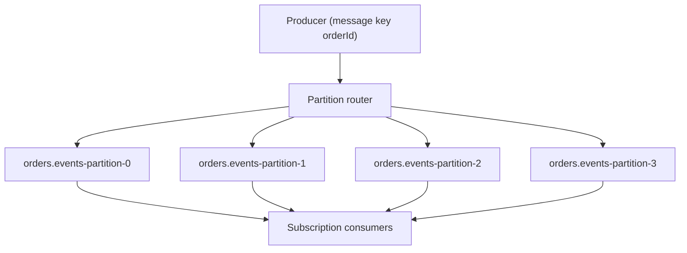

Typically, producer routing hashes the key so messages sharing a key land in the same partition **while topology/routing config stays stable**. However:

- Append order in partition 0 establishes no before–after relationship with partition 1.
- Increasing partition count can remap key → partition depending on the routing algorithm; a key may have older messages in the previous partition and newer ones in another. Plan migrations carefully if per-key ordering is critical.
- Multiple producers sending with the same key can race; there is no shared "global sequence" unless business logic assigns versions/sequences.
- `Failover` can assign **active consumers per partition**.
- `Key_Shared` adds per-key/hash-range distribution **within the subscription**; it does not create total ordering across partitions.

**If strict total ordering across all events is truly required**, evaluate the throughput ceiling, single stream/partition, single sequencer producer, and sequential processing; usually per-aggregate ordering is far preferable to total global ordering.

## 12. Producer Keys and Message Payloads Are Distinct Data

A producer can send a JSON string while setting a key for broker routing:

```java
import org.apache.pulsar.client.api.Producer;
import org.apache.pulsar.client.api.PulsarClient;
import org.apache.pulsar.client.api.Schema;

public final class OrderEventPublisher {

    public static void main(String[] args) throws Exception {
        try (PulsarClient client = PulsarClient.builder()
                .serviceUrl("pulsar://localhost:6650")
                .build();
             Producer<String> producer = client.newProducer(Schema.STRING)
                .topic("persistent://public/default/orders.events")
                .enableBatching(false)
                .create()) {

            String json = """
                {"eventId":"evt-1001",
                 "orderId":"ORD-501",
                 "aggregateVersion":1,
                 "type":"OrderCreated"}
                """;

            producer.newMessage()
                .key("ORD-501")
                .property("eventType", "OrderCreated")
                .property("schemaVersion", "1")
                .value(json)
                .send();
        }
    }
}
```

Key distinctions:

- `.key("ORD-501")` is the Pulsar message key used for routing/`Key_Shared` semantics.
- `orderId` inside the JSON is part of the **business contract** for validation/idempotency. Both values must match.
- `eventId` is the **stable business message identity**; never replace it with the broker's `MessageId` when producers can republish.
- `aggregateVersion` lets the consumer protect business state order independently of dispatch mechanics.
- `schemaVersion` in properties is producer-supplied metadata; check consistency with the payload.
- `enableBatching(false)` simplifies learning key routing here, at the expense of throughput. Production can use **key-based batching** after testing.

`Schema.STRING` only states the payload is string-encoded; it **does not** tell the broker to validate a JSON schema. For managed Avro/JSON schemas, use Pulsar Schemas and the appropriate registry/compatibility policy, tested against your version.

## 13. Do Not Confuse Key, Ordering Key, and MessageId

A Pulsar message can carry:

| Field | Assigned by | Used for |
| --- | --- | --- |
| `message.key` | Producer | Routing/`Key_Shared`/grouping by key |
| `orderingKey` (when supported by API/provider) | Producer | Ordering/routing metadata under specific semantics |
| `MessageId` | Broker/client publish result | Message position in ledger/partition, ack/seek |
| `eventId` in payload | Business producer | Idempotency across retries/republishing |
| `aggregateVersion` | Business state owner | Blocking out-of-order state transitions |
| `publishTime` | Broker/client metadata | Observing send time, not business sequence |
| `eventTime` | Producer | When the event originated; may differ from delivery |

**Important:** Pulsar exposes an `orderingKey` API in certain client lines; not every system uses both key and ordering key simultaneously, and routing effects depend on client/broker policies. To keep `Key_Shared` contracts simple, pick one **consistent message key** and test the routing path on your exact version rather than mixing keys untested.

Never use `publishTime` or `eventTime` for total ordering, as producer clocks can skew or two events can share timestamps.

## 14. Batching: A Common Misconfiguration with Key_Shared

Producer batching reduces overhead by grouping multiple messages. However, default batching can pack messages with **different keys** into the same batch. Under `Key_Shared`, dispatching a batch based on one key/metadata can violate "every key goes to its matching consumer."

Some Java Pulsar client versions support **key-based batching**:

```java
import org.apache.pulsar.client.api.BatcherBuilder;
import org.apache.pulsar.client.api.Schema;

var producer = client.newProducer(Schema.STRING)
    .topic("persistent://public/default/orders.events")
    .enableBatching(true)
    .batcherBuilder(BatcherBuilder.KEY_BASED)
    .create();
```

Here `client` is an initialized `PulsarClient` that must be closed per lifecycle. Verify `BatcherBuilder.KEY_BASED` and batch/linger bounds for your Pulsar client version.

Options:

1. **Disable batching** for simplicity and safety when initially testing semantics.
2. **Key-based batching** to group same-key messages without arbitrarily mixing keys per supported version policy.
3. Use another batching mode **only after testing** with interleaved keys and multiple consumers on a real broker.

You cannot prove `Key_Shared` works correctly by testing one key and one consumer. Send **multiple interleaved keys** and assert routing/ordering with batching enabled.

## 15. Key_Shared AUTO_SPLIT and STICKY: Hash Range Concepts

At the Pulsar Java client layer, **Key_Shared policies** can control hash-range assignment through mechanisms such as:

- **AUTO_SPLIT:** the broker manages splitting key hash ranges as consumers join or leave.
- **STICKY:** the client/application declares fixed hash ranges per consumer according to policy.

API configuration pattern (verify against your version):

```java
import org.apache.pulsar.client.api.KeySharedPolicy;
import org.apache.pulsar.client.api.SubscriptionType;

var consumer = client.newConsumer(Schema.STRING)
    .topic("persistent://public/default/orders.events")
    .subscriptionName("shipping-v1")
    .subscriptionType(SubscriptionType.Key_Shared)
    .keySharedPolicy(
        KeySharedPolicy.autoSplitHashRange()
    )
    .subscribe();
```

`client` and `Schema` match the producer example. This creates a single consumer, not a complete processing loop; close consumers and clients on shutdown.

**AUTO_SPLIT** is convenient when instance counts fluctuate. However, every scale/rebalance involves in-flight messages, unacked messages, and shifting key ranges; verify ordering behavior during failure windows.

**STICKY** allows explicit range control but demands managing mappings, overlaps, gaps, and consumer lifecycles. Do not pick `STICKY` simply assuming "manual ranges will be faster"; operations become substantially harder.

Hash range policies do not replace business idempotency or sequence checks, nor do they create ordering across partitions.

## 16. Consumer Churn and Key Range Transfers: Does Ordering Hold?

Suppose:

```text
t0: key ORD-501 -> Consumer A
t1: A receives seq=5 and starts slow HTTP call
t2: Consumer B joins; ownership assignment may change
t3: A crashes before ack or after side effect
t4: Broker redelivers seq=5; seq=6 also pending
t5: Consumer B processes messages
```

Risks:

- `seq=5` may have executed a side effect before crashing without ack.
- Redelivered messages may show an incremented `redeliveryCount`.
- If the application processes asynchronously, `seq=6` can finish before `seq=5`.
- Settings allowing **out-of-order delivery** (where supported by policy/version) can trade ordering for throughput or reduced head-of-line blocking.
- During consumer scale-down or broker ownership shifts, verify behavior for your version and in-flight state.

**Never promise "out-of-order is impossible" just by specifying `SubscriptionType.Key_Shared`.** Distinguish broker dispatch contracts from database state, and use `aggregateVersion` or sequence numbers to **detect and prevent invalid applications**.

When strict ordering is mandatory, process sequentially per key, disallow async stages from overtaking one another, bound unacked work, test reconnects/rebalances, and implement wait/buffer/park handling when a prior version is missing.

## 17. Key Hot-Spots and Uneven Distribution

`Key_Shared` balances **by keys/hash ranges**, not by splitting messages of the same key across all consumers. If one `tenantId` accounts for 70% of traffic, the consumer owning that key becomes overloaded:

```text
Tenant A: 70% traffic ---> one key / one consumer bottleneck
Tenant B: 10% traffic ---> another consumer
Other tenants: 20% ----> remaining consumers
```

Adding 20 consumers cannot increase parallelism **within a single key** if business invariants require serial execution.

Mitigations:

- Redefine keys to the narrowest invariant scope possible: `tenantId:resourceId`, `warehouseId:sku`.
- Isolate heavy tenants onto separate workloads or topics when SLAs/permissions justify it.
- Optimize single-key handling: DB indexes, business-level batching (not mixed-key producer batching), lower remote latency.
- Track backlog age and per-key hot spots with cardinality-bounded metrics.
- Never attach raw `orderId`/`tenantId` to every metric label.

**Sharding a single key into multiple keys for throughput sacrifices per-key ordering guarantees.** Do so only when the business state machine tolerates or has been redesigned for it.

## 18. Ack Semantics: Individual vs Cumulative Differ

Consumers must inform the broker when messages are processed per policy.

Two common acknowledgment styles:

- **Individual ack:** confirms one specific message.
- **Cumulative ack:** confirms a given message and all preceding messages in that stream, valid only when subscription/ordering semantics allow it.

| Subscription | Individual ack | Cumulative ack |
| --- | --- | --- |
| Exclusive | Yes | Usable in matching sequential models |
| Failover | Yes | Usable when processing in matching order |
| Shared | Yes | **Unsupported** under Shared semantics |
| Key_Shared | Yes | **Unsupported** under Key_Shared semantics |

For `Shared` and `Key_Shared`, individual ack is the practical model. Cumulative ack could accidentally mark unfinished parallel messages as "processed" if misused, so the broker forbids it under those modes' semantics.

**Ack timing:** never ack before critical DB transactions or side effects finish. Conversely, if the DB commits and the process dies before ack, the broker can redeliver; hence inbox/idempotent effects remain essential.

## 19. Negative Ack, Ack Timeout, and Redelivery Affect Observed Order

When message processing fails, consumers typically use:

- `negativeAcknowledge(message)`: tells the broker/client the message must be redelivered per policy.
- **Ack timeout:** if unacked past the configured duration, the message can be redelivered.
- **Consumer disconnect/crash:** unacked messages can be redelivered to another consumer.
- **Reconsume later / retry topic:** defers reprocessing to a later time if supported by config and API.
- **Dead-letter topic:** isolates messages exceeding retry counts or hitting permanent failures per policy.

These mechanisms differ; **redelivery is not a newly published message**, and an invalid message does not magically become valid after 10 retries.

For ordered subscriptions, consider:

```text
Broker dispatch key ORD-501:  seq=10 -> seq=11
Consumer receives seq=10:    DB temporarily unavailable
Consumer negative-acks 10:   schedule redelivery
Consumer receives seq=11:    possible depending on mode/config/in-flight
Business state:              must not apply 11 before 10
```

A guarantee of **per-key dispatch** does not guarantee that retries, `reconsumeLater`, asynchronous callbacks, and side effects maintain business order. Verify exact behavior against your **Pulsar version, subscription policy, ack/redelivery mode, and consumer code**.

**Guidance:** when messages sharing a key have an order-dependent state machine, ack only after committing a valid transition; on encountering a gap `expectedVersion != incomingVersion`, defer/park/reconcile rather than applying the later message early.

## 20. Configuring Ack Timeout and Negative-Ack Delay in the Java Client

Example `Shared` consumer handling independent jobs:

```java
import java.util.concurrent.TimeUnit;

import org.apache.pulsar.client.api.Consumer;
import org.apache.pulsar.client.api.PulsarClient;
import org.apache.pulsar.client.api.Schema;
import org.apache.pulsar.client.api.SubscriptionType;

Consumer<String> worker = client.newConsumer(Schema.STRING)
    .topic("persistent://public/default/email.commands")
    .subscriptionName("email-worker-v1")
    .subscriptionType(SubscriptionType.Shared)
    .ackTimeout(60, TimeUnit.SECONDS)
    .negativeAckRedeliveryDelay(5, TimeUnit.SECONDS)
    .subscribe();
```

`client` is a `PulsarClient` managed at startup; remember to close `worker` on shutdown.

How to interpret:

- `ackTimeout` bounds the receive-to-ack window per API/implementation; if workers run longer, in-flight messages risk redelivery.
- `negativeAckRedeliveryDelay` controls delay after negative ack; it is not a full exponential backoff policy by default.
- 60 seconds and 5 seconds are illustrative only, not optimal values for all workloads.
- If downstream HTTP can take up to 90 seconds while ack timeout is 60 seconds, expect overlapping duplicate processing.
- With Spring listener containers, configure timeouts/redelivery on the **exact consumer factory/container** rather than defining an unused config bean.

Never merge three separate timers into one: **HTTP timeout**, **Pulsar ack timeout**, and **business SLA** serve different responsibilities. Consumers must still recover cleanly from crashes even if ack timeout is disabled.

## 21. Sample Consumer Loop: Ack After Success, Negative Ack on Failure

Java client example separating permanent errors from transient errors:

```java
import org.apache.pulsar.client.api.Consumer;
import org.apache.pulsar.client.api.Message;
import org.apache.pulsar.client.api.PulsarClient;
import org.apache.pulsar.client.api.Schema;
import org.apache.pulsar.client.api.SubscriptionType;

public final class OrderWorker {

    private final Consumer<String> consumer;
    private final OrderProcessor processor;

    public OrderWorker(PulsarClient client,
                       OrderProcessor processor)
            throws Exception {
        this.consumer = client.newConsumer(Schema.STRING)
            .topic("persistent://public/default/orders.events")
            .subscriptionName("shipping-v1")
            .subscriptionType(SubscriptionType.Key_Shared)
            .subscribe();
        this.processor = processor;
    }

    public void handleOne() throws Exception {
        Message<String> msg = consumer.receive();
        try {
            String key = msg.getKey();
            if (key == null || key.isBlank()) {
                throw new InvalidEventException(
                    "MISSING_ORDER_KEY"
                );
            }

            processor.process(
                key,
                msg.getValue(),
                msg.getProperty("schemaVersion")
            );
            consumer.acknowledge(msg);
        } catch (TransientProcessingException ex) {
            consumer.negativeAcknowledge(msg);
        } catch (InvalidEventException ex) {
            // Do not ack until durable quarantine succeeds.
            // On failure to quarantine, prefer redelivery/alerting.
            quarantineThenAcknowledge(msg, ex);
        }
    }

    private void quarantineThenAcknowledge(
            Message<String> msg, Exception cause)
            throws Exception {
        // Application-specific: durable storage / DLQ confirmation.
        // Implement before enabling this path in production.
        throw new UnsupportedOperationException(
            "Quarantine adapter required"
        );
    }
}
```

`OrderProcessor`, `TransientProcessingException`, and `InvalidEventException` are project-defined types. `quarantineThenAcknowledge` intentionally **does not ack** because the sample omits durable quarantine storage; never teach dropping poison messages via `catch { ack(); }`.

**Operational note:** this snippet demonstrates **one receive-and-process cycle**, not full production listener lifecycle/shutdown. Real code needs a loop, interruption handling, consumer/client closing, error policies, bounded concurrency, and timeout control. When using `@PulsarListener`, the container manages ACKs per mode; avoid duplicate ACKs from code unaware of container mode.

## 22. Dead-Letter Topics and Poison Messages: Protecting Throughput

A poison message is a message that **cannot succeed by repeating the exact same retry**, such as:

- Invalid JSON or permanently incompatible schema version.
- Missing mandatory business event ID or key.
- Unrecognized event type.
- Data violating invariants with no automatic reconciliation path.
- Oversized payload or parser limit breach.
- Invalid signature or tenant authorization failure.

Some Java Pulsar client versions support configuring **`DeadLetterPolicy`**:

```java
import org.apache.pulsar.client.api.DeadLetterPolicy;
import org.apache.pulsar.client.api.Schema;
import org.apache.pulsar.client.api.SubscriptionType;

var consumer = client.newConsumer(Schema.STRING)
    .topic("persistent://public/default/orders.events")
    .subscriptionName("shipping-v1")
    .subscriptionType(SubscriptionType.Shared)
    .deadLetterPolicy(
        DeadLetterPolicy.builder()
            .maxRedeliverCount(5)
            .deadLetterTopic(
                "persistent://public/default/orders.events-dlq"
            )
            .build()
    )
    .subscribe();
```

**This snippet illustrates the policy for `Shared`** without a receive/ack loop. Depending on version/scenario, dead-letter handling has specific requirements around ack timeout, negativeAck/reconsumeLater, retry topics, permissions, or topology. Do not assume `maxRedeliverCount` applies uniformly across every error, subscription type, or redelivery path. **Test against a real broker** to see after how many attempts a message moves to the DLQ and how the original message is acked/removed.

A DLQ workflow requires:

1. An owner triaging failures to identify producer vs consumer bugs.
2. Safe metadata retention: eventId, topic, subscription, schema version, masked key, error category.
3. Size/retention/quota limits; never retain arbitrary raw payloads with PII unnecessarily.
4. Controlled replay tooling **preserving the stable business `eventId`** without unbounded concurrency.
5. Schema evolution and decoder tests before replaying.
6. Alerts on DLQ rate/age; never treat "landed in DLQ" as business success.

**Key_Shared and DLQ:** routing one message of a key to a DLQ can let a later version proceed ahead of the missing one. If business logic demands an unbroken chain, **park/reconcile per key** rather than moving one error to a DLQ and continuing blindly.

## 23. Retry Topics, reconsumeLater, and Business Ordering

Rather than redelivering immediately on the main subscription, some workflows use a **retry topic** or `reconsumeLater` to reprocess after a backoff.

What to understand:

- A deferred message may no longer precede subsequent messages arriving on the main topic.
- A retry topic is a separate delivery path with its own cursor and settings.
- Even when retry messages retain `eventId` or properties, consumers must still deduplicate.
- `enableRetry`, `reconsumeLater`, retry topic naming, and DLQ integration depend on client version and subscription type; test the real pipeline.
- For a failing key, newer events can arrive before the old retry finishes unless blocked by the application.

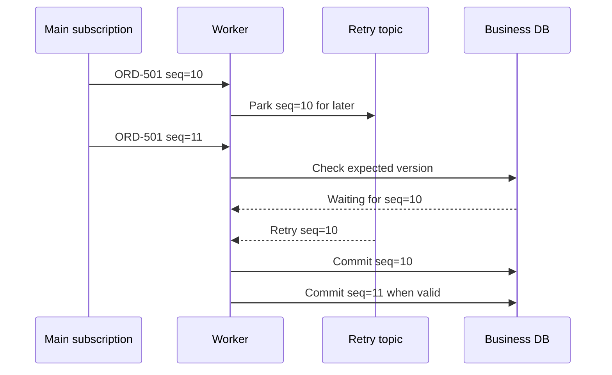

**If strict per-key sequencing is mandatory**, do not rely solely on a retry topic without an expected-version guard. You can hold the failing message and pause progress for that key, or store durable pending-event state for recovery; the trade-off is head-of-line blocking scoped to that key rather than all keys.

## 24. Subscription Cursors and Durable Backlogs Differ from Kafka Offsets

Pulsar tracks consumption state via **subscription cursors**, supporting backlogs and redelivery per the broker model. A `MessageId` encodes ledger/partition position; do not treat it like a single monotonic integer offset across an entire topic.

Example:

```text
Topic orders.events
  Subscription shipping-v1:
    cursor ~ point A / unacked ranges
    backlog: messages shipping has not completed

  Subscription analytics-v1:
    cursor ~ point B
    backlog: independent of shipping
```

Implications:

- Two subscriptions on the same topic maintain **independent progress**.
- One consumer's ack never acks another subscription.
- Large backlogs hold data requiring retention/storage per broker policy.
- With `Shared`/`Key_Shared` and individual acks, the entire backlog cannot be collapsed into one linear offset.
- Resetting/seeking a cursor **replays or skips messages**; require approval, idempotency, and business impact review.
- Deleting and recreating a subscription can alter initial position and cause duplicates or missed data per retention; never delete a production subscription to "clear lag" blindly.

**Durable subscription** does not mean data lives forever: topic retention, backlog quotas, TTL/expiry, storage, and admin policies still apply.

## 25. subscriptionInitialPosition: Earliest/Latest Only Applies on Creation

A consumer can specify where to start when the subscription does not yet exist:

```java
import org.apache.pulsar.client.api.SubscriptionInitialPosition;
import org.apache.pulsar.client.api.SubscriptionType;

var consumer = client.newConsumer(Schema.STRING)
    .topic("persistent://public/default/orders.events")
    .subscriptionName("analytics-v1")
    .subscriptionType(SubscriptionType.Shared)
    .subscriptionInitialPosition(
        SubscriptionInitialPosition.Earliest
    )
    .subscribe();
```

- **Earliest:** for a new subscription, starts from the oldest retained data subject to retention/backlog constraints.
- **Latest:** a new subscription favors messages arriving after creation per corresponding semantics.
- For an **existing** subscription, initial position **does not reset the cursor**; the broker resumes from the persisted subscription state.
- `Earliest` does not promise "read the entire history since day one" if retention has already expired older messages.
- `Latest` on a command-processing group can skip commands published before the subscription existed; verify subscription creation before producers start sending.

**Rollout trap:** renaming `shipping-v1` to `shipping-v2` with `Earliest` can replay retained history to the new group; setting `Latest` can miss commands published while no consumer existed. That is a **migration decision**, not a harmless Java variable rename.

## 26. One Topic, Many Subscriptions: Independent Fan-Out by Type

Suppose Orders Service emits `OrderCreated`:

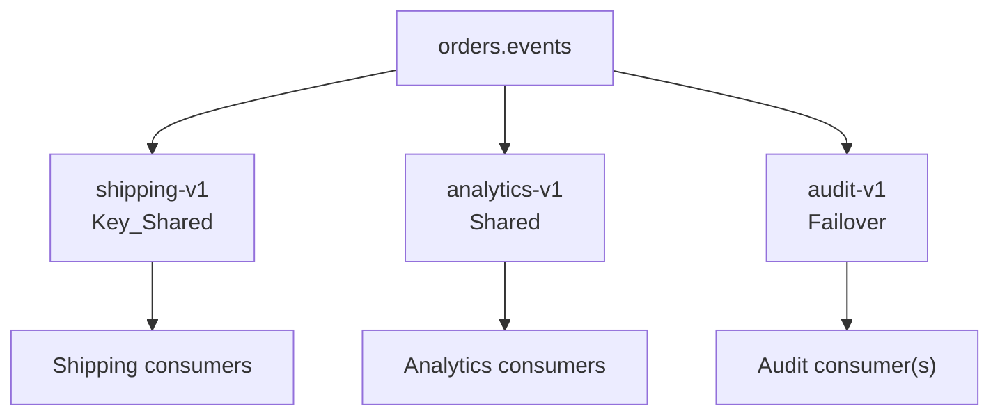

In this setup:

- **shipping-v1** requires per-`orderId` ordering.
- **analytics-v1** processes independent metrics, scaling horizontally.
- **audit-v1** wants one active consumer with standby, or active per partition.

Use **different subscription names** to fan out the same events to each group. Putting Shipping and Analytics on the **same `Shared` subscription** makes them compete for messages, delivering each event to only one side instead of both.

Subscription type governs **distribution within a subscription**; subscription count determines how many independent consumer groups receive the stream. These two concepts are often conflated when people say "a Pulsar topic delivers once to every consumer."

## 27. Multi-Topic Subscriptions and Ordering: Never Promise Cross-Topic Order

A Pulsar consumer can subscribe to multiple topics or a regex pattern (subject to API and permissions). However:

- Each topic/partition maintains independent storage/dispatch order.
- Merging messages from `orders.created` and `orders.cancelled` does not yield total ordering.
- Sending the same `orderId` to two different topics will not make `Key_Shared` merge them into a single end-to-end serial stream.
- Pattern subscriptions discover new topics dynamically; attach timing and initial cursors must be tested.
- Cross-topic ordering and business sequencing must be designed explicitly, even when Pulsar supports scoped transactions.

When protecting an order's state machine, keeping **one stream per aggregate with a stable message key** is far simpler than splitting every event type across separate topics and reconstructing order from arrival timestamps.

When multiple topics are unavoidable, rely on business versions/correlations, deferred waiting state, and reconciliation rather than wall-clock order.

## 28. Spring Boot: Starter and Pulsar Connection Configuration

Spring Boot supports **Spring for Apache Pulsar** via its starter in matching versions. Maven dependency example (aligned with your project's Spring Boot BOM):

```xml
<dependencies>
    <dependency>
        <groupId>org.springframework.boot</groupId>
        <artifactId>spring-boot-starter-pulsar</artifactId>
    </dependency>
</dependencies>
```

Gradle:

```groovy
dependencies {
    implementation 'org.springframework.boot:spring-boot-starter-pulsar'
}
```

Local configuration:

```yaml
spring:
  pulsar:
    client:
      service-url: ${PULSAR_SERVICE_URL:pulsar://localhost:6650}
    admin:
      service-url: ${PULSAR_ADMIN_URL:http://localhost:8080}
```

Meaning:

- `pulsar://localhost:6650` is the local Pulsar binary protocol endpoint, **not** a Kafka bootstrap URL or HTTP admin endpoint.
- `http://localhost:8080` is an example Pulsar admin HTTP endpoint; admin/tenant/namespace/topic provisioning permissions can be kept separate from the app.
- Inside Docker/Kubernetes, `localhost` refers to the container/pod itself; use service DNS and topology-appropriate endpoints.
- TLS/authentication settings (token, OAuth2/mTLS per version/provider) must come from secrets and proper client config, never hardcoded in YAML/Git.
- Do not use auto-created `public/default` topics lacking ACLs/retention policies for sensitive production data.

`spring-boot-starter-pulsar` does not automatically fix producer batching, key schemas, consumer group identity, ack/redelivery/DLQ, or transaction correctness. Those must be configured and tested at the **right template/listener/container/client layer**.

## 29. @PulsarListener in Spring: Deliberately Choosing Subscription Type

In Spring for Apache Pulsar, listeners declare topics, subscription names, and subscription types on `@PulsarListener` per version API:

```java
import org.apache.pulsar.client.api.SubscriptionType;
import org.springframework.pulsar.annotation.PulsarListener;
import org.springframework.stereotype.Component;

@Component
public class ShippingEventListener {

    private final ShippingEventService service;

    public ShippingEventListener(ShippingEventService service) {
        this.service = service;
    }

    @PulsarListener(
        topics = "persistent://public/default/orders.events",
        subscriptionName = "shipping-v1",
        subscriptionType = SubscriptionType.Key_Shared
    )
    public void onEvent(String jsonPayload) {
        service.processJson(jsonPayload);
    }
}
```

`ShippingEventService` is a project-defined business service. This example takes a **String payload** and therefore omits validating key/eventId/schemaVersion; a real app must inspect metadata via the listener API and verify key consistency with the payload.

Watch out:

1. `subscriptionName` must stay consistent across replicas of the same group.
2. `subscriptionType` must match business needs and broker policies.
3. Consumer factories/listener containers can specify additional **ack mode, concurrency, schema, and subscription properties**; the annotation alone does not override everything.
4. For `Key_Shared`, the producer must set **keys** and **key-based batching**; the listener annotation alone does not create per-key ordering.
5. Returning from a `void` method does not prove remote HTTP/DB work committed if the service fired-and-forgot or swallowed exceptions.
6. With Spring auto-ack, exception handling and transaction behavior depend on listener container mode; test actual redelivery rather than guessing from annotation names.
7. Newer Spring versions can change annotation/container configuration; check the exact Spring for Apache Pulsar reference.

**Never** hand work off from `onEvent` to an unmanaged thread pool and return immediately: the container may ack on method return while side effects remain unfinished.

## 30. PulsarTemplate and Key-Aware Publishing in Spring

Spring for Apache Pulsar offers `PulsarTemplate<T>` to send payloads from Spring components. General example:

```java
import org.springframework.pulsar.core.PulsarTemplate;
import org.springframework.stereotype.Component;

@Component
public class NotificationPublisher {

    private final PulsarTemplate<String> template;

    public NotificationPublisher(
            PulsarTemplate<String> template) {
        this.template = template;
    }

    public void sendNotification(String payload) {
        template.send(
            "persistent://public/default/notifications",
            payload
        );
    }
}
```

`send(topic, payload)` is convenient for messages needing no routing key. **However, with `Key_Shared`, never stop at this example**: use an API supporting **message keys** (such as Spring Pulsar's fluent `newMessage()`/customizer API for your version, or raw Pulsar Java producer `newMessage().key(...)`) and verify keys on the consumer.

Do not confuse **KafkaTemplate** key overloads with **PulsarTemplate**; overloads and type signatures differ. When you need specific capabilities like ordering keys, schemas, custom properties, event times, or key-based batching, check your version's Spring Pulsar template builder and manage producer configuration centrally.

Switching between `PulsarTemplate` and the native Pulsar client does not alter business requirements: `eventId`, subscriptions, partitions, acks, and durable retries remain mandatory.

## 31. Listener Concurrency: Multiple Instances vs Multiple Threads

Two scaling dimensions are often confused:

**Scaling broker consumers:** increasing consumers attached to the same subscription. Outcomes depend on subscription type:

- `Exclusive`: disallows multiple active consumers under standard usage.
- `Failover`: adds standbys or increases active assignments across partitions.
- `Shared`: broker distributes more messages across consumers.
- `Key_Shared`: keys/hash ranges are rebalanced, though a hot key still caps single-key throughput.

**Scaling application tasks:** one consumer receives messages and dispatches work to a thread pool, `CompletableFuture`, or reactive operators. This can boost processing throughput **yet destroys business completion order** if messages sharing a key execute concurrently.

Wrong example when `ORD-501` needs serialization:

```java
@PulsarListener(
    topics = "persistent://public/default/orders.events",
    subscriptionName = "shipping-v1",
    subscriptionType = SubscriptionType.Key_Shared
)
public void onEvent(String json) {
    java.util.concurrent.CompletableFuture.runAsync(
        () -> processRemotely(json)
    );
    // Method returned before remote processing completed!
}
```

Ordering is not the only casualty; if the container auto-acks upon method return, the event gets acknowledged even if the remote operation fails afterward.

**Solution:** serialize per key at the business boundary, ack/commit only after durable side effects, use bounded concurrency across distinct keys, and assert the order of **DB commits**, not merely message arrivals.

## 32. Manual Ack in Spring: Choosing by Container Mode

Spring for Apache Pulsar supports listener container modes for acknowledgements depending on version. When a problem demands manual ack:

- Inspect the exact `PulsarAcknowledgement`/`Acknowledgement` API or native `Consumer`/`Message` access offered by your version instead of copying types from JMS/Kafka.
- Configure ack mode on the listener factory/container actually used by Spring.
- Ack only after the DB transaction/business effect commits.
- For transient errors, apply negative ack or explicit delayed retry policies.
- For permanent errors, persist to DLQ/quarantine before considering the message handled.
- Never ack the same message from two code paths, and never manually retry/negative-ack when the container already does so.
- If the listener returns a future/reactive type, verify **when the framework considers processing done** rather than guessing from the method signature.

In this lesson, the native `Consumer<String>` example in Section 21 highlights the ack boundary clearly. Because Spring Pulsar manual acknowledgement APIs evolve across releases, **never copy an unverified method signature into production**; check the Spring Pulsar reference/Javadoc and write a broker-backed integration test.

## 33. Enforcing Business Order with aggregateVersion in the Database

Even if the broker dispatches `seq=10` then `seq=11`, consumer failover can deliver them back-to-back. The business database should enforce a guard:

```sql
CREATE TABLE shipping_projection (
    order_id VARCHAR(100) PRIMARY KEY,
    aggregate_version BIGINT NOT NULL,
    shipping_status VARCHAR(40) NOT NULL
);

CREATE TABLE processed_event (
    source_system VARCHAR(80) NOT NULL,
    event_id VARCHAR(120) NOT NULL,
    processed_at TIMESTAMP WITH TIME ZONE
        NOT NULL DEFAULT CURRENT_TIMESTAMP,
    PRIMARY KEY (source_system, event_id)
);
```

An optimistic PostgreSQL state transition:

```sql
UPDATE shipping_projection
SET aggregate_version = :incomingVersion,
    shipping_status = :newStatus
WHERE order_id = :orderId
  AND aggregate_version = :incomingVersion - 1;
```

Use `:incomingVersion`, `:newStatus`, and `:orderId` as **named SQL parameters** with `NamedParameterJdbcTemplate` or jOOQ; do not paste them into a JDBC `PreparedStatement` expecting `?` placeholders.

Check **affected rows**:

- 1 row: state transition from N−1 to N succeeded.
- 0 rows: distinguish **duplicate** (already at N), **gap** (at N−2), **missing aggregate**, and **conflict/reordered event**.
- Never increment version if the payload is invalid.
- An out-of-order event can be parked/deferred and replayed once event N−1 arrives.
- Still keep the `(source_system, event_id)` unique key to block double side effects if the same version arrives twice.

**Warning:** the SQL above assumes the aggregate row already exists. The v1 aggregate-creation event must use concurrency-safe insert/upsert. Never interpret 0 affected rows as always meaning duplicate; a missing prior event is a failure requiring handling.

## 34. Inbox and Transactions: Ack After Database Commit

For a consumer writing to PostgreSQL, the standard pattern is:

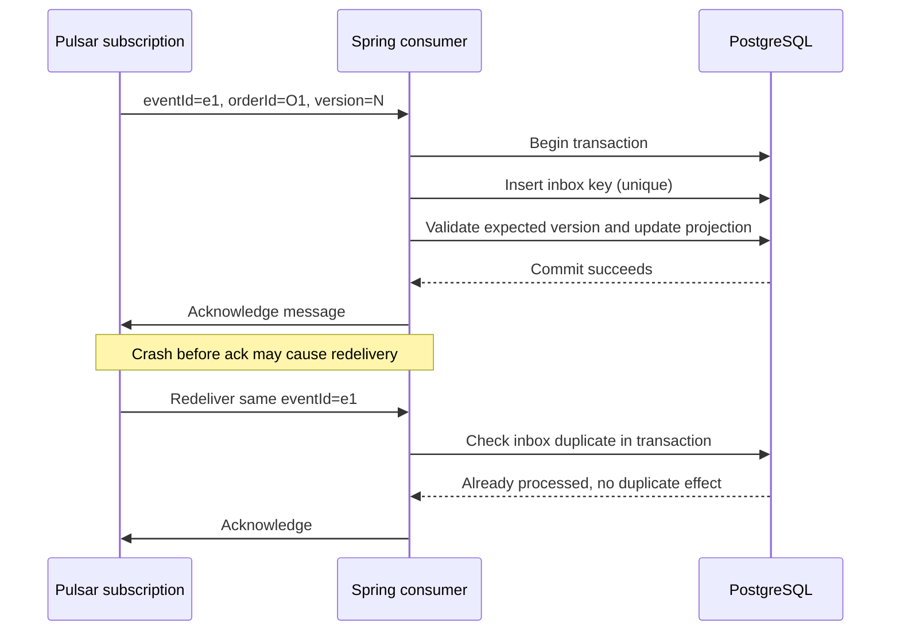

Essential points:

1. **Business data + inbox record** are written in the same PostgreSQL transaction when targeting the same database.
2. Enforce a unique constraint rather than `exists()` then `save()` outside a transaction.
3. Never call HTTP or a broker and assume an SQL rollback undoes the remote side effect.
4. DB commit can succeed while Pulsar ack fails, making redelivery normal.
5. If you ack before DB commit, crashing after ack can **lose work**.
6. If the inbox record is persisted before a remote side effect outside the transaction, track `PENDING/COMPLETED`, compensation, or downstream idempotency.
7. The producer's stable `eventId` differs from the broker's `MessageId`.
8. On an event gap, do not ack as successful unless a durable pending-event/reconciliation workflow owns it.

**Choosing `Key_Shared` reduces contention on the same `orderId`, but transactions and unique keys protect correctness across crashes, retries, and concurrent claims.**

## 35. Transactional Outbox: DB Commit and Pulsar Publish Are Not Atomic by Default

A Spring Boot service receives an HTTP POST, creates an order in PostgreSQL, and publishes to Pulsar inside `@Transactional`:

```java
@Transactional
public void createOrder(CreateOrderCommand command) {
    orderRepository.save(command.toEntity());
    pulsarTemplate.send("orders.events", command.toJson());
}
```

This is pseudocode with application-defined types/services. **JDBC/JPA `@Transactional` does not synchronize commits with Pulsar**:

- DB rolls back after the broker received the message → consumers see an event for a non-existent order.
- DB commits while the broker is unavailable → event is lost if intent was not stored.
- Producer times out after the broker accepted → outcome is uncertain; retries may produce a duplicate.
- Sending without a key prevents downstream `Key_Shared` from grouping by `orderId`.

**Transactional outbox:**

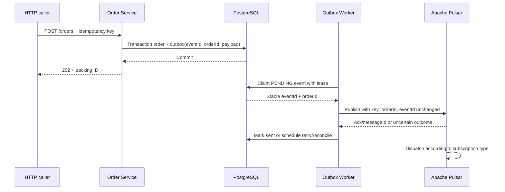

An outbox preserves **durable intent** across application restarts. It primarily delivers **at-least-once publishing**; when a producer resends after an uncertain outcome, consumers rely on inbox/`eventId` to avoid duplicating side effects.

Pulsar provides **transaction-related APIs** in certain versions/configurations, yet Pulsar transactions **do not automatically merge** into PostgreSQL JDBC transactions. Cross-system atomicity demands explicit coordination patterns; never confuse Pulsar transactions with default distributed XA transactions.

## 36. Step-by-Step Subscription Type Selection

Instead of picking an enum first, start from invariants and topology.

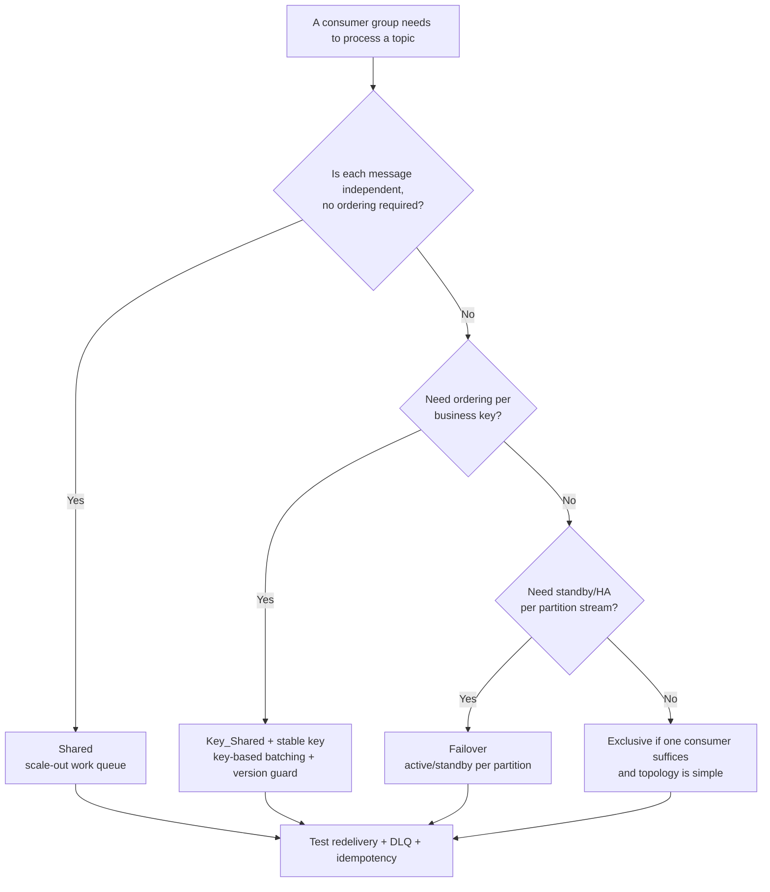

Mandatory questions before going to production:

1. **What is the unit requiring order?** Entire topic, partition, `orderId`, or SKU?
2. **Does input have a stable key?** Can the key be null, mutate, or be randomly generated per attempt?
3. **Are there multiple producers?** Who assigns the aggregate sequence/version?
4. **How many partitions does the topic have?** Are there plans to increase partition counts?
5. **Can one key dominate traffic?** Is head-of-line blocking acceptable?
6. **If a worker disconnects, who takes its backlog?** Have failover and scale-in been tested?
7. **After what step do we ack?** After DB commit, partner HTTP confirmation, or durable intent?
8. **Are retry/DLQ configured?** Should event N+1 run while N sits in the DLQ?
9. **How many groups need fan-out?** Create separate subscription names instead of competing on one.
10. **What are latency SLAs and retention limits?** Could backlog expire/hit quota before processing?
11. **What policies do your client/framework versions support?** Verify explicitly with batching and `Key_Shared`.
12. **Are duplicates/out-of-order errors caught in the DB?** Never stop at broker config.

**Quick summary:** `Shared` for independent tasks; `Key_Shared` for per-key processing; `Failover` for active/standby per stream/partition; `Exclusive` for a single simple consumer. All four still require error handling and idempotency.

## 37. Comparing with Kafka Consumer Groups and RabbitMQ Queues

Pulsar, Kafka, and RabbitMQ all support message-driven integrations, yet their configurations are not one-to-one equivalents.

| Goal | Pulsar | Kafka | RabbitMQ AMQP |
| --- | --- | --- | --- |
| Fan-out to independent groups | Multiple subscription names | Multiple consumer groups | Multiple queues/bindings |
| Scale independent work | `Shared` | Partitions / consumer group | Competing consumers |
| Per-key ordering | `Key_Shared` + routing/constraints | Key → partition + per-partition processing | Requires routing/queue design and consumer serialization |
| Standby single active consumer | `Failover` | Partition consumer assignment; different semantics | Single-active-consumer or consumer priority per broker |
| Processing confirmation | Ack/cursor per subscription | Commit offsets per group | Ack/nack/delivery tags |
| Retry/DLQ | Negative ack, retry topic, DLQ policy | App/framework retry topics/DLT | Dead-letter exchange/queue policies |
| Cursors/retention | Subscription cursor/backlog + retention policy | Topic log offsets + retention | Queue lifecycle/TTL/retention per broker |

**Never use the phrase "Kafka partition offset" to describe Pulsar `Shared` acks.** `Shared`/`Key_Shared` use individual acknowledgements and cursor semantics rather than committing a single linear offset.

Likewise, never treat RabbitMQ `basicNack(requeue=false)` as identical to Pulsar `negativeAcknowledge`. DLQ routing and retry limits depend on each broker/framework's specific policy.

## 38. Test Matrix: Must Include At Least Two Consumers and Multiple Keys

Testing with a single consumer and single partition never proves how `Shared` differs from `Key_Shared`. Set up an **isolated test topic**, multiple consumers on the same subscription, and messages carrying metadata for verification.

| Test case | Setup | Expected / observed |
| --- | --- | --- |
| Exclusive, second consumer | 2 consumers, 1 subscription | Cannot both consume in `Exclusive` mode |
| Failover, primary disconnects | 2 consumers, non-partitioned topic | Standby takes over; unacked may redeliver |
| Failover partitioned | 4 partitions, 3 consumers | Active assignments per partition; no global order claim |
| Shared multiple workers | 4 consumers, interleaved keys | Load distributed; no per-key order assumed |
| Key_Shared multiple keys | 3 consumers, 10 keys, multiple seqs | Same key grouped per policy; matching dispatch order |
| Key_Shared + default batching | Producer batching mixed keys | Exposes setup that can break key routing |
| Key_Shared + key-based batching | Producer `BatcherBuilder.KEY_BASED` | Tests routing/ordering expectations |
| Key_Shared scale-in/out | Consumers join/leave while in-flight | Evaluates rebalance/unacked and business version guard |
| Shared duplicate | Crash after DB commit before ack | Event redelivered, business effect occurs once |
| Missing key | Producer sends keyless message | Consumer/quarantine enforces contract without applying state |
| Hot key | 80% events share one key | Only one lane bottlenecks; lag/alerts fire |
| Order version gap | Seq=2 arrives before seq=1 | Refuses committing v2 state while v1 is missing |
| Poison + valid messages | Invalid JSON followed by valid JSON | Poison isolated; valid events not lost |
| DLQ + per-key sequence gap | Seq=N goes to DLQ, N+1 arrives | N+1 is parked or reconciled |
| Cursor reset or subscription rename | Retain realistic data/backlog | Evaluates replay vs missed messages |
| Topic partition expansion | Key routing before/after adding partitions | Evaluates order migration |
| Broker failover / connection reset | Producer/consumer reconnect | No double-applied business effects |
| Backlog storage quota | Consumer stopped long-term | Alerts fire before expiry/quota/retention breach |

Assertions should verify **all three layers**:

- **Delivery:** which consumer received, key/partition/messageId/redelivery count, and sequence.
- **Business state:** final version in PostgreSQL, count of HTTP side effects, and inbox uniqueness.
- **Reliability:** total `eventId`s processed/parked/quarantined without lost or duplicated effects.

Never just assert "100 messages received" and conclude ordering and idempotency work.

## 39. Testing Against a Real Pulsar Broker: How to Organize

You can run **Pulsar standalone in an isolated container** or a version-matched Testcontainers module for integration tests. The Spring Boot test context and Pulsar admin/tenant/namespace/topic provisioning must align.

A test outline:

```text
Arrange
  1. Start Pulsar broker test instance.
  2. Create persistent partitioned topic test/orders.events (e.g. 4).
  3. Create 3 consumers on subscription shipping-it with Key_Shared.
  4. Create producer with message key=orderId,
     batching disabled or KEY_BASED.
Act
  5. Publish interleaved sequences for 10 orderIds.
  6. Introduce slow processing, negative ack, consumer restart.
Assert
  7. Capture per-key dispatch/processing traces.
  8. Assert database aggregateVersion evolves monotonically.
  9. Assert eventId unique business effect, even on redelivery.
 10. Verify DLQ/parked messages and backlog after failures.
Cleanup
 11. Close consumers/producers/client.
 12. Delete isolated test topic/subscription if policy allows.
```

Never hardcode `pulsar://localhost:6650` in CI if containers bind dynamic host ports. Inject `serviceUrl` and the admin endpoint from the test container into controlled Spring Boot config; use images and clients compatible with your BOM/versions.

**Never run integration tests against production topics.** Tests can reset cursors, create subscriptions, inject poison/DLQ messages, and skew live metrics.

### Unit Tests with Fake Processors Remain Valuable

No broker is needed to verify logic like:

- Validating `eventId`/key/`schemaVersion`.
- Comparing incoming `aggregateVersion` against current version.
- Duplicate/gap/conflict rules.
- Mapping domain exceptions to transient/permanent.
- Business idempotency state machines.

However, those tests **do not prove** the broker dispatches `Shared`/`Key_Shared`/`Failover` accurately. Ack, redelivery, and batching paths require broker-backed integration tests.

## 40. Observing Subscription State and Ordering with Metrics

Signals to track across broker, client, and business service:

| Metric/signal | Purpose | Interpret carefully |
| --- | --- | --- |
| Topic incoming publish rate | How much load are producers generating? | Does not mean business effects succeeded |
| Subscription backlog | How many messages remain unconsumed? | Involves cursor/unacked semantics, not always one offset |
| Oldest backlog age | How far behind SLA is event processing? | Requires retention/backlog quotas |
| Consumer count / active consumers | Enough workers? Who is active in Failover? | Depends on subscription type/partitions |
| Dispatch rate | How fast is the broker delivering messages? | Can exceed business completions due to redelivery |
| Ack rate | Are messages being confirmed? | Does not validate DB state if acked early |
| Redelivery count/rate | How many messages are redelivered? | Distinguish transient, poison, and crashes |
| Negative ack / ack timeout | Are handlers or downstream failing/stalling? | Correlate with SQL/HTTP |
| DLQ/retry backlog age | Are permanent failures piling up unhandled? | Avoid the "DLQ equals success" trap |
| Per-key lag / hot hash ranges | Which keys may be bottlenecked? | Never use raw keys as metric labels |
| Business aggregate version gaps | Are sequences missing/out of order? | Measure at DB/consumer; broker metrics miss this |
| Inbox duplicate count | How many replays did the consumer block? | Does not mean producers aren't over-retrying |
| SQL transaction latency | Is DB delaying acks? | Raising ack timeout will not fix a slow DB |
| Outbox oldest pending age | Is publish intent stuck after SQL commit? | Track separately from Pulsar backlog |
| Failed HTTP side effects | Is a remote dependency slowing consumers? | Use a stable idempotency key |

**Cardinality:** never put `orderId`, `paymentId`, full message keys, `eventId`, or PII payloads into time-series metric labels. Use access-controlled sampling/logs/traces; for hot keys, emit hashed/anonymized key samples per security policy.

On dashboards, separate **broker-side dispatch success** from **business-side success**. A subscription showing zero backlog while the inbox is missing events points to premature acks or swallowed exceptions.

## 41. Capacity Planning: Consumers, Partitions, and Key Cardinality

A system handling 3 million events/day does not necessarily need hundreds of consumers. Rough math:

```text
averageInputRate = 3_000_000 / 86_400 ~= 34.7 events/second

if averageProcessingTime = 200 ms:
  one serial worker theoretical capacity ~= 5 events/second

capacity needed for steady state:
  >= inputRate * processingTime
  >= 34.7 * 0.2 ~= 6.94 concurrent work slots
```

This is a back-of-the-envelope average, **not** a benchmark or capacity guarantee: peak traffic, key skew, p99 HTTP latency, database locks, broker batching, retries, and headroom can push demand much higher.

Key considerations by subscription:

- `Exclusive` running sequentially at 200 ms per event caps out around 5 msg/s; optimize or switch models if insufficient.
- `Failover` on a partitioned topic can activate multiple partitions, yet a hot partition still bottlenecks.
- `Shared` scales consumers horizontally for independent jobs, bounded by broker/DB/downstream quotas.
- `Key_Shared` needs **enough distinct active keys**; if one key dominates traffic, 100 consumers will not bypass per-key serialization.
- Increasing partitions helps spread load yet is **not a free change** when keys require ordering: routing migration, consumer assignment, and storage are impacted.

Budget **SQL connections, concurrent HTTP calls, message prefetch, memory, and retry attempts** alongside consumer counts. If 30 consumers each issue 10 concurrent HTTP calls, a partner faces 300 in-flight calls; subscription types do not enforce rate limits.

## 42. Changing Subscription Type on a Running System: Migration Plan

Suppose Shipping Service initially ran `Shared` and now wants `Key_Shared` for per-order ordering. **Simply flipping the enum and redeploying the cluster** creates multiple hazards:

- `Shared` consumers remain attached to the same subscription; new `Key_Shared` consumers may be rejected or alter semantics depending on broker/version.
- Existing unacked/backlog messages were already dispatched without key affinity.
- Older producers did not set message keys or used default batching.
- Messages sitting in retry topics/DLQs carry inconsistent keys/metadata.
- Old and new code may write to the same projection in conflicting orders.
- Topic partition routing may not yet stabilize under the new config.
- Spring listeners might ack before async business steps finish.

Safer migration plan:

1. **Lock down the invariant:** per-`orderId` order and `aggregateVersion` checks.
2. **Roll out producer keys** and schema validation first, tested across all event types/producer apps.
3. **Configure key-based batching** or disable batching; test with multiple keys.
4. **Deploy inbox + version guards** so running consumers refuse out-of-order state mutations.
5. **Assess backlogs/cursors/retries/DLQs** and decide between draining/quiescing or creating a new subscription with controlled replay.
6. **Separate stopping old consumers** from subscribing new consumers; never mix modes haphazardly.
7. **Validate `Key_Shared` in test/staging** under scale-in/out, crashes, and realistic throughput.
8. **If creating a new subscription**, select `Earliest`/`Latest`/cursor position deliberately rather than picking a random name.
9. **Verify** pending/processed counts, `aggregateVersion` gaps, duplicate counts, and partner side effects.
10. **Prepare a rollback/canary plan:** rolling back to `Shared` requires keeping DB version guards and accounting for replayed/advanced cursors.

Some broker changes require admin actions; never delete production subscriptions/cursors automatically at app startup just to work around a subscription type mismatch.

## 43. Common Failures and How to Diagnose Them

| Symptom | Possible cause | Where to investigate |
| --- | --- | --- |
| Second consumer cannot subscribe | `Exclusive` permits only one active consumer | Subscription name/type, active consumers |
| `Failover` has multiple active consumers | Partitioned topic assigns active owners per partition | Partition assignments, consumer names |
| `Shared` processes `seq=3` before `seq=2` | No ordering guarantee | Subscription type, thread pools, DB commits |
| `Key_Shared` still reorders key routing | Missing producer key, default batching, version-specific rebalance | Key metadata, batcher, hash ranges |
| Same key spans multiple partitions | Partition count/routing changed or producer configs differ | Producer routing logs, partition metadata |
| `Key_Shared` throughput does not scale | Hot key or few active keys | Key skew, processing latency |
| Message processed twice | DB commit before ack, reconnect/redelivery | Business `eventId`, unique inbox |
| Messages replayed after deploy | New subscription name, cursor reset | Initial position, retention, subscription history |
| Analytics misses messages | Analytics shares Shipping's subscription | Subscription names / fan-out design |
| Consumer receives yet skips state update | `aggregateVersion` gap/conflict | Missing event, reordering, retry topic |
| Schema errors loop infinitely | Poison message + negative ack without DLQ | `schemaVersion`, DLQ/backoff policy |
| Message enters DLQ and order breaks | N quarantined while N+1 continues | Per-key gap policy, reconciliation |
| Backlog rises after scaling consumers | DB/HTTP bottleneck, hot key, retry storm | Lag age, connection pool, key skew |
| Consumer acks yet DB row is missing | Ack before transaction commit or async execution | Listener ack mode, transaction boundaries |
| Ack timeout spikes redelivery | Processing time > ack timeout | DB locks, HTTP latency, timeout config |
| Listener fails to start | Wrong service URL/auth/schema/topic | Pulsar client config, tenant/namespace |
| Spring listener type mismatch | Annotation vs custom listener factory use different modes | Bean wiring, effective subscription type |
| Topic retention drops replay data | Backlog quota/TTL/retention policy | Broker policies, subscription cursor |
| Producer retries cause duplicates | Unknown publish outcome, new `eventId` per attempt | Outbox, stable business ID |
| Ordering lost after adding partitions | Key routing topology changed | Partition expansion plan, version guard |

### Decision Tree

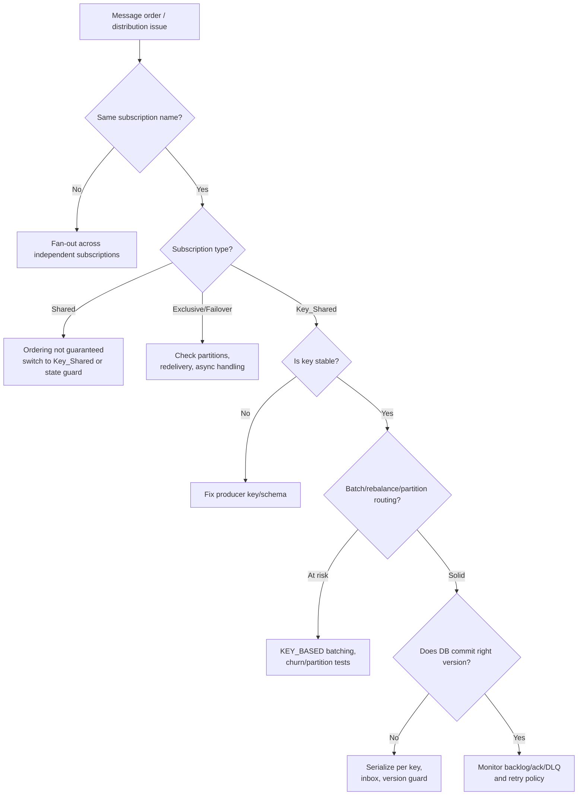

**Do not fix the wrong layer:** adding more `Shared` consumers cannot create ordering guarantees. Switching `Shared` to `Key_Shared` will not fix buggy async DB commits in consumers. Resetting cursors or deleting subscriptions will not fix a producer publishing without keys.

## 44. Case Study: Processing Payments per orderId Across 6 Replicas

An e-commerce platform runs:

- 6 Spring Boot replicas of the Shipping/Payment integration service.
- Topic `persistent://commerce/orders/orders.events` with 8 partitions.
- Producers emitting `OrderCreated`, `PaymentConfirmed`, and `OrderCancelled`.
- Spring listener using `Shared` for throughput.
- Two events for `ORD-501` go to different pods; the pod handling cancel finishes faster than the pod handling created.
- Some `PaymentConfirmed` messages redeliver due to DB timeouts.
- Producers leave default batching on without stable keys.
- The team plans to switch the subscription type to `Key_Shared` without changing anything else.

### Analysis and Solution

**Step 1 — Define ordering scope.** Ordering is only needed per **`orderId`**. No global order is needed between `ORD-501` and `ORD-502`.

**Step 2 — Lock producer contract.** Every event for an order uses `key=orderId`, an immutable `eventId`, and `aggregateVersion` incremented by the state owner. Never let producer A use `customerId` while producer B uses `orderId`.

**Step 3 — Fix batching.** Temporarily disable batching or switch to `BatcherBuilder.KEY_BASED`; test with multiple real producers and keys.

**Step 4 — Add database guards.** Unique-key inbox table and projection table carrying `aggregateVersion`. Never commit v3 before v2 exists; implement a durable pending/reconciliation policy.

**Step 5 — Isolate side effects from listener.** Never fire-and-forget HTTP calls. When calling a payment partner, supply a stable `Idempotency-Key`, persist `UNKNOWN` on timeout, and reconcile.

**Step 6 — Enable `Key_Shared`.** Keep events for the same order grouped onto a single consumer per subscription policy while scaling across orders. Maintain stable subscription names instead of generating random names per deploy.

**Step 7 — Test failure windows.** Send interleaved `seq=1,2,3` across 20 orders; kill pods after DB commit before ack, scale 3→6→2 consumers, inject network timeouts, and replay. Assert each business side effect happens exactly once.

**Step 8 — DLQ/gaps.** If `seq=2` fails deserialization, do not process `seq=3` normally; park/reconcile so state transitions are not skipped.

**Step 9 — Capacity.** 8 partitions do not mean 8 or 6 parallel lanes for a single order. If one order drives 60% of traffic, it remains a hot key; optimize the pipeline or revisit the business invariant.

**Step 10 — Observability.** Dashboards track topic backlog, oldest age, active consumers, redeliveries, DLQ, inbox duplicates, `aggregateVersion` gaps, and p99 DB/HTTP latency.

**Expected outcome:** different orders run in parallel, a single order never suffers **corrupted state transitions**, and broker/consumer failures replay safely. That comes from combining **`Key_Shared` + producer key contract + DB version guard + idempotency**, not merely toggling a subscription enum.

## 45. Self-Assessment Exercises

### A. Choosing a Subscription Type for Email Sending

**Prompt:** 12 independent email notifications must be sent quickly across 4 workers. There is no ordering requirement between emails; SMTP errors must retry.

**Suggested answer:** `Shared`, with individual ack, bounded retry/backoff, idempotent email identity against resends, and a DLQ for permanent failures. `Key_Shared` is unnecessary if throughput without ordering is all you need.

### B. Failover Showing 3 Active Consumers

**Prompt:** Consumer group `audit-v1` uses `Failover`, the topic has 8 partitions, and 3 consumers connect. The dashboard shows all 3 actively processing.

**Suggested answer:** Not necessarily broken: active assignments can occur per partition, letting multiple consumers run actively on different partitions. Check partition ownership and broker semantics rather than assuming one active consumer for the entire logical topic.

### C. Key_Shared Completing Same orderId Out of Order

**Prompt:** A listener receives `seq=10` then `seq=11` yet uses `runAsync` to call HTTP. `seq=11` commits to the DB before `seq=10`.

**Suggested answer:** `Key_Shared` does not serialize asynchronous application tasks. Protect with `aggregateVersion`/transactions, serialize per key, and ack only after completion rather than right after scheduling.

### D. Topic Expanded from 4 to 12 Partitions

**Prompt:** A producer hashes `orderId` across partitions; after scaling, partition count changes. The team still claims same-key messages are strictly ordered.

**Suggested answer:** Key→partition routing can shift depending on the algorithm when partition counts change. Plan migrations/fencing/version guards and test placement of old vs new messages. Never expand partitions as an ordering-neutral change.

### E. Poison Event Mid-Sequence

**Prompt:** `OrderCreated seq=1` succeeds, `PaymentConfirmed seq=2` fails schema validation into DLQ, and `OrderCancelled seq=3` arrives right after.

**Suggested answer:** Do not apply `seq=3` if the state machine requires `seq=2` first. Quarantine/park the chain per key, alert, and fix schema/reconcile before advancing; landing in a DLQ does not mean the business step completed.

### F. New Subscription with Earliest

**Prompt:** The Analytics team switches subscription from `analytics-v1` to `analytics-v2` with `Earliest`. Why did analytics counters double?

**Suggested answer:** `v2` is a brand-new subscription with its own cursor, replaying messages still within retention. Define replay scope, idempotent sinks, and cutover strategy rather than assuming a new name merely "continues."

## 46. Anti-Patterns to Eliminate

1. **Choosing `Shared` while expecting per-key ordering.** `Shared` distributes work without ordering guarantees.
2. **Choosing `Exclusive` to get exactly-once.** A single consumer still sees redeliveries/duplicates after crashes.
3. **Assuming `Failover` always means one active consumer topic-wide.** Partitioned topics assign active owners per partition.
4. **Choosing `Key_Shared` without producers setting keys.** Routing cannot reflect business entities.
5. **Using default producer batching with `Key_Shared` untested.** Mixed-key batches can break expected distribution.
6. **Assuming one consumer guarantees serial DB commits.** Async handlers can finish out of order.
7. **Omitting `aggregateVersion`/sequence in payloads.** Impossible to detect gaps or invalid state transitions.
8. **Using `MessageId` as a business `eventId`.** Republishing assigns a different broker ID.
9. **Acking before DB commit.** Crashes can lose tasks even though the broker marked them done.
10. **Swallowing exceptions and returning from listeners.** Containers may auto-ack failed business work.
11. **Negative-acking malformed JSON infinitely.** Poison loop bloating the backlog.
12. **Letting `seq=N+1` proceed while N sits in DLQ.** State machines skip mandatory steps.
13. **Using retry topics without ordering guards.** Retries can arrive after newer events.
14. **Adding consumers to fix a hot key.** Per-key serialization caps a single key to one lane.
15. **Increasing partitions without a migration plan.** Key mapping/ordering can shift.
16. **Generating subscription names from pod IDs.** Creates fresh cursors and causes unintended replays/lag.
17. **Sharing one subscription across two services wanting fan-out.** They compete for messages.
18. **Deleting subscriptions / resetting cursors to clear backlogs.** Can drop or replay business data.
19. **Omitting retention/backlog quota policies.** Messages can expire before processing.
20. **Calling remote HTTP from consumers without idempotency.** Redelivery duplicates side effects.
21. **Assuming JDBC `@Transactional` commits atomically with Pulsar publish.** No distributed atomicity by default.
22. **Putting PII/raw tenant keys in metric labels.** Leaks data and explodes cardinality.
23. **Testing one consumer and one key and declaring `Key_Shared` verified.** Misses rebalancing and batching bugs.
24. **Skipping failover/crash tests between DB commit and ack.** Fails to prove duplicate safety.
25. **Mixing Spring listener ack modes with raw native acks arbitrarily.** Leads to double-acks or premature acks.

## 47. Production Checklist for Subscription Type Selection

- [ ] Is the truly required ordering scope **per-topic, per-partition, or per-key**?
- [ ] Chosen subscription type derived from invariants rather than pod count.
- [ ] Fan-out uses **separate subscription names** per business group.
- [ ] Subscription names stay stable across deploys; initial position controlled upon creation.
- [ ] Producers attach stable keys and business `eventId`s for `Key_Shared` messages.
- [ ] Keys stay immutable across retries, services, and JSON formats; key/payload consistency verified.
- [ ] Key-based batching or disabled batching configured for `Key_Shared`.
- [ ] Evaluated hash-range policies, key skew, consumer churn, and partition expansion.
- [ ] No false claims of global ordering across partitioned topics or multiple producers.
- [ ] Handlers never fire-and-forget and ack before side effects finish.
- [ ] Individual ack used properly on `Shared`/`Key_Shared`, never cumulative ack by mistake.
- [ ] Ack timeout / negative ack delay bounded and aligned with processing SLOs.
- [ ] Retry topics, DLQs, and redelivery policies tested on the exact broker version.
- [ ] When `seq=N` fails, state machine enforces park/reconcile for N+1.
- [ ] JSON/schema version, message key, `eventId`, and `aggregateVersion` validated.
- [ ] Unique inbox constraint and business state transitions execute in an appropriate transaction.
- [ ] Ack occurs only after business state/durable intent commits.
- [ ] Outbox preserves event publish intent when DB commits while Pulsar is unavailable.
- [ ] HTTP side effects use stable idempotency keys and handle unknown outcomes.
- [ ] Configured retention, backlog quotas, topic permissions/TLS, and credential management.
- [ ] Monitored consumer counts/active partition ownership, backlog age, ack/redelivery/DLQ metrics.
- [ ] Excluded raw keys/PII/eventIds from high-cardinality metric labels.
- [ ] Tested multiple keys, multiple consumers, multiple partitions, batching, and scale-in/out.
- [ ] Tested crash after DB commit before ack and retries after producer unknown outcomes.
- [ ] Tested subscription type changes, cursor resets/renames, retention, and partition expansion before production.
- [ ] When upgrading Spring for Apache Pulsar/Pulsar client, verified listener configs, ack semantics, and broker compatibility.

**Key takeaway:** **`Exclusive`** simplifies single-consumer streams; **`Failover`** adds per-topic/partition standby; **`Shared`** distributes independent tasks without ordering; **`Key_Shared`** routes per key subject to producer keys, batching, and rebalancing constraints. **Broker dispatch order** never replaces **database commit order**, so **SPRING_BOOT_INTEGRATION** flows still need business sequences, unique event IDs, inbox/outbox, controlled retries, and real failure testing.

## References

- [Apache Pulsar Concepts – Messaging](https://pulsar.apache.org/docs/next/concepts-messaging/): topics, producers, consumers, subscriptions, and message keys.
- [Apache Pulsar Concepts – Messaging – Subscription Types](https://pulsar.apache.org/docs/next/concepts-messaging/#subscription-types): Exclusive, Failover, Shared, and Key_Shared.
- [Apache Pulsar Concepts – Architecture Overview](https://pulsar.apache.org/docs/next/concepts-architecture-overview/): brokers, partitions, BookKeeper storage, and cursors.
- [Apache Pulsar Java Client Documentation](https://pulsar.apache.org/docs/next/client-libraries-java/): ProducerBuilder, ConsumerBuilder, ack/redelivery, and schemas.
- [Apache Pulsar Concepts – Retention and Expiry](https://pulsar.apache.org/docs/next/concepts-messaging/#message-retention-and-expiry): backlog and retention policies.
- [Apache Pulsar Administration – Manage Topics](https://pulsar.apache.org/docs/next/admin-api-topics/): partitioned topics, subscriptions, and reset/seek.
- [Spring for Apache Pulsar Reference](https://docs.spring.io/spring-pulsar/reference/): PulsarTemplate, @PulsarListener, listener containers, properties, and transactions.
- [Spring Boot Reference – Apache Pulsar](https://docs.spring.io/spring-boot/reference/messaging/pulsar.html): Spring Boot auto-configuration, client/admin endpoints, and listeners.
- [Spring Boot Reference – Testcontainers](https://docs.spring.io/spring-boot/reference/testing/testcontainers.html): broker-backed integration test environments.
- [Spring Framework Reference – Transaction Management](https://docs.spring.io/spring-framework/reference/data-access/transaction.html): local database transactions and commit boundaries.
- [PostgreSQL Documentation](https://www.postgresql.org/docs/): unique constraints, transaction isolation, and optimistic version guards.

`next` documentation links may describe versions newer than your running environment. When applying in practice, verify your **Pulsar broker/client version, Spring Boot BOM, Spring for Apache Pulsar version, subscription configuration, batching policy, and retention settings**, and test the full producer–broker–consumer–database chain under restart and redelivery before going to production.
