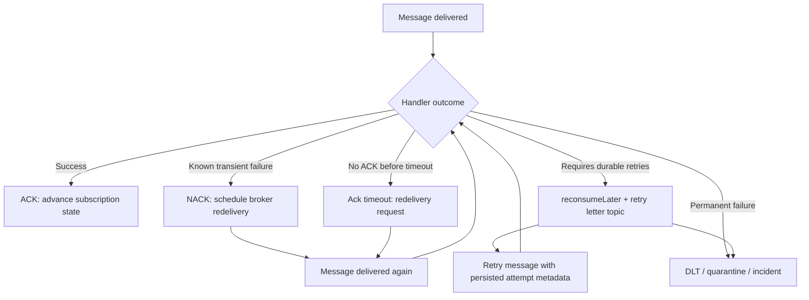
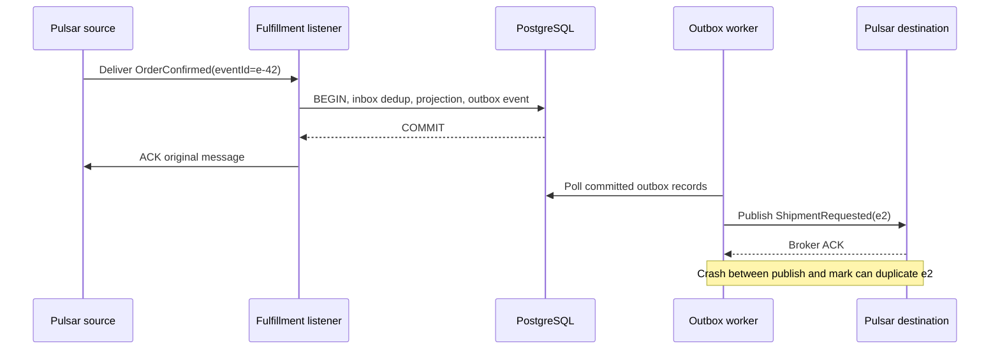
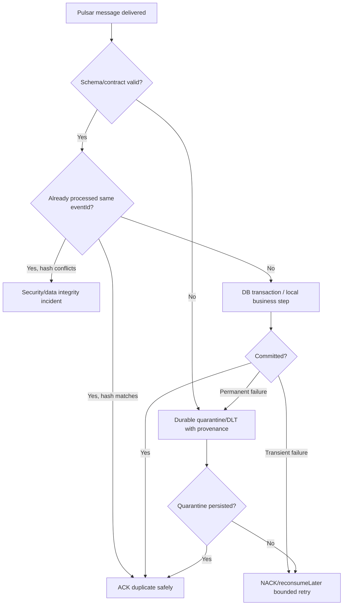
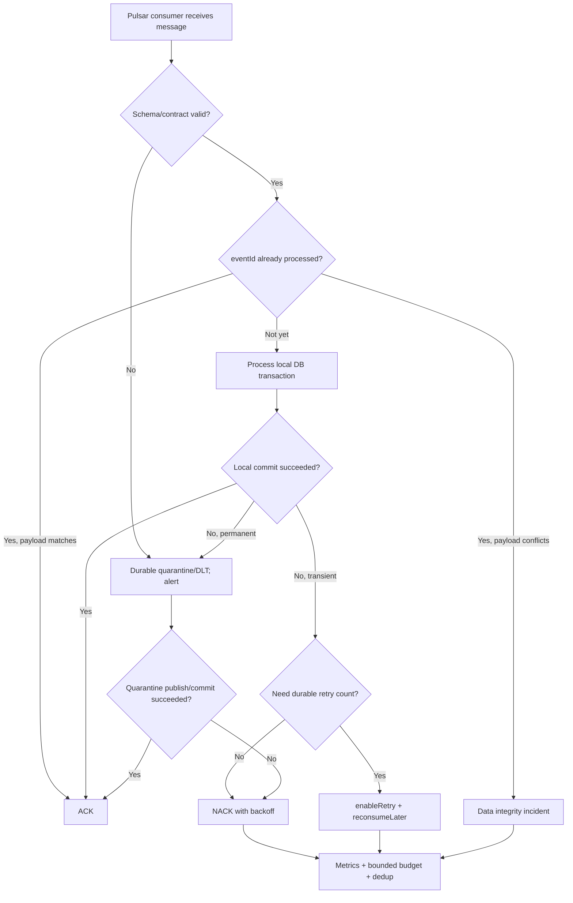

# Acknowledgement, Negative Acknowledgement, and Redelivery

> **Chapter:** Apache Pulsar  
> **Module:** SPRING_BOOT_INTEGRATION — organizing system integration in Spring Boot via HTTP clients, databases, caches, message brokers, and Spring Integration adapters. Focus: configuration, data contracts, transactions, error handling/deduplication, testing, and observing real integration flows.

## 1. When Is a Message Considered Processed?

Suppose a shipping service reads an `OrderConfirmed` event from Apache Pulsar, writes a projection to PostgreSQL, calls a partner HTTP endpoint, and emits a follow-up `ShipmentRequested` event. A single event can be delivered multiple times due to consumer crashes, network drops, or application-triggered redelivery. If you ACK immediately upon receiving the event, you risk losing business state if the database fails to commit; if you never ACK, the backlog grows and the event keeps replaying.

```mermaid
sequenceDiagram
    participant P as Producer
    participant B as Pulsar broker + subscription
    participant C as Spring Boot consumer
    participant DB as PostgreSQL
    P->>B: Publish OrderConfirmed(eventId=e-42)
    B-->>C: Deliver messageId=m-101
    C->>DB: BEGIN; insert inbox + update order projection
    DB-->>C: COMMIT successful
    C->>B: ACK m-101
    Note over B,C: ACK reports message processed on subscription
    B-->>C: Next message
```

If the process dies **after DB commit, before ACK**, Pulsar may redeliver `m-101` after the consumer reconnects or fails over. The consumer must detect that `eventId=e-42` was already processed so it neither calls HTTP nor updates business state twice.

**Principle:** Pulsar acknowledgment is a signal of **consumption status on a subscription**, **not** a PostgreSQL commit command, partner HTTP rollback, or end-to-end exactly-once guarantee.

### 1.1. Learning Outcomes

After this lesson, learners will be able to:

1. Distinguish `ACK`, `NACK`, `acknowledgeCumulative`, `ackTimeout`, `redeliverUnacknowledgedMessages`, `reconsumeLater`, and dead-letter topics.
2. Explain the roles of `MessageId`, subscription cursors, backlogs, unacked messages, retention, and producer message batching.
3. Choose appropriate ACK modes for `Exclusive`, `Failover`, `Shared`, and `Key_Shared` subscriptions.
4. Configure **Spring for Apache Pulsar** listeners with `BATCH`, `RECORD`, or `MANUAL`, avoiding premature ACKs.
5. Understand why NACK triggers redelivery yet can affect ordering/duplicates, and why NACK retry counts are not fully durable.
6. Use retry letter topics + `reconsumeLater` when durable attempt counts are required, paired with a monitored DLT policy.
7. Coordinate ACKs after PostgreSQL transactions, inbox/idempotency, transactional outbox, bounded retries, and reconciliation.
8. Test against a real broker with fault injection, consumer crash/restart, duplicate handling, and operational metrics.

### 1.2. Version Scope and How to Use Examples

Examples target **Java 17+, Spring Boot 3.2–3.5, Spring for Apache Pulsar 1.x** with compatible Apache Pulsar client/broker releases; raw Java client snippets reference Apache Pulsar 4.x APIs. For Spring Boot 4.x/Spring Pulsar 2.x or newer Pulsar releases, check the BOM and changed imports/APIs. **Never independently bump the Pulsar client against Spring Boot's dependency management** just to expose a setting.

Some snippets are marked **fragment** to illustrate behavior; fuller examples state their schema, dependency, and lifecycle assumptions explicitly. Never treat local Docker development examples as production security blueprints.

## 2. Subscriptions, MessageId, and ACK State

Pulsar organizes messages under **tenant/namespace/topic**. Consumers attach to a topic (which may be partitioned) using a **subscription name**, and the broker tracks consumption state for that subscription.

```text
Topic: persistent://commerce/orders/order-events-v1
    |
    +-- subscription: fulfillment-v1
    |       consumer A / consumer B -> shared workload
    |       its own ack cursor / backlog
    |
    +-- subscription: billing-v1
    |       different application, independent backlog/acks
    |
    +-- subscription: audit-v1
            independent delivery/ack progression
```

An ACK in `fulfillment-v1` never ACKs `billing-v1`. Two applications that **each need all events** must use separate subscription names; multiple replicas wanting to **share work** use the same subscription name with a multi-consumer subscription type.

### 2.1. MessageId Is Not Business Event ID

| ID | Example | What is it used for? |
| --- | --- | --- |
| Pulsar `MessageId` | Ledger/entry/partition/batch index provided by broker/client | ACK, NACK, seek, diagnostics, and technical record location |
| Application `eventId` | `order-42-confirmed-v3` | Business idempotency/dedup across redelivery and republish |
| `aggregateId` | `order-42` | Ordering/grouping by business entity |
| `schemaVersion` | `1` | Contract inspection as consumers evolve |
| `correlationId` | `req-a12` | Tracing across HTTP, DB, broker, and downstream |

Never rely solely on `MessageId` as a business deduplication key. The same business event can be **republished by a producer as two messages with different MessageIds**, or DLT/retry letter topics can generate new messages with new IDs.

### 2.2. ACK and Data Storage Are Separate Policies

A successful consumer ACK marks the message processed **for that subscription**. Whether the bytes remain in the topic depends on retention, compaction, TTL, other subscriptions, and BookKeeper/Pulsar ledger storage.

- **Backlog:** messages not yet processed/ACKed by a subscription; not synonymous with all retained bytes.
- **Retention:** policy allowing messages to be kept even after ACK, per namespace/topic policy.
- **TTL:** expires unacked messages per admin policy, risking missed processing if exceeded.
- **Subscription cursor:** state Pulsar tracks to resume consumption; not stored identically to a Kafka committed offset.

**ACK does not immediately delete a record everywhere.** Conversely, backlog existence does not guarantee messages stay forever if TTL/quota/retention policies expire them.

### 2.3. Distinguishing Delivery, Processing, and Acknowledgment

```text
MESSAGE PUBLISHED
     ↓
BROKER DELIVERS TO CONSUMER
     ↓
APPLICATION PROCESSES (maybe DB/HTTP)
     ├── Success → ACK
     ├── Transient failure → NACK / retry
     ├── Poison pill → quarantine/DLT policy
     └── Crash before ACK → redelivery possible
```

A record delivered to a consumer **has not necessarily been processed**, a record committed to the DB **has not necessarily had its ACK received by the broker**, and an ACK sent **does not guarantee business side effects exist** if code ACKed before commit.

## 3. Positive Acknowledgment: Individual and Cumulative

### 3.1. Per-Message ACK

Raw Java client API:

```java
import org.apache.pulsar.client.api.Consumer;
import org.apache.pulsar.client.api.Message;

void handleOne(Consumer<String> consumer) throws Exception {
    Message<String> msg = consumer.receive();
    processSynchronouslyAndCommit(msg.getValue());
    consumer.acknowledge(msg);
}
```

`processSynchronouslyAndCommit(...)` is an assumed application helper: it **must wait for the local transaction to commit** before returning. If the helper throws an exception, catch and apply a retry/NACK strategy rather than letting the method exit without recovery policy.

The Java client also provides asynchronous ACK operations (e.g., `acknowledgeAsync`), typically returning a `CompletableFuture`. Calling async ACK and discarding its future can hide connection/ack failures; if business logic or monitoring needs ACK confirmation, observe the future and errors.

### 3.2. Cumulative Acknowledgment

For single-stream ordered subscription models:

```java
// Only use on subscription types that support cumulative ack.
consumer.acknowledgeCumulative(message);
```

Cumulative ACK signals that **the specified message and all preceding messages within that consumption scope** have been processed. It optimizes sequential processing, yet is dangerous if an earlier message failed to commit:

```text
Delivered: m-100, m-101, m-102
Database:
  m-100 -> committed
  m-101 -> failed
  m-102 -> committed

Incorrect: acknowledgeCumulative(m-102)
Result: m-101 may be skipped despite failed business processing
```

**Never use cumulative acknowledgment with `Shared` or `Key_Shared` subscriptions.** Those modes can interleave messages across multiple consumers, so ACKs must be per message. `Exclusive` and `Failover` support cumulative ACK, provided actual commit order is respected.

### 3.3. Selection Matrix by Subscription Type

| Subscription type | Consumers on same subscription | Expected ordering | Individual ACK | Cumulative ACK |
| --- | --- | --- | --- | --- |
| `Exclusive` | One active consumer | Follows stream/partition per mode semantics | Yes | Yes, if strictly sequential |
| `Failover` | One active owner per topic/partition; standbys may connect | Per owner, subject to failover edge cases | Yes | Yes, when appropriate |
| `Shared` | Multiple active consumers sharing load | No ordering guarantee | Yes | **No** |
| `Key_Shared` | Multiple consumers, partitioned by key | Per key under supported/correct config | Yes | **No** |

Choosing a subscription type affects more than throughput: it governs redelivery, ordering, DLQ/retry compatibility, and valid ACK modes. Never switch subscription type on an active subscription without planning consumer shutdown/startup and business contracts.

### 3.4. Per-Message ACK Differs from Producer Batching

Pulsar producers can pack multiple messages into one **producer batch**, while consumers read via record-by-record or batch-receive APIs. ACKing a single message interacts with broker/client **batch index acknowledgment**. If batch index ACK is disabled or unsupported in your configuration, redelivery can replay sibling records from the same producer batch.

**Keep distinct:**

1. **Producer batching:** packing multiple messages into one transport/ledger entry batch.
2. **Consumer `batchReceive`:** returning a group of messages in one poll call.
3. **Spring Pulsar `AckMode.BATCH`:** container ACK policy around batch receive processing.
4. **Batch index ACK:** Pulsar feature tracking per-message ACKs inside a producer batch.

Never infer from `@PulsarListener(batch=false)` that the producer does not batch, or from `AckMode.RECORD` that the broker tracks cursors independently of batch index semantics.

### 3.5. Sync/Async ACK and Acknowledgment Grouping

Pulsar clients can optimize traffic via **acknowledgment grouping**, buffering ACKs briefly before flushing to the broker per client config. This improves efficiency while leaving a window between business commit and broker acknowledgment persistence.

If the process crashes inside that window, redelivery still occurs. **Never claim `consumer.acknowledge(...)` or Spring `Acknowledgement.acknowledge()` forms a two-phase commit with PostgreSQL.** Inbox deduplication remains mandatory even when ACK runs after DB commit.

## 4. Negative Acknowledgment: Deliberate Redelivery Requests

On transient failures, a consumer can invoke NACK:

```java
Consumer<String> consumer = client.newConsumer(Schema.STRING)
        .topic("persistent://commerce/orders/order-events-v1")
        .subscriptionName("fulfillment-v1")
        .subscriptionType(SubscriptionType.Shared)
        .negativeAckRedeliveryDelay(2, TimeUnit.SECONDS)
        .subscribe();

Message<String> message = consumer.receive();
try {
    processSynchronouslyAndCommit(message.getValue());
    consumer.acknowledge(message);
} catch (TransientDatabaseException transientError) {
    consumer.negativeAcknowledge(message);
}
```

This is a **Java client fragment**: `client` is a managed `PulsarClient`; `TransientDatabaseException` is an application exception, requiring imports for `Schema`, `SubscriptionType`, `TimeUnit`, and `Message`. Close the consumer with the app lifecycle; never allocate a consumer per message.

### 4.1. NACK Does Not Delete Messages or Roll Back the DB

A NACK signals: **"this message was not processed successfully; redeliver it per policy."** The broker/client schedules redelivery after the configured delay/backoff. If a partner HTTP call succeeded prior to the NACK, redelivery risks **repeating the action** unless guarded by an idempotency key.

### 4.2. When Should You Use NACK?

| Error type | Example | Appropriate reaction |
| --- | --- | --- |
| **Transient** | PostgreSQL connection drop, HTTP 503, slow token service | NACK with delay/backoff and retry budget |
| **Rate limited** | Partner HTTP 429 with `Retry-After` | Delay per contract; prevent retry storms |
| **Permanent contract** | Invalid JSON, unsupported schema version | Quarantine/DLT with original record/audit; never NACK forever |
| **Business duplicate** | `eventId` already processed and payload hash matches | ACK after verifying duplicate; skip side effects |
| **Business conflict** | Same `eventId` with different payload | Audit + manual resolution; never ACK silently as "duplicate" |
| **Unknown outcome** | HTTP POST times out after partner may have committed | Lookup/reconcile with stable key before retrying |

Well-designed systems classify errors **before** deciding ACK vs NACK, rather than catching `Exception` and calling `nack()` infinitely on configuration or validation bugs.

### 4.3. Redelivery Delay Is Not a Total Retry Budget

`negativeAckRedeliveryDelay(2, SECONDS)` sets a default redelivery wait, without limiting total attempts. A message with invalid schema will loop:

```text
receive m-101 -> parse fail -> NACK
2s -> receive m-101 -> parse fail -> NACK
2s -> receive m-101 -> parse fail -> NACK
... forever unless retry/DLT policy resolves it
```

When consumers crash, reconnect, or broker topology shifts, redelivery can arrive sooner than the expected backoff. Never rely on delay alone as an exact delivery timer or strict attempt cap.

### 4.4. NACK Can Break Ordering

Suppose events for the same order are:

```text
m-101: OrderCreated(order-42)
m-102: OrderConfirmed(order-42)
m-103: OrderShipped(order-42)
```

If `m-102` is NACKed for 10 seconds while `m-103` dispatches and processes immediately, the read model could move to `SHIPPED` before `CONFIRMED`. Pulsar warns that NACKs on ordered modes (`Exclusive`, `Failover`, `Key_Shared`) can cause **out-of-order** delivery during redelivery.

To protect business consistency:

- Route using a stable `aggregateId`/message key.
- Enforce version/sequence checks inside the consumer.
- On a missing prerequisite sequence, pause/quarantine the aggregate or persist durable pending state for reconciliation.
- Never claim `Key_Shared` guarantees "zero out-of-order" across NACKs or crashes.
- Avoid arbitrarily altering keys, routers, or batching modes when ordering matters.

### 4.5. NACK Before Ack Timeout

If an application uses both `ackTimeout` and explicit NACK, ensure NACK happens **before ack timeout fires** when NACK is the intended mechanism. If ack timeout triggers redelivery while a record is still executing, **two concurrent executions** can run under different owners depending on subscription semantics.

Prefer explicit NACK on known failures rather than tuning `ackTimeout` ultra-short to force retries on slow calls. Ack timeout remains valuable as a watchdog for stalled work when sized appropriately.

## 5. Ack Timeout: A Watchdog, Not Your Primary Retry Scheduler

An Apache Pulsar consumer can configure `ackTimeout` to track delivered, unacked messages. Upon expiration, the client asks the broker to **redeliver unacknowledged messages**.

```java
Consumer<String> consumer = client.newConsumer(Schema.STRING)
        .topic("persistent://commerce/orders/order-events-v1")
        .subscriptionName("fulfillment-v1")
        .subscriptionType(SubscriptionType.Shared)
        .ackTimeout(60, TimeUnit.SECONDS)
        .ackTimeoutTickTime(1, TimeUnit.SECONDS)
        .subscribe();
```

This is a Java client fragment; manage `PulsarClient` and consumer lifecycles properly. `ackTimeoutTickTime` controls check granularity rather than millisecond-exact deadlines.

### 5.1. AckTimeout May Be Disabled by Default

In typical Pulsar client defaults, ack timeout is **disabled**, so an unacked message will not redeliver just because an implicit "30-second timeout" passed; the broker still redelivers upon **consumer disconnect/crash/failover**. If an application stays healthy without ACKing while `ackTimeout` is disabled, unacked messages can hang indefinitely.

With `MANUAL` listeners or async pipelines, decide explicitly: should an ack timeout watchdog be enabled, what is the maximum processing budget, and how are hung tasks handled while the client stays alive?

### 5.2. Timeline When Processing Exceeds Timeout

```text
T0:  consumer C1 receives m-101
T5:  C1 starts partner call, partner stalls
T10: ackTimeout=10s triggers redelivery request
T11: C2 may receive m-101 while C1 is still processing
T15: C1 receives partner response; commits local business state
T17: C2 may also commit unless inbox/idempotency prevents it
```

This illustrates a **plausible race**, not a promise of exact timing or that C2 always receives it. **An overly short `ackTimeout` causes duplicate processing even when C1 has not crashed**.

If processing p99 is ~20 seconds, setting `ackTimeout=3s` invites a retry storm. Size timeouts to actual processing deadlines while pairing bounded retries, circuit breakers, and idempotency.

### 5.3. Ack Timeout Redelivery Backoff

```java
import org.apache.pulsar.client.api.MultiplierRedeliveryBackoff;

Consumer<String> consumer = client.newConsumer(Schema.STRING)
        .topic(topic)
        .subscriptionName(subscription)
        .ackTimeout(10, TimeUnit.SECONDS)
        .ackTimeoutRedeliveryBackoff(
                MultiplierRedeliveryBackoff.builder()
                        .minDelayMs(1_000)
                        .maxDelayMs(60_000)
                        .multiplier(2)
                        .build())
        .subscribe();
```

Expected delays scale with redelivery counts. In Pulsar's model, the first redelivery wait equals **initial ack timeout + backoff delay**; do not treat it as an exact-timing exactly-once timer.

### 5.4. How Should Ack Timeout and NACK Work Together?

- When the handler catches a transient failure **immediately**, use NACK/retry with explicit delay instead of waiting for a long `ackTimeout`.
- When the handler **stops responding**, `ackTimeout` catches stuck unacked messages for redelivery.
- When an operation routinely outlasts `ackTimeout`, split into a **durable task/outbox** and ACK once intent is persisted rather than holding unacked deliveries indefinitely.
- If both NACK backoff and ackTimeout backoff are active, test behavior empirically to avoid overlapping redelivery triggers.
- Never use `ackTimeout` as a substitute for HTTP response timeouts or SQL transaction timeouts; it solely tracks Pulsar acknowledgments.

### 5.5. Does AckTimeout Guarantee Bounded Retries?

No. It triggers redelivery, yet **creates no durable retry budget**. Redelivery counters can reset when dispatchers restart, brokers fail over, or consumers reconnect. When errors must quarantine reliably after N attempts, use a **retry letter topic with persisted retry properties** or a durable business retry ledger instead of relying solely on NACK counts.

## 6. Backoff: Distinguishing Redelivery Mechanisms



### 6.1. Summary Comparison

| Mechanism | Trigger | Delay/backoff | Retry count persistence | Key reminder |
| --- | --- | --- | --- | --- |
| `negativeAcknowledge(message)` | Handler knows it failed | `negativeAckRedeliveryDelay`/`negativeAckRedeliveryBackoff` | Not durable across all disconnects/dispatcher restarts | Simple for brief transient glitches; not a strict retry budget |
| `ackTimeout` | Message unacked past threshold | `ackTimeoutRedeliveryBackoff` | No durable retry ledger by default | Watchdog for stuck processing; risks duplicates if too low |
| `redeliverUnacknowledgedMessages(...)` | App explicitly requests replay of unacked | Per broker/client policy | Creates no durable retry count | Used for deliberate recovery/intervention |
| `enableRetry(true)` + `reconsumeLater(...)` | App routes failed message to retry letter topic | Code-specified delay | **Retry count stored in message properties** | Suited for finite retries and DLT |
| App durable retry ledger/outbox | Service persists failure state in DB | Business-controlled | In DB | Strong audit/compensation; requires orchestration |

### 6.2. NACK Backoff with MultiplierRedeliveryBackoff

```java
Consumer<String> consumer = client.newConsumer(Schema.STRING)
        .topic(topic)
        .subscriptionName(subscription)
        .subscriptionType(SubscriptionType.Shared)
        .negativeAckRedeliveryBackoff(
                MultiplierRedeliveryBackoff.builder()
                        .minDelayMs(1_000)
                        .maxDelayMs(60_000)
                        .multiplier(2)
                        .build())
        .subscribe();
```

| Redelivery count | Illustrative target delay |
| ---: | ---: |
| 1 | 1 second |
| 2 | 2 seconds |
| 3 | 4 seconds |
| 4 | 8 seconds |
| 5 | 16 seconds |
| 6 | 32 seconds |
| 7+ | Capped at 60 seconds |

Do not treat delays as strict SLAs: scheduling, failover, batching, reconnects, and live load can shift delivery times.

### 6.3. Watch Out for the negativeAcknowledge(MessageId) Overload

In the Pulsar Java client, `negativeAcknowledge(MessageId)` accepts only the ID and **may not apply `negativeAckRedeliveryBackoff` the same way as the `Message<?>` overload**, because the client lacks redelivery count metadata from the ID alone.

```java
// Prefer the Message overload when native negative-ack backoff is needed:
consumer.negativeAcknowledge(message);

// MessageId overload does not guarantee the same exponential backoff:
consumer.negativeAcknowledge(message.getMessageId());
```

This matters for Spring listener manual ACK, where `Acknowledgement.nack(messageId)` and underlying container handling can vary across versions. When count-based backoff is critical, **test against a real broker** or use a retry letter topic.

### 6.4. Redelivery Count Is Not a Durable Event Attempt Number

`Message.getRedeliveryCount()` and broker/client counters help with diagnostics, yet for NACKs the counter can **reset** when a dispatcher closes on broker restart, topic unload, or consumer disconnect. If a pipeline sets `DeadLetterPolicy.maxRedeliverCount=5` with NACK-only retries, a message might never reach the DLT if counters keep resetting.

With retry letter topics, Pulsar attaches message properties such as `RECONSUMETIMES`, `ORIGIN_MESSAGE_ID`, `REAL_TOPIC`, and `DELAY_TIME` (per version), tracking attempts durably across restarts.

### 6.5. Crash Redelivery Differs from Delayed NACK

If a consumer dies while processing a message, unacked messages can be redelivered to another consumer per subscription mode **without necessarily waiting for the configured NACK delay**. Redeploys/rolling upgrades can cause a burst of redeliveries at once; avoid letting all consumers hammer partner HTTP APIs simultaneously.

## 7. Retry Letter Topics and reconsumeLater

When you need **finite retries with business-appropriate delays**, Pulsar provides retry letter topics. Enable `enableRetry(true)` on the consumer and call `reconsumeLater(message, delay)`. Failed messages are published to the retry topic with attempt-tracking metadata, and routed to the DLT upon reaching `maxRedeliverCount`.

### 7.1. Raw Java Client Example

```java
import java.util.concurrent.TimeUnit;
import org.apache.pulsar.client.api.Consumer;
import org.apache.pulsar.client.api.DeadLetterPolicy;
import org.apache.pulsar.client.api.Message;
import org.apache.pulsar.client.api.PulsarClient;
import org.apache.pulsar.client.api.Schema;
import org.apache.pulsar.client.api.SubscriptionType;
import org.apache.pulsar.client.api.SubscriptionInitialPosition;

void consumeWithDurableRetry(PulsarClient client) throws Exception {
    String sourceTopic =
            "persistent://commerce/orders/order-events-v1";
    String subscription = "fulfillment-v1";

    try (Consumer<String> consumer =
            client.newConsumer(Schema.STRING)
                    .topic(sourceTopic)
                    .subscriptionName(subscription)
                    .subscriptionType(SubscriptionType.Shared)
                    .subscriptionInitialPosition(
                            SubscriptionInitialPosition.Earliest)
                    .enableRetry(true)
                    .deadLetterPolicy(DeadLetterPolicy.builder()
                            .maxRedeliverCount(5)
                            .retryLetterTopic(
                                    "persistent://commerce/orders/fulfillment-retry-v1")
                            .deadLetterTopic(
                                    "persistent://commerce/orders/fulfillment-dlq-v1")
                            .build())
                    .subscribe()) {

        while (!Thread.currentThread().isInterrupted()) {
            Message<String> msg = consumer.receive();
            try {
                processSynchronouslyAndCommit(msg.getValue());
                consumer.acknowledge(msg);
            } catch (TransientDatabaseException e) {
                consumer.reconsumeLater(msg, 3, TimeUnit.SECONDS);
            }
        }
    }
}
```

This is a **native Java client fragment**: `processSynchronouslyAndCommit` and `TransientDatabaseException` are application-defined. Production code needs graceful shutdown/unblocking `receive`, ACLs on source/retry/DLT topics, idempotency, alerts, and handling failed `reconsumeLater` publishes.

**Never** call `acknowledge(msg)` **immediately after** `reconsumeLater(msg,...)` in the failure branch. `reconsumeLater` handles forwarding the message into the retry path and acknowledging the source message per client semantics. If enqueueing the retry fails, keep the message recoverable instead of silently ACKing.

### 7.2. Retry Letter Topics Differ from General Delayed Delivery

Delayed delivery schedules messages for a **desired future delivery time**; retry letter topics handle **failed message processing** while retaining origin and attempt metadata. Both use delays for different goals:

- Scheduler: deliver a message 2 hours after publish.
- Retry: replay a failed event after 30 seconds with an eventual DLT.

Never turn retry topics into general-purpose business timers, which complicates quotas, retention, and root-cause analysis.

### 7.3. Retry Message Metadata

```text
REAL_TOPIC=persistent://commerce/orders/order-events-v1
ORIGIN_MESSAGE_ID=<original broker message id>
RECONSUMETIMES=3
DELAY_TIME=3000
```

Never use `ORIGIN_MESSAGE_ID` for business deduplication instead of `eventId`. When a producer publishes an event twice, there are two distinct original IDs for the same logical operation. Never assume `RECONSUMETIMES` exists on every redelivery path: NACKs normally bypass retry letter topics.

### 7.4. Retry Topics Can Alter Ordering

Moving a failed message onto a retry topic frees the main subscription to advance, allowing later business events to overtake the retried message. If `OrderConfirmed` retries for 30 seconds while `OrderShipped` executes immediately, state becomes inconsistent.

When per-aggregate ordering matters:

1. Use a stable message key/ordering key.
2. Check aggregate version/sequence in the consumer.
3. On missing events, persist deferred state or pause the aggregate.
4. Run reconciliation jobs/alerts when missing sequences linger.
5. Never treat `Key_Shared + retry topic` as an absolute strict ordering guarantee.

### 7.5. Durable Retries Still Do Not Equal Exactly-Once

Retry letter topics preserve attempt metadata, yet races can still happen between retry publish/source acknowledgment, failovers, and side effects. You still need `eventId`, inbox deduplication, stable HTTP idempotency keys, DLT audit/re-drive, and reconciliation.

## 8. Dead-Letter Topics: Safely Escaping Poison-Pill Loops

A DLT/DLQ holds messages that fail beyond the retry budget or suffer permanent failures. A DLT keeps the main subscription moving, yet **is not business success**.

### 8.1. DeadLetterPolicy in the Native Client

```java
DeadLetterPolicy dlt = DeadLetterPolicy.builder()
        .maxRedeliverCount(5)
        .deadLetterTopic(
                "persistent://commerce/orders/fulfillment-dlq-v1")
        .build();
```

When attached to a consumer with a supporting subscription, the Pulsar client can route messages exceeding the redelivery threshold to the DLT. With NACK/ackTimeout alone, counts can reset on restart, **so `maxRedeliverCount` is not strictly guaranteed**. For durable bounded attempts, prefer `enableRetry(true) + reconsumeLater` per documentation.

### 8.2. DLT Support Depends on Subscription Type and Version

Native dead-letter/retry support evolves across versions: some Spring Pulsar 1.x docs specify native DLT for `Shared`, while Apache Pulsar 4.2.x docs also mention `Key_Shared`. Therefore:

- Standard examples pick **`Shared`** to minimize version sensitivity.
- For `Key_Shared`, verify exact client/broker versions and test DLT behavior directly.
- Never assume native DLT works on `Exclusive`/`Failover` just because the builder accepts `deadLetterPolicy`.
- DLT/retries can break ordering by moving messages between topics.

### 8.3. DLTs Require Contracts and Operations

| Attribute | Requirement |
| --- | --- |
| Topic/name | Explicit per application/subscription/version |
| Payload | Preserve original data where safe; handle schema evolution |
| Provenance | Source topic, message ID, subscription, `eventId`, retry count |
| Error metadata | Sanitized category/error code; never dump secrets |
| Access control | Only authorized services/personnel can read/re-drive |
| Monitoring | DLT publish failures, backlog, oldest age, re-drive rate |
| Replay | Dry-run, idempotency, rate limiting, and business ordering |
| Retention | Long enough for incident triage; compliant with data retention rules |

Default DLT names can be derived from topic/subscription, and **partitioned topics** may append partition suffixes in certain versions; declare an explicit DLT topic name per team policy.

### 8.4. Poison Pills and Deserialization Failures

Schema-invalid messages can throw **inside the deserializer before `@PulsarListener` runs**, bypassing any `try/catch` inside the listener. Solutions:

- Use proper schemas/`SchemaResolver` and compatibility strategies.
- Handle deserialization errors at the container/native client layer.
- Consume raw bytes/strings at the adapter boundary when payloads must be quarantined before validation.
- Never retry malformed JSON or unknown schema versions infinitely.
- Ensure the DLT producer can serialize raw payloads; if DLT publishing fails, never silently ACK the source message as succeeded.

### 8.5. DLTs Do Not Replace Manual Review

A DLT entry might represent a missing invoice, refund, or shipment. Define SLAs stating who investigates, when reconciliation runs, conditions for re-drive/compensation, and how duplicate business effects are prevented.

## 9. Spring Boot and Spring for Apache Pulsar: Consumer Configuration

### 9.1. Gradle Dependencies

```groovy
// Build uses Spring Boot Gradle plugin/BOM to manage versions.
dependencies {
    implementation 'org.springframework.boot:spring-boot-starter-pulsar'
    implementation 'org.springframework.boot:spring-boot-starter-jdbc'
    implementation 'org.springframework.boot:spring-boot-starter-json'
    runtimeOnly 'org.postgresql:postgresql'

    testImplementation 'org.springframework.boot:spring-boot-starter-test'
    testImplementation 'org.springframework.boot:spring-boot-testcontainers'
    testImplementation 'org.testcontainers:junit-jupiter'
    testImplementation 'org.testcontainers:pulsar'
    testImplementation 'org.testcontainers:postgresql'
}
```

`spring-boot-starter-pulsar` provides imperative listener/template support matching Spring Pulsar 1.x in Spring Boot 3.x. If selecting reactive consumers, consider `spring-boot-starter-pulsar-reactive` and its reactive acknowledgement semantics in Section 14. JDBC is included only because the consumer writes to PostgreSQL in the examples.

**Never declare a Pulsar Java client version conflicting with the Spring Boot BOM** without verifying binary compatibility; APIs such as error handlers, batch listeners, and transaction support differ between Spring Pulsar 1.x and 2.x.

### 9.2. application.yml Configuration

```yaml
app:
  pulsar:
    orders-topic: ${ORDERS_TOPIC:persistent://commerce/orders/order-events-v1}
    fulfillment-subscription: ${FULFILLMENT_SUBSCRIPTION:fulfillment-v1}

spring:
  pulsar:
    client:
      service-url: ${PULSAR_SERVICE_URL:pulsar://localhost:6650}
    admin:
      service-url: ${PULSAR_ADMIN_URL:http://localhost:8080}
    consumer:
      subscription:
        name: ${FULFILLMENT_SUBSCRIPTION:fulfillment-v1}
        type: shared
        initial-position: earliest
    listener:
      concurrency: ${PULSAR_LISTENER_CONCURRENCY:2}
```

Properties `spring.pulsar.client.service-url`, `spring.pulsar.consumer.subscription.*`, and `spring.pulsar.listener.concurrency` exist in Spring Boot 3.5. Use `initial-position: earliest` only for **new subscriptions without a cursor**; it does not replay all messages once a durable subscription already exists.

`spring.pulsar.client.service-url` is typically the broker protocol `pulsar://...:6650`, while `spring.pulsar.admin.service-url` is the HTTP management/admin endpoint `http://...:8080`; **never swap** those ports. Containers/k8s/cloud have distinct advertised addresses, TLS, and auth/ACLs; never hardcode `localhost` across environments.

### 9.3. Spring-Managed Consumers and Lifecycle

With the right Spring Boot starter, the framework auto-configures `PulsarClient`, consumer factories, listener containers, and annotation processing. `@PulsarListener` manages consumers **within Spring's lifecycle**, eliminating manual `client.newConsumer().subscribe()` inside business methods.

```java
import org.springframework.pulsar.annotation.PulsarListener;
import org.springframework.stereotype.Component;

@Component
public class SimpleOrderListener {
    private final OrderEventService service;

    public SimpleOrderListener(OrderEventService service) {
        this.service = service;
    }

    @PulsarListener(
            topics = "${app.pulsar.orders-topic}",
            subscriptionName = "${app.pulsar.fulfillment-subscription}")
    public void onOrder(String json) {
        service.processSynchronously(json);
    }
}
```

`OrderEventService` is an application-defined Spring service. When processing finishes synchronously and throws exceptions properly on failure, the Spring listener container issues ACK/NACK per the chosen mode. If `processSynchronously` launches a `CompletableFuture` and returns early before work completes, the framework can ACK prematurely.

### 9.4. Precedence Between Annotation and YAML

In the example, `topics` and `subscriptionName` are specified explicitly on the annotation via placeholders. `spring.pulsar.consumer.subscription.name` is a default/factory-level property; annotations can override it per listener. With multiple `@PulsarListener`s in one app, verify **the effective subscription name of each listener** rather than assuming the shared property binds everything identically.

When scaling worker instances to split work, all instances share `fulfillment-v1` on the same topic/type. If a billing service accidentally uses `fulfillment-v1` in `Shared` mode, both services **split events between them** instead of each receiving every event; billing needs its own subscription.

### 9.5. Broker Prerequisites, Tenant/Namespace, and TLS

Topic `persistent://commerce/orders/order-events-v1` requires tenant `commerce` and namespace `orders` to exist with matching consume/produce permissions. Never assume Pulsar auto-topic-creation is enabled in production. Test clusters can use `persistent://public/default/...` for convenience, while production topics/schemas/subscriptions must be provisioned via IaC.

For TLS: broker URLs typically use `pulsar+ssl://...`, and HTTP admin endpoints use `https://...`. Configure auth plugins, truststores, and hostname verification accurately. Never resolve `UNAUTHORIZED` or hostname mismatches by disabling TLS verification.

## 10. Spring Pulsar AckMode: BATCH, RECORD, MANUAL

Spring Pulsar imperative listeners offer three primary ACK modes. **Never mechanically apply Spring Kafka ack-mode habits:** Pulsar has distinct subscription types, `batchReceive`, and native NACK mechanics.

### 10.1. Behavior Table

| Mode | Listener returns normally | Listener throws exception | When to use |
| --- | --- | --- | --- |
| `AckMode.BATCH` (default) | For single-record listeners, container processes `batchReceive` and ACKs succeeded messages after the batch | Failed records are NACKed per container logic; for batch listeners, failure may NACK the entire batch | Throughput, short jobs, synchronous processing |
| `AckMode.RECORD` | Container ACKs after each record completes | Container NACKs the failed record | When per-record ACK/NACK is wanted on single-record listeners |
| `AckMode.MANUAL` | Framework does not auto-ACK | Framework does not auto-NACK; app must call `Acknowledgement` appropriately | ACK after DB commit, custom quarantine, partial batch success |

With `@PulsarListener(batch=true)`, `RECORD` is **not** a valid mode for batch listeners in Spring Pulsar 1.x docs. Choose `BATCH` (entire receive batch) or `MANUAL` (per-`MessageId` ACK/NACK).

### 10.2. BATCH on a Single-Record Listener Differs from batch=true

```text
Underlying Pulsar Consumer.batchReceive() yields [m1, m2, m3]
@PulsarListener(batch=false, ackMode=BATCH)
    handler(m1) succeeds
    handler(m2) throws
    handler(m3) succeeds

Container can ACK m1,m3 and NACK m2 after processing batch.
```

This differs from:

```text
@PulsarListener(batch=true, ackMode=BATCH)
    handler(List<m1,m2,m3>) throws

Container can NACK entire receive batch.
```

Never assume `AckMode.BATCH` always means "all three messages ACK together or NACK together" when the listener method takes individual records. Behavior depends on listener/container style and must be tested directly.

### 10.3. RECORD Auto ACK/NACK

```java
import org.springframework.pulsar.annotation.PulsarListener;
import org.springframework.pulsar.listener.AckMode;

@PulsarListener(
        topics = "${app.pulsar.orders-topic}",
        subscriptionName = "${app.pulsar.fulfillment-subscription}",
        ackMode = AckMode.RECORD)
public void receive(String payload) {
    orderEventService.processSynchronously(payload);
    // Success => container auto-ACKs record.
    // Exception propagates => container auto-NACKs record.
}
```

This is a **method fragment** placed inside a Spring bean with `orderEventService` injected. `processSynchronously` must finish its DB commit before returning. Catching and logging exceptions without rethrowing causes the container to treat the call as successful and ACK.

### 10.4. MANUAL with the Acknowledgement API

For Spring Pulsar 1.2.x, the interface is published in package:

```java
import org.springframework.pulsar.listener.Acknowledgement;
```

**Spelling note:** the API interface is **`Acknowledgement`** (ending in `-gement`) in Spring Pulsar 1.x Javadoc, even though some prose/examples on the web spell `Acknowledgment`. Never guess imports from `org.apache.pulsar.client.api.Consumer` or Spring Kafka.

Methods:

```java
void acknowledge();
void acknowledge(MessageId messageId);
void acknowledge(List<MessageId> messageIds);
void nack();
void nack(MessageId messageId);
```

This is a **signature summary**, not an implementation class. For single-record listeners, `acknowledge()`/`nack()` apply to the current message. For batch listeners, use the `MessageId` overloads to specify individual records, since the container cannot infer a single current record from a `List`.

### 10.5. Minimal MANUAL Listener Example

```java
import org.apache.pulsar.client.api.Message;
import org.apache.pulsar.client.api.SubscriptionType;
import org.springframework.pulsar.annotation.PulsarListener;
import org.springframework.pulsar.listener.AckMode;
import org.springframework.pulsar.listener.Acknowledgement;
import org.springframework.stereotype.Component;

@Component
public class FulfillmentListener {
    private final FulfillmentProcessor processor;

    public FulfillmentListener(FulfillmentProcessor processor) {
        this.processor = processor;
    }

    @PulsarListener(
            topics = "${app.pulsar.orders-topic}",
            subscriptionName = "${app.pulsar.fulfillment-subscription}",
            subscriptionType = SubscriptionType.Shared,
            ackMode = AckMode.MANUAL,
            properties = {"negativeAckRedeliveryDelay=2s"})
    public void handle(
            Message<String> message,
            Acknowledgement acknowledgement) {

        try {
            // Spring service has already committed business state upon returning.
            processor.process(message.getValue());
            acknowledgement.acknowledge();
        } catch (RuntimeException failure) {
            // Minimal transient retry policy for lesson illustration only.
            acknowledgement.nack();
        }
    }
}
```

**Warning:** `catch(RuntimeException) -> nack` merely illustrates ACK/NACK and is **not complete production error classification**; malformed JSON and permanent errors would NACK infinitely without DLT/quarantine. Later sections expand this into a classified policy. Most importantly, **ACK occurs after `processor` returns from the local DB commit**, never at listener entry.

### 10.6. Never ACK and Then Throw

```java
// Anti-pattern:
acknowledgement.acknowledge();
throw new IllegalStateException("Later business step failed");
```

The framework cannot "undo a positive ACK" if a subsequent step fails. Likewise, never call both `acknowledge()` and `nack()` for the same message across racy branches. Design every operation outcome as a **single controlled state transition**.

### 10.7. MANUAL Does Not Mean Broker ACK Is Instantly Durable

The Spring wrapper invokes the consumer API; the underlying client may group ACKs or encounter a disconnect. Between DB commit and the ACK reaching the broker, redelivery can still occur. Thus:

- `MANUAL` lets you choose **when to invoke ACK**.
- It creates no distributed transaction between PostgreSQL and Pulsar.
- It does not eliminate the need for inbox/`eventId` deduplication.
- Failed ACK/NACK calls need metrics, error handling, and recovery.

## 11. PostgreSQL Inbox: ACK Only After Transaction Commit

Suppose the consumer reads `OrderConfirmed`, updates a read model in PostgreSQL, and writes a processed-event marker. **Both marker and projection must commit in the same local transaction** before ACKing Pulsar.

### 11.1. Minimal Schema

```sql
CREATE TABLE fulfillment_inbox (
    consumer_name VARCHAR(120) NOT NULL,
    event_id VARCHAR(160) NOT NULL,
    payload_sha256 CHAR(64) NOT NULL,
    processed_at TIMESTAMPTZ NOT NULL DEFAULT CURRENT_TIMESTAMP,
    PRIMARY KEY (consumer_name, event_id)
);

CREATE TABLE fulfillment_projection (
    order_id VARCHAR(160) PRIMARY KEY,
    order_version BIGINT NOT NULL,
    state VARCHAR(64) NOT NULL,
    updated_at TIMESTAMPTZ NOT NULL DEFAULT CURRENT_TIMESTAMP
);
```

`event_id` is the stable logical ID supplied by the producer; never use `MessageId` as the primary key. `payload_sha256` distinguishes **byte-identical** duplicates from ID collisions carrying different payloads. If JSON serialization is non-canonical, whitespace differences produce different hashes; production systems should canonicalize schemas or hash stable business fields rather than arbitrary raw JSON.

### 11.2. Contract DTO

```java
// OrderConfirmedEvent.java
public record OrderConfirmedEvent(
        String eventId,
        String orderId,
        long aggregateVersion,
        String state) {
}
```

Contracts must validate non-blank `eventId`/`orderId`, `aggregateVersion > 0`, and `state` membership in an enum/allowlist; never assume any JSON parsing into the record is valid.

### 11.3. Synchronous Processor with a JDBC Transaction

```java
import com.fasterxml.jackson.core.JsonProcessingException;
import com.fasterxml.jackson.databind.ObjectMapper;
import java.nio.charset.StandardCharsets;
import java.security.MessageDigest;
import java.security.NoSuchAlgorithmException;
import java.util.HexFormat;
import java.util.Set;
import org.springframework.jdbc.core.JdbcTemplate;
import org.springframework.stereotype.Service;
import org.springframework.transaction.annotation.Transactional;

@Service
public class FulfillmentProcessor {
    private final JdbcTemplate jdbc;
    private final ObjectMapper mapper;

    public FulfillmentProcessor(
            JdbcTemplate jdbc, ObjectMapper mapper) {
        this.jdbc = jdbc;
        this.mapper = mapper;
    }

    @Transactional
    public void process(String json) {
        OrderConfirmedEvent event = parseAndValidate(json);
        String hash = sha256(json);

        int inserted = jdbc.update("""
                INSERT INTO fulfillment_inbox
                    (consumer_name, event_id, payload_sha256)
                VALUES (?, ?, ?)
                ON CONFLICT (consumer_name, event_id) DO NOTHING
                """, "fulfillment-v1", event.eventId(), hash);

        if (inserted == 0) {
            String existing = jdbc.queryForObject("""
                    SELECT payload_sha256
                    FROM fulfillment_inbox
                    WHERE consumer_name = ? AND event_id = ?
                    """, String.class,
                    "fulfillment-v1", event.eventId());
            if (!hash.equals(existing)) {
                throw new ConflictingReplayException(
                        "eventId reused with different payload");
            }
            // Already processed and committed previously: safe to ACK again.
            return;
        }

        int changed = jdbc.update("""
                INSERT INTO fulfillment_projection
                    (order_id, order_version, state)
                VALUES (?, ?, ?)
                ON CONFLICT (order_id) DO UPDATE
                SET order_version = EXCLUDED.order_version,
                    state = EXCLUDED.state,
                    updated_at = CURRENT_TIMESTAMP
                WHERE fulfillment_projection.order_version
                      < EXCLUDED.order_version
                """, event.orderId(),
                event.aggregateVersion(), event.state());

        // If not updated: older/duplicate version may be acceptable
        // per domain contract; missing sequences need their own policy.
    }

    private OrderConfirmedEvent parseAndValidate(String json) {
        try {
            OrderConfirmedEvent event =
                    mapper.readValue(json, OrderConfirmedEvent.class);
            if (event == null || event.eventId() == null
                    || event.eventId().isBlank()
                    || event.orderId() == null
                    || event.orderId().isBlank()
                    || event.aggregateVersion() <= 0
                    || event.state() == null
                    || !Set.of("CONFIRMED", "CANCELLED")
                            .contains(event.state())) {
                throw new InvalidEventException("Invalid event contract");
            }
            return event;
        } catch (JsonProcessingException parseFailure) {
            throw new InvalidEventException(
                    "Unsupported event JSON", parseFailure);
        }
    }

    private String sha256(String json) {
        try {
            byte[] value = MessageDigest.getInstance("SHA-256")
                    .digest(json.getBytes(StandardCharsets.UTF_8));
            return HexFormat.of().formatHex(value);
        } catch (NoSuchAlgorithmException impossibleOnJava17) {
            throw new IllegalStateException(
                    "SHA-256 unavailable", impossibleOnJava17);
        }
    }
}
```

Minimal domain exception definitions:

```java
public class InvalidEventException extends RuntimeException {
    public InvalidEventException(String message) {
        super(message);
    }
    public InvalidEventException(String message, Throwable cause) {
        super(message, cause);
    }
}

public class ConflictingReplayException extends RuntimeException {
    public ConflictingReplayException(String message) {
        super(message);
    }
}
```

Each public top-level class belongs in its own Java source file; they are shown back-to-back here for convenience—**do not paste both public classes into a single `.java` file**.

### 11.4. What Is Guaranteed and What Is Not?

- JDBC `@Transactional` on a public service method invoked **through a Spring proxy** and returning synchronously: when the method returns normally, the local DB transaction has committed (assuming proper manager/transaction setup).
- Marker and projection share the same DB transaction: if projection fails, the marker rolls back too.
- If the DB commits and the process dies before ACK, the event redelivers; matching marker + hash lets the consumer skip repeating business updates.
- An older, lower-version event will not overwrite a newer version thanks to the UPSERT condition; **this alone does not prove there are no `aggregateVersion` gaps**.
- No HTTP/Kafka/RabbitMQ side effects occur inside this transaction; remote side effects require outbox/idempotency/reconciliation.
- When **multiple DataSources/managers** exist, specify `@Transactional(transactionManager="...")` explicitly; the example assumes a single PostgreSQL datasource.

**Never** let the listener call `processor.process(json)` and then make a separate HTTP POST requiring atomicity before ACKing. The remote POST can commit while the response drops, and Pulsar retries will repeat it unless protected by a stable idempotency key.

## 12. Spring Pulsar Redelivery Customization and Error Handlers

### 12.1. Configuring ackTimeout and NACK Delay on a Listener

Spring Pulsar allows passing select **native Pulsar consumer properties** via `@PulsarListener.properties`:

```java
@PulsarListener(
        topics = "${app.pulsar.orders-topic}",
        subscriptionName = "fulfillment-retry-demo-v1",
        subscriptionType = SubscriptionType.Shared,
        ackMode = AckMode.RECORD,
        properties = {
            "ackTimeoutMillis=60000",
            "negativeAckRedeliveryDelay=2s"
        })
void receiveWithWatchdog(String json) {
    processor.process(json);
}
```

This is a **fragment inside a Spring bean** with `processor` injected; it enables both mechanisms for discussion, not as a copy-paste template lacking explicit deadlines/budgets. In Spring Pulsar 1.x, native properties and syntax like `negativeAckRedeliveryDelay=2s` appear in framework documentation. Verify actual bound values for your client version.

### 12.2. Backoff Bean on a Listener

```java
import org.apache.pulsar.client.api.MultiplierRedeliveryBackoff;
import org.apache.pulsar.client.api.RedeliveryBackoff;
import org.springframework.context.annotation.Bean;
import org.springframework.context.annotation.Configuration;

@Configuration(proxyBeanMethods = false)
class PulsarRedeliveryConfig {
    @Bean("fulfillmentNegativeBackoff")
    RedeliveryBackoff fulfillmentNegativeBackoff() {
        return MultiplierRedeliveryBackoff.builder()
                .minDelayMs(1_000)
                .maxDelayMs(30_000)
                .multiplier(2)
                .build();
    }
}
```

And listener:

```java
@PulsarListener(
        topics = "${app.pulsar.orders-topic}",
        subscriptionName = "fulfillment-v1",
        subscriptionType = SubscriptionType.Shared,
        ackMode = AckMode.RECORD,
        negativeAckRedeliveryBackoff = "fulfillmentNegativeBackoff")
void consumeWithBackoff(String json) {
    processor.process(json);
}
```

**Never register two listeners** on the same topic/subscription in one app unless you intentionally want additional load-sharing consumers and have verified idempotency. The fragments in this section are **alternative configuration options**, not methods to enable all at once.

The backoff bean adjusts NACK redelivery delays; it does not create durable finite retry counts. Test consumer disconnects between retries as well.

### 12.3. Native DeadLetterPolicy Bean for a Shared Listener

```java
import org.apache.pulsar.client.api.DeadLetterPolicy;
import org.springframework.context.annotation.Bean;

@Bean("fulfillmentDeadLetterPolicy")
DeadLetterPolicy fulfillmentDeadLetterPolicy() {
    return DeadLetterPolicy.builder()
            .maxRedeliverCount(5)
            .deadLetterTopic(
                    "persistent://commerce/orders/fulfillment-dlq-v1")
            .build();
}
```

Listener referencing the bean:

```java
@PulsarListener(
        topics = "${app.pulsar.orders-topic}",
        subscriptionName = "fulfillment-v1",
        subscriptionType = SubscriptionType.Shared,
        ackMode = AckMode.RECORD,
        deadLetterPolicy = "fulfillmentDeadLetterPolicy",
        properties = {"ackTimeoutMillis=60000"})
void readWithNativeDlt(String json) {
    processor.process(json);
}
```

**Note:** native DLT counters with NACK/ackTimeout can reset on dispatcher/reconnect events; when exact retry counts across restarts are mandatory, use `enableRetry/reconsumeLater` or a durable retry ledger. Do not read this snippet as a guarantee of "DLT after exactly five failures regardless of broker failover."

### 12.4. Spring PulsarConsumerErrorHandler for Framework-Level DLT Logic

Spring for Apache Pulsar offers `PulsarConsumerErrorHandler`, `DefaultPulsarConsumerErrorHandler`, and `PulsarDeadLetterPublishingRecoverer` for listener container error handling. Configuration per 1.x docs:

```java
// @Configuration fragment — import classes from your Spring Pulsar BOM.
@Bean("fulfillmentErrorHandler")
PulsarConsumerErrorHandler<String> fulfillmentErrorHandler(
        PulsarTemplate<String> template) {
    return new DefaultPulsarConsumerErrorHandler<>(
            new PulsarDeadLetterPublishingRecoverer<>(
                    template,
                    (consumer, message) ->
                            "persistent://commerce/orders/fulfillment-dlt-v1"),
            new org.springframework.util.backoff.FixedBackOff(500, 3));
}
```

`PulsarTemplate` needs a schema/producer configuration compatible with the DLT payload. For partitioned topics with custom routing modes, Spring Pulsar docs note you may need a **dedicated template/producer factory** for DLT to avoid invalid routing configs.

Listener using this policy:

```java
@PulsarListener(
        topics = "${app.pulsar.orders-topic}",
        subscriptionName = "fulfillment-v1",
        pulsarConsumerErrorHandler = "fulfillmentErrorHandler")
void consumeWithSpringErrorHandler(String json) {
    processor.process(json);
    // Let the container see the exception when processing fails.
}
```

**Never manually NACK and swallow the exception** inside a listener when you want Spring's error handler to handle failures. The handler must **receive the thrown exception** to orchestrate retries and recovery. When using `PulsarConsumerErrorHandler` in Spring Pulsar 1.x, documentation advises **not configuring an ack timeout on that same listener**, as policies can interact unexpectedly. Never combine native `DeadLetterPolicy`, custom error handlers, and MANUAL NACK without defining a single recovery owner.

### 12.5. Spring Container Retries Differ from Broker Retries

`FixedBackOff(500,3)` in a Spring handler makes the **application re-execute a message** multiple times before sending it to the DLT, whereas native NACK asks the **broker for redelivery**. These two paths differ in:

- Where retry state lives.
- How attempts are counted.
- Backpressure, concurrency, and ordering effects.
- How recovery behaves after app crashes or broker unloads.

Therefore assign **one policy owner** per listener. Specify whether alerts count "handler attempts" or "broker delivery attempts" rather than lumping everything under a generic `retryCount`.

## 13. Batch Listeners: Processing Record by Record Without Mis-ACKing

### 13.1. batch=true with BATCH ACK

```java
@PulsarListener(
        topics = "${app.pulsar.orders-topic}",
        subscriptionName = "bulk-fulfillment-v1",
        subscriptionType = SubscriptionType.Shared,
        batch = true,
        ackMode = AckMode.BATCH)
void processBatch(List<String> payloads) {
    for (String payload : payloads) {
        processor.process(payload);
    }
}
```

If the 7th record fails after the first 6 **committed to the DB**, the listener throws and the container NACKs **the entire receive batch**. On redelivery, the first six arrive again; inbox deduplication ensures they are not applied twice. Never assume `batch=true` creates **one JDBC transaction** for the whole list: here `processor` carries `@Transactional` per call, committing record by record.

### 13.2. MANUAL Batch to ACK Individual MessageIds

```java
import java.util.List;
import org.apache.pulsar.client.api.Message;
import org.apache.pulsar.client.api.SubscriptionType;
import org.springframework.pulsar.annotation.PulsarListener;
import org.springframework.pulsar.listener.AckMode;
import org.springframework.pulsar.listener.Acknowledgement;

@PulsarListener(
        topics = "${app.pulsar.orders-topic}",
        subscriptionName = "batch-fulfillment-v1",
        subscriptionType = SubscriptionType.Shared,
        batch = true,
        ackMode = AckMode.MANUAL)
void handleBatch(
        List<Message<String>> messages,
        Acknowledgement acknowledgment) {

    for (Message<String> message : messages) {
        try {
            processor.process(message.getValue());
            acknowledgment.acknowledge(message.getMessageId());
        } catch (TransientDatabaseException retryable) {
            acknowledgment.nack(message.getMessageId());
        }
    }
}
```

This is a **fragment inside a bean with `processor` injected**. Permanent errors need a separate DLT/quarantine branch rather than NACKing forever. With `nack(MessageId)`, native negativeAck redelivery backoff by count may not behave like the `Message` overload; test actual timing or choose retry letters.

### 13.3. Partial Batch Success and Producer Batching

Distinguish **listener receive batches** from **producer batches**:

```text
Producer batch entry P:
  [m1, m2, m3, m4]

Consumer batchReceive:
  [m1, m2] or [m1,m2,m3,m4] or other grouping

Spring MANUAL ACK:
  ack(m1), nack(m2), ack(m3), ack(m4)
```

Batch index acknowledgment and compatibility settings decide whether the broker/client skips redelivering already-ACKed messages inside a producer batch. Even when enabled, keep **idempotent processing** because crashes/reconnects can still introduce duplicates.

### 13.4. Avoid Holding One DB Transaction Across Thousands of Records

If a batch has 10,000 messages, opening a single PostgreSQL transaction for the entire batch can:

- Hold locks and connections open too long.
- Inflate transaction log/rollback costs.
- Trigger ack timeouts while processing drags on.
- Roll back massive work on the last record and cause retry storms.

Process in **bounded chunks** with an inbox, ACKing after each commit, or use a reliable durable staging pipeline. Choose based on ordering and business atomicity; never fake partial success with cumulative ACKs on `Shared`/`Key_Shared`.

### 13.5. Spring Error Handler with Batches

When using Spring `PulsarConsumerErrorHandler` on a batch and identifying the failing record, certain Spring Pulsar lines provide `PulsarBatchListenerFailedException` to pinpoint the failed message. Combine `MANUAL` ACK for committed messages, then throw the exception wrapping the failing message so the handler retries/recovers the remainder. Never throw a generic `RuntimeException` expecting the container to know which index in the batch already committed.

## 14. Reactive Pulsar: Mono/Flux Signals Drive ACK

Spring for Apache Pulsar includes reactive support separate from imperative `@PulsarListener`. In Spring Boot 3.x, typical dependencies:

```groovy
dependencies {
    implementation 'org.springframework.boot:spring-boot-starter-pulsar-reactive'
    implementation 'org.springframework.boot:spring-boot-starter-data-r2dbc'
    runtimeOnly 'org.postgresql:r2dbc-postgresql'
}
```

### 14.1. OneByOne Reactive Listener

```java
import org.springframework.pulsar.reactive.config.annotation.ReactivePulsarListener;
import org.springframework.stereotype.Component;
import reactor.core.publisher.Mono;

@Component
public class ReactiveOrderConsumer {
    private final ReactiveOrderProcessor processor;

    public ReactiveOrderConsumer(ReactiveOrderProcessor processor) {
        this.processor = processor;
    }

    @ReactivePulsarListener(
            topics = "${app.pulsar.orders-topic}",
            subscriptionName = "fulfillment-reactive-v1")
    Mono<Void> handle(String json) {
        return processor.processInR2dbcTransaction(json);
    }
}
```

In a **OneByOne reactive listener**, the framework treats normal `Mono.empty()`/completion as ACK and `Mono.error(...)` as NACK/recovery per policy. Methods must **return the publisher executing the work**, never calling `.subscribe()` manually and returning `Mono.empty()`.

### 14.2. R2DBC Transactions and Reactive ACK

A service:

```java
Mono<Void> processInR2dbcTransaction(String json) {
    return validateEvent(json)
            .flatMap(event -> insertInboxAndUpdateProjection(event))
            .as(r2dbcTransactionalOperator::transactional)
            .then();
}
```

This is a fragment where `validateEvent`/`insertInboxAndUpdateProjection` return reactive publishers and `r2dbcTransactionalOperator` uses the right `R2dbcTransactionManager`. When the returned publisher completes after transaction commit, the reactive listener ACKs. If it emits `onError`, the listener withholds success.

**Never** place `onErrorResume(ex -> Mono.empty())` inside the operation when failures should roll back and NACK. Swallowing errors inside a transactional boundary can allow partial DB writes to commit depending on error/manager semantics.

### 14.3. Streaming Reactive Listener

With `stream=true`, Spring Pulsar 1.x can receive `Flux<Message<T>>` and require returning `Flux<MessageResult<Void>>` expressing per-record ACK/NACK.

```java
// Fragment: imports per Spring Pulsar 1.2.x / Pulsar Reactive Client.
import org.apache.pulsar.client.api.Message;
import org.apache.pulsar.reactive.client.api.MessageResult;
import org.springframework.pulsar.reactive.config.annotation.ReactivePulsarListener;
import reactor.core.publisher.Flux;
import reactor.core.publisher.Mono;

@ReactivePulsarListener(
        topics = "${app.pulsar.orders-topic}",
        subscriptionName = "fulfillment-reactive-stream-v1",
        stream = true)
Flux<MessageResult<Void>> consumeStream(
        Flux<Message<String>> messages) {

    return messages.concatMap(message ->
            processor.processInR2dbcTransaction(message.getValue())
                    .thenReturn(MessageResult.acknowledge(
                            message.getMessageId()))
                    .onErrorResume(error -> Mono.just(
                            MessageResult.negativeAcknowledge(
                                    message.getMessageId()))));
}
```

`MessageResult` comes from the **Pulsar reactive client API**; verify exact imports/schemas/generic signatures against your BOM before copying. `concatMap` preserves sequential processing within a subscription stream; switching to `flatMap` for concurrency requires protecting ordering, inbox, and driver connections. The error branch emits a **negative result** instead of terminating the entire stream unpredictably.

### 14.4. Reactive Does Not Share a Transaction with the Broker

Spring Data R2DBC's Reactor Context holds PostgreSQL transaction state; Pulsar reactive ACK is a separate broker operation. If the DB commits and the ACK drops, events redeliver. If the app ACKs before DB commit, crashes lose business state.

Returning a reactive `Mono<Void>` that completes only **after the local business transaction commits** sets the right ACK boundary, yet inbox/dedup and ACK-error/reconnect handling remain mandatory.

### 14.5. Backpressure and Unknown Outcomes

Never emit `Mono.empty()` from a reactive listener immediately after enqueueing work into an in-memory queue. If the JVM dies, queued tasks vanish while the broker already ACKed the event. To ACK upon "work accepted," persist a **durable work item/outbox/inbox** first.

Likewise, never run `Flux.flatMap(event -> HTTP POST)` with unbounded concurrency: one consumer can flood partner quotas and trigger mass timeouts/NACKs. Use bounded concurrency, rate limiters, stable idempotency keys, and chunked durable work where needed.

## 15. Subscription Types, Ordering, and Redelivery Trade-Offs

### 15.1. Exclusive

A single active consumer on the subscription (partitioned topics have topic-level semantics) keeps the processing flow simplest. Yet if a handler NACKs or crashes, partial work followed by redelivery still causes duplicates; cumulative ACK is safe only when **every earlier message truly finished**.

### 15.2. Failover

Multiple consumers register while the broker picks an active owner per topic/partition. When the owner dies, unacked messages redeliver. During handoffs, an old message may still be in-flight on the departing consumer while the new owner starts, creating duplicate/out-of-order edge cases. Never replace DB idempotency with Failover.

### 15.3. Shared

Messages distribute across consumers without global ordering. Great for independent jobs, uses per-message ACKs, and has broad DLQ/retry support. When one consumer dies, unacked messages can go to another consumer; stable deduplication is essential.

### 15.4. Key_Shared

`Key_Shared` routes messages by key/ordering key across consumers to help preserve per-key order under the right conditions. However:

- Producers must supply a stable key for the same aggregate.
- Partitioning/batching must satisfy `Key_Shared` ordering requirements.
- NACKs, retry topics, failovers, and concurrent processing can disturb ordering.
- Check aggregate version/sequence whenever correctness matters.
- Never use cumulative ACK.

### 15.5. Business Selection Matrix

| Use case | Mode to consider | ACK/recovery policy |
| --- | --- | --- |
| Audit independent events | Shared | Individual ACK, bounded retry/DLT |
| Order projection by aggregate ID | Key_Shared (when topology fits) | Stable key, event version, individual ACK, reconciliation |
| Single writer needing strict sequentiality | Exclusive | Cumulative ACK possible after sequential commits |
| Hot standby worker | Failover | ACK after commit, duplicate protection on failover |
| Rate-limited HTTP partner (429s) | Shared + rate limit or durable queue | Avoid retry storms, stable operation key |
| Critical payments/fulfillment | Pick for ordering, prioritize data correctness | Inbox/outbox, quarantine/reconciliation, ACK after durable commit |

Choose the mode based on **delivery/ordering requirements**, not simply "Shared is fastest" or "Key_Shared gives exactly-once."

## 16. Concurrency, Backpressure, and Backlogs Under Slow Consumers

### 16.1. ACK/NACK Cannot Bypass Capacity Limits

A `Shared` subscription with 4 consumers cannot process infinite traffic. If each message takes 2 seconds waiting on partner HTTP:

```text
4 consumers × 0.5 message/s ≈ 2 messages/s
Producer rate = 100 messages/s
Backlog growth ≈ 98 messages/s
```

This is a simplified model ignoring batching, async concurrency, response variance, and partitioned topics. If operators shorten NACK delay to 100ms during partner 503s, consumers merely **retry more aggressively** without increasing partner throughput.

### 16.2. Receiver Queue, Unacked Messages, and RAM

The Pulsar Java client exposes knobs like `receiverQueueSize` and pending/unacked limits across consumers/dispatchers. An oversized queue can:

- Buffer many delivered messages the application has not processed yet.
- Increase heap/GC pressure.
- Trigger ack timeouts while messages sit waiting in memory.
- Cause a wave of redeliveries upon consumer restart.
- Skew end-to-end latency measurements if you only instrument handler time.

An undersized queue can throttle throughput when batching/network latency is high. Size based on payload size, max processing time, consumer count, and broker quotas; test both load and failure paths.

### 16.3. Configuring Native receiverQueueSize

```java
Consumer<byte[]> consumer = client.newConsumer(Schema.BYTES)
        .topic(topic)
        .subscriptionName(subscription)
        .subscriptionType(SubscriptionType.Shared)
        .receiverQueueSize(100)
        .subscribe();
```

This is a fragment; with Spring Pulsar, configure through the consumer factory/customizer or supported properties instead of creating an extra standalone `Consumer` that competes on the **same subscription** with your Spring listener.

### 16.4. Spring Pulsar Listener Concurrency

```yaml
spring:
  pulsar:
    listener:
      concurrency: 3
```

For one listener, Spring Pulsar concurrency creates multiple consumer resources/threads per container implementation; inspect actual consumer count on the broker. Running **5 pods × concurrency 3** yields 15 consumers, not 3. Under `Shared`, many consumers receive concurrently; under `Failover`/`Exclusive`, active owners remain bounded by subscription type and partition count.

**Never crank up concurrency to "fix" ordering issues.** With `Key_Shared`, concurrency/schedulers and producer key routing must align with per-aggregate invariants; test redeliveries and missing sequences.

### 16.5. HTTP/JDBC Downstream Needs Dedicated Bulkheads

Suppose:

```text
3 pods
4 Pulsar consumers per pod
Each handler calls PostgreSQL + HTTP shipping partner
Partner allows 20 requests/second globally
```

The Pulsar consumer pool can easily exceed 20 HTTP calls/s when fast. Enforce a **global rate limit** or per-instance quota, bounded HTTP concurrency, retry budgets, circuit breakers, and durable deferral when partners go down.

Never hold a JDBC transaction open across a 10-second HTTP request. Separate the local transaction (inbox + outbox) from post-commit external dispatch to prevent lock/pool contention.

### 16.6. Pause/Resume to Protect Downstream

Spring Pulsar's listener registry/containers support pause/resume depending on version:

```java
// Fragment with injected PulsarListenerEndpointRegistry.
var container = registry.getListenerContainer("fulfillment-listener");
if (container != null) {
    container.pause();
    // Once downstream recovers and state is verified:
    // container.resume();
}
```

This is a temporary throttling tool; the container ID must match `@PulsarListener(id="fulfillment-listener")`. Pausing does not clear backlogs, roll back HTTP side effects, or guarantee all in-flight handlers stopped. Monitor paused state and maintain a resume runbook; avoid leaving listeners paused indefinitely.

### 16.7. Graceful Shutdown

When a pod receives `SIGTERM`:

1. Stop polling new messages if the listener framework supports controlled stop/pause.
2. Let in-flight DB transactions finish or roll back.
3. ACK committed messages; unacked messages remain eligible for redelivery.
4. Close Pulsar consumers/clients per Spring lifecycle.
5. Align shutdown grace period with p99 processing time; never promise completion under `SIGKILL`.
6. After restart, inbox deduplication handles any message committed to the DB before its ACK reached the broker.

Never rush to ACK all in-flight messages during shutdown if business logic has not committed; "making backlog look clean" that way drops business data.

## 17. Delivery Semantics and Multi-Resource Transactions

### 17.1. At-Least-Once and Duplicate Processing

Pulsar ACK/NACK/redelivery typically yields **at-least-once processing** when applications ACK only after durable business commits:

```text
Message m-101 delivered
  ↓
PostgreSQL transaction commits
  ↓
App crashes before ACK
  ↓
Pulsar redelivers m-101
  ↓
Inbox marker prevents double business effect
  ↓
ACK redelivery
```

This is an **expected** recovery duplicate, not a broker bug. Never eliminate duplicates by ACKing before DB commit, because crashing in between permanently loses the business effect.

### 17.2. ACK Before Commit Loses Business State

```text
T0: Pulsar delivers m-101
T1: listener calls ACK
T2: broker records ACK
T3: PostgreSQL INSERT fails / process crashes
T4: message no longer eligible for ordinary redelivery
T5: order projection missing
```

Depending on retention and administrative replay, message bytes might linger briefly, yet **normal subscription processing considers the record finished**, so automatic recovery will never backfill the missing SQL row. This is a severe anti-pattern.

### 17.3. DB Transactions and Broker Transactions Are Separate Resources

Pulsar provides transaction features for **Pulsar consume/produce/ACK within a broker transaction**, and Spring Pulsar supports transactions in compatible releases. However:

- PostgreSQL JDBC transactions do not join Pulsar transactions automatically.
- MongoDB transactions do not roll back Pulsar ACKs.
- HTTP partner side effects do not roll back if a Pulsar transaction aborts.
- Spring `@Transactional` picking the right manager is necessary, **not automatic XA/distributed transactions**.
- In Spring Boot 3.5, reactive Pulsar variants have separate transaction limitations; never assume a reactive `Mono` wraps a Pulsar transaction.

Claim **exactly-once** only after explicitly documenting resource boundaries, broker semantics, and consumer idempotency—never merely because `PulsarTransactionManager` or `transactional=true` is configured.

### 17.4. Transactional Outbox for Downstream Event Publishing

A sounder workflow:



If the worker crashes after broker publish before marking sent, it resends the event and the broker may accept it again. Downstream consumers deduplicate via stable `eventId`; never treat an outbox as magic absolute exactly-once publishing.

### 17.5. Inbox/Outbox and Retry Letter Topics Solve Different Problems

| Component | Purpose | Does not replace |
| --- | --- | --- |
| Inbox unique event ID | Prevents reapplying business effects on redelivery | Does not control broker retry delays |
| Outbox | Ensures business state and publish intent share local commit | Does not guarantee consumer processed it |
| Pulsar ACK | Marks processed on a subscription | Does not commit JDBC or remote HTTP |
| Pulsar NACK | Requests redelivery | Not a durable retry ledger |
| Retry letter topic | Preserves failed messages and attempt counts across restarts | Does not guarantee idempotency |
| DLT | Captures failures exceeding retry budget | Does not fix business discrepancies |
| Reconciliation | Compares system states and repairs missing/duplicate gaps | Does not replace prevention/alerts |

### 17.6. Independence Across Subscriptions

Billing and fulfillment use two separate subscriptions on the same topic. Fulfillment may ACK `OrderConfirmed` in 100ms while billing lags 20 minutes behind. Never force fulfillment to wait for billing's ACK inside a local DB transaction; each service owns its own backlog/SLO.

Instead of generating random pod-ID subscription names (making every replica consume the whole topic), name subscriptions by **logical consumer role/version** and preserve them across rolling deploys. Renaming a subscription in a blue/green deploy can cause the new app to **replay historical events** per initial-position/retention, risking duplicate side effects if unisolated.

### 17.7. Unknown HTTP Request Outcomes

A Pulsar consumer calls the shipping HTTP API, times out, yet the partner committed the shipment. NACKing retries the event. Retrying with a fresh idempotency key breaks safety:

```text
Message e-42
  attempt 1: POST /shipments key=random-A -> server commits, response lost
  attempt 2: POST /shipments key=random-B -> duplicate shipment created
```

Use a **stable key derived from `eventId`/business command**, lookup/reconcile on timeout, and persist `UNKNOWN_REQUIRES_RECONCILIATION` when the outcome is unknown. Never assume "NACK rolled back the previous attempt's side effects."

## 18. Schema Evolution, Permanent Failures, and Quarantine Policies

### 18.1. Error Classification Before ACK/NACK



**Quarantine persisted before ACK** is safe only when the quarantine sink/transaction genuinely committed durably with an assigned owner. If writing to the DLT fails yet you ACK the source, the message is lost. If a consumer creates its own DLT producer and publishes async, wait for broker ACK/durability per contract before ACKing the source.

### 18.2. Multi-Layer Schema Validation

- Broker/topic schema compatibility: producers and consumers agree on evolution policy.
- Pulsar client deserialization: failures can occur before the handler runs.
- DTO validation: required fields, enum values, `schemaVersion`.
- Business validation: aggregate version, ownership/authorization, valid transitions.
- Data constraints: database unique keys, foreign keys, optimistic versioning.

A broker/schema failure will not necessarily hit `catch(RuntimeException)` inside `@PulsarListener`. Separately test **pre-listener poison pills** and container/error handler recovery.

### 18.3. DLT/Retry Payloads Contain Sensitive Data

DLTs typically preserve original payloads including order IDs, payment metadata, or PII. Never log raw payloads or grant unrestricted developer access to DLT topics. Enforce:

- Transport encryption/TLS and tenant/namespace/topic permissions.
- Retention sufficient for triage without exceeding data compliance limits.
- Redaction/sanitization in error headers and logs.
- Access-controlled re-drives with per-action audit trails.
- Correlation IDs and broker MessageIds for diagnosis without exposing payloads.

### 18.4. Never Confuse User Payloads with Retry Metadata

Users or external callers might inject custom properties colliding with technical names or send older schemas lacking `eventId`. Never trust `RECONSUMETIMES` or `ORIGIN_MESSAGE_ID` from untrusted producers as platform-verified metadata. Separate **trusted retry-topic metadata** produced by the client from **untrusted business properties**, and always enforce business duplicate constraints.

### 18.5. Poison Pills Must Not Stall the Whole System

An invalid message NACKed forever swells backlogs and keeps waking consumers. Under `Shared`, other messages may progress while errors waste resources; under strict ordering, one bad message can block an entire aggregate/partition. Enforce finite retries/quarantine, alerts, and state compensation whenever skipping a transition.

## 19. Testing ACK/NACK and Redelivery with Real Pulsar Testcontainers

Mocking a `Message<String>` and calling a listener method tests code branches only; it **cannot prove** the Pulsar broker receives NACKs, redelivers after delays, completes ACKs on a subscription, or moves messages to retry/DLT topics. You need integration tests with a **real Pulsar broker**.

### 19.1. Dependencies

```groovy
dependencies {
    testImplementation 'org.springframework.boot:spring-boot-starter-test'
    testImplementation 'org.testcontainers:junit-jupiter'
    testImplementation 'org.testcontainers:pulsar' // Testcontainers 1.x BOM.
}
```

In Testcontainers 2.x, the Maven module coordinates may be `org.testcontainers:testcontainers-pulsar`; use the artifact matching your pinned Testcontainers BOM. Never put both versions on the same classpath. Ensure Docker/Testcontainers can pull/start images; never use production Pulsar clusters for retry/seek/DLT tests.

### 19.2. JUnit Native Java Client Test: NACK Triggers Redelivery

```java
// PulsarAckRedeliveryIntegrationTest.java
import java.util.UUID;
import java.util.concurrent.TimeUnit;
import org.apache.pulsar.client.api.Consumer;
import org.apache.pulsar.client.api.Message;
import org.apache.pulsar.client.api.Producer;
import org.apache.pulsar.client.api.PulsarClient;
import org.apache.pulsar.client.api.Schema;
import org.apache.pulsar.client.api.SubscriptionInitialPosition;
import org.apache.pulsar.client.api.SubscriptionType;
import org.junit.jupiter.api.Test;
import org.testcontainers.containers.PulsarContainer;
import org.testcontainers.junit.jupiter.Container;
import org.testcontainers.junit.jupiter.Testcontainers;
import org.testcontainers.utility.DockerImageName;

import static org.assertj.core.api.Assertions.assertThat;

@Testcontainers
class PulsarAckRedeliveryIntegrationTest {

    @Container
    static final PulsarContainer pulsar = new PulsarContainer(
            DockerImageName.parse("apachepulsar/pulsar:3.2.0"));

    @Test
    void negativeAckCausesRedeliveryThenPositiveAck()
            throws Exception {

        String topic = "persistent://public/default/ack-test-"
                + UUID.randomUUID();
        String subscription = "ack-test-subscription";

        try (PulsarClient client = PulsarClient.builder()
                    .serviceUrl(pulsar.getPulsarBrokerUrl())
                    .build();
             Consumer<String> consumer = client.newConsumer(
                            Schema.STRING)
                    .topic(topic)
                    .subscriptionName(subscription)
                    .subscriptionType(SubscriptionType.Shared)
                    .subscriptionInitialPosition(
                            SubscriptionInitialPosition.Earliest)
                    .negativeAckRedeliveryDelay(
                            500, TimeUnit.MILLISECONDS)
                    .subscribe();
             Producer<String> producer = client.newProducer(
                            Schema.STRING)
                    .topic(topic)
                    .create()) {

            producer.send("event-42");

            Message<String> first =
                    consumer.receive(10, TimeUnit.SECONDS);
            assertThat(first).isNotNull();
            assertThat(first.getValue()).isEqualTo("event-42");

            consumer.negativeAcknowledge(first);

            Message<String> again =
                    consumer.receive(15, TimeUnit.SECONDS);
            assertThat(again).isNotNull();
            assertThat(again.getValue()).isEqualTo("event-42");

            consumer.acknowledge(again);
        }
    }
}
```

**Test conditions:** image `apachepulsar/pulsar:3.2.0` is an illustrative pinned development tag; choose a broker version compatible with your Spring Boot BOM client when testing alongside the app. The test assumes standalone Pulsar inside the container allows creating topics in `public/default`. Production clusters require pre-provisioned topics/ACLs.

**What is verified:** NACK through the Java client causes a valid message to redeliver; ACK after redelivery succeeds. The test does not by itself prove finite retry budgets, DLT handling, exactly-once, or Spring listener/JDBC integration correctness.

### 19.3. Testing That ACK Prevents Automatic Redelivery

On an isolated test topic/subscription:

1. Publish message `m-A`.
2. Receive `m-A` and ACK it.
3. Wait past the configured NACK/redelivery window.
4. No unacked redelivery of `m-A` should arrive on that subscription.

Note that asserting `consumer.receive(2, SECONDS) == null` **is not absolute proof of durable ACK persistence under all failures**; it only verifies absence within the test window. Inspect broker subscription stats/ack counters and write separate crash/restart tests to verify persistence.

### 19.4. Testing ACK After DB Commit with Two Containers

End-to-end integration goal:

```java
// Fragment for @SpringBootTest with Testcontainers.
@Container
@ServiceConnection
static final PulsarContainer pulsar = new PulsarContainer(
        DockerImageName.parse("apachepulsar/pulsar:3.2.0"));

@Container
@ServiceConnection
static final PostgreSQLContainer<?> postgres =
        new PostgreSQLContainer<>("postgres:16-alpine")
                .withDatabaseName("fulfillment_it")
                .withUsername("it_user")
                .withPassword("it_password");
```

Spring Boot 3.5 provides `PulsarConnectionDetails` for `PulsarContainer` and `JdbcConnectionDetails` for `PostgreSQLContainer` when matching `spring-boot-testcontainers`/drivers are present. This is a **fragment**, requiring imports, test configs/migrations, and listener beans. Never hardcode `pulsar://localhost:6650` or PostgreSQL `localhost:5432` in tests when containers bind dynamic host ports.

Test steps:

1. Start broker and PostgreSQL containers with isolated names/ports.
2. Run migrations creating `fulfillment_inbox` and `fulfillment_projection` on the **test database**.
3. Configure `@PulsarListener(ackMode=MANUAL)` for the test topic/subscription.
4. Publish `OrderConfirmedEvent(eventId=e-42, orderId=order-42, version=1)`.
5. Boundedly await until PostgreSQL shows exactly one inbox marker and one projection row.
6. Simulate a crash after DB commit before ACK using a test-only hook / fault injection, then restart the listener.
7. Verify the record may redeliver while projection/business effects are never applied twice.
8. Verify ACK and backlog return to expected state.

Never rely on `Thread.sleep(100)` to assume "the DB probably committed." Use Awaitility/StepVerifier/SQL row counts with deadlines, a clean test hook between commit and ACK, and broker stats.

### 19.5. Testing Poison Pills and DLTs

An integration scenario:

```text
Source topic messages:
    event-1: valid JSON
    event-2: malformed JSON
    event-3: valid JSON

Expected:
    event-1 → DB commit → ACK
    event-2 → bounded recovery → DLT/quarantine
    event-3 → processed or held according to ordering policy
```

Key assertions:

- `event-2` does not retry infinitely.
- The DLT record retains logical event ID/source provenance if deserializable, or raw bytes if contract fails.
- If DLT publish fails, the source message is **not silently lost**.
- If the source uses `Key_Shared` and `event-3` shares the aggregate, verify ordering/versioning, not just message count.
- Re-driving from the DLT with the same `eventId` causes no duplicate business effects.

### 19.6. Testing Retry Counts Across Restarts

To prove why `reconsumeLater` helps:

1. Run a consumer with `enableRetry(true)` and `DeadLetterPolicy.maxRedeliverCount=N`.
2. Publish a poison message and have the handler call `reconsumeLater(...)` each time.
3. Once the message shows `RECONSUMETIMES > 0`, stop/restart the consumer or restart the broker in a fault-injection test if supported.
4. Verify attempts continue from persisted metadata and the message eventually lands in the DLT.
5. Compare against a NACK-only consumer in a separate test: counters can reset when dispatchers restart, though do not make the test rely on a **mandatory** reset on every restart (timing depends on the broker).

This tests **durable retry semantics**, not throughput benchmarking. Use isolated topics/subscriptions, bounded deadlines, Testcontainers cleanup, and never let re-drives hit production HTTP endpoints.

### 19.7. Testing Batch Index Acknowledgment

When producer batching is enabled:

```text
Producer batch entry:
  e1, e2, e3

Consumer:
  ACK e1
  NACK e2
  ACK e3
```

Check broker/client **batch index acknowledgment** settings. If redelivering `e2` also replays `e1`/`e3`, inbox deduplication must still keep business processing accurate. Test against your exact deployed Pulsar broker/client configuration rather than assuming identical behavior across versions.

### 19.8. Testing Two Independent Subscriptions

Create two subscriptions:

```text
Topic: orders-events-it
  subscription A = fulfillment-it
  subscription B = audit-it
```

Publish one message and verify **both A and B** receive it, and A's ACK never hides the message from B. Conversely, attach two consumers to subscription A in `Shared` mode and verify messages split across them rather than broadcasting every message to each consumer. Wait for consumers to join with timeouts rather than assuming instant assignment.

## 20. Observability: Backlog, Unacked, Redelivery, Retry, and DLT

### 20.1. Critical Signals

| Signal | Question | Action when abnormal |
| --- | --- | --- |
| Subscription backlog count/bytes | How many messages remain unacked? | Compare producer rate vs consumer throughput |
| Backlog age / oldest unprocessed | Are processing SLAs slipping? | Prioritize critical backlogs; check retention/TTL |
| Unacked messages per consumer | Are messages delivered yet unacked too long? | Check stuck handlers, ack mode/timeout |
| Redelivery rate/count | Which errors drive retries? | Classify transient/permanent, broker churn |
| Negative ACK count | How often does the app actively trigger retries? | Rate limit/backoff; prevent retry storms |
| Ack timeout count | Are handlers slow or ACKs lost? | Resize timeouts; inspect DB/HTTP latency |
| Retry topic backlog & RECONSUMETIMES | How many attempts are durably waiting? | Watch retry delays/age |
| DLT publish rate/failures | Are poison pills piling up or DLT producer failing? | Alert, assign owner, replay |
| JDBC pool active/pending/deadlocks | Is DB slowing consumers down? | Tune SQL/transactions, size pool |
| HTTP 429/503/p95/p99 | Is a remote partner overloaded? | Rate limit/bulkhead/circuit breaker |
| Inbox duplicate count / hash conflict | Expected redeliveries vs corrupted data? | Normal duplicates vs data integrity incident |
| Pulsar consumer disconnect/reconnect | Is there broker/dispatcher churn? | Check network, TLS, admin logs, failover |
| Spring listener running/paused state | Is the app actually consuming? | Check registry, readiness, config |

Spring Boot Actuator/Observation can instrument listeners per version/config, yet **does not emit every business counter automatically** simply from adding the Pulsar starter. Combine Pulsar broker/exporter metrics, client instrumentation, and custom business metrics with low-cardinality labels.

### 20.2. Metric Labels to Include and Avoid

```text
Good:
  service=fulfillment
  subscription=fulfillment-v1
  topic=order-events-v1
  outcome=ACK|NACK|DLT|RECONCILE
  errorCategory=TRANSIENT_DB|INVALID_CONTRACT|UNKNOWN_HTTP

Avoid as metric labels:
  eventId=e-....
  orderId=order-....
  messageId=<high-cardinality broker id>
  raw payload, customerId, token, full exception text
```

To trace a specific event, query access-controlled logs/audit stores using sanitized trace/correlation IDs. Never copy raw Kafka/Pulsar message properties that may contain PII into metric labels.

### 20.3. pulsar-admin Commands for Investigation

```bash
# Use the admin endpoint and credentials for the target environment.
bin/pulsar-admin topics stats \
  persistent://commerce/orders/order-events-v1

bin/pulsar-admin topics subscriptions \
  persistent://commerce/orders/order-events-v1

bin/pulsar-admin topics stats-internal \
  persistent://commerce/orders/order-events-v1
```

These commands are **read-only** and require appropriate authentication/authorization. Output fields vary by Pulsar version, typically including subscription stats, backlog, connected consumers, and unacked/redelivery rates/cursors. Never paste raw admin output containing private endpoints/consumer metadata into public tickets.

### 20.4. Sample Dashboard

```text
Pulsar topic: order-events-v1
  producer publish rate: 800 msg/s
  fulfillment consume rate: 750 msg/s
  backlog growth: ~50 msg/s
  unacked: increasing
  redelivery: 30 msg/s

PostgreSQL:
  Hikari pending: high
  transaction p99: 5s

Shipping HTTP partner:
  429 rate: 12%
  response p99: 9s
```

These figures are **hypothetical data**. In this situation, raising concurrency or Pulsar receiver queues will push even more requests onto an already saturated PostgreSQL/HTTP partner. Measure handler stages, throttle retry storms, and consider durable backlogs/outboxes.

### 20.5. Subscription Cursors and Message Retention

Zero backlog does not prove business projections are accurate if listeners ACK prematurely or DLTs hold unresolved records. Also verify:

- Count of DB processed events/inbox markers.
- Count of pending outbox items.
- DLT backlog and message age.
- Whether messages expired via TTL due to slow processing.
- Whether retention covers operational replay windows.

Never run administrative skip/seek/delete-subscription commands just to force backlog "to 0" without business reconciliation.

## 21. Runbook: Bad ACK/NACK, Stuck Messages, or Redelivery Spikes

### 21.1. Symptoms, Possible Causes, and First Checks

| Symptom | Possible cause | Priority check |
| --- | --- | --- |
| Business DB missing rows despite low backlog | ACK before DB commit, DLT dropped event | Audit `eventId` vs inbox/outbox, ack mode |
| Same event runs twice after deploy | DB commit followed by lost ACK, consumer reconnect | Inbox dedup and stable business key |
| Concurrent duplicate processing happening live | Ack timeout shorter than handler duration | Unacked count, p99 processing, timer/config |
| `MANUAL` listener never ACKs/NACKs | Missed calling `Acknowledgement` | Success/error branches, exception paths |
| Listener logs exception yet broker never redelivers | Exception caught/swallowed in auto-ACK mode | RECORD/BATCH behavior, handler return |
| Poison pill retries infinitely | NACK-only without durable retry budget/quarantine | Schema, DLT, `enableRetry`/`reconsumeLater` |
| DLT stays empty despite `maxRedeliverCount` set | NACK counter reset on dispatcher restart | Broker/consumer reconnects, persisted retry metadata |
| Multiple DLT topics created with partition suffixes | Native default naming on partitioned topics | Configure explicit `deadLetterTopic` |
| DLT publish fails | Wrong topic/ACL/schema/producer routing | Producer futures/permissions/topic stats |
| `Key_Shared` events out of order | NACK/retry topic, key routing, concurrency | Aggregate sequence, batching mode, redelivery |
| Shared consumers appear to "miss" messages | Sharing the same subscription splits deliveries | Effective subscription names/types |
| Every pod processes **every** event | Pods use different subscription names | Config/annotation/env overrides |
| Consumer sits idle despite topic backlog | Paused container, wrong subscription, auth | Registry, topic stats, consumer state |
| Ack timeouts spike when DB slows | DB pool/locks, handler p99 exceeds timeout | JDBC metrics, SQL locks, unacked |
| Retry storm triggers partner 429s | Delay too short, no rate limit | Attempts/s, HTTP p95, global quota |
| Batch listener repeats succeeded records | Batch NACK or mismatched batch index ACK | Producer batching, consumer mode, inbox |
| DLT accumulates messages unattended | Missing alerts/re-drive owner | DLT backlog age, incident process |
| Re-drive duplicates side effects | Not idempotent, regenerated operation IDs | `eventId`/partner idempotency key |
| Invalid JSON restarts consumer container | Pre-listener deserialization error | Schema/consumer factory error handling |
| Admin shows 0 backlog yet jobs incomplete | ACKed when merely queued in RAM | Durable tasks/outbox vs fire-and-forget |
| TLS/auth fails only on retry/DLT | Different topic ACLs or producer credentials | Tenant/namespace role permissions |
| Service runs yet receives no events | Wrong topic/subscription initial position | Effective topic, cursor, listener readiness |

### 21.2. Standard Diagnostic Sequence

1. **Confirm exact topic/subscription** from the Pulsar broker and Spring listener annotation rather than guessing from service/pod names.
2. **Inspect subscription type:** Exclusive/Failover/Shared/Key_Shared, consumer counts, partitions, and message keys.
3. **Inspect ACK owner:** AUTO `BATCH/RECORD` vs `MANUAL`; do exceptions propagate?
4. **Check broker metrics:** backlog, unacked, redeliveries, consumers, DLT.
5. **Measure processing stages:** deserialize, validate, JDBC commit, HTTP calls, producer publish.
6. **Classify failures:** transient infrastructure, permanent contract, business duplicate, unknown remote outcome.
7. **Review recovery mechanism:** NACK delay, ack timeout, retry letter topic, or Spring error handler?
8. **Check retry count persistence:** using `reconsumeLater` or relying on redelivery counts?
9. **Check idempotency:** inbox markers, payload hashes, aggregate versions, stable HTTP operation keys.
10. **Check lifecycle:** recent rolling deploys, consumer disconnects, topic unloads, new subscription names?
11. **Write a regression test** in Testcontainers reproducing the bug instead of blindly tweaking production settings.
12. **Final reconciliation:** align DB/partner/outbox/DLT using source message IDs rather than merely draining backlog.

### 21.3. Never "Fix" by Skipping Messages

High-impact commands like skip/seek/reset cursor, unsubscribe, or delete subscription/topic can drop unprocessed messages or trigger mass replays. Use only when:

- The exact target topic/subscription/partition is verified.
- Approval/audit and a backup/retention plan exist.
- Committed business side effects are accounted for.
- Idempotency/reconciliation and dry-runs are ready.
- Consumers are stopped/coordinated properly to prevent races.

A dashboard showing backlog=0 after skipping messages **never proves** orders/payments were processed.

### 21.4. DLT Handling Workflow

```text
DLT alert triggered
    ↓
Classify schema / infra / business conflict
    ↓
Check source eventId, subscription, retry metadata
    ↓
Check DB/outbox/partner side effects already committed
    ↓
Fix bug/credentials/schema or validate data correction
    ↓
Re-drive to approved topic with stable eventId and rate limit
    ↓
Observe inbox dedup, business state and backlog
    ↓
Record incident closure / reconciliation evidence
```

Never delete a DLT record right after sending a re-drive before confirming downstream reached the desired state. Critical financial events may require longer quarantine, audit trails, and independent sign-off.

### 21.5. When Should You Increase Ack Timeout?

Raising timeout from 10s to 120s reduces duplicate deliveries if valid handlers take 30s, yet never speeds up databases or HTTP partners. If a handler hangs forever, raising the timeout merely hides the stall and keeps messages unacked longer. Optimize the handler, split into durable stages, set business timeouts, and inspect p99 before tuning.

### 21.6. When Should You Increase Negative ACK Delay?

When partners return 429/503 or a DB is under maintenance, increasing delay/backoff relieves load. However:

- Retry topics can unblock the source stream and change ordering.
- Excessive delays can breach processing SLAs.
- Multi-hour/multi-day retries are better handled by a durable retry ledger/workflow scheduler.
- Never let a message NACK endlessly without alerts and a DLT.

### 21.7. When Should You Pause Consumers?

Pausing helps during downstream outages while backlog fits within retention/TTL budgets. To pause safely:

1. Identify the exact listener/container IDs.
2. Halt new dispatches while letting in-flight commits/rollbacks finish cleanly.
3. Monitor backlog, TTL, and on-call ownership.
4. Resume with controlled/rate-limited ramp-up to prevent thundering herds.
5. Never let liveness probes restart the whole deployment just because downstream is temporarily down.

## 22. Decision Tree for Choosing ACK/NACK/Retry



### 22.1. Rule 1 — ACK After a Durable Boundary

ACK when:

- The PostgreSQL/MongoDB local transaction has committed.
- Or the event has been persisted to a **durable work inbox/quarantine** per contract.
- Or a duplicate event is verified as already processed with matching payload/business identity.

Never ACK upon merely receiving the message, submitting to an in-memory executor, firing an async HTTP request without awaiting, or sending to a DLT future without confirming broker outcome.

### 22.2. Rule 2 — NACK for Recoverable Failures

Use NACK with delay/backoff for transient network/DB/HTTP errors when processing is idempotent and within SLA. If errors persist too long, escalate to durable retry/DLT or raise an incident. When **attempt counts must be guaranteed**, do not rely solely on NACK redelivery counts.

### 22.3. Rule 3 — Quarantine Permanent Failures

Malformed schemas, unsupported event versions, and business contradictions must be **preserved for inspection**, never NACKed endlessly. Still, never ACK the source message until durable quarantine persistence has succeeded/been ACKed.

### 22.4. Rule 4 — Distinguish Ordering from Throughput

If business logic demands strict version ordering, routing a failing event to a retry topic can open gaps; enforce state machines/aggregate versions to detect them. `Shared` mode yields high throughput without global order. `Key_Shared` preserves per-key affinity under proper conditions without replacing idempotency.

### 22.5. Rule 5 — One Recovery Owner per Listener

Avoid stacking all of these together:

```text
Spring error handler retries
  +
Listener manually NACKs
  +
Pulsar ackTimeout
  +
Native DeadLetterPolicy
  +
Custom retry DB job
```

without explicitly analyzing interactions. Pick **who owns retries**, who owns ACK/DLT, who tracks retry counts, who throttles rates, and who provides observability. Stacking retry layers multiplies total attempts far beyond intended budgets.

## 23. Hands-On Exercise: Resilient Pulsar Fulfillment Consumer

### 23.1. Context

A Spring Boot integration application connects:

- Pulsar topic `persistent://commerce/orders/order-events-v1`.
- Subscription `fulfillment-v1`, `Shared` across three replicas.
- PostgreSQL projection and inbox tables.
- HTTP shipping partner capped at 50 req/s globally.
- Pulsar retry topic and DLT.

Producers emit events:

```json
{
  "eventId": "evt-order-42-v3",
  "orderId": "order-42",
  "aggregateVersion": 3,
  "state": "CONFIRMED"
}
```

The goal is ensuring **no lost business work on crashes**, safe duplicate handling, bounded retry budgets, and preventing poison pills from stalling the system forever.

### 23.2. Implementation Steps

1. Spin up Pulsar Testcontainers and PostgreSQL Testcontainers pinned to your Spring Boot BOM.
2. Provision source topic, retry topic, DLT, and subscription in a dedicated namespace; pass broker URLs via Testcontainers service connections.
3. Write the DTO/schema contract with stable `eventId`/`aggregateVersion` and validation.
4. Create PostgreSQL `fulfillment_inbox` with primary key `(consumer_name,event_id)` and `fulfillment_projection` with order version.
5. Implement `FulfillmentProcessor.process(...)` updating inbox/projection inside a single JDBC transaction, rolling back everything on failure.
6. Implement `@PulsarListener(ackMode=MANUAL)` ACKing only after the service returns from commit.
7. Send a valid event; verify SQL rows, broker backlog, and ACK behavior.
8. Resend the identical event; verify ACK occurs without repeating projection updates or external partner calls.
9. Send the same `eventId` with a different payload; verify conflict alert/quarantine instead of silently ACKing as a valid duplicate.
10. Simulate DB downtime; listener NACKs transiently, verify delayed redelivery without unbounded infinite retries.
11. Enable an overly short `ackTimeout` in an isolated test; run a slow handler and demonstrate concurrent duplicate delivery before the first attempt completes.
12. Simulate process crash after DB commit before Pulsar ACK, restart consumer, and verify inbox deduplication.
13. Configure `enableRetry(true) + reconsumeLater(...)` in a native client test with persisted `RECONSUMETIMES`; restart consumer and verify finite attempts.
14. Send a malformed JSON poison pill; verify DLQ/quarantine captures source info without blocking the system forever.
15. Send three events for the same `orderId` while NACKing the middle one; compare `Shared` vs `Key_Shared` and version-gap handling.
16. Enable producer batching, test individual ACK/NACK, and observe batch index redelivery effects.
17. Use a Spring batch listener `batch=true, ackMode=MANUAL`, processing each record and ACKing successes / NACKing failures.
18. Test Spring `PulsarConsumerErrorHandler` separately without manually NACKing and swallowing errors in the same listener.
19. Test a reactive `@ReactivePulsarListener`: `Mono.empty()` => ACK, `Mono.error()` => NACK, DB transaction committing before completion.
20. Add an HTTP shipping worker downstream of PostgreSQL outbox commit using stable idempotency keys and global rate limiting.
21. Build dashboards for backlog/unacked/redeliveries/retries/DLT/DB pool/HTTP status.
22. Write runbooks for DLT replay, graceful shutdown, and incident rollback.

### 23.3. Acceptance Matrix

| Test case | Expected Pulsar outcome | Expected business state |
| --- | --- | --- |
| Valid event, DB commit | ACK | One inbox marker and updated projection |
| Duplicate eventId + same payload | ACK redelivery | No repeated side effects |
| EventId collision + different payload | Quarantine/alert | Not silently ignored |
| Database unavailable | NACK/retry | Never ACK before commit |
| Crash after commit, before ACK | Redelivery possible | Inbox dedups; projection not repeated |
| Invalid schema | DLT/quarantine | No infinite poison loop |
| NACK delay 2s | Redelivery after approximate delay | No assumption of exact timing |
| AckTimeout shorter than p99 | In-flight duplicates possible | Idempotency guards against race |
| Retry letter topic reached max | DLT | Retry count persists across restarts per policy |
| Batch listener one record fails | Accurate partial ACK/NACK | Committed records not applied twice |
| Key_Shared with failed middle event | Out-of-order possible via NACK | Version checks/hold/reconcile |
| HTTP partner 503/429 | Bounded retry/slowdown | No duplicate shipments created |
| DLT publisher fails | Source not silently ACKed | Durable record remains recoverable |
| Blue/green renames subscription | Replay may occur | Downstream sandboxed/idempotent |

### 23.4. Design Self-Evaluation

Suppose 3 pods each run 4 Spring Pulsar consumers using `Shared`/`fulfillment-v1`. An `OrderConfirmed` event reaches pod A, PostgreSQL commits after 100ms, and pod A dies before ACK. Pod B receives the event on failover:

1. Could the system receive the same `MessageId` again?
2. Why must the DB inbox store a **producer-supplied `eventId`** rather than just the broker ID?
3. Should pod B ACK or NACK if the inbox marker already exists with a matching payload hash?
4. What should pod B do if `eventId` matches yet the payload differs?
5. If pod A already called HTTP shipping before dying, how do you prevent calling it again?
6. If broker retry counts reset on topic unload, is `maxRedeliverCount=5` still guaranteed with NACK-only retries?
7. When both source topic backlog and DLT rise simultaneously, does increasing concurrency fix the root cause?

A solid answer distinguishes **subscription delivery**, **DB transactions**, **remote side effects**, **retry budgets**, and **reconciliation**.

## 24. Production Checklist and Self-Check Questions

### 24.1. Checklist: Message Contracts and Subscriptions

- [ ] Are topic/subscription names explicit and consistent across replicas?
- [ ] Do billing/audit/fulfillment use separate subscriptions if each needs every event?
- [ ] Do you understand `Exclusive`, `Failover`, `Shared`, `Key_Shared`, and each mode's ordering guarantees?
- [ ] Do `Shared`/`Key_Shared` use individual ACK only, never cumulative ACK?
- [ ] With `Failover`/`Key_Shared`, have redelivery and out-of-order edge cases under crashes/NACKs been tested?
- [ ] Do producers attach stable `eventId`, `aggregateId`, `aggregateVersion`, and `schemaVersion`?
- [ ] Is technical `MessageId` never used instead of business ID for deduplication?
- [ ] Is there a rule when the same `eventId` arrives with a different payload hash?
- [ ] Have producer batching and batch index acknowledgment been tested on your broker/client version?
- [ ] Are retention/TTL, backlog quotas, and replay windows defined?
- [ ] Are topic partitioning/keys and subscription types tested under real topology?

### 24.2. Checklist: ACK/NACK and Retry Policies

- [ ] Does ACK happen only after business state or durable work items commit?
- [ ] Do you avoid ACKing when merely submitting an in-memory executor job or unawaited async HTTP call?
- [ ] If using Spring Pulsar `BATCH`, do you understand single-record listener vs batch listener differences?
- [ ] When per-record ACK/NACK is required, is `RECORD` or `MANUAL` explicitly chosen?
- [ ] In `MANUAL`, do all success/failure paths explicitly decide ACK/NACK/quarantine?
- [ ] Do code paths/exception handlers prevent calling both `acknowledge` and `nack` on one record?
- [ ] Do auto-ACK listeners never catch exceptions and return normally when business logic failed?
- [ ] Are permanent failures routed to DLT/quarantine with audit trails instead of infinite NACKs?
- [ ] Are transient errors, invalid schemas, duplicates, and unknown HTTP outcomes classified separately?
- [ ] Is `negativeAckRedeliveryDelay`/backoff sized for downstream SLAs?
- [ ] When calling `negativeAcknowledge(MessageId)`, has backoff behavior been verified on your real client?
- [ ] Is `ackTimeout` safely above p99 legitimate processing time with headroom?
- [ ] Are you aware `ackTimeout` may be disabled by default and NACK/crash behave differently?
- [ ] Do you avoid treating `ackTimeout`/NACK counts as durable finite retry ledgers?
- [ ] When bounded retries across restarts are required, do you use retry letter topics/`reconsumeLater` or a DB retry ledger?
- [ ] Is `maxRedeliverCount` tested across broker restarts/dispatcher reconnects per SLA?
- [ ] Is the DLT topic name explicit rather than creating awkward per-partition default names?
- [ ] Does the DLT publisher have compatible schemas/ACLs/partition routing and verified ACKs?
- [ ] Is the source never ACKed before DLT/quarantine persistence succeeds?
- [ ] Do DLT re-drives enforce rate limits, idempotency, dry-runs, and audits?
- [ ] Have you avoided layering manual NACK, native timeout, Spring error handler, and other retries without one recovery owner?

### 24.3. Checklist: PostgreSQL, HTTP, and External Systems

- [ ] Are inbox markers and projections written in the same PostgreSQL transaction?
- [ ] Are JDBC `@Transactional` methods invoked through Spring proxies?
- [ ] Are there tests verifying a failure in the second SQL step rolls back the first SQL step?
- [ ] Is there a unique constraint on `eventId` + consumer namespace, never just `SELECT` before `INSERT`?
- [ ] Are aggregate version/sequence checks enforced where ordering matters?
- [ ] Does ACK run after PostgreSQL commit rather than before SQL or async tasks?
- [ ] If DB commits and ACK is lost, is redelivery idempotent?
- [ ] Do partner HTTP POSTs carry stable business idempotency keys?
- [ ] Are HTTP timeouts after potential remote commits treated as `UNKNOWN` with lookup/reconciliation?
- [ ] Are Kafka/RabbitMQ/Redis side effects kept outside assumptions of JDBC transaction atomicity?
- [ ] Is a transactional outbox used for reliable downstream publishing after local commits?
- [ ] Does the outbox worker handle crashing between broker ACK and marking sent?
- [ ] Do R2DBC reactive listeners return `Mono<Void>` completing only after DB transaction commit?
- [ ] Do reactive listeners avoid calling `.subscribe()` and returning `Mono.empty()` early?
- [ ] Are consumer load, concurrency, and receiver queues aligned with PostgreSQL/HTTP quotas?

### 24.4. Checklist: Testing and Operations

- [ ] Do Pulsar Testcontainers tests verify native ACK/NACK/redelivery on isolated topics?
- [ ] Do end-to-end Spring listener tests use PostgreSQL Testcontainers rather than mocks alone?
- [ ] Are crash-after-commit-before-ACK fault injection and restart/replay tests implemented?
- [ ] Are there tests proving overly short `ackTimeout` creates in-flight duplicates?
- [ ] Are pre-listener malformed schema errors and DLT/quarantine tested?
- [ ] Is batch index ACK tested when producer batching is enabled?
- [ ] Are `Shared` vs `Key_Shared` ordering/redelivery tested?
- [ ] Is retry count persistence tested if production relies on finite retries?
- [ ] Is DLT publisher failure tested to ensure source messages are not lost?
- [ ] Are dashboards tracking subscription backlog/unacked/redeliveries/retries/DLT?
- [ ] Is there a `businessOutcome` metric beyond broker ACK rates?
- [ ] Are alerts configured for DLT oldest age, retry storms, inbox hash conflicts, and outbox backlogs?
- [ ] Are `eventId`/`messageId`/`customerId`/raw payloads excluded from metric labels?
- [ ] Is graceful shutdown verified without ACKing uncommitted in-flight work?
- [ ] Are replay/seek/subscription-reset runbooks gated by approval instead of ad-hoc production tweaks?
- [ ] Are TLS, authentication, and tenant/namespace/topic ACLs verified across source/retry/DLT topics?
- [ ] Are producer/consumer contract versions tracked during rolling deploys?

### 24.5. Self-Check Questions

1. Is a Pulsar ACK scoped to an entire topic or to a specific subscription?
2. Why should billing and fulfillment use two separate subscriptions if both need every event?
3. How does `MessageId` differ from a producer-generated business `eventId`?
4. How do individual ACK and cumulative ACK differ?
5. Why can't cumulative ACK be used with `Shared`/`Key_Shared`?
6. Are producer batching, consumer `batchReceive`, and `AckMode.BATCH` the same thing?
7. How does a Spring single-record listener with `AckMode.BATCH` handle a failing record differently from a batch listener?
8. When should you pick `AckMode.RECORD` over `MANUAL`?
9. In Spring Pulsar 1.x, what is the exact interface name and package for manual acknowledgement?
10. What can happen if a `MANUAL` listener forgets both ACK and NACK?
11. Does NACK roll back a PostgreSQL transaction?
12. Does NACK automatically cap total retry attempts?
13. Why does NACK on `Key_Shared` still carry out-of-order risks?
14. Is `ackTimeout` always enabled by default?
15. What happens if `ackTimeout=3s` while legitimate processing takes 15s?
16. Does `negativeAckRedeliveryBackoff` apply identically to `negativeAcknowledge(Message)` and `negativeAcknowledge(MessageId)`?
17. Why shouldn't `Message.getRedeliveryCount()` serve as a durable retry budget?
18. What problem does `enableRetry(true)` paired with `reconsumeLater` solve?
19. What roles do `RECONSUMETIMES`/`ORIGIN_MESSAGE_ID` play in retry letter topics?
20. Why can routing to a retry topic reorder business events for the same order?
21. Does `maxRedeliverCount=5` with NACK-only retries always move messages to the DLT after exactly 5 attempts across restarts?
22. Which subscription types support native DLT, and why must you check your version?
23. When Spring `PulsarConsumerErrorHandler` is enabled, should the listener manually NACK and swallow exceptions or rethrow?
24. When DLT publishing fails, is ACKing the source safe?
25. Why must a batch listener ACK specific `MessageId`s for partial success?
26. How can a Spring listener calling `CompletableFuture.runAsync(...)` and returning cause a premature ACK?
27. What do `Mono.empty()` and `Mono.error()` mean for ACK/NACK in a reactive listener?
28. What downstream risks must a reactive listener using high-concurrency `flatMap` guard against?
29. Why can ACKing after database commit still result in redelivery if the process crashes?
30. Why shouldn't you change the business event ID on each HTTP POST retry?
31. When backlog=0 while DLT grows, can business processing be considered successful?
32. How can you use Pulsar Testcontainers to prove NACK causes redelivery without touching production topics?
33. Does setting `initial-position: earliest` on a subscription with an existing cursor automatically replay all historical data?
34. If a producer changes message keys across events of the same aggregate, does `Key_Shared` still guarantee per-aggregate affinity?
35. Which metrics distinguish a consumer bottlenecked on PostgreSQL, a partner HTTP service, or a poison pill?

**Key takeaway:** Pulsar **ACK** confirms message processing for a subscription; **NACK** requests redelivery without guaranteeing finite retries or ordering on failure; **ackTimeout** acts as a watchdog for unacked messages rather than a business deadline; **`reconsumeLater` + retry letter topics** fit durable persisted retry attempts; and **DLTs** require audits, permissions, and re-drives. In Spring Boot, explicitly select `AckMode.BATCH/RECORD/MANUAL` and **ACK after durable commit**. Crashes, redeliveries, batching, and external HTTP side effects all demand **stable `eventId`, inbox, outbox, idempotency, rate limiting, Testcontainers, and monitoring**—never declare end-to-end exactly-once lightly.

### Official References

- [Apache Pulsar 4.x — Messaging, ACK/NACK, Retry and DLT](https://pulsar.apache.org/docs/4.0.x/concepts-messaging/)
- [Apache Pulsar 4.2.x — Subscription types and Key_Shared](https://pulsar.apache.org/docs/4.2.x/concepts-messaging/)
- [Apache Pulsar — Work with Consumers](https://pulsar.apache.org/docs/client-libraries/consumers/)
- [Apache Pulsar 4.x — Java ConsumerBuilder Javadoc](https://pulsar.apache.org/api/client/4.0.x/org/apache/pulsar/client/api/ConsumerBuilder.html)
- [Apache Pulsar — Java Client API](https://pulsar.apache.org/api/client/4.0.x/)
- [Spring Boot 3.5 — Apache Pulsar Support](https://docs.spring.io/spring-boot/3.5/reference/messaging/pulsar.html)
- [Spring Boot 3.5 — Common Application Properties](https://docs.spring.io/spring-boot/3.5/appendix/application-properties/)
- [Spring Pulsar 1.2.x — Message Consumption and AckMode](https://docs.spring.io/spring-pulsar/docs/1.2.x/reference/reference/pulsar/message-consumption.html)
- [Spring Pulsar 1.2.x — Reactive Message Consumption](https://docs.spring.io/spring-pulsar/docs/1.2.x/reference/reference/reactive-pulsar/reactive-message-consumption.html)
- [Spring Pulsar 1.2.x — PulsarListener Javadoc](https://docs.spring.io/spring-pulsar/docs/1.2.x/api/org/springframework/pulsar/annotation/PulsarListener.html)
- [Spring Pulsar 1.2.x — AckMode Javadoc](https://docs.spring.io/spring-pulsar/docs/1.2.x/api/org/springframework/pulsar/listener/AckMode.html)
- [Spring Pulsar 1.2.x — Test Support](https://docs.spring.io/spring-pulsar/docs/1.2.x/reference/reference/testing-applications.html)
- [Spring Boot 3.5 — Testcontainers](https://docs.spring.io/spring-boot/3.5/reference/testing/testcontainers.html)
- [Testcontainers Java — Apache Pulsar Module](https://java.testcontainers.org/modules/pulsar/)
- [Spring Framework — Declarative Transactions](https://docs.spring.io/spring-framework/reference/data-access/transaction/declarative.html)
- [Spring Framework — R2DBC Transaction Management](https://docs.spring.io/spring-framework/reference/data-access/r2dbc.html)
