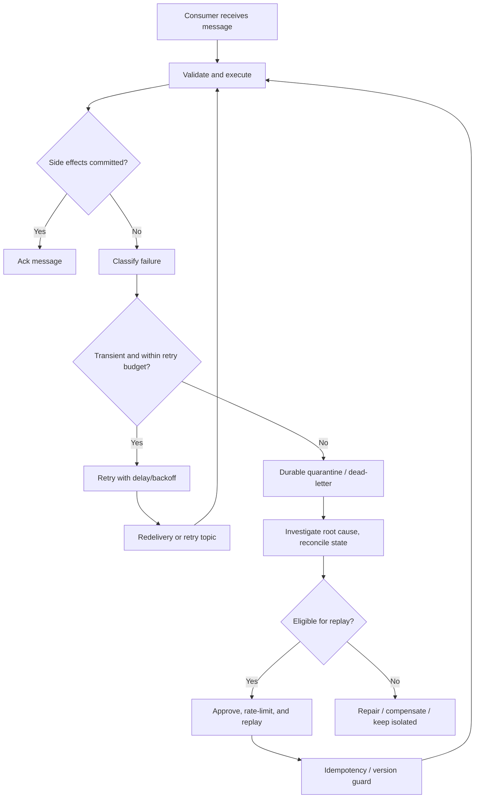

# Retries, Dead-Lettering, and Error Processing Bounds

## 1. Why Does Apache Pulsar Need an Explicit Error-Handling Policy?

In a Spring Boot integration system, a Pulsar consumer may receive an event to write to PostgreSQL, call a partner HTTP API, update a cache, or forward to a Spring Integration adapter. A valid message may fail due to a timeout, lost database connection, or HTTP 503 response. Another message may fail permanently because of a bad schema, missing required fields, or a business-state violation.

If all errors retry indefinitely, a single **poison message** can monopolize CPU, connection pools, and stall the entire consumer. If the application ACKs and skips on failure, data can be lost. If it dumps every error into a dead-letter topic and replays automatically, the system can trigger duplicate side effects or overwrite newer state with stale data.

This lesson belongs to the **Apache Pulsar** group of `SPRING_BOOT_INTEGRATION`. Its goal is to design a complete error pipeline spanning message reception, classification, retries, dead-lettering, replay, and verification across HTTP, databases, and brokers. A sound operational policy must answer simultaneously:

- Which errors should retry and which must be quarantined?
- When should you pick `negativeAcknowledge`, `ackTimeout`, or `reconsumeLater`?
- How do you bound attempt counts, total time, and resource usage?
- Are messages routed to a dead-letter topic retained long enough for investigation?
- When is ACKing allowed, and how do you protect already-committed side effects?
- When is replay safe, especially for ordered events?
- Who observes, approves, and executes recovery operations?

**Principle:** transient failures retry within finite budgets; unrecoverable failures stay isolated in a quarantine store; a message is acknowledged only after business outcomes are durable or after it has been safely handed off to a controlled recovery path.

## 2. Concepts to Distinguish

| Concept | Meaning | Common confusion |
| --- | --- | --- |
| `Message` | Pulsar record holding payload, key, properties, and Message ID | Broker Message ID does not replace business event ID |
| `Subscription` | Consumption and ack state on a topic | One topic can have many subscriptions, each tracking independent progress |
| `acknowledge` | Confirms the message was processed for the current subscription | Early ack loses redelivery capability after failures |
| `negativeAcknowledge` | Requests redelivery after a failure | Can break processing order and is not a guaranteed durable retry budget |
| `ackTimeout` | Detects messages received yet unacked for too long | Can redeliver while the original execution is still running |
| `reconsumeLater` | Schedules delayed redelivery through the retry mechanism | Requires enabling retry and checking retry topic/DLQ |
| `retry topic` | Intermediate topic holding messages awaiting retry | Does not automatically preserve ordering relative to new source messages |
| `dead-letter topic` (DLT/DLQ) | Topic holding unprocessable messages | Landing in DLT does not mean business logic succeeded |
| `DeadLetterPolicy` | Configures threshold and destination for failing messages | Verify exact behavior by client version and subscription type |
| `replay` | Re-executing messages from an error store or history | Can cause duplicates, stale writes, and external side effects |

Detailed retry/DLQ behaviors vary across Pulsar Java client and broker versions. Java examples in this lesson illustrate common structuring patterns; before adopting them, verify attempt counts, subscription types, and actual ack paths on your deployed stack.

## 3. Flow from Failure to Recovery



The flow has four boundaries to define explicitly:

1. **Business commit:** database transactions or HTTP outcomes must be confirmed before considering processing successful.
2. **Durable retry write:** never ack the original message before the retry/quarantine path confirms persistence per the API used.
3. **Preserve original context:** when forwarding across topics, retain event ID, key, contract version, and diagnostic metadata.
4. **Verify replay:** the number of replayed records does not equal the number successfully applied at the destination.

An HTTP call that timed out may still have been processed by the partner system. That is an **unknown outcome** state, requiring lookup by idempotency key or reconciliation; blindly retrying it as a brand-new command can cause duplicate side effects.

## 4. Three Retry Mechanisms Commonly Confused

### 4.1. `negativeAcknowledge`

The Java client lets you report a processing failure:

```java
consumer.negativeAcknowledge(message);
```

The message is redelivered per the negative acknowledgment policy. Delays can be set via `negativeAckRedeliveryDelay` or supported backoff configuration. This is convenient for brief glitches, yet you should not assume every nack increments a reliable DLQ counter regardless of version or subscription type. Test dead-letter routing on your real system.

Nack can also allow subsequent messages to keep processing, so **side-effect completion order** can diverge from publish order.

### 4.2. `ackTimeout`

When acknowledgment timeout is configured, messages unacked after that interval can be redelivered. It detects hung consumers or lost ownership, rather than serving as a controlled business retry scheduler.

Example: a handler needs 90 seconds to write data while ack timeout is 30 seconds. A second execution can start while the first is still writing to the DB, causing contention, duplicate HTTP requests, or duplicate events without idempotency.

For longer tasks, size timeouts against real latency and business deadlines, while adding in-flight caps, redelivery metrics, and duplicate guards.

### 4.3. `reconsumeLater` via a Retry Topic

The Pulsar Java client offers:

```java
consumer.reconsumeLater(message, 15, TimeUnit.SECONDS);
```

With retry topics and a matching `DeadLetterPolicy` enabled, the message is scheduled for retry after the delay; once policy limits are reached, it moves to the DLQ. This is useful for **delayed retries with persisted history**, instead of blocking threads or nacking continuously.

Avoid stacking multiple retry layers simultaneously without calculating total attempts: HTTP client retries, business handler retries, nacks, and `reconsumeLater` can multiply effective requests several-fold.

### 4.4. Decision Table

| Mechanism | When to consider | Limitations |
| --- | --- | --- |
| Short retry inside handler | Very brief glitches, few attempts, latency still within budget | Ties up processing thread/slot |
| Nack with backoff | Want simple broker redelivery | Retry counting/DLQ behavior must be verified; can reorder |
| Ack timeout | Guard against hung/crashed consumers | Risks overlapping attempts if timeout is too low |
| `reconsumeLater` | Want delayed topic-based retries and policy-driven DLQ | Must manage retry topic, retention, ordering |
| Immediate quarantine | Schema errors or unfixable missing data | Needs durable store, publish confirmation, and runbook |
| Operator-triggered replay | Root cause fixed and state reconciled | Needs permissions, audit trail, rate limits |

## 5. Designing Retry Budgets and Load Limits

A retry policy must define **attempt counts, total duration, and concurrent executions**.

| Failure type | Reference behavior | Stopping point |
| --- | --- | --- |
| HTTP 503 or transient timeout | Finite retries, backoff with jitter | Route to DLT when budget expires |
| HTTP 429 | Respect partner quotas and `Retry-After` where appropriate | DLT or controlled wait |
| Database connection error | Delayed retries and bounded concurrency | DLT/quarantine if prolonged |
| Schema-invalid JSON/Avro payload | Never retry the exact same record infinitely | Quarantine, fix producer/consumer |
| Referenced entity not present yet | Wait boundedly, check ordering requirements | Gap queue/reconciliation past deadline |
| Permanent state violation | Investigate instead of blind retry | Quarantine and repair data |
| HTTP timeout where partner may have processed | Query result by idempotency key | Retry/repair based on reconciliation |

`maxRedeliverCount=4` is merely one policy threshold, **not a promise** that the entire business lifecycle makes at most five API calls. Crashes, redeliveries, internal retries, or operator replays can produce additional attempts.

Bound all dimensions together:

- **Attempt budget:** number of processing attempts per event in one cycle.
- **Time budget:** maximum elapsed time an event may retry before escalation.
- **Rate budget:** messages/minute or HTTP requests/second a dependency can sustain.
- **Concurrency budget:** in-flight messages, DB/HTTP connections, and active workers.
- **Backlog budget:** volume/age of messages awaiting retry or sitting in the DLQ.

During a downstream outage, circuit breakers, bulkheads, and backpressure prevent **retry storms**. Scaling up consumers to "drain the backlog quickly" often knocks a recovering dependency right back down.

## 6. Example Pulsar Java Client Configuration with Retry Topic and DLQ

Suppose an `order-projection` service consumes `persistent://shop/integration/orders.events`, persists projections to PostgreSQL, and wants delayed retries.

### 6.1. Consumer Builder

```java
import java.util.concurrent.TimeUnit;
import org.apache.pulsar.client.api.Consumer;
import org.apache.pulsar.client.api.DeadLetterPolicy;
import org.apache.pulsar.client.api.Message;
import org.apache.pulsar.client.api.PulsarClient;
import org.apache.pulsar.client.api.Schema;
import org.apache.pulsar.client.api.SubscriptionType;

String inputTopic = "persistent://shop/integration/orders.events";
String retryTopic = "persistent://shop/integration/orders.events-RETRY";
String dlqTopic = "persistent://shop/integration/orders.events-DLQ";

PulsarClient client = PulsarClient.builder()
        .serviceUrl("pulsar://pulsar-broker:6650")
        .build();

Consumer<String> consumer = client.newConsumer(Schema.STRING)
        .topic(inputTopic)
        .subscriptionName("order-projection")
        .subscriptionType(SubscriptionType.Shared)
        .enableRetry(true)
        .deadLetterPolicy(DeadLetterPolicy.builder()
                .maxRedeliverCount(4)
                .retryLetterTopic(retryTopic)
                .deadLetterTopic(dlqTopic)
                .initialSubscriptionName("order-projection-dlq")
                .build())
        .subscribe();
```

Understand accurately:

- `enableRetry(true)` enables the retry topic flow with `reconsumeLater` on supporting clients.
- `retryLetterTopic` and `deadLetterTopic` are named explicitly for clear provisioning, permissions, retention control, and monitoring.
- `maxRedeliverCount(4)` is an illustrative threshold. Verify actual delivery counts and DLQ behavior, since nack, timeout, and reconsume mechanics differ.
- `initialSubscriptionName` can prepare an initial DLQ subscription per API support; still verify topics, subscriptions, permissions, backlog policies, and retention after deployment.
- `SubscriptionType.Shared` lets multiple consumers process concurrently, yet does not guarantee events for the same `orderId` complete in order.

This snippet illustrates the client API. Real applications need auth/TLS, secrets, timeouts, and proper lifecycle shutdown for both client and consumer. Never run a manual `receive` loop alongside a `@PulsarListener` on the same subscription unless intentionally designed.

### 6.2. Handling Messages by Failure Category

```java
Message<String> message = consumer.receive();

try {
    // DB transaction and idempotency live inside this service.
    projectionService.applyIdempotently(message.getValue());
    consumer.acknowledge(message);
} catch (TransientDownstreamException transientError) {
    consumer.reconsumeLater(message, 15, TimeUnit.SECONDS);
} catch (PermanentPayloadException permanentError) {
    quarantinePublisher.publishAndAwaitConfirmation(
            message, permanentError);
    consumer.acknowledge(message);
}
```

This is an **illustrative business skeleton**: `projectionService`, the exceptions, and `quarantinePublisher` are project-defined. Production code requires a receive loop, client exception handling, metrics, shutdown, and resource management.

Crucially:

1. Ack only after DB commit. If commit succeeds yet ack fails, redelivery is possible; consumers must deduplicate.
2. When routing permanent errors to a custom quarantine, await durable publish confirmation **before acking**. If quarantine publishing fails, never ack as safely isolated.
3. If quarantine publishing succeeds yet source ack fails, the message may reappear; both the quarantine store and consumer must tolerate duplicates.
4. Never catch all exceptions indiscriminately such that an **ack failure after DB commit** is treated as a business failure and triggers uncontrolled side-effect replays.
5. For uncertain errors like an HTTP timeout after the partner may have committed, query status and use an idempotency key.

### 6.3. Spring Boot and Spring for Apache Pulsar

Basic connection configuration:

```yaml
spring:
  pulsar:
    client:
      service-url: ${PULSAR_SERVICE_URL:pulsar://localhost:6650}
    admin:
      service-url: ${PULSAR_ADMIN_URL:http://localhost:8080}
```

In Spring Boot, `PulsarClient` can be managed by the framework and injected into consumer/producer beans. When using `@PulsarListener` instead of a manual receive loop, configure ack mode, dead-lettering, retries, and exception handlers using the exact API of your **Spring for Apache Pulsar** version. Never copy native Java client builder settings and assume they automatically configure the framework's listener container.

`spring.pulsar.admin.service-url` is used only when the application actually needs the Pulsar Admin API or admin-dependent features; an ordinary consumer should not receive cluster-wide admin rights. Production requires TLS, authentication, tenant/namespace/topic ACLs, and proper secret configuration.

## 7. Why Redelivery Count Does Not Equal Business Execution Count

The same event can arrive multiple times because of:

- Consumer crash right before ack.
- Ack timeout while a handler is still running.
- Negative acknowledgment.
- `reconsumeLater` scheduling another attempt via a retry topic.
- Reconnects, failovers, or consumer assignment shifts.
- Operator replay of older messages from a DLQ.
- The same event delivered to multiple subscriptions with separate side effects.

Client-reported redelivery counters do not necessarily equal **total requests received by a partner API**. One business attempt might make multiple HTTP calls due to client-side retries; conversely, a redelivered message might be skipped immediately via deduplication.

For lifecycle tracking, define explicitly:

- `eventId`: stable logical ID across redeliveries and replays.
- `firstSeenAt`: when event processing first began.
- `deliveryAttempt`: delivery counter observed from broker metadata.
- `businessAttempt`: meaningful side-effect execution count; persist carefully if needed.
- `replayRunId`: identifier of an operator-triggered replay batch.
- `lastFailureCode`: standardized classification for observability.

Application-maintained counters must be durable and concurrency-safe, never just an in-memory field on one instance. Do not assume crashes and replays preserve every retry property across all client versions.

## 8. Poison Messages and Permanent Failures

A **poison message** is a record that current code cannot process successfully by simply repeating the same attempt—for example, JSON missing a required field, incompatible Avro schema, wrong ID type, or invalid business state.

Sound workflow:

1. Validate payload, schema version, and contract before executing side effects.
2. If failure is clearly permanent, avoid repeating technical retries.
3. Write to a durable quarantine/DLT preserving original payload, message key, topic, subscription, event ID, and failure code.
4. Wait for persistence acknowledgment on custom error publishers before acking the source.
5. Alert the owning producer/consumer team to ship a fix.
6. Replay under controlled governance after the root cause is resolved.

Pulsar's `DeadLetterPolicy` normally operates on redelivery/retry thresholds and cannot automatically infer your custom `PermanentPayloadException`. Routing permanent failures directly to quarantine requires explicit code or framework configuration. For deserialization errors occurring before the handler runs, configure an error handler at the serializer/listener layer to capture the **raw payload** for investigation.

Not every "missing entity" error is permanent. Events can arrive out of order, or upstream data may still be committing. Those cases need **version gap** handling, bounded waiting, or reconciliation rather than infinite replay.

## 9. Dead-Letter Topics Must Be Operated Error Stores

DLTs/DLQs are not infinite permanent archives by default. Topics and namespaces obey retention, backlog quota, TTL, and subscription rules. Verify empirically **whether messages remain or expire** if no consumer investigates for days.

| Component | Required policy |
| --- | --- |
| Topic name | Clear environment, tenant, namespace, source, and purpose |
| Investigation subscription | Durable; pre-provisioned or created via verified workflow |
| Retention/TTL | Long enough for incident triage, with expiry warnings |
| Backlog quota | Prevents unbounded DLTs from harming the cluster |
| ACLs | Consumers can produce to their DLQ; investigators get scoped read access |
| Metadata | Retain event ID, key, schema version, origin, failure code, and retry info |
| Monitoring | DLQ inflow rate, backlog size, oldest message age, publish failures |
| Runbook | Owner, triage SLA, replay/repair criteria, and approval authority |

Example diagnostic metadata structure:

```json
{
  "eventId": "evt-1823",
  "aggregateId": "order-4711",
  "aggregateVersion": 8,
  "origin": {
    "topic": "persistent://shop/integration/orders.events",
    "subscription": "order-projection",
    "messageId": "ledger:entry:partition"
  },
  "failure": {
    "code": "PARTNER_HTTP_503",
    "firstFailedAt": "2026-11-21T04:05:00Z",
    "lastFailedAt": "2026-11-21T04:07:40Z"
  },
  "operations": {
    "incidentId": "INC-421",
    "status": "QUARANTINED",
    "replayRunId": null
  }
}
```

This is an **illustrative audit format**, not a mandatory Pulsar header standard. The Message ID string is purely symbolic; when persisting real IDs, use your client's serialization API. Certain retry/DLQ properties are library internals, so avoid building critical business logic on guessed header names.

Failed payloads may hold personal or financial data. Dashboards should display redacted metadata by default; raw payload access requires elevated permissions and access logs.

## 10. Retries Can Break Business-Key Ordering

### 10.1. Subscription Types

| Subscription type | Normal dispatch | Risk during retries |
| --- | --- | --- |
| `Exclusive` | One consumer on the subscription | A delayed retry can still trail newer messages |
| `Failover` | One active consumer with standby failover | Post-failover redelivery can trigger duplicate processing |
| `Shared` | Messages spread across multiple consumers | No per-key processing order guarantee |
| `Key_Shared` | Same-key messages routed by key affinity | Retry topics and async side effects can still reorder effective mutations |

Example:

```text
OrderCreated  orderId=A version=1  -> APPLIED
OrderPaid     orderId=A version=2  -> RETRY 30s
OrderShipped  orderId=A version=3  -> RECEIVED BEFORE RETRY V2
```

If the consumer applies `SHIPPED` and later replays `PAID`, state can regress backward. **`Key_Shared` does not automatically preserve business ordering across retry topics.** You need `aggregateVersion`, DB guards, gap waiting policies, or reconciliation.

### 10.2. Batching, Keys, and Concurrency

With `Key_Shared`, configure producer batching to match key-based routing. In supporting versions, use key-based batching or disable batching to preserve per-key dispatch, and test with multiple interleaved keys.

Never publish events for the same aggregate with random keys. Nor should you hand records off to `@Async` or an `ExecutorChannel` and ack immediately before DB/HTTP finishes; the broker may preserve delivery order while your application reverses commit order.

## 11. Idempotency and Transactions Across Retries/Redelivery

Pulsar can redeliver messages after ack errors or crashes. The pragmatic architecture is **at-least-once + idempotent consumers**.

Illustrative payload:

```json
{
  "eventId": "evt-2221",
  "orderId": "order-4711",
  "aggregateVersion": 8,
  "status": "PAID"
}
```

PostgreSQL schema:

```sql
CREATE TABLE processed_integration_event (
    consumer_name VARCHAR(120) NOT NULL,
    event_id VARCHAR(120) NOT NULL,
    processed_at TIMESTAMPTZ NOT NULL DEFAULT CURRENT_TIMESTAMP,
    PRIMARY KEY (consumer_name, event_id)
);

CREATE TABLE order_projection (
    order_id VARCHAR(120) PRIMARY KEY,
    status VARCHAR(40) NOT NULL,
    last_version BIGINT NOT NULL
);
```

Processing outline **inside one DB transaction**:

```text
BEGIN TRANSACTION

1. Parse eventId, orderId, aggregateVersion; validate data.
2. Insert (consumer_name, event_id) into processed_integration_event;
   if duplicate and previously committed -> skip safely.
3. Lock the projection row by orderId or use compare-and-set.
4. Check incomingVersion:
   - equals lastVersion + 1 (if stream guarantees contiguous versions): apply
   - less than or equal to lastVersion: stale/duplicate, do not overwrite
   - greater than lastVersion + 1: roll back, wait for gap/repair
5. Persist projection and lastVersion.

COMMIT
Only after commit, acknowledge the Pulsar message.
```

**Inserting the dedup marker and updating the projection must share one transaction.** If the marker commits separately while processing fails, retries will falsely skip the work.

If a stream only carries a **subset** of an aggregate's events, source versions may legitimately skip numbers. Design a stream-specific sequence or appropriate monotonic rule rather than enforcing `+1` when the contract does not guarantee contiguous numbers.

Broker deduplication or Pulsar transactions do not provide exactly-once across PostgreSQL, HTTP APIs, email, and other brokers. When calling APIs with side effects, send a stable idempotency key or use transactional outbox/reconciliation at system boundaries.

## 12. Integrating Retries with Timeouts, Circuit Breakers, and Bulkheads

A consumer should not sit retrying continuously while a partner API suffers a 15-minute outage. Combine:

1. **Connect/read timeouts:** never hold connections and workers indefinitely.
2. **Circuit breakers:** pause calls to a broadly failing dependency.
3. **Retries with backoff and jitter:** prevent synchronized thundering herds.
4. **Bulkheads:** cap concurrent DB/HTTP operations.
5. **Rate limits:** throttle normal processing and replay rates.
6. **Retry topics:** defer messages without sleeping worker threads.
7. **DLQs:** isolate records exhausting budgets or needing investigation.

If the HTTP client retries three times per delivery, the handler retries twice, and Pulsar redelivers several times, total API calls far exceed `maxRedeliverCount`.

\[
\text{HTTP attempts (estimate)} \approx
\text{message deliveries} \times
\text{HTTP attempts per delivery}
\]

This formula helps size load budgets, not promise an exact cap during crashes, abnormal redeliveries, or manual replays.

## 13. Backpressure and In-Flight Bounds

| Limit | What to monitor |
| --- | --- |
| Consumer instance count | Total receive capacity, connections, and downstream request load |
| Client `receiverQueueSize` | Prefetched messages buffered in memory; not equal to active tasks |
| Executor/thread pool | Avoid unbounded queues ahead of HTTP/DB |
| HTTP/DB connection pool | Stay within dependency ceilings |
| Retry topic rate and backlog | Avoid bunching all retries into a single spike |
| DLQ retention and quotas | Ensure failed messages do not trigger storage outages |
| Ack timeout | Avoid premature redelivery while valid work is running |
| Max processing deadline | Avoid processing obsolete messages indefinitely |

If a Pulsar adapter pushes messages into a Spring Integration `ExecutorChannel` or async processor, explicitly define who acks and how side effects become durable. An in-memory queue can accept a message and lose it on process crash; that is not a safe handoff for acking the source.

**Head-of-line blocking** is sometimes the right trade-off when per-aggregate order matters. Never "fix" it by processing versions of the same entity in parallel without a version guard.

## 14. Observing DLQs and Retries by Root Cause

Broker metrics and business metrics must be viewed together:

| Metric | Purpose |
| --- | --- |
| Message redelivery rate | Detect retry storms and failing consumers |
| Ack timeout / unacked count | Detect hung handlers or overly short timeouts |
| Retry topic backlog and message age | Understand retry deferral lag |
| DLQ inflow by `failureCode` | Spot poison messages or outages |
| DLQ backlog / oldest age | Track triage SLAs and retention |
| Consumer processing latency | Measure p95/p99, pinpoint HTTP/DB bottlenecks |
| Duplicates ignored / version gaps / stale events | Catch data issues even when source backlog is empty |
| Replay submitted / applied / failed | Avoid equating replay publish with business recovery |
| Connection/reconnect and assignment churn | Explain unexpected redeliveries |

Pulsar brokers and clients expose metrics at different layers; Spring Boot Actuator/Micrometer can supplement business metrics. Exact metric names vary by broker/exporter and version, so map dashboards against live metrics rather than guessing.

Structured logs should capture `eventId`, `messageId`, `topic`, `subscription`, `aggregateId`, `attempt`, `failureCode`, `correlationId`, and `replayRunId` when applicable. Never attach high-cardinality IDs or sensitive payloads as Prometheus labels.

Two alerts convey very different realities:

- **Transient outage:** redelivery rate climbs alongside HTTP 503s; check circuit breakers and dependencies.
- **Broken data contract:** DLQ fills with schema-invalid messages after a deploy; fix producer/consumer instead of blindly replaying.

A surging DLQ while source backlog stays low **does not prove the integration is healthy**: events may simply be piling up unprocessed in the error topic.

## 15. Authorization and Replay Governance

DLQs can hold sensitive data, and replays can trigger real side effects. Separate roles:

- **Viewer / on-call:** inspect metrics, counts, and redacted metadata.
- **Investigator:** inspect raw payloads under scoped access and audit logging.
- **Requester:** submit replay requests with event filters, justification, and ticket reference.
- **Approver:** sign off on scope, record count, rate limit, and stop conditions.
- **Executor / automation:** reads the approved DLQ and produces to the target topic via a restricted service account.
- **Platform admin:** manages namespace policies, ACLs, and retention; does not execute business replays by default.

Pulsar permissions across tenant/namespace/topic must align with application RBAC. Never grant cluster-admin rights or broad subscription resets merely to replay a few events. High-impact financial replays or large backfills require independent approval.

Before replaying:

1. Confirm the root cause is fixed and live consumers handle the payload.
2. Reconcile whether the event was already applied or processed externally.
3. Check `aggregateVersion`: is the older event still valid?
4. Freeze the approved event set or filter criteria; snapshot counts.
5. Set rate limits, max message caps, a kill switch, and an execution window.
6. Run a canary replay, verify target DB/API state, then scale up.
7. Record audit logs linking `incidentId`, `replayRunId`, and individual events.

Replay publishes new messages onto the target topic; it does not splice records back into old positions in Pulsar history. For an event at version 8 when current state is already version 10, rely on version guards, reconciliation, or mark superseded instead of forcing stale state.

## 16. End-to-End Testing with Pulsar and a Database

Test against a real Pulsar broker and production-matching database (e.g., Testcontainers), because handler unit mocks cannot verify retry topics, dead-letter routing, and ack behavior.

| Scenario | Passing criteria |
| --- | --- |
| Valid message | DB commits and acks; no copies in retry/DLQ |
| Brief HTTP 503 | Retries after delay, then succeeds; no duplicates |
| Prolonged HTTP 503 | After budget, record rests in DLQ with metadata |
| Schema-invalid payload | Quarantined with raw payload; no infinite retries |
| Retry/DLQ publish fails | Source message is not falsely acked as protected |
| Crash after DB commit before ack | Redelivery does not duplicate side effects |
| Overly short ack timeout | Test exposes in-flight duplicates to calibrate timeout |
| Nack vs `reconsumeLater` | Verifies count/delay/DLQ differences for your version |
| `Shared` / `Key_Shared` same key | Version guard prevents overwriting with stale state |
| `Key_Shared` with batching | Verifies routing when producer emits multiple keys |
| Replaying stale event | Does not overwrite newer projection |
| DLQ unconsumed for days | Retention/subscription preserves records per SLA |
| Multiple instances, reconnects | No lost messages and no duplicate side effects |

**Critical test:** commit DB changes successfully and force the consumer to die before ack; upon restart, the message redelivers yet the DB reflects the business effect only once. This occurs regularly in HTTP/database integrations.

Never assert only that a message entered the DLT; prove the message remains readable and replays cleanly with accurate business outcomes.

## 17. Synthesis Scenario: Inventory Synchronization

Suppose `inventory-service` publishes `StockReserved`, `StockReleased`, and `StockAdjusted` to Pulsar. Spring Boot service `warehouse-sync` consumes events, calls an external warehouse HTTP API, and persists checkpoints in PostgreSQL.

Design:

1. **Contract:** events carry `eventId`, `skuId`, `aggregateVersion`, `occurredAt`, and an idempotency key.
2. **Key:** use `skuId` if per-item ordering is required; verify `Key_Shared` and batching on your client version.
3. **Retry:** `reconsumeLater` for HTTP 503s with backoff and finite attempt budget; never infinitely retry schema errors.
4. **DLQ:** preserve original payload, source topic, failure code, subscription, timestamps, and event ID.
5. **Idempotency:** dedup marker and DB checkpoint share one transaction; warehouse API requires idempotency keys or reconciliation.
6. **Load protection:** HTTP timeouts, circuit breaker, bulkhead, and concurrency/rate limits.
7. **Operations:** measure retry backlog/age, DLQ inflow, version gaps, and sync lag against the source.
8. **Replay:** once the API recovers, reconcile unknown-outcome commands, approve the event batch, replay in small throttled batches, and verify state.

If `StockAdjusted(v5)` already applied while `StockReserved(v4)` sits in the DLQ, replaying v4 blindly can corrupt inventory levels. Enforce version-aware state transitions or rebuild from the source of truth rather than merely resending stale events.

## 18. Common Mistakes

| Mistake | Why it is dangerous | Fix |
| --- | --- | --- |
| Treating nack as an exact retry budget | DLQ/counts vary by mechanism and version | Test attempt counts on a real broker; pick a primary retry path |
| Acking upon enqueueing to an executor | Side effects can fail after ack | Ack after commit or durable handoff |
| Ultra-low ack timeout to "retry fast" | Old and new handler runs can overlap | Size timeout to latency; enforce idempotency |
| Retrying every exception | Poison messages create loops | Classify permanent/transient/gap errors |
| Auto-replaying everything from DLT | Failures recur and cause duplicates | Require approval and controlled replay |
| Using `Shared` while needing per-key order | Parallel consumers break ordering | Use `Key_Shared` where suitable + version guards |
| Expecting `Key_Shared` to order retry topics | Delayed retries can reorder effects | Enforce version checks in the DB |
| Committing dedup marker before DB update | Retries skip unfinished work | Keep marker and updates in one transaction |
| Forgetting DLQ subscription/retention | Error messages expire before investigation | Check policies, maintain backlog, alert on age |
| Monitoring only source backlog | Failing events may all sit in the DLQ | Monitor retry/DLQ and business outcomes |

## 19. Production Checklist for Pulsar Retries and DLQs

- [ ] Classified transient, permanent, gap, and unknown-outcome failures.
- [ ] Selected a primary retry path; understand nack, ack timeout, and `reconsumeLater`.
- [ ] Defined attempt, duration, rate, concurrency, and backlog budgets.
- [ ] Provisioned retry/DLQ topics with proper namespaces, ACLs, retention, and subscriptions.
- [ ] Tested `DeadLetterPolicy` on your real Pulsar client/broker versions and subscription type.
- [ ] Never ack before DB commit or durable persistence in retry/quarantine.
- [ ] Events include stable IDs, versions/sequences, and matching idempotency keys.
- [ ] Consumers handle duplicates, stale events, and version gaps.
- [ ] Metrics cover redeliveries, ack timeouts, retry backlog/age, DLQ counts/age, and business outcomes.
- [ ] Runbooks define payload read permissions, replay request/approval/execution, and audit trails.
- [ ] Tested crash-after-commit-before-ack, failed DLQ publish, poison messages, and stale replays.
- [ ] Prepared pause, repair/reconciliation, and post-recovery verification plans.

**Desired outcome:** for any failing message, operations teams know exactly when it retries, when it quarantines, when it may replay, and which evidence proves destination data is accurate. Retries, dead-lettering, timeouts, idempotency, and processing bounds must be engineered as one cohesive chain in a Spring Boot integration system.
