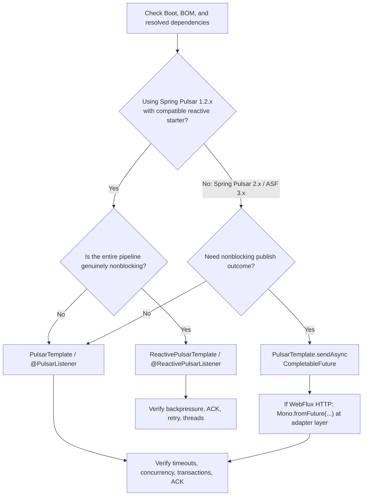
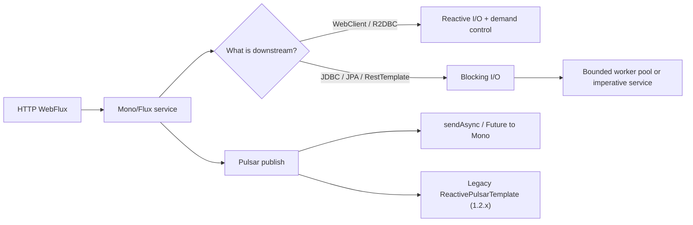

# Choosing Imperative or Reactive APIs Based on Dependency Stack

In a Spring Boot service using Apache Pulsar, developers frequently encounter APIs such as `PulsarTemplate`, `@PulsarListener`, `sendAsync`, `ReactivePulsarTemplate`, and `@ReactivePulsarListener`. Those names easily create the impression that simply using `Mono`/`Flux`, adding WebFlux, or swapping an annotation converts the whole messaging flow into reactive programming. In reality, **which APIs are available depends on your Spring Boot version, the Pulsar libraries on the classpath, and their support lifecycle**; how you coordinate acknowledgments, error handling, and blocking data sources also changes with that choice.

This lesson belongs to the **Apache Pulsar** chapter of `SPRING_BOOT_INTEGRATION` (integrating Spring Boot with HTTP clients, databases, caches, brokers, and Spring Integration adapters). The focus is on **choosing the API according to your actual dependency stack** and then implementing producers/consumers with sound data contracts, consistency, deduplication, transactions, testing, and observability. Examples use Java 17+ and Spring Boot, with versions explicitly noted where relevant.

> **Important version milestone, verified as of 21/11/2026:** Spring for Apache Pulsar **1.2.x** with Spring Boot **3.5.x** still supports a separate reactive module. Starting with **Spring for Apache Pulsar 2.0.0** and **Spring Boot 4.0.0**, that reactive module was removed. On **10/11/2026**, the project moved to the Apache Software Foundation under the name *Apache Pulsar support for Spring*; release **3.0.0-M1** uses new Maven coordinates and packages while keeping the imperative APIs. Therefore, do not copy Boot 3.x reactive configurations into Boot 4.x or Apache Pulsar support for Spring 3.x projects without verifying support.

## 1. Clarifying Three Meanings of "Reactive"

In the Java ecosystem, the following concepts are related yet **not synonymous**:

| Concept | Characteristics | Examples | Notes |
| --- | --- | --- | --- |
| Imperative / standard API | Direct method calls; listeners execute via callbacks or container threads | `PulsarTemplate.send(...)`, `@PulsarListener` | Easy to combine with JDBC/JPA and synchronous business logic. |
| Asynchronous API | Initiates I/O and receives results later via futures/callbacks | `PulsarTemplate.sendAsync(...)` → `CompletableFuture<MessageId>` | Avoids blocking threads waiting on the broker, yet is **not** a reactive consumer. |
| Reactive Streams | Publishers expressing data streams, completion/error signals, and demand/backpressure | `Mono<MessageId>`, `Flux<...>`, `ReactivePulsarTemplate` from 1.2.x | Requires the corresponding reactive library plus accurate subscription/ACK rules. |

`spring-boot-starter-webflux` adds the reactive HTTP stack and **does not create** `ReactivePulsarTemplate`. Having Project Reactor on the classpath does not cause Spring Boot to turn `@PulsarListener` into a reactive listener either. Conversely, a Spring MVC application can call `sendAsync` without migrating any controller to WebFlux.

The right decision starts by inspecting **managed versions and resolved dependencies**, then picking the programming model that fits the work.

## 2. Version Matrix: Which Starter Provides Which API?

| Stack | Primary dependency | Producer/consumer APIs | Recommendation |
| --- | --- | --- | --- |
| Spring Boot **3.5.x** + Spring Pulsar **1.2.x** | `org.springframework.boot:spring-boot-starter-pulsar` | `PulsarTemplate`, `@PulsarListener` | Default for synchronous code or async sends. |
| Spring Boot **3.5.x** + Spring Pulsar **1.2.x** | `org.springframework.boot:spring-boot-starter-pulsar-reactive` | `ReactivePulsarTemplate`, `@ReactivePulsarListener`; reactive client/factory | Choose only when maintaining an existing reactive stack with verified version compatibility. |
| Spring Boot **4.0–4.2** + Spring Pulsar **2.0.x** | `org.springframework.boot:spring-boot-starter-pulsar` | `PulsarTemplate`, `@PulsarListener`, `sendAsync` | **Do not** look for `spring-pulsar-reactive` in 2.0.x; it was removed. |
| Apache Pulsar support for Spring **3.0.0-M1** (11/2026 milestone) | `org.apache.pulsar:pulsar-spring-boot-starter` | `PulsarTemplate`, `@PulsarListener`, `@PulsarReader`, Pulsar client API | Use when evaluating/migrating to the new project; it is a milestone, so manage versions deliberately. |

Two historical notes:

1. In Spring Pulsar **0.2.x** tutorials, you may see `org.springframework.pulsar:spring-pulsar-reactive-spring-boot-starter`. That is an **obsolete** coordinate. In Spring Boot 3.2–3.5, the reactive starter belongs to group `org.springframework.boot` under `spring-boot-starter-pulsar-reactive`.
2. Spring Pulsar `2.0.8` is the final release published by the Spring team. Development continues at Apache Pulsar; never mix `org.springframework.pulsar` and `org.apache.pulsar:pulsar-spring` in the same dependency graph during migration.

**Never assume a class exists across all versions just from its name.** When upgrading Boot 3.5 → Boot 4.x or Spring Pulsar 1.2.x → 2.x/Apache 3.x, re-verify all producer/consumer imports, auto-configurations, and starters.

### Decision Diagram



This diagram covers **choosing Spring Pulsar APIs** and does not preclude directly using the low-level Pulsar Java Client or another reactive library. If using a separate client/binder, verify its specific documentation and compatibility matrix—never refer to it as `ReactivePulsarTemplate` when it does not provide that class.

## 3. Inspect Your Dependency Graph Before Choosing Code

### 3.1. Maven/Gradle in a Spring Boot 3.5 Project

Standard producer/consumer:

```xml
<dependency>
    <groupId>org.springframework.boot</groupId>
    <artifactId>spring-boot-starter-pulsar</artifactId>
</dependency>
```

Only when the project belongs to the **1.2.x reactive-supported line** and needs reactive Pulsar:

```xml
<dependency>
    <groupId>org.springframework.boot</groupId>
    <artifactId>spring-boot-starter-pulsar-reactive</artifactId>
</dependency>
```

With Gradle:

```groovy
dependencies {
    implementation 'org.springframework.boot:spring-boot-starter-pulsar'
    // In Boot 3.x compatible with Spring Pulsar 1.2.x, select the reactive starter
    // if the goal is ReactivePulsarTemplate/@ReactivePulsarListener:
    // implementation 'org.springframework.boot:spring-boot-starter-pulsar-reactive'
}
```

These snippets show **alternatives**, not instructions to add both starters to every app. Use the matching Spring Boot BOM/parent to manage versions, then inspect the transitively resolved artifacts.

Commands you can run in your project:

```bash
# Maven: view actual resolved versions
./mvnw dependency:tree -Dincludes=org.springframework.pulsar,org.springframework.boot,org.apache.pulsar

# Gradle: inspect runtime classpath
./gradlew dependencies --configuration runtimeClasspath

# Gradle: trace what pulls a module into the graph
./gradlew dependencyInsight --dependency spring-pulsar-reactive --configuration runtimeClasspath
```

You do not need all three commands; run the one matching your build tool. In Maven, `-Dincludes` follows plugin-specific `groupId:artifactId` filtering syntax; if results omit dependencies, run full `dependency:tree` or filter individually. Distinguish **declared dependencies** from final resolved dependencies after BOMs, constraints, and exclusions apply.

### 3.2. Apache Pulsar Support for Spring 3.0.0-M1

When moving to the Apache Pulsar project, starter coordinates change:

```xml
<dependency>
    <groupId>org.apache.pulsar</groupId>
    <artifactId>pulsar-spring-boot-starter</artifactId>
    <version>3.0.0-M1</version>
</dependency>
```

In this milestone, the Spring Boot BOM **does not automatically manage** the new artifact's version; official notes also highlight compatibility with Pulsar Client **5.0.x** and Netty. Per the 10/11/2026 release guidance, Maven examples may set:

```xml
<properties>
    <pulsar.version>5.0.1</pulsar.version>
    <netty.version>4.2.20.Final</netty.version>
</properties>
```

When picking other versions, review the corresponding compatibility notes. Using `pulsar-spring-bom` or pinning versions depends on your build's BOM management. Never add the new starter **alongside** the old starter, as you risk duplicate auto-configurations, mismatched API packages, and broken classpaths.

From this release onward, Spring Pulsar classes move packages:

```text
Before (Spring Pulsar 1.x / 2.x):
  org.springframework.pulsar.core.PulsarTemplate
  org.springframework.pulsar.annotation.PulsarListener

After (Apache Pulsar support for Spring 3.x):
  org.apache.pulsar.spring.core.PulsarTemplate
  org.apache.pulsar.spring.annotation.PulsarListener
```

`spring.pulsar.*` properties carry forward into 3.0.0-M1, yet changing packages means source code, tests, and customizers must be rebuilt and retested.

## 4. Shared Connection Configuration for the Imperative API

From Spring Boot 3.5 through Boot 4.2, service URL configuration uses:

```yaml
spring:
  pulsar:
    client:
      service-url: pulsar://localhost:6650
    admin:
      service-url: http://localhost:8080
```

`6650` is the broker's Pulsar protocol port; `8080` here is local Pulsar's HTTP admin port (not the Spring Boot app's server port). In production, replace with your cluster/tenant URLs, TLS (`pulsar+ssl://...` where required), token/OAuth2 authentication, authorization, and a secret manager.

If a producer omits a topic, the framework can apply topic resolution/default topics. When writing guides or integration contracts, pass topics explicitly or define unambiguous resolution rules; publishing to the wrong namespace is a common deployment error.

Topic used throughout this lesson:

```text
persistent://public/default/orders.created.v1
```

In multi-environment/multi-tenant projects, never hardcode `public/default` in production. Manage topics, subscription names, schemas, and retention policies via deployment configuration.

## 5. Imperative API: PulsarTemplate and @PulsarListener

This model fits Spring Boot MVC/JDBC/JPA apps and remains the primary path in Spring Pulsar 2.x / Apache 3.x.

### 5.1. Synchronous Send

Example using **Spring Pulsar 1.x/2.x packages**:

```java
package com.example.orders.messaging;

import org.apache.pulsar.client.api.MessageId;
import org.springframework.pulsar.core.PulsarTemplate;
import org.springframework.stereotype.Service;

@Service
public class OrderEventPublisher {
    private static final String TOPIC =
            "persistent://public/default/orders.created.v1";

    private final PulsarTemplate<String> pulsarTemplate;

    public OrderEventPublisher(PulsarTemplate<String> pulsarTemplate) {
        this.pulsarTemplate = pulsarTemplate;
    }

    public MessageId publish(String eventJson) {
        return pulsarTemplate.send(TOPIC, eventJson);
    }
}
```

For **Apache Pulsar support for Spring 3.x**, change the `PulsarTemplate` import to `org.apache.pulsar.spring.core.PulsarTemplate`; calling logic remains essentially unchanged. Using `String` keeps the snippet short; real apps should define event DTOs with `eventId`, `schemaVersion`, `occurredAt`, and an agreed JSON/Avro/Protobuf schema.

`send()` **blocks for the publish outcome** and returns `MessageId` once the broker confirms per producer contract; it does not mean consumers have finished processing. If the broker slows down, the calling thread blocks until completion or timeout. Never call `send()` directly on a WebFlux Netty event loop for endpoints requiring nonblocking performance.

### 5.2. Consuming with a Listener

```java
package com.example.orders.messaging;

import org.springframework.pulsar.annotation.PulsarListener;
import org.springframework.stereotype.Component;

@Component
public class OrderCreatedListener {
    private final OrderProjectionService projectionService;

    public OrderCreatedListener(OrderProjectionService projectionService) {
        this.projectionService = projectionService;
    }

    @PulsarListener(
            topics = "persistent://public/default/orders.created.v1",
            subscriptionName = "billing-projection-v1")
    public void onMessage(String eventJson) {
        projectionService.applyEvent(eventJson);
    }
}
```

`OrderProjectionService` is an assumed business service that receives JSON, validates the schema, and updates data idempotently; it must be implemented separately. In Apache 3.x, the annotation import changes to `org.apache.pulsar.spring.annotation.PulsarListener`.

In standard container setups, **normal method return signals success**, while exceptions signal failure; the container/consumer decides ACK, negative acknowledgment, and retries per configuration and subscription type. Never assume throwing an exception automatically guarantees the message enters a dead-letter topic. Configure delivery/ack/retry/DLQ explicitly and verify on a real Pulsar broker.

### 5.3. When to Choose Imperative

- Already using JDBC, JPA, blocking partner APIs, or record-by-record processing with clear local transactions.
- Wanting bounded listener threads/worker pools per execution.
- Targeting Spring Pulsar 2.x or Apache Pulsar support for Spring 3.x, where the Spring Pulsar reactive module no longer exists.
- Most I/O balances cleanly with thread pools, batching, and timeouts without needing an end-to-end `Flux` pipeline.

Imperative code still scales effectively via partitions/topics, subscription types, bounded concurrency, and async publishing. Reactive adds zero parallelism if downstream holds a single database connection or serializes on one key.

## 6. Asynchronous Sending with sendAsync Without the Reactive Starter

`PulsarTemplate` typically provides both `send()` and `sendAsync()`. `sendAsync()` returns a `CompletableFuture<MessageId>`, letting callers observe broker confirmation without blocking the current thread.

```java
import java.util.concurrent.CompletableFuture;
import org.apache.pulsar.client.api.MessageId;
import org.springframework.pulsar.core.PulsarTemplate;

public class AsyncOrderEventPublisher {
    private final PulsarTemplate<String> template;

    public AsyncOrderEventPublisher(PulsarTemplate<String> template) {
        this.template = template;
    }

    public CompletableFuture<MessageId> publish(String json) {
        return template.sendAsync(
                "persistent://public/default/orders.created.v1", json);
    }
}
```

If the caller is an HTTP/WebFlux controller, never call `sendAsync()` and immediately return `202 Accepted` claiming "published" while the future is unresolved. Pick one of two contracts:

1. **Await broker confirmation** via the future, then return the matching HTTP status; timeouts and publish failures surface as explicit errors.
2. **Persist the job to durable memory/outbox** first, then return `202` meaning "accepted," never claiming broker receipt prematurely. If durability across crashes is required, use a transactional outbox.

Bound in-flight futures. Never call `sendAsync()` unconstrained from an unbounded `Flux`, piling up hundreds of thousands of pending network futures; the async API alone applies no backpressure to producer queues or databases.

## 7. Bridging sendAsync to Reactor in Modern WebFlux Projects

When using WebFlux with Spring Pulsar **2.x** or Apache **3.x**, you can expose `Mono<MessageId>` at the adapter layer by wrapping `CompletableFuture` from the imperative API:

```java
import org.apache.pulsar.client.api.MessageId;
import reactor.core.publisher.Mono;

// For Spring Pulsar 2.x:
import org.springframework.pulsar.core.PulsarTemplate;

public class ReactiveHttpFacingPublisher {
    private final PulsarTemplate<String> template;

    public ReactiveHttpFacingPublisher(PulsarTemplate<String> template) {
        this.template = template;
    }

    public Mono<MessageId> publish(String eventJson) {
        return Mono.defer(() -> Mono.fromFuture(
                template.sendAsync(
                        "persistent://public/default/orders.created.v1",
                        eventJson)));
    }
}
```

`Mono.defer(...)` ensures each new subscription calls `sendAsync()`; writing `Mono.fromFuture(template.sendAsync(...))` at publisher construction time starts publishing **before a subscription exists**. That distinction is critical for retries or reused publishers.

In Apache 3.x, update **only** the `PulsarTemplate` import as noted earlier. Reactor APIs use `reactor-core`; `spring-boot-starter-webflux` provides the reactive HTTP stack when you actually expose reactive web endpoints. This is a **bridge between an async API and Reactor**, not a revival of the removed `ReactivePulsarTemplate`/`@ReactivePulsarListener`.

### WebFlux REST Example Awaiting Publish Confirmation

```java
@RestController
@RequestMapping("/api/events")
public class PublishController {
    private final ReactiveHttpFacingPublisher publisher;

    public PublishController(ReactiveHttpFacingPublisher publisher) {
        this.publisher = publisher;
    }

    @PostMapping
    public Mono<ResponseEntity<String>> publish(@RequestBody String payload) {
        return publisher.publish(payload)
                .map(messageId -> ResponseEntity.accepted()
                        .body("Pulsar accepted: " + messageId))
                .timeout(Duration.ofSeconds(5));
    }
}
```

This is a compact example (add Spring WebFlux/`Duration` imports). Production APIs must validate/authenticate requests, construct server-controlled event DTOs, and handle timeouts representing "publish status unknown." `Mono.timeout(...)` can terminate the client request even as the broker still persists the event; client retries must carry a logical command idempotency key with deduplication/reconciliation.

**Never** call `.block()` on an event-loop thread. If downstream uses blocking JDBC/JPA, offload it to an imperative service on a bounded worker pool, or adopt R2DBC for a genuinely nonblocking chain. `sendAsync()` does not turn JDBC transactions into reactive transactions.

## 8. ReactivePulsarTemplate in the Legacy 1.2.x Stack

This section **applies only** when your dependency graph actually contains `org.springframework.pulsar:spring-pulsar-reactive` compatible with Spring Boot 3.x. It does not apply to Spring Pulsar 2.0+, Spring Boot 4.x, or Apache Pulsar support for Spring 3.x.

```java
package com.example.orders.legacyreactive;

import org.apache.pulsar.client.api.MessageId;
import org.springframework.pulsar.reactive.core.ReactivePulsarTemplate;
import reactor.core.publisher.Mono;

public class LegacyReactivePublisher {
    private final ReactivePulsarTemplate<String> template;

    public LegacyReactivePublisher(ReactivePulsarTemplate<String> template) {
        this.template = template;
    }

    public Mono<MessageId> publish(String json) {
        return template.send(
                "persistent://public/default/orders.created.v1", json);
    }
}
```

Here `send(...)` returns `Mono<MessageId>` per the Spring Pulsar 1.2.x reactive API. **Nothing actually publishes until the pipeline is subscribed to by the framework or caller**. In a WebFlux controller, return the `Mono` so the HTTP runtime manages subscription; in integration tests, use `StepVerifier` to subscribe and assert; in services, never blindly call `.subscribe()` and assume work finished.

Example one-by-one reactive consumer in the 1.2.x line:

```java
import org.springframework.pulsar.reactive.config.annotation.ReactivePulsarListener;
import org.springframework.stereotype.Component;
import reactor.core.publisher.Mono;

@Component
public class LegacyReactiveOrderListener {
    private final ReactiveOrderProcessor processor;

    public LegacyReactiveOrderListener(ReactiveOrderProcessor processor) {
        this.processor = processor;
    }

    @ReactivePulsarListener(
            topics = "persistent://public/default/orders.created.v1",
            subscriptionName = "billing-reactive-v1")
    public Mono<Void> onMessage(String eventJson) {
        return processor.applyEvent(eventJson);
    }
}
```

`ReactiveOrderProcessor.applyEvent(...)` is assumed to return a `Mono<Void>` completing only after business updates persist durably. In Spring Pulsar 1.2.x **one-by-one** mode:

- `Mono.empty()` or normal completion signals the container to ACK the message.
- `Mono.error(...)` signals failure so the container applies negative acknowledgment.
- Calling `processor.applyEvent(...).subscribe()` internally and returning `Mono.empty()` immediately lets the container ACK **before** actual processing completes.

A **streaming** reactive listener (`stream = true`) follows a different contract: it accepts `Flux<Message<...>>` and returns `Flux<MessageResult<Void>>` per message, where each result encodes ACK/NACK. Never apply one-by-one listener patterns to streaming listeners while ignoring message results.

Legacy reactive APIs/dependencies are no longer maintained in newer releases. When operating an app pinned to Boot 3.5 + Spring Pulsar 1.2.x, plan an upgrade with a thorough test matrix rather than forcing removed modules into Boot 4 via version overrides.

## 9. Checking Whether the Entire Chain Is Truly Nonblocking

A `Mono` pipeline delivers its expected benefits only when major I/O stages do not tie up event-loop threads for long durations:



Example when JPA must be called from `Mono`-returning code:

```java
Mono<OrderSummary> readFromBlockingJpa(String id) {
    return Mono.fromCallable(() -> orderQueryService.findSummary(id))
            .subscribeOn(Schedulers.boundedElastic());
}
```

This is a **bounded-worker bridge**, not a way to make JPA nonblocking. `orderQueryService` must be a Spring bean with an actual transaction boundary; with `@Transactional` on that method, the transaction opens and closes on the executing worker thread. Never pass a lazy JPA entity across thread boundaries and access it after the transaction closed. Map to a DTO while the transaction is active.

When using `Flux.flatMap(...)` to publish many messages, cap concurrency:

```java
Flux<MessageId> results = Flux.fromIterable(events)
        .flatMap(event ->
                publisher.publish(event.json()),
                16); // At most 16 concurrent in-flight publishes here
```

`flatMap` can reorder completions; if the contract requires per-`orderId` order, use matching keys and per-key serialization, consider `concatMap` where appropriate, and configure Pulsar subscriptions/key routing. Concurrency 16 is illustrative; tune limits based on broker throughput, latency, memory, producer queues, and downstream capacity.

## 10. Subscriptions and Processing Order Are Independent of API Style

Choosing imperative or reactive **does not** decide how messages distribute across instances. In Pulsar, subscription type directly governs distribution and ordering:

| Subscription type | General behavior | Use case |
| --- | --- | --- |
| `Exclusive` | One active consumer per subscription at a time | Single-consumer tasks; limited horizontal scaling. |
| `Failover` | One active consumer, others on standby | Maintaining single-consumer processing with failover. |
| `Shared` | Messages distributed across multiple consumers on the same subscription | Scaling throughput without topic-wide ordering guarantees. |
| `Key_Shared` | Messages sharing a key route to the same consumer per key-routing rules | Per-key sequential processing subject to specific limits and configs. |

Two listeners with **two different subscription names** receive two independent consumption streams; they do not compete for messages like a single consumer group. Define `subscriptionName`, `subscriptionType`, and message keys explicitly when scaling replicas.

Never assume simply setting `Key_Shared` keeps internal async processing ordered: if an app receives same-key messages and fans them out into `flatMap` with concurrency, completions can reorder despite key-ordered delivery. Database mutation order also still depends on transactions and idempotency.

## 11. ACK, Retries, Dead-Lettering, and Deduplication

Pulsar provides acknowledgments, negative acknowledgments, redelivery, and dead-letter policies. Those mechanisms live at the **consumer/subscription** layer and do not appear automatically just because you use `Mono` or `PulsarTemplate`.

| Stage | Standard listener | Reactive 1.2.x one-by-one listener | Must guarantee |
| --- | --- | --- | --- |
| Success | Method returns normally | `Mono` completes normally | Business data committed before ACK. |
| Failure | Exception reaches container | `Mono` emits `onError` | Container/nack/retry runs per policy; never fake ACK. |
| Redelivery | Broker resends on failover/nack/timeout per config | Same | Handlers are idempotent by `eventId`. |
| Poison message | Routed per dead-letter policy | Reactive 1.2.x follows mode/subscription DLQ rules | Avoid infinite loops; support redrive. |
| Uncertain outcome | HTTP/DB succeeded yet ACK unrecorded | Same | Checkpoints/inbox and idempotency keys guard side effects. |

Example `OrderCreatedV1(eventId=evt-71)`:

1. Consumer A writes to PostgreSQL and commits successfully.
2. Process A is killed before ACKing the broker.
3. Broker redelivers the event to Consumer B on the same subscription.
4. B checks the inbox/unique key `evt-71`, sees it was processed, and ACKs without duplicating writes.

Thus "Pulsar + reactive" does not deliver end-to-end exactly-once across Pulsar, databases, HTTP partners, and caches. When consumers execute external side effects, attach idempotency keys and reconcile states. When producers must write to a database and emit events, consider a transactional outbox; Pulsar transactions do not create a joint ACID transaction with PostgreSQL.

### Never ACK Before Real Work Finishes

Legacy reactive anti-pattern:

```java
@ReactivePulsarListener(topics = "orders.created")
Mono<Void> badListener(String payload) {
    processAsync(payload).subscribe(); // Fire-and-forget
    return Mono.empty();                // Container sees premature success
}
```

Fix:

```java
@ReactivePulsarListener(topics = "orders.created")
Mono<Void> goodListener(String payload) {
    return processAsync(payload);       // Propagate true completion/error signal
}
```

In imperative listeners as well, never spawn a background task and return immediately if ACKing requires task completion. If genuinely handing work off to another durable queue, persist/commit the handoff per contract before ACKing and design replay handling.

## 12. Transactions: What Is Guaranteed?

Spring Pulsar supports broker-scoped Pulsar transactions under appropriate configurations; Spring Boot exposes `spring.pulsar.transaction.enabled` on supporting stacks:

```yaml
spring:
  pulsar:
    transaction:
      enabled: true
```

Enabling transactions must be verified with your broker and client versions, including Pulsar's transaction coordinator setup. **Broker transactions do not automatically include JPA/JDBC `@Transactional`**. Example flow:

```text
BEGIN PostgreSQL transaction
INSERT order
COMMIT PostgreSQL
PUBLISH Pulsar event
```

If the process dies between commit and publish, the event can be lost. The standard fix writes an `outbox_event` inside the PostgreSQL transaction alongside the order, then a separate publisher sends to Pulsar and marks completion upon broker ack. That publisher can resend if it crashes between publish and mark-sent, so consumers still need deduplication.

In reactive pipelines, R2DBC/Reactor transaction contexts differ from JDBC's thread-bound transactions. Never wrap a `Mono` assuming JDBC `@Transactional` spans async stages; verify transaction managers, subscription lifecycles, and exactly which code executes inside the transaction.

## 13. Testing API Selection and Send/Receive Behavior

Quick checks fit unit tests, whereas broker and delivery guarantees require integration tests with real Pulsar (such as Testcontainers Pulsar).

### 13.1. Classpath / Auto-Configuration Tests

| Test | Expected |
| --- | --- |
| Boot 3.5 + standard starter | `PulsarTemplate` injectable; `@PulsarListener` active. |
| Boot 3.5 + compatible reactive starter | `ReactivePulsarTemplate` injectable; `@ReactivePulsarListener` active. |
| Boot 4 + Spring Pulsar 2.x | No reactive Pulsar beans expected; use `PulsarTemplate`/`sendAsync`. |
| Apache support 3.0-M1 | Imports from `org.apache.pulsar.spring.*`; new starter replaces old starter. |
| Only `spring-boot-starter-webflux` added | No `ReactivePulsarTemplate` expected without the Pulsar reactive module. |

Checking bean presence is only step one; always verify **real producer publishing** and **real listener ACKing** against a cluster. A context with beans but wrong `service-url`, topic, or auth will still fail at runtime.

### 13.2. Testing Standard Producers and Async Bridges

For `sendAsync`, fakes or mocks returning `CompletableFuture` can verify future contracts; e.g., JUnit idea:

```java
@Test
void deferredPublisherStartsWhenSubscribed() {
    AtomicInteger sends = new AtomicInteger();
    Supplier<CompletableFuture<String>> send = () -> {
        sends.incrementAndGet();
        return CompletableFuture.completedFuture("message-id");
    };

    Mono<String> publisher = Mono.defer(
            () -> Mono.fromFuture(send.get()));

    assertEquals(0, sends.get());
    StepVerifier.create(publisher)
            .expectNext("message-id")
            .verifyComplete();
    assertEquals(1, sends.get());
}
```

This unit test illustrates the **defer** rule with futures (requires JUnit, `reactor-test`, and imports for `Supplier`, `AtomicInteger`, `CompletableFuture`). It tests neither Pulsar networking nor `MessageId`. Integration tests should publish via `PulsarTemplate` to a test topic, await confirmation, consume, and assert payload/schema/key.

For legacy `ReactivePulsarTemplate` code, use `StepVerifier` to assert `Mono` emits `MessageId` or `onError`. Never call `.subscribe()` followed by `Thread.sleep()` and guess outcomes: async failures are easily missed.

### 13.3. Testing Consumers and Resilience

Build test scenarios for:

1. Send a valid event; consumer commits to DB and ACKs; post-commit state is accurate.
2. Resend the same `eventId` on the same subscription; no second business record is created.
3. Consumer throws a transient error: broker redelivers per policy; once recovered, processing succeeds.
4. Consumer hits a poison message: routes to DLQ after the configured redelivery budget without looping.
5. Kill an instance after DB commit before ACK: redelivery causes no duplicate side effects.
6. On reactive 1.2.x, verify `Mono.error` triggers container failure handling while `Mono.empty` after commit triggers ACK; test both explicitly.
7. Two replicas on `Shared`/`Key_Shared` subscription: verify distribution, per-key ordering, throughput, and idempotency under real concurrency.
8. Cut broker connectivity or supply invalid credentials: producer/consumer surfaces errors and retries within budget without swallowing future/`Mono` failures.

Tests covering ACK and redelivery must run against **real Pulsar**, since mocks only verify Java calls. With Testcontainers, wire client service URL and admin HTTP URL from the container; isolate each test with dedicated topics/subscriptions to avoid leftover backlog contamination.

### 13.4. Observability and Resource Bounds

Monitor publish latency, in-flight futures, retry/negative-ack counts, DLQ depth, consumer backlog, connection pools, and processing durations. In reactive pipelines, also measure operator concurrency, subscriber cancellations, and blocked threads; in imperative flows, measure listener thread occupancy and backlog. Never put high-cardinality `eventId` values in metric labels.

## 14. Common Configuration Errors

| Symptom | Possible cause | Resolution |
| --- | --- | --- |
| `ClassNotFoundException: ReactivePulsarTemplate` | Running Spring Pulsar 2.x/Apache 3.x, or missing reactive module on Boot 3.x | Check version; use imperative/`sendAsync` APIs for current stacks. |
| `NoSuchBeanDefinitionException` for `ReactivePulsarTemplate` | Only `starter-webflux` or standard starter present, lacking Pulsar reactive 1.2.x | Add proper dependency **if** stack supports it; otherwise update code. |
| IDE imports `org.springframework.pulsar.*` fail | Migrated to Apache Pulsar support 3.x | Switch packages to `org.apache.pulsar.spring.*`, rebuild and retest. |
| Duplicate beans or erratic listener config | Mixed old Spring starter and new Apache starter | Remove old dependency; keep only one matching auto-configuration stack. |
| Slow WebFlux HTTP, blocking warnings in logs | Using `PulsarTemplate.send()` or direct JDBC on event loop | Switch to `sendAsync`/Mono bridge; offload blocking work to worker threads. |
| HTTP returns success before broker receives event | Calling `sendAsync` and ignoring future, or `.subscribe()` fire-and-forget | Await completion or persist outbox before returning `202`. |
| Reactive listener drops messages on slow processing | Returning `Mono.empty()` early after manual `.subscribe()` | Return the publisher doing the work so the container ACKs after completion. |
| Backlog and RAM spike with `flatMap` | Unbounded concurrency against slow downstream | Bound in-flight concurrency, batching, timeouts; check pools and broker quotas. |
| Same-key messages process out of order | Using `Shared` or parallel `flatMap` processing | Align subscription/key routing and concurrency with ordering contract. |
| Handler runs twice after restart | Incomplete ACK or redelivery | Implement idempotency, inbox, outbox, and proper recovery. |
| Timeout while partner already updated | Uncertain HTTP or broker publish outcome | Query by correlation/idempotency key instead of blindly reissuing commands. |
| Boot upgrade breaks compilation of reactive tests | Removed module, changed packages/annotations | Plan API migration, update dependencies, and retest ACK/retries. |

## 15. Upgrade Plan from Reactive 1.2.x

If a system currently runs `ReactivePulsarTemplate`/`@ReactivePulsarListener`, upgrading to Spring Pulsar 2.x or migrating to Apache 3.x requires a structured replacement plan:

1. **Inventory current usage:** list reactive endpoints, one-by-one/stream listeners, builder customizers, `Mono`/`Flux` types, schemas, and ACK/NACK/redelivery policies.
2. **Confirm business guarantees:** per-key ordering, idempotency, retries, DLQ, transactions, outbox, target throughput, and latency.
3. **Choose the new producer:** replace `ReactivePulsarTemplate.send()` with `PulsarTemplate.sendAsync()`; in WebFlux, bridge futures to `Mono` at the adapter without changing durable event contracts.
4. **Choose the new consumer:** migrate `@ReactivePulsarListener` to `@PulsarListener`/imperative services with clear transactions, or use low-level Pulsar Java Client where specialized control is needed. If services still return `Mono`, explicitly define who subscribes, awaits completion, and triggers ACK.
5. **Update dependencies and imports:** use the standard starter on Spring Pulsar 2.x; when moving to Apache 3.x, switch Maven/Gradle coordinates and packages to `org.apache.pulsar.spring.*`, aligning Pulsar client/Netty versions.
6. **Run behavioral tests:** verify publish counts, commit-before-ACK, error propagation, DLQ, redelivery, cancellation, ordering, and throughput against a real broker.
7. **Roll out in phases:** preserve subscription/consumer compatibility, canary on a controlled topic/subscription set, and monitor backlog and rollback triggers.

Never scatter `Mono.block()` inside old reactive listeners assuming a simple annotation swap suffices. A `Mono` blocked on a listener thread behaves differently under retries and cancellation; refactor code so **processing completion** aligns directly with **listener success signaling**.

## 16. Selection Checklist for New Projects

- [ ] Verified exact Spring Boot, Spring Pulsar/Apache Pulsar support, and Pulsar Client versions from the dependency graph.
- [ ] Selected APIs based on supported artifacts; never equated WebFlux with reactive Pulsar.
- [ ] On Boot 3.5/Pulsar 1.2.x: if choosing reactive, included `spring-boot-starter-pulsar-reactive` and tested full `Mono`/`Flux` and ACK paths.
- [ ] On Boot 4/Pulsar 2.x or Apache 3.x: use `PulsarTemplate`/`@PulsarListener`, adopting `sendAsync` or a Reactor adapter for nonblocking publishing.
- [ ] Never mixed old and new starters/packages; if using Apache 3.0.0-M1, aligned compatible client and Netty versions.
- [ ] Explicitly specified all topics, subscription names, subscription types, keys, schemas, and tenants/namespaces.
- [ ] Event DTOs carry event ID, schema version, and correlation ID where needed; producer and consumer agree on serialization.
- [ ] Blocking HTTP/JDBC/JPA never runs on event loops; concurrency, timeouts, and in-flight producer sends are bounded.
- [ ] Consumers ACK only after business success, with classified retry/DLQ and idempotency for redeliveries.
- [ ] Included real-broker producer/consumer tests, crash-before-ACK tests, timeout tests, and multi-replica tests.
- [ ] Monitored backlog, publish latency, broker errors, retries, DLQs, and message traces.

**Hands-on exercise:** create two separate application branches targeting the same topic `persistent://public/default/orders.created.v1`. Branch A uses Spring Boot 3.5 + Spring Pulsar 1.2.x to compare `PulsarTemplate.sendAsync` and `ReactivePulsarTemplate.send`; write tests proving one returns `CompletableFuture` and the other returns `Mono`, and that a reactive listener waits for `Mono<Void>` completion before ACKing. Branch B uses Spring Boot 4.x or a compatible Apache Pulsar support for Spring release to publish with `PulsarTemplate.sendAsync`, wrap `Mono.defer/fromFuture` for a WebFlux controller, and consume via `@PulsarListener`. Inject timeouts, take the broker offline, and replay the same `eventId`; compare publish logs, ACKs, retries, and database rows to prove both branches uphold the same **business contract** despite differing API styles.

## 17. References and Maintenance Milestones

- [Spring Boot 3.5 – Apache Pulsar Support](https://docs.spring.io/spring-boot/3.5/reference/messaging/pulsar.html): standard and reactive starters, client/producer/consumer configuration in 3.x.
- [Spring for Apache Pulsar 1.2 – Reactive message consumption](https://docs.spring.io/spring-pulsar/docs/1.2.x/reference/reference/reactive-pulsar/reactive-message-consumption.html): `@ReactivePulsarListener`, `Mono<Void>`/`Flux<MessageResult<...>>` contracts, ACK/NACK.
- [Spring for Apache Pulsar – What's new](https://docs.spring.io/spring-pulsar/reference/whats-new.html): reactive support removed as of 2.0.0.
- [Spring Boot 4.2 – Apache Pulsar Support](https://docs.spring.io/spring-boot/reference/messaging/pulsar.html): imperative starter and `PulsarTemplate` in Boot 4.
- [Spring Pulsar transfer announcement to Apache Software Foundation, 10/11/2026](https://spring.io/blog/2026/11/10/spring-pulsar-new-home-asf/): Spring maintenance concludes after 2.0.8.
- [Apache Pulsar – Spring Pulsar Has a New Home](https://pulsar.apache.org/blog/2026/11/10/apache-pulsar-support-for-spring/): new coordinates and packages, 3.0.0-M1 milestone, dependency management notes.
- [Apache Pulsar support for Spring – Migration guide](https://pulsar.apache.org/pulsar-spring/reference/migration.html): updating Maven coordinates, Java imports, and test configuration.

Choosing imperative vs reactive APIs for Apache Pulsar is a decision about **contracts, dependencies, versions, and end-to-end flow operations**. On stacks that removed the reactive module, `sendAsync()` and a Reactor adapter handle WebFlux publishing needs cleanly, while imperative listeners scale effectively with proper concurrency, ACKs, and idempotency. Applications remaining on Spring Pulsar 1.2.x may use reactive APIs while anchoring themselves to exact version boundaries and a clear upgrade plan, never trading message-flow correctness for `Mono`/`Flux` aesthetics.
