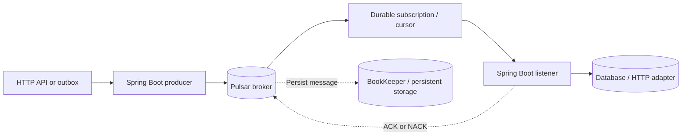

# Testing Brokers, Connection Failures, and Post-Restart Recovery

## Context and Objectives

In **Spring Boot Integration**, Apache Pulsar often sits between request-handling applications and asynchronous processors such as order services, databases, HTTP adapters, or notification systems. An integration flow may run cleanly while the broker is always healthy, yet break when the broker has not started yet, connections drop, a consumer stops mid-flight, or the application restarts after updating a database without sending an acknowledgment (ACK).

This topic focuses on **testing brokers, connection failures, and post-restart recovery**, answering three questions with observable tests:

1. Does the application send/receive accurately through a **real Pulsar broker** and detect broker unavailability?
2. When producers, consumers, or brokers suffer disruptions, how does the system **recover connectivity and reprocess** per contract?
3. After an application or broker restarts, are unacked messages redelivered while already-ACKed messages avoid unintended reprocessing?

Examples use **Spring Boot 3.5 / Spring for Apache Pulsar 1.2.x / Testcontainers 1.x** as an illustrative baseline; verify APIs, dependencies, and startup policies for other versions. Content applies to integration services with downstream databases/HTTP, without assuming database transactions and Pulsar ACKs form a single atomic transaction.

## 1. Failure Modes to Distinguish

### 1.1. Components That Can Fail Independently



A successful send call proves only that the producer received confirmation from the broker per its send contract—**not that the listener finished processing**. Conversely, a listener can commit data to a database and die before ACKing: the broker still considers the message incomplete and may redeliver it. That is the classic source of duplicate records.

| Scenario | What changes | What must be tested |
|---|---|---|
| Broker unavailable at app startup | Producer/consumer cannot connect; listener may fail to start. | Startup policy, readiness status, error logs, listener startup once broker recovers. |
| Broker loses connectivity mid-run | Producer sends fail/timeout; consumer disconnects and must reconnect. | Bounded retries, no loss of broker-persisted messages, no false success without confirmation. |
| Consumer stops before ACK | Durable cursor has not recorded message completion. | New consumer on the same subscription receives the unacked message again. |
| Consumer stops after ACK | Cursor advances per durable ACK state. | Restarting does not automatically replay that message on the same subscription. |
| Downstream HTTP/DB fails | Listener received message yet business operation failed. | NACK/redelivery or DLT, avoiding premature ACKs and infinite retries. |
| Broker container deleted and recreated | Test environment data/metadata may be wiped. | Distinguish **recreating an environment** from **restarting a broker with persistent storage intact**. |

## 2. Foundations for Understanding Post-Restart Outcomes

### 2.1. Persistent Topics, Durable Subscriptions, and Read Position

- **Persistent topics** (`persistent://tenant/namespace/topic`) persist messages via Pulsar's storage tier; this does not mean every ephemeral Docker test setup preserves data when containers and volumes are deleted.
- **Durable subscriptions** persist cursors/ACK progress. When a consumer reconnects with the **same subscription name**, the broker uses saved state to decide the next message. Durable is the default subscription mode in the Pulsar Java client.
- **Non-durable subscriptions** do not guarantee preserving cursors across broker restarts. `Reader` has different semantics from consumer subscriptions and must not substitute for durable consumer recovery tests.
- **`subscriptionInitialPosition(Earliest/Latest)`** applies primarily when **creating a new subscription**. Switching to `Earliest` and reconnecting to an existing subscription with a cursor does not automatically replay full history.
- **Unacked messages** can redeliver after consumer disconnect/crash; **ACKed messages** do not automatically replay simply because the application restarted. Replaying ACKed data requires retention policies and deliberate cursor/seek operations.

Avoid randomly generated subscription names in production applications that must track backlogs across deployments. Fixed names by **business group** (`orders-projection-v1`, `billing-posting-v1`) let tests exercise the same cursor across restarts; random names belong solely to **isolating individual test cases**.

### 2.2. ACK, NACK, and Delivery Guarantees

| Mechanism | Expected result | Watch-outs on restart |
|---|---|---|
| ACK after successful processing | Marks message processed on the subscription. | Once recorded by the broker, restarts will not re-fetch that message on the old cursor. |
| NACK on processing error | Asks broker to redeliver per delay/policy. | Redelivery may land on another consumer; ordering is not always kept under `Shared`. |
| Unacked and consumer closes/crashes | Message remains incomplete. | Broker can redeliver once a consumer/subscription is active, without strictly requiring ack timeout. |
| `ackTimeout` (optional) | Messages unacked past the limit are scheduled for redelivery. | Disabled by default; too short a timeout causes duplicate runs while valid processing continues. |
| Dead-letter topic (DLT/DLQ) | Separates repeatedly failing messages from the main stream. | Check retry counts, retention, and DLT consumer subscriptions; do not assume all restarts preserve retry counters. |

**At-least-once** means the system can redeliver an unacknowledged message. It does not guarantee business side effects occur once. For database writes, HTTP calls, or balance deductions, build explicit **idempotency**. Pulsar message IDs correlate a single publish attempt, whereas a stable **business event ID** is far more useful when upstream republishes the same event as a new message.

## 3. Broker Test Environment with Testcontainers

Never rely solely on mocking `PulsarTemplate` or invoking listener methods directly: neither exercises connectivity, schemas, subscriptions, cursors, ACKs, or redelivery. Separate testing layers:

| Test layer | Goal | Suggested tools |
|---|---|---|
| Unit | Payload parsing, contract validation, idempotency logic, error classification. | JUnit, Mockito, fake repositories. |
| Real-broker integration | Send/receive, subscriptions, ACK/NACK, retries, and post-reconnect redelivery. | Pulsar Testcontainers + `@SpringBootTest`. |
| Fault injection | Broker/network cuts, downstream failures, timeouts, recovery behavior. | Toxiproxy or controlled connections/containers in isolated tests. |
| Recovery/chaos on prod-like infra | Broker restarts with persistent storage, rolling upgrades, failover, multi-instance consumers, DB consistency. | Dedicated Pulsar cluster and observable infra; never extrapolate from one ephemeral container. |

### 3.1. Dependencies and Version Alignment

With **Spring Boot 3.5** managing **Testcontainers 1.x**, Gradle example (Groovy DSL):

```groovy
dependencies {
    implementation 'org.springframework.boot:spring-boot-starter-pulsar'

    testImplementation 'org.springframework.boot:spring-boot-starter-test'
    testImplementation 'org.springframework.boot:spring-boot-testcontainers'
    testImplementation 'org.testcontainers:junit-jupiter'
    testImplementation 'org.testcontainers:pulsar'
}
```

**Version upgrade note:** Testcontainers **2.x** renamed several artifacts; the 2.x Pulsar module is `org.testcontainers:testcontainers-pulsar`, whereas Testcontainers 1.x uses `org.testcontainers:pulsar`. Match the dependency BOM your project actually resolves; never mix imports/modules across both lines. Typical Pulsar Spring Boot config:

```yaml
spring:
  pulsar:
    client:
      service-url: pulsar://localhost:6650
    admin:
      service-url: http://localhost:8080
```

This sample config targets a local broker. In integration tests, use `@ServiceConnection` so Spring Boot picks up broker and Admin addresses from the container, since Testcontainers assigns dynamic host ports. Without service connections, register **both** properties via `@DynamicPropertySource` using `PulsarContainer.getPulsarBrokerUrl()` and `getHttpServiceUrl()`.

### 3.2. An Integration Test Verifying ACK and Redelivery

The test below exercises **a consumer closing without ACKing**, followed by a new consumer attaching to the **same subscription**. It is minimal, deterministic, and repeatable because it does not wait on random network glitches.

```java
import static org.assertj.core.api.Assertions.assertThat;

import java.util.UUID;
import java.util.concurrent.TimeUnit;

import org.apache.pulsar.client.api.Consumer;
import org.apache.pulsar.client.api.Message;
import org.apache.pulsar.client.api.MessageId;
import org.apache.pulsar.client.api.PulsarClient;
import org.apache.pulsar.client.api.Schema;
import org.apache.pulsar.client.api.SubscriptionInitialPosition;
import org.apache.pulsar.client.api.SubscriptionMode;
import org.apache.pulsar.client.api.SubscriptionType;
import org.junit.jupiter.api.Test;
import org.springframework.beans.factory.annotation.Autowired;
import org.springframework.boot.test.context.SpringBootTest;
import org.springframework.boot.testcontainers.service.connection.ServiceConnection;
import org.springframework.pulsar.core.PulsarTemplate;
import org.testcontainers.containers.PulsarContainer;
import org.testcontainers.junit.jupiter.Container;
import org.testcontainers.junit.jupiter.Testcontainers;
import org.testcontainers.utility.DockerImageName;

@Testcontainers
@SpringBootTest
class PulsarConsumerRecoveryIT {

    @Container
    @ServiceConnection
    static final PulsarContainer BROKER = new PulsarContainer(
            DockerImageName.parse("apachepulsar/pulsar:3.0.0"));

    @Autowired PulsarClient client;
    @Autowired PulsarTemplate<String> template;

    @Test
    void deliversUnacknowledgedMessageAfterConsumerReconnect() throws Exception {
        String suffix = UUID.randomUUID().toString();
        String topic = "persistent://public/default/orders-recovery-" + suffix;
        String subscription = "orders-worker-" + suffix;
        MessageId originalId;

        try (Consumer<String> first = newConsumer(topic, subscription)) {
            template.send(topic, "order-42");

            Message<String> message = first.receive(15, TimeUnit.SECONDS);
            assertThat(message).isNotNull();
            assertThat(message.getValue()).isEqualTo("order-42");
            originalId = message.getMessageId();
            // Simulate consumer dying before ACK: intentionally do NOT acknowledge.
        }

        try (Consumer<String> restarted = newConsumer(topic, subscription)) {
            Message<String> again = restarted.receive(15, TimeUnit.SECONDS);
            assertThat(again).isNotNull();
            assertThat(again.getValue()).isEqualTo("order-42");
            assertThat(again.getMessageId()).isEqualTo(originalId);
            restarted.acknowledge(again);
        }
    }

    private Consumer<String> newConsumer(String topic, String subscription)
            throws Exception {
        return client.newConsumer(Schema.STRING)
                .topic(topic)
                .subscriptionName(subscription)
                .subscriptionMode(SubscriptionMode.Durable)
                .subscriptionType(SubscriptionType.Exclusive)
                .subscriptionInitialPosition(SubscriptionInitialPosition.Earliest)
                .subscribe();
    }
}
```

Prerequisites: Docker and a minimal Spring Boot application context with Pulsar auto-configuration; test broker permits auto-creating topics or has them pre-created. Topic/subscription names use UUID suffixes so parallel tests do not share cursors; the image tag is pinned to minimize environment drift. This is a **consumer reconnect integration test**, **not yet a broker restart test**. To verify business behavior of `@PulsarListener`, add tests running the live listener and asserting database or destination state updates upon message receipt.

Extend with two contrasting assertions: **unacked ⇒ redelivered** and **ACKed ⇒ not redelivered**. For the ACKed case, allow the broker to record state, then call `receive(timeout)` to confirm no stale message returns; always use bounded timeouts rather than assuming instant timing.

## 4. Testing Connection and Startup Failures

### 4.1. Broker Unavailable at Application Startup

Spring for Apache Pulsar starts listener containers when the application context refreshes. Supporting Spring Pulsar lines offer `StartupFailurePolicy` on listener containers:

| Policy | Behavior when listener fails to start | What tests must assert |
|---|---|---|
| `Stop` (default) | Logs error and rethrows exception, typically failing application startup. | Deployment detects startup failure; avoids pretending the service is ready to consume. |
| `Continue` | Logs error without stopping the app; listener stays stopped. | **Liveness and readiness separated**: process stays alive while message consumption is inactive. |
| `Retry` | Retries **starting the listener container** asynchronously; if retries exhaust, container may remain stopped. | When the broker returns inside the retry window, the listener starts and drains backlog; if retries exhaust, deliberate alerting/recovery runs. |

In Spring Pulsar 1.2 documentation, default startup retry runs **3 times**, spaced **10 seconds** apart, and is customizable. This retries **container startup**; never confuse it with producer send retries, Pulsar Java client connection retries, or consumer NACKs on received messages. Configure this policy via `PulsarContainerFactoryCustomizer`/container properties for your exact version; never assume merely setting `spring.pulsar.client.*` alters startup policy.

Test scenarios should start the app while the broker is unreachable and observe the configured policy; then bring the broker online and verify the listener actually consumes a newly published message. If retries exhaust before the broker recovers, require an **app restart, listener container restart, or orchestrated retry**, rather than treating context `UP` as sufficient.

### 4.2. Broker Drops Connectivity Mid-Run

Tests can place an independent network proxy between Spring Boot and the broker to sever/throttle links and later restore them. **Toxiproxy** works well for reproducing connection faults while keeping broker data intact. Every test action needs bounded timeouts; errors may return immediately, after timeout, or after client retries depending on config.

Observe these checkpoints:

1. Start broker and listener; send `event-1`, verify consumer processes and ACKs it.
2. Cut producer/consumer connectivity through the proxy; attempt sending `event-2` and capture the send future/exception or timeout—**never** treat creating the future as a successful send.
3. Restore connectivity; verify the client reconnects and the listener receives `event-3`.
4. Reconcile broker-confirmed messages against downstream state; check whether `event-2` was absent, delivered once, or duplicated if the producer retried under uncertainty.
5. Inspect reconnect logs, unacked/backlog counts, recovery time, and confirm no threads or futures hang indefinitely.

Never hardcode a single retry count for every network fault. Accurate tests define `operationTimeout`, app-level retry limits, producer reconnect policies, and test wait bounds. When downstream HTTP/DB fails, inject faults **at downstream directly** to prove the listener NACKs properly; never shut down the broker to simulate every integration error.

### 4.3. Broker Restart Differs from Recreating a Testcontainer

Restarting a **broker process with intact metadata and persistent storage** is fundamentally different from calling `stop()` and launching a fresh standalone container. In Testcontainers, stopping/removing and recreating a container often wipes ephemeral filesystems or resets metadata, so a test seeing "message gone" may simply reflect **reset test state** rather than a subscription bug.

To test a **real broker restart**:

- Run a broker/cluster with BookKeeper and metadata store persisting independently of process/container restarts, keeping identical topic, subscription, storage, and reachable addresses.
- Send a message, create a durable subscription, receive without ACKing; restart the broker **without wiping storage**; wait for client recovery and assert redelivery.
- Also verify ACKed messages do not reappear and backlogs/cursors remain intact; document exact broker version, node count, partitions, retention/TTL policies, and topology.

`docker pause`/`unpause` simulates a brief freeze yet **does not** substitute for broker restart / BookKeeper recovery tests. Single standalone containers excel at protocol testing, while durability claims across broker crashes must be validated against real persistent storage.

## 5. Error Handling in `@PulsarListener` and Retry Bounds

### 5.1. Matching ACK Mode to the Unit of Work

Spring for Apache Pulsar offers three primary ACK modes:

| Mode | Behavior with standard listeners | When it fits |
|---|---|---|
| `BATCH` (default) | Container polls an internal batch; for **single-record listeners**, succeeded records are ACKed and failed records are NACKed after batch processing. | Batch-cadence confirmation is acceptable and receive-batch boundaries are understood. |
| `RECORD` | ACKs or NACKs each record individually right after the method completes or throws. | Easy to test independent per-event side effects. |
| `MANUAL` | Application calls `Acknowledgement.acknowledge()` or `.nack()` explicitly; framework does not auto-ACK/NACK. | Must tie ACK to a clear business milestone while controlling every failure branch. |

For instance, a single-record listener handling order events and ACKing only after `projectionService` finishes:

```java
import org.apache.pulsar.client.api.SubscriptionType;
import org.springframework.pulsar.annotation.PulsarListener;
import org.springframework.pulsar.listener.AckMode;
import org.springframework.stereotype.Component;

@Component
class OrderProjectionListener {
    private final OrderProjectionService projectionService;

    OrderProjectionListener(OrderProjectionService projectionService) {
        this.projectionService = projectionService;
    }

    @PulsarListener(
            topics = "persistent://public/default/order-created",
            subscriptionName = "orders-projection-v1",
            subscriptionType = SubscriptionType.Shared,
            ackMode = AckMode.RECORD,
            properties = {"negativeAckRedeliveryDelay=5s"})
    void onMessage(String eventJson) {
        projectionService.applyIdempotently(eventJson);
        // Success: container ACKs; exception: container handles NACK.
    }
}
```

`OrderProjectionService.applyIdempotently` is an **illustrative business interface** requiring implementation in your project. The snippet highlights the ACK boundary rather than being a standalone runnable class. On failure, **let exceptions propagate to the container** to trigger NACK/redelivery in `RECORD` mode; never catch all exceptions and just log, because returning normally causes a false ACK.

With `MANUAL`, success and failure branches:

```java
@PulsarListener(
        topics = "persistent://public/default/order-created",
        subscriptionName = "orders-projection-v1",
        ackMode = AckMode.MANUAL)
void receive(String eventJson, Acknowledgement ack) {
    try {
        projectionService.applyIdempotently(eventJson);
        ack.acknowledge();
    } catch (RuntimeException ex) {
        ack.nack();
    }
}
```

This snippet uses `org.springframework.pulsar.listener.Acknowledgement` to show manual ACKing. When combining `MANUAL` with `PulsarConsumerErrorHandler` for container retries or DLT routing, **never manually NACK and swallow the exception**: let the handler see the error per framework contract. On batch listeners, `BATCH` errors can redeliver the entire batch; to ACK individual messages within a batch, use `MANUAL` with `MessageId`.

### 5.2. Retries and DLTs: Separating Transient Errors from Data Errors

- **Transient errors** like HTTP 503, connection refused, or database unavailable: retry with bounded backoff, jitter, timeouts, and monitoring.
- **Unrecoverable errors** like invalid schema or invalid SKU: avoid infinite NACK loops; route to a DLT with trace context for operational remediation.
- **Partition / overload errors:** consider pausing listeners or lowering concurrency so downstream recovers rather than compounding load with retries.

Pulsar supports `ackTimeout`, `negativeAckRedeliveryBackoff`, `DeadLetterPolicy`, and retry letter topics. Spring Pulsar adds `PulsarConsumerErrorHandler`/`DefaultPulsarConsumerErrorHandler` for listener-level retries and DLT publishing via recoverers. **Never stack multiple retry mechanisms without summing total attempts**, since multi-layer retries multiply attempt counts.

Notably, redelivery counters in some **NACK paths are not persisted across broker disconnects, restarts, or topic unloads**. Therefore, do not treat `maxRedeliverCount = 5` on a native dead-letter policy as a strict absolute cap across all outages. When retry budgets must survive restarts, use a retry path storing attempt counts **inside the message** (`enableRetry`/`reconsumeLater` where suitable) or persist retry state in a database. Also provision a subscription on the DLT so failed messages are observable.

## 6. Idempotency for Safe Post-Crash Reprocessing

Consider this sequence:

```text
T0: Pulsar delivers eventId=E-42 to listener
T1: Listener writes order successfully to DB
T2: Spring Boot process is killed before ACK
T3: Process restarts on the same durable subscription
T4: Pulsar redelivers E-42 because ACK was never recorded
```

At `T4`, blindly running `INSERT` or charging payment again duplicates business state. The standard safeguard is **inbox/deduplication inside the same database transaction** as business updates:

```sql
CREATE TABLE processed_event (
    consumer_name VARCHAR(100) NOT NULL,
    event_id VARCHAR(100) NOT NULL,
    processed_at TIMESTAMP NOT NULL DEFAULT CURRENT_TIMESTAMP,
    PRIMARY KEY (consumer_name, event_id)
);
```

```text
BEGIN TRANSACTION
  Attempt INSERT (consumer_name, event_id) into processed_event
  If already exists: skip side effect for this duplicate delivery
  If newly inserted: write projection / business state to DB
COMMIT
Only after COMMIT succeeds: ACK message
```

The insert attempt must be **atomic and backed by a unique constraint**, handling two consumers receiving the same event ID concurrently. Avoid `SELECT absent` then `INSERT` without a unique constraint, as two parallel executions can both observe "absent." If the transaction rolls back, the `processed_event` marker must also roll back so redelivery can retry cleanly.

This illustrates **side effects inside one database**. If processing includes HTTP calls, writes to two databases, or publishing to another broker, a single local transaction cannot span systems atomically; evaluate **outbox, downstream idempotency keys, sagas, or genuinely supported transaction mechanisms**. If an external payment API succeeded while the connection dropped before the response arrived, retries must reuse the exact same idempotency key to check status before re-issuing the command.

## 7. Required Recovery Test Matrix

| Test ID | Trigger | Outcome / checkpoint to verify |
|---|---|---|
| **T01 - Happy path** | Producer sends 1 event to real broker with listener running. | Received with right schema/payload; side effects committed and ACKed; backlog drops to 0 within expected bounds. |
| **T02 - Consumer dies before ACK** | Receive message, close consumer without ACKing, open new consumer on same durable subscription. | Receives **same MessageId** or event ID; after ACK, does not spontaneously redeliver. |
| **T03 - Consumer restarts after ACK** | Receive and ACK, close/reopen same subscription. | Does not receive the acknowledged message again; never confuse with a fresh `Earliest` subscription. |
| **T04 - Broker down at startup** | Start app while broker is down. | `Stop`/`Continue`/`Retry` behaves as configured; readiness reflects consumer health; clear recovery path. |
| **T05 - Network partition** | Cut app↔broker link during producer send/consumer receive. | Bounded timeouts; resends cause no duplicate side effects; reconnects and resumes once network heals. |
| **T06 - Downstream 503** | Handler calls HTTP adapter returning transient error. | Exception not swallowed; NACK/retries with backoff, ACKs upon recovery. |
| **T07 - Poison message** | Schema/contract-violating payload or unrecoverable business error. | Classified and routed to DLT per chosen mechanism; healthy messages are not blocked indefinitely. |
| **T08 - Crash after DB commit** | DB commits, kill app before ACK. | Redelivery occurs; idempotency marker ensures side effects apply **once**. |
| **T09 - Broker restart keeping storage** | Restart broker process with BookKeeper/metadata intact. | Durable cursor survives; unacked messages return, ACKed messages stay skipped. |
| **T10 - Multiple consumers** | Scale instances on `Shared`/`Failover`/`Key_Shared`. | No global-order assumption on `Shared`; no duplicate side-effect races; failover drains backlog. |
| **T11 - Startup retries exhausted** | Broker stays down past startup retry budget. | Stopped container alerts clearly; no false readiness; controlled restart once broker returns. |

When testing asynchronous flows, never use `Thread.sleep(...)` as pass criteria. Use polling with **finite timeouts** (Awaitility, latches, `receive(timeout)`, repository checks) asserting **final state**, not "slept long enough." On disconnect tests with competing consumers, avoid asserting rigid delivery order across consumers.

## 8. Observability and Acceptance Criteria

A thorough recovery test captures both **technical signals** and **business outcomes**:

| Signal | Why it matters |
|---|---|
| Producer send success/error/timeout and retry counts | Separates broker-confirmed sends from sends merely wrapped in futures. |
| Listener startup, running/paused state, reconnects | Distinguishes a live process whose listener is down from a recovered consumer. |
| Backlog, unacked messages, redelivery rate, DLT volume | Spots bottlenecks and poison-message loops. |
| Consumer lag / event-to-processing latency | Measures SLA impact during broker or downstream disruptions. |
| `eventId`, `messageId`, `subscription`, `topic`, correlation/trace ID | Traces a single business event across retries and multiple systems. |
| Business row counts and unique markers after restart | Proves idempotency via durable state rather than logs alone. |

Define acceptance thresholds up front, e.g., "after broker recovery, remaining backlog drains within the **published SLO**." Never adopt sample numbers as SLAs without load testing. Spring Boot Actuator/Micrometer can expose health/readiness and observations, yet you must verify **Pulsar client/listener running state** for your actual components; HTTP `/actuator/health = UP` does not prove backlogs are draining.

**Incident closure checklist:**

1. Pinpoint whether failure occurred **before or after** broker publish confirmation, **before or after** DB commit, and **before or after** ACK.
2. Verify topic name, subscription name, and mode (`Durable`/`NonDurable`; `Exclusive`/`Shared`/`Failover`/`Key_Shared`).
3. Preserve storage when testing broker restarts; never call a freshly recreated container a durability test.
4. Measure message delivery, cursor/backlog state, retries/DLT, and business side effects in a timeout-bounded test.
5. Verify safe reprocessing via unique constraints or durable idempotency mechanisms.

## 9. Common Mistakes and How to Avoid Them

| Mistake | Why it is wrong | Fix |
|---|---|---|
| Testing only with mocked `PulsarTemplate` | Never touches broker, subscriptions, schemas, or ACKs. | Maintain at least one integration test against real Pulsar. |
| Creating a new subscription with `Earliest` and calling it "recovery" | Broker initializes a brand-new cursor and replays intentionally, proving nothing about existing cursor survival. | Reconnect with the **exact same subscription** for recovery tests. |
| Treating Testcontainers `stop/start` as durable broker restart | Often recreates the container and wipes storage/metadata. | Test restarts on infrastructure preserving persistent storage. |
| ACKing before side effects complete | Crashing between steps leaves the broker skipping unfinished work. | ACK after success; guard duplicates via idempotency. |
| `catch(Exception)` that logs and returns | Listener reports success; message gets ACKed despite failed business logic. | Rethrow for framework handling or handle manual ACK/NACK completely. |
| Assuming `maxRedeliverCount` holds strictly across restarts | Some redelivery counters live in memory and reset on disconnects. | Use durable retry metadata or DB retry state when strict caps matter. |
| Checking only that app process stays up after broker outage | Listener may be stopped or have exhausted startup retries. | Tie readiness/alerts to listener state and test real message flow. |
| Expecting "exactly once" from Pulsar ACK alone | DB commits and ACKs are not automatically atomic. | Local transactions + inbox idempotency/outbox along data boundaries. |

## References

- [Spring Boot 3.5 – Apache Pulsar Support](https://docs.spring.io/spring-boot/3.5/reference/messaging/pulsar.html): client, Admin, producer, consumer, and configuration.
- [Spring Boot 3.5 – Testcontainers Service Connections](https://docs.spring.io/spring-boot/3.5/reference/testing/testcontainers.html): `@ServiceConnection`, `PulsarConnectionDetails`.
- [Spring for Apache Pulsar 1.2 – Message Consumption](https://docs.spring.io/spring-pulsar/docs/1.2.x/reference/reference/pulsar/message-consumption.html): ACK modes, NACK, DLT, listener containers, startup policies.
- [Spring for Apache Pulsar – Testing Applications](https://docs.spring.io/spring-pulsar/reference/reference/testing-applications.html): `spring-pulsar-test`, `PulsarConsumerTestUtil`, test container support.
- [Apache Pulsar 4.0 – Messaging](https://pulsar.apache.org/docs/4.0.x/concepts-messaging/): subscription modes, durable cursors, ACK, redelivery, retries, persistent/non-persistent topics.
- [Apache Pulsar – Work with Consumers](https://pulsar.apache.org/docs/client-libraries/consumers/): consumer reconnect, backoff, ACK/NACK.
- [Testcontainers for Java – Apache Pulsar Module](https://java.testcontainers.org/modules/pulsar/): `PulsarContainer` and broker/Admin URLs.
