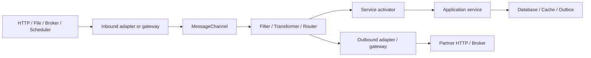
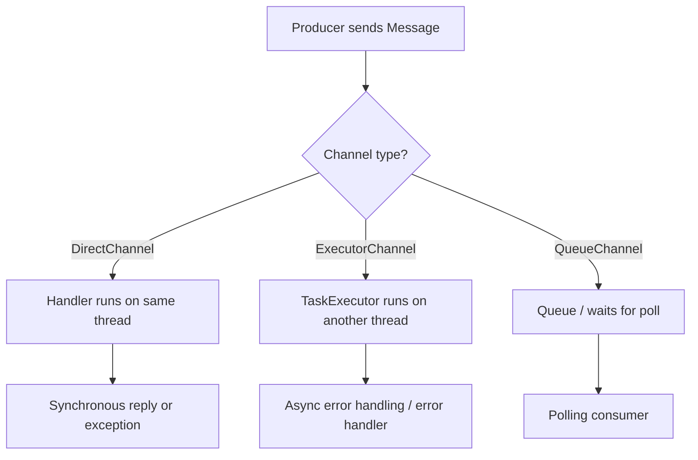
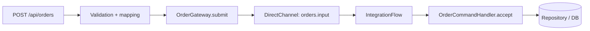

# spring-boot-starter-integration and Boot-Initialized Infrastructure

In the **SPRING_BOOT_INTEGRATION** module, a Spring Boot service can receive data over HTTP, access databases, use caches, send/receive messages through brokers, and coordinate adapters. When a flow is no longer a simple service call, **Spring Integration** provides a message-processing model and Enterprise Integration Patterns (EIP) to build clear processing pipelines: receiving messages, transforming, filtering, routing, and invoking business components.

The **`spring-boot-starter-integration`** dependency brings Spring Integration into a Boot application's context consistently. However, **the starter does not create your business flows automatically**. Three responsibilities must be separated: the Spring Integration library provides the model and building blocks, Spring Boot conditionally auto-configures part of the infrastructure, and the application declares channels, endpoints, mappings, transactions, error policies, and observability.

This lesson belongs to the **Spring Integration** chapter, focusing on the starter and what Boot initializes. Examples use Java 17+ in the Spring Boot 3.x / Spring Integration 6.x ecosystem. Options and APIs can change across versions; keep your BOM and documentation aligned to the same generation when applying them.

## 1. Learning Objectives

After this lesson, you will be able to:

1. Explain the roles of `Message`, `MessageChannel`, endpoints, `IntegrationFlow`, and message handlers.
2. Add the right starter and distinguish core from protocol-specific adapter modules.
3. Accurately identify **infrastructure conditionally auto-configured by Boot** versus beans the application must declare itself.
4. Build a basic flow using the Java DSL, call it from an HTTP adapter via a messaging gateway, and understand synchronous execution timing.
5. Select an appropriate channel/poller and recognize error and transaction boundaries when switching threads or crossing a broker.
6. Test wiring, DTO contracts, duplicate handling, retries, and observability of a real flow.

## 2. Positioning Spring Integration in the Architecture

Spring Integration organizes calls between components as a **message flow**. Each message carries a payload and headers; endpoints move messages into/out of channels or invoke services. A flow does not have to connect to a broker: channels can pass messages **within the same process**, between two Java beans.



| Concept | Role | What not to misunderstand |
| --- | --- | --- |
| `Message<T>` | Typed payload accompanied by headers | Headers are not an uncontrolled place to dump sensitive business data. |
| `MessageChannel` | Connects producers and consumers inside the application | An internal channel is not inherently durable like a Kafka queue/topic. |
| Message endpoint | Connects a channel to a handler method or external system | An endpoint is not always an HTTP endpoint. |
| `IntegrationFlow` | Java DSL describing a chain of endpoints, channels, filters, transformers, routers | Defining the flow is the application's responsibility. |
| Message handler / service activator | Executes a business step or delegates to a service | Does not automatically open a DB transaction or guarantee retries. |
| Inbound adapter/gateway | Brings data from a source into the message flow | Protocol module and source configuration must be explicitly chosen. |
| Outbound adapter/gateway | Sends data from the flow to a destination | Does not automatically roll back external effects alongside a DB transaction. |

Spring Integration is especially useful when the same business logic is triggered from multiple sources—for instance, an HTTP controller, a Kafka consumer, and a file poller all producing a `CreateOrderCommand`. However, a simple controller → service → repository application usually does not need an extra messaging layer.

## 3. Installing `spring-boot-starter-integration`

With Maven and the Spring Boot parent/BOM:

```xml
<dependencies>
    <dependency>
        <groupId>org.springframework.boot</groupId>
        <artifactId>spring-boot-starter-integration</artifactId>
    </dependency>

    <!-- Only needed when the example includes an HTTP controller. -->
    <dependency>
        <groupId>org.springframework.boot</groupId>
        <artifactId>spring-boot-starter-web</artifactId>
    </dependency>

    <dependency>
        <groupId>org.springframework.boot</groupId>
        <artifactId>spring-boot-starter-validation</artifactId>
    </dependency>
</dependencies>
```

With Gradle Groovy DSL:

```groovy
dependencies {
    implementation 'org.springframework.boot:spring-boot-starter-integration'
    implementation 'org.springframework.boot:spring-boot-starter-web'
    implementation 'org.springframework.boot:spring-boot-starter-validation'
    testImplementation 'org.springframework.boot:spring-boot-starter-test'
}
```

`spring-boot-starter-integration` brings in the core infrastructure for Integration message flows. **Protocol-specific adapters** usually require separate Spring Integration modules, for example:

| Need | Commonly used addition | Related infrastructure |
| --- | --- | --- |
| In-memory channels/flows only | Integration starter is enough | Spring context, message channels, handlers |
| Receive/send HTTP as message endpoints | `spring-integration-http` | Appropriate HTTP server/client, JSON/XML contract |
| File inbound/outbound | `spring-integration-file` | Paths, filters, pollers, archive mechanism |
| JDBC message endpoints/pollers | `spring-integration-jdbc` | `DataSource`, SQL, transaction manager |
| RabbitMQ / AMQP | `spring-integration-amqp` | Spring AMQP connection factory, queues, ack/DLQ |
| Kafka message channel adapter | `spring-integration-kafka` | Spring Kafka producer/consumer factories, topics, offsets |
| JMS broker | `spring-integration-jms` | JMS connection factory and broker |
| Redis message endpoint | `spring-integration-redis` | Spring Data Redis connection factory |
| SFTP remote files | `spring-integration-sftp` | Session factory, authentication, polling/synchronization |

Do not add every adapter indiscriminately. If a Java method simply needs to send a Kafka event, `KafkaTemplate` directly may suffice; if you just need to query a database, `JdbcTemplate`/jOOQ is usually enough. When connectivity becomes a **step in a flow**, the protocol-specific Integration module makes the adapter conform to the message contract.

An adapter dependency **does not register business flows automatically**: adding `spring-integration-kafka` does not make the application subscribe to an arbitrary topic; adding `spring-integration-file` does not make Boot scan a default folder.

## 4. What Infrastructure Does Boot Auto-Configure?

Spring Boot uses **conditional** auto-configuration: it checks the classpath, existing beans, application type, and configuration properties before creating beans. When Spring Integration conditions are met, Boot enables integration support in the Spring context and provides foundational components and hooks. The Integration framework can also create default components at integration context startup, such as infrastructure channels like `errorChannel` and `nullChannel`, depending on enabled configuration.

These are **infrastructure beans**, not meaningful business channels/endpoints for your application. Boot cannot guess `orders.input`, your DTO contracts, Kafka inbound channels, or when a poller is allowed to run.

| Component | Infrastructure provided when conditions match | What the application still must do |
| --- | --- | --- |
| Spring Integration core | Message dispatching, framework infrastructure, and annotation/DSL processing support | Define message flows and business boundaries |
| Spring Integration system channels | Error mechanism and sink channel that discards results, depending on runtime/config | Do not rely on the default error channel as a complete retry/DLQ policy |
| Java DSL | API for building flows in the Spring context | Create `@Bean IntegrationFlow` or configure endpoints |
| Messaging gateway | Infrastructure to create proxies for registered gateway interfaces | Declare `@MessagingGateway`, ensure component scanning, request/reply channels |
| Polling/TaskScheduler infrastructure | Scheduling support when pollable endpoints are needed and beans/config exist | Declare pollers, intervals, messages/poll, concurrency, checkpoints/claims |
| Actuator/Micrometer (if added and enabled) | Partial observability/management depending on conditions and version | Choose business metrics, correlation IDs, tracing, endpoint protection policies |
| JDBC/Redis/Kafka/AMQP starters (if added) | Connection factories, templates, `DataSource`, or client factories conditionally | Choose topics/queues, schemas, TTLs, transactions, idempotency, and actual adapters |

**Three layers must be distinguished:**

1. **The Starter** brings dependencies and enables auto-configuration conditions.
2. **The Spring Integration framework** registers infrastructure, `MessageChannel` implementations, message handlers, lifecycle, and message-processing patterns.
3. **The Application** declares flows, endpoint beans, business channels, business DTOs, source/destination configuration, error policies, and transactions.

Do not assume a specific bean name always exists across every version or context. If the application defines its own component of the same type, or auto-configuration conditions are not met, the resulting beans may differ. Verify against your **actual version and configuration** rather than relying on assumptions.

### 4.1. Configuration Properties Have Two Owners

```yaml
spring:
  application:
    name: order-integration

app:
  orders:
    channel: orders.input
    importer-enabled: false
```

`spring.application.name` is a property understood by Spring Boot. By contrast, `app.orders.*` is strictly an **application convention**: its values will not alter a flow unless application code registers `@ConfigurationProperties`, `@ConditionalOnProperty`, or reads them directly. Do not invent arbitrary `spring.integration.*` properties expecting Boot to understand them; use only the keys documented for your specific version.

In the file inbound example in Section 7, `@ConditionalOnProperty` is placed directly on the `csvFlow` bean so the endpoint is only created when `app.orders.importer-enabled=true`. When the flag is off, Spring does not register that flow. This is a condition on an **application-declared bean**; Boot evaluates the condition but does not generate file-import logic from the property.

## 5. Channels and How Messages Execute

Your choice of `MessageChannel` directly impacts threads, transactions, and how errors are reported:

| Channel | Typical behavior | Best suited when | Warning |
| --- | --- | --- | --- |
| `DirectChannel` | Synchronous dispatch on the sender's thread | Short flows needing immediate reply/error | Slow handlers slow down the producer; exceptions can propagate back to the caller |
| `ExecutorChannel` | Hands work off via a `TaskExecutor` | Offloading threads for asynchronous processing | Does not automatically propagate transaction context to the new thread; must manage queue, errors, and shutdown |
| `QueueChannel` | Holds messages in an in-memory queue until polled by a consumer | Decoupling producer/consumer with pollable semantics | Standard queues are not durable across restarts; requires a poller and bounded capacity |
| `PublishSubscribeChannel` | Broadcasts to multiple subscribers | Fan-out to multiple processing steps | Not a durable pub/sub broker; error and synchronicity behavior depend on configuration |



`DirectChannel` is used in the first example because the execution path and errors are easy to reason about. Only switch to `ExecutorChannel` to "improve performance" after measuring load and defining policies for error handling, backpressure, timeouts, and reliability. Switching threads can change the expected behavior of `@Transactional` and HTTP responses.

**Headers and payload:** headers such as `id`, `timestamp`, `correlationId`, and `replyChannel` serve routing and message correlation; the payload should be a DTO or command with a clear contract. Never log entire messages when they contain personal data, tokens, or payment details. Do not rely on the auto-generated `MessageHeaders.ID` to deduplicate across redeliveries: each recreated message can get a new ID, even though it represents the same business event.

## 6. Java DSL Example: From HTTP to Service via a Gateway

Let's build a flow that accepts an order command. An HTTP adapter receives `OrderRequest`; the application layer converts it into `OrderCommand` and sends it through a messaging gateway to `orders.input`. An `IntegrationFlow` delivers the command to a business handler.



### 6.1. DTO and Internal Command

```java
import jakarta.validation.constraints.NotBlank;
import jakarta.validation.constraints.NotNull;
import jakarta.validation.constraints.Positive;

public record OrderRequest(
        @NotBlank String requestId,
        @NotBlank String orderId,
        @NotNull @Positive Long amountCents
) {}

public record OrderCommand(
        String requestId,
        String orderId,
        long amountCents
) {}
```

In a Java project, place each `public` top-level type in its own file. The request DTO describes the incoming JSON; the command describes the internal business intent. Other adapters (Kafka, file, HTTP client) can also convert their contracts into `OrderCommand`, while preserving corresponding semantics and validation.

### 6.2. Registering the Messaging Gateway and Flow

```java
import org.springframework.integration.annotation.MessagingGateway;

@MessagingGateway(defaultRequestChannel = "orders.input")
public interface OrderGateway {
    void submit(OrderCommand command);
}
```

```java
import org.springframework.beans.factory.annotation.Qualifier;
import org.springframework.context.annotation.Bean;
import org.springframework.context.annotation.Configuration;
import org.springframework.integration.annotation.IntegrationComponentScan;
import org.springframework.integration.channel.DirectChannel;
import org.springframework.integration.dsl.IntegrationFlow;
import org.springframework.messaging.MessageChannel;

@Configuration(proxyBeanMethods = false)
@IntegrationComponentScan
public class OrderIntegrationConfiguration {

    @Bean("orders.input")
    MessageChannel orderInput() {
        return new DirectChannel();
    }

    @Bean
    IntegrationFlow orderFlow(
            @Qualifier("orders.input") MessageChannel input,
            OrderCommandHandler handler) {

        return IntegrationFlow.from(input)
                .handle(OrderCommand.class, (command, headers) -> {
                    handler.accept(command);
                    return null; // One-way handler, no reply.
                })
                .get();
    }
}
```

`@IntegrationComponentScan` enables Spring to discover `@MessagingGateway` interfaces within the scan scope and generate proxies once the Integration infrastructure is active. Depending on package layout, you can specify `basePackages`. If a gateway interface is already registered via another configuration, avoid duplicate scanning.

Here, the application **explicitly creates** `orders.input` as a `DirectChannel` and **explicitly creates** the `orderFlow` bean. Boot does not create these two beans. In a Boot application with Integration auto-configuration enabled, `@EnableIntegration` is typically unnecessary just to obtain core components; in non-Boot Spring setups, enabling Integration may differ.

`OrderCommandHandler` is a project-implemented application service, for example:

```java
import org.springframework.stereotype.Service;
import org.springframework.transaction.annotation.Transactional;

@Service
public class OrderCommandHandler {
    private final OrderRepository repository;

    public OrderCommandHandler(OrderRepository repository) {
        this.repository = repository;
    }

    @Transactional
    public void accept(OrderCommand command) {
        if (command.amountCents() <= 0) {
            throw new IllegalArgumentException("amountCents must be positive");
        }
        repository.recordOnce(command);
    }
}

public interface OrderRepository {
    void recordOnce(OrderCommand command);
}
```

`OrderRepository.recordOnce` is a **persistence adapter contract** that the application must implement with JDBC/jOOQ/JPA and a database unique constraint. The snippet above illustrates wiring between Boot and Integration; it cannot execute persistence logic without a real implementation bean, schema, and `DataSource`. The transaction is opened by the application's Spring Transaction configuration, not as an inherent feature of `DirectChannel`.

### 6.3. Calling the Gateway from an HTTP Controller

```java
import jakarta.validation.Valid;
import org.springframework.http.ResponseEntity;
import org.springframework.web.bind.annotation.PostMapping;
import org.springframework.web.bind.annotation.RequestBody;
import org.springframework.web.bind.annotation.RequestMapping;
import org.springframework.web.bind.annotation.RestController;

@RestController
@RequestMapping("/api/orders")
public class OrderController {
    private final OrderGateway gateway;

    public OrderController(OrderGateway gateway) {
        this.gateway = gateway;
    }

    @PostMapping
    public ResponseEntity<Void> accept(@Valid @RequestBody OrderRequest request) {
        gateway.submit(new OrderCommand(
                request.requestId(), request.orderId(), request.amountCents()));
        return ResponseEntity.noContent().build();
    }
}
```

Because the gateway sends to a `DirectChannel`, the handler executes synchronously on the HTTP request thread, and the controller only returns **204 No Content** after the handler call completes successfully. If the handler throws an exception, the gateway call can fail; the application must define how exceptions map to HTTP statuses or contract-compliant error responses. **Do not switch the channel to async while keeping this 204 assumption:** for asynchronous processing, the endpoint should normally respond indicating "accepted" with a job identifier to track progress.

## 7. Pollers, Lifecycle, and Push vs. Poll Sources

Not all integration endpoints receive data the same way:

- **Message-driven**: the source pushes events or a listener receives them as they arrive. For example, a broker listener sends a message into a channel as soon as the consumer receives it from a queue/topic.
- **Polling**: the application actively queries the source on a schedule. Examples include scanning a file directory, checking a database table for new rows, or periodically fetching batches from an API.

When polling is needed, Spring Integration supports `Pollers` and `TaskScheduler`. Having scheduling infrastructure available does not mean the application has chosen a schedule, directory, query criteria, or progress tracking. An appropriate poller must be explicitly configured based on the source's characteristics.

Example of a file inbound adapter requiring the `spring-integration-file` dependency in addition to the Integration starter:

```java
import java.io.File;
import java.time.Duration;
import org.springframework.boot.autoconfigure.condition.ConditionalOnProperty;
import org.springframework.context.annotation.Bean;
import org.springframework.context.annotation.Configuration;
import org.springframework.integration.dsl.IntegrationFlow;
import org.springframework.integration.dsl.Pollers;
import org.springframework.integration.file.dsl.Files;

@Configuration(proxyBeanMethods = false)
public class CsvFlowConfiguration {

    @Bean
    @ConditionalOnProperty(
            prefix = "app.orders",
            name = "importer-enabled",
            havingValue = "true")
    IntegrationFlow csvFlow(CsvImportService importer) {
        return IntegrationFlow
                .from(
                        Files.inboundAdapter(new File("/var/app/inbox"))
                                .patternFilter("*.csv"),
                        endpoint -> endpoint.poller(
                                Pollers.fixedDelay(Duration.ofSeconds(10))
                                        .maxMessagesPerPoll(10)))
                .handle(File.class, (file, headers) -> {
                    importer.importFile(file);
                    return null;
                })
                .get();
    }
}
```

`CsvImportService` is a business component implemented by the application. Even though Spring Integration provides `Files.inboundAdapter` and `Pollers`, **no files will be read unless the application defines the endpoint, directory, and polling schedule**. The hardcoded path here is illustrative; in practice, load it from `@ConfigurationProperties`, check file permissions, and use environment-specific paths.

| Property/technique | What to consider |
| --- | --- |
| `fixedDelay` | Counts the pause after one poll finishes; helps space out runs. |
| `fixedRate` | Schedules at a fixed interval; understand the impact when a run takes longer than the period. |
| `maxMessagesPerPoll` | Limits messages fetched per poll; helps control backlogs and thread occupancy. |
| Multi-instance pollers | DB/file sources may be picked up by two instances simultaneously; requires a durable claim/lock/lease mechanism. |
| Checkpoint/archive | Processed files must be durably marked, archived, or quarantined according to policy. |

**Common mistake:** using an in-memory "accept once" filter and assuming the system is permanently protected against duplicates. Across restarts or multiple instances, in-memory state is insufficient. For file and DB polling, design durable ingestion/processing state (such as checksum/ID + unique constraint) and handle partially written files.

## 8. Channels Do Not Replace Brokers, Databases, or Caches

Spring Integration's `DirectChannel`, `QueueChannel`, and `PublishSubscribeChannel` are generally **in-process** exchange mechanisms. They do not inherently provide replication, retention, consumer offsets, dead-lettering, or crash recovery like a real broker. Boot's Integration infrastructure does not spin up a Kafka/RabbitMQ cluster or a Redis server.

| Problem | Appropriate mechanism | Notes |
| --- | --- | --- |
| Decouple Java processing steps within one app | Spring Integration channels + flows | Thread and exception boundaries depend on the channel type. |
| Durable messaging between services | Kafka/AMQP/JMS via starters/clients and adapters | Must design topics/queues, acks, retention, retries, DLQs. |
| Store duplicate-processing state | DB unique constraint / inbox / suitable state store | Stable business ID, transactions, and concurrency. |
| Offload read queries | Redis/Spring Cache | TTL and invalidation; a cache does not create message durability. |
| Write DB then reliably emit an event | Transactional outbox | Outbox commits with data, publisher relays, consumer is idempotent. |

An integration flow may use a JDBC repository, a cache, and a broker in different steps, yet **each system has its own contract and transactions**. Never assume a message passing through a channel is "safely persisted" unless it has actually landed in durable storage.

## 9. Errors in Flows: Paths Depend on Threads and Endpoints

Spring Integration includes standard error components, among which `errorChannel` is used in many asynchronous paths to route an `ErrorMessage` to an error handler. However, **not every error is automatically sent to the global error channel**.

Comparison by scenario:

| Scenario | Typical error behavior | Application decision |
| --- | --- | --- |
| Gateway sends to `DirectChannel` and handler throws | Error can propagate back to the gateway's calling thread | Map to HTTP 4xx/5xx or a contract-compliant business response. |
| Poller reads source and handler fails | Endpoint/poller handles error via its configured error handler | Retry/backoff, how data is marked, and dead-letter/quarantine. |
| `ExecutorChannel` async processing | Producer may have already returned from `send()` before handler fails | Error channel, monitoring, replay mechanism, and state persistence. |
| Broker listener redelivers after error | Message may be redelivered depending on ack/transaction | Idempotency, bounded retries, DLQ. |
| Outbound HTTP timeout | Partner may have completed the action even if client missed the response | Idempotency key and retry policy matching partner's contract. |

You can declare a consumer for the error channel to **observe** errors sent there:

```java
import org.slf4j.Logger;
import org.slf4j.LoggerFactory;
import org.springframework.integration.annotation.ServiceActivator;
import org.springframework.messaging.support.ErrorMessage;
import org.springframework.stereotype.Component;

@Component
public class IntegrationErrorObserver {
    private static final Logger log =
            LoggerFactory.getLogger(IntegrationErrorObserver.class);

    @ServiceActivator(inputChannel = "errorChannel")
    public void onError(ErrorMessage error) {
        Throwable cause = error.getPayload();
        log.error("Integration message failed: type={}",
                cause.getClass().getSimpleName());
    }
}
```

This is an **observability example**, not a complete retry/DLQ implementation. Having a consumer receive the error and only log it can cause lost retry opportunities if the upstream source considers the message handled. Define who owns retries, when ack happens, attempt counts, and where unprocessable messages go. Do not log full payloads or sensitive headers; in production, include flow identifiers, error types, and sanitized correlation IDs.

For business errors that should not be retried (bad schema, insufficient permissions, invalid status codes), define a clear error type and handling contract. For transient errors (DB connection loss, HTTP timeout, broker unavailable), retry with **bounded attempts, backoff, and a deadline** if the side effect is safe to repeat. Spring Integration provides interceptors and advice to build error strategies, but Boot cannot automatically pick the right policy for each endpoint.

## 10. Transactions and Idempotency Across External Systems

Consider an event-ingestion flow:

```mermaid
sequenceDiagram
    participant K as Kafka consumer
    participant F as IntegrationFlow
    participant S as OrderService
    participant D as PostgreSQL
    participant O as Outbox publisher
    participant B as Broker
    K->>F: OrderEvent(eventId)
    F->>S: process(command)
    S->>D: BEGIN; claim eventId + update order + outbox; COMMIT
    S-->>F: success
    F-->>K: ack per listener configuration
    O->>D: Read pending outbox
    O->>B: Publish event
    Note over O,B: May republish; consumer must be idempotent
```

Three limits to keep in mind:

1. `@Transactional` on a service supports JDBC/JPA transactions **if** the method is invoked through a Spring proxy using the right transaction manager. A `DirectChannel` usually stays on the same thread so the service call remains synchronous, yet the channel itself does not open a transaction.
2. Switching to an `ExecutorChannel`, poller, or another listener thread changes the transaction context. Never assume the original transaction propagates across threads.
3. A database transaction does not encompass Kafka acks, HTTP side effects, Redis updates, or file moves unless an explicit coordination mechanism is designed. Even when using a broker's own transactions, understand their limits with respect to the database.

### Preventing Duplicate Processing Is a Business Responsibility

If a broker delivers the same `eventId` twice, the consumer may invoke the handler twice. The idempotency key should come from the **event contract** or a predefined business key—never a freshly generated random ID per delivery. One implementation uses a `processed_event(event_id PRIMARY KEY)` table written in the same transaction as the business update. If the update fails, roll back the processed mark as well so a subsequent retry can execute legitimately.

Cases with the same `eventId` but a different payload require a dedicated policy: compare a stored fingerprint/value and flag a conflict rather than blindly treating every duplicate ID as a valid retry.

### When to Use Outbox vs. Inbox?

- **Inbox/processed-event:** the receiver records processed events to protect side effects against redelivery.
- **Transactional outbox:** the producer writes business data and intended outgoing events in one DB transaction. A publisher sends them afterward; if it crashes before marking completion, the event may be resent.
- **Retry/DLQ:** helps recover or isolate failing messages, but does not replace idempotency and transactions.

Do not equate "the flow ran once without errors" with an **exactly-once** guarantee across multiple systems. A more realistic goal is **non-duplicated business effects** even when messages are redelivered.

## 11. Combining with HTTP Clients, JDBC, Redis, and Brokers

When combining multiple technologies, maintain a clean boundary between infrastructure configured by Boot and message orchestration handled by Spring Integration.

| Flow | What Boot/starters can prepare | What the app/Integration must implement |
| --- | --- | --- |
| HTTP inbound | Spring MVC/Servlet from `spring-boot-starter-web` | Controller or `spring-integration-http` inbound gateway, DTOs, validation, error mapping |
| HTTP outbound | `RestClient.Builder` or WebClient infrastructure per starter | URI, headers, timeouts, auth, retries, and outbound gateway if used in a flow |
| JDBC | `DataSource`, connection pool, `JdbcTemplate` from JDBC starter | SQL, repositories, transactions, polling adapter if needed |
| Redis cache | Redis connection factory, Spring Cache support per dependency | Cache keys, TTLs, eviction, and consistency |
| Kafka | Producer/consumer factories, `KafkaTemplate` conditionally | Topics/groups, serializers, integration adapter or listener, acks, DLQ |
| AMQP | Connection factory, `RabbitTemplate`, and listener infrastructure conditionally | Queues/exchanges/routing, adapter or listener, redelivery, dead-lettering |
| File | File adapter module when dependency declared | Directories, filters, pollers, archive/quarantine, durable deduplication |

Do not send JPA entities or JDBC rows straight out over HTTP or a broker merely because they are handy in the flow. An inbound adapter should parse and validate data against the source's contract, then map it to an **internal command or DTO**. An outbound adapter selects the recipient's schema and maps deliberately from the business model; that way, database or partner payload changes do not force every other flow to break.

For example, the same `OrderCommand` could enter from an HTTP request, an `OrderCreatedEventV1` from Kafka, and a CSV row. Those three sources differ in authentication, timestamps, versioning, errors, and duplicates; each adapter must enforce its own contract before calling the shared service.

## 12. Verifying That Boot Infrastructure Actually Initialized

When a flow does not work, there are usually two root-cause categories: **infrastructure was not created** or **the business flow/endpoint was not declared or started**.

Check in this order:

1. **Classpath/BOM:** is `spring-boot-starter-integration` on the runtime classpath? Are needed protocol modules added within the same version range?
2. **Auto-configuration:** do profile settings, bean conditions, or custom beans alter auto-configuration?
3. **Gateway:** is the `@MessagingGateway` interface scanned/registered by Spring; does `defaultRequestChannel` match the channel bean name?
4. **Channel/flow:** do the named `MessageChannel`, `IntegrationFlow`, and active consumer/handler beans exist?
5. **External endpoints:** are Kafka/file/JDBC adapters declared, started via lifecycle, and connected to the right source/destination?
6. **Poller:** for pollable sources, is a polling schedule set, does the executor/scheduler have threads, and does the source have data matching the filter?
7. **Error flow:** are errors propagating back to the caller, flowing through an error channel, or handled by a listener/poller? Is enough context logged to diagnose root causes?

In a Spring Boot application, you can enable `--debug` at startup in an appropriate environment to inspect the **Conditions Evaluation Report**, or use the Actuator `conditions` endpoint if enabled and secured. These reports show which auto-configurations applied and why, though they do not prove Kafka acked properly or a file imported cleanly.

Note when inspecting beans: some default channels belong to **Spring Integration infrastructure**, not Boot-generated business flows. Having an `errorChannel` bean does not mean you have a business consumer, configured retries, or a DLQ.

## 13. Observability and Operations

For message flows, you need visibility into **the flow from source to outcome**, not just application process health.

| Signal | What question does it answer? |
| --- | --- |
| Messages received/processed per flow | Is the source active? Is there a bottleneck between inbound and handler? |
| Processing latency | Which filter/transform/DB/HTTP step is slowing requests down? |
| Backlog and wait time | Is the poller draining files/rows fast enough; is broker lag rising? |
| Error type, retries, DLQ/quarantine | Contract errors in payloads or transient infrastructure failures? |
| Thread pools, queue capacity | Is an `ExecutorChannel`/`QueueChannel` saturated or full? |
| DB pool, cache latency, HTTP timeouts | Are target dependencies slowing or failing the flow? |
| Event ID, correlation ID, flow name | Can one request be traced across adapters and services? |

Spring Boot Actuator/Micrometer and Spring Integration's observability features support instrumentation when appropriate dependencies and configuration are present. Automatic metric coverage varies by version and component; applications still need business-outcome metrics such as committed orders, duplicate events, or failed file imports. Never use order IDs, emails, or request IDs as **metric tags** because of high cardinality; keep them in controlled, sanitized traces and logs.

When a message crosses threads or a broker, **propagate correlation context** deliberately; MDC in an HTTP thread does not automatically appear in a consumer thread. When passing trace context via message headers, define an explicit allowlist of headers permitted to leave the process so credentials are never leaked accidentally.

## 14. Testing the Starter, Wiring, and Message Flows

A test that merely checks whether the Spring context boots **is not enough** to prove an `IntegrationFlow` works properly. Choose tests by the boundary you want to guarantee:

| Test level | Goal | How to do it |
| --- | --- | --- |
| Unit test | Mappers, validation, and handler branches | JUnit/Mockito, no Spring context needed. |
| Integration wiring test | Gateway registered, channel names match, flow invokes handler | `@SpringBootTest` with fake/mock repository and real gateway/flow beans. |
| File poller test | Polls right directory, filters, and handles duplicates | Temp directory, bounded wait, verify real archive/claim state. |
| JDBC integration test | Constraints, transactions, duplicate keys, rollbacks | PostgreSQL Testcontainers and real migrations. |
| Broker integration test | Serializers, topics/queues, acks, redelivery, DLQ | Kafka/RabbitMQ containers or isolated test environment. |
| End-to-end test | HTTP → flow → DB → outbox → broker/consumer journey | Real HTTP server + real dependencies within declared scope. |

Spring Integration also offers the **`spring-integration-test`** module with utilities such as `@SpringIntegrationTest` and `MockIntegrationContext` for replacing endpoints in a running `IntegrationFlow`.

Maven dependency:

```xml
<dependency>
    <groupId>org.springframework.integration</groupId>
    <artifactId>spring-integration-test</artifactId>
    <scope>test</scope>
</dependency>
```

Example of testing the synchronous `gateway → flow → handler` path with a fake repository:

```java
import static org.mockito.Mockito.verify;
import static org.mockito.Mockito.mock;

import org.junit.jupiter.api.Test;
import org.springframework.beans.factory.annotation.Autowired;
import org.springframework.boot.test.context.SpringBootTest;
import org.springframework.boot.test.context.TestConfiguration;
import org.springframework.context.annotation.Bean;
import org.springframework.context.annotation.Import;

@SpringBootTest
@Import(OrderFlowWiringTest.FakeRepositoryConfig.class)
class OrderFlowWiringTest {
    @TestConfiguration
    static class FakeRepositoryConfig {
        @Bean
        OrderRepository orderRepository() {
            return mock(OrderRepository.class);
        }
    }

    @Autowired OrderGateway gateway;
    @Autowired OrderRepository repository;

    @Test
    void gatewayDispatchesCommandToApplicationHandler() {
        var command = new OrderCommand("req-1", "ord-1", 120000L);

        gateway.submit(command);

        verify(repository).recordOnce(command);
    }
}
```

This test verifies the gateway proxy, channel bean, flow, and handler invocation in the same context. It **does not** prove JDBC SQL or transactions are right because the repository is mocked. If the project has custom test infrastructure or transaction management, configure it accordingly; to verify real rollbacks, use the actual repository implementation against a database matching the production dialect.

### Which Tests Are Commonly Missed?

1. **Channel mismatch:** the name in `@MessagingGateway` does not match `@Bean("orders.input")`, causing the gateway to fail or send to a channel without consumers.
2. **Thread boundary:** switching `DirectChannel` to `ExecutorChannel` causes the controller to finish before the handler runs; old synchronous tests no longer reflect real behavior.
3. **Failure after commit:** DB handler commits, publisher fails, message gets replayed; single happy-path tests miss this.
4. **Duplicate redelivery:** the same `requestId` or `eventId` arrives multiple times; unique constraints and business state must not be duplicated.
5. **Poller restart:** unfinished files/rows are re-emitted; durable progress tracking must be verified.
6. **Message contract:** an adapter receives a newer event version while the mapper still expects old fields; explicit rejection/quarantine is needed.

For asynchronous flows, wait on **observable conditions** with a deadline, such as Awaitility checking DB/outbox state or processed message counts. Avoid fixed `Thread.sleep` calls and avoid using mocks to infer real broker ack/transaction behavior.

## 15. Common Configuration Mistakes and Misconceptions

| Symptom | Possible cause | How to fix |
| --- | --- | --- |
| Starter present but no flow runs | No `IntegrationFlow`, channel, or inbound adapter declared | Check bean definitions and actual endpoints. |
| Cannot inject gateway interface | `@MessagingGateway` not registered via scan/config | Check `@IntegrationComponentScan` and scan packages. |
| "Dispatcher has no subscribers" | Sent to `DirectChannel` with no subscribed handler | Check channel name, flow lifecycle, handler wiring. |
| Poller does not read files/DB | Missing poller, wrong path, filter drops data, empty source | Check poll interval and source state. |
| HTTP caller does not receive processing errors | Flow switched to an async channel | Switch to status tracking and an explicit error flow. |
| Request processed twice after restart | Only deduplicating with in-memory filter or new message ID | Use durable business keys and transaction/inbox. |
| Producer writes DB but broker has no event | Two systems are not in one transaction | Use an outbox and an observed publisher with retries. |
| Increasing concurrency exhausts DB pool | Threads/pollers/broker listeners exceed resource limits | Measure latency, backpressure, pool size, and tune concurrency. |
| Errors do not show up in `errorChannel` | Exception is still synchronous or endpoint uses its own error handler | Identify thread boundaries and per-endpoint configuration. |
| Actuator reports bean present yet business fails | Bean health does not mean messages process properly | Assert business state, logs/traces, and post-handler metrics. |

## 16. Checklist Before Using the Starter in Production

Before adopting `spring-boot-starter-integration` in a critical integration flow, verify each item:

1. **Is a flow truly needed?** If there is only a single service call, a normal controller/service/repository may be clearer.
2. **Right dependencies?** Integration starter and the exact protocol adapter modules needed, using compatible BOM versions.
3. **Boot infrastructure clear?** Which auto-configurations apply, which default beans exist, and which beans are application-defined?
4. **Wiring verified?** Channel names, gateways, `IntegrationFlow`, handlers, lifecycle, and pollers connected?
5. **Execution style chosen?** Synchronous or asynchronous, with transaction context and error propagation matching expectations?
6. **Data contracts clear?** DTOs, schema versions, validation, sensitive data, message headers, and mappings?
7. **Reliability designed?** Retries/backoff, idempotency, DB commits, broker acks, outbox/inbox, dead-lettering, and checkpoints?
8. **Meaningful tests?** Unit logic, wiring, Testcontainers for DB/brokers, duplicates, rollbacks, restarts, and eventual consistency?
9. **Adequate observability?** Correlation IDs, latency, backlogs, error types, retry counts, and final business outcomes?

**Remember:** `spring-boot-starter-integration` lets Spring Boot prepare the **foundation** for using Spring Integration, while **message flows, adapters, data, transactions, and reliability** must be designed by the application. Clearly distinguish in-process channels from durable brokers, synchronous from asynchronous errors, and auto-configured components from business endpoints. That way, integrations across HTTP, databases, caches, and message brokers can be tested and operated according to the guarantees they truly provide.
