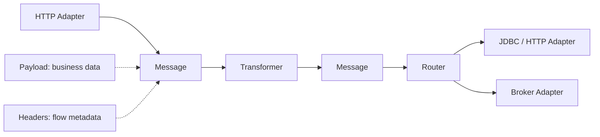
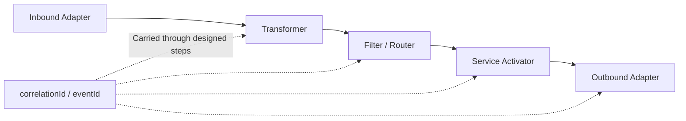
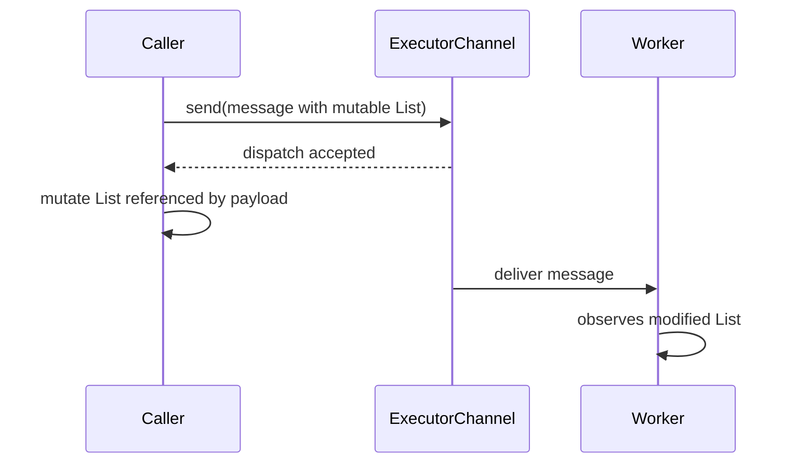
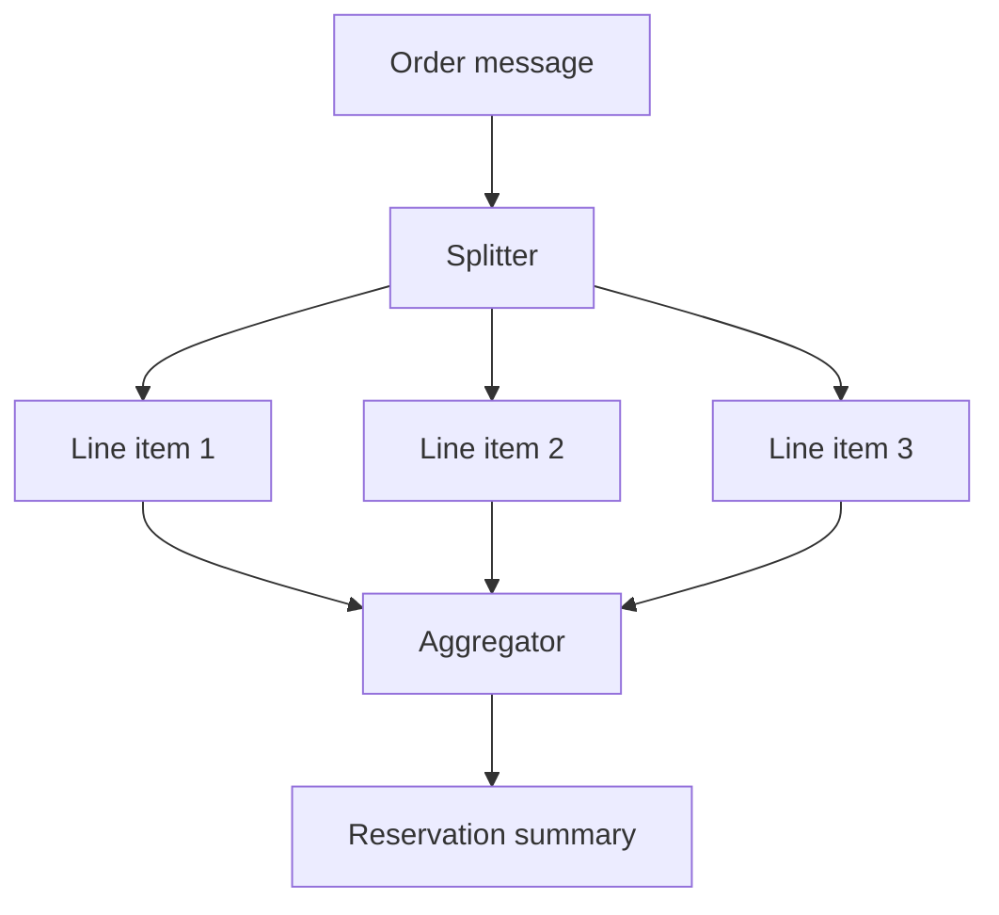
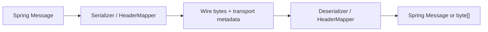
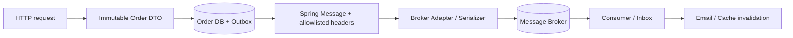

# Message, Payload, MessageHeaders, and Immutability

## 1. Why Does Message Structure Matter in Spring Integration?

In the **SPRING_BOOT_INTEGRATION** module, Spring Boot integrates HTTP clients, databases, caches, message brokers, and Spring Integration adapters. A flow may receive an order from a REST API, transform data, write to a database, publish an event to RabbitMQ, and update Redis. If each step simply passes around a plain Java object without context, it becomes difficult to trace the request origin, correlate errors with the order, and enforce contracts between systems.

**Spring Integration** applies Enterprise Integration Patterns. The unit of exchange between endpoints is a **`Message<T>`**, consisting of:

- **Payload**: the primary data of the message, such as `OrderCreated`, decoded JSON, `byte[]`, or a domain object.
- **Headers**: message metadata, such as `id`, `timestamp`, `contentType`, `correlationId`, `replyChannel`, and `errorChannel`.

The two parts serve different purposes. The payload answers "what data is being processed?", while headers answer "how is the data traveling through the flow and which request does it belong to?".



This lesson explains the exact roles of `Message`, `payload`, and `MessageHeaders`; how messages are created with builders; what **immutability at the message boundary** means; retaining or changing headers across transformers, routers, and gateways; serialization risks over HTTP/brokers; and how to test and observe integration flows.

Examples use Spring Boot 3.x, Spring Framework 6.x, and Spring Integration 6.x with Java 17+. Do not treat an in-memory Java object example as a serialization contract between independent services.

## 2. The Two-Part Model: Message<T> = payload + headers

The `Message<T>` API belongs to `org.springframework.messaging`, not exclusively to Spring Integration:

```java
package org.springframework.messaging;

public interface Message<T> {
    T getPayload();
    MessageHeaders getHeaders();
}
```

This is a **shortened signature for conceptual learning**, not the complete framework source code. The generic type `T` describes the payload at Java compile time; as it moves through messaging adapters, `Message<?>` may appear when the payload type is determined dynamically.

An example of creating a message:

```java
import org.springframework.messaging.Message;
import org.springframework.messaging.support.MessageBuilder;

public record OrderCreated(String orderId, String customerId) {}

Message<OrderCreated> message =
    MessageBuilder.withPayload(
            new OrderCreated("ord-1024", "cus-17")
        )
        .setHeader("correlationId", "req-80a7")
        .setHeader("eventType", "OrderCreated")
        .build();

OrderCreated payload = message.getPayload();
Object correlation = message.getHeaders().get("correlationId");
```

Here:

- `message.getPayload()` returns `OrderCreated`.
- `message.getHeaders()` returns a `MessageHeaders` object that acts like a **read-only** map from the caller's perspective.
- Spring generates certain system headers, typically `id` and `timestamp`, depending on the message creation mechanism.
- `correlationId` and `eventType` are set by application code; Spring does not automatically guarantee they are valid or forwarded across every transport.

```text
Message<OrderCreated>
├── payload
│   ├── orderId = "ord-1024"
│   └── customerId = "cus-17"
└── headers
    ├── id = <message UUID>
    ├── timestamp = <message creation time>
    ├── correlationId = "req-80a7"
    └── eventType = "OrderCreated"
```

### 2.1. A Message Is Not Necessarily an Event

A `Message` can represent a command, request, reply, event, file record, stream chunk, or processing error. A payload class name like `OrderCreated` describes a business event, while `Message<OrderCreated>` is the **delivery envelope within a flow**.

| Data kind | Example payload | What must be defined |
| --- | --- | --- |
| Command | `ReserveInventory` | Action to perform, idempotency key |
| Event | `OrderCreated` | Fact that occurred, event ID, schema version |
| Request | `GetCustomerById` | Reply/error contract, timeout |
| Reply | `CustomerSnapshot` | Request correlation, not-found semantics |
| Technical error | `Throwable` in `ErrorMessage` | Failed message, failing step, reprocessing |
| Raw transport | `byte[]`/`String` | Encoding, content type, parser, size limit |

A `Message` object can change payload types between steps (raw JSON → DTO → enriched DTO) while selectively preserving metadata. Do not assume every header must be copied across all steps.

## 3. What Is MessageHeaders and Why Not Mutate It Directly?

`MessageHeaders` belongs to `org.springframework.messaging.MessageHeaders`. It implements a `Map<String, Object>`-like interface for convenient header reading, yet **is designed to be immutable at the map structure level**.

Reading headers:

```java
import java.util.UUID;
import org.springframework.messaging.MessageHeaders;

MessageHeaders headers = message.getHeaders();

UUID messageId = headers.getId();
Long createdAtEpochMillis = headers.getTimestamp();
String correlationId = (String) headers.get("correlationId");

boolean hasEventType = headers.containsKey("eventType");
```

Example of an improper mutation attempt:

```java
// Do not do this: MessageHeaders does not allow mutating the map via its direct API.
message.getHeaders().put("correlationId", "new-correlation");

// Likewise, remove/clear on headers is not the way to create
// a new message with modified metadata.
```

Map mutation operations like `put`, `remove`, or `clear` on `MessageHeaders` generally throw `UnsupportedOperationException`. The goal is to prevent one handler from silently altering metadata on the same message instance seen by other handlers.

**Want to change a header? Create a new message with a builder** instead of mutating a published message. Still, header immutability **is not deep immutability** for the objects stored inside; Section 6 examines that detail.

### 3.1. MessageHeaders Is Not Every Protocol's "Header"

`MessageHeaders` is metadata in the Spring Messaging environment. It differs from:

- HTTP request/response headers on the wire.
- JMS message properties and JMS system headers.
- RabbitMQ AMQP headers/properties.
- Kafka record headers, key, timestamp, and offset.

Adapters can **map** between Spring `MessageHeaders` and transport metadata, but there is no universal rule that every Java header passes untouched over HTTP, Kafka, JMS, or AMQP. Header values that are arbitrary Java objects may be unsupported by the transport or unsafe to serialize.

## 4. Creating Messages with MessageBuilder and GenericMessage

Spring Messaging provides `MessageBuilder` for constructing messages explicitly:

```java
import org.springframework.messaging.Message;
import org.springframework.messaging.MessageHeaders;
import org.springframework.messaging.support.MessageBuilder;
import org.springframework.util.MimeTypeUtils;

Message<OrderCreated> created =
    MessageBuilder.withPayload(
            new OrderCreated("ord-1024", "cus-17")
        )
        .setHeader("eventId", "evt-1024")
        .setHeader("correlationId", "req-80a7")
        .setHeader(
            MessageHeaders.CONTENT_TYPE,
            MimeTypeUtils.APPLICATION_JSON
        )
        .build();
```

The builder prepares payload and headers before the message is dispatched into a flow. The `MessageBuilder` in this example is from **`org.springframework.messaging.support`**; Spring Integration also provides its own message builder utilities. When reading project code, always check the imports and exact API.

### 4.1. Common Builder Operations

```java
Message<OrderCreated> updated =
    MessageBuilder.fromMessage(created)
        .setHeader("processingStage", "validated")
        .setHeaderIfAbsent("schemaVersion", 1)
        .removeHeader("debug-only")
        .build();
```

| Operation | Meaning |
| --- | --- |
| `withPayload(value)` | Starts with a new payload |
| `fromMessage(existing)` | Starts from an existing message |
| `setHeader(name, value)` | Adds or replaces a header in the builder |
| `setHeaderIfAbsent(name, value)` | Sets only if the header is not already present |
| `copyHeaders(map)` | Copies header entries into the builder per API rules |
| `copyHeadersIfAbsent(map)` | Copies entries not yet present |
| `removeHeader(name)` | Excludes the specified header from the new message |
| `build()` | Builds the resulting `Message` |

Message immutability means **modifying by creating a subsequent message**, not "every builder call preserves every system header identically". Special headers like `id`/`timestamp` follow specific rules; when building from an existing message, do not rely on an assumption that the UUID is always preserved or always regenerated without checking the framework API and actual conversion path.

### 4.2. When Is GenericMessage Useful?

`GenericMessage<T>` is the basic `Message<T>` implementation in Spring Messaging. Example of direct instantiation:

```java
import java.util.Map;
import org.springframework.messaging.Message;
import org.springframework.messaging.support.GenericMessage;

Message<String> raw = new GenericMessage<>(
    "{\"orderId\":\"ord-1024\"}",
    Map.of("source", "http-adapter")
);
```

In normal application code, a builder is usually clearer and easier to extend. Whether using a constructor or a builder, **the supplied payload is not automatically deep-copied**. A DTO holding a mutable list, map, or `byte[]` still requires the application's own immutability strategy.

### 4.3. Is a Null Payload Valid?

Under the standard `GenericMessage`/`MessageBuilder` model, the payload is required to be **non-null**. `MessageBuilder.withPayload(null)` is not used to represent "no event".

If a poller calls `QueueChannel.receive(timeout)` and no message arrives, it may receive **`null` from the `receive` method** to indicate timeout or an empty channel. That is distinct from a `Message` with a null payload.

To represent "result not found", use an explicit reply contract (empty response, optional result, status code, omitting a message, or a dedicated event type depending on the flow) instead of passing `null` as a payload.

## 5. Message ID, Timestamp, Correlation ID, and Business Event ID

This is the metadata group most often confused when integrating multiple systems.

| Metadata | Role | Should it be used for business deduplication? |
| --- | --- | --- |
| `id` (`MessageHeaders.ID`) | Identifies a Spring message per framework mechanics | **Not by default**; may change on recreation or transport hops |
| `timestamp` (`MessageHeaders.TIMESTAMP`) | Messaging-layer message creation time | No; does not prove business event time |
| `correlationId` | Groups messages belonging to the same request/job/workflow | Only if explicitly mandated by contract; mainly for tracing |
| `eventId` | Stable **business event** identifier issued by the producer | **Yes**, when the producer preserves it across retries/redeliveries |
| `schemaVersion` | Payload/event contract version | No; used for decoding and compatibility |
| `causationId` | Event/request that directly caused the current event | No; used for causal chains |

Example of one order emitting two events:

```text
HTTP correlationId = req-80a7
  ├── OrderCreated eventId = evt-1024
  │     └── Spring Message id = UUID-A
  └── ReservationRequested eventId = evt-1025
        └── Spring Message id = UUID-B
```

If `OrderCreated` is republished after a network failure, an adapter might create a new Spring `Message` with a different `id`. **`eventId=evt-1024` must stay unchanged** if it represents the same business event to deduplicate.

### 5.1. System Headers and Spring Integration Headers

Standard names in Spring Messaging:

```java
MessageHeaders.ID;
MessageHeaders.TIMESTAMP;
MessageHeaders.CONTENT_TYPE;
MessageHeaders.REPLY_CHANNEL;
MessageHeaders.ERROR_CHANNEL;
```

Spring Integration also uses additional flow metadata such as correlation, sequence, priority, routing slip, history, and more. These headers can be manipulated through `IntegrationMessageHeaderAccessor` and corresponding utilities depending on your version.

**Do not write code depending on ad-hoc header strings** such as `"correlation-id"` if the system uses `"correlationId"`. Standardize names, types, and propagation rules; when using Kafka/JMS/AMQP adapters, check each transport's header mapper and codec.

### 5.2. replyChannel and errorChannel Are Not Business Headers

`replyChannel` and `errorChannel` may hold a `MessageChannel` reference or a channel name resolved by the framework in context. They route **replies or technical errors** inside the flow, unlike business fields such as `orderId`.

Do not serialize a Java `MessageChannel` object into a JSON event expecting another service to call back over it. Once leaving the process, you need a reply-to/correlation protocol or a callback endpoint with its own contract.

## 6. MessageHeaders Immutability Does Not Mean Deep Payload Immutability

This is the core takeaway of the lesson.

Consider:

```java
import java.util.ArrayList;
import java.util.List;
import org.springframework.messaging.Message;
import org.springframework.messaging.support.MessageBuilder;

List<String> skus = new ArrayList<>();
skus.add("sku-1");

Message<List<String>> message =
    MessageBuilder.withPayload(skus).build();

skus.add("sku-2");

// The payload still references the same original mutable list.
System.out.println(message.getPayload()); // [sku-1, sku-2]
```

Even though headers disallow `put`, `message.getPayload()` here still points to an `ArrayList` being mutated. When the message is dispatched over an `ExecutorChannel`, the handler may read the data at a different time than the caller thread and observe a different state than when the message was created.

**Envelope immutability does not protect against race conditions on a mutable payload.**

### 6.1. Using Records and Defensive Copies

Example of an event using immutable data:

```java
import java.util.List;

public record OrderLine(String sku, int quantity) {}

public record OrderSubmitted(
    String orderId,
    List<OrderLine> lines
) {
    public OrderSubmitted {
        lines = List.copyOf(lines);
    }
}
```

`List.copyOf(lines)` creates a list that prohibits structural modification via that reference. When `OrderLine` elements are records containing only `String`/`int`, this data model is relatively straightforward to keep immutable.

However, **`List.copyOf` only performs a shallow copy**: if an element is a mutable bean (for example `PriceInfo` with setters), the caller can still mutate that object. Deep-copy elements defensively or choose immutable element types.

### 6.2. For byte[], Copy Both on Input and Output

`byte[]` is mutable even inside a `record`:

```java
public record RawDocument(byte[] bytes) {

    public RawDocument {
        bytes = bytes.clone();
    }

    @Override
    public byte[] bytes() {
        return bytes.clone();
    }
}
```

By cloning in both the compact constructor and the accessor, external code cannot alter the stored contents by mutating either the original array or the returned array.

Apply the same scrutiny when payloads hold `ByteBuffer`, `Map`, JPA entities, collections, or mutable third-party library objects. Never pass a JPA entity attached to a persistence context across an executor or broker so another worker reads lazy fields after the transaction has ended.

### 6.3. Header Values Can Also Be Mutable

`MessageHeaders` prevents mutating **the map structure**, not freezing **the value objects**:

```java
import java.util.ArrayList;
import java.util.List;
import org.springframework.messaging.Message;

List<String> traceSteps = new ArrayList<>();
traceSteps.add("received");

Message<OrderCreated> message =
    MessageBuilder.withPayload(
        new OrderCreated("ord-1024", "cus-17")
    )
    .setHeader("traceSteps", traceSteps)
    .build();

traceSteps.add("validated");

// The object stored as a header value may have mutated.
```

That is why header values should be `String`, `UUID`, `Long`, `Integer`, stable enums, or immutable DTOs; avoid stuffing large mutable collections, open HTTP request objects, or database connections into headers.

**Rule:** immutable message envelope + immutable payload + immutable header values together create a communication model that is safe and easy to reason about across threads.

## 7. Creating a New Message When Metadata or Payload Must Change

When a handler needs to add metadata, create a new message:

```java
Message<OrderCreated> source =
    MessageBuilder.withPayload(
        new OrderCreated("ord-1024", "cus-17")
    )
    .setHeader("correlationId", "req-80a7")
    .build();

Message<OrderCreated> next =
    MessageBuilder.fromMessage(source)
        .setHeader("processingStage", "validated")
        .build();
```

Here `source` retains its original headers; `next` is a new message produced by the builder. **Never mutate `source.getHeaders()` directly.**

When changing the payload:

```java
public record ValidatedOrder(String orderId, boolean accepted) {}

public Message<ValidatedOrder> validate(Message<OrderCreated> input) {
    OrderCreated order = input.getPayload();
    ValidatedOrder validated =
        new ValidatedOrder(order.orderId(), true);

    var builder = MessageBuilder.withPayload(validated);
    Object correlationId = input.getHeaders().get("correlationId");

    if (correlationId instanceof String value) {
        builder.setHeader("correlationId", value);
    }

    return builder
        .setHeader("processingStage", "validated")
        .build();
}
```

The example above **forwards only allowlisted headers**. This is especially useful when crossing trust boundaries: it prevents accidentally leaking `replyChannel`, `errorChannel`, access tokens, stack traces, or internal metadata.

If all headers are safe within an internal flow, you can use `copyHeaders` or `copyHeadersIfAbsent`. However, for integrations across brokers or HTTP, prefer an explicit **allowlist** for required metadata instead of copying everything.

## 8. Header Propagation Across Multiple Endpoints

A typical flow:



Each endpoint can affect metadata:

| Endpoint | Potential changes | What to verify |
| --- | --- | --- |
| Inbound HTTP adapter | Converts HTTP headers/body to a Spring Message | Which headers are mapped? Which fields are trusted? |
| Transformer | Changes payload class/shape, builds a new message | Are required `correlationId`/`eventId`/`schemaVersion` preserved? |
| Filter | Drops messages failing conditions | Does a filtered-out state need ack/reply/audit? |
| Router | Selects output channel by header/payload | Does a missing header go to a default route or error? |
| Splitter | Emits multiple child messages from one message | Needs correlation/sequence for an aggregator to recombine |
| Aggregator | Combines multiple messages into a single result | Correlation key, release strategy, expiry, duplicates |
| Service Activator | Calls business/DB/HTTP logic and may return a reply | Which reply/error channel is used? |
| Outbound Kafka/JMS/AMQP adapter | Converts message to wire format | Header mapper/serializer, size, types, and target system limits |

**Never assume every header passes through every step unchanged.** A transformer returning a plain object is typically wrapped by endpoint rules; a transformer returning a `Message<?>` expresses header handling more explicitly. When in doubt, write a test asserting the exact header contract on the output channel.

### 8.1. Headers Are Technical, Payloads Are Business — With Some Overlap

A field like `eventId` may appear both in the payload of a broker event and in a header used for routing/deduplication. That makes sense when the contract is clear, but **a single source of truth must be defined** if the two ever diverge.

For example:

```json
{
  "eventId": "evt-1024",
  "eventType": "OrderCreated",
  "schemaVersion": 1,
  "occurredAt": "2026-11-21T02:15:00Z",
  "data": {
    "orderId": "ord-1024"
  }
}
```

If the wire event schema defines `eventId` in the payload, use it for deduplication; a repeated Kafka/JMS header for the event ID can optimize routing/tracing, but must never silently carry a different value.

## 9. Header Routing in Spring Integration

A message can be routed in several ways: by payload content, by header, or by a combined rule.

Example header on a message:

```java
Message<OrderCreated> event =
    MessageBuilder.withPayload(
        new OrderCreated("ord-1024", "cus-17")
    )
    .setHeader("destination", "notifications")
    .build();
```

A router can inspect `destination` to send the message to the notifications channel. However, **never blindly trust header values supplied by external clients**. If an inbound HTTP adapter lets callers supply `destination=payments`, they could steer internal routing unintentionally.

Safe strategy:

1. Validate inputs and caller permissions at the inbound boundary.
2. Map only allowed headers; strip internal control headers coming from untrusted callers.
3. Configure routers with an explicit allowlist of valid routes and a clear default/error route.
4. Never interpret an arbitrary header directly as a Java bean name or privileged channel name.
5. Test missing headers, invalid values, and spoofed values.

### 9.1. Service Activators Receiving Payload vs. Full Message

Spring Integration supports handlers that take only the payload:

```java
import org.springframework.integration.annotation.ServiceActivator;
import org.springframework.stereotype.Component;

@Component
public class OrderHandler {

    @ServiceActivator(inputChannel = "ordersInput")
    public void handle(OrderCreated event) {
        // Execute business logic from the payload.
    }
}
```

When metadata is needed, you can accept `Message<OrderCreated>`:

```java
import org.springframework.integration.annotation.ServiceActivator;
import org.springframework.messaging.Message;
import org.springframework.stereotype.Component;

@Component
public class AuditedOrderHandler {

    @ServiceActivator(inputChannel = "auditedOrdersInput")
    public void handle(Message<OrderCreated> message) {
        OrderCreated event = message.getPayload();
        Object correlationId =
            message.getHeaders().get("correlationId");

        // Safely log correlationId and process the event.
    }
}
```

These are **two handlers illustrating two different input channels**, not a requirement to have both for one use case. Accepting the full `Message` is useful when header metadata is needed, but business services should not depend on `MessageHeaders` everywhere; keep adapters/gateways at the boundary and invoke domain services with clean DTOs and explicit context.

## 10. Messages and Channel Types: Immutability Matters Even More with Executors

Spring Integration distinguishes synchronous and asynchronous message handoff:

- `DirectChannel` normally invokes the handler on the caller's thread.
- `ExecutorChannel` submits the work to an executor, so the handler runs on a worker thread.
- `QueueChannel` holds messages for a poller or consumer to receive later.
- `PublishSubscribeChannel` can dispatch synchronously or via an executor depending on configuration.

If a payload or header value is mutated between `send()` and when the handler actually reads it, the system can suffer subtle, hard-to-reproduce race conditions.



This is **shared mutable state**, not an "immutable Message" guarantee. Converting to immutable DTOs before sending eliminates this class of bug. If a payload is very large and copying must be avoided, enforce strict data ownership and concurrency rules rather than relying on luck.

### 10.1. Synchronous and Asynchronous Errors Take Different Paths

With `DirectChannel`, exceptions from a handler typically propagate back up the call stack. With `ExecutorChannel`, failures occurring **after dispatch succeeds** on a worker cannot rewind into the caller's `try/catch`; the framework may publish an `ErrorMessage` to the configured error channel.

An `ErrorMessage` is itself a message whose payload is a `Throwable`:

```java
import org.springframework.messaging.support.ErrorMessage;

public void inspectError(ErrorMessage error) {
    Throwable cause = error.getPayload();
    // Classify the failure and inspect failed/original message if available.
}
```

Never assume `failedMessage` is always present, and never log sensitive payloads through exceptions. If an executor rejects a task **at submission time**, the dispatch failure can still return synchronously to the caller. Error tests must therefore separate task-rejection failures from post-dispatch handler failures.

## 11. Correlation and Sequence When Splitting and Aggregating Messages

A common use case: Order Service receives an order with 3 line items; the flow **splits** it into 3 messages to check inventory and then **aggregates** the results.



Spring Integration commonly uses correlation and sequence metadata to support these EIPs. Key concepts to understand:

- **Correlation key**: groups child messages belonging to the same split/request.
- **Sequence number**: position of a message within the group when ordering metadata exists.
- **Sequence size**: total number of messages in the group, if known.
- **Release strategy**: condition determining when the aggregator emits a result.
- **Expiry/timeout**: how incomplete groups missing items are handled.

If an externally supplied `correlationId` is passed without normalization or authorization checks, two unrelated requests could accidentally be grouped together. When using an aggregator, define a correlation key unique to the processing context rather than weak values like `"order"`.

Another issue: message redelivery can cause a splitter to emit an item twice. Aggregators need duplicate and timeout strategies; **sequence headers alone do not guarantee exactly-once processing**.

## 12. Across HTTP, Kafka, JMS, and RabbitMQ: Wire Messages Are No Longer Java Objects

Within an **in-JVM** flow, adapters can pass references to payload objects. Over network transports, messages must be encoded and decoded:



### 12.1. Payloads Must Have a Schema Contract

A Java `OrderCreated` record does not automatically create a compatibility contract between two services. Publish:

- `eventType` and `schemaVersion`;
- required fields, types, `null`/missing rules, constraints;
- encoding/content type: JSON, Avro, Protobuf, XML...;
- rules for adding fields, removing fields, and evolving enums;
- timestamp semantics, currency units, and personal data handling.

Adding a new field to a record does not guarantee older consumers can decode it. Run schema contract tests on both producer and consumer, and maintain a transition policy while older messages remain in the broker.

### 12.2. Header Mapping Is Its Own Contract

| Issue | Risk |
| --- | --- |
| Header holds a `MessageChannel` object | Cannot be serialized as cross-JVM transport metadata |
| Header holds a `Throwable`/`HttpServletRequest` | Leaks internals, unsuitable for serializers |
| Header holds arbitrary Java class names | Deserialization vulnerability with untrusted types |
| Overly large or too many headers | Hits transport/proxy/broker size limits |
| Header typed as `UUID`/`Instant`/enum | Remote consumer may receive a `String` or bytes |
| `id` header regenerated | Consumer mistakes framework ID for durable event ID |
| Sensitive headers propagated | Leaks tokens, cookies, or PII downstream |
| Inbound header collides with technical header name | Could hijack routing/replies if unvalidated |

**Forward only an allowlist of headers** that are needed, such as `eventId`, `schemaVersion`, `correlationId`, `contentType`, and message type when required by the contract. For Kafka/JMS/AMQP, select adapter header mappers/serializers intentionally and test round-trips through a real broker.

### 12.3. Do Not Use MessageHeaders as a Store for Long-Lived Business State

If a workflow needs to track durable statuses such as `PENDING`, `RETRYING`, `SUCCEEDED`, or `FAILED`, store that state in a database, broker, or job store appropriate for your SLA. Headers describe metadata of **a message in transit**, not a replacement for persistence or transaction management.

## 13. Messages Do Not Solve Transactions, Retries, or Correctness by Themselves

Consider this flow:

```text
HTTP request
  -> Message<OrderCommand>
  -> JDBC insert order
  -> Message<OrderCreated>
  -> Broker publish
  -> Notification consumer
```

An immutable message envelope makes published data easier to reason about, but it does not create a distributed transaction:

1. Spring `@Transactional` only manages resources enlisted in the configured transaction manager, not HTTP clients and brokers by default.
2. If the database commits and the process dies before publishing to the broker, the event can be lost without an outbox or equivalent guarantee.
3. Brokers may redeliver messages; consumers must deduplicate by `eventId`.
4. A timeout calling downstream does not prove the remote side failed to execute the side effect.
5. `MessageHeaders.ID` does not substitute for a stable business idempotency key.

**Sound design pattern:** persist the order and outbox event in one DB transaction, let a publisher read committed outbox rows to send to the broker, and have consumers enforce an inbox/unique constraint on event ID before applying side effects.

### 13.1. Header Timestamp Does Not Replace Business Time

`message.getHeaders().getTimestamp()` typically reflects when the message was instantiated inside the application. An order event may have occurred earlier; during reprocessing, the transport or Spring envelope timestamp can change.

When business time matters, include `occurredAt` in the event contract with explicit timezone and precision rules. For ordering, never rely solely on timestamps because producers have clock skew; choose sequence numbers, versions, offsets, or domain rules instead.

## 14. Testing Payloads and Headers with JUnit

### 14.1. Headers Are Read-Only

```java
import static org.assertj.core.api.Assertions.assertThat;
import static org.assertj.core.api.Assertions.assertThatThrownBy;

import org.junit.jupiter.api.Test;
import org.springframework.messaging.Message;
import org.springframework.messaging.support.MessageBuilder;

class MessageImmutabilityTest {

    @Test
    void headersAreReadOnly() {
        Message<String> message = MessageBuilder
            .withPayload("created")
            .setHeader("correlationId", "req-80a7")
            .build();

        assertThat(message.getHeaders().get("correlationId"))
            .isEqualTo("req-80a7");

        assertThatThrownBy(
            () -> message.getHeaders().put("correlationId", "changed")
        ).isInstanceOf(UnsupportedOperationException.class);
    }

    @Test
    void aNewMessageCanHaveAnUpdatedHeader() {
        Message<String> original = MessageBuilder
            .withPayload("created")
            .setHeader("stage", "received")
            .build();

        Message<String> revised = MessageBuilder
            .fromMessage(original)
            .setHeader("stage", "validated")
            .build();

        assertThat(original.getHeaders().get("stage"))
            .isEqualTo("received");
        assertThat(revised.getHeaders().get("stage"))
            .isEqualTo("validated");
    }
}
```

These tests verify **preventing direct header mutation and creating a new message**, not asserting UUID/`timestamp` generation internals across all versions.

### 14.2. Testing Defensive Copying of Payloads

```java
import static org.assertj.core.api.Assertions.assertThat;

import java.util.ArrayList;
import java.util.List;
import org.junit.jupiter.api.Test;
import org.springframework.messaging.Message;
import org.springframework.messaging.support.MessageBuilder;

class PayloadCopyTest {

    @Test
    void copiedListDoesNotFollowChangesToInputList() {
        List<OrderLine> input = new ArrayList<>();
        input.add(new OrderLine("sku-1", 2));

        Message<OrderSubmitted> message = MessageBuilder
            .withPayload(new OrderSubmitted("ord-1024", input))
            .build();

        input.add(new OrderLine("sku-2", 3));

        assertThat(message.getPayload().lines())
            .hasSize(1);
    }
}
```

This test passes because `OrderSubmitted` uses `List.copyOf` in its canonical constructor, not because `MessageBuilder` automatically copies lists.

### 14.3. Testing Header Propagation Across In-Memory Channels

You can verify processing paths without a broker:

```java
import static org.assertj.core.api.Assertions.assertThat;

import org.junit.jupiter.api.Test;
import org.springframework.integration.channel.DirectChannel;
import org.springframework.integration.channel.QueueChannel;
import org.springframework.messaging.Message;
import org.springframework.messaging.support.MessageBuilder;

class HeaderPropagationTest {

    @Test
    void handlerAddsMetadataWithoutChangingOriginal() {
        DirectChannel input = new DirectChannel();
        QueueChannel output = new QueueChannel();

        input.subscribe(message -> output.send(
            MessageBuilder.fromMessage(message)
                .setHeader("stage", "validated")
                .build()
        ));

        Message<String> source = MessageBuilder
            .withPayload("ord-1024")
            .setHeader("correlationId", "req-80a7")
            .build();

        input.send(source);
        Message<?> forwarded = output.receive(1000);

        assertThat(forwarded).isNotNull();
        assertThat(forwarded.getHeaders().get("stage"))
            .isEqualTo("validated");
        assertThat(forwarded.getHeaders().get("correlationId"))
            .isEqualTo("req-80a7");
        assertThat(source.getHeaders().containsKey("stage"))
            .isFalse();
    }
}
```

`DirectChannel` invokes the handler synchronously; `QueueChannel` collects the output message with a timeout in the test. This is an **in-memory mapping** test—it does not verify Kafka/JMS/AMQP serialization or header mappers. To verify wire contracts, write integration tests against a real broker/HTTP server or provider/consumer contract tests.

## 15. Common Edge-Case Pitfalls

| Symptom | Cause | How to inspect/fix |
| --- | --- | --- |
| `UnsupportedOperationException` modifying headers | `MessageHeaders` disallows map mutation | Use `MessageBuilder.fromMessage(...)` |
| Handler sees a different payload than sent | Payload holds mutable list/map/bean | Use immutable DTOs and defensive copies |
| Handler cannot read `correlationId` | Transformer/adapter dropped the header | Define an allowlist and test propagation |
| Two consumers process the same event twice | Used Spring Message ID for dedupe, or missing inbox | Use a stable business `eventId` |
| Error handler cannot identify failed message | Missing correlation/failed message or lost context | Carry `jobId`/`eventId`, inspect `ErrorMessage` safely |
| Kafka/JMS header decodes to wrong type | Adapter mapping differs from Java map | Check serializer and header mapper |
| `replyChannel` header unusable across broker | Channel reference is only valid locally | Use an explicit reply-to/correlation contract |
| JSON payload decodes yet data is invalid | Schema lacks unit/null/enum validation | Contract validation and semantic tests |
| Executor worker hits JPA lazy-loading error | Passed entity bound to old transaction thread | Convert to an immutable DTO before thread boundary |
| Multiple differing `timestamp` fields | Framework/transport/business timestamps differ | Define `occurredAt` and per-layer timestamp meanings |
| User token header forwarded downstream | Copied all headers through outbound adapter | Forward only an allowlist and redact secrets |
| `null` message or missing reply causes timeout | Confused null payload, missing reply, receive timeout | Define explicit empty/error semantics |

### 15.1. Immutable Payloads Can Still Be Semantically Invalid

A message carrying an immutable `OrderCreated` record can still contain `quantity=-3` or `currency="ABC"`. Immutability does not replace validation. Validate schemas, boundary values, business rules, and downstream contracts. Conversely, data that was valid when parsed yet mutated after dispatch is an **ownership/mutability** bug.

### 15.2. Never Use MessageHeaders to Pass Secrets

Headers may be included in default logs or forwarded by mappers across adapters. Protect bearer tokens, passwords, and PII by:

- Avoiding raw credentials in headers when a dedicated security context or credential provider can be used.
- When sensitive metadata must cross boundaries, explicitly configuring header mappers, masking, and lifetimes.
- Never using `MessageHeaders.toString()` as a production audit log for all messages.
- Limiting header size and cardinality, avoiding attaching entire domain objects to headers.

## 16. Observing Messages Without Relying on Message ID

To trace a multi-hop flow:

```text
HTTP POST /orders
  correlationId=req-80a7
  ↓
Message<OrderCommand>
  eventId=cmd-1024
  ↓
DB transaction + Outbox
  eventId=evt-1024
  ↓
Broker event OrderCreated
  eventId=evt-1024
  ↓
Consumer
  inbox key=(consumerName,evt-1024)
```

Signals worth observing:

- Messages entering/leaving channels, handler latency, errors per endpoint/flow.
- Correlation ID and trace context (never use these values as high-cardinality metric labels).
- Event ID/job ID to reconcile retries and deduplication.
- Deserialization/schema mismatch errors, header mapping failure rates.
- Executor saturation, queue depth, and stalled messages in asynchronous flows.
- Broker lag/redelivery/DLQ and transaction/outbox backlog.

Spring Integration supports observation, message history, and Micrometer integration depending on dependencies and configuration. Enable only the observation level needed; message history and full payload/header logging can add overhead or expose sensitive data. **Never treat the framework Message ID as the sole end-to-end trace ID** across processes and transports.

## 17. Capstone Scenario: Order Service Publishes OrderCreated via Broker

Suppose Order Service receives an HTTP request, saves the order in a database, publishes an event over RabbitMQ, and Notification Service sends an email. Data must move from an in-process payload to a JSON wire event while preserving semantics.

**Step 1 — Define an immutable payload with an explicit contract.**

```java
import java.time.Instant;
import java.util.List;

public record OrderLine(String sku, int quantity) {}

public record OrderCreatedEvent(
    String eventId,
    String orderId,
    Instant occurredAt,
    int schemaVersion,
    List<OrderLine> lines
) {
    public OrderCreatedEvent {
        lines = List.copyOf(lines);
    }
}
```

`eventId` belongs to the event contract and remains stable across republishes. `occurredAt` is the business event timestamp, never overwritten by Spring's Message timestamp at subsequent hops.

**Step 2 — Construct the Message at the internal boundary.**

```java
OrderCreatedEvent event = new OrderCreatedEvent(
    "evt-1024",
    "ord-1024",
    java.time.Instant.parse("2026-11-21T02:15:00Z"),
    1,
    java.util.List.of(new OrderLine("sku-123", 2))
);

Message<OrderCreatedEvent> message =
    MessageBuilder.withPayload(event)
        .setHeader("correlationId", "req-80a7")
        .setHeader("eventId", event.eventId())
        .setHeader("eventType", "OrderCreated")
        .setHeader("schemaVersion", event.schemaVersion())
        .build();
```

**Step 3 — At the outbound adapter, choose allowed metadata.**

- Encode the payload as JSON/Avro/Protobuf according to the published schema.
- Map only headers such as `correlationId`, `eventId`, `eventType`, `schemaVersion`, and content type as required by the contract.
- Drop references to channels, `Throwable`, security contexts, or internal Java objects.
- Do not rely on Spring's `MessageHeaders.ID` as the business event ID on the consumer side.

**Step 4 — Guarantee durability and duplicate handling.**

- Write the order and outbox record in the same database transaction.
- Have the publisher send events from the outbox with bounded retries while keeping `eventId` constant.
- Have the consumer check a unique key on `(consumerName, eventId)` before applying side effects.
- On failures, use error flows/DLQ and reconcilable job state.
- Test the consumer against both the current schema and older versions still sitting in the broker.



### Pre-Merge Checklist for a New Flow

- [ ] Identified the exact `Message<T>`, payload, and `MessageHeaders` for every endpoint?
- [ ] Are payloads and header values shared across threads immutable or defensively copied?
- [ ] Avoided mutating `getHeaders()` directly, creating a new message when transformations are needed?
- [ ] Distinguished message ID, correlation ID, event ID, and business timestamp?
- [ ] Does the header mapper forward only allowlisted fields across transports?
- [ ] Validated schema, nullable/unknown fields, content type, and event versioning?
- [ ] Defined reply/error behavior when no payload is returned or processing fails?
- [ ] Tested handler, transformer, router, executor, and broker adapter paths?
- [ ] Implemented transactions/outbox/inbox, retries, and idempotency for critical side effects?
- [ ] Configured tracing/correlation, metrics, and logs with sensitive data redacted?

**Conclusion:** `Message<T>` is an envelope containing a **business payload** and **`MessageHeaders` metadata**. Spring Messaging disallows mutating the header map directly after message creation; use builders to construct subsequent messages. However, **header immutability does not imply deep immutability of payloads or header values**. When Spring Boot connects HTTP, databases, caches, brokers, and Spring Integration adapters, use immutable DTOs, contracted metadata, controlled header mapping, stable business event IDs, and boundary testing so data flows predictably.
