# MessageChannel and Paths Between Endpoints

## 1. Why Understanding a Message's Path Matters

In a Spring Boot integration system, data rarely goes straight from a controller to a repository and stops. An order creation command might pass through an HTTP inbound gateway, a data-contract validator, a transformer, a router, a database service, an outbox publisher, and a Kafka outbound adapter. Spring Integration connects these stages using **messages** and **channels**, instead of letting every component call the next one directly.

A flow might look like this:

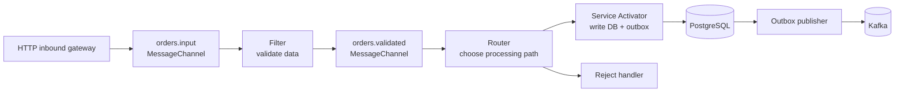

In this diagram, an **endpoint** is where work happens: receiving, filtering, transforming, routing, invoking a business service, or sending data out. A **MessageChannel** is the communication boundary between endpoints. A channel is not automatically a durable queue: some channels hand messages off immediately on the sender's thread, some buffer temporarily in memory, and some distribute messages to multiple subscribers.

Choosing the right channel type determines:

- Whether the handler runs immediately on the sending thread?
- When `send()` returns, has the business logic finished or merely been buffered?
- When an exception occurs, does it return to the caller or move to an error flow?
- Does a thread-bound database transaction continue across the channel boundary?
- When a queue fills up, who must slow down and where do unacknowledged messages live?
- If there are two subscribers, are both invoked or only one?

In the **SPRING_BOOT_INTEGRATION** module, these questions tie directly to HTTP, JDBC/JPA, Redis, Kafka/RabbitMQ/Pulsar, and Spring Integration adapters. Proper channel design preserves data contracts, transactions, idempotency, testability, and observability.

### Learning Objectives

After this lesson, you will be able to:

1. Explain the roles of `Message<?>`, `MessageHeaders`, `MessageChannel`, `SubscribableChannel`, and `PollableChannel`.
2. Distinguish `DirectChannel`, `PublishSubscribeChannel`, `QueueChannel`, `ExecutorChannel`, and specialized options.
3. Trace paths across inbound endpoints, transformers, filters, routers, service activators, outbound adapters, and gateways.
4. Write flows using annotations and the Java DSL in Spring Boot, including request-reply and polling examples.
5. Identify thread, transaction, ack/retry, reply/error channel, and durability boundaries.
6. Set queue bounds, handle errors, observe metrics, and test an integration flow.

> **Illustrative versions:** Java 17+, Spring Boot 3.x, and Spring Integration 6.x aligned with the Spring Boot BOM. Some APIs/annotations differ across 6.x and Spring Integration 7.x, so verify against your actual version. DB/broker examples illustrate integration patterns and do not imply `MessageChannel` automatically guarantees distributed transactions.

## 2. Three Core Concepts: Message, Channel, and Endpoint

### 2.1. A Message Consists of Payload and Headers

A Spring Messaging `Message<T>` has two parts:

```text
Message<OrderCreated>
├── payload: OrderCreated(eventId, orderId, totalMinor, ...)
└── headers:
    ├── id
    ├── timestamp
    ├── correlationId (chosen by application)
    ├── replyChannel (for request-reply)
    ├── errorChannel (when an error path is needed)
    └── adapter/protocol-specific metadata
```

In Java code:

```java
package example.integration.message;

import org.springframework.messaging.Message;
import org.springframework.messaging.support.MessageBuilder;

public class MessageExample {

    public static Message<OrderCreated> newMessage() {
        OrderCreated event = new OrderCreated(
                "evt-42", "ORD-42", 129900L);

        return MessageBuilder.withPayload(event)
                .setHeader("correlationId", "trace-42")
                .setHeader("schemaVersion", 1)
                .build();
    }

    public record OrderCreated(
            String eventId,
            String orderId,
            long totalMinor) {
    }
}
```

The headers of a `Message` are treated as **metadata that is not mutated in place**. To add or change a header, use `MessageBuilder.fromMessage(oldMessage)...build()` to produce a new message; never treat a header as proof of authentication simply because it is attached to a `Message`.

The **payload contract** must remain explicit: `totalMinor` is an integer in minor units, `eventId` is for idempotency, `orderId` is the aggregate ID. The `correlationId` header assists tracing rather than replacing authorization or the business event ID.

### 2.2. MessageChannel Is the Send Contract

Spring Messaging defines the interface:

```java
public interface MessageChannel {
    boolean send(Message<?> message);
    boolean send(Message<?> message, long timeout);
}
```

This summarizes the core methods, not a requirement for applications to redeclare the interface. `send()` is just a call to a channel. What "send succeeded" actually means depends on **the channel type and downstream**: with `DirectChannel` the handler may have already run; with `QueueChannel` it may merely be enqueued in memory; with `ExecutorChannel` it may simply have been accepted by the executor.

Never assume `send()==true` always means **the database committed, the broker acked, or the message was durably stored**.

### 2.3. An Endpoint Is the Component Doing Work on Messages

An endpoint can:

- **Receive** messages from HTTP, files, JDBC polling, Kafka, RabbitMQ, or Pulsar.
- **Filter** messages failing conditions, routing to a discard flow or throwing an error.
- **Transform** payloads/headers into the contract understood by the next step.
- **Route** to corresponding channels by event type, priority, or tenant.
- **Invoke services** to execute business work, such as writing `orders` and `integration_outbox`.
- **Send** to an HTTP client, Kafka producer, RabbitMQ template, or JDBC adapter.

`@ServiceActivator`, `@Transformer`, `@Filter`, `@Router`, or the Java DSL are ways of declaring endpoints. Channels connect endpoints; channels themselves do not inherently know business logic.

## 3. Two Interface Families: SubscribableChannel and PollableChannel

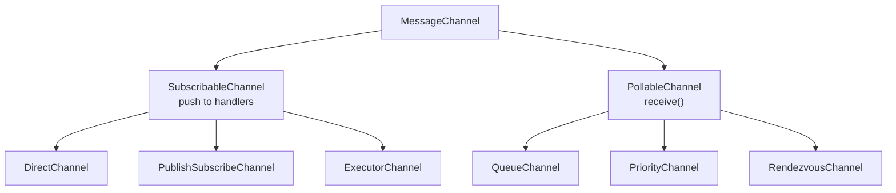

| Channel family | Who actively fetches the message? | How endpoints typically operate |
| --- | --- | --- |
| `SubscribableChannel` | Channel pushes the message to subscribed `MessageHandler`s | **Event-driven consumer** receives immediately on dispatch |
| `PollableChannel` | Polling endpoint calls `receive()` on schedule or demand | **Polling consumer** fetches messages in batches |

A `SubscribableChannel` has `subscribe(MessageHandler)`/`unsubscribe(...)`. A `PollableChannel` has `receive()`/`receive(timeout)`. Both families allow decoupling producers and consumers, yet their **semantics differ sharply** around threads, acks, queuing, and ordering.

### 3.1. Do Not Equate Subscribable with Asynchronous

`DirectChannel` is a `SubscribableChannel`, yet its handler defaults to running **synchronously on the sender thread**. Meanwhile, `ExecutorChannel` is also a `SubscribableChannel`, but it can dispatch via an executor.

### 3.2. Do Not Equate Pollable with a Broker

`QueueChannel` is a **JVM in-memory** queue under standard configuration. It does not natively provide durability, retention, replication, or consumer groups like Kafka, Pulsar, or RabbitMQ. If the app crashes after acking the source, messages sitting only in a `QueueChannel` can be lost.

## 4. DirectChannel: Synchronous Communication on One Call Thread

`DirectChannel` is usually the default choice when the next endpoint should be invoked immediately. With a single subscriber, the path looks like:

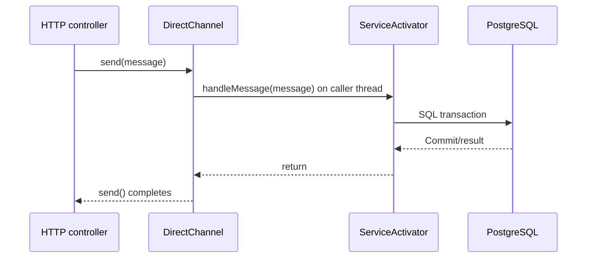

Characteristics:

- **Synchronous:** the handler usually runs on the thread calling `send()`.
- **Unbuffered:** if the handler is slow, the caller is slowed down too.
- **Synchronous errors:** exceptions from the handler can propagate back to the caller as appropriate messaging/integration exceptions.
- **Transaction context:** staying on the same thread allows a Spring thread-bound transaction to span synchronous steps when transaction manager/handlers are configured properly.
- **Multiple subscribers:** `DirectChannel` uses a dispatcher to pick a handler according to load-balancing/failover policy—**it does not automatically broadcast to all subscribers**.

> **Important:** `DirectChannel` does not give you a database transaction by default. It simply does not switch threads. Whether `@Transactional` takes effect depends on transaction proxies, method invocations, and the transaction manager.

### 4.1. Multiple Senders Do Not Guarantee Global Ordering

If two HTTP threads send messages concurrently, both calls can execute in parallel on two sender threads. Thus `DirectChannel` does not guarantee global ordering across all application events. If ordering by `orderId` is required, consider partitioning, correlation, concurrency, and business state at the flow level.

### 4.2. When Should You Use It?

`DirectChannel` fits fast transform/validate steps, handlers inside a short transaction, or synchronous request-reply calls. Avoid letting an HTTP/caller thread hold a database connection while a downstream endpoint waits seconds for a partner HTTP call.

## 5. PublishSubscribeChannel: Delivering One Message to Multiple Subscribers

`PublishSubscribeChannel` differs from `DirectChannel`: it distributes messages to **multiple registered handlers**, fitting internal fan-out:

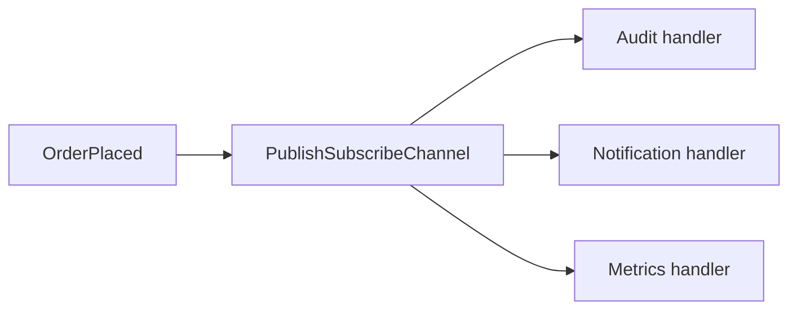

By default, without an attached executor, subscribers are normally invoked synchronously on the sending thread. If a `TaskExecutor` is configured, they can be dispatched asynchronously, introducing different thread and transaction considerations.

### 5.1. Do Not Treat PublishSubscribeChannel Like a Kafka Topic

`PublishSubscribeChannel` does not automatically:

- Durably persist messages if the process shuts down.
- Replay messages to subscribers that register later.
- Guarantee one atomic transaction across all subscribers.
- Provide broker consumer groups, retention, partitions, or network replication.

If the notification handler fails, depending on the dispatcher, executor, and error handler configuration, other subscribers can be affected differently. **Do not use internal fan-out to guarantee external side effects occur exactly-once.**

### 5.2. Safer Fan-Out for Critical Business Work

When order creation must both record an audit entry and send an email, consider:

```text
DB transaction: order + outbox rows
       ↓ commit
Broker topics / durable queues
       ├── audit consumer
       └── notification consumer
```

Internal fan-out remains suitable for metrics or best-effort work. For side effects that must survive crashes, use a durable broker/outbox with matching idempotency.

## 6. QueueChannel: Bounded Buffer, Polling Consumer

`QueueChannel` lets producers and consumers decouple processing timing:

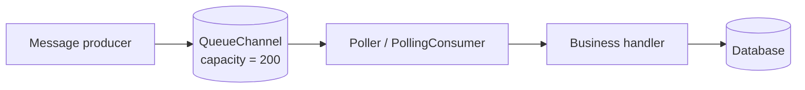

By default, a `QueueChannel` uses JVM memory and delivers messages in FIFO queue order. Multiple polling consumers or parallel processing can cause **completion order** to differ from enqueue order.

Bean example:

```java
package example.integration.channels;

import org.springframework.context.annotation.Bean;
import org.springframework.context.annotation.Configuration;
import org.springframework.integration.channel.QueueChannel;

@Configuration(proxyBeanMethods = false)
public class QueueChannels {
    @Bean
    QueueChannel ordersBuffer() {
        return new QueueChannel(200);
    }
}
```

With capacity 200, decide **what happens when it is full**. `send(message, 0)` attempts a non-blocking send; `send(message, 100)` waits up to roughly 100 ms per API semantics. If it cannot enqueue, the caller may receive `false` or a related exception depending on the situation. Never turn a "queue full" failure into `200 OK`/`ACK` for upstream unless another durable store holds the work.

### 6.1. Send Timeout Is Not Processing Timeout

```java
Message<OrderCreated> message = MessageBuilder
        .withPayload(event)
        .build();

boolean accepted = ordersBuffer.send(message, 100);
if (!accepted) {
    throw new RejectedExecutionException("Orders buffer full");
}
```

Above, `event` is an application `OrderCreated` object and `ordersBuffer` is the injected `QueueChannel`; imports needed are `org.springframework.messaging.Message`, `org.springframework.messaging.support.MessageBuilder`, and `java.util.concurrent.RejectedExecutionException`. `accepted == true` only means the message was **placed in the queue**, not that any business transaction completed.

### 6.2. When Should You Use It?

`QueueChannel` is suitable for smoothing short bursts, throttling producer/consumer pace within one process, or modeling polling semantics in demos/tests. It should not be the sole storage for payments, orders, or work that must survive a crash.

## 7. ExecutorChannel: Dispatching Through a TaskExecutor

Unlike `QueueChannel`, `ExecutorChannel` belongs to the **SubscribableChannel** family and hands processing off to a `TaskExecutor`. Handlers are triggered by the executor without needing a poller calling `receive()`.

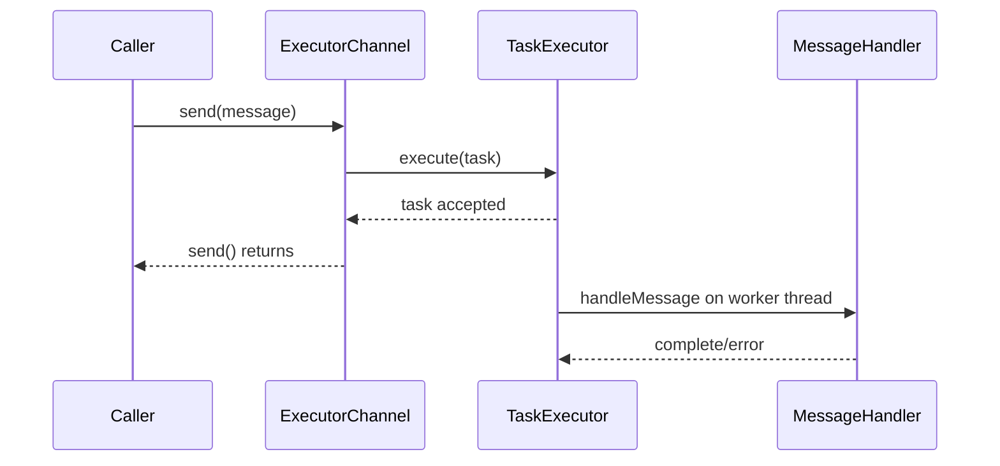

Example:

```java
package example.integration.channels;

import org.springframework.context.annotation.Bean;
import org.springframework.context.annotation.Configuration;
import org.springframework.integration.channel.ExecutorChannel;
import org.springframework.scheduling.concurrent.ThreadPoolTaskExecutor;

@Configuration(proxyBeanMethods = false)
public class ExecutorChannels {

    @Bean
    ThreadPoolTaskExecutor integrationExecutor() {
        var executor = new ThreadPoolTaskExecutor();
        executor.setCorePoolSize(4);
        executor.setMaxPoolSize(8);
        executor.setQueueCapacity(100);
        executor.setThreadNamePrefix("integration-");
        executor.initialize();
        return executor;
    }

    @Bean
    ExecutorChannel ordersAsync(ThreadPoolTaskExecutor integrationExecutor) {
        return new ExecutorChannel(integrationExecutor);
    }
}
```

Things to note:

- The executor queue is a **separate buffer** from any broker backlog.
- `send()` can return before the handler finishes.
- Worker-thread exceptions normally cannot be thrown back to a sender that already moved on; an appropriate **error-handling strategy** is required.
- Thread-local transactions and MDC/tracing context do not automatically cross executors unless explicitly propagated.
- When the executor queue fills, the executor can reject tasks; rejection policies (such as running on the caller thread) can also alter synchronous/asynchronous expectations.

`ExecutorChannel` does not make databases or partner APIs faster. If there are 8 workers but the JDBC pool has only 4 connections and each worker holds a connection during an HTTP call, adding workers may simply create more waiting threads.

## 8. Comparing the Four Common Channels

| Feature | `DirectChannel` | `PublishSubscribeChannel` | `QueueChannel` | `ExecutorChannel` |
| --- | --- | --- | --- | --- |
| API family | Subscribable | Subscribable | Pollable | Subscribable |
| Delivers to | One chosen handler | Multiple subscribers | Message waits to be polled | Handler dispatched by executor |
| Thread | Sender thread by default | Sender thread by default, or executor | Poller/consumer thread | Worker thread, depending on executor/rejection |
| Internal buffer | No | Not required | Yes | May have executor queue |
| `send()==true` | Dispatched synchronously per sync semantics | Accepted/dispatched per config | Enqueued successfully | Executor accepted task, completion not guaranteed |
| Sender's transaction | Can continue if same thread | Can continue when sync | Does not cross poll boundary | Does not cross async boundary |
| Crash persistence | No | No | No by default | No by default |
| Typical use case | Synchronous processing | Internal fan-out | Buffering/polling | Offloading async tasks |

**Remember:** these are default/common semantics, not a substitute for inspecting actual executor, polling, dispatcher, store, or extension settings. Never infer full delivery guarantees from a class name alone.

## 9. Other Specialized Channels

Spring Integration also provides specialized channel types and mechanisms:

- **`PriorityChannel`**: priority-based queue, usually driven by the `priority` header or a comparator. Priority order differs from FIFO; starvation can occur if high-priority messages arrive continuously.
- **`RendezvousChannel`**: synchronous handoff channel where sender and receiver meet according to channel semantics; not a long-term storage queue.
- **`FluxMessageChannel`**: bridge built on Reactor `Flux`, used when connecting an integration flow to reactive streams. Requires understanding demand, subscriber lifecycle, and how the source supports backpressure.
- **Persistent channels backed by an appropriate `MessageStore`**: certain channel setups can use a store to persist messages, though transactions, serialization, acks, and durability depend on the store, polling, and failure handling.
- **`nullChannel`**: special channel name used to intentionally discard messages where designed; sending there does not equal business completion or safe error handling.

Do not use `PriorityChannel` to "prioritize everything" without fairness or an SLA for low-priority items. Similarly, `FluxMessageChannel` does not turn a blocking JDBC driver into a non-blocking one or solve downstream bottlenecks.

## 10. Endpoints: Event-Driven Consumer or Polling Consumer?

An endpoint reading from a `SubscribableChannel` typically operates in **event-driven** mode: the handler subscribes to the channel and gets dispatched when messages arrive. Conversely, with a `PollableChannel`, the endpoint needs a **poller** to retrieve messages.

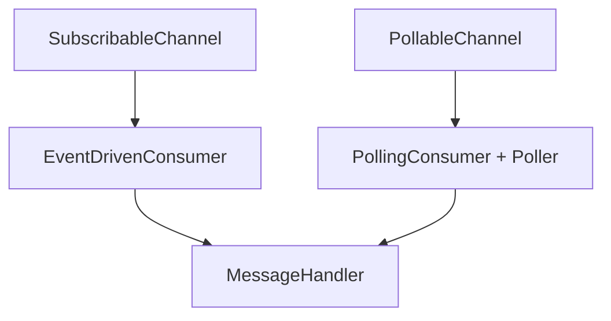

The **Poller** defines the schedule for calling `receive()`, max messages per poll, and any executor/transaction advice:

```text
Poller fixedDelay 200 ms
  → check channel
  → take up to 10 messages per cycle per config
  → dispatch each message to handler
  → schedule next cycle
```

`maxMessagesPerPoll(10)` **does not guarantee** 50 messages/second when `fixedDelay` is 200 ms. Processing time, poller thread count, backlog, scheduler load, transactions, and downstream capacity determine real throughput.

### 10.1. An Adapter Can Produce Messages, Not Only Consume Them

Inbound/outbound concepts:

| Type | Role | Example |
| --- | --- | --- |
| Inbound channel adapter | Brings messages from a source into an integration flow, usually one-way | File poll, JDBC, broker listener |
| Outbound channel adapter | Takes messages from a flow and sends to external systems, usually one-way | Send to Kafka/AMQP, write file |
| Inbound gateway | Receives an external request and can return a reply | HTTP inbound gateway |
| Outbound gateway | Sends a request to an external system and awaits/receives a reply | HTTP outbound gateway |

An **inbound adapter** is a producer to the internal channel; an **outbound adapter** is a consumer of that channel. Gateways handle both request and reply paths, so they must also manage timeouts, correlation, `replyChannel`, and error handling.

## 11. Building Blocks Inside an IntegrationFlow

| Endpoint/EIP | Role in the path | Design decisions |
| --- | --- | --- |
| Transformer | Converts payload/headers, e.g. JSON String → DTO | Output contract, error mapping, versioning |
| Filter | Keeps valid messages, discards/rejects invalid ones | Discard, exception, or DLT? |
| Router | Selects output channel by rules | What to do when nothing matches? |
| Splitter | Splits one message into many | Correlation, sequence, partial failures |
| Aggregator | Combines multiple messages into one group | Correlation key, completion, timeout, message store |
| Service Activator | Calls business/adapter method | Transactions, side effects, return/reply |
| Bridge | Connects two channels without changing business payload | Does it change thread or durability? |
| Gateway | Request-reply between application code and flow | Reply timeout, error channel, caller blocking |
| Wire Tap | Sends a copy to an observation channel | Sensitive data, overhead, and audit errors |

### 11.1. Difference Between a Channel and an Endpoint

A `Transformer` receives a message from an **input channel** and normally emits the transformed message to an **output channel**. Avoid saying "DirectChannel performs the transform"; the **endpoint handler** transforms, while the channel dispatches.

When reading Java DSL code like:

```text
from("rawOrders")
    → transform(...)
    → filter(...)
    → channel("validatedOrders")
    → handle(...)
```

there may be implicit internal channels between steps of the flow. Identify **explicit `.channel(...)`** boundaries and implicit synchronous segments when troubleshooting.

## 12. Dependencies and Foundational Configuration

With Maven and the Spring Boot BOM:

```xml
<dependency>
    <groupId>org.springframework.boot</groupId>
    <artifactId>spring-boot-starter-integration</artifactId>
</dependency>

<dependency>
    <groupId>org.springframework.boot</groupId>
    <artifactId>spring-boot-starter-test</artifactId>
    <scope>test</scope>
</dependency>

<dependency>
    <groupId>org.springframework.integration</groupId>
    <artifactId>spring-integration-test</artifactId>
    <scope>test</scope>
</dependency>
```

These are the baseline dependencies for core Spring Integration and testing. When actually using Kafka/HTTP/JDBC/AMQP/Redis adapters, add the **corresponding Spring Integration module** and required client/starter, for example:

```xml
<!-- Add only the modules the flow actually uses -->
<dependency>
    <groupId>org.springframework.integration</groupId>
    <artifactId>spring-integration-http</artifactId>
</dependency>
<dependency>
    <groupId>org.springframework.integration</groupId>
    <artifactId>spring-integration-jdbc</artifactId>
</dependency>
```

Do not assume `spring-boot-starter-integration` installs every connector or auto-configures TLS/credentials for brokers. An HTTP endpoint still needs an HTTP client configured with timeouts, SSL bundles, and authentication; a JDBC adapter needs a `DataSource`, pool, and transaction manager.

In Spring Boot 3.x, the integration starter generally activates the infrastructure needed for default configuration. You can add `@EnableIntegration` explicitly if a project does not rely completely on Boot auto-configuration; avoid overlapping configurations without inspecting the resulting beans.

## 13. Complete Example A: DirectChannel Between Filter and Service Activator

Suppose the application receives `OrderCommand` from an HTTP controller or gateway, validates the order, and writes to a DB transaction. Model:

```text
Caller
   │ send(OrderCommand)
   ▼
ordersInput: DirectChannel
   ▼
@Filter validate
   ├─ true  → ordersValidated: DirectChannel → @ServiceActivator accept
   └─ false → ordersRejected: DirectChannel → @ServiceActivator reject
```

### 13.1. Declaring the DTO and Three Channels

```java
// OrderCommand.java
package example.integration.order;

public record OrderCommand(
        String eventId,
        String orderId,
        long totalMinor) {
}
```

```java
// OrderChannelConfiguration.java
package example.integration.order;

import org.springframework.context.annotation.Bean;
import org.springframework.context.annotation.Configuration;
import org.springframework.integration.config.EnableIntegration;
import org.springframework.integration.channel.DirectChannel;
import org.springframework.messaging.MessageChannel;

@Configuration(proxyBeanMethods = false)
@EnableIntegration
public class OrderChannelConfiguration {

    @Bean
    MessageChannel ordersInput() {
        return new DirectChannel();
    }

    @Bean
    MessageChannel ordersValidated() {
        return new DirectChannel();
    }

    @Bean
    MessageChannel ordersRejected() {
        return new DirectChannel();
    }
}
```

### 13.2. Annotation-Based Endpoints

```java
// OrderEndpoints.java
package example.integration.order;

import org.springframework.integration.annotation.Filter;
import org.springframework.integration.annotation.ServiceActivator;
import org.springframework.stereotype.Component;

@Component
public class OrderEndpoints {

    private final OrderBusinessService service;
    private final RejectedOrderRecorder rejectedOrders;

    public OrderEndpoints(
            OrderBusinessService service,
            RejectedOrderRecorder rejectedOrders) {
        this.service = service;
        this.rejectedOrders = rejectedOrders;
    }

    @Filter(
            inputChannel = "ordersInput",
            outputChannel = "ordersValidated",
            discardChannel = "ordersRejected")
    public boolean validate(OrderCommand command) {
        return command.eventId() != null
                && !command.eventId().isBlank()
                && command.orderId() != null
                && !command.orderId().isBlank()
                && command.totalMinor() >= 0;
    }

    @ServiceActivator(inputChannel = "ordersValidated")
    public void accept(OrderCommand command) {
        service.processIdempotently(command);
    }

    @ServiceActivator(inputChannel = "ordersRejected")
    public void reject(OrderCommand command) {
        rejectedOrders.record(command.eventId(), "Invalid order contract");
    }
}
```

Business interfaces provided by the project:

```java
package example.integration.order;

public interface OrderBusinessService {
    void processIdempotently(OrderCommand command);
}
```

```java
package example.integration.order;

public interface RejectedOrderRecorder {
    void record(String eventId, String reason);
}
```

**Key points to understand:**

- `@Filter` decides whether to accept or reject; rejected messages go to `ordersRejected`.
- `@ServiceActivator` calls the business service—the channel itself does not write to the DB.
- All three channels are `DirectChannel`, so the main steps generally execute on the **caller's thread**.
- `RejectedOrderRecorder` should persist rejection decisions durably if upstream requires an audit trail; simply logging and dropping may not be enough.
- Having `@Filter` route to a discard flow **does not automatically throw an error to the caller**. If the HTTP contract demands a 400 response, your design must throw an exception or return an appropriate reply rather than treating rejected messages as successful.

### 13.3. Sending Messages from Application Code

```java
// OrderIngress.java
package example.integration.order;

import org.springframework.beans.factory.annotation.Qualifier;
import org.springframework.messaging.MessageChannel;
import org.springframework.messaging.support.MessageBuilder;
import org.springframework.stereotype.Component;

@Component
public class OrderIngress {

    private final MessageChannel ordersInput;

    public OrderIngress(
            @Qualifier("ordersInput") MessageChannel ordersInput) {
        this.ordersInput = ordersInput;
    }

    public void submit(OrderCommand command, String correlationId) {
        boolean accepted = ordersInput.send(
                MessageBuilder.withPayload(command)
                        .setHeader("correlationId", correlationId)
                        .build()
        );
        if (!accepted) {
            throw new IllegalStateException("Order message was not accepted");
        }
    }
}
```

**Do not treat `submit()` returning as proof that all side effects committed under every model.** With the current `DirectChannel` setup, synchronous handlers have finished if no exception occurred; once a stage switches to `QueueChannel` or `ExecutorChannel`, `send()` can return early. Changing channel types is a **contract semantics change** that requires reviewing HTTP responses, acks, and transactions.

### 13.4. An Equivalent Java DSL Variant

Replace the annotation endpoints above with an `IntegrationFlow` (do not register **both** this and the annotation endpoints on the same input channel unless you intend to create multiple subscribers):

```java
package example.integration.order;

import org.springframework.context.annotation.Bean;
import org.springframework.context.annotation.Configuration;
import org.springframework.integration.dsl.IntegrationFlow;

@Configuration(proxyBeanMethods = false)
public class OrderFlowConfiguration {

    @Bean
    IntegrationFlow validateAndProcessFlow(
            OrderBusinessService service) {

        return IntegrationFlow.from("ordersInput")
                .filter(
                        OrderCommand.class,
                        command -> command.orderId() != null
                                && !command.orderId().isBlank()
                                && command.totalMinor() >= 0,
                        spec -> spec.discardChannel("ordersRejected"))
                .channel("ordersValidated")
                .handle(
                        OrderCommand.class,
                        (command, headers) -> {
                            service.processIdempotently(command);
                            return null;
                        })
                .get();
    }
}
```

In this flow, `return null` from the handler ends a **one-way** flow; to return a reply, the handler must return an appropriate payload/message. A separate endpoint for `ordersRejected` is still needed (like in the previous example, or another flow). Do not register both `OrderEndpoints.validate` and this flow on `ordersInput` when expecting single execution, because multiple subscribers on a `DirectChannel` compete for messages.

## 14. Example B: Messaging Gateway and the Reply Path

A `MessageChannel` can serve as the entry point for a **request-reply** interface. A Spring Integration gateway accepts a Java call, wraps the request into a `Message`, sends it to the request channel, and waits for a valid reply.

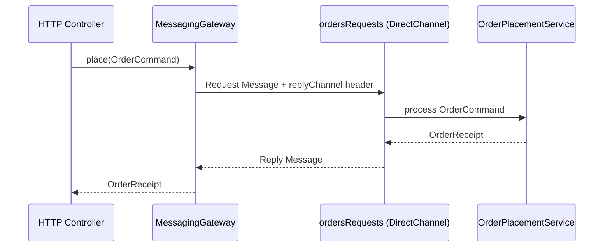

### 14.1. Gateway Interface

```java
// OrderRequestGateway.java
package example.integration.gateway;

import example.integration.order.OrderCommand;
import org.springframework.integration.annotation.Gateway;
import org.springframework.integration.annotation.MessagingGateway;

@MessagingGateway(defaultRequestChannel = "ordersRequests")
public interface OrderRequestGateway {

    @Gateway(requestTimeout = 2000, replyTimeout = 5000)
    OrderReceipt place(OrderCommand command);
}
```

```java
// OrderReceipt.java
package example.integration.gateway;

public record OrderReceipt(String orderId, String status) {
}
```

### 14.2. Registering the Gateway and Reply-Producing Flow

```java
// GatewayFlowConfiguration.java
package example.integration.gateway;

import example.integration.order.OrderCommand;
import org.springframework.context.annotation.Bean;
import org.springframework.context.annotation.Configuration;
import org.springframework.integration.annotation.IntegrationComponentScan;
import org.springframework.integration.channel.DirectChannel;
import org.springframework.integration.dsl.IntegrationFlow;
import org.springframework.messaging.MessageChannel;

@Configuration(proxyBeanMethods = false)
@IntegrationComponentScan
public class GatewayFlowConfiguration {

    @Bean
    MessageChannel ordersRequests() {
        return new DirectChannel();
    }

    @Bean
    IntegrationFlow orderRequestReplyFlow(OrderPlacementService service) {
        return IntegrationFlow.from("ordersRequests")
                .handle(OrderCommand.class,
                        (command, headers) -> service.accept(command))
                .get();
    }
}
```

```java
// OrderPlacementService.java
package example.integration.gateway;

import example.integration.order.OrderCommand;

public interface OrderPlacementService {
    OrderReceipt accept(OrderCommand command);
}
```

`@IntegrationComponentScan` discovers `@MessagingGateway` interfaces in scanned packages. When the handler returns an `OrderReceipt`, the reply is sent back along the reply path placed in the message header by the gateway.

Distinguish two timeouts:

- `requestTimeout` governs **sending the request into the channel**, especially if the channel can block due to capacity. It is not a hard deadline for downstream JDBC/HTTP calls.
- `replyTimeout` governs how long the gateway waits for a reply. If downstream runs asynchronously, a caller timeout **does not guarantee** the worker stopped or the transaction rolled back.

If an endpoint returns HTTP `202 Accepted`, only return 202 once the application has reached a **durable acceptance point** (such as a durable inbox). A fast gateway reply from a `QueueChannel` does not mean business processing finished.

### 14.3. When There Is No Reply

If the handler is `void`, returns `null`, or routes to a channel that produces no output, the gateway can time out or receive an empty result depending on signature and configuration. Never use `null` to mean "success" when the contract expects an `OrderReceipt`. Transformers and routers in a request-reply chain must preserve the necessary `replyChannel`/correlation metadata.

## 15. Example C: QueueChannel and Polling Endpoint

Suppose a batch job places multiple `OrderCommand`s into an in-process queue, and a poller processes up to a bounded count per batch:

```java
package example.integration.polling;

import java.time.Duration;
import example.integration.order.OrderCommand;
import org.springframework.context.annotation.Bean;
import org.springframework.context.annotation.Configuration;
import org.springframework.integration.channel.QueueChannel;
import org.springframework.integration.dsl.IntegrationFlow;
import org.springframework.integration.dsl.Pollers;

@Configuration(proxyBeanMethods = false)
public class OrderPollingFlowConfiguration {

    @Bean
    QueueChannel queuedOrders() {
        return new QueueChannel(200);
    }

    @Bean
    IntegrationFlow queuedOrdersFlow(
            QueueChannel queuedOrders,
            QueuedOrderProcessor processor) {

        return IntegrationFlow.from(
                        queuedOrders,
                        endpoint -> endpoint.poller(
                                Pollers.fixedDelay(Duration.ofMillis(200))
                                        .maxMessagesPerPoll(10)))
                .handle(OrderCommand.class, (command, headers) -> {
                    processor.process(command);
                    return null;
                })
                .get();
    }
}
```

```java
package example.integration.polling;

import example.integration.order.OrderCommand;

public interface QueuedOrderProcessor {
    void process(OrderCommand command);
}
```

**Execution path:**

1. Producer calls `queuedOrders.send(message, timeout)`.
2. If queue space is available, `send` succeeds as soon as enqueued, **before the handler runs**.
3. The poller fetches messages on schedule and invokes `processor.process(...)`.
4. If the handler throws, a separate recovery/error flow is required; a message popped from an in-memory `QueueChannel` does not automatically return to a broker.

`maxMessagesPerPoll(10)` caps how many messages are fetched per poll tick, not that 10 handlers run concurrently. `fixedDelay(200 ms)` does not guarantee 50 messages/sec because processing time, scheduler availability, executors, and DB/HTTP bottlenecks all apply.

### 15.1. For Critical Data, Keep a Durable Store

```text
Kafka event → inbox table + commit → Kafka ACK
              ↓
         background poller
              ↓
     idempotent business processing
```

The inbox table is the recoverable source of work. Polling a DB via Spring Integration JDBC still requires claiming/locking, transaction isolation, retries, and status tracking; a `Poller` alone does not guarantee distributed locking.

## 16. Filter, Router, Splitter, Aggregator, and Bridge

Real flows are rarely linear:

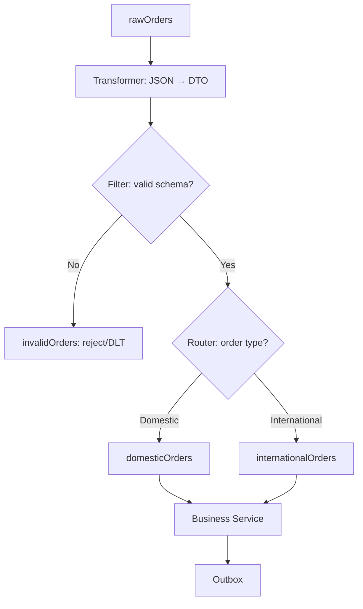

### 16.1. Filter: Discarding Is Not Error Handling

When the predicate returns false, a filter can route to a discard channel, throw an exception, or drop intentionally. For business-significant events, never use `nullChannel` to hide invalid data; establish an approved DLT/parking/rejection policy. If a Kafka adapter sees the listener finish normally, it may commit the offset per ack policy even though the business event was dropped.

### 16.2. Router: Select Channels from Allowed Values

```text
eventType = order.created   → ordersCreated
eventType = order.cancelled → ordersCancelled
eventType = other           → unsupportedEvents
```

Configure a default route or explicit error for unsupported `eventType` values. Externally supplied headers **are not trusted data**: never use an arbitrary value as a Java class name, bean name, or target URL without allowlisting.

### 16.3. Splitter and Aggregator

```text
Order ORD-7
  → split item 1
  → split item 2
  → split item 3
        ↓
  potentially parallel processing
        ↓
  aggregate by ORD-7
        ↓
  combined result
```

An aggregator requires a correlation key, sequence size or completion strategy, group timeout, and a message store. When a part arrives late, fails, or is redelivered, you need **policies for partial groups, duplicates, and idempotency**. Replacing `DirectChannel` with `ExecutorChannel` can make completion order differ from arrival order: an aggregator must never rely on global FIFO assumptions.

### 16.4. Bridge Does Not Add Durability

`BridgeHandler` or Java DSL `.bridge()` connects channels without transforming the payload. It does not add transactions, storage, retries, or broker persistence. Whenever two channels differ in type, analyze thread boundaries and failure semantics.

## 17. `replyChannel`, `errorChannel`, and Return Paths

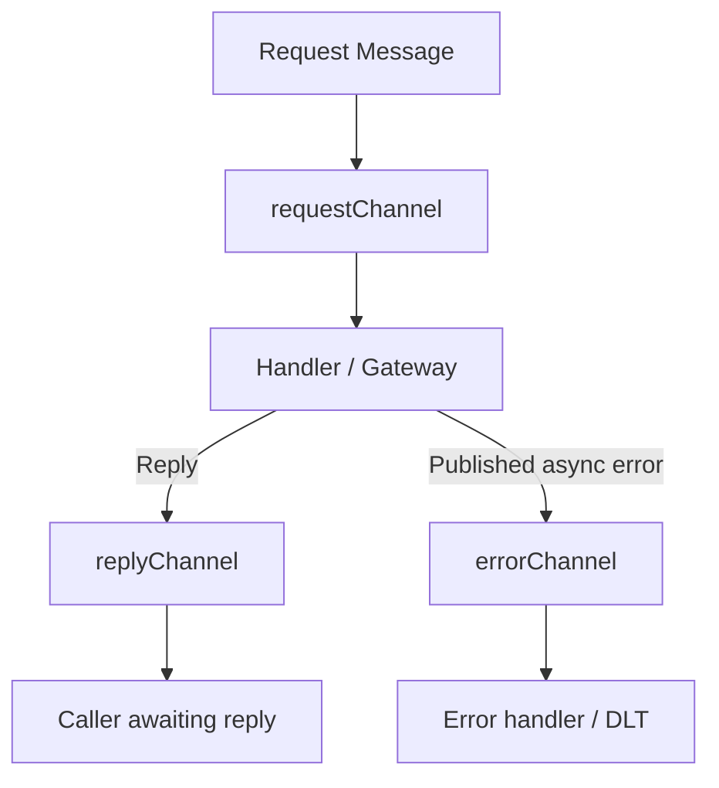

### 17.1. ErrorMessage Carries a Throwable Payload

```java
package example.integration.errors;

import org.slf4j.Logger;
import org.slf4j.LoggerFactory;
import org.springframework.integration.annotation.ServiceActivator;
import org.springframework.messaging.support.ErrorMessage;
import org.springframework.stereotype.Component;

@Component
public class IntegrationErrorHandler {

    private static final Logger log =
            LoggerFactory.getLogger(IntegrationErrorHandler.class);

    @ServiceActivator(inputChannel = "integrationErrors")
    public void handle(ErrorMessage error) {
        Throwable cause = error.getPayload();
        log.error("Integration message failed: {}",
                cause.getClass().getSimpleName(), cause);
    }
}
```

This is only the **handler**. The application must declare the matching `integrationErrors` channel and configure endpoints/async error publishers to use it. An exception on a synchronous `DirectChannel` typically **propagates back to the caller**, rather than going to the global error channel by default. Verify exact behavior on the poller, gateway, and broker listener container in use.

### 17.2. Error Handlers Must Not Silently Drop Data

Merely logging an error while letting upstream ack can lose work. An error flow should classify transient vs. permanent errors, apply bounded retries/backoff, use a DLT or durable retry store, and emit diagnostic metrics. Record `eventId`, topic/partition/offset, or correlation ID appropriately—**never** log raw sensitive payloads or credentials.

### 17.3. Reply Headers Are Not Business Event Content

`MessageHeaders.REPLY_CHANNEL` and `MessageHeaders.ERROR_CHANNEL` can reference internal channel objects or channel names. Never serialize a Java `MessageChannel` object into JSON expecting another service to reply through it. For cross-process Kafka/HTTP request-reply, use correlation keys and reply topics/endpoints mapped according to the protocol contract.

## 18. Thread and Transaction Boundaries Are Architectural Decisions

A serious mistake is assuming `@Transactional` at the start of a flow automatically covers processing after a `QueueChannel` or `ExecutorChannel`.

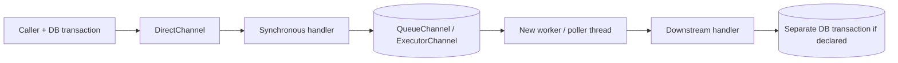

| Boundary | Same sender thread? | Upstream transaction context |
| --- | --- | --- |
| Default `DirectChannel` | Yes | Can join an active thread-bound transaction |
| `PublishSubscribeChannel` without executor | Usually yes | Can share transaction when synchronous; no multi-system atomicity |
| `ExecutorChannel` | Usually no | Does not carry Spring thread-bound transactions |
| `QueueChannel` + poller | No, separate poll cycle | Does not carry the original transaction |
| Broker inbound/outbound adapter | Separate network/commit boundary | No atomic DB + broker transaction from channels alone |

### 18.1. Anti-Pattern: Treating Enqueue as Committed

```java
@Transactional
public void receiveOrder(OrderCommand command) {
    ordersRepository.insert(command);
    queuedOrders.send(MessageBuilder.withPayload(command).build());
}
```

Here `ordersRepository` and `queuedOrders` are service dependencies; the snippet illustrates an **anti-pattern**, not a complete class. If `queuedOrders` is an in-memory `QueueChannel`, a poller can pick up the message **before the sender's DB transaction commits**. If that transaction subsequently rolls back, the worker processes work with no matching DB state.

A safer durable pattern:

```text
BEGIN DB transaction
  insert orders
  insert integration_outbox(eventId, payload, status)
COMMIT
       ↓
Outbox worker reads only committed rows
       ↓
Send to broker / continue with retries and idempotency
```

That is the transactional outbox. If broker publishing succeeds yet the DB crashes before marking the outbox row sent, the same event may be republished; consumers must deduplicate by event ID.

### 18.2. Release JDBC Connections Promptly

In a synchronous `DirectChannel` chain, if a business method opens a DB transaction and calls a partner HTTP API inside that same transaction, the connection stays checked out for the entire HTTP wait. Result: Hikari pending requests climb, throughput drops, and cascading request timeouts occur.

```text
HTTP ingress
  → validate/transform
  → short DB transaction: business state + outbox
  → commit
  → bounded async publisher
  → partner HTTP / Kafka
```

Switching a channel to asynchronous only changes threads—it **does not create durable storage** or automatically fix DB-to-HTTP coupling.

## 19. Broker Adapters: Message Sources and Ack Ownership Belong to the Container

When `@KafkaListener` or a Spring Integration Kafka inbound adapter receives a record, at least three boundaries exist:

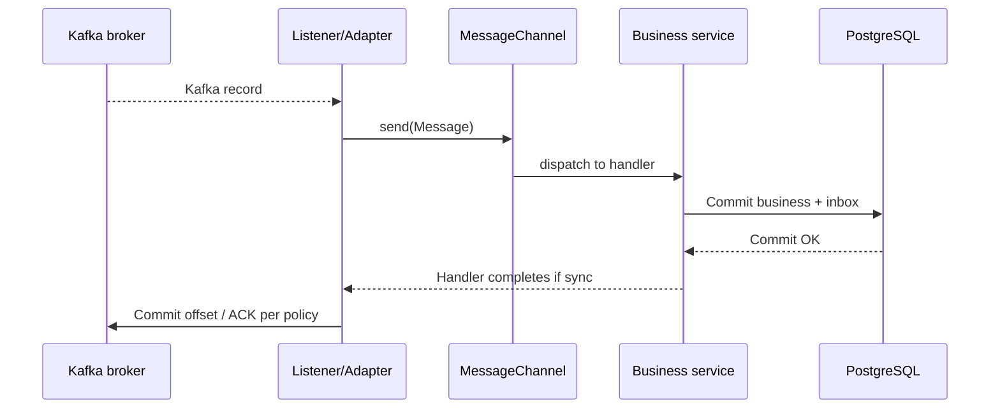

With a synchronous `DirectChannel` where the handler commits before returning, the adapter/container **can** use the handler outcome to decide acks per policy. Still, ack timing depends on ack mode, transaction manager, and error handler in Kafka/Spring Integration. Never assume every container commits offsets right after the handler in every configuration.

When inserting a `QueueChannel` or `ExecutorChannel`:

```text
Broker → listener → send() accepted → listener returns
                                     ↓
                         worker writes DB later
```

The listener can return **before** the DB commits. If the container acks upon listener return, a crash loses messages the broker now considers done. A channel does not automatically "hold back" broker acknowledgements until an async worker finishes.

### 19.1. Options for Preserving Semantics

| Option | Suitable when | What to verify |
| --- | --- | --- |
| Synchronous handler over DirectChannel, commit DB then ack | Handler is relatively fast | Poll interval, DB transactions, error propagation |
| Persist inbox then ack, worker processes async | Work is long-running and requires durability | Unique `eventId`, retries, checkpoints, monitoring |
| Keep message on broker until processed | Using broker as the durable queue | Prefetch/poll, container ack, rebalances |
| Enqueue in-memory then ack | Only when contract permits loss on crash | Do not use by default for orders/payments |

Kafka manages offsets and consumer groups; RabbitMQ has ack/nack/prefetch; Pulsar has subscriptions/acks/redeliveries per client. **`MessageChannel` does not replace these mechanisms** and cannot impose one uniform ack property across broker adapters.

### 19.2. Duplicate Delivery vs. Duplicate Business Effect

Crashing after DB commit but before broker ack causes redelivery: a normal property of at-least-once processing. A simple schema:

```sql
CREATE TABLE processed_event (
    consumer_name VARCHAR(120) NOT NULL,
    event_id VARCHAR(80) NOT NULL,
    processed_at TIMESTAMPTZ NOT NULL,
    PRIMARY KEY (consumer_name, event_id)
);
```

The application inserts the receipt and applies business side effects in the **same database transaction**, handling races via the unique constraint. `MessageChannel` adds no idempotency on its own. Never replace a database constraint with an in-JVM `ConcurrentHashMap` in multi-replica deployments.

## 20. Buffering, Backpressure, and Load Limits

Suppose ingress is 800 events/s while the pipeline finishes only 500 events/s:

\[
\Delta Q/\Delta t \approx \lambda-\mu=300\text{ events/s}
\]

After 60 seconds, the backlog grows by nearly `300 × 60 = 18,000` events if rates stay steady. A `QueueChannel(200)` cannot absorb that gap for long.

### 20.1. Where Work Accumulates

```text
Kafka / RabbitMQ / Pulsar backlog (durable per policy)
        ↓
Consumer fetch/prefetch queue
        ↓
QueueChannel / Executor task queue inside JVM
        ↓
HikariCP pending / HTTP client connection-pool pending
```

Zero broker lag does not guarantee low business latency: work may simply have shifted into an in-process queue. Measure **backlog at every layer and message age**, not just broker queue depth.

### 20.2. Bounded Queues Need Feedback Policies

For HTTP ingress:

- Return **429** when exceeding quota/rate limits or **503** when temporarily out of capacity, per HTTP contract.
- Include `Retry-After` when a retry window can be estimated.
- Return **202 Accepted** only after reaching a durable acceptance point, such as an inbox/outbox commit.

For brokers:

- Reduce poll/fetch/prefetch or pause consumption via supported listener container APIs.
- Leave unacknowledged messages in durable storage per delivery policy.
- Bound concurrency toward JDBC and outbound HTTP with timeouts and retry budgets.

With reactive streams, demand/backpressure must propagate across boundaries per Reactor/Reactive Streams contracts; never assume `QueueChannel` throttles Kafka or HTTP ingress automatically.

### 20.3. Rate Limits Differ from Concurrency Limits

A `Semaphore(8)` caps concurrent in-flight requests to 8 **per instance**, not a partner's 100 req/s rate limit. Across 10 replicas, the cluster could have ~80 in-flight requests. Size quotas, rates, and concurrency to **cluster-wide** upstream/downstream capacity, not a single pod's threads.

## 21. Observability: Channel Naming, Correlation, and WireTap

A multi-endpoint flow is hard to debug if logs only say "message processed". You need to know which channel a message traversed, which endpoint ran, how long it took, and what committed.

### 21.1. Channel Names Should Reflect State

```text
orders.raw
orders.validated
orders.rejected
orders.persisted
orders.publish.retry
```

Never name a `QueueChannel` holding pending work `orders.completed`. Channel and endpoint names should clarify whether they sit **before or after a business commit boundary**.

### 21.2. IDs Are Not Interchangeable

| Field | Used for | Do not use instead of |
| --- | --- | --- |
| `correlationId` | Linking workflow steps and traces | Idempotency ID unless guaranteed unique |
| `eventId` | Event identity, preventing duplicate side effects | Kafka topic-partition-offset |
| `orderId` | Business aggregate | Single delivery attempt ID |
| `traceparent` | Distributed tracing | Authorization or security signatures |
| `replyChannel` | Framework-internal reply routing | Unmapped cross-process reply topic |
| `errorChannel` | Framework error path | Default durable DLT |

Never put raw payment data, secrets, or sensitive personal data into headers just for logging convenience.

### 21.3. WireTap Is Not Durable Auditing

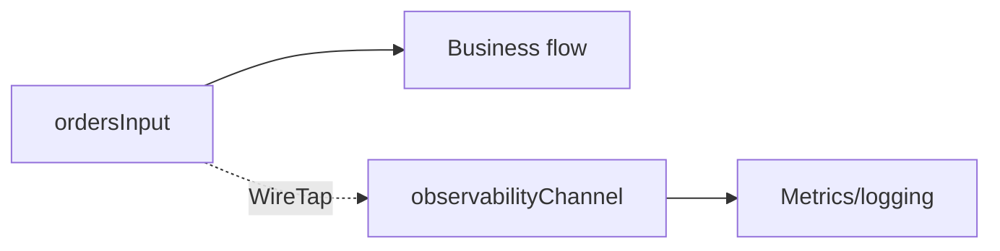

`WireTap` copies messages to an observation channel. If the observability handler is synchronous and slow, it still slows down the main path. If audit records must survive crashes, use a transactional outbox/DB or durable store with explicit semantics rather than a best-effort wire tap.

### 21.4. Key Metrics to Watch

| Location | Metric/signal | Question |
| --- | --- | --- |
| Input channel | Send count/errors, dispatch latency | Are message handoffs failing? |
| QueueChannel | Queue depth/capacity, wait time | Is backlog piling up in heap? |
| Executor | Active workers, queued tasks, rejections | Is the worker pool saturated? |
| Poller | Poll count, duration, messages per poll | Is it draining backlog? |
| Handler | Success/failure, p95/p99 | Which business step is slow? |
| JDBC/HTTP | Connection pending, timeouts, 429/503 | Which downstream is bottlenecked? |
| Broker | Consumer lag, oldest age, retries/DLT | Are messages still durably unconsumed? |
| Outbox/inbox | Pending age, duplicate rate | Are business effects completing? |

Spring Integration supports monitoring and Micrometer depending on version and configuration; verify the **actual meters exported** rather than guessing metric names. Combine Actuator, structured logging, tracing, and broker/database dashboards.

## 22. Endpoint Lifecycle and Graceful Shutdown

Many Spring Integration endpoints participate in Spring's lifecycle, including `SmartLifecycle`-compatible components. On startup, listeners/pollers should only begin consuming after datasources, migrations, and critical dependencies are ready per operational policy.

```text
Stop accepting new HTTP/broker work
        ↓
Pause/stop inbound endpoints via lifecycle
        ↓
Let in-flight tasks finish within grace period
        ↓
Commit/ack at proper durable boundary
        ↓
Close clients and DataSource
```

An in-memory `QueueChannel` **does not transfer items to a new replica**. If upstream already acked, items in memory can be lost during rolling restarts. Critical work belongs in a broker, inbox, or persistent message store with proper transactions and recovery.

### 22.1. Readiness and Liveness

- **Readiness**: should this instance receive new work?
- **Liveness**: is the process alive and able to recover?

Do not let one malformed message or a failing partner HTTP endpoint fail liveness and trigger a restart storm. Pause inbound adapters, open circuit breakers, or hold backlog in the broker while recovering.

### 22.2. `autoStartup` and Endpoint IDs

Many endpoints support `autoStartup`, IDs, and lifecycle methods. Assign meaningful IDs to control and observe flows and avoid cryptic auto-generated bean names. Never spawn threads in constructors or poll databases before Spring Boot finishes database initialization.

## 23. Testing Channels and Message Paths

Separate **unit tests of channel semantics** from **Spring context integration tests** and **end-to-end tests with real brokers and databases**.

### 23.1. Testing DirectChannel: Synchronous Execution

```java
package example.integration.channels;

import java.util.concurrent.atomic.AtomicReference;
import org.junit.jupiter.api.Test;
import org.springframework.integration.channel.DirectChannel;
import org.springframework.messaging.support.GenericMessage;

import static org.assertj.core.api.Assertions.assertThat;

class DirectChannelTest {

    @Test
    void handlerRunsOnSendingThreadByDefault() {
        DirectChannel channel = new DirectChannel();
        AtomicReference<String> handlerThread = new AtomicReference<>();

        channel.subscribe(message ->
                handlerThread.set(Thread.currentThread().getName()));

        String sendingThread = Thread.currentThread().getName();
        boolean accepted = channel.send(new GenericMessage<>("order"));

        assertThat(accepted).isTrue();
        assertThat(handlerThread.get()).isEqualTo(sendingThread);
    }
}
```

This tests **one default `DirectChannel` behavior**; it does not prove transactions or crash durability.

### 23.2. Testing QueueChannel: Bounded Capacity

```java
package example.integration.channels;

import org.junit.jupiter.api.Test;
import org.springframework.integration.channel.QueueChannel;
import org.springframework.messaging.Message;
import org.springframework.messaging.support.GenericMessage;

import static org.assertj.core.api.Assertions.assertThat;

class QueueChannelTest {

    @Test
    void fullQueueRejectsImmediateSend() {
        QueueChannel channel = new QueueChannel(1);

        assertThat(channel.send(new GenericMessage<>("first")))
                .isTrue();
        assertThat(channel.send(new GenericMessage<>("second"), 0))
                .isFalse();

        Message<?> message = channel.receive(0);
        assertThat(message).isNotNull();
        assertThat(message.getPayload()).isEqualTo("first");
    }
}
```

Avoid writing tests with infinite timeouts when a queue is full. Use finite deadlines and proper cleanup. A `QueueChannel` unit test only measures in-memory behavior, not broker acks or DLT retries.

### 23.3. Integration Tests with a Spring Context

After declaring `OrderChannelConfiguration`, `OrderEndpoints`, and fake `OrderBusinessService`/`RejectedOrderRecorder`, verify:

1. Sending a valid `OrderCommand` to `ordersInput` calls the service exactly once.
2. Sending a command missing `orderId` invokes the reject recorder and skips DB updates.
3. `correlationId` propagates across transformers/routers when tracing is required.
4. When the handler throws, verify how errors propagate back to the caller on `DirectChannel`.
5. Swap to a `QueueChannel` in a **dedicated test configuration**; confirm `send()` completes before business processing.
6. Test `@MessagingGateway` returning the expected reply type, timeouts, and error channel behavior.

**Do not register both the annotation endpoints and the Java DSL demo on the same channel** when expecting each message to be handled once. A passing `send()` test does not prove DB commits or broker acks.

### 23.4. End-to-End Tests with PostgreSQL and Kafka

```text
Publish record to test Kafka
  → inbound adapter builds Spring Message
  → channel → filter/transform
  → business service commits PostgreSQL + inbox
  → consumer acks/commits per policy
  → verify DB state, DLT, idempotency, and consumer lag
```

Testcontainers or equivalent test infrastructure verifies:

- Producer/consumer serialization, headers, trace propagation.
- Deserialization exceptions **before** the business endpoint runs.
- Crash after DB commit but before offset commit → safe redelivery.
- Poison messages, bounded retries, DLQ/DLT, and error routing.
- Bounded queues, rejections, executor capacity, and graceful shutdown.
- Multiple replicas/partitions when validating scale and ordering.

Mocking a Spring Integration channel **does not replace** real broker tests, because offset/ack handling, transactions, and rebalances belong to the real listener container and protocol.

## 24. Diagnosing Path Failures

| Symptom | Possible cause | What to check |
| --- | --- | --- |
| `Dispatcher has no subscribers` or similar | `DirectChannel` has no subscriber | Endpoint beans, input channel name, component scan, lifecycle |
| Message never reaches handler | Wrong channel name, wrong router branch, filter discarded it | Flow graph, bean names, discard/error routes |
| `QueueChannel` receives yet never processes | No polling endpoint/poller configured | `PollableChannel` vs `SubscribableChannel` |
| Gateway timeout | Missing reply or lost `replyChannel` | Handler return value, transformers, reply routing |
| Send succeeds yet no DB record appears | Worker runs async or failed after send | Thread boundary, transactions, error channel |
| Kafka lag low yet business processing slow | Backlog stuck in JVM queue or JDBC pool | Queue depth, Hikari pending, end-to-end age |
| One event processed twice | Duplicate flows, redelivery, or producer retry | Subscriber wiring, `eventId`, broker ack |
| Failing audit handler slows orders | Synchronous PubSub with slow side effects | Executor, separate durable audit |
| Transaction disappears between steps | Crossed `Executor`/`Queue`/Poller thread | Thread IDs, transaction propagation, service boundary |
| Infinite retries on bad payload | Missing error classification / DLT | Deserializer, error handler, poison message |
| Queue full and HTTP timeouts | Insufficient capacity, missing throttling | Sender timeout, reject policy, arrival/completion rate |
| Poller keeps running on shutdown | Misconfigured lifecycle coordination | `autoStartup`, graceful shutdown, executor |
| Metrics misreport latency | Measuring message sent instead of business completion | Instrumentation, lag/age, trace spans |

### 24.1. Runbook for Investigating a "Missing" Message

1. Locate **`eventId`**, `orderId`/correlation ID, and timestamp.
2. Check ingress: what did HTTP return, or did the broker deliver/ack/commit the offset?
3. List channels/endpoints: Direct, Queue, Executor, PubSub, router, discard, error.
4. Identify the **last durable persistence point**: broker, inbox, business DB, outbox.
5. Check thread/transaction boundaries: did `send()` return before or after business commit?
6. Correlate metrics: channel send errors, queue depth, poll rate, JDBC pool, HTTP latency.
7. Inspect error flows, DLT/parking, and retry attempts.
8. Only replay after checking idempotency and whether side effects already took place.

Never see a `Sent message to channel` log line and conclude the record is safely stored in PostgreSQL or Kafka.

## 25. Case Study: Losing Orders After Switching Channels for Throughput

**Hypothetical scenario:**

- A Kafka consumer receives 300 order events/s.
- The service uses `DirectChannel ordersInput`, with a business handler writing PostgreSQL and `processed_event` in one transaction.
- Consumer lag grows during peak hours.
- The team replaces `DirectChannel` with an `ExecutorChannel` backed by 32 workers because the listener returns faster.
- The container ack mode commits offsets as soon as the listener callback finishes.

### 25.1. Why Is This Dangerous?

```text
Kafka record
   ↓
Adapter / listener
   ↓
ExecutorChannel.send() accepts task
   ↓
Listener returns / offset may commit
   ↓
Worker DB transaction finishes later
```

If the process crashes between "broker offset committed" and "DB not yet committed", the consumer group will not automatically redeliver the event, yet the database has no business record. This is a **change in delivery semantics across a thread boundary**, not a Kafka bug.

If the executor queue is too large, "accepted" messages surge while DB completion throughput stays flat, raising latency and heap usage. If the Hikari pool has only 10 connections, 32 workers merely create more threads waiting for connections.

### 25.2. How to Investigate

1. Compare `messagesConsumed/s` against **`businessCompleted/s`**.
2. Measure executor queue depth, active workers, and Hikari active/pending counts.
3. Verify the listener container's real ack/offset commit boundary.
4. Find `eventId`s whose offsets were committed without corresponding inbox receipts.
5. Assess broker retention, upstream sources, and safe replay options.

### 25.3. Ways to Fix

**Keep processing synchronous:**

- Continue using `DirectChannel` through a short DB transaction.
- Scale concurrency modestly within partition counts and DB capacity.
- Optimize SQL/indexes/batching, and move slow HTTP calls outside the DB transaction.
- Ack only at the durable processing boundary.

**Use asynchronous processing durably:**

- Have the listener persist the inbox receipt + payload and commit the database.
- Ack the broker only after commit.
- Have workers read pending inbox rows and process idempotently with retries/checkpoints.
- Alert on inbox age and queue size against SLOs.

**Keep backlogs in the broker:**

- Let records wait in Kafka instead of pulling them all into JVM memory.
- Tune poll/batch/concurrency and backoff retries.
- Combine with outbox/inbox whenever side effects span database and broker.

### 25.4. Fan-Out for Audit and Metrics

Best-effort metrics can use a fast wire tap or pub-sub handler. Mandatory durable audit records should write to DB/outbox or a durable broker. If using an executor for audit, define when the caller is told it succeeded and how failed audits are recovered.

**Lesson:** changing a `MessageChannel` changes **execution timing, failure behavior, and data guarantees**, not merely thread tuning. Every switch from Direct → Queue/Executor or single subscriber → fan-out must be reviewed together with broker acks, transactions, and SLOs.

## 26. MessageChannel and Path Design Checklist

1. **Entry/exit:** which source receives data, which endpoints transform, filter, route, write DB, and publish to brokers?
2. **Channel names:** each name reflects a clear boundary—never label an uncommitted buffer "completed".
3. **Channel type:** choose Direct, PubSub, Queue, or Executor for semantics, not throughput alone.
4. **Thread boundary:** does the handler run on the sender thread or a worker/poller thread?
5. **Transaction boundary:** does the business DB commit before or after send/ack?
6. **Request-reply:** `replyChannel`, `errorChannel`, timeouts, and missing replies handled?
7. **Filter/router:** invalid messages must go to reject/DLT or throw, never vanish silently.
8. **Bounded buffers:** finite capacity, send timeouts, reject policies, and upstream feedback.
9. **Durability:** for critical flows, use a suitable broker, inbox/outbox, or persistent store.
10. **Idempotency:** event IDs, unique constraints, and redelivery recovery.
11. **Backpressure:** broker poll/prefetch, HTTP 429/503, downstream budgets.
12. **Fan-out:** `DirectChannel` does not broadcast; PubSub must handle per-branch failures.
13. **Observability:** correlation, metrics, queue depth, business completion, DLT/lag.
14. **Lifecycle:** inbound startup order, graceful shutdown, and in-memory pending tasks.
15. **Testing:** unit semantics, Spring wiring, real broker/database integration, and replay.

### Self-Check Questions

**1.** When `ordersInput` is a `DirectChannel`, which thread runs the handler? What changes with `ExecutorChannel`?

**2.** What does `QueueChannel.send(message)==true` prove, and what does it **not** prove?

**3.** What is the difference between `SubscribableChannel` and `PollableChannel`? What happens to a `QueueChannel` with no poller?

**4.** If two Service Activators subscribe to the same `DirectChannel`, do both receive a copy by default? What should you use for fan-out?

**5.** Why can a Gateway time out when a handler returns no payload or drops `replyChannel`?

**6.** Why can switching `DirectChannel` to `ExecutorChannel` inside a Kafka listener lose events even when Kafka has no errors?

**7.** Does `@Transactional` on an HTTP thread automatically continue inside a worker polling from `QueueChannel`?

**8.** When a filter receives a schema-invalid event, what determines whether to discard, DLT, or throw?

**9.** A Splitter emits 10 line-item messages; what metadata does the Aggregator need to reassemble one order and recover if an item is missing?

**10.** Broker lag is 0 yet end-to-end latency is rising: which buffers/pools should you inspect?

## References

- [Spring Integration — Reference Manual](https://docs.spring.io/spring-integration/reference/): architecture, messages, channels, endpoints, and Java DSL.
- [Spring Integration — Message Channels](https://docs.spring.io/spring-integration/reference/channel.html): channel types and dispatch characteristics.
- [Spring Integration — Message Endpoints](https://docs.spring.io/spring-integration/reference/endpoint.html): event-driven/polling consumers, gateways, annotations, and pollers.
- [Spring Integration — Java DSL](https://docs.spring.io/spring-integration/reference/dsl.html): defining `IntegrationFlow`, filters, routers, handlers, and channel wiring.
- [Spring Integration — Error Handling](https://docs.spring.io/spring-integration/reference/error-handling.html): error channels and synchronous/asynchronous errors.
- [Spring Boot 3.5 — Spring Integration](https://docs.spring.io/spring-boot/3.5/reference/messaging/spring-integration.html): starter and auto-configuration.
- [Spring Integration — Testing](https://docs.spring.io/spring-integration/reference/testing.html): testing components, integration contexts, and test strategies.

## Conclusion

A `MessageChannel` is a **boundary connecting endpoints**, not automatically a durable queue or complete transaction. `DirectChannel` generally executes synchronously; `PublishSubscribeChannel` fans out to multiple subscribers; `QueueChannel` buffers messages for polling consumers; and `ExecutorChannel` offloads execution to a task executor. Each choice changes **threads, timeouts, transactions, ordering, error paths, and response timing**. When connecting HTTP, JDBC, Redis, Kafka/RabbitMQ/Pulsar, and Spring Integration adapters, ensure `send()` is never mistaken for business completion. Reliable flows explicitly define **acks/retries, durable persistence points, inbox/outbox, idempotency, monitoring, and recovery tests** so messages reach the right endpoints and data is processed according to contract.
