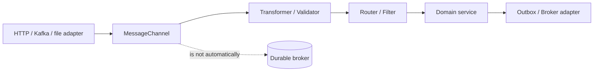
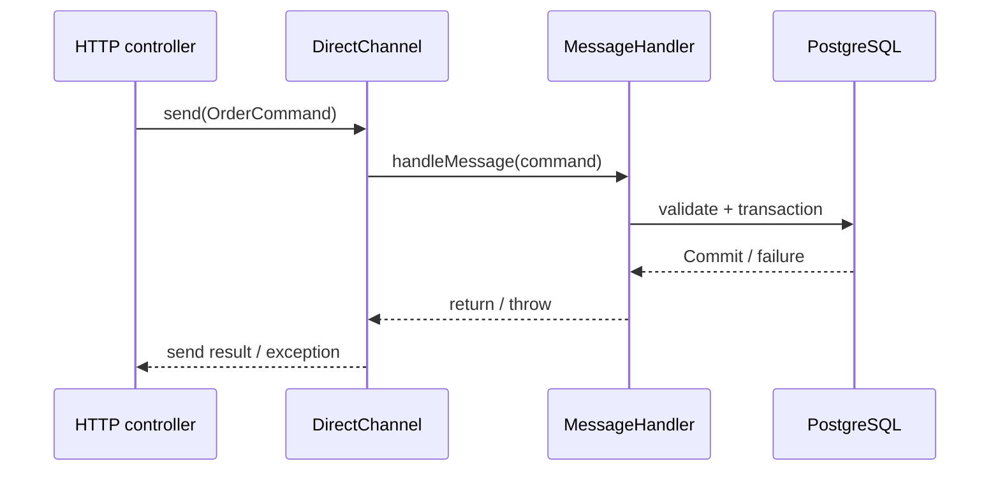
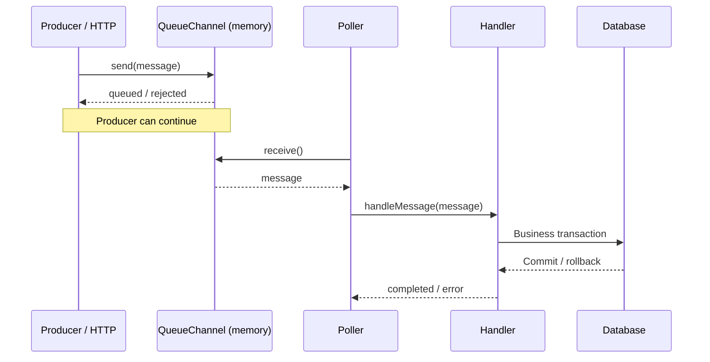
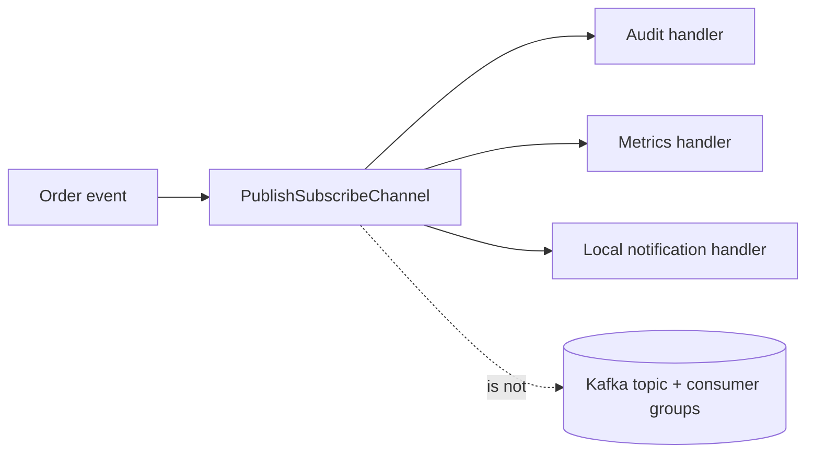
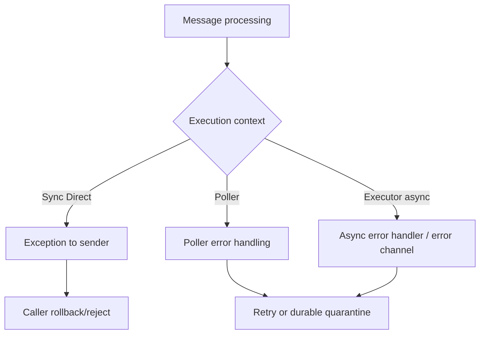
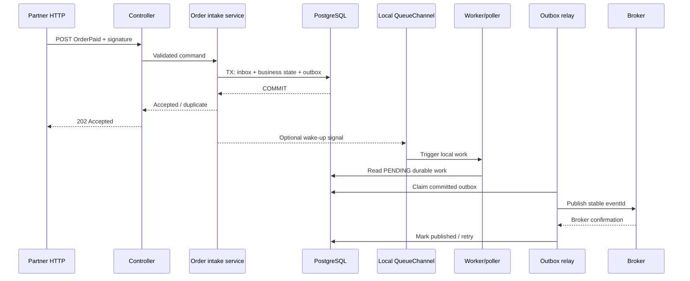
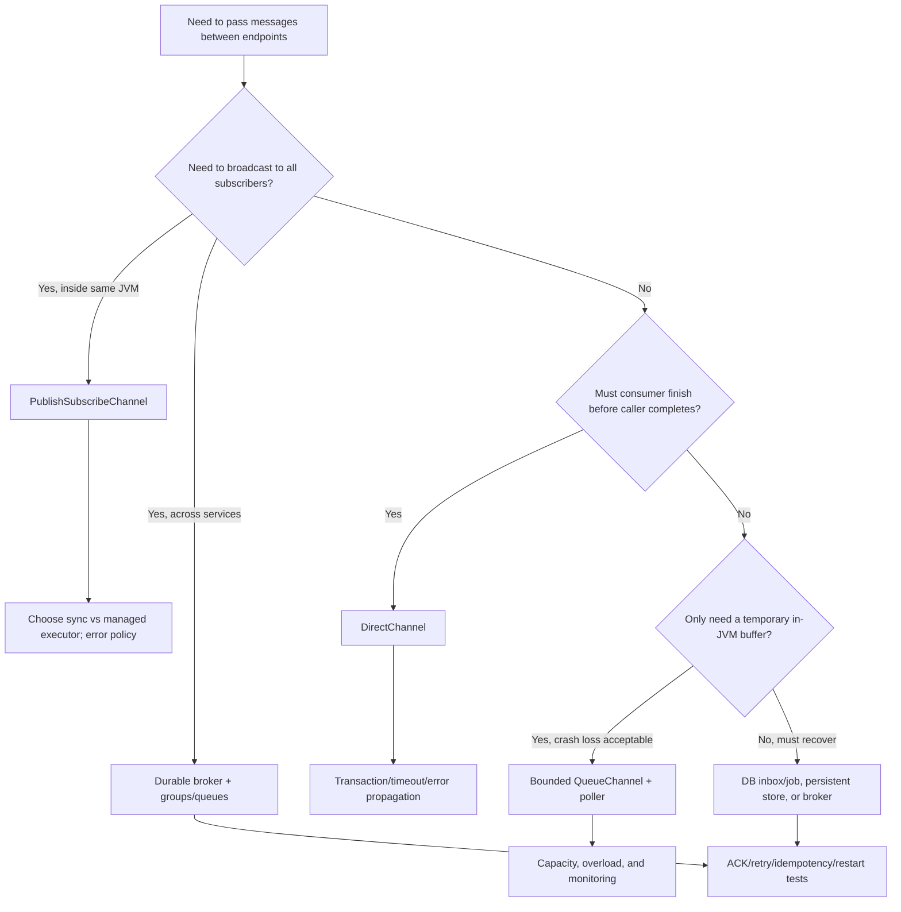

# DirectChannel, QueueChannel, and PublishSubscribeChannel

> **Chapter:** Spring Integration  
> **Module:** `SPRING_BOOT_INTEGRATION` — organizing Spring Boot system integrations across HTTP clients, databases, caches, message brokers, and Spring Integration adapters; focusing on configuration, data contracts, errors, duplicate prevention, testing, and observing real integration flows.
>
> **Example scope:** Java 17+, Spring Boot 3, Spring Framework 6, and Spring Integration Java DSL. Examples illustrate common usage; actual Spring Integration versions, transaction managers, executors, and channel stores must be verified before deployment. Business classes like `OrderCommandService` or `AuditService` are application interfaces/services, not built-in Spring integration APIs.

## 1. The Problem: How Does a Message Move Through the System?

A Spring Boot service receives an `OrderPaid` webhook over HTTP, validates the data contract, updates PostgreSQL, evicts a Redis cache entry, and creates an outbox event to publish to Kafka/RabbitMQ. The team wants to decouple ingestion, order processing, auditing, and metrics using Spring Integration.

Three initial designs look similar on the surface:

```text
HTTP controller -> DirectChannel -> business handler

HTTP controller -> QueueChannel -> poller -> business handler

Business handler -> PublishSubscribeChannel
                 |-> audit handler
                 |-> metrics handler
                 |-> notification handler
```

Yet they differ in **who executes the work, when processing occurs, how many subscribers receive the message, durability, and how errors propagate**:

- `DirectChannel`: delivers directly to **one** selected handler, usually on the **sender's thread**; suitable for synchronous processing paths.
- `QueueChannel`: accepts messages into an **internal queue** so another caller can `receive()` or a poller can fetch later; decouples producer and consumer timing.
- `PublishSubscribeChannel`: broadcasts messages to **multiple subscribers**, typically synchronously if no executor is configured, or asynchronously with an executor.

**Core question of this lesson:** Which channel makes HTTP response timing, database commit timing, message loss risk on JVM death, retries, ordering, and observability requirements explicit? You cannot answer that simply by seeing that a channel has a `send()` method.

### Learning Objectives

After this lesson, you will be able to:

1. Distinguish `MessageChannel`, `SubscribableChannel`, and `PollableChannel`.
2. Explain call flow, dispatching, load balancing, and exceptions for `DirectChannel`.
3. Use `QueueChannel` with bounded capacity and a poller without assuming it is durable by default.
4. Use `PublishSubscribeChannel` for fan-out and understand synchronous vs. executor-based asynchronous dispatch.
5. Identify transaction/thread boundaries when swapping channels or adding a poller.
6. Design an HTTP–PostgreSQL–Redis–broker flow with inbox/outbox and idempotency.
7. Test message delivery, fan-out, errors, full queues, and restarts instead of only happy paths.
8. Observe latency, queue depth, handler errors, and backlogs across systems.

## 2. Where Channels Fit in Spring Integration

Spring Integration implements many **Enterprise Integration Patterns (EIP)**: message channels, gateways, transformers, filters, routers, splitters, aggregators, service activators, inbound/outbound adapters, pollers, and error channels.



In Spring Integration:

- A **Message** consists of a payload and headers, typically `org.springframework.messaging.Message<T>`.
- A **MessageChannel** is the contract for sending messages between endpoints.
- A **Consumer endpoint** receives messages via subscription or polling.
- A **Handler** processes messages and may call domain services.
- **Adapters** connect internal flows to HTTP, Kafka, JDBC, files, AMQP, and other external systems.
- A **MessageStore** can provide persistence for certain patterns/channels when explicitly configured; it **does not appear automatically** just by adding the Spring Integration starter.

Spring Boot manages beans, external configuration, and lifecycle. Spring Integration builds the messaging graph. However, **Spring does not automatically validate payloads, span transactions across brokers, or provide business exactly-once semantics**.

## 3. Three Axes to Evaluate Before Choosing a Channel

| Axis | Question | Example consequence |
|---|---|---|
| **Dispatch** | One subscriber or all subscribers? | Load-sharing workers differ from audit fan-out |
| **Execution** | Synchronous on sender thread or async/polled? | Request latency, ThreadLocal transactions, exceptions |
| **Durability** | Does the message live in RAM or durable storage? | Restarts, power loss, retries, proof of acceptance |
| **Capacity** | Does it block or reject under overload? | Backpressure and HTTP 429/503 |
| **Ordering** | Must events for a key run sequentially? | Ordered order-state transitions |
| **Error policy** | Do errors go to the caller or an error channel? | Rollbacks, ACK/NACK, quarantine |
| **Scale** | One JVM or multiple replicas? | Per-pod in-memory queues are not shared queues |

The three channels in this lesson primarily address **internal dispatch and scheduling**. Durability and transactions are **additional design choices**—never infer them from the class name.

### 3.1. Quick Comparison Table

| Characteristic | DirectChannel | QueueChannel | PublishSubscribeChannel |
|---|---|---|---|
| Primary API | `SubscribableChannel` | `PollableChannel` | `SubscribableChannel` |
| Receiver selection | One handler chosen by dispatcher | One receiver/poller takes one item | Dispatches to subscribers |
| Synchronous by default | Yes | `send`/`receive` decoupled in time | Yes when no executor is set |
| Async by default? | No | Async in **processing time**; `send` can wait for capacity | No when no executor is set |
| Buffering | No | Yes | Not a queue |
| Durable by default | No | No (typically in-memory) | No |
| Preserves caller thread | Yes on sync path | No across poller | Yes if sync dispatch; no with executor |
| Typical use | Immediate request/command handling | Bounded buffer/polling | In-app event fan-out |

**Terminology note:** "asynchronous" does not mean "non-blocking". `QueueChannel.send(...)` can block when the queue is full; the handler runs later on another thread, yet the sender may still block waiting for capacity. Nor does this channel imply Reactor `Mono/Flux`.

## 4. MessageChannel, SubscribableChannel, and PollableChannel

Spring Messaging defines these foundational interfaces:

```java
import org.springframework.messaging.Message;
import org.springframework.messaging.MessageChannel;
import org.springframework.messaging.PollableChannel;
import org.springframework.messaging.SubscribableChannel;

// MessageChannel:
boolean accepted = channel.send(message);
boolean acceptedWithDeadline = channel.send(message, timeoutMillis);

// SubscribableChannel:
boolean registered = subscribable.subscribe(messageHandler);

// PollableChannel:
Message<?> next = pollable.receive(timeoutMillis);
```

This is a **usage signature sketch**, not a complete class: variables `channel`, `message`, `timeoutMillis`, `subscribable`, `messageHandler`, and `pollable` must be created/supplied by the application.

- `send` returns handoff status per channel semantics, **not an HTTP response from downstream**.
- `receive` is only for `PollableChannel`; a `DirectChannel` has no queue to poll.
- `subscribe` attaches a handler to a `SubscribableChannel`; `QueueChannel` is typically read actively by a poller or consumer.

A simple message:

```java
import org.springframework.messaging.Message;
import org.springframework.messaging.support.MessageBuilder;

Message<String> msg = MessageBuilder.withPayload("order-1001")
    .setHeader("eventId", "evt-order-1001")
    .setHeader("correlationId", "checkout-1001")
    .build();
```

Payloads do not replace headers; headers are not automatically preserved across every serializer/transport. In particular, `MessageHeaders.ID` is a technical ID for the Spring `Message`, not a business `eventId` or broker `MessageId`.

## 5. DirectChannel: Invoking a Handler Directly

`DirectChannel` is a **point-to-point, subscribable, synchronous-dispatch** channel. When a message arrives:



A handler on a `DirectChannel` typically runs **on the thread calling `send`**. Consequently:

- A slow handler makes the caller wait.
- Handler exceptions can propagate back to the caller through the messaging infrastructure.
- If the handler participates in an open JDBC transaction on the same thread with the right transaction manager, it can share the caller's transaction boundary.
- There is no built-in queue, persisted backlog, or crash retry.

This is advantageous for short, synchronous pipelines where unified rollback **within one transactional data source** is desired. It becomes risky if a handler makes slow partner HTTP calls, tying up request-handling threads.

### 5.1. Creating and Sending to a DirectChannel

```java
import org.springframework.context.annotation.Bean;
import org.springframework.context.annotation.Configuration;
import org.springframework.integration.channel.DirectChannel;
import org.springframework.messaging.MessageChannel;

@Configuration(proxyBeanMethods = false)
class OrderChannels {

    @Bean
    MessageChannel orderCommandInput() {
        return new DirectChannel();
    }
}
```

```java
import org.springframework.beans.factory.annotation.Qualifier;
import org.springframework.messaging.MessageChannel;
import org.springframework.messaging.support.MessageBuilder;
import org.springframework.stereotype.Service;

@Service
class OrderCommandGateway {
    private final MessageChannel orderCommandInput;

    OrderCommandGateway(
            @Qualifier("orderCommandInput")
            MessageChannel orderCommandInput) {
        this.orderCommandInput = orderCommandInput;
    }

    void submit(String commandJson, String eventId) {
        boolean accepted = orderCommandInput.send(
            MessageBuilder.withPayload(commandJson)
                .setHeader("eventId", eventId)
                .build()
        );
        if (!accepted) {
            throw new IllegalStateException("No handler accepted command");
        }
    }
}
```

If no handler is subscribed, `send` can return `false` or throw a messaging exception depending on the dispatcher/`requireSubscribers` and configuration. Never simply log `false` and return HTTP `200` when no consumer exists.

### 5.2. Synchronous Flow via Java DSL

```java
import org.springframework.context.annotation.Bean;
import org.springframework.context.annotation.Configuration;
import org.springframework.integration.dsl.IntegrationFlow;

@Configuration(proxyBeanMethods = false)
class DirectOrderFlowConfiguration {

    @Bean
    IntegrationFlow orderCommandFlow(OrderCommandService service) {
        return IntegrationFlow.from("orderCommandInput")
            .handle(String.class, (payload, headers) -> {
                service.accept(payload, (String) headers.get("eventId"));
                return null; // One-way handler; produces no reply.
            })
            .get();
    }
}
```

`OrderCommandService` is an application-implemented service responsible for contract validation, tenant authorization, transactions, idempotency, and business outcomes. The `IntegrationFlow` merely wires the message to the handler.

### 5.3. One Handler vs. One Subscriber

**DirectChannel does not broadcast.** If multiple handlers subscribe to the same channel, the dispatcher chooses one handler per message; both do not run. If both `audit` and `billing` must **each** receive the same business event, do not attach two subscribers to a `DirectChannel` expecting both to be called.

## 6. DirectChannel, Load Balancing, and Failover

Multiple subscribers on a `DirectChannel` normally share a **UnicastingDispatcher**. In Spring Integration, the dispatcher can support round-robin load balancing and failover depending on version and configuration.

```text
             +--> Worker A
DirectChannel|
             +--> Worker B
             +--> Worker C

Per message: dispatcher selects one handler, not broadcast to A/B/C.
```

Distinguish clearly:

- **Load balancing:** decides which handler receives a message.
- **Failover:** if the selected handler throws, the dispatcher can try another handler **according to policy**.
- **Business retry:** re-attempting the same command based on error classification.
- **Idempotency:** ensures that even if a message is redelivered or reapplied, the business effect is not duplicated.

Dispatcher-level failover is not equivalent to safe retry. Handler A might commit to the DB and then throw while calling a downstream HTTP service; immediately failing over to Handler B could cause a second side effect.

### 6.1. When Multiple Subscribers Make Sense

Use multiple subscribers on the same `DirectChannel` only when the handlers are genuinely **interchangeable** with the same contract—for example, identical workers protected by durable deduplication. When two handlers have distinct responsibilities, use a router or `PublishSubscribeChannel`.

Do not rely on round-robin for cluster-wide balancing across pods: a `DirectChannel` inside each Spring context only sees handlers **inside that JVM**, not across the network.

### 6.2. Do Not Infer Global Ordering

A synchronous `DirectChannel` preserves call order for **a single sending thread** if nothing inside runs asynchronously. Yet two HTTP threads sending concurrently can interleave; multiple handlers and transactions can finish out of arrival order. When ordering per `orderId` matters, use versioning, a state machine, or per-key serialization.

## 7. DirectChannel and Synchronous Transactions

Suppose an HTTP controller invokes a service via gateway → `DirectChannel` → `@Transactional` application service. Because the flow does not switch threads, the handler can execute inside the transaction created by Spring's proxy on the service.

```java
import org.springframework.stereotype.Service;
import org.springframework.transaction.annotation.Transactional;

@Service
class OrderCommandService {

    private final OrderRepository repository;
    private final OutboxRepository outbox;
    private final OrderCommandParser parser;

    OrderCommandService(
            OrderRepository repository,
            OutboxRepository outbox,
            OrderCommandParser parser) {
        this.repository = repository;
        this.outbox = outbox;
        this.parser = parser;
    }

    @Transactional
    public void accept(String json, String eventId) {
        OrderCommand cmd = parser.parseAndValidate(json, eventId);

        if (!repository.insertInboxIfAbsent(cmd)) {
            return; // Duplicate: do not apply new business effects.
        }
        repository.applyOrder(cmd);
        outbox.insertPendingEvent(cmd);
    }
}
```

The repositories, `OrderCommand`, and `OrderCommandParser` are application-defined components. `OrderCommandParser.parseAndValidate(...)` must validate the data contract, `eventId`, tenant, and sender authorization before inserting into the inbox. This snippet illustrates **where the transaction boundary sits**; it requires real implementations to run and does not replace signature verification at the HTTP adapter.

**Key takeaway:** `@Transactional` only covers resources participating in the configured transaction manager. It does not automatically roll back HTTP calls, Redis mutations, or Kafka publishes. Even though `DirectChannel` runs synchronously, it **does not create a distributed transaction**.

### 7.1. Exception Propagation and Rollback

If a handler throws an unchecked exception before DB commit, Spring's transaction typically rolls back per default rules. However, if the handler catches the exception and **returns normally**, Spring may commit even though the business work failed. Therefore, error handling at each endpoint must mirror policy:

- Duplicate already committed: return normally if valid per idempotency contract.
- Transient DB error: throw to roll back and retry at the designated owner.
- Poison payload: reject/quarantine rather than retrying infinitely.
- Downstream HTTP timeout: never assume the partner failed to execute the command.

## 8. QueueChannel: Enqueue Now, Process Later

`QueueChannel` is a **PollableChannel**. Sending and receiving are two independent operations:



`QueueChannel` **buffers messages** and lets receivers or pollers take them when ready. This introduces an important boundary:

- A successful `send` typically means the message **was placed in the queue**, not that the business handler ran.
- `receive` can run on a separate poller thread.
- Handler exceptions do not propagate back to a producer that already returned from `send`.
- Default queues are **in-memory**; a JVM crash can lose unprocessed messages.
- Queues require policies for **capacity**, pollers, shutdown, and recovery.

### 8.1. Creating a Bounded QueueChannel

```java
import org.springframework.context.annotation.Bean;
import org.springframework.context.annotation.Configuration;
import org.springframework.integration.channel.QueueChannel;
import org.springframework.messaging.PollableChannel;

@Configuration(proxyBeanMethods = false)
class QueueConfiguration {

    @Bean
    PollableChannel pendingOrderCommands() {
        return new QueueChannel(256); // Bounded in-memory queue.
    }
}
```

`256` is the number of slots, **not** bytes. If payloads are several megabytes each, 256 items can still pressure heap memory. For large payloads, bound **message size, item count, and total in-flight bytes** at ingress.

### 8.2. Sending with an Explicit Timeout

```java
import org.springframework.messaging.MessageChannel;
import org.springframework.messaging.support.MessageBuilder;

boolean queued = pendingOrders.send(
    MessageBuilder.withPayload("evt-1001").build(),
    200L  // milliseconds: how long send waits when capacity is exhausted.
);

if (!queued) {
    // Backpressure: do not silently treat the command as accepted.
    throw new IllegalStateException("Queue capacity exhausted");
}
```

`pendingOrders` is an injected `MessageChannel`. When full, `send` waits up to the timeout or fails per contract; exceptions can also occur. Over HTTP, translate overload into `429`/`503` or another fitting policy instead of falsely returning `202`.

**Major warning:** `queued == true` is still **not crash-durable** when backed by an in-memory `QueueChannel`. If HTTP returns `Accepted` meaning "work has been durably accepted", persist a DB inbox/job/outbox row or use a durable broker contract before replying.

## 9. PollableChannel.receive() and Polling Consumers

You can call `PollableChannel` directly:

```java
import org.springframework.messaging.Message;
import org.springframework.messaging.PollableChannel;

Message<?> next = pendingOrders.receive(1000L);

if (next != null) {
    // Retrieved one message from the queue.
    process(next);
}
```

`receive(1000L)` waits up to about 1 second per API semantics; `null` indicates no message arrived within the timeout. Writing your own `while(true)` loop inside a request thread or ignoring stop/cancellation is an anti-pattern.

Spring Integration provides **polling consumers** and `PollerMetadata`, managing the scheduler, messages per poll, error handling, and advice/transaction policies.

### 9.1. IntegrationFlow with a Poller

```java
import java.time.Duration;
import org.springframework.context.annotation.Bean;
import org.springframework.context.annotation.Configuration;
import org.springframework.integration.dsl.IntegrationFlow;
import org.springframework.integration.dsl.Pollers;

@Configuration(proxyBeanMethods = false)
class QueuedOrderFlowConfiguration {

    @Bean
    IntegrationFlow queuedOrderFlow(OrderCommandService service) {
        return IntegrationFlow
            .from("pendingOrderCommands", spec ->
                spec.poller(Pollers
                    .fixedDelay(Duration.ofMillis(250))
                    .maxMessagesPerPoll(20)))
            .handle(String.class, (payload, headers) -> {
                service.accept(payload, (String) headers.get("eventId"));
                return null;
            })
            .get();
    }
}
```

This is standard Java DSL for a **pollable channel source**. Depending on version, method overloads/DSL vary slightly; compile against your project's Spring Integration version. Channel bean names and service names must match your actual configuration.

Meaning:

- `fixedDelay(250ms)`: polling schedule managed by the scheduler per policy.
- `maxMessagesPerPoll(20)`: caps messages fetched per poller invocation.
- Does not mean "20 messages run in parallel"; if the handler is synchronous, the poller can process them sequentially on the poller thread.
- Each application instance has its own scheduler and queue unless you design a shared external source.
- Actual delay depends on handler latency, scheduler capacity, and poller configuration.

## 10. QueueChannel and Transaction Boundaries

This is the most error-prone difference when replacing `DirectChannel` with `QueueChannel`.

```text
Request thread:
  BEGIN TX
  send(message) -> QueueChannel
  COMMIT TX
  HTTP 202

Poller thread (later):
  receive(message)
  BEGIN NEW BUSINESS TX
  UPDATE orders
  COMMIT / FAIL
```

A **ThreadLocal** JDBC transaction on the request thread does not automatically follow into the poller thread. When the poller dequeues a message, the business transaction must be **started at the consumer** or configured on the poller.

### 10.1. With an In-Memory Queue, Transaction Rollback Does Not Restore the Message

Suppose a message is popped from an in-memory `QueueChannel`, the handler runs `@Transactional`, and the DB rolls back due to an error. The DB rollback **does not put the message back into the queue**. Without an explicit retry or error path, the message is dequeued and lost from processing.

That is why **"putting `@Transactional` on the consumer" is not enough to make a queue durable**.

Options:

1. Have the caller write a **durable job/inbox** row in the DB, using `QueueChannel` only as an optimization wake-up signal; a poller can re-scan the DB on restart.
2. Use a channel backed by a compatible **persistent `MessageStore`** with verified transactional polling and recovery.
3. Use Kafka/RabbitMQ/Pulsar/Redis Streams with proper ACK, retries, and redelivery.
4. For long-running checkpointed batch pipelines, use Spring Batch or a DB job table.

### 10.2. Poller Transactions Are Not Sender Transactions

A poller can have transaction advice attached if the data store and transaction manager support it. Verify:

- Do **dequeuing from the persistent queue** and executing the business SQL share the **same DB transaction**?
- If the handler throws, does the message remain available for retry after rollback?
- If the poller has no persistent store, does rollback affect the in-memory queue at all?
- If the handler publishes to a broker, is the broker ACK inside the transaction?
- If the app crashes after business commit but before marking done, are duplicates deduplicated?

Never claim a `QueueChannel` is transactional simply because the downstream service uses `@Transactional`.

## 11. Queue Capacity, Send Timeout, and Backpressure

A bounded `QueueChannel` surfaces overload clearly instead of hiding it inside a huge default queue.

| Design | Benefit | Risk |
|---|---|---|
| Effectively unbounded queue | Producers rarely rejected at first | Heap growth, OOM, hidden latency |
| Bounded queue | Explicit overload signaling | `send` can wait/fail; needs response policy |
| Poller faster than ingress | Queue stays shallow | Handlers/DB can still saturate during spikes |
| Poller persistently slower than ingress | Temporary burst buffer | Queue fills up, backlog climbs |
| Multiple pollers | Can raise throughput | Ordering/duplicate/DB contention, thread limits |

Never rely on a static formula like "capacity = throughput × seconds" as sufficient. Message sizes, p99 latency, bursts, pod counts, and memory budgets all matter.

### 11.1. Designing Admission Control

If CPU or the DB pool is already saturated, buffering another 100,000 messages in RAM can make an incident worse. A reliable integration system:

- Limits request payload and batch sizes.
- Accepts work only after verifying the contract and caller identity.
- Persists processing intent durably when required by contract.
- Uses bounded queues to smooth thread handoffs within a single instance.
- Returns retryable overload responses with backoff/jitter guidance.
- Measures queue depth, oldest item age, ingress/egress rates, and send wait times.

### 11.2. Per-Instance Queues Are Not Distributed Queues

Three pods each declaring `new QueueChannel(256)` create **three separate queues**. When a load balancer distributes unevenly, Pod A can fill up while Pod B sits idle. Same bean names do not create cluster-wide consumer groups or partition assignment.

To distribute work across pods, use DB claiming/leasing or middleware with queue/consumer-group semantics.

## 12. Durable QueueChannel: Requires a MessageStore and Recovery Policy

Spring Integration provides abstractions such as `MessageGroupStore` and persistent store implementations; queues can be backed by stores supported in your version. Common components include:

- `MessageStore`/`MessageGroupStore`: stores messages/groups according to contract.
- `JdbcChannelMessageStore`: JDBC-backed store for channel messages in Spring Integration JDBC.
- `MessageGroupQueue` or equivalent structure: a queue abstraction backed by a store when wired properly.
- Poller transaction advice/transaction manager: coordinates receive, business SQL, and commit/rollback when supported by resources.

**Never** wire classes together by name and assume you have exactly-once delivery. A persistent queue requires DB schemas, transaction managers, serialization, expiry, cleanup, locking, and operational tooling.

### 12.1. Mandatory Questions Before Using a Persistent QueueChannel

1. Does the store support the exact message types and headers that must be preserved?
2. Can payload serializers read records written by older application versions?
3. When two instances poll the shared store, does claiming give ownership to only one worker at a time?
4. When a handler fails and the transaction rolls back, is the message restored?
5. If a message is processed yet ack/delete fails to commit, can it be redelivered safely?
6. Could a poison message block the head of the queue?
7. Are TTL, cleanup, and stale-backlog monitoring defined?
8. Are store schema migrations and crash/restart tests in place?

If you just need background work with the DB as the primary source of truth, a **job table + status + lease** is often clearer and easier to control than a complex `MessageStore`.

## 13. PublishSubscribeChannel: Broadcasting to Multiple Subscribers

`PublishSubscribeChannel` implements **in-process publish–subscribe** within the same application context. When a message arrives, registered subscribers receive a dispatch according to channel policy.



Do not confuse:

- **PublishSubscribeChannel**: fans out to handlers **inside one JVM**.
- **Kafka topic**: broker storing records across partitions with retention; consumer groups track independent offsets.
- **RabbitMQ fanout exchange**: broker routing to bound queues with independent durability/ACKs.
- **Redis Pub/Sub**: does not store backlogs for offline subscribers by default.

Three subscribers on one `PublishSubscribeChannel` do not automatically become three independent services with separate progress, retries, and replay.

### 13.1. Creating the Channel and Registering Two Flows

```java
import org.springframework.context.annotation.Bean;
import org.springframework.context.annotation.Configuration;
import org.springframework.integration.channel.PublishSubscribeChannel;

@Configuration(proxyBeanMethods = false)
class EventChannelConfiguration {

    @Bean
    PublishSubscribeChannel orderEventFanOut() {
        return new PublishSubscribeChannel();
    }
}
```

```java
import org.springframework.context.annotation.Bean;
import org.springframework.context.annotation.Configuration;
import org.springframework.integration.dsl.IntegrationFlow;

@Configuration(proxyBeanMethods = false)
class EventSubscriberFlows {

    @Bean
    IntegrationFlow auditOrderEvents(AuditService audit) {
        return IntegrationFlow.from("orderEventFanOut")
            .handle(String.class, (payload, headers) -> {
                audit.append(payload);
                return null;
            })
            .get();
    }

    @Bean
    IntegrationFlow metricsOrderEvents(OrderMetrics metrics) {
        return IntegrationFlow.from("orderEventFanOut")
            .handle(String.class, (payload, headers) -> {
                metrics.recordEvent(payload);
                return null;
            })
            .get();
    }
}
```

`AuditService` and `OrderMetrics` are application-defined dependencies. Both flows subscribe to the same channel, so each valid message can trigger both handlers **if dispatch succeeds**. Execution order and error handling depend on dispatcher and subscriber policies.

### 13.2. Do Not Use Fan-Out for Actions That Must Commit Together

If auditing and inventory updates are **both mandatory parts of one business transaction**, sending to a `PublishSubscribeChannel` and hoping both finish is dangerous: the first handler may commit while the second fails.

Prefer:

- Running mandatory SQL writes inside the same **application service transaction**.
- Writing an **outbox** row inside the transaction for cross-service fan-out.
- Having independent downstream consumers handle events with idempotency and reconciliation.

## 14. PublishSubscribeChannel Is Synchronous by Default, Not Async

Without an executor configured:

```java
PublishSubscribeChannel channel = new PublishSubscribeChannel();
```

In normal usage, the channel dispatches to subscribers **on the sending thread**. Thus:

- A slow Handler A blocks the sender.
- A synchronous exception can affect the send call and subsequent subscribers depending on error-handling configuration.
- There is no "fire-and-forget" simply from the name `PublishSubscribe`.
- Callers may share thread/transaction context when invoked synchronously, yet **there is no atomic commit across all side effects** if subscribers touch different transactions or resources.

Do not rely on subscriber registration order to express business sequencing, such as "audit always runs before notify". If order and prior results **must** hold, build an explicit sequential handler flow.

### 14.1. What Happens to Other Subscribers When One Throws?

With synchronous dispatch, an error can propagate back to the sender and halt remaining dispatches depending on channel configuration. With an async executor, errors go to an error handler after the sender has returned.

Therefore, **fan-out does not guarantee successful delivery to every subscriber**. If two systems must both receive an event even when one fails, use a broker with independent queues/consumer groups and confirmed outbox publishing.

## 15. PublishSubscribeChannel with an Executor: Asynchronous Fan-Out

To submit dispatches to an executor, construct the channel with a Spring-managed `Executor`.

```java
import org.springframework.context.annotation.Bean;
import org.springframework.context.annotation.Configuration;
import org.springframework.integration.channel.PublishSubscribeChannel;
import org.springframework.scheduling.concurrent.ThreadPoolTaskExecutor;

@Configuration(proxyBeanMethods = false)
class AsyncFanOutConfiguration {

    @Bean
    ThreadPoolTaskExecutor eventFanOutExecutor() {
        ThreadPoolTaskExecutor executor = new ThreadPoolTaskExecutor();
        executor.setCorePoolSize(2);
        executor.setMaxPoolSize(6);
        executor.setQueueCapacity(100);
        executor.setThreadNamePrefix("order-fanout-");
        return executor;
    }

    @Bean
    PublishSubscribeChannel asyncOrderFanOut(
            ThreadPoolTaskExecutor eventFanOutExecutor) {
        return new PublishSubscribeChannel(eventFanOutExecutor);
    }
}
```

Spring manages lifecycle and initialization for a `ThreadPoolTaskExecutor` bean when created via supported mechanisms. Thread and queue limits represent **per-instance capacity**, not a durable backlog.

When using an executor:

- `send` can return as soon as tasks are **submitted**, before handlers actually run.
- Handlers run on other threads; ThreadLocal JDBC transactions, security contexts, and MDC are not preserved automatically in all cases.
- If the executor queue fills, rejections occur; configure policies and monitoring rather than silently dropping messages.
- A JVM crash loses tasks sitting in the executor queue.
- Uncaught async errors require an error handler or error channel; callers cannot catch exceptions after `send` returns.

### 15.1. An Executor Does Not Replace a Transactional Outbox

`AsyncTaskExecutor` solves in-JVM scheduling. It does not provide replay after restarts, business idempotency, broker acknowledgements, or distributed transactions.

For example, returning HTTP `202` right after `asyncOrderFanOut.send(...)` returns `true` is **insufficient** if the contract promises the event was durably persisted. Persist to a DB inbox/outbox or durable broker before responding.

## 16. PublishSubscribeChannel Behavior When There Are No Subscribers

Two edge cases exist:

- **Zero subscribers:** `send` may fail, be rejected, or behave differently depending on `minSubscribers`, `requireSubscribers`, version, and configuration.
- **Subscribers exist, yet one handler throws:** an event may end up processed by only a subset of subscribers without a recovery policy.

Spring Integration exposes configuration flags for subscriber counts, error handlers, and executors depending on version. Never rely on defaults when **audit loss is unacceptable**.

Explicitly test:

1. Before any handler registers, the flow signals an error clearly.
2. One subscriber throws: are remaining subscribers invoked under your configuration?
3. Executor full or shutting down: what does `send` return and where do errors go?
4. An async handler commits DB then the JVM dies before recording progress: where does replay start?
5. A subscriber processes the same event again: does it no-op cleanly by `eventId`?

A broadcast channel has no default **per-subscriber durable checkpoint**. That is the fundamental boundary separating it from a broker topology with dedicated queues or consumer groups.

## 17. Direct Examples Without a Spring Context: Observing All Three Behaviors

### 17.1. DirectChannel Invokes One Handler Synchronously

```java
import java.util.concurrent.atomic.AtomicReference;
import org.springframework.integration.channel.DirectChannel;
import org.springframework.messaging.support.GenericMessage;

DirectChannel direct = new DirectChannel();

AtomicReference<String> seen = new AtomicReference<>();

direct.subscribe(message ->
    seen.set((String) message.getPayload()));

boolean ok = direct.send(new GenericMessage<>("cmd-1"));

assert ok;
assert "cmd-1".equals(seen.get());
```

After `send` returns, `seen` has already been updated on the synchronous execution path.

### 17.2. QueueChannel Buffers for Later Receive

```java
import org.springframework.integration.channel.QueueChannel;
import org.springframework.messaging.Message;
import org.springframework.messaging.support.GenericMessage;

QueueChannel queue = new QueueChannel(3);

queue.send(new GenericMessage<>("job-1"));

Message<?> later = queue.receive(0L);
assert later != null;
assert "job-1".equals(later.getPayload());

Message<?> empty = queue.receive(0L);
assert empty == null;
```

Without a polling consumer, the message remains in the queue until read, evicted, or the channel lifecycle terminates.

### 17.3. PublishSubscribeChannel Dispatches to Two Handlers

```java
import java.util.List;
import java.util.concurrent.CopyOnWriteArrayList;
import org.springframework.integration.channel.PublishSubscribeChannel;
import org.springframework.messaging.support.GenericMessage;

PublishSubscribeChannel pubsub = new PublishSubscribeChannel();
List<String> seen = new CopyOnWriteArrayList<>();

pubsub.subscribe(m -> seen.add("audit:" + m.getPayload()));
pubsub.subscribe(m -> seen.add("metric:" + m.getPayload()));

pubsub.send(new GenericMessage<>("evt-1"));

assert seen.contains("audit:evt-1");
assert seen.contains("metric:evt-1");
```

This illustrates the case **when both handlers succeed**. Do not use it to claim durable fan-out, atomic transactions, or zero missed events per subscriber.

## 18. Same Business Command, Three Different Failure Paths

Suppose `processOrder` throws `DataAccessResourceFailureException` because the DB connection dropped.

| Channel | Who observes the failure? | When can it be retried? | Main risk |
|---|---|---|---|
| DirectChannel | Synchronous sender can catch a messaging exception | Caller or retry advice with a clear owner | Retrying after uncertain side effects |
| In-memory QueueChannel | Poller/consumer sees the error after `send` already returned | Dedicated poller error handler/re-enqueue | Message popped from RAM queue and lost |
| Sync PubSub | Sender may observe subscriber failure | Dispatcher/endpoint policy | Earlier subscribers already executed |
| Async PubSub | Async error handler / error channel | Worker retry/recovery per design | Caller already returned; executor queue lost on crash |

### 18.1. Do Not Catch and Swallow

```java
.handle(String.class, (payload, headers) -> {
    try {
        service.accept(payload);
    } catch (Exception ex) {
        log.error("Failed", ex);
    }
    return null; // Can turn a failed execution into "success".
})
```

This is an **anti-pattern** when the source is a broker that ACKs as soon as the handler returns normally. A failed message gets ACKed and loses redelivery.

Classify explicitly:

- Unrecoverable contract/security error → reject/quarantine.
- Transient DB/broker error → bounded retry.
- Already-committed duplicate event → successful no-op.
- Unknown publish outcome → preserve `eventId`, reconcile/deduplicate.

## 19. Error Channels Differ from Retry/DLQ and Caller Exceptions

Spring Integration provides `errorChannel` and `ErrorMessage` for failures in message flows. When a handler executes **synchronously** over `DirectChannel`, exceptions can propagate to the caller; when running from a **poller or async executor**, failures normally route through the appropriate error infrastructure.



Key clarifications:

1. `errorChannel` can be an **internal Spring `MessageChannel`**, not a Kafka DLT or RabbitMQ DLQ.
2. To persist failed messages durably, an adapter, store, or recoverer must actually write to durable storage.
3. Error handlers may receive a `MessagingException` wrapping the failed message; avoid logging sensitive payloads.
4. Endpoint retry advice, poller retries, and broker redeliveries can **multiply total attempts**.
5. With custom executors or transaction boundaries, test which handler actually receives the failure—never guess from bean names.

### 19.1. ErrorMessage Does Not Make Business Work Exactly-Once

Even when an error flow captures rich metadata, if a side effect already committed before the exception was thrown, a retry can reapply the business logic. Unique constraints/inboxes keyed by `eventId` remain the primary defense.

## 20. When Switching from Direct to Queue Is a Major Semantics Change

A seemingly harmless refactor:

```java
// Before:
@Bean MessageChannel commands() {
    return new DirectChannel();
}

// After:
@Bean PollableChannel commands() {
    return new QueueChannel(100);
}
```

If handlers and callers stay unchanged while swapping the channel:

- Senders no longer wait for handlers to finish.
- Exceptions no longer propagate back to callers the same way.
- Transaction context no longer propagates naturally across the poller thread.
- HTTP responses can return before DB commits.
- If the queue is in RAM, restarts lose messages.
- Ordering and concurrency change with poller settings.
- Tests and observability must be re-verified.

**This is an architectural change, not a simple performance tweak.** Review business contracts, crash behavior, and retries—not just `send` p95 benchmarks.

### 20.1. HTTP 202 Must Mean What It Claims

Suppose a signed webhook arrives to be processed asynchronously:

- If a **durable inbox row** was written to PostgreSQL and committed, returning `202 Accepted` can honor the contract.
- If the message was only placed in an **in-memory `QueueChannel`**, returning `202` implying "guaranteed processing across restarts" is false.
- If it was merely handed to an async PubSub executor, durable acceptance has not been achieved either.
- With a Kafka producer, understand ack/publish confirmation; an application-level `send` does not prove downstream business completion.

## 21. Example Flow: HTTP → DB Inbox/Outbox → Internal Channel

A design with clean boundaries:



Here `QueueChannel` is only an **acceleration wake-up signal**: if the in-RAM signal is lost, the worker can still scan the DB for `PENDING` work. Thus the system does not depend on in-memory channel durability.

### 21.1. Responsibilities to Keep Separate

- Verify signatures and JSON contracts before any business side effect.
- DB unique key `(partner, eventId)` prevents duplicates.
- Inbox/outbox and business state share **one DB transaction**.
- Internal `QueueChannel` enforces bounded capacity and overload handling.
- Outbox relay publishes based on real broker ACKs and retries with a stable `eventId`.
- Downstream consumers deduplicate because brokers may redeliver.
- Metrics distinguish `accepted`, `queued`, `published`, and `processed`.

## 22. Redis Cache and Internal Channels: Cache Invalidation Is a Side Effect

After an order updates, the application wants to delete a Redis cache entry and write an audit record:

```text
DB commit
   |
   +--> invalidate Redis order-summary
   +--> write audit
   +--> publish OrderPaid event
```

`PublishSubscribeChannel` can notify **within one instance**, yet:

- If Redis deletion fails, the cache becomes stale.
- If PostgreSQL audit writes succeed while Kafka publishing fails, there is no shared transaction.
- If the instance dies right after DB commit, in-RAM PubSub messages are not replayed.
- If a subscriber runs asynchronously, the caller has no completion outcome for it.

For invalidations that **must retry after crashes**, write an outbox/job row in the same DB transaction and let retrying adapters/consumers execute it. Redis still needs TTL and versioning policies to handle races between cache-aside readers and invalidation.

### 22.1. Never Use an Event Channel as a Cross-Microservice Broker

A `PublishSubscribeChannel` on Instance A **never broadcasts** to subscribers on Instance B. Identical bean names across pods do not create cross-pod fan-out. Use a broker such as Kafka, RabbitMQ, or Pulsar with consumer groups, queues, or subscriptions aligned to business responsibilities.

## 23. Attaching Kafka/RabbitMQ Adapters to Channels: Two Boundaries

Spring Integration provides inbound and outbound adapters for brokers. In a flow:

```text
Kafka inbound adapter
    -> DirectChannel or QueueChannel
    -> Transformer / Validator
    -> Application service
    -> Database inbox + outbox

Outbox relay / event publisher
    -> Outbound channel
    -> Kafka/Rabbit outbound adapter
```

The channel is the **internal wiring point inside the Spring context**. The broker controls partitions/groups/queues, redelivery, ACKs, and retention.

### 23.1. Consuming from a Broker into a RAM QueueChannel: Risk of Early ACK

If an inbound adapter/consumer treats "sent to RAM channel" as processing complete, it may commit offsets or ACK before the poller runs. A pod crash loses messages the broker considers done.

Solutions depend on your actual adapter, container, and ACK mode:

- Keep the path synchronous through DB commit if you want ACKs tied to the transaction.
- Or persist an inbox/task row before ACKing the source.
- Or configure the broker consumer to await durable completion rather than an unpersisted internal queue.
- For async processing, clearly define who holds the acknowledgement context and how failures in the poller are handled.

**Never claim a particular ACK setting carries transactions across a `QueueChannel`** without running integration tests against your real driver and broker version.

### 23.2. Broker Fan-Out Differs from PublishSubscribeChannel

If Inventory and Billing both need `OrderPaid`, Kafka typically uses two consumer groups and RabbitMQ uses separate queues/bindings. Each tracks progress and retries independently. Use `PublishSubscribeChannel` only to fan out to **handlers inside one app**, not as a replacement for broker subscriptions.

## 24. Ordering, Correlation, and Concurrent Processing

### 24.1. One Message, Multiple Handlers Does Not Guarantee Business Ordering

A `DirectChannel` with multiple subscribers picks one handler, `PublishSubscribeChannel` fans out to subscribers, and `QueueChannel` is polled; all three can interleave across concurrent threads.

To process events for the same `orderId` in version order:

- Include `aggregateId` and `aggregateVersion` in the contract.
- In the DB, reject or park stale/out-of-order events.
- When using a broker, select an appropriate routing/partition key and test redeliveries.
- Never infer global ordering from channel names alone.
- If strict per-key sequencing is required, use single-consumer/partitioned/serial-executor designs and size throughput limits accordingly.

### 24.2. CorrelationId vs. EventId

- `eventId`: deduplication key for a single event.
- `correlationId`: links steps belonging to a workflow.
- `causationId`: identifies the parent event/command that triggered a new message.
- `MessageHeaders.ID`: technical ID of a Spring `Message`.
- Broker offset/`MessageId`: transport position/identifier.

One workflow can emit multiple events sharing the same `correlationId`. Using `correlationId` as a unique inbox key would drop valid events.

### 24.3. Splitter/Aggregator Are Not Built Into PublishSubscribeChannel

PubSub merely dispatches one message to multiple subscribers; it does not "wait for two subscribers to finish" and automatically return an aggregate result. If you need request/reply after fan-out, design an aggregator with correlation, release strategy, timeout, and store—and handle failures and partial results.

## 25. Testing DirectChannel: Synchronous Handler Invocation

JUnit 5 and AssertJ example (Spring Integration + test dependencies):

```java
import static org.assertj.core.api.Assertions.assertThat;

import java.util.concurrent.atomic.AtomicReference;
import org.junit.jupiter.api.Test;
import org.springframework.integration.channel.DirectChannel;
import org.springframework.messaging.support.GenericMessage;

class DirectChannelTest {

    @Test
    void invokesHandlerBeforeSendReturns() {
        DirectChannel channel = new DirectChannel();
        AtomicReference<String> seen = new AtomicReference<>();

        channel.subscribe(message ->
            seen.set((String) message.getPayload()));

        boolean accepted =
            channel.send(new GenericMessage<>("order-1"));

        assertThat(accepted).isTrue();
        assertThat(seen.get()).isEqualTo("order-1");
    }
}
```

This proves synchronous handler execution on the simple path. Add tests for exception propagation, multiple subscribers, and failover policies if customizing dispatchers.

### 25.1. Transaction Tests Must Use a Real Database

Mocking a repository and asserting a method was called is not enough. To verify real rollbacks, run a PostgreSQL integration test with real migrations, throw an exception after an insert, and confirm the DB did not commit unintended data.

When using a messaging gateway, test reply timeouts and HTTP status mapping on handler failures.

## 26. Testing QueueChannel: Bounded Capacity and Receive

```java
import static org.assertj.core.api.Assertions.assertThat;

import org.junit.jupiter.api.Test;
import org.springframework.integration.channel.QueueChannel;
import org.springframework.messaging.Message;
import org.springframework.messaging.support.GenericMessage;

class QueueChannelTest {

    @Test
    void buffersUntilPolled() {
        QueueChannel channel = new QueueChannel(1);

        assertThat(channel.send(new GenericMessage<>("job-1"), 0L))
            .isTrue();

        assertThat(channel.send(new GenericMessage<>("job-2"), 0L))
            .isFalse(); // Queue full, do not wait.

        Message<?> received = channel.receive(0L);
        assertThat(received).isNotNull();
        assertThat(received.getPayload()).isEqualTo("job-1");
        assertThat(channel.receive(0L)).isNull();
    }
}
```

This sample uses an in-memory `QueueChannel` with a single slot; check exact `send(..., 0)` semantics for your version. For production, also test:

- Poller actually starts and processes queued items.
- Handler throws: is the message retained or lost, and where is the retry path?
- Queue overload: sender receives the expected exception/`false`.
- JVM restart: default in-memory queues do not recover messages.
- Multiple pods: queues do not distribute work across instances.
- Stopped poller: backlog and readiness are observed.

## 27. Testing PublishSubscribeChannel: Both Subscribers Receive

```java
import static org.assertj.core.api.Assertions.assertThat;

import java.util.List;
import java.util.concurrent.CopyOnWriteArrayList;
import org.junit.jupiter.api.Test;
import org.springframework.integration.channel.PublishSubscribeChannel;
import org.springframework.messaging.support.GenericMessage;

class PublishSubscribeChannelTest {

    @Test
    void broadcastsToTwoSuccessfulHandlers() {
        PublishSubscribeChannel channel =
            new PublishSubscribeChannel();

        List<String> calls = new CopyOnWriteArrayList<>();

        channel.subscribe(message ->
            calls.add("audit:" + message.getPayload()));
        channel.subscribe(message ->
            calls.add("metric:" + message.getPayload()));

        assertThat(channel.send(new GenericMessage<>("evt-1")))
            .isTrue();

        assertThat(calls)
            .containsExactlyInAnyOrder("audit:evt-1", "metric:evt-1");
    }
}
```

This is a synchronous happy path. When using an executor, use proper synchronization (such as `CountDownLatch` or Awaitility with deadlines) instead of arbitrary `Thread.sleep` calls.

### 27.1. Testing Subscriber Failures

Verify whether the second subscriber runs when the first throws, according to your error handler and dispatcher policy. A test where both handlers succeed **does not prove** fan-out recovers reliably.

When fan-out triggers critical side effects, test "Handler A commits, Handler B fails" and validate replay and idempotency against the business contract.

## 28. Integration Tests: From Webhook to DB and Broker

A practical test matrix:

| Scenario | What to verify |
|---|---|
| Invalid HTTP body/schema | Business handler not called; appropriate 4xx returned |
| `DirectChannel` handler succeeds | Caller returns only after DB commit per contract |
| `DirectChannel` handler fails | Exception/rollback propagates accurately |
| `QueueChannel` full | Returns overload response; no silent drops |
| RAM `QueueChannel` restarted | Demonstrates backlog loss so durability is not falsely promised |
| Queue backed by durable store | Recovers/retries cleanly after restart or rollback |
| Sync `PublishSubscribeChannel` with one failing handler | Clear knowledge of which handlers ran |
| Async `PublishSubscribeChannel` executor full | Rejections monitored and handled |
| Broker inbound ACKs after RAM queue submit | Test exposes the risk; avoid this design |
| Kafka/Rabbit inbound with inbox | DB commit then crash before ACK → idempotent redelivery |
| Outbox publish succeeds, DB mark fails | Relay retries without duplicating consumer business effects |
| Redis cache invalidation fails | TTL/versioning/retries preserve consistency within SLA |
| Multi-pod | Per-instance channels are not mistaken for distributed queues |
| Schema evolution | V1/V2 messages and header mappings remain compatible |
| Slow downstream | Thread pools and request deadlines do not exhaust resources |
| Duplicate `eventId` | Unique constraint prevents duplicate side effects |

### 28.1. Why Channel Unit Tests Are Not Enough

`channel.send(...)` succeeding does not prove:

- JDBC transactions roll back together with a message store.
- Kafka offsets commit at the right boundary.
- RabbitMQ requeues and DLQ match topology.
- An async subscriber finished before an HTTP response returned.
- A Redis key was invalidated after DB commit.
- A worker recovers messages after a crash.

Use Testcontainers or equivalent test infrastructure with real brokers, DBs, and Redis, fault injection, and post-restart state assertions.

## 29. Observability and Operational Controls

Monitor every layer rather than relying on a single "message sent" metric:

| Layer | Metrics/logs | Question |
|---|---|---|
| HTTP ingress | Request rate, 4xx/5xx, latency, validation failures | Overload or malformed payloads? |
| DirectChannel | Send latency, handler errors, active threads | Is a slow handler stalling requests? |
| QueueChannel | Queue depth, age, send timeouts/rejections, poll throughput | Is backlog approaching capacity? |
| Poller | Poll rate, processed count, failures, scheduler saturation | Is the poller draining messages? |
| Sync PubSub | Dispatch latency, per-subscriber errors | Which subscriber is slowing callers? |
| Async PubSub | Executor active/queued/rejected, async exceptions | Are tasks dropped or failing out of band? |
| Database | Transaction duration, rollbacks, lock waits, pool pending | Business errors or I/O bottlenecks? |
| Outbox | Pending count, oldest pending age, attempt count | Events committed yet unpublished? |
| Broker | Publish ACKs, consumer lag, DLT/DLQ | Are downstream services receiving and processing? |
| Redis cache | Hits/misses, invalidation failures, stale reads | Is cache consistent within SLA? |

Spring Integration includes management and observability support alongside Spring Boot Actuator/Micrometer depending on version and configuration. Never assume every channel exports metrics out of the box; enable appropriate instrumentation and inspect actual metric names and labels in your running app.

### 29.1. Tracing and Correlation

Attach `eventId`, `correlationId`, `schemaVersion`, and `source` to logs and traces, preserving required metadata across adapters. Never use `eventId` or `orderId` as high-cardinality **metric labels**. Never log raw webhook payloads, tokens, or sensitive data.

With async executors, configure proper context propagation/tracing; a `ThreadLocal` on the sender thread does not automatically follow into worker threads.

### 29.2. Pausing/Stopping Does Not Create Durability

Stopping a poller or container causes queues to build up. If the queue is in memory and the process shuts down abruptly, messages are lost. Runbooks must cover graceful shutdown, draining, timeouts, recovery, and the source of truth to re-scan.

## 30. Troubleshooting: Symptoms and Remediation

| Symptom | Common cause | Where to inspect |
|---|---|---|
| `MessageDeliveryException: Dispatcher has no subscribers` | Flow not registered/started, wrong channel name | Bean scanning, `IntegrationFlow`, subscribers |
| HTTP latency spikes after adding `DirectChannel` | Handler runs synchronously with slow DB/HTTP | Thread dumps, handler duration, timeouts |
| Only one of two handlers receives events | Used `DirectChannel` instead of PubSub | Pick fan-out or competing consumers intentionally |
| `QueueChannel.send` slows/times out | Queue full, poller slow or stopped | Capacity, queue depth, scheduler, consumer errors |
| Queue loses messages on restart | In-memory queue | Durable inbox/job/store/broker |
| Queue popped item yet DB rolled back | Receive not part of a recovery transaction | Poller/store/transaction design |
| Poller never runs | Missing poller or endpoint never started | Endpoint lifecycle, poller configuration |
| Switched Direct to Queue and `@Transactional` stopped rolling back | Thread boundary changed | Place transaction boundary on consumer/poller |
| Fan-out misses remaining subscribers on error | Sync handler threw exception, dispatcher policy | Check failover/error handler |
| Async PubSub returns fast yet audit record missing | Executor task failed/rejected or JVM crashed | Executor metrics, error channel, durability |
| Events processed twice | Redelivery, multi-ingress, post-commit retry | Inbox unique key/`eventId`, idempotency |
| Kafka ACKs before business processing | Handed off to RAM queue and returned | ACK boundary and durable persistence |
| Stale Redis after update | Invalidation outside DB transaction, race | Versioning/TTL/outbox reconciliation |
| Growing outbox pending rows | Broker publish failing or relay stopped | Error logs, attempts, oldest age |
| Spring Integration shows no metrics | Instrumentation/Actuator not enabled | Dependencies, observation config, exposed endpoints |
| Changing executor config lowers throughput | DB pool or locks are the bottleneck | Tune total concurrency within DB limits |

**Never "fix" errors by swallowing exceptions, setting unbounded queue capacity, or making every handler async.** Those changes only mask data loss and nondeterminism.

## 31. Choosing a Channel by Business Requirement

| Requirement | Starting point | Why |
|---|---|---|
| Handler must finish before request returns | `DirectChannel` | Synchronous with clear error propagation |
| Multiple interchangeable handlers in one JVM | `DirectChannel` with multiple subscribers | Dispatches to one handler; needs failover policy |
| Temporary buffer between two endpoints in one instance | Bounded `QueueChannel` + poller | Decouples producer and consumer rates |
| Queue must survive restarts | DB job/inbox, persistent `MessageStore`, or broker | Do not rely on RAM `QueueChannel` |
| Best-effort in-app audit + metrics for one event | `PublishSubscribeChannel` | Internal fan-out |
| Fan-out to multiple independent microservices | Kafka/RabbitMQ/Pulsar | Independent durable subscriptions/queues/groups |
| Best-effort async fan-out inside one pod | `PublishSubscribeChannel` + managed executor | Bounded threads/queue, async error handling |
| Multiple dependent processing steps | `IntegrationFlow` with chained endpoints | Clear sequencing, transformation, and contracts |
| Request/reply with timeouts and correlation | Messaging gateway | Correlated response tied to workflow |
| DB commit before broker publish | Transactional outbox | Clear transaction boundary and recoverable relay |
| Events may be redelivered | Inbox/dedup + idempotent handler | Prevents duplicate side effects |
| Multi-hour restartable batch job | Spring Batch or DB job framework | Explicit checkpoints, restarts, and skips |

### 31.1. Decision Flowchart



This flowchart is a **starting point**, not a replacement for detailed decisions on transactions, sensitive data, ordering, and specific SLOs.

## 32. Production Review Checklist

1. **Channel role:** explicitly chosen point-to-point, pollable buffer, or broadcast?
2. **Thread:** know whether handlers run on caller threads or poller/executor threads?
3. **Transaction:** know the exact DB commit boundary and whether propagation occurs?
4. **Durability:** must messages survive restarts, and if so, where are they durably stored?
5. **ACK:** when do HTTP/broker sources acknowledge—before or after durable persistence/commit?
6. **Capacity:** do queues/executors have bounded sizes, send timeouts, and clear overload responses?
7. **Poller:** scheduler, `maxMessagesPerPoll`, and recovery policy tested?
8. **Subscriber semantics:** one handler or all; round-robin/failover matches requirements?
9. **Error handling:** sync throws, async `errorChannel`, retries, quarantine, and alerts have clear owners?
10. **Idempotency:** unique keys `(consumer, eventId)`/`(partner, eventId)` protect against duplicates?
11. **Outbox:** business + event intent committed atomically, publish retries safe?
12. **Ordering:** when required per aggregate, enforced via versioning/checkpoints rather than assuming channel ordering?
13. **Security:** source authentication, schema/tenant checks, and payload/header redaction in place?
14. **Multi-pod:** distinguished per-JVM queues from clustered DB/broker topologies?
15. **Observability:** queue depth, channel send latency, subscriber errors, outbox age, consumer lag monitored?
16. **Performance:** tested slow handlers, full queues, executor rejections, and DB pool saturation?
17. **Failure injection:** killed pods around commit/ACK boundaries and tested replay and recovery?
18. **Upgrade:** metadata/serializer/`MessageStore` schemas and Integration DSL versions compatible?
19. **Runbook:** documented how to drain/pause/restart and replay without double side effects?
20. **Ownership:** one clear component owns every retry, ACK, and state transition?

## 33. Self-Check Knowledge Quiz

**Question 1:** Does `DirectChannel` deliver a message to every subscribed handler?  
**Answer:** No. It is point-to-point and the dispatcher selects one handler; use `PublishSubscribeChannel` to broadcast to subscribers.

**Question 2:** Does `DirectChannel` always run on a different thread?  
**Answer:** No. Normally the handler executes synchronously on the sending thread; the caller waits and can receive exceptions.

**Question 3:** Does `QueueChannel.send(...) == true` prove business data was committed?  
**Answer:** No. It only proves the channel accepted the message per queue semantics; a poller may not have processed it yet and the queue defaults to RAM.

**Question 4:** Does a `QueueChannel` with capacity 100 running on three pods create a single 300-capacity distributed queue?  
**Answer:** No. There are three independent queues in three JVMs unless explicitly backed by a shared persistent store and tested for concurrency.

**Question 5:** Why can switching `DirectChannel` to `QueueChannel` break `@Transactional`?  
**Answer:** The handler runs on a different poller thread, so the caller's ThreadLocal transaction context does not carry over; place transaction boundaries on the consumer/poller.

**Question 6:** Does a `PublishSubscribeChannel` with an executor guarantee all subscribers finish before `send` returns?  
**Answer:** No. Tasks may be submitted and run later; errors need async error handling and there is no durability guarantee by default.

**Question 7:** Can `PublishSubscribeChannel` replace a Kafka topic for independent microservices?  
**Answer:** No. It fans out within a Spring context without per-service durable subscriptions, retention, or broker replay.

**Question 8:** A DB handler commits successfully, yet the producer/broker misses the ACK. Is retrying safe?  
**Answer:** Only with stable event IDs, idempotency/deduplication, and reconciliation; timeout outcomes are inherently uncertain.

**Question 9:** Is Spring Integration's `errorChannel` automatically a RabbitMQ DLQ?  
**Answer:** No. It is an internal error flow; a durable DLQ requires properly configured adapters, stores, or recoverers.

**Question 10:** If an in-memory `QueueChannel` delivers a message and the poller crashes, does `@Transactional` on the service return the message to the queue?  
**Answer:** Not automatically. You need a durable store/transactional dequeue or a DB job/recovery pattern.

**Question 11:** Why can a failing audit handler prevent a fan-out from completing?  
**Answer:** Synchronous dispatch can propagate the exception and abort further dispatches depending on error policy; channels do not provide atomic delivery to all subscribers.

**Question 12:** How do `eventId` and `correlationId` differ?  
**Answer:** `eventId` uniquely identifies one event for deduplication; `correlationId` links multiple steps/events in the same workflow.

**Question 13:** If commands for a given `orderId` must execute in strict order, which channel alone is sufficient?  
**Answer:** No channel alone suffices in concurrent systems. You need an aggregate version contract and proper sequencing, partitioning, or state guards.

**Question 14:** When can an endpoint reliably return HTTP `202 Accepted`?  
**Answer:** When the request has been authenticated/validated and processing intent is durably persisted per contract, such as an inbox/outbox DB commit—never merely upon entering a RAM queue.

### Version Reference Documentation

- [Spring Integration Reference — Message Channels](https://docs.spring.io/spring-integration/reference/channel.html).
- [Spring Integration Reference — Java DSL](https://docs.spring.io/spring-integration/reference/dsl.html).
- [Spring Integration Reference — Pollers](https://docs.spring.io/spring-integration/reference/polling-consumer.html).
- [Spring Integration Reference — Message Stores](https://docs.spring.io/spring-integration/reference/message-store.html).
- [Spring Framework Reference — Transaction Management](https://docs.spring.io/spring-framework/reference/data-access/transaction.html).
- [Enterprise Integration Patterns — Message Channel](https://www.enterpriseintegrationpatterns.com/patterns/messaging/MessageChannel.html).

Verify exact APIs and versions against your project build before running examples; this lesson emphasizes **channel semantics and failure boundaries** rather than treating snippets as complete production projects.

---

In the **Spring Integration** chapter of `SPRING_BOOT_INTEGRATION`, remember: **`DirectChannel` is a synchronous handoff to one handler; `QueueChannel` is a polled queue decoupled in time yet non-durable by default; `PublishSubscribeChannel` broadcasts to multiple subscribers within the same application, synchronously or asynchronously depending on its executor**. These three channels clarify how messages move *inside* the Spring context; they **do not replace** contract validation, database transactions, idempotency, outboxes, broker ACKs/replay, retries, testing, and observability across the HTTP–database–cache–broker pipeline.
