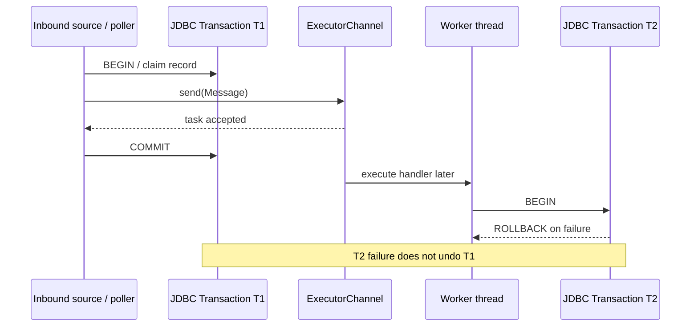
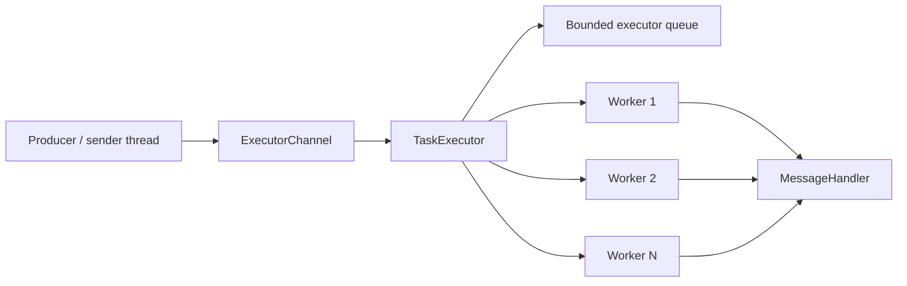
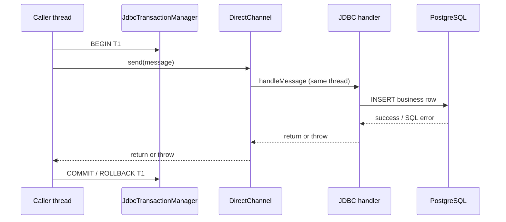
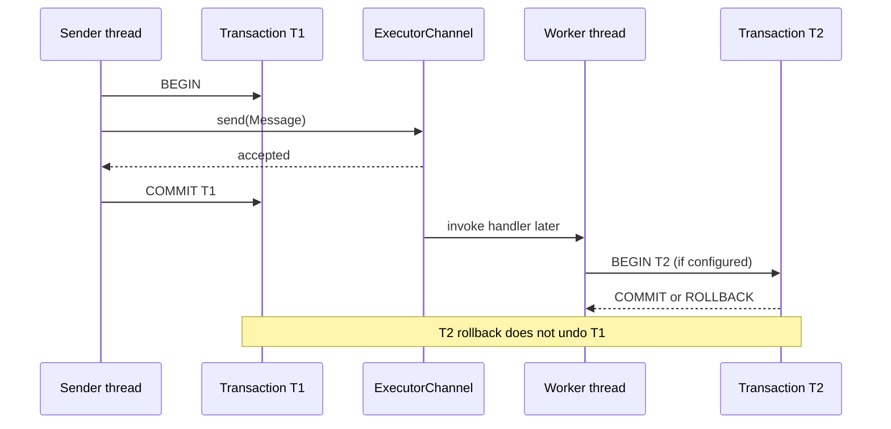
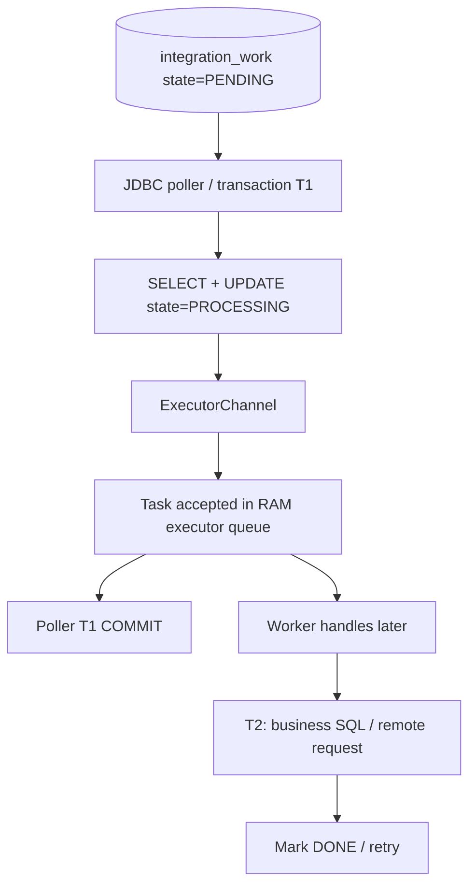
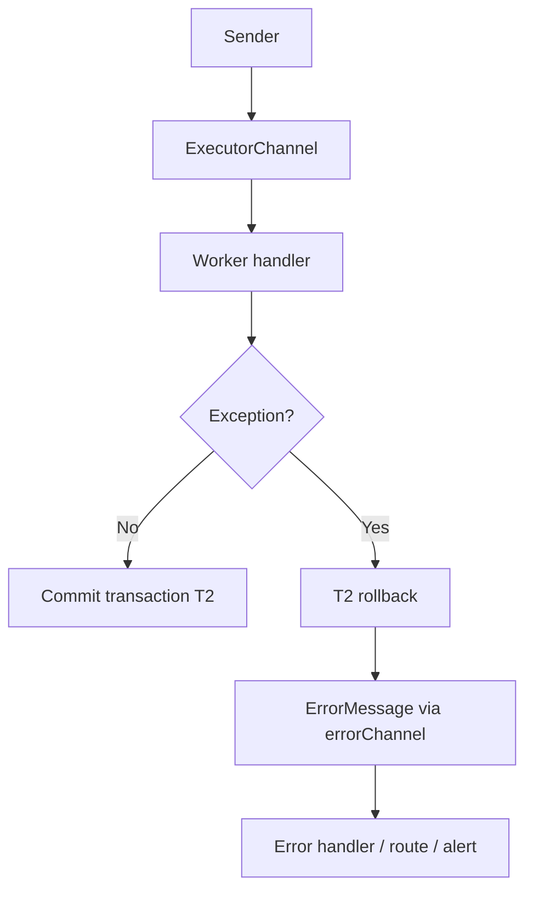
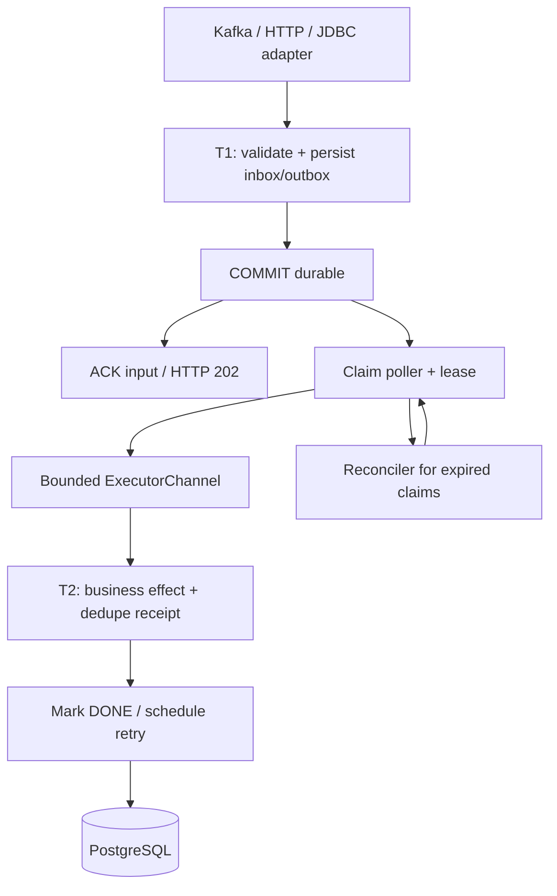
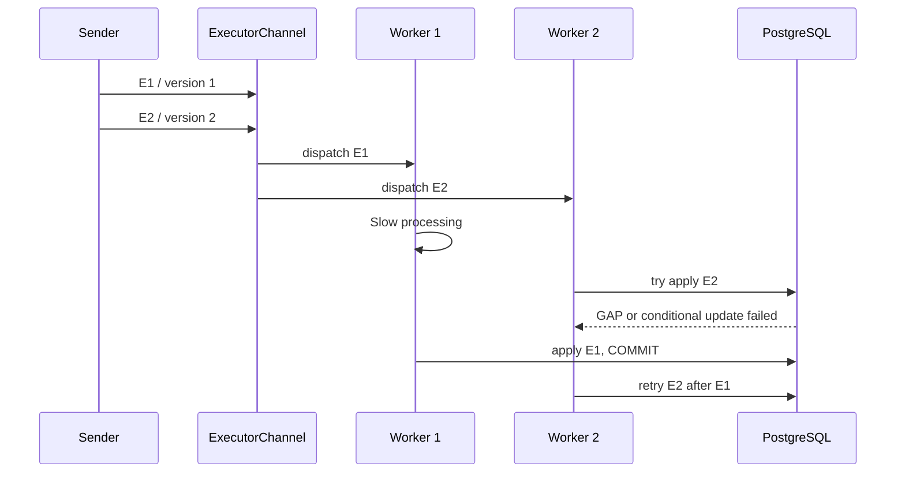
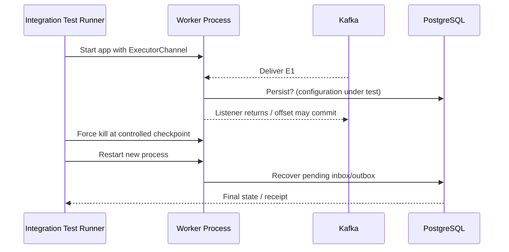
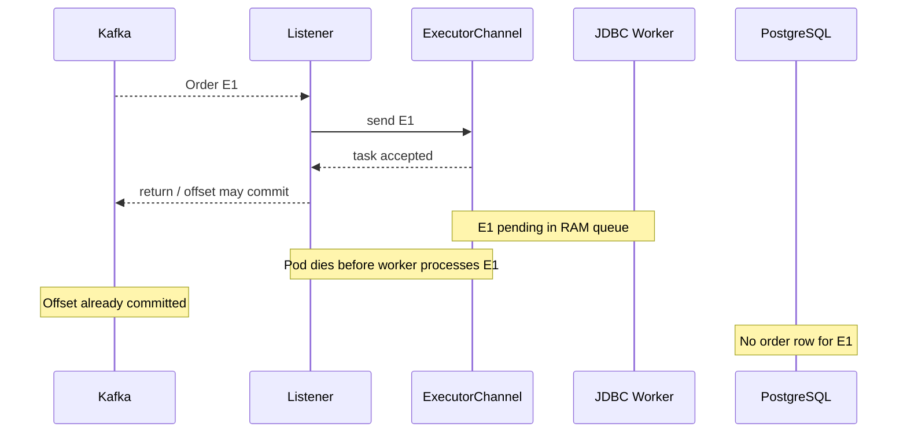

# ExecutorChannel, Thread Boundaries, and Transaction Impact

## 1. The Problem: Processing Faster Yet Committing Before Work Finishes

In a service belonging to the **SPRING_BOOT_INTEGRATION** module, Spring Boot may receive HTTP requests, read a PostgreSQL outbox, consume from Kafka/RabbitMQ/Pulsar, and call partner APIs. Because a handler can occasionally take hundreds of milliseconds, teams often swap a synchronous `DirectChannel` for an `ExecutorChannel` to avoid tying up message-receiving threads.

The change looks simple:

```text
Before:
  Kafka listener -> DirectChannel -> JdbcService -> DB commit -> listener return

After:
  Kafka listener -> ExecutorChannel -> worker -> JdbcService -> DB commit
        |
        +-- listener returns early, may ACK before DB commit
```

In throughput terms, the receiving thread is freed quickly. In correctness terms, **the point where the sender considers work handed off is no longer the point where business state committed**. If a pod dies after the message enters the executor queue but before the JDBC write commits, data can be lost if the broker or HTTP caller already received an ACK without a durable inbox.

Another case: the source is a JDBC poller holding transaction T1 to run `SELECT ... FOR UPDATE` and mark rows `PROCESSING`. Once `ExecutorChannel` accepts the message, T1 can commit before worker transaction T2 even begins. A failure in T2 will not roll back T1.



**Core point:** `ExecutorChannel` is a mechanism for **dispatching through a `TaskExecutor`**, not a durable message queue, a distributed transaction manager, or an API confirming business completion.

### Learning Objectives

After this lesson, you will be able to:

1. Distinguish `DirectChannel`, `ExecutorChannel`, `QueueChannel`, and broker channels across threads, completion timing, errors, and transactions.
2. Explain why JDBC/`JpaTransactionManager` binds transaction context to threads and why switching threads breaks automatic transaction participation.
3. Write Spring Boot Java configuration/`IntegrationFlow` using `ThreadPoolTaskExecutor` with bounded queues and explicit rejection policies.
4. Analyze how `MessageChannel.send()` returning `true` differs from DB commits and broker ACKs.
5. Establish a new transaction on the worker side, isolate the sender's transaction, and design inbox/outbox/idempotency when durability is required.
6. Route `ErrorMessage` to `errorChannel` while recognizing the limits of async error handling and retries.
7. Size concurrency/queue capacity, choose backpressure/load-shedding policies, and avoid `CallerRunsPolicy` breaking transaction assumptions.
8. Write deterministic tests for thread boundaries, independent rollbacks, post-return errors, and shutdown/recovery.
9. Evaluate interactions with HTTP, Kafka, RabbitMQ, Pulsar, R2DBC, Spring Integration pollers, and observability.

> **Illustrative versions:** Spring Boot 3.5.x, Spring Integration 6.x, Spring Framework 6.x, Java 17+, and Spring JDBC/PostgreSQL. Snippets use the Java DSL or `org.springframework.integration.channel.ExecutorChannel` APIs from the 6.x line. ACK policies, async listeners, transactions, and lifecycle must be tested against your project's actual dependency versions. `SPECIAL_NOTE` has no additional constraints for this lesson.

## 2. What Is ExecutorChannel Really?

`ExecutorChannel` is a **point-to-point `SubscribableChannel`**. It uses a dispatcher to pick a subscriber and delegates dispatch execution to an `Executor`/`TaskExecutor`.



Several concepts must be kept separate:

| Concept | Role | What must not be inferred |
| --- | --- | --- |
| `MessageChannel` | `send(Message)` contract | `send()==true` = business work committed |
| `SubscribableChannel` | Subscribed handlers receive messages via dispatch | Persistent message storage |
| `ExecutorChannel` | Dispatches messages through an executor | Shared thread/transaction across sender and worker |
| `TaskExecutor` | Executes `Runnable` per implementation | Always asynchronous (e.g., `SyncTaskExecutor` is not async) |
| `ThreadPoolTaskExecutor` | Pool, queue, rejection, and lifecycle for worker threads | Durable queue or automatic retries |
| `ErrorMessage` | Routes task exceptions to an error flow per framework rules | Error subscriber automatically rolls back sender transaction |
| `PlatformTransactionManager` | Coordinates JDBC/JPA transactions on compatible resources | Automatically carries transactions across executor threads |

Spring Integration's `ExecutorChannel` supports dispatcher settings similar to `DirectChannel`, including **load balancing** and **failover** across multiple subscribers. It does not broadcast; to deliver to every subscriber, look at `PublishSubscribeChannel` and verify its async error and completion semantics.

### 2.1. Why Does `send()` Usually Return Early?

```java
boolean accepted = workChannel.send(
        MessageBuilder.withPayload(orderCommand).build());
```

With a capacity-available asynchronous executor, `send()` typically completes once **the task is accepted by the executor for dispatch**, not when the handler finishes SQL queries or outbound HTTP calls. Consequences:

- `accepted == true` does not prove `OrderService` committed.
- The handler can throw an exception **after the caller has exited the method**.
- The caller cannot always catch worker errors using `try/catch` around `send()`.
- A process crash can lose tasks sitting only in the RAM executor queue.

**Exceptions to remember:** `SyncTaskExecutor` or `CallerRunsPolicy` can cause the handler to execute directly on the sender thread under certain conditions. That is why "usually" matters: `ExecutorChannel` offers no hard guarantee that `send()` is always non-blocking.

### 2.2. It Has a Queue, Yet It Is Not QueueChannel

`ThreadPoolTaskExecutor` can use an internal `BlockingQueue<Runnable>` to hold **tasks**. Spring Integration's `QueueChannel` holds **messages** for a `PollingConsumer` to pull later. Neither is persistent by default:

```text
ExecutorChannel:
  sender -> executor accepts Runnable -> worker calls subscriber

QueueChannel:
  sender -> Message stored in queue -> poller receives -> invokes subscriber
```

Never describe either one as "switching to a Kafka-like durable queue". When you need a durable boundary before ACKing a source, use a properly configured broker or a persistent message store/inbox with transactions and recovery.

## 3. Comparing Channels by Execution Boundary

| Channel | Typical dispatch thread | When does sender return? | Keeps sender JDBC transaction to handler? | Default durability |
| --- | --- | --- | --- | --- |
| `DirectChannel` | Same sender thread | After sync handler returns/throws | **Possible**, with matching resource and propagation | No |
| `ExecutorChannel` | Executor thread | When task is accepted for execution | **Not guaranteed**, typically separate | No |
| `QueueChannel` | Separate poller thread | When message is enqueued | **No**, sender and poller are in separate transactions | No |
| `PriorityChannel` | Separate poller thread | When message is enqueued | Does not carry transaction automatically | No |
| Synchronous `PublishSubscribeChannel` | Sender thread per subscriber per config | After dispatching subscribers per semantics | Can share thread | No |
| `PublishSubscribeChannel` with executor | Executor threads | Does not necessarily wait for all subscribers | Does not carry transaction automatically | No |
| Broker/JMS-backed channel | Depends on container/adapter | Per transport producer/consumer contract | Not automatically the same JDBC transaction | Can be durable **if broker/config supports it** |

**Do not confuse "same thread" with "automatic transaction":** `DirectChannel` does not open a JDBC transaction for you. It simply does not lose an **already active transaction** when the handler runs synchronously on that thread.

### 3.1. DirectChannel: One Synchronous Call Stack



When `JdbcTemplate` and `JdbcTransactionManager` share the same `DataSource`, Spring retrieves the thread-bound connection. Handler exceptions return to the caller, allowing the transaction interceptor to decide rollback rules.

### 3.2. ExecutorChannel: Two Call Stacks and Two Deadlines



Without `@Transactional` or programmatic transactions on the worker, JDBC operations in the handler may run in **autocommit** mode per database/driver defaults. There is no rule where an executor automatically opens a new transaction unless you configure one.

## 4. Thread-Bound JDBC Transactions and Related Context Data

With `JdbcTransactionManager`/`DataSourceTransactionManager`, Spring uses `TransactionSynchronizationManager` to bind connections, transaction metadata, and synchronizations to the current thread.

```text
Thread "kafka-listener-1":
  TransactionSynchronizationManager
     resource: ordersDataSource -> ConnectionHolder of T1
     actualTransactionActive = true
       |
       +-- ExecutorChannel schedules task

Thread "orders-worker-1":
  TransactionSynchronizationManager
     resource: ordersDataSource -> none (initially)
     actualTransactionActive = false (until new @Transactional opens T2)
```

Thread-local transactions are not automatically copied to workers. Manually copying `ConnectionHolder` or transaction ThreadLocals to "pass T1 across" is **wrong and unsafe**: a JDBC transaction/connection has strict ownership, cleanup, and concurrency rules; sharing a connection across threads breaks isolation and causes resource leaks.

### 4.1. Other Context That Can Also Be Lost

Beyond transactions, thread handoffs affect:

- **MDC/correlation ID:** worker logs lose trace IDs unless propagated.
- **SecurityContext:** thread-bound principal/authorizations do not appear automatically on workers.
- **RequestContextHolder:** HTTP servlet request attributes do not follow async tasks by default.
- **Locale/tenant routing ThreadLocals:** queries may hit the wrong tenant or database.
- **Observation/tracing scopes:** spans will not nest under the parent without instrumentation.
- **Reactor Context:** reactive transaction/security context flows with reactive subscriptions, not JDBC ThreadLocals.

A `TaskDecorator` or context propagation helper can assist with MDC/tracing, yet **must never be used to copy JDBC transaction resources to workers**. See the dedicated section on context propagation.

### 4.2. `@Transactional` on the Sender Does Not Cover the Worker

```java
@Transactional(transactionManager = "ordersTransactionManager")
public void accept(OrderCommand command) {
    jdbc.update("INSERT INTO inbox ...");
    workChannel.send(MessageBuilder.withPayload(command).build());
}
```

If `workChannel` is an `ExecutorChannel`, the sender's transaction only covers work on the calling thread. The worker may start after the sender commits, or even **run concurrently before the sender commits**. When the worker queries the newly inserted inbox row, it may **not see the row yet** because T1 has not committed.

This is a subtle, common bug: spawning an async task **inside an uncommitted transaction** creates a race where the worker queries data that is not visible yet.

### 4.3. Rolling Back T1 Does Not Cancel an Executor-Accepted Task

If a sender submits a task to `ExecutorChannel` and a later SQL statement throws, rolling back T1, the task already accepted by the executor **can still run**. `send()` has no mechanism to revoke an enqueued `Runnable` upon outer JDBC rollback.

Therefore, never emit an ephemeral task claiming "approved" from inside an uncommitted transaction as if it were an after-commit event. Persist an **outbox record inside T1** and have a dispatcher emit **after commit**, with retries from durable state.

## 5. Configuring ExecutorChannel with Spring Boot Java Configuration

This example uses:

- A **dedicated** `ThreadPoolTaskExecutor` for the order-processing flow.
- A bounded queue capacity; never rely on an unbounded queue as a default buffer.
- A point-to-point `ExecutorChannel`.
- A `DirectChannel` at ingress before deciding on async handoff.
- Spring Integration-registered `MessageHandler`s, avoiding mixing manual `subscribe()` calls with endpoints on the same channel.

### 5.1. Dependencies

```xml
<dependencies>
    <dependency>
        <groupId>org.springframework.boot</groupId>
        <artifactId>spring-boot-starter-integration</artifactId>
    </dependency>
    <dependency>
        <groupId>org.springframework.boot</groupId>
        <artifactId>spring-boot-starter-jdbc</artifactId>
    </dependency>
    <dependency>
        <groupId>org.postgresql</groupId>
        <artifactId>postgresql</artifactId>
        <scope>runtime</scope>
    </dependency>
</dependencies>
```

You do not need `spring-integration-jdbc` solely to use `ExecutorChannel`. The JDBC adapter module is needed separately when using `JdbcPollingChannelAdapter` or `JdbcMessageHandler`.

### 5.2. Executor Bean with Explicit Bounds

```java
// OrderAsyncConfiguration.java
package example.integration.flow;

import java.util.concurrent.ThreadPoolExecutor;
import org.springframework.beans.factory.annotation.Qualifier;
import org.springframework.context.annotation.Bean;
import org.springframework.context.annotation.Configuration;
import org.springframework.core.task.TaskExecutor;
import org.springframework.integration.channel.DirectChannel;
import org.springframework.integration.channel.ExecutorChannel;
import org.springframework.messaging.MessageChannel;
import org.springframework.scheduling.concurrent.ThreadPoolTaskExecutor;

@Configuration(proxyBeanMethods = false)
public class OrderAsyncConfiguration {

    @Bean("orderWorkExecutor")
    ThreadPoolTaskExecutor orderWorkExecutor() {
        var executor = new ThreadPoolTaskExecutor();
        executor.setThreadNamePrefix("orders-work-");
        executor.setCorePoolSize(4);
        executor.setMaxPoolSize(8);
        executor.setQueueCapacity(100);
        executor.setRejectedExecutionHandler(
                new ThreadPoolExecutor.AbortPolicy());
        executor.setWaitForTasksToCompleteOnShutdown(true);
        executor.setAwaitTerminationSeconds(30);
        return executor;
    }

    @Bean("orderIngress")
    MessageChannel orderIngress() {
        return new DirectChannel();
    }

    @Bean("orderExecutorChannel")
    MessageChannel orderExecutorChannel(
            @Qualifier("orderWorkExecutor") TaskExecutor executor) {
        return new ExecutorChannel(executor);
    }
}
```

Spring manages the lifecycle of the `ThreadPoolTaskExecutor` bean; you typically do not call `initialize()` or `shutdown()` per request. This example uses `AbortPolicy` to **expose overload** so ingress can retry, back off, or persist work rather than silently dropping tasks.

**Read ThreadPoolExecutor scaling carefully:** with `core=4`, `max=8`, and `queueCapacity=100`, once 4 core workers are busy, tasks normally **queue up first**; the pool grows beyond core size only after the queue is full. Thus `maxPoolSize=8` does not mean it runs 8 workers under moderate load.

### 5.3. Return Type `MessageChannel` and Qualifier Injection

A bean declared as `@Bean("orderExecutorChannel")` can be injected via:

```java
public IngressService(
        @Qualifier("orderExecutorChannel") MessageChannel channel) {
    this.channel = channel;
}
```

When multiple `MessageChannel` beans exist in the context, use `@Qualifier` to avoid ambiguity. Even when the bean method returns `MessageChannel`, the runtime instance is the configured `ExecutorChannel`.

## 6. Java DSL: Placing Explicit Async Boundaries in IntegrationFlow

A concrete flow:

```java
// OrderIntegrationFlowConfiguration.java
package example.integration.flow;

import org.springframework.context.annotation.Bean;
import org.springframework.context.annotation.Configuration;
import org.springframework.integration.dsl.IntegrationFlow;

@Configuration(proxyBeanMethods = false)
public class OrderIntegrationFlowConfiguration {

    @Bean
    IntegrationFlow orderIntegrationFlow(
            OrderWorkDispatcher dispatcher) {

        return IntegrationFlow
                .from("orderIngress")
                .channel("orderExecutorChannel")
                .handle(dispatcher, "handle")
                .get();
    }
}
```

In this example, `orderIngress` is a `DirectChannel`, `orderExecutorChannel` is an `ExecutorChannel`, and `OrderWorkDispatcher.handle(...)` is registered via Java DSL. **Do not also add `@ServiceActivator(inputChannel="orderExecutorChannel")` on the same handler** unless you intend to compete across multiple subscribers.

### 6.1. Handler Invoking a Separate Transactional Service

```java
// OrderWorkDispatcher.java
package example.integration.flow;

import org.springframework.stereotype.Component;

@Component
public class OrderWorkDispatcher {

    private final OrderWorkerService worker;

    public OrderWorkDispatcher(OrderWorkerService worker) {
        this.worker = worker;
    }

    public void handle(OrderCommand command) {
        worker.apply(command);
    }
}
```

```java
// OrderCommand.java
package example.integration.flow;

public record OrderCommand(String eventId, String orderId) {
}
```

```java
// OrderWorkerService.java
package example.integration.flow;

import org.springframework.jdbc.core.JdbcTemplate;
import org.springframework.stereotype.Service;
import org.springframework.transaction.annotation.Transactional;

@Service
public class OrderWorkerService {

    private final JdbcTemplate jdbc;

    public OrderWorkerService(JdbcTemplate jdbc) {
        this.jdbc = jdbc;
    }

    @Transactional(transactionManager = "ordersTransactionManager")
    public void apply(OrderCommand command) {
        jdbc.update("""
                INSERT INTO processed_event(event_id, order_id)
                VALUES (?, ?)
                ON CONFLICT (event_id) DO NOTHING
                """, command.eventId(), command.orderId());
    }
}
```

This code assumes the DB has a `processed_event` table and an `ordersTransactionManager` bean configured by the app. In real business flows, **recording a receipt and discarding the payload does not execute business effects**. Add the business SQL updates inside **the same T2** and apply effects only when the event ID was newly claimed; the inbox/outbox section elaborates on this.

**Why separate into two beans?** `OrderWorkDispatcher` is invoked by the executor, while `OrderWorkerService` is a Spring proxy with `@Transactional`. Calling `worker.apply()` through a separate bean ensures transaction advice intercepts the call, avoiding self-invocation bypasses such as `this.apply()` inside the same service.

### 6.2. Ingress Sending into the Flow

```java
// OrderIngressService.java
package example.integration.flow;

import org.springframework.beans.factory.annotation.Qualifier;
import org.springframework.messaging.MessageChannel;
import org.springframework.messaging.support.MessageBuilder;
import org.springframework.stereotype.Service;

@Service
public class OrderIngressService {

    private final MessageChannel input;

    public OrderIngressService(
            @Qualifier("orderIngress") MessageChannel input) {
        this.input = input;
    }

    public void submit(OrderCommand command) {
        boolean accepted = input.send(
                MessageBuilder.withPayload(command).build());
        if (!accepted) {
            throw new IllegalStateException(
                    "Integration flow did not accept command");
        }
    }
}
```

**Never interpret `submit()` returning as "order persisted successfully"**: the method only knows the flow/`ExecutorChannel` accepted the task per dispatch rules. When the worker has not yet finished, if an HTTP status is needed, return `202 Accepted` **only after the request has been durably persisted** (inbox/outbox) or under an explicit async API contract.

### 6.3. Equivalent XML Configuration

For legacy projects using Spring Integration XML configuration:

```xml
<task:executor id="orderWorkExecutor"
               pool-size="4-8"
               queue-capacity="100"
               rejection-policy="ABORT"/>

<int:channel id="orderExecutorChannel">
    <int:dispatcher task-executor="orderWorkExecutor"/>
</int:channel>
```

XML requires the corresponding Spring `task` and `int` namespaces and schema locations. This illustrates the concept, whereas the Java configuration above shows complete beans ready for Spring Boot 3.x. Do not declare duplicate Java and XML beans **with the same names** in one context.

## 7. Observing Thread Handoffs: Log in the Right Places

With `ExecutorChannel`, do not look only at the thread name where the sender calls `send()`; observe the thread inside the handler and at transaction boundaries.

```java
// ThreadBoundaryProbe.java
package example.integration.flow;

import org.springframework.stereotype.Component;
import org.springframework.transaction.support.TransactionSynchronizationManager;

@Component
public class ThreadBoundaryProbe {

    public void logContext(String stage) {
        String thread = Thread.currentThread().getName();
        boolean transactionActive =
                TransactionSynchronizationManager.isActualTransactionActive();

        System.out.printf(
                "stage=%s thread=%s txActive=%s%n",
                stage, thread, transactionActive);
    }
}
```

If you call `probe.logContext("before-send")` from a `@Transactional` sender, `probe.logContext("worker-before-tx")` from `OrderWorkDispatcher.handle()`, and `probe.logContext("worker-inside-tx")` from `OrderWorkerService.apply()`, logs typically resemble:

```text
stage=before-send thread=http-nio-8080-exec-2 txActive=true
stage=worker-before-tx thread=orders-work-1 txActive=false
stage=worker-inside-tx thread=orders-work-1 txActive=true
```

These are illustrative logs; exact thread names and line order vary under load. Two lines reporting `txActive=true` **are not the same transaction**. They can belong to different threads, connections, and start times.

### 7.1. A Singleton Bean Does Not Share Transactions

A singleton `OrderWorkerService` bean can be called concurrently by multiple executor threads. Singleton bean scope does not mean a JDBC `Connection` or transaction is shared. Spring acquires/binds connections via the transaction manager and `DataSource` per invocation.

### 7.2. Do Not Guess Completion Timing from Log Order

`after-send` may be logged before or after `worker-start`. Use `eventId`, `correlationId`, enqueue timestamps, worker start/end timestamps, and transaction commit outcomes rather than relying on log line order. Across multiple pods, clocks can also skew.

## 8. Two Transactions T1/T2: `@Transactional` on Each Side

A sender runs a JDBC transaction and then hands work off asynchronously:

```java
// OrderCommandSubmission.java
package example.integration.flow;

import org.springframework.stereotype.Service;
import org.springframework.transaction.annotation.Transactional;

@Service
public class OrderCommandSubmission {

    private final OrderIngressService ingress;
    private final SenderReceiptRepository receipts;

    public OrderCommandSubmission(
            OrderIngressService ingress,
            SenderReceiptRepository receipts) {
        this.ingress = ingress;
        this.receipts = receipts;
    }

    @Transactional(transactionManager = "ordersTransactionManager")
    public void accept(OrderCommand command) {
        receipts.insertReceipt(command);
        ingress.submit(command); // async handoff before T1 commit
    }
}
```

`SenderReceiptRepository` is a project-supplied repository sharing the orders `DataSource`. The snippet **intentionally illustrates an anti-pattern** if the worker assumes the receipt is already committed. The worker can execute before T1 commits; furthermore, T1 can roll back after the task has been accepted.

### 8.1. Timeline to Account For

| Time | Sender T1 | Executor | Worker T2 |
| --- | --- | --- | --- |
| t0 | Begin | No task yet | Not running |
| t1 | INSERT receipt, uncommitted | No task yet | Not running |
| t2 | `send()` | Task accepted | May begin running |
| t3 | Commit or rollback | Queue/worker proceeds | May query before T1 commits |
| t4 | T1 ends | Task running/finished | Commit or rollback T2 |

`ExecutorChannel` **does not establish a happens-before relation where T1 commits before T2 begins** merely because `send()` is the last line of a `@Transactional` method.

### 8.2. Is Scheduling After Commit Enough?

Spring transaction synchronization allows an `afterCommit()` callback:

```java
// Illustrates the mechanism, not durable delivery:
TransactionSynchronizationManager.registerSynchronization(
        new TransactionSynchronization() {
            @Override
            public void afterCommit() {
                ingress.submit(command);
            }
        });
```

Imports:

```java
import org.springframework.transaction.support.TransactionSynchronization;
import org.springframework.transaction.support.TransactionSynchronizationManager;
```

The callback avoids having the worker query uncommitted rows, yet **is not crash-safe**. If the DB commits and the JVM dies before `afterCommit()` fires, the task is never dispatched. If the executor rejects after commit, T1 cannot roll back either. Use this for best-effort notifications or cache hints, not mandatory business events.

### 8.3. Durable Solution: Transactional Outbox

```text
T1:
  INSERT orders
  INSERT integration_outbox(eventId, payload, state=PENDING)
  COMMIT

Independent publisher:
  claim pending outbox
  ExecutorChannel / bounded worker
  publish HTTP/broker
  mark success / retryable
```

Both the order and the outbox row are written within the **same DataSource/transaction**. After a crash, pending events remain in the DB and can be replayed. An executor remains useful for bounded concurrency, while recovery never depends on a RAM queue.

### 8.4. Workers Must Target the Right DataSource Transaction Manager

`OrderWorkerService.apply()` specifies `@Transactional(transactionManager = "ordersTransactionManager")` and is intercepted by a Spring proxy, creating/joining a transaction on the **worker thread**. If the handler also uses an `auditJdbcTemplate` bound to a different datasource, T2 does not cover audit SQL automatically. Similarly, `R2dbcTransactionManager` binds to a reactive context rather than turning JDBC handlers into reactive transaction participants.

## 9. JDBC Pollers: Where ExecutorChannel Easily Drops Work

A Spring Integration JDBC inbound adapter typically polls, claims rows, and sends messages downstream. When the poller has transaction advice and downstream runs synchronously, handler failures can roll back the claim.



### 9.1. Comparing Transaction Outcomes

| Configuration | Downstream failure | Claim transaction |
| --- | --- | --- |
| Poller transaction advice + `DirectChannel` + sync JDBC handler | Exception can return to poller | SELECT/claim and business SQL can roll back together in T1 |
| Poller transaction advice + `ExecutorChannel` | Error happens in worker after handoff | T1 has usually already committed; does not roll back |
| Poller without transaction advice | SELECT/UPDATE may autocommit separately | No atomic read/claim guarantee |
| In-memory `QueueChannel` + downstream poller | Exception on a different receiver thread | Sender T1 does not roll back automatically |

`maxMessagesPerPoll` bounds poll invocations per tick, **not** total worker tasks in the executor queue. One message carrying 100 rows can be split into 100 tasks by a splitter.

### 9.2. Why a `PROCESSING` State Alone Is Not Enough

If T1 commits `PROCESSING` and the pod crashes, the row is no longer `PENDING`. Without recovery logic, it stays stuck forever:

- Add `claimed_by`, `lease_until`, or an attempt token.
- Have a reconciler reclaim expired leases in a controlled manner.
- Use fencing/conditional updates to stop stale workers from overwriting new owners.
- Maintain unique receipts, stable `eventId`s, and idempotency for redeliveries.
- Enforce retry budgets and DLT/parking for poison messages.

### 9.3. Keep Transactions Short Around HTTP Partners

Never hold a `SELECT ... FOR UPDATE` transaction open for 10 seconds while calling an HTTP API. Stable pattern:

```text
T1: claim up to N rows under DB lock, store lease, COMMIT
Worker: external HTTP/broker call with stable idempotency key
T2: conditional UPDATE success/failure and COMMIT
Recovery: reprocess expired/failed work
```

This design embraces at-least-once execution while protecting outcomes with idempotency. **T1 and T2 do not merge into a single transaction** just because they hit the same database.

## 10. Kafka Listener → ExecutorChannel: ACKing Before DB Commit

Anti-pattern example:

```java
// Listener only enqueues work, has not committed business DB
@KafkaListener(topics = "orders.status.v1", groupId = "orders-consumer")
public void onOrder(OrderCommand command) {
    orderIngressService.submit(command);
    // Returns before async worker completes.
}
```

If `orderIngress` → `ExecutorChannel`, the listener returns as soon as the task is accepted. The Spring Kafka container can commit the offset per listener success/ack mode **before T2 commits**. If the JVM dies after offset commit and before the worker writes the DB, the event is lost.

### 10.1. Two Safer Patterns

**Pattern A — synchronous up to a durable point:**

```text
Kafka listener -> DirectChannel
  -> transactional JDBC handler / inbox write
  -> DB COMMIT
  -> listener return
  -> ACK/offset commit according to container policy
```

**Pattern B — durable inbox before ACK, async worker:**

```text
Kafka listener:
  T1 INSERT inbox(eventId,payload,state=PENDING)
  T1 COMMIT
  listener return -> broker ACK according to policy

Worker:
  poll/claim inbox
  T2 apply business effect + receipt
  mark DONE or retryable
```

If a crash happens after inbox commit and before ACK, the record is redelivered; the unique key on `eventId` keeps the next inbox insert idempotent. If ACK happened before the worker ran, the inbox row remains `PENDING` for recovery.

### 10.2. Partition Ordering vs. Worker Ordering

Kafka preserves offset order per partition under proper configuration. However, if a listener dispatches E1 and E2 into an executor, E2 can finish T2 **before E1**. When business logic requires version 1 before version 2, use per-key serialization/partitioned workers or a DB version guard + gap parking/reconciliation.

### 10.3. ACK Modes Must Be Verified

```yaml
spring:
  kafka:
    consumer:
      enable-auto-commit: false
      group-id: orders-consumer
    listener:
      ack-mode: record
```

`ack-mode: record` tells the container to process offset commits per policy after the listener call finishes—**it does not automatically wait for executor workers**. Some Spring Kafka versions support async listener return types/callbacks; use exact API/container settings and test completion, errors, and rebalances. Returning `CompletableFuture.completedFuture(null)` right after enqueuing is still an early ACK.

### 10.4. Crash Windows to Test

| Where did the crash occur? | RAM ExecutorChannel | Durable inbox |
| --- | --- | --- |
| Before DB commit and before Kafka ACK | Broker can redeliver | Redelivery retries inbox |
| After Kafka ACK before worker DB commit | **Can lose business event** | Inbox stays `PENDING` |
| After DB commit before Kafka ACK | Possible duplicate effect without receipt | Receipt/idempotency blocks duplicate |
| After outbound Kafka ACK before outbox mark-published | Can republish | Stable `eventId` and downstream dedup |

Kafka transaction semantics have a broker-specific scope; they do not automatically form a general distributed transaction across PostgreSQL, HTTP, and Kafka.

## 11. RabbitMQ, Pulsar, and HTTP: Same Fundamental ACK Boundary

```text
RabbitMQ listener -> ExecutorChannel -> JDBC worker
Pulsar listener   -> ExecutorChannel -> JDBC worker
HTTP controller   -> ExecutorChannel -> JDBC worker
```

Common trait: **the caller can return right after handoff while business work finishes later**. Differences lie in transport contracts and error/ack handling.

### 11.1. RabbitMQ Auto vs. Manual ACK

With a Spring AMQP listener container configured for automatic acknowledgement, normal listener return triggers ACK regardless of whether an async worker committed. With manual ACK, only ACK after a durable point, adhering strictly to RabbitMQ channel/delivery-tag contracts and thread safety.

Test these cases:

1. DB commits yet ACK is lost due to connection drop → redelivery, receipt blocks duplicate effects.
2. ACK after RAM queue enqueue before DB commit → demonstrates event loss on JVM crash.
3. Handler throws → NACK/requeue/DLQ policy applies without swallowing exceptions.
4. High prefetch + multiple consumers → completion order can differ from delivery order.
5. Shutdown with unacked messages → replacement consumer reprocesses idempotently.

`auto` in Spring AMQP containers **does not** mean RabbitMQ wire-level `autoAck=true` (no-ack) as the name might suggest; check actual APIs/settings to know when the container ACKs.

### 11.2. Pulsar Subscription Semantics

Pulsar offers Exclusive, Failover, Shared, and Key_Shared subscription modes. With `Key_Shared`, the broker can provide key affinity/ordering under proper conditions, yet if the consumer hands messages for one key into a multi-worker executor pool, **DB completion order can still invert**.

Pulsar's broker/producer-assigned message ID is a transport identifier. The same business event can be republished with a new message ID; carry a stable `eventId` in the payload or business metadata.

Ack/nack, ack timeout, redelivery, and dead-letter handling depend on Spring Pulsar version, subscription type, and listener container. Never assume `ExecutorChannel.send()` means the Pulsar message succeeded.

### 11.3. What Does HTTP 202 Accepted Mean?

An illustrative controller:

```java
@PostMapping("/orders")
public ResponseEntity<Void> submit(@RequestBody OrderCommand command) {
    ingress.submit(command);
    return ResponseEntity.accepted().build();
}
```

This is an **anti-pattern** if the business contract treats `202` as "server durably accepted the work", when in reality it only queued a task in RAM. For critical orders/payments:

- Persist request/inbox/operation state before returning `202`.
- Return an operation ID so clients can poll status.
- Require an `Idempotency-Key` with scope/TTL and handle key reuse with different payloads.
- If the executor is overloaded before persistence, return `429`/`503` or a contract-defined retryable error instead of reporting "accepted".

Not every HTTP `202` requires an inbox by HTTP spec, yet **the business contract** must be honest about durability and recovery.

### 11.4. Request-Reply Gateways Differ from Fire-and-Forget Sends

If a caller uses `@MessagingGateway` expecting a reply across an `ExecutorChannel`, the proxy can wait on the reply channel until the handler returns or times out. However:

- Gateway timeout **does not cancel an in-flight JDBC query/task**.
- A late reply after timeout is discarded.
- Caller retries after timeout still require idempotency.
- `replyTimeout` is not equivalent to a SQL statement timeout.
- If the caller keeps JDBC transaction T1 open while waiting for the reply, the worker cannot see T1's uncommitted writes and may hit lock waits or deadlocks.

Never switch a synchronous request-reply HTTP endpoint to fire-and-forget async solely to shave request latency without changing the API contract.

## 12. Executor Saturation: Pool, Queue, and Rejection

In `ThreadPoolTaskExecutor`, `corePoolSize`, `maxPoolSize`, and `queueCapacity` govern behavior together:

```text
corePoolSize=4, maxPoolSize=8, queueCapacity=100

First tasks:    create up to 4 core threads
Core busy:      queue up to 100 pending tasks
Queue full:     grow towards 8 max threads
Max and full:   reject according to configured policy
```

If Hikari `maximumPoolSize=6`, an executor max of 64 simply forces dozens of workers to block waiting for JDBC connections. Adding threads will not raise throughput; it can cause connection acquisition timeouts and retry storms.

### 12.1. AbortPolicy: Make Overload Visible

```java
executor.setRejectedExecutionHandler(
        new ThreadPoolExecutor.AbortPolicy());
```

When both the queue and pool are full, submissions are rejected (typically surfacing in Spring `TaskExecutor` as `TaskRejectedException`). This is a **send/submission-time failure**, distinct from exceptions thrown by a handler **after task acceptance**.

Source policies:

- Kafka/Rabbit listeners: let the container error handler trigger retry/NACK per config; **do not ACK** without a durable receipt.
- HTTP: if operation state is not saved yet, return an error or rate-limit per contract while preserving idempotency.
- DB poller: let the claim transaction roll back or preserve recovery state per transaction scope.
- Already ACKed before queue admission: cannot recover from a RAM queue; requires a durable inbox/outbox.

### 12.2. DiscardPolicy/DiscardOldestPolicy Can Lose Messages

These rejection policies silently drop a new task or evict an older queued task. That is usually **unacceptable** for orders, payments, or outbox events. Consider them only when messages are genuinely droppable, such as best-effort cache refreshes or regenerable telemetry signals.

### 12.3. CallerRunsPolicy: Backpressure That Alters Thread Semantics

```java
executor.setRejectedExecutionHandler(
        new ThreadPoolExecutor.CallerRunsPolicy());
```

When the queue is full and the pool is saturated, the JDK executor runs the task **directly on the sending thread**. While this throttles the sender to create backpressure, it introduces a serious trap:

1. Under light load, the handler runs on a worker thread, isolated from JDBC transaction T1.
2. Under heavy load, the handler runs on the sender thread, potentially seeing T1.
3. `send()` now **blocks** until the handler completes.
4. Error propagation and transaction participation flip depending on load.
5. If the sender is a Kafka listener, JDBC poller, or Netty event loop, blocking handlers unexpectedly run on those threads.
6. Once the executor shuts down, JDK `CallerRunsPolicy` may skip running tasks; never view it as a durability guarantee.

**Never rely on `CallerRunsPolicy` to "restore" transaction context.** Spring Integration documentation warns this behavior is unpredictable; transaction design must be sound regardless of which thread runs the handler.

### 12.4. SyncTaskExecutor Is Not a Concurrency Solution

`SyncTaskExecutor` runs tasks on the sender thread. Pairing it with `ExecutorChannel` provides no offloading; if synchronous execution is required, use `DirectChannel` explicitly rather than surprising callers via an executor implementation.

## 13. Bounded Queues and End-to-End Backpressure

If arrival rate \(\lambda\) exceeds service rate \(\mu\), backlog grows:

\[
\Delta Q \approx (\lambda-\mu)\Delta t,\quad \lambda>\mu.
\]

For example, if a source delivers 250 messages/sec while workers/DB finish 180 messages/sec, in 60 seconds the backlog grows by roughly:

\[
(250-180)\times 60=4\,200\text{ messages}.
\]

A queue capacity of 100 only absorbs brief bursts; **it can never permanently compensate for a downstream slower than ingress**.

### 13.1. Bound Concurrency to Downstream Limits

| Component | Limit | Risk |
| --- | --- | --- |
| Executor | `core/max/queueCapacity` | RAM queue growth, task rejections |
| PostgreSQL | Hikari connections, query/lock timeouts | Pool saturation / long locks |
| Partner HTTP | Connection pool, rate quota, p99 latency | 429 / timeouts / unknown outcomes |
| Kafka | Partition assignment, max poll interval, lag | Rebalances / duplicate redeliveries |
| RabbitMQ | Prefetch, consumers, unacked count | Excess in-flight buffering |
| Pulsar | Receiver queue, listener concurrency, ACK | Backlog / redeliveries |
| Spring Integration poller | `maxMessagesPerPoll`, `fixedDelay` | Query rate != rows processed |

Bumping `maxPoolSize` from 8 to 64 can exhaust a 6-connection Hikari pool faster and degrade all requests. Measure before/after and size concurrency to DB and partner budgets.

### 13.2. `send accepted` Is an Ingress Metric, Not Business Completion

```text
messages.received
messages.executor.accepted
messages.executor.rejected
messages.worker.started
messages.worker.db.committed
messages.worker.failed
messages.durable.pending.oldest_age
```

These metric names are **illustrative instrumentation targets**, not default meter names automatically exported by every Spring version. Separate executor task counts from durable DB/broker backlogs.

### 13.3. A Queue Size of 0 Does Not Prove All Work Completed

When a JVM is killed, the RAM executor queue disappears; upon restart, queue size reads 0 even though prior tasks never committed. Monitoring must correlate business receipts, inbox/outbox states, and source ACK progress.

## 14. Asynchronous Errors: errorChannel and ErrorMessage

A synchronous `DirectChannel` normally returns handler exceptions to the caller; with `ExecutorChannel`, handler exceptions occur inside executor tasks **after the caller has returned**.



Spring Integration supports publishing an `ErrorMessage` to a message's **`errorChannel` header** if supplied, or to the global `errorChannel` via its error-publishing infrastructure. By default, the global `errorChannel` has a logging subscriber; **logging is not durable retry**.

### 14.1. Pinpoint Where Failures Occur

| Failure point | Visible to sender? | How to handle |
| --- | --- | --- |
| Channel has no subscribers | Can fail right at `send()` | Check flow wiring/startup |
| TaskExecutor rejects task | Can throw at submission | Backpressure/retry at source; do not mis-ACK |
| Worker JDBC query fails after task accepted | Usually not directly | Roll back T2; `errorChannel`/error handler/recovery |
| Error handler itself fails | No guaranteed source redelivery | Monitor error flow; avoid losing errors |
| Partner HTTP times out after processing request | Cannot conclude effect did not occur | Idempotency key and reconciliation |

### 14.2. Registering an Error Handler

```java
// IntegrationErrorLogger.java
package example.integration.flow;

import org.springframework.integration.annotation.ServiceActivator;
import org.springframework.messaging.support.ErrorMessage;
import org.springframework.stereotype.Component;

@Component
public class IntegrationErrorLogger {

    @ServiceActivator(inputChannel = "errorChannel")
    public void onError(ErrorMessage errorMessage) {
        Throwable failure = errorMessage.getPayload();
        // Replace with structured logging/metrics with sensitive fields masked.
        System.err.println("Async integration failure: "
                + failure.getClass().getSimpleName());
    }
}
```

This example only prints the exception type and performs no retries. When adding your own error handler, inspect existing subscribers on `errorChannel` and framework logging policies; never assume registering this method completely replaces built-in error loggers.

### 14.3. Specifying a Per-Message Error Channel

```java
Message<?> message = MessageBuilder.withPayload(command)
        .setHeader(
                MessageHeaders.ERROR_CHANNEL,
                "ordersIntegrationErrors")
        .build();
```

Required imports:

```java
import org.springframework.messaging.Message;
import org.springframework.messaging.MessageHeaders;
import org.springframework.messaging.support.MessageBuilder;
```

Create the `ordersIntegrationErrors` `MessageChannel` bean with an attached error handler subscriber, and verify how your components resolve error channels. Never replace proper error handling with a header string pointing to a channel with no subscriber.

### 14.4. ErrorMessage Does Not Roll Back T1 or Requeue Broker Records

If sender T1 already committed, an `ErrorMessage` on a worker thread is **post-commit error information**, not a rollback command. Even if an error flow inserts a new database row, it cannot undo an earlier HTTP or Kafka side effect. Recovery requires a state machine, retry budget, and durable inbox/outbox/DLT.

### 14.5. Never Swallow Exceptions to Fool Transactions

```java
try {
    jdbc.update("...");
} catch (DataAccessException ex) {
    log.error("failed", ex);
    return; // transaction interceptor may commit unless marked rollback-only
}
```

If an exception must roll back T2, let it propagate or explicitly mark rollback using Spring transaction APIs. Classify transient failures (DB connections/deadlocks), permanent payload errors, valid duplicates, and unknown partner outcomes. `errorChannel` does not classify errors for you.

## 15. Explicitly Configuring the Worker's Transaction Manager

For a JDBC business operation, configure a `JdbcTransactionManager` bound to the right `DataSource`:

```java
// JdbcTxConfiguration.java
package example.integration.flow;

import javax.sql.DataSource;
import org.springframework.beans.factory.annotation.Bean;
import org.springframework.context.annotation.Configuration;
import org.springframework.jdbc.support.JdbcTransactionManager;
import org.springframework.transaction.PlatformTransactionManager;

@Configuration(proxyBeanMethods = false)
public class JdbcTxConfiguration {

    @Bean("ordersTransactionManager")
    PlatformTransactionManager ordersTransactionManager(
            DataSource dataSource) {
        return new JdbcTransactionManager(dataSource);
    }
}
```

Boot may auto-configure a manager when a single datasource exists under standard conditions, yet an explicit bean name makes `@Transactional("ordersTransactionManager")` on workers unambiguous. If the project uses Hibernate/JPA, `JpaTransactionManager` is normally appropriate for JPA workflows; never blindly replace it with a JDBC manager.

### 15.1. Self-Invocation Bypasses Transaction Advice

```java
public void handle(OrderCommand command) {
    this.apply(command); // self-invocation: @Transactional proxy can be bypassed
}

@Transactional("ordersTransactionManager")
public void apply(OrderCommand command) {
    // SQL work
}
```

With Spring proxy-based transactions, `this.apply()` inside the same object skips the proxy. Separating `OrderWorkDispatcher` and `OrderWorkerService` in Section 6 prevents this bug.

### 15.2. REQUIRES_NEW Does Not Link T2 to T1

`PROPAGATION_REQUIRES_NEW` on a worker does not enlist it in a sender's T1 on another thread; it creates a fresh transaction in the worker's current scope. In synchronous flows, it can also commit independently when an outer transaction rolls back, changing atomicity. Test propagation per domain rather than dropping in `REQUIRES_NEW` as a magic fix.

### 15.3. When Handlers Also Call HTTP or Kafka

JDBC T2 does not pull remote HTTP calls or broker sends into an atomic overarching transaction. Keep T2 very short, write intent/outbox rows alongside business tables, and publish/update status afterward with retries and idempotency. If legacy constraints force partner calls inside T2, enforce strict query/HTTP deadlines, connection budgets, and lock-duration analysis.

## 16. Inbox/Outbox: Making ExecutorChannel Useful Without Losing Work

`ExecutorChannel` works safely in reliable flows when the source of truth is a **durable work store** and the executor is merely a concurrency dispatcher for pending work:



**What this solves:** if the executor queue vanishes in a crash, rows in the database remain `PENDING` or `PROCESSING` with expiring leases, allowing a reconciler to pick them back up. You do not rely on Spring Integration persisting in-memory `Runnable`s in the thread pool.

### 16.1. Illustrative Inbox Schema

```sql
CREATE TABLE integration_inbox (
    event_id VARCHAR(120) PRIMARY KEY,
    aggregate_id VARCHAR(80) NOT NULL,
    payload_json JSONB NOT NULL,
    payload_hash VARCHAR(64) NOT NULL,
    state VARCHAR(20) NOT NULL DEFAULT 'PENDING',
    attempts INTEGER NOT NULL DEFAULT 0,
    claimed_by VARCHAR(120),
    claim_token BIGINT NOT NULL DEFAULT 0,
    lease_until TIMESTAMPTZ,
    next_attempt_at TIMESTAMPTZ NOT NULL DEFAULT now(),
    created_at TIMESTAMPTZ NOT NULL DEFAULT now(),
    processed_at TIMESTAMPTZ
);

CREATE INDEX idx_inbox_pending
    ON integration_inbox (next_attempt_at, created_at)
    WHERE state = 'PENDING';

CREATE TABLE processed_event (
    event_id VARCHAR(120) PRIMARY KEY,
    order_id VARCHAR(80) NOT NULL,
    processed_at TIMESTAMPTZ NOT NULL DEFAULT now()
);
```

`payload_hash` detects **the same `eventId` carrying a different business payload**; compare fingerprints only when canonicalization/serialization is deterministic under the event contract. If `eventId` is only unique per producer, use a composite key of producer namespace + event ID.

### 16.2. Persist Inbox Before ACKing

```sql
INSERT INTO integration_inbox (
    event_id, aggregate_id, payload_json, payload_hash
) VALUES (
    :eventId, :aggregateId, CAST(:payload AS jsonb), :payloadHash
)
ON CONFLICT (event_id) DO NOTHING;
```

**Never assume `DO NOTHING` means all duplicates are benign**: when affected rows = 0, read the stored receipt/payload hash and compare; a mismatched payload is a contract violation. The inbox write must commit **before** the listener ACKs the source. If commit succeeds yet ACK fails, redelivery remains safe thanks to the unique key.

### 16.3. Claiming with a Short Transaction

PostgreSQL can claim rows atomically with `FOR UPDATE SKIP LOCKED`:

```sql
WITH picked AS (
    SELECT event_id
    FROM integration_inbox
    WHERE state = 'PENDING'
      AND next_attempt_at <= now()
    ORDER BY next_attempt_at, created_at
    LIMIT 10
    FOR UPDATE SKIP LOCKED
)
UPDATE integration_inbox AS i
SET state = 'PROCESSING',
    attempts = attempts + 1,
    claimed_by = :workerId,
    claim_token = claim_token + 1,
    lease_until = now() + INTERVAL '60 seconds'
FROM picked
WHERE i.event_id = picked.event_id
RETURNING i.event_id, i.aggregate_id,
          i.payload_json, i.claim_token;
```

This is **PostgreSQL-specific SQL** executed in a short transaction. The `RETURNING` clause hands back a claim token that the worker presents when recording the outcome, avoiding holding row locks during multi-second HTTP or Kafka calls.

### 16.4. Lease Expiry Does Not Prove the Previous Worker Died

Suppose Worker A hits a GC pause longer than 60 seconds; a reconciler reclaims the event and Worker B starts processing it. Worker A wakes up and might still call the partner API. Therefore:

- Verify `claimed_by` and `claim_token` in conditional outcome updates.
- Use unique `eventId`/business receipts and external idempotency keys to block double effects.
- Fencing tokens alone cannot stop an HTTP partner lacking version/idempotency support; reconcile unknown outcomes.

```sql
UPDATE integration_inbox
SET state='DONE',
    processed_at=now(),
    claimed_by=NULL,
    lease_until=NULL
WHERE event_id=:eventId
  AND claimed_by=:workerId
  AND claim_token=:claimToken
  AND state='PROCESSING';
```

If affected rows = 0, the worker lost claim ownership; investigate/reconcile rather than unconditionally marking `DONE`.

### 16.5. Transactional Business Effect + Receipt

Inside worker T2:

```text
BEGIN
  attempt INSERT processed_event(eventId) with unique constraint
  if newly inserted:
      update business table(s)
  mark inbox DONE with claim token / outcome
COMMIT
```

If business updates fail, both the receipt and outcome update roll back together. If the event was already processed earlier, the worker skips re-applying business effects. For critical data, distinguish **identical duplicate payloads** from an `eventId` reused for different content.

### 16.6. Outbox for Outbound Publishing

When worker T2 succeeds and needs to publish a downstream message:

```text
T2:
  UPDATE orders
  INSERT processed_event
  INSERT integration_outbox(eventId, payload, state=PENDING)
  COMMIT

Publisher:
  claim outbox
  broker.send(eventId)
  wait for broker ACK
  mark outbox PUBLISHED / retry
```

If the broker receives the event yet the app crashes before `markPublished`, the outbox may resend. **Downstream consumers must deduplicate by stable `eventId`.** Never claim atomic exactly-once across PostgreSQL and HTTP/brokers without a real coordination mechanism.

## 17. Ordering and Concurrency: ExecutorChannel Can Invert Completion Order

An order receives two events:

```text
E1: orderId=ORD-42, version=1, status=CONFIRMED
E2: orderId=ORD-42, version=2, status=PAID
```

The sender submits E1 then E2 to `ExecutorChannel`. Worker W1 stalls on E1 due to a lock or partner call while W2 finishes E2 quickly:



Point-to-point dispatch and a FIFO task queue **do not guarantee FIFO completion** across multiple workers. If per-order ordering is required, use one of these strategies:

1. **Per-key serial execution:** route the same `orderId` to one ordered worker/lane, with bounded concurrency and recovery.
2. **Database sequence/CAS:** `UPDATE ... WHERE version = incomingVersion - 1`; if a prior version is missing, persist a gap/park record and reconcile.
3. **Broker ordering + synchronous handler:** preserve partition/key order through the commit boundary without adding an executor pool that reorders.
4. **Latest-wins snapshot:** valid only when the contract truly sends full snapshots and allows skipping intermediate states; unsuitable for delta ledgers.

### 17.1. Unique Receipts and Aggregate Version Guards Solve Different Bugs

```sql
-- Prevent duplicate delivery of the same business event:
PRIMARY KEY (consumer_name, event_id)

-- Prevent out-of-order overwrites on one order:
UPDATE order_projection
SET version = :v, order_status = :status
WHERE order_id = :orderId
  AND version = :v - 1;
```

Unique receipts prevent **the same `eventId`** from applying twice; version guards prevent **two distinct events** from updating versions out of order. Neither replaces the other.

### 17.2. If One Order Needs 100% Serial Execution, One Global Executor Is Too Restrictive

Setting `maxPoolSize=1` serializes the entire system, letting one slow order or partner block everything else. Sharding by key across N lanes or using broker partition/key affinity preserves parallelism **across orders** while enforcing serialization **within each order**. You still need idempotency on redelivery and ordering contracts across retry topics.

### 17.3. Never Use Timestamps in Place of Aggregate Sequence

Producer `occurredAt` suffers clock skew, and `receivedAt` shifts with network delays and retries. When business logic depends on causal order, define an authoritative version/sequence or a reliable state machine. Async executors have no knowledge of business ordering rules.

## 18. Propagating MDC, SecurityContext, and Traces Across Executors

Thread handoffs also impact observability and security:

```text
HTTP request thread:
  MDC traceId=abc
  SecurityContext user=U
  TenantContext tenant=A

Executor worker:
  MDC / SecurityContext / TenantContext
  may be absent unless explicitly propagated
```

### 18.1. TaskDecorator for MDC (Tracing Context Only, Not Transactions)

```java
// Example added to the ThreadPoolTaskExecutor bean
executor.setTaskDecorator(task -> {
    var captured = MDC.getCopyOfContextMap();
    return () -> {
        var previous = MDC.getCopyOfContextMap();
        try {
            if (captured == null) {
                MDC.clear();
            } else {
                MDC.setContextMap(captured);
            }
            task.run();
        } finally {
            if (previous == null) {
                MDC.clear();
            } else {
                MDC.setContextMap(previous);
            }
        }
    };
});
```

Requires `import org.slf4j.MDC;`. Configure `TaskDecorator` on `ThreadPoolTaskExecutor` **before Spring initializes the pool and accepts tasks**; this snippet covers MDC only. Restoring the prior context in `finally` prevents a reused worker thread from leaking one request's trace data into the next.

### 18.2. Never Propagate Privileges from Unverified HTTP Headers

If a worker uses tenant/security context to pick a database or check permissions, verify:

- The principal was authenticated at ingress.
- Authorization was checked for the specific operation.
- The message carries **signed/verified or revalidated** tenant identity/permissions, not a raw user-supplied `X-Tenant` header.
- After restart/replay, the worker still resolves the correct tenant and permissions per business policy.
- Context is cleared after each task so Tenant A never leaks into Tenant B.

Spring Security offers `SecurityContext` propagation helpers for task executors where appropriate; Micrometer Context Propagation and Spring Observation support tracing. **Never copy `TransactionSynchronizationManager` resource maps or JDBC `ConnectionHolder`** alongside MDC.

### 18.3. Propagating Context Does Not Fix Transactions

Seeing the right `traceId` in worker logs does not mean the worker shares sender transaction T1; tracing and transactions are orthogonal. Even if a decorator gives the worker thread an identical MDC, JDBC transactions still must be opened/joined by a transaction manager on the worker side.

### 18.4. Context Propagation in Spring Integration Message Headers

For durable business identifiers, use `MessageHeaders` or versioned/schema-validated payload fields. `eventId`, `correlationId`, and `tenantId` used for routing, tracing, or authorization must follow **explicit contracts** rather than trusting arbitrary external headers as internal metadata.

## 19. Reactive Transactions and ExecutorChannel: Unlike JDBC ThreadLocals

In R2DBC, `ReactiveTransactionManager` (e.g., `R2dbcTransactionManager`) uses **Reactor Context** inside a reactive subscription, whereas a JDBC `PlatformTransactionManager` normally uses ThreadLocals.

```text
JDBC:
  thread T1 + TransactionSynchronizationManager
  ExecutorChannel handoff -> thread T2 -> no automatic T1

R2DBC:
  reactive publisher + Reactor Context transaction
  arbitrary imperative ExecutorChannel handoff does not
  automatically establish a reactive subscription/transaction
```

**Never assume** that because a service method returns `Mono<T>`, routing it through an `ExecutorChannel` preserves a reactive transaction. Reactive operators, subscriptions, context propagation, and Spring Integration reactive endpoints have dedicated semantics; maintain a proper reactive subscription chain and reactive transaction operator/declarative boundaries.

### 19.1. Do Not Call Fire-and-Forget `subscribe()` and Then ACK

```java
@ServiceActivator(inputChannel = "orderExecutorChannel")
public void handle(OrderCommand command) {
    reactiveOrderService.save(command).subscribe();
    // Handler returns before reactive DB commit.
}
```

If the framework/adapter treats handler return as success, the event can ACK before the reactive commit completes. With reactive code, use endpoints/containers supporting **async completion semantics** for your version, or persist a durable inbox row before ACK—never fire `.subscribe()` ad hoc and assume the framework tracks completion.

### 19.2. Running Blocking JDBC in WebFlux

An `ExecutorChannel` with a bounded thread pool can isolate JDBC from the Netty event loop when `send()` offloads, yet **`CallerRunsPolicy`** can pull blocking JDBC handlers right back onto the sender thread under saturation. In WebFlux, that is a strong reason to avoid `CallerRunsPolicy` on non-blocking ingress.

When bridging legacy JDBC into a reactive pipeline, the explicit pattern is typically:

```java
return Mono.fromCallable(() -> legacyJdbcService.load(orderId))
        .subscribeOn(Schedulers.boundedElastic());
```

This only isolates blocking work; it does not make JDBC non-blocking like R2DBC or carry another thread's JDBC transaction onto `boundedElastic`. Apply timeouts, bounded concurrency, and pool budgets.

## 20. Resource Ownership and Graceful Shutdown

When Spring Boot receives `SIGTERM`, stop incoming work sources before closing executors, JDBC pools, and broker producers:

```text
SIGTERM
  -> stop inbound HTTP/broker listeners/JDBC pollers
  -> prevent new work submissions
  -> let in-flight worker tasks finish, or leave durable pending state
  -> commit/ACK/mark retryable correctly
  -> stop outbound producer connections
  -> close Hikari/Redis/HTTP pools
  -> flush metrics/traces
```

Executor settings from Section 5:

```java
executor.setWaitForTasksToCompleteOnShutdown(true);
executor.setAwaitTerminationSeconds(30);
```

These options let Spring manage executor shutdown, **not durability**. `awaitTerminationSeconds` is a shutdown wait budget under Spring executor lifecycle semantics; it cannot guarantee worker commits if DB/partners hang longer or Kubernetes sends `SIGKILL`.

### 20.1. Shutdown Can Be Cut Short Before Tasks Finish

If `terminationGracePeriodSeconds` is too short or the process crashes:

- Tasks sitting in the RAM executor queue are lost.
- Uncommitted in-flight JDBC transactions roll back or have connections closed.
- Unacked broker messages can redeliver.
- Outbox/inbox rows not yet `DONE` need lease/scan recovery.

A reliable pipeline must remain **correct even without graceful shutdown**.

### 20.2. Never Close Hikari Before Workers Stop

If `DataSource` is destroyed before `ExecutorChannel` handlers finish, workers fail with "HikariPool has been closed". Rely on Spring-managed bean lifecycles, `SmartLifecycle` or listener/container stop phases, and in-flight tracking; test shutdown ordering rather than calling `dataSource.close()` inside arbitrary `@PreDestroy` hooks.

### 20.3. Draining Status Must Distinguish RAM from Durable State

```text
Executor queue size = 0
  ≠ all in-flight worker completed
  ≠ all business transactions committed
  ≠ all external broker sends ACKed

Inbox/outbox pending = 0 + confirmations
  → stronger signal of business completion
```

For a restarted pod, never use the final queue size to decide everything was processed. Rely on durable state, receipts, and source offsets/ACKs per contract.

## 21. Testing Thread Boundaries with JUnit and CountDownLatch

**Minimum bar:** tests must never rely on `Thread.sleep()` to guess whether a worker ran. Use `CountDownLatch` to pause the handler at an exact point, observe the sender returning, and then release the handler to finish.

### 21.1. Testing That ExecutorChannel Send Is Accepted Before Handler Completion

```java
// ExecutorChannelBoundaryTest.java
package example.integration.flow;

import java.util.concurrent.CountDownLatch;
import java.util.concurrent.TimeUnit;
import java.util.concurrent.atomic.AtomicReference;

import org.junit.jupiter.api.Test;
import org.springframework.integration.channel.ExecutorChannel;
import org.springframework.messaging.support.GenericMessage;
import org.springframework.scheduling.concurrent.ThreadPoolTaskExecutor;

import static org.assertj.core.api.Assertions.assertThat;

class ExecutorChannelBoundaryTest {

    @Test
    void senderReturnsBeforeWorkerIsAllowedToFinish()
            throws Exception {

        var executor = new ThreadPoolTaskExecutor();
        executor.setCorePoolSize(1);
        executor.setMaxPoolSize(1);
        executor.setQueueCapacity(1);
        executor.setThreadNamePrefix("boundary-test-");
        executor.initialize();

        try {
            var channel = new ExecutorChannel(executor);
            var started = new CountDownLatch(1);
            var release = new CountDownLatch(1);
            var finished = new CountDownLatch(1);
            var workerThread = new AtomicReference<String>();

            channel.subscribe(message -> {
                workerThread.set(Thread.currentThread().getName());
                started.countDown();
                try {
                    if (!release.await(5, TimeUnit.SECONDS)) {
                        throw new IllegalStateException("Test timed out");
                    }
                } catch (InterruptedException ex) {
                    Thread.currentThread().interrupt();
                    throw new IllegalStateException(ex);
                } finally {
                    finished.countDown();
                }
            });

            String senderThread = Thread.currentThread().getName();
            boolean accepted = channel.send(new GenericMessage<>("E1"));

            assertThat(accepted).isTrue();
            assertThat(started.await(5, TimeUnit.SECONDS)).isTrue();
            assertThat(finished.getCount()).isEqualTo(1L);
            assertThat(workerThread.get()).isNotEqualTo(senderThread);

            release.countDown();
            assertThat(finished.await(5, TimeUnit.SECONDS)).isTrue();
        } finally {
            executor.shutdown();
        }
    }
}
```

**What this test proves:** with a real thread-pool executor, `send()` completes while the handler is intentionally blocked from finishing. It does not test database transactions; that requires real PostgreSQL.

### 21.2. Testing That DirectChannel Preserves the Synchronous Exception Path

```java
@Test
void directChannelPropagatesFailureToSender() {
    var channel = new DirectChannel();
    channel.subscribe(message -> {
        throw new IllegalStateException("Business failure");
    });

    assertThatThrownBy(() ->
            channel.send(new GenericMessage<>("E1")))
            .isInstanceOf(RuntimeException.class);
}
```

Additional imports for the test class:

```java
import org.springframework.integration.channel.DirectChannel;
import static org.assertj.core.api.Assertions.assertThatThrownBy;
```

Depending on Spring Integration version, the exception may be `MessageHandlingException` or another wrapper. When asserting causes, use root cause or version-appropriate classification rather than brittle wrapper assumptions. What matters is that **the caller sees the failure synchronously**.

### 21.3. Testing ExecutorChannel Errors After Send

A symmetric test:

```text
Given:
  executor pool has a dedicated thread
  handler blocks on a latch and then throws IllegalStateException
  errorChannel has a subscriber/latch capturing ErrorMessage

When:
  sender calls send() and receives accepted=true
  test releases handler, handler throws

Then:
  sender does not get the worker exception rethrown from the already-returned send() call
  ErrorMessage/diagnostic is delivered to the matching error flow
  T2 rolls back if the handler has an appropriate transaction
```

**Never stop at testing `send()==true`**; wait for the error subscriber or business DB state with a deadline. A logging-only error flow may suffice for telemetry, yet required business work needs durable retry/parking.

## 22. PostgreSQL Testcontainers: Two Transactions Commit and Roll Back Independently

Tests with a mocked `JdbcTemplate` do not prove transactions; use real PostgreSQL. Example dependencies:

```xml
<dependency>
    <groupId>org.springframework.boot</groupId>
    <artifactId>spring-boot-starter-test</artifactId>
    <scope>test</scope>
</dependency>
<dependency>
    <groupId>org.springframework.boot</groupId>
    <artifactId>spring-boot-testcontainers</artifactId>
    <scope>test</scope>
</dependency>
<dependency>
    <groupId>org.testcontainers</groupId>
    <artifactId>junit-jupiter</artifactId>
    <scope>test</scope>
</dependency>
<dependency>
    <groupId>org.testcontainers</groupId>
    <artifactId>postgresql</artifactId>
    <scope>test</scope>
</dependency>
```

In Spring Boot 3.5, `@ServiceConnection` can configure JDBC connection details from a PostgreSQL Testcontainer for the Boot-managed datasource when classpath conditions match. If the project uses a custom datasource prefix, use `@DynamicPropertySource` with the exact prefix so tests do not hit the wrong DB.

A skeleton test class for the test methods in Section 22:

```java
// TransactionHandoffIT.java
package example.integration.flow;

import javax.sql.DataSource;
import org.junit.jupiter.api.BeforeEach;
import org.springframework.beans.factory.annotation.Autowired;
import org.springframework.beans.factory.annotation.Qualifier;
import org.springframework.boot.test.context.SpringBootTest;
import org.springframework.boot.testcontainers.service.connection.ServiceConnection;
import org.springframework.jdbc.core.JdbcTemplate;
import org.springframework.transaction.PlatformTransactionManager;
import org.testcontainers.containers.PostgreSQLContainer;
import org.testcontainers.junit.jupiter.Container;
import org.testcontainers.junit.jupiter.Testcontainers;

@Testcontainers
@SpringBootTest
class TransactionHandoffIT {

    @Container
    @ServiceConnection
    static PostgreSQLContainer<?> postgres =
            new PostgreSQLContainer<>("postgres:16-alpine");

    @Autowired
    JdbcTemplate jdbc;

    @Autowired
    @Qualifier("ordersTransactionManager")
    PlatformTransactionManager txManager;

    @BeforeEach
    void prepare() {
        // Minimal schema dedicated to this illustrative test;
        // replace with Flyway migrations in a real project.
        jdbc.execute("""
                CREATE TABLE IF NOT EXISTS sender_record (
                    event_id VARCHAR(100) PRIMARY KEY
                )
                """);
        jdbc.execute("""
                CREATE TABLE IF NOT EXISTS worker_record (
                    event_id VARCHAR(100) PRIMARY KEY
                )
                """);
        jdbc.update("DELETE FROM worker_record");
        jdbc.update("DELETE FROM sender_record");
    }
}
```

Place the `@Test` methods below inside **the same `TransactionHandoffIT` class** along with the extra imports listed per example; do not create multiple public top-level Java classes with the same name. `ordersTransactionManager` was configured in Section 15; if a test profile relies on an auto-configured bean with another name, adjust the qualifier accordingly. These tests should not run concurrently against the same schema/fixtures; if enabling parallel JUnit execution, isolate schemas, containers, or event IDs.

### 22.1. Testing T1 Rolling Back While T2 Commits

Programmatic transaction test choosing two independent tables so row locks do not obscure the boundary:

```sql
CREATE TABLE sender_record (
    event_id VARCHAR(100) PRIMARY KEY
);

CREATE TABLE worker_record (
    event_id VARCHAR(100) PRIMARY KEY
);
```

Test method (inside the `@SpringBootTest` class with `JdbcTemplate jdbc` and `PlatformTransactionManager txManager` injected from the same DataSource):

```java
@Test
void senderRollbackCannotUndoAsyncWorkerCommit() throws Exception {
    var workerFinished = new CountDownLatch(1);
    var workerFailure = new AtomicReference<Throwable>();

    var executor = new ThreadPoolTaskExecutor();
    executor.setCorePoolSize(1);
    executor.setMaxPoolSize(1);
    executor.setQueueCapacity(10);
    executor.initialize();

    try {
        var channel = new ExecutorChannel(executor);

        channel.subscribe(message -> {
            try {
                new TransactionTemplate(txManager).executeWithoutResult(tx ->
                        jdbc.update(
                                "INSERT INTO worker_record(event_id) VALUES (?)",
                                message.getPayload()));
            } catch (Throwable failure) {
                workerFailure.set(failure);
            } finally {
                workerFinished.countDown();
            }
        });

        new TransactionTemplate(txManager).executeWithoutResult(tx -> {
            jdbc.update(
                    "INSERT INTO sender_record(event_id) VALUES (?)", "E1");

            boolean accepted = channel.send(new GenericMessage<>("E1"));
            assertThat(accepted).isTrue();

            // Sender T1 rolls back. The already-sent task can still run.
            tx.setRollbackOnly();
        });

        assertThat(workerFinished.await(5, TimeUnit.SECONDS)).isTrue();
        assertThat(workerFailure.get()).isNull();

        assertThat(jdbc.queryForObject(
                "SELECT COUNT(*) FROM sender_record",
                Integer.class)).isEqualTo(0);

        assertThat(jdbc.queryForObject(
                "SELECT COUNT(*) FROM worker_record",
                Integer.class)).isEqualTo(1);
    } finally {
        executor.shutdown();
    }
}
```

Imports for the test snippet:

```java
import java.util.concurrent.CountDownLatch;
import java.util.concurrent.TimeUnit;
import java.util.concurrent.atomic.AtomicReference;
import org.springframework.integration.channel.ExecutorChannel;
import org.springframework.messaging.support.GenericMessage;
import org.springframework.scheduling.concurrent.ThreadPoolTaskExecutor;
import org.springframework.transaction.support.TransactionTemplate;
import static org.assertj.core.api.Assertions.assertThat;
```

This assumes `txManager`, `jdbc`, and the tables exist in the test context/fixture; do not place `@Transactional` on the test method itself, because that wraps the JUnit thread in a transaction and clouds observations. `@SpringBootTest` does not create those two tables automatically: use Flyway test migrations, `@Sql`, or the `prepare()` setup above.

**Expected result:** T1 rolls back `sender_record`, while T2 in the worker commits `worker_record`. Here T1 and T2 hit the same PostgreSQL instance yet run as **separate transactions**—proving why you should never dispatch non-durable tasks from a transaction that can still roll back.

### 22.2. Testing Worker Rollback Without Rolling Back Sender Receipt

Reverse the scenario:

```text
T1: INSERT sender_record('E1'), send to ExecutorChannel, COMMIT
T2: INSERT worker_record('E1'), throw RuntimeException, ROLLBACK

Assert:
  sender_record E1 exists
  worker_record E1 absent
  errorChannel/diagnostic captured worker error
  recovery state for E1 is available if business-critical
```

If `sender_record` is merely an audit row with no `PENDING` state or scanner, the system still cannot recover. Tests must cover **how work is reclaimed after a worker failure**, not just transaction isolation.

### 22.3. T1 Uncommitted When Worker Reads

A latch-controlled test:

```text
Sender T1:
  BEGIN
  INSERT inbox(eventId='E1')
  send task to executor
  WAIT on releaseSender latch before COMMIT

Worker:
  starts on another JDBC connection
  SELECT inbox WHERE eventId='E1'
  under PostgreSQL READ COMMITTED

Expected:
  before T1 commit -> worker does not see uncommitted row
  after T1 commit -> retry/new query can see row
```

Never use `Thread.sleep()` to "hope T1 hasn't committed yet". Use two latches—`workerReadAttempted` and `releaseSender`—and assert DB visibility under real isolation. This catches the classic race from sending tasks inside `@Transactional`.

### 22.4. Testing Multiple DataSources

If an application uses both `ordersDataSource` and `auditDataSource`, spin up two PostgreSQL containers or two explicit databases with two transaction managers and two qualified `JdbcTemplate`s. Verify the handler's T2 writes to **the intended DB**; `@Transactional("ordersTransactionManager")` does not manage JDBC statements executed against the audit datasource.

## 23. Testing Rejection, CallerRunsPolicy, and Ordering Loss

### 23.1. Controllable Rejection Test

```text
Executor:
  core=1, max=1, queueCapacity=1, AbortPolicy

1. Send E1: worker holds on latch.
2. Send E2: sits in executor queue.
3. Send E3: pool busy + queue full -> rejected.
4. Assert sender receives rejection, E3 not ACKed.
5. Release E1; E2 processes and finishes.
6. Verify E1/E2 business outcomes, E3 has durable retry path.
```

Never use `Thread.sleep(500)` hoping the pool stays busy; wait on a `workerStarted` latch and assert controlled queue saturation. When testing Spring's `ThreadPoolTaskExecutor`, the exception wrapper thrown by `TaskExecutor` may differ from raw JDK `RejectedExecutionException`; inspect the root cause per version.

### 23.2. CallerRuns Test: One Channel, Two Thread Semantics

```text
Executor:
  core=max=1, queueCapacity=0, CallerRunsPolicy

E1 -> occupies worker thread, held by latch
E2 -> sender calls send while pool full
    -> E2 handler can run on sender thread

Assert:
  thread(E1) != sender
  thread(E2) == sender
  send(E2) does not return until E2 handler finishes
```

This test proves `ExecutorChannel` with `CallerRunsPolicy` **is not a fixed transaction boundary**. Write worker transaction handling explicitly without relying on T1 even under saturation.

### 23.3. Ordering Test with Two Workers

```text
Worker 1 handles E1, waits on latch
Worker 2 handles E2, completes fast

Expected:
  E2 may finish before E1
  DB version guard refuses E2 while current version=0
  E2 becomes durable GAP/parking
  release E1 -> apply v1
  replay E2 -> apply v2
```

If you only test `send E1` then `send E2` and assert E1 always finishes first, the test can **pass by coincidence** without proving the ordering contract. Force completion skew deterministically with latches.

### 23.4. Throughput/Load Tests Must Also Verify Consistency

A stress test sending 1,000 events can report high throughput while silently losing 10 events to async ACKs. After load completes:

- Wait for in-flight workers with a deadline.
- Count distinct event receipts and committed business effects.
- Compare source ack offsets against durable inbox/outbox progress.
- Check for duplicates, gaps, DLQ entries, and expired leases.
- Inspect pool saturation and task rejections.
- Assert stable IDs and expected cardinality, never merely counting `send()==true`.

## 24. Crash/Restart Tests: RAM Queues Do Not Recover Automatically

Crash tests must use an **independent process/container** separate from the test runner, because calling `ApplicationContext.close()` performs a graceful shutdown that waits for tasks to finish.



Critical checkpoints:

| Fault point | What must be proven |
| --- | --- |
| Before inbox commit | Broker has not ACKed or can redeliver |
| After inbox commit but before broker ACK | Redelivery creates no duplicate inbox/effect |
| After broker ACK but before worker begins | With durable inbox, work recovers; with RAM queue only, test exposes loss risk |
| After worker T2 commit but before outbox ACK | Duplicate execution does not double business effects |
| After outbound broker ACK before mark-published | Outbox retry keeps stable `eventId` and consumer dedupes |
| During graceful shutdown | Stops ingress, drains within grace period or leaves durable recovery state |
| During SIGKILL / node crash | Does not rely on lifecycle callbacks; unfinished work remains recoverable |

### 24.1. Toxiproxy and Network Faults

Use Toxiproxy or controlled proxies to sever PostgreSQL/broker/HTTP connections at deliberate checkpoints. Tests must distinguish **transport timeouts** from **business failures**: a partner may have applied the request right before the response dropped. Never retry non-idempotent POSTs blindly on timeout.

### 24.2. Never Let the Test Runner Kill Itself

To simulate `SIGKILL`, kill the **worker application container/process** while keeping Postgres/Kafka Testcontainers alive independently so the test runner can assert DB state across restart. Calling `context.close()` tests graceful shutdown, not crash safety.

### 24.3. Multi-Replica Shutdown

Two worker instances can race to claim work; if one instance dies, the survivor reclaims after the lease expires. Tests must confirm:

- Zero double business effects even under duplicate claim attempts.
- A waking stale worker cannot `mark DONE` once the claim token changed.
- Outboxes still publish eventually after worker replacement.
- Pending age remains within SLO across valid rolling deployments.

## 25. Observability: Measuring from Message Receipt to Business Completion

If dashboards measure only ingress, `ExecutorChannel` creates an **illusion of throughput**: senders accept 10,000 messages/sec while workers commit only 2,000/sec and pending queues/inboxes quietly grow.

### 25.1. Signals to Observe

| Location | Metric/signal | Why it matters |
| --- | --- | --- |
| Inbound HTTP/broker | Received, validation failed | How much work enters the application |
| Channel dispatch | Accepted vs rejected | When overload begins |
| Executor | Active threads, pool size, queue size | In-JVM task backlog |
| Worker | Started, completed, failed, duration p95/p99 | Is business work actually completing? |
| Transaction manager | Commit/rollback count, duration | Did T2 succeed or merely enqueue? |
| Hikari | Active, idle, pending, acquire timeout | Is the JDBC pool congested? |
| Database | Lock waits, slow SQL, deadlocks | Database bottlenecks |
| Inbox | Oldest pending age, expired leases | Work is recoverable yet falling behind |
| Outbox | Publish retries, oldest unpublished age | Outbound events stalled |
| Kafka | Consumer lag, offset commit/rebalance | Source delivery/recovery |
| RabbitMQ | Unacked, requeued, DLQ count | ACKs and poison messages |
| Pulsar | Backlog, redelivery/ACK errors | Subscription recovery |
| Partner HTTP | 429/timeouts, unknown outcomes | Downstream rate/budget |
| Shutdown | In-flight tasks at termination | Risk of `SIGKILL` before completion |

These metric names are **instrumentation goals**, not guaranteed `MeterRegistry` meter names across every Spring Integration/Micrometer version. Check your actual Actuator/Observation configuration.

### 25.2. Metric/Trace Labels Must Have Bounded Cardinality

```text
GOOD:
integration_worker_results_total{
    flow="orders",
    result="committed"
}

BAD:
integration_worker_results_total{
    event_id="EVT-000000000123456789"
}
```

`eventId`, `orderId`, payment IDs, and tenant user IDs have unbounded cardinality. Put them in structured logs/traces **with proper access control and retention**, never as unbounded metric labels.

### 25.3. Tracing Across Threads Is Not Tracing Across Transactions

When `traceId` propagates, spans connect from ingress to worker. Yet T1 and T2 remain independent transactions. Record and observe explicit stages:

```text
traceId=abc eventId=E1 stage=received
traceId=abc eventId=E1 stage=executor_accepted
traceId=abc eventId=E1 stage=worker_started tx=T2
traceId=abc eventId=E1 stage=business_committed
traceId=abc eventId=E1 stage=source_acked
```

These stages are **application-defined business logs/observations**. Never attach transaction IDs that might carry private data or high cardinality to metrics.

### 25.4. Alert on Pending Age, Not Count Alone

A queue with 20 tasks stuck for 30 minutes can be far worse than 10,000 tasks received 10 seconds ago, depending on SLO. Watch for:

- `oldest_inbox_pending_age` breaching deadline.
- `worker_failure_ratio` spiking.
- Continuous executor rejections without upstream recovery.
- Near-zero Kafka lag while `inbox.pending` rises.
- Rising Hikari pending counts alongside growing executor queues.
- `errorChannel` failures lacking a recoverable work ID.
- Spikes in expired leases after rolling deployments.

### 25.5. Logs Must Avoid Leaking Payloads and Secrets

Messages can contain access tokens, emails, payment details, or SQL connection strings. Error logging should capture **error codes, event types, correlation IDs, retry state, and minimal context**—never dump full message headers or payloads into production logs.

## 26. Common Misconceptions and Troubleshooting

| Symptom | Possible cause | How to inspect |
| --- | --- | --- |
| `send()==true` yet no DB row | Worker has not run yet, async thread error, process crash | Executor queue/worker metrics, inbox, `errorChannel` |
| `@Transactional` on sender invisible to worker | `ExecutorChannel` switched threads | Log thread + `TransactionSynchronizationManager` |
| Worker queries row sender just inserted, gets not found | Task ran before T1 committed | Barrier test, transaction isolation, outbox/`afterCommit` |
| T1 rolls back yet worker still commits | Task already submitted, separate T2 | Two-table test / T1 rollback vs T2 commit |
| T2 fails yet inbox row stays `PROCESSING` | Poller T1 already committed claim | Lease/recovery, queue boundary |
| Caller never catches handler failure | Exception happened after async handoff | `ErrorMessage`/`errorChannel`, durable retry |
| Under high load, JDBC errors appear on Netty thread | `CallerRunsPolicy` ran blocking handler on caller | Check rejection handler and thread names |
| Executor max 16 yet only 4 workers active | Queue capacity still free so pool stays at core | `corePoolSize`, queue sizing, load behavior |
| App hits OOM | Unbounded executor queue or huge payloads/tasks | Bounded queue, payload size limits, durable buffer |
| Sender times out because `send()` slowed suddenly | `CallerRuns` or blocking admission | Thread dumps, rejection policy, active/queue |
| Hikari pool exhausted while CPU idle | Long JDBC queries, locks, too many executor threads | Hikari pending, DB lock/query metrics |
| Kafka lag low yet business backlog high | ACKed after enqueue before commit | Compare offsets with inbox/business metrics |
| RabbitMQ unacked climbing | Listener/worker slow, ACKs incomplete | Prefetch, container mode, DB commit time |
| Pulsar redeliveries climbing | Listener ACK/timeout/recovery issues | Subscription type, ack timeout, worker latency |
| Out-of-order DB events despite Kafka key | Executor workers finish out of order | DB version guard, per-key serialization |
| Duplicate orders on pod restart | Redelivery without receipt/idempotency | Stable `eventId` + unique DB receipt |
| `errorChannel` only logs and tasks vanish | Async errors lack durable retry path | Inbox/outbox/parking and recovery job |
| `@Transactional` ignored inside worker | Self-invocation, wrong proxy/manager | Separate service bean, manager qualifier, rollback test |
| `HikariPool has been closed` on shutdown | Pool closed before workers drained | Lifecycle stop ordering, graceful shutdown test |
| Empty or wrong MDC/`tenantId` | ThreadLocal not propagated/cleaned | `TaskDecorator`/context propagation, validation |
| Gateway times out yet handler still commits | Timeout only aborted caller/reply wait, not JDBC query | Statement timeout, idempotency, reconciliation |

### 26.1. Runbook: "Send Succeeded Yet Data Vanished"

1. Locate `eventId`, source/topic/partition/offset, or HTTP operation ID.
2. Check whether `send()` crossed an `ExecutorChannel` or `QueueChannel`.
3. Compare source ACK timestamp against DB commit timestamp via logs/traces.
4. Check executor queue, rejections, `errorChannel`, and task failures.
5. Check inbox/outbox for `PENDING`/`PROCESSING`/`FAILED` rows.
6. If held only in RAM and already ACKed at the source, verify whether upstream/DLT replay exists; avoid promising guaranteed recovery when no durable copy exists.
7. Check whether caller-run/transaction boundaries shifted under load.
8. Fix architecture: durable inbox before ACK or synchronous execution through DB commit, then add a crash-window test.

### 26.2. Runbook: "T1 Rolled Back Yet T2 Still Committed"

1. List all channel types from sender to handler.
2. Check for `ExecutorChannel`, `QueueChannel`, `@Async`, `CompletableFuture`, or manual threads.
3. Log `TransactionSynchronizationManager.isActualTransactionActive()` at every stage.
4. Identify the transaction manager and `DataSource` on sender and worker.
5. Check proxy-based `@Transactional` and self-invocation.
6. Never attempt to copy thread-local transaction resources to workers.
7. Establish one clear transaction owner and use outbox/inbox for async cross-boundary steps.
8. Add both T1-rollback/T2-commit and T1-commit/T2-rollback tests.

### 26.3. Runbook: "Ordering and Transactions Behave Differently Under High Load"

1. Inspect `ThreadPoolTaskExecutor` core/max/`queueCapacity` and rejection policy.
2. If using `CallerRunsPolicy`, log the handler thread when the queue is full.
3. Count out-of-order completions by aggregate/event version.
4. Enforce business sequence/DB CAS/parking per contract rather than relying on executor order.
5. Inspect Hikari pool and DB locks for tail latency.
6. Test rejection/`CallerRuns` deterministically with latches instead of luck.
7. Consider `AbortPolicy` with upstream backpressure/recovery or per-key ordered workers.

### 26.4. Runbook: "Pool Closed Errors During Application Shutdown"

1. Identify which component still accepts work during shutdown.
2. Inspect inbound listener/poller `SmartLifecycle` stop phases and readiness.
3. Check `ThreadPoolTaskExecutor` shutdown flags and await termination.
4. Never destroy Hikari/producers/Redis while workers still need them.
5. Verify `terminationGracePeriodSeconds` against measured drain times.
6. Test both graceful shutdown and hard kill; unfinished rows/offsets must be recoverable.

## 27. Capstone Scenario: Increasing Concurrency and Losing Orders

**Hypothetical scenario:**

- An `order-integration` service consumes `OrderCreated` from Kafka and writes to PostgreSQL using `JdbcTemplate`.
- The old version used `DirectChannel`, so the listener waited for the JDBC commit before returning.
- To lower Kafka listener latency, the team switched to an `ExecutorChannel` with 8 workers and 100 queue slots.
- During peak traffic, the Hikari pool had only 4 connections, so worker tasks waited heavily.
- The Kafka listener kept returning successfully as soon as the executor accepted each task, committing offsets before DB commits.
- A pod restarted after ACKing 150 records while 80 tasks were still in the RAM queue: those 80 tasks were never replayed.

### 27.1. Incident Sequence Diagram



### 27.2. Why `@Transactional` on the Listener Cannot Save It

`@Transactional` on a Kafka listener can start a JDBC transaction on the listener thread. Yet the worker runs on another thread and **does not join T1**. Whether T1 commits after `send()` succeeds does not commit the worker's business writes. Even adding `@Transactional` on the worker only opens a separate T2; it never makes the listener wait for T2.

### 27.3. Option A: Synchronous Durable Point

```text
Kafka listener
  -> DirectChannel
  -> OrderWorkerService with JDBC transaction
  -> DB commit
  -> listener return / ACK per container mode
```

If the handler fails, the exception propagates back to the listener for broker error handling/retries. Use bounded listener concurrency, avoid infinite blocking, and set sensible timeouts. This option stays simple whenever business SQL is fast and finishes within the consumer deadline.

### 27.4. Option B: Inbox + ExecutorChannel

```text
Kafka listener
  -> T1 INSERT inbox(eventId, payload, state=PENDING)
  -> T1 COMMIT
  -> listener return / ACK

Worker / reconciler
  -> claim inbox with lease and token
  -> bounded ExecutorChannel
  -> T2 apply business effect + unique receipt
  -> T2 COMMIT / mark DONE
  -> recover expired claims / retry errors
```

Benefit: the listener does not block on long business work while still guaranteeing a durable point before ACK. Trade-off: extra DB writes, state machine, retry/recovery logic, eventual consistency, and monitoring. When the executor queue fills, **slow down claiming new work** or let rows wait in the inbox—never drop ACKed tasks.

### 27.5. Regression Tests Catching the Old Bug

- Listener returns after `ExecutorChannel.send()` while worker is paused on a latch → DB has no receipt yet; exposes the ACK boundary.
- Crash after inbox commit before ACK → redelivery produces no duplicate inbox row.
- Crash after ACK before worker T2 commit → restart reconciler processes `PENDING` inbox row.
- Crash after T2 commit before outbox mark-published → retry does not duplicate business effect.
- Two workers claim the same event → unique receipt/fencing prevents double effect.
- `CallerRunsPolicy` or `AbortPolicy` under saturation → expected backpressure/error semantics hold.
- Kafka E1/v1 and E2/v2 for the same order arrive out of order → version guard/parking protects state.
- Shutdown before Hikari closes → no worker touches a closed pool.

**Lesson:** `ExecutorChannel` improves scheduling independence yet **changes the completion contract**. Whenever a source has ACKed, another durable copy must exist to recover every unfinished task.

## 28. Pre-Production Checklist for ExecutorChannel

1. **Reason for async:** clear throughput/latency target, not just "to go faster".
2. **Thread boundaries:** mapped sender threads, worker threads, and every intermediate channel.
3. **Channel type:** Direct, Executor, Queue, publish-subscribe/broker semantics clearly distinguished.
4. **Sender completion:** `send()==true` means task acceptance, not DB commit.
5. **Transaction owner:** proper `PlatformTransactionManager`/DataSource on the worker; never copy T1 ThreadLocals.
6. **No premature work:** never schedule business tasks relying on uncommitted T1 rows without an outbox.
7. **AfterCommit caveat:** after-commit callbacks are not crash-safe; use outbox for durable delivery.
8. **ACK contract:** Kafka/Rabbit/Pulsar ACKs happen after a durable receipt or business commit.
9. **HTTP contract:** return `202` only matching true durability, with operation status and idempotency.
10. **Executor bounds:** finite core, max, `queueCapacity`, and rejection handler.
11. **CallerRuns:** never rely on it for transactions; avoid blocking Netty/event loops.
12. **Abort/rejection:** upstream has backpressure/retry paths; never ACK unpersisted work.
13. **No silent drops:** avoid discard policies for business-critical events.
14. **ErrorChannel:** async errors observed and routed to durable recovery, not just logs.
15. **Retry classification:** transient, permanent, duplicate, gap, and unknown HTTP outcomes handled.
16. **Inbox/outbox:** stable `eventId`, unique receipts, `PENDING`/retryable states, and crash recovery.
17. **Claim/lease:** fencing tokens, expiry/reclaim, and stale-worker race protection.
18. **Ordering:** per-aggregate versioning/CAS or serialized per-key workers.
19. **Resource budget:** executor threads stay within DB and partner capacities.
20. **Timeouts:** JDBC acquire/query/lock, HTTP clients, gateway replies, and listener polls.
21. **Context:** MDC/tracing/security/tenant propagation validated and cleaned up.
22. **Reactive:** fire-and-forget `Mono.subscribe()` does not turn DB commits into acks.
23. **Testing:** latches/threads, T1 vs T2 rollbacks, saturation, and `errorChannel`.
24. **Integration tests:** PostgreSQL Testcontainers and broker ACK/redelivery.
25. **Crash tests:** separate-process `SIGKILL`, restart/lease replay, zero loss/zero double effects.
26. **Shutdown:** stop ingress/pollers then drain workers before closing pools.
27. **Observability:** accepted vs committed, reject/error rates, durable pending age, and broker lag.
28. **Security:** avoid logging payloads/credentials; enforce tenant routing.
29. **Runbook:** idempotent replay procedures and distinguishing lost RAM tasks from pending DB rows.
30. **Docs version:** verified against actual Spring Boot/Spring Integration/Spring Framework APIs rather than guessed defaults.

### Self-Check Questions

**1.** How does `ExecutorChannel` differ from `DirectChannel` regarding the sender thread and when `send()` returns?

**2.** Why does `@Transactional` on the sender not automatically cover a JDBC handler running on an executor thread?

**3.** Why can a worker **execute before the sender's transaction commits**, not only afterward?

**4.** Which race does an `afterCommit()` callback solve, and what crash window still remains?

**5.** Why is an in-RAM `ThreadPoolTaskExecutor` queue not a durable inbox?

**6.** How does `CallerRunsPolicy` change thread and transaction semantics under load?

**7.** With `core=4, max=8, queueCapacity=100`, when does the executor typically create the fifth thread?

**8.** A Kafka listener returns after `send()` before the worker commits. At what exact moment does record loss risk occur?

**9.** If JDBC poller T1 claims `PROCESSING` and executor worker T2 fails, why can the row stay stuck?

**10.** Does an `ErrorMessage` arriving at `errorChannel` automatically roll back T1 or NACK an already-ACKed Kafka record?

**11.** If two events for the same aggregate are submitted FIFO to an executor, are they guaranteed to commit FIFO?

**12.** Should a `TaskDecorator` propagating MDC also propagate JDBC `ConnectionHolder`?

**13.** Why can `Mono.subscribe()` inside a handler cause a listener to ACK too early?

**14.** To prove T1 rollback does not affect T2's commit, how should you design the transaction/database test?

**15.** When a pod receives `SIGKILL`, where can pending tasks from an in-RAM `ExecutorChannel` be recovered if there is no inbox or unacked broker record?

**16.** A dashboard reports 10,000/s accepted throughput yet only 2,000/s DB commits—what alerts are missing?

## References

- [Spring Integration — Message Channel Implementations](https://docs.spring.io/spring-integration/reference/channel/implementations.html): `ExecutorChannel`, `DirectChannel`, `QueueChannel`, dispatchers, and thread boundaries.
- [Spring Integration — Configuring Message Channels](https://docs.spring.io/spring-integration/reference/channel/configuration.html): configuring `ExecutorChannel` with `TaskExecutor`, dispatcher load balancing/failover.
- [Spring Integration — Transaction Support](https://docs.spring.io/spring-integration/reference/transactions.html): thread-bound transactions, poller advice, and impact of Executor/PollableChannel on transaction boundaries.
- [Spring Integration — Error Handling](https://docs.spring.io/spring-integration/reference/error-handling.html): `ErrorMessage`, `errorChannel`, async task failures.
- [Spring Integration — Message Endpoints](https://docs.spring.io/spring-integration/reference/endpoint.html): pollers, transactional advice, and lifecycle.
- [Spring Framework — Task Execution and Scheduling](https://docs.spring.io/spring-framework/reference/integration/scheduling.html): `TaskExecutor`, `ThreadPoolTaskExecutor`, bounded queues, rejections, and task decorators.
- [Spring Framework — Transaction Management](https://docs.spring.io/spring-framework/reference/data-access/transaction.html): imperative transaction context, propagation, and rollback rules.
- [Spring Framework — JDBC](https://docs.spring.io/spring-framework/reference/data-access/jdbc.html): `JdbcTemplate`, transaction-aware connections, and JDBC failure modes.
- [Spring Kafka — Listener Containers](https://docs.spring.io/spring-kafka/reference/kafka/receiving-messages/message-listener-container.html): ACK modes, concurrency, and rebalances.
- [Spring AMQP — Async Consumer](https://docs.spring.io/spring-amqp/reference/amqp/receiving-messages/async-consumer.html): listener ACK/prefetch/concurrency.
- [Spring for Apache Pulsar — Reference](https://docs.spring.io/spring-pulsar/reference/): subscription, ACK, and redelivery semantics.
- [Spring Boot 3.5 — SQL Databases](https://docs.spring.io/spring-boot/3.5/reference/data/sql.html): JDBC connection pools and auto-configuration.
- [PostgreSQL — Transaction Isolation](https://www.postgresql.org/docs/current/transaction-iso.html): READ COMMITTED/locking/serialization.
- [PostgreSQL — SELECT](https://www.postgresql.org/docs/current/sql-select.html): `FOR UPDATE SKIP LOCKED`.
- [Testcontainers PostgreSQL](https://java.testcontainers.org/modules/databases/postgres/): database integration testing.

## Conclusion

`ExecutorChannel` lets Spring Integration delegate work to a `TaskExecutor` and decouple senders from message handlers, yet **the handoff point is usually both a thread boundary and a transaction boundary**. A sender's JDBC transaction does not automatically flow to workers, worker failures do not roll back senders, and `send()==true` does not prove business commits. `CallerRunsPolicy` occasionally runs tasks on the caller thread, only making semantics less predictable—**never** a valid transaction propagation mechanism. Across HTTP, PostgreSQL, caches, Kafka/RabbitMQ/Pulsar, and Spring Integration adapters, configure the **right transaction manager on the worker**, enforce bounded executors and backpressure, handle `errorChannel`, align ACKs to durable persistence points, and build **inbox/outbox, idempotency, leases/fencing, per-key ordering, and recovery** whenever critical work must survive crashes. Tests with `CountDownLatch`, PostgreSQL Testcontainers, broker/container restarts, and fault injection must prove **final business invariants** rather than merely seeing `send()` return fast or listener lag drop.
