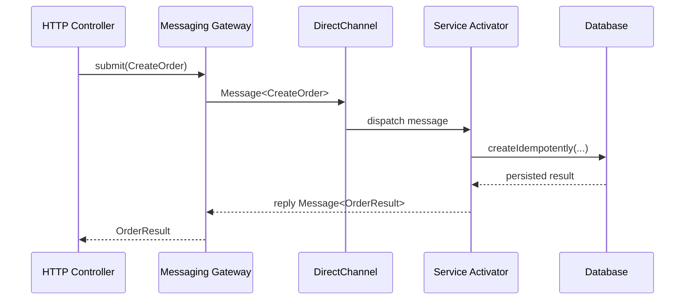
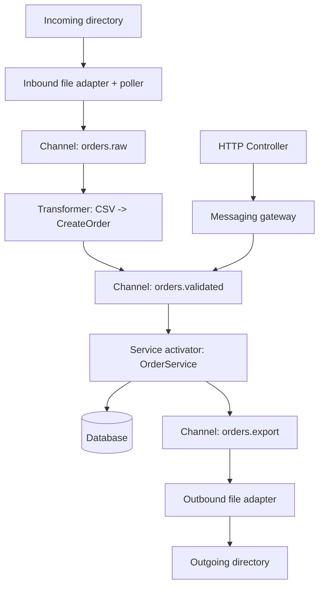

# Channel Adapter, Messaging Gateway, and Service Activator in Spring Integration

In a Spring Boot system, a request might start over HTTP, be converted into an internal message, invoke a business service, access a database, write to a Redis cache, and finally publish an event to a broker. When every component calls the next one directly, changing protocols, handling errors, or adding branches creates tight coupling. **Spring Integration** provides integration patterns based on *Enterprise Integration Patterns* to connect these steps using messages and channels.

This lesson focuses on three commonly used endpoint types:

- **Channel adapter:** brings data from an external system into a `MessageChannel`, or takes messages from a channel to send externally, typically without needing a per-message reply.
- **Messaging gateway:** provides a request/reply-style boundary between Java calls or an external system and a message flow; can turn method invocations into messages and map replies back to method return values.
- **Service activator:** consumes messages from a channel to invoke a Java business method; can optionally return a result message for downstream steps.

These three concepts are closely related yet hold distinct responsibilities. Understanding their boundaries helps you design HTTP client, database, cache, message broker, and adapter integration flows while keeping errors, transactions, duplicate handling, testing, and observability under control.

## 1. Foundations: Message, Channel, and Endpoint

A message in Spring Integration consists of a **payload** and **headers**:

```text
Message<CreateOrder>
  payload: CreateOrder(orderId="o-123", customerId="c-456")
  headers:
    id: ...
    timestamp: ...
    correlationId: ...
    replyChannel: ... (when a request/reply flow exists)
    errorChannel: ... (when configured)
```

- **Payload** carries business data, such as an order record, file bytes, or an event object.
- **Headers** carry metadata used for routing, request/reply correlation, trace propagation, deadlines, or protocol metadata. Headers are not an arbitrary place to store secrets.
- **Message channel** moves messages from producers to consumers. A channel is a messaging abstraction; it is not a durable queue by default.
- **Endpoint** connects a processing component to a channel. Channel adapters, gateways, and service activators are all endpoints in the broad sense.

Basic flow:


The diagram depicts one possible composition of endpoints; not every application needs all six stages. A service activator can return a result straight back to a gateway via the reply channel without declaring an explicit output channel; an adapter can end a flow after writing a file.

### 1.1. Commonly Used Channels

| Channel | How messages move | When appropriate | Things to watch |
| --- | --- | --- | --- |
| `DirectChannel` | Invokes handler directly on the current sending thread | Synchronous handling, simple request/reply | Slow handlers slow the sender; exceptions can propagate back |
| `ExecutorChannel` | Hands work off to a `TaskExecutor` | Decoupling producer and consumer threads | Thread context and transactions do not propagate automatically; manage timeouts, errors |
| `QueueChannel` | Stores messages in an internal queue for a poller to fetch | Buffering within a single process | Default queue is in memory; does not replace a durable broker |
| `PublishSubscribeChannel` | Delivers to multiple subscribers | Multiple steps interested in one internal event | No durability, retries, or replay by default |

With `DirectChannel`, avoid assuming "using messages" means "already running asynchronously". A `send` call can execute every downstream handler before returning. With executor or queue channels, the converse holds: a successful send call does not prove business work completed.

### 1.2. Choosing an Endpoint by Direction and Interaction Style

| Requirement | Starting component | Response style |
| --- | --- | --- |
| Periodically scan a folder and feed files into a flow | **Inbound channel adapter** | No per-read reply |
| Receive an event from a broker to process | Inbound adapter with listener or message-driven mode | Usually one-way; ack per adapter/broker |
| Emit a message to a file or broker | **Outbound channel adapter** | Does not wait for a business reply from destination |
| Call an external API and need a response back | **Outbound gateway** | Request/reply from external system |
| Let controllers call a flow like a Java service | **Messaging gateway** on an interface | Result/exception returns to caller if expecting reply |
| Run a business method inside a flow | **Service activator** | Can emit a reply or end the flow |

An inbound gateway differs from an inbound adapter in communication contract: an inbound gateway receives a request and returns a result to the caller; an inbound adapter only feeds data into the flow. Similarly, an outbound gateway sends a request outward and awaits a response; an outbound adapter only pushes data out. "Gateway" therefore does not specifically mean an HTTP API gateway or Spring Cloud Gateway.

## 2. Channel Adapters: Bridges to External Systems

An **inbound channel adapter** is a producer of internal messages. It turns data received from files, databases, mail, or external sources into messages pushed onto a channel.

An **outbound channel adapter** is a consumer of internal messages. It receives a message and performs an outbound action: writing a file, sending an email, publishing to a broker, or writing to another system.

Both directions differ from a service activator calling a plain Java service: adapters generally understand external protocols and metadata, whereas service activators primarily invoke application-supplied Java logic.

### 2.1. Inbound: Polling vs. Message-Driven

There are two primary ingestion models:

1. **Polling:** the integration system actively queries the source on a schedule. File inbound adapters and JDBC polling adapters are common examples. Configure the poller, frequency, max messages per poll, and error handling.
2. **Message-driven:** the source proactively notifies a listener when data arrives, such as a broker pushing messages to a consumer. Pollers are typically not configured for this endpoint style; load limits and acknowledgements belong to the adapter/broker.

Polling does not mean data is processed only once. If a file stays in the directory, an in-memory filename filter resets, or a DB query fails to mark processed rows, the same data can be ingested again. An appropriate idempotency or checkpointing mechanism is required.

#### Example: Importing CSV Files from a Directory with Java DSL

With `spring-boot-starter-integration` and `spring-integration-file`, you can build a flow:

```java
@Configuration
public class CsvImportFlowConfig {

    @Bean
    IntegrationFlow csvImportFlow(CsvImportService csvService) {
        return IntegrationFlow
                .from(
                        Files.inboundAdapter(new File("./incoming"))
                                .patternFilter("*.csv"),
                        endpoint -> endpoint.poller(
                                Pollers.fixedDelay(Duration.ofSeconds(5))))
                .handle(File.class, (file, headers) -> {
                    csvService.importFile(file);
                    return null;
                })
                .get();
    }
}
```

Key imports: `org.springframework.integration.dsl.IntegrationFlow`, `org.springframework.integration.dsl.Pollers`, `org.springframework.integration.file.dsl.Files`, `java.io.File`, and `java.time.Duration`. The application must provide its own `CsvImportService`; the snippet describes the integration pipeline, not CSV parsing logic.

Here:

- `Files.inboundAdapter(...)` reads matching files; it is the **inbound channel adapter**.
- `poller(...)` decides when to query the source. Five seconds is illustrative; tune it for load and SLA.
- `handle(File.class, ...)` is a DSL **service activator**: it invokes Java processing with a `File` payload and emits no reply by returning `null`.

In production, a file may still be actively written when the poller spots it. Write to a temporary name and **atomically rename** upon completion (if supported by the filesystem), or use file-size/timestamp stability filters and a dedicated claim mechanism. Also move succeeded files to an archive folder, route failed files to quarantine, and persist a file identity trail (name, checksum, source ID) to prevent reprocessing across restarts. An in-memory duplicate filter does not survive restarts.

### 2.2. Outbound: Writing Data to a Target System

Example flow writing text reports to an export folder:

```java
@Configuration
public class ReportExportFlowConfig {

    @Bean
    IntegrationFlow reportExportFlow() {
        return IntegrationFlow.from("reports.out")
                .handle(Files.outboundAdapter(new File("./outgoing"))
                        .fileNameGenerator(message -> {
                            Object exportId = message.getHeaders().get("exportId");
                            if (exportId == null) {
                                throw new IllegalArgumentException("Missing exportId");
                            }
                            return "report-" + exportId + ".txt";
                        }))
                .get();
    }
}
```

This flow assumes the payload type is supported by the file-writing adapter (e.g., `String`) and that `exportId` was generated from a safe identifier without arbitrary path characters. Explicitly control file-exists behavior: overwrite, append, reject, or generate a new name per idempotency key. Never concatenate raw HTTP inputs into file paths, as that risks path traversal or filename collisions.

For brokers, outbound adapters play a comparable role, with additional key concepts including partition/routing keys, publish confirmations, retries, message ordering, and connection drops. Sending a message into the adapter does not automatically mean the broker durably persisted it; read the acknowledgement contract of the specific adapter.

### 2.3. Where an Adapter's Responsibility Stops

A channel adapter translates between external protocols and internal messages; it **does not automatically guarantee**:

- Exactly-once processing across restarts.
- Atomic commits across DB writes and broker publishes in one transaction.
- Automatic recovery after a process or in-memory channel loses messages.
- Uniform routing metadata, correlation IDs, or error formats across all adapters.

Those guarantees must be designed based on actual protocols, storage engines, and transaction configuration.

## 3. Messaging Gateway: Java Interface and Request/Reply Contract

When an HTTP controller or business service needs to interact with a flow without manually constructing `Message<?>` envelopes, declare a **messaging gateway** on a Java interface. Spring Integration generates a proxy: method call → builds message → sends to request channel → awaits reply (if required by method) → maps reply back to Java return value.



This is a synchronous request/reply flow when backed by `DirectChannel`. The proxy simply bridges the Java interface and messaging; business logic stays inside the service activator or the service it calls.

### 3.1. Spring Boot Style Runnable Example

Minimal Gradle dependency for an in-process Java flow:

```gradle
dependencies {
    implementation 'org.springframework.boot:spring-boot-starter-integration'
}
```

In the example application, enable Integration processing and gateway scanning:

```java
@SpringBootApplication
@EnableIntegration
@IntegrationComponentScan
public class OrderApplication {
    public static void main(String[] args) {
        SpringApplication.run(OrderApplication.class, args);
    }
}
```

In real Spring Boot projects, parts of Integration configuration are already auto-configured. The example declares annotations explicitly to show gateway registration requirements; ensure packages or `basePackages` cover the gateway interfaces.

Define the data contract and Java gateway:

```java
public record CreateOrder(
        String requestId,
        String customerId,
        BigDecimal total) {
}

public record OrderResult(
        String orderId,
        String status) {
}

@MessagingGateway
public interface OrderMessagingGateway {
    @Gateway(
            requestChannel = "orders.in",
            requestTimeout = 1_000,
            replyTimeout = 5_000)
    OrderResult submit(CreateOrder command);
}
```

Gateway imports are `org.springframework.integration.annotation.MessagingGateway` and `org.springframework.integration.annotation.Gateway`; the record requires `java.math.BigDecimal`. Both timeout values are in milliseconds. The gateway sends the request to `orders.in`, receives the reply from downstream endpoints, and converts the payload to `OrderResult`.

Define the channel and service activator:

```java
@Configuration
public class OrderChannelsConfig {
    @Bean("orders.in")
    MessageChannel ordersInputChannel() {
        return new DirectChannel();
    }
}

@Component
public class OrderMessageHandler {
    private final OrderService orderService;

    public OrderMessageHandler(OrderService orderService) {
        this.orderService = orderService;
    }

    @ServiceActivator(inputChannel = "orders.in")
    public OrderResult create(CreateOrder command) {
        return orderService.createIdempotently(command);
    }
}
```

`OrderService` is an application-provided business service. It validates data, executes a DB transaction, enforces a unique constraint on `requestId` or an appropriate idempotency key, and returns `OrderResult`. The handler above omits `outputChannel` because the gateway attaches reply metadata to the request so the endpoint sends the result straight back to the waiting call.

Related imports: `org.springframework.messaging.MessageChannel`, `org.springframework.integration.channel.DirectChannel`, and `org.springframework.integration.annotation.ServiceActivator`, along with standard Spring annotations.

An HTTP controller can inject the interface like any normal dependency:

```java
@RestController
@RequestMapping("/orders")
public class OrderController {
    private final OrderMessagingGateway gateway;

    public OrderController(OrderMessagingGateway gateway) {
        this.gateway = gateway;
    }

    @PostMapping
    public ResponseEntity<OrderResult> create(
            @RequestBody CreateOrder command) {
        OrderResult result = gateway.submit(command);
        return ResponseEntity.status(HttpStatus.CREATED).body(result);
    }
}
```

This example groups classes/records in the same project and assumes an `OrderService` bean exists with `createIdempotently(CreateOrder)` returning `OrderResult`. Spring MVC requires the web starter dependency if used. Translating exceptions into HTTP 4xx/5xx responses and duplicate request handling belong in services or controller advice, rather than emerging automatically from the gateway annotation.

### 3.2. Request Timeout and Reply Timeout Have Limits

- **Request timeout:** applies to attempting to send a message when a channel may block, such as a full queue. It is not a "kill switch" for any HTTP/DB call exceeding that duration.
- **Reply timeout:** how long the gateway waits for a reply in models that actually wait on a reply message. With `DirectChannel` invoking a handler synchronously on the current thread, a handler blocked on DB/HTTP can hold the call longer than the configured timeout.
- **External timeouts:** HTTP clients, JDBC queries, broker clients, and thread pools need their own timeouts. A gateway timeout does not cancel remote operations already in flight.

Define what happens when no reply arrives, when a reply has an unexpected payload type, and when a handler throws. `void` methods suit one-way invocations; if the API contract promises committed business state, never return success just for pushing a message onto an async channel.

### 3.3. Mapping Payloads and Headers

Gateways and service activators can accept plain payload objects or messages with metadata:

```java
@ServiceActivator(inputChannel = "orders.in")
public OrderResult create(
        CreateOrder command,
        @Header(name = "correlationId", required = false)
        String correlationId) {
    return orderService.createIdempotently(command, correlationId);
}
```

This is an **alternative variant** of the handler above—do not register both methods consuming `orders.in` simultaneously in one application. For `correlationId` to exist, the producer or gateway must set it explicitly or propagate metadata properly. Do not expect every HTTP header to become a Spring Integration header automatically; define explicit mapping and filter untrusted headers.

`replyChannel` and `errorChannel` headers may hold internal channel objects rather than strings meaningful to external systems. When serializing messages across a broker or remote system, design correlation IDs and reply destinations that can be exchanged safely across processes.

## 4. Service Activator: Where Business Actions Execute

A **service activator** listens to an input channel, receives messages, binds payload/headers to method parameters, and invokes a POJO. If the method returns a value, Spring Integration wraps it into a reply message sent to the configured `outputChannel` or the request's `replyChannel`.

Conceptually:

```text
inputChannel -> service activator -> POJO method
                                   |-- returns object -> reply
                                   |-- returns Message<?> -> reply with payload/headers
                                   |-- void/null -> no reply emitted
                                   |-- throws -> error handling flow
```

A service activator can be declared with `@ServiceActivator` as shown above, or via Java DSL `.handle(...)`. The DSL form is handy when reading a continuous flow:

```java
@Bean
IntegrationFlow orderBusinessFlow(OrderService orderService) {
    return IntegrationFlow.from("orders.in")
            .handle(CreateOrder.class,
                    (command, headers) ->
                            orderService.createIdempotently(command))
            .get();
}
```

This is an **alternative** to the `@ServiceActivator(inputChannel = "orders.in")` handler in the previous example. In real deployments, register **only one** endpoint to handle a request unless competing consumers are intended. Registering both on a `DirectChannel` causes messages to be distributed between separate subscribers instead of executing both in sequence.

### 4.1. When Does a Service Activator Emit a Reply?

| Handler signature | Typical behavior | Use case |
| --- | --- | --- |
| `OrderResult handle(CreateOrder order)` | Wraps result as a reply message | Gateway needs a response |
| `Message<OrderResult> handle(CreateOrder order)` | Returns application-defined payload and headers | Need to pass custom metadata |
| `void handle(CreateOrder order)` | Completes with no reply | Logging, one-way dispatch |
| `OrderResult handle(Message<CreateOrder> msg)` | Reads both payload and headers | Need correlation, tenant, or tracing |
| Handler throws exception | No success reply; invokes endpoint error path | Retries, propagate to caller, or error channel |

If a method returns `null` for a gateway expecting a typed return value, the caller can time out or receive an empty result depending on configuration. Document each flow's contract: input, return type, timeout, and expected errors.

### 4.2. Do Not Mix Message Orchestration with Core Business Logic

A clean service activator usually:

1. Receives a contract-compliant command or event.
2. Validates required metadata such as tenant, source ID, and idempotency key.
3. Invokes a business service or infrastructure port with explicit timeouts.
4. Returns the result or throws a classified exception for the integration layer.

Business services should enforce domain invariants and DB transactions without coupling deeply to Spring Integration `Message<?>` types. That allows unit testing domain logic independently and integration testing channels, handlers, replies, and retries separately.

## 5. Combining All Three into a Realistic Integration Flow

Suppose an e-commerce system receives partner CSV order files, validates records, persists them to the DB, and exports results to an outbound folder for partner pickup:



This diagram is a reference architecture; the file-driven branch and HTTP-driven branch may differ in response requirements, transactions, and ingestion semantics. A synchronous gateway needs a result back from the service activator, while a file inbound adapter may only need to write a final report. If both paths share the order-processing service, DB idempotency must protect against the same order arriving from multiple sources.

### 5.1. Explicitly Choosing Processing Modes at Each Boundary

- **HTTP → gateway → DirectChannel → service activator:** suited when the controller must return an immediate result and work fits inside the HTTP SLA.
- **HTTP → durable enqueue → consumer → service activator:** suited when work may take a long time; HTTP returns `202 Accepted` with an operation ID and the client polls status later.
- **Poller → inbound adapter → service activator:** suited for file imports or scanning external data; must account for shutdown, restart, duplicates, and per-record errors.
- **Service activator → outbound adapter:** suited for one-way writes/publishes. If a response from an external API is required, prefer the corresponding outbound gateway.

Within one flow, you can combine transformers, filters, routers, splitters, aggregators, and multiple channels. Service activators perform the step's internal work; adapters and gateways define communication at system edges.

### 5.2. Choosing an Outbound Gateway Over an Outbound Adapter

Suppose a service must call a partner HTTP API to check a balance and **needs to inspect** the partner's response. An HTTP outbound gateway fits better than a one-way outbound adapter:

```text
Service Activator -> request channel
                  -> HTTP Outbound Gateway
                  -> HTTP response -> reply channel -> next handler
```

An HTTP outbound gateway still requires URI, HTTP method, serializer, accepted status codes, connect/read timeouts, and retry policies. For non-idempotent POST requests, automatic retries after timeouts can cause duplicate side effects, so pair retries with idempotency keys and partner state checks.

## 6. Errors and Timeouts: Synchronous vs. Asynchronous Flows

Error behavior depends heavily on channel and endpoint types.

| Flow | When handler fails | Who can observe it? | Decisions required |
| --- | --- | --- | --- |
| Gateway + `DirectChannel` | Exception typically propagates back to send/gateway call | Caller, e.g., HTTP controller | HTTP error mapping, retries, transactions |
| Polling inbound adapter | Failure occurs during a poll tick | Poller/error handler, monitoring | File/record retries, quarantine, prevent hot loops |
| `ExecutorChannel` or async handler | Failure occurs on worker thread | Error flow/`errorChannel` or configured callback | Never report HTTP success as if committed |
| Broker inbound adapter | Failure while processing message | Adapter/broker listener | Ack/nack, redelivery, DLQ, retry budget |
| Outbound adapter | Send/write fails or remains unconfirmed | Sending endpoint and callback/ack logic | Publish confirmation, retries, outbox |

Spring Integration supports **error messages** and **error channels** to coordinate asynchronous failures. However, declaring an `errorChannel` does not mean the system retries successfully or survives a process crash automatically. Distinguish:

- **Non-retryable business errors:** invalid schema, invalid order, insufficient permissions.
- **Retryable transient errors:** HTTP 503, DB deadlock, temporary broker outage; use backoff, jitter, and bounded attempts.
- **Unknown outcomes:** timeout after calling an order-creation API or publishing to a broker; query state via idempotency key rather than blindly resending.
- **Sustained systemic failures:** alert, route to DLQ/quarantine, or pause ingestion to avoid pileups and overload.

Some endpoints support retry advice such as `RequestHandlerRetryAdvice`. When attaching retry advice to a handler with side effects, ensure a failed attempt never leaves partially committed work that repeats on retry. Retry is merely a re-attempt mechanism; it does not provide exactly-once semantics.

### 6.1. DB Transactions Do Not Span All Channels

With `DirectChannel`, the handler runs on the same thread and can join a caller-initiated transaction depending on where `@Transactional` sits. Switching to `ExecutorChannel` changes threads, and standard Spring transaction contexts do not cross to the new thread. With pollers or broker listeners, transaction boundaries start according to source and handler configuration, never spanning external systems automatically.

To persist an order to the DB and reliably publish to a broker, the **transactional outbox** pattern usually fits: persist the order and event record in the same DB transaction; a separate relay publishes outbox rows to the broker, marks status upon confirmation, and retries safely. Consumers deduplicate using event IDs. No single Spring Integration annotation creates an atomic transaction across SQL and arbitrary APIs or brokers.

## 7. Correlation, Idempotency, and Data Contracts

When flows span multiple adapters or gateways, standardize data contracts:

| Contract element | Example | Purpose |
| --- | --- | --- |
| Message type/schema | `CreateOrderV1` with fields and validation | Detect incompatible payloads |
| Message identity | Event ID or source record ID | Duplicate prevention, auditing |
| Correlation ID | Request ID propagated end-to-end | Connect logs/traces across steps |
| Causation ID | Message ID that triggered the next event | Understand causal chains |
| Idempotency key | Tenant + operation + client request ID | Make retries safe |
| Timeout/deadline | Business processing deadline | Stop work exceeding SLA |
| Source/tenant | Trusted identity established after auth | Routing and data isolation |

The framework-generated `id` header on each message is not automatically a durable business identifier. Across broker hops, payload transformations, or retries, recreated messages can get new IDs. For cross-boundary deduplication, use a **stable business ID / event ID** generated at the source or persisted by the receiver.

Service activators should validate fields affecting business logic; never blindly trust an externally supplied header simply because it is named `tenantId` or `authenticatedUser`. Identity and authorization metadata must be established or verified at an authenticated boundary.

For request/reply across multiple systems, attach a correlation ID to match responses back to requests. If replies can arrive after timeout, decide whether to discard them, store state, or expose a query API. Never hold an HTTP request open indefinitely waiting on long-running pipelines.

## 8. Capacity, Backpressure, and Operations

Routing messages through Spring Integration does not eliminate resource limits. A flow ingesting files faster than the DB can write builds queues, ties up threads, or overloads downstream services.

Parameters to bound per model:

- **Poller:** interval, messages per poll, concurrent pollers, ingest rate, and pausing when downstream saturates.
- **Executor channel:** thread pool size, wait queue capacity, full-queue rejection policy; never use unbounded thread pools.
- **Broker consumer:** concurrency, prefetch/batch size, acks, visibility/lock timeouts, retries, and dead-letter queues.
- **HTTP gateway:** connect timeout, read/response timeout, connection pool size, retry limits, and circuit breakers.
- **Downstream:** DB connection pools, query timeouts, Redis/broker quotas, and shared dependency protection.

If a flow processes 100 messages/sec while the source emits 1,000 messages/sec, latency and queued items grow indefinitely unless intake is throttled or capacity scales. An in-memory `QueueChannel` merely postpones overload and loses items if the process terminates.

For observability, track:

1. Throughput and latency at key endpoints/channels, separating queue wait time from handler execution time.
2. Error rates by category, retry counts, oldest pending message age, and queue sizes.
3. Latency, timeouts, and pool utilization across DB, HTTP, Redis, and brokers.
4. Correlation ID, operation ID, and endpoint name in logs/traces; redact secrets and sensitive payloads.
5. Counts of succeeded, failed, quarantined, or DLQ'd files/records and recovery times.

Spring Integration includes metrics/management hooks compatible with Micrometer, Actuator, and tracing depending on version and project setup; verify exact metric names, activation flags, and detail levels in your runtime configuration. Never assume all messages are traced or every handler emits alerts automatically.

## 9. Meaningful Testing Strategy

Split testing into two layers: unit testing `OrderService` business rules and testing **real wiring** across gateways, channels, handlers, and adapters.

| Test case | What to prove |
| --- | --- |
| Call `OrderMessagingGateway.submit(...)` with valid service | Payload routes to `orders.in`; handler returns expected `OrderResult` |
| Service activator throws domain error | Gateway/HTTP caller gets contract-compliant error rather than silent success |
| Handler returns `null` when gateway expects reply | Exposes missing-reply behavior; verifies timeout configuration |
| Handler blocks on HTTP/DB | Confirms gateway timeout does not assume in-flight operation was aborted |
| Two requests share `requestId` | DB creates one business effect; retry returns valid outcome |
| Inbound file detected mid-write | Incomplete file is ignored; stability filter or atomic rename works |
| File processed, app restarts | Idempotency/checkpoint blocks re-import |
| Outbound adapter hits I/O failure | Bounded retry, quarantine, or recovery runs; never falsely marks exported |
| Broker consumer redelivers | Side effects remain idempotent; ack happens only after criteria are met |
| Executor/poller overloaded | Queue does not grow unbounded; overload errors and backlog metrics appear |

For pure-Java flows, integration tests can boot a Spring context, invoke the real gateway interface with controlled dependencies, and verify inputs/outputs. For file adapters, use temporary directories, sample files, and bounded poll waits, cleaning up afterward. For DB, Redis, and brokers, prefer Testcontainers or faithful integration environments to verify real transactions, retries, and duplicates.

When using Spring Integration's dedicated test utilities (such as `spring-integration-test`), verify the exact classes and annotations available in your version; never mock `MessageChannel` alone and conclude gateway/adapter wiring works end-to-end.

## 10. Common Misconceptions

| Misconception | Accurate understanding |
| --- | --- |
| "Using Spring Integration makes processing async." | `DirectChannel` runs synchronously; async only occurs with an async channel/endpoint and executor. |
| "Channel adapters also return replies like gateways." | Adapters are normally one-way; gateways implement request/reply contracts. |
| "A service activator is just a plain Java service." | It is an endpoint responsible for receiving messages, invoking a method, and routing results/errors back into the flow. |
| "A gateway call returning successfully means the broker persisted the message." | Depends on channel type, handler, adapter, and target system confirmations. |
| "`replyTimeout` hard-caps handler execution time." | It cannot abort a handler/HTTP/DB call blocking synchronously on a `DirectChannel`. |
| "`QueueChannel` is equivalent to Kafka/RabbitMQ." | Default internal queues do not provide broker durability, consumer groups, or replay. |
| "Adding `@Transactional` rolls back DB + HTTP + broker together." | Each resource has separate boundaries; use outboxes, idempotency, and reconciliation. |
| "Every message gets a unique ID, so duplicates cannot happen." | Framework message IDs do not replace stable business event IDs across retries and adapters. |
| "Subscribing two handlers to `DirectChannel` runs both." | `DirectChannel` dispatches to one chosen subscriber, not broadcast; use sequential flows or publish-subscribe for fan-out. |

## 11. Integration Flow Design Checklist

Before implementation, answer every question clearly:

1. **Sources and sinks:** does data arrive from HTTP, files, databases, or brokers? Do you need one-way adapters or request/reply gateways?
2. **Contracts:** what are the payload schemas and versions? How are correlation IDs, idempotency keys, tenants, and deadlines created, validated, and propagated?
3. **Channels:** synchronous or asynchronous? Which channel matches throughput, thread, transaction, and durability needs?
4. **Business endpoints:** which service does each service activator call, what does it reply, and what happens on missing replies or exceptions?
5. **Reliability:** where are acks, retries, backoff, DLQ/quarantine, outbox, unique constraints, and crash-restart recovery?
6. **Performance and observability:** are per-dependency timeouts, concurrency bounds, backlogs, metrics, tracing, and alerts defined?
7. **Testing:** have you proven real wiring, request/reply, errors, duplicates, timeouts, and external outage behavior?

**Remember the roles:** channel adapters move data **into/out of the system**, messaging gateways provide **contracted call/response interfaces**, and service activators execute **Java actions on messages**. Spring Integration cleanly composes these pieces into explicit flows; guarantees around transactions, deduplication, durability, and recovery must still be engineered across the full HTTP, DB, cache, and broker pipeline.
