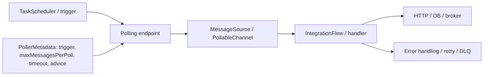
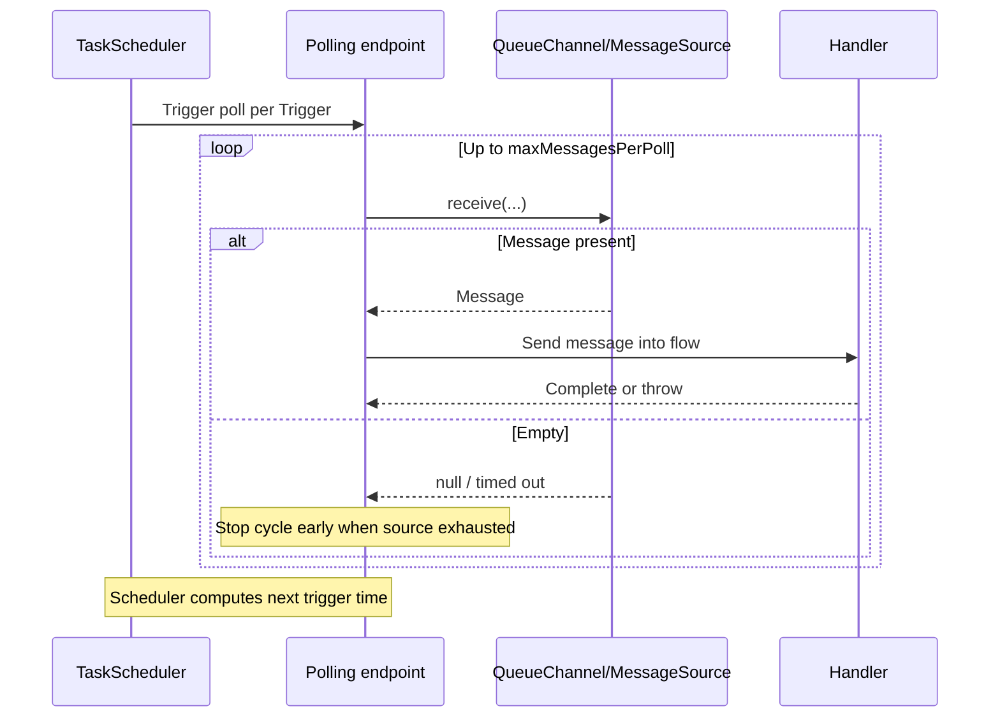
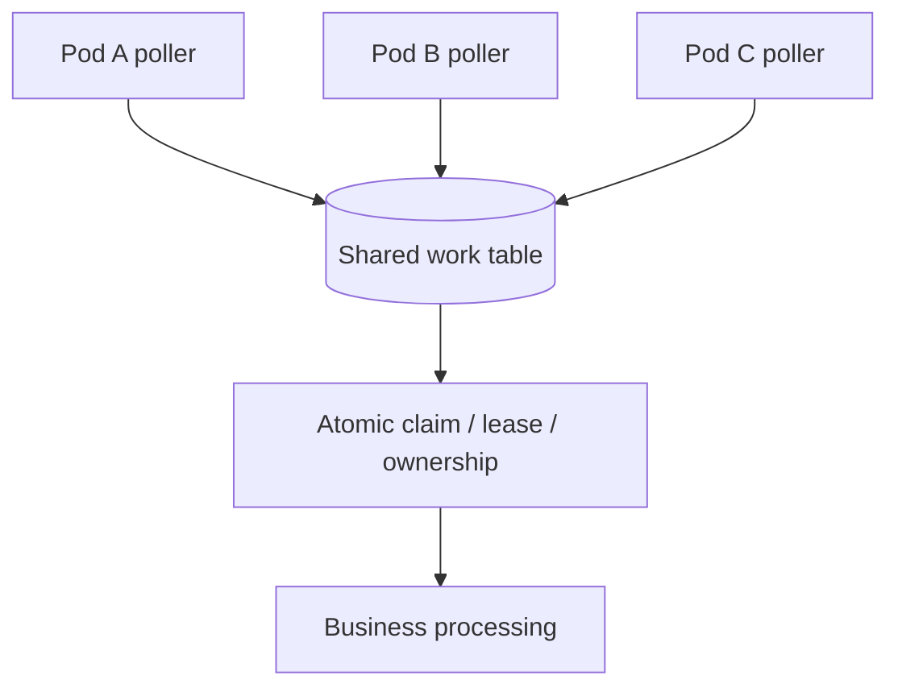

# PollerMetadata, TaskScheduler, and spring.integration.poller.*

## 1. Why Does Spring Integration Need Pollers?

In **Spring Boot Integration**, a system can react passively to incoming HTTP requests or broker messages, yet some data sources **do not push events proactively**. Examples include querying an outbox table for unsent rows, reading items from a `QueueChannel`, scanning a directory for files, polling an API periodically, or claiming pending jobs from a data store. These cases require a component that actively **checks the source on a schedule**.

A Spring Integration **Poller** answers three questions: *when* to check for data, *how many items* to fetch per cycle, and *how* to handle retrieved items or failures. Pollers appear on endpoints such as `SourcePollingChannelAdapter` (reading from a `MessageSource`) and `PollingConsumer` (reading from a `PollableChannel`). A poller is not a message broker, does not turn queries into distributed transactions, and does not guarantee exactly-once delivery.

For example: every two seconds, check for ready outbox rows, turn them into `Message<?>` instances, invoke an HTTP gateway, and update delivery status. Polling too fast overloads the database and partner HTTP API; polling too slowly grows backlogs. With multiple instances polling concurrently, rows must be **claimed/leased atomically**, and every retry must be safe.



### 1.1. Polling vs. Event-Driven Consumers

| Mechanism | Who triggers execution? | Examples | Needs dedicated poller? |
| --- | --- | --- | --- |
| Pull-style `MessageSource` | Endpoint calls `receive()` on schedule | File-reading source, JDBC polling source, custom work source | Usually yes |
| `PollableChannel` | Endpoint calls `receive(...)` on channel | `QueueChannel` | Yes, when feeding an endpoint |
| `SubscribableChannel` | Publisher pushes messages to subscribers | `DirectChannel`, `PublishSubscribeChannel` | No, not for receiving from the channel |
| HTTP inbound gateway | Web server receives requests | REST endpoints | No |
| Kafka/Rabbit listener | Broker listener/container coordinates message delivery | `@KafkaListener`, `@RabbitListener` | Do not use this SI poller solely to consume from brokers |
| Scheduled job runner | Schedule triggers business jobs | Quartz Job, `@Scheduled` | Separate scheduling concept; does not replace SI poller metadata |

Not every operation named "poll" belongs to the same API. A Kafka consumer calls `poll()` inside its client library, yet its lifecycle and settings **differ** from Spring Integration's `PollerMetadata`. Likewise, Quartz schedules jobs by trigger rather than replacing `MessageSource` message polling.

## 2. Three Commonly Confused Components

### 2.1. `PollerMetadata`: Policy for a Polling Endpoint

`org.springframework.integration.scheduling.PollerMetadata` holds the configuration used by a polling endpoint. Key parts:

| Element | Purpose | Things to note |
| --- | --- | --- |
| `Trigger` | Determines firing schedule: fixed delay, fixed rate, cron, or custom trigger | Can slip when the scheduler runs short on threads |
| `maxMessagesPerPoll` | Caps receives attempted per polling cycle | Not thread count or total messages/second |
| `receiveTimeout` | Wait time on sources/channels supporting blocking waits | Does not apply identically to all `MessageSource` implementations |
| Optional `TaskExecutor` | Offloads message handling off the scheduler thread | Requires bounds on concurrency, resources, and in-flight work |
| `Advice` / transactions | Wraps the poll cycle with retries, transactions, or control logic | Transaction boundaries vary across endpoints, advice, and sources |
| `Error handling` | Routes failures to error flows or error handlers depending on path | Never assume all exceptions go to the same `errorChannel` |

**`PollerMetadata` is not a self-running scheduler.** It describes policy; a polling endpoint reads that policy and schedules tasks with a scheduler.

### 2.2. `TaskScheduler`: Deciding When to Run

`org.springframework.scheduling.TaskScheduler` is Spring Framework's task-scheduling abstraction. In integrations, the scheduler computes the next execution time from the `Trigger`, places tasks onto scheduler threads, and invokes the poll operation.

A `ThreadPoolTaskScheduler` has a finite pool size. If slow receives or handlers occupy every thread, **other pollers run late** even though their cron or fixed-delay configuration has not changed. Thus "poller runs every 1 second" is a **scheduling intent**, not a guaranteed per-second latency SLA under heavy load.

### 2.3. `TaskExecutor`: Concurrent Execution Is Not Scheduling

`TaskExecutor` controls how submitted work executes—potentially on separate threads with its own queue and bounds. When a poller is configured with an executor, polling and message processing exhibit different concurrency behavior than running synchronously on the scheduler thread.

**Do not conflate:**

- `TaskScheduler` decides *when* a poll task is triggered.
- `PollerMetadata` defines an endpoint's *polling policy*.
- `TaskExecutor` defines *how work runs* when an endpoint/poller uses an executor.

Adding an executor does not guarantee message ordering, same-thread transactions, or rate limiting toward external APIs. Submitting too many tasks to an executor with an unbounded queue merely shifts bottlenecks from the poller to heap memory and connection pools.



This diagram illustrates **synchronous polling** for clarity; adding an executor changes task handoff and concurrency. Downstream processing duration directly affects when a synchronous poll finishes.

## 3. Global Configuration: `spring.integration.poller.*` in Spring Boot

With Spring Boot and Spring Integration auto-configuration active, you can configure a **default poller** for polling endpoints that do not declare their own poller:

```yaml
spring:
  integration:
    poller:
      fixed-delay: 2s
      max-messages-per-poll: 5
      receive-timeout: 200ms
```

These properties are commonly supported in modern Spring Boot releases with Spring Integration. Verify exact property names, defaults, and applicability in configuration metadata **for the Spring Boot version you are running**. `PollerMetadata` exposes more options than Boot surfaces directly under this prefix.

| Property | Meaning | What it does NOT mean |
| --- | --- | --- |
| `spring.integration.poller.fixed-delay` | Delay between one poll finishing and the next starting under fixed-delay trigger | Does not guarantee a new message arrives every interval |
| `spring.integration.poller.max-messages-per-poll` | Max messages attempted per poll tick | Not a thread pool size |
| `spring.integration.poller.receive-timeout` | Wait time for a message on sources supporting timeouts | Not an HTTP read timeout or JDBC query timeout |

The snippet above sets the **default policy**. An endpoint with its own poller via Java DSL, XML, or annotation overrides the default. So if changing `spring.integration.poller.fixed-delay` leaves a flow's cadence unchanged, check whether that flow declares a dedicated poller.

### 3.1. The Default Poller Does Not Apply to Every Flow

`spring.integration.poller.*` is **not** a global setting for all consumers:

- Does not govern `@KafkaListener` fetch sizes, consumer groups, or `max.poll.records`.
- Does not replace RabbitMQ listener container prefetch or ack modes.
- Does not set timeouts on `RestClient`, `WebClient`, R2DBC, or Redis clients.
- Does not configure Quartz triggers.
- Does not throttle a `DirectChannel`, which runs immediately when producers call `send()`.

Always verify which endpoints actually rely on the **default `PollerMetadata`** before tuning global properties. When multiple sources poll, raising max messages globally can let one noisy source starve shared resources and delay other flows.

### 3.2. Avoid Guessing Trigger Properties

At the framework level, `Pollers.fixedDelay(...)`, `Pollers.fixedRate(...)`, and `Pollers.cron(...)` express distinct scheduling modes. Never assume every Java DSL option maps to an identically named property under `spring.integration.poller.*` across all Boot versions. When you need cron, complex fixed-rate rules, advice, or dedicated schedulers, **declare the poller explicitly** and test its runtime behavior.

## 4. Declaring a Default `PollerMetadata` Java Bean

As an alternative to Boot properties, declare the default poller explicitly in Spring Integration:

```java
import java.time.Duration;
import org.springframework.context.annotation.Bean;
import org.springframework.context.annotation.Configuration;
import org.springframework.integration.dsl.Pollers;
import org.springframework.integration.scheduling.PollerMetadata;

@Configuration
public class IntegrationPollerConfiguration {

    @Bean(name = PollerMetadata.DEFAULT_POLLER)
    public PollerMetadata defaultPoller() {
        return Pollers.fixedDelay(Duration.ofSeconds(2))
                .maxMessagesPerPoll(5)
                .getObject();
    }
}
```

`PollerMetadata.DEFAULT_POLLER` is the special bean name Spring Integration looks up when a polling endpoint needs default settings. In Boot apps, auto-configuration may already provide a default poller; **never define two beans with the same name**, and never mix custom beans with global properties without checking how auto-configuration backs off.

Selection guide:

1. Simple shared defaults with no special advice or trigger: prefer Boot properties supported by your version.
2. Complex default poller or custom bean rules: declare a `PollerMetadata` bean with the default name.
3. One flow needing its own cadence or bounds: attach a poller **directly to that endpoint** rather than altering app-wide defaults.

When multiple schedulers exist, also verify **which scheduler a polling endpoint actually uses**, not just how many `TaskScheduler` beans live in the context.

## 5. Dedicated Poller for an `IntegrationFlow`

Suppose an app keeps retryable events in a `QueueChannel`. An endpoint reads the queue every 500 ms, taking up to 10 messages per tick without altering other flows' default poller.

```java
import java.time.Duration;
import org.springframework.beans.factory.annotation.Qualifier;
import org.springframework.context.annotation.Bean;
import org.springframework.context.annotation.Configuration;
import org.springframework.integration.channel.QueueChannel;
import org.springframework.integration.dsl.IntegrationFlow;
import org.springframework.integration.dsl.Pollers;

@Configuration
public class RetryFlowConfiguration {

    @Bean("retryQueue")
    QueueChannel retryQueue() {
        return new QueueChannel(500);
    }

    @Bean
    IntegrationFlow retryFlow(
            @Qualifier("retryQueue") QueueChannel retryQueue,
            RetryMessageHandler handler) {
        return IntegrationFlow
                .from(retryQueue, endpoint -> endpoint.poller(
                        Pollers.fixedDelay(Duration.ofMillis(500))
                                .maxMessagesPerPoll(10)))
                .handle(message -> handler.process(message))
                .get();
    }
}
```

`RetryMessageHandler` is an illustrative application dependency; it can be declared as:

```java
import org.springframework.messaging.Message;

public interface RetryMessageHandler {
    void process(Message<?> message);
}
```

This pattern fits experiments or in-JVM buffering. **`QueueChannel` is not a durable queue like RabbitMQ or Kafka**: on app restart, in-memory messages are lost unless backed by a durable `MessageStore`. When zero job loss is required, use a broker or durable persistence alongside proper ACKs and idempotency.

### 5.1. When the Source Is a `MessageSource`

For custom pull sources, one `receive()` fetches one unit of work:

```java
import org.springframework.integration.core.MessageSource;
import org.springframework.messaging.support.MessageBuilder;

@Bean
MessageSource<String> pendingWorkSource(WorkClaimRepository repository) {
    return () -> repository.claimOne()
            .map(id -> MessageBuilder.withPayload(id).build())
            .orElse(null);
}
```

`WorkClaimRepository` is a placeholder interface:

```java
import java.util.Optional;

public interface WorkClaimRepository {
    Optional<String> claimOne();
}
```

`claimOne()` must execute an **atomic claim/lease**—such as a locked status update or `SELECT ... FOR UPDATE SKIP LOCKED` on supporting DBMSs—so multiple pods never pick the same row. Never run an unsynchronized `SELECT` followed by a separate status `UPDATE`. `MessageSource.receive()` returns `null` when no work exists, allowing the endpoint to end the current poll cycle early.

If `claimOne()` performs blocking JDBC on the scheduler thread, slow queries, locks, or timeouts delay other pollers. Bound query timeouts, connection pools, and size schedulers/executors for the source type. If integrating reactive R2DBC, never casually call `.block()` inside a polling endpoint while assuming the pipeline stays non-blocking.

### 5.2. How Default Pollers vs. Endpoint Pollers Apply

```text
Application
├── Default PollerMetadata (spring.integration.poller.* property or bean)
│   ├── Endpoint A with no explicit poller -> uses default
│   └── Endpoint B with no explicit poller -> uses default
└── Endpoint C with .poller(Pollers.fixedDelay(...))
    └── Uses C's policy, ignoring the default cadence
```

Note that certain adapters/channels require either an explicit poller or a valid default poller before the context can boot. If startup fails complaining "no poller has been defined", check whether the endpoint is a `PollableChannel` or `MessageSource`, inspect poller configs and Spring Integration auto-configuration, instead of slapping an external `@Scheduled` method onto the side.

## 6. Fixed Delay, Fixed Rate, and Cron: Matching Cadence to Goals

Three trigger types serve different goals:

| Trigger | Next run timing | Typical fit | Risk |
| --- | --- | --- | --- |
| **Fixed delay** | Waits the delay after the previous run finishes | Polling sources safely under load; avoids piling up runs | Slow handlers lower throughput and grow backlogs |
| **Fixed rate** | Schedules at evenly spaced timestamps | Keeping check cadence steady under light load | Scheduler thread starvation delays ticks; exact on-time runs not guaranteed |
| **Cron** | Calendar/wall-clock timestamps per cron expression and timezone | End-of-day syncs or business-hour schedules | Must handle DST, timezones, misfires, and missed ticks |

Java DSL examples:

```java
Pollers.fixedDelay(Duration.ofSeconds(2));
Pollers.fixedRate(Duration.ofSeconds(2));
Pollers.cron("0 */5 * * * *"); // Illustrative: every 5 minutes
```

Note that cron in Spring Integration normally uses Spring's cron syntax. Never mix Spring's six-field cron expressions with Quartz's seven-field or `?` syntax without verifying the parser and timezone.

**Fixed rate does not automatically run overlapping concurrent executions.** Concurrency still depends on the scheduler, executor, downstream handlers, and source behavior; never infer "every 2 seconds spins up another parallel thread".

### 6.1. Approximating Throughput for Sequential Execution

Suppose:

- `maxMessagesPerPoll = 10`.
- Each message takes ~**40 ms** synchronously.
- `fixedDelay = 1 s`.
- The source always has messages, ignoring `receive()`/DB lock overhead.

One batch takes roughly `10 × 40 ms = 400 ms`. A full cycle takes about `400 ms + 1,000 ms = 1,400 ms`, yielding an ideal throughput around `10 / 1.4 ≈ 7.1 messages/sec` for this endpoint. This is an **illustrative estimate**, not an SLA: real throughput reflects receive timeouts, query latency, network calls, transactions, scheduler contention, concurrency, and arrival rates.

Raising `maxMessagesPerPoll` does not scale throughput linearly. Long per-message work makes large poll batches monopolize scheduler threads, starving other pollers. When downstream enforces rate limits, bigger batches simply trigger 429s, retries, and larger backlogs.

### 6.2. Special Values for `maxMessagesPerPoll`

In Spring Integration, positive integers cap messages per poll; `-1` generally means unbounded per poll cycle until the source drains (`receive()` returns `null`). **Never set `-1` on an ever-full source** without safeguards, as one poll cycle can run indefinitely, holding resources and starving other pollers.

Some versions interpret `0` as temporarily pausing receives without removing the endpoint; behavior varies by API and runtime version. For operational pause/resume, using the endpoint lifecycle API with explicit status tracking is far clearer.

### 6.3. Receive Timeout Is Not the Poll Interval

On an empty `QueueChannel`, `receive(timeout)` blocks until a message arrives or the timeout expires. If `maxMessagesPerPoll` is large and the source is empty, a poll cycle ends after waiting for the receive timeout and only then starts counting fixed delay. On sources ignoring timeouts, `receiveTimeout` may have no effect; check the `MessageSource` contract.

If many endpoints wait on long receive timeouts while `TaskScheduler` has very few threads, they contend for threads even when zero messages exist. Do not solve this simply by bloating the thread pool while ignoring timeouts, endpoint counts, and blocking behavior.

## 7. Configuring `TaskScheduler` and Thread Pools

When multiple polling endpoints run in one application, the scheduler is a shared resource worth monitoring. You can supply a dedicated `ThreadPoolTaskScheduler` sized for the workload:

```java
import org.springframework.context.annotation.Bean;
import org.springframework.context.annotation.Configuration;
import org.springframework.scheduling.concurrent.ThreadPoolTaskScheduler;

@Configuration
public class PollerSchedulerConfiguration {

    @Bean(name = "taskScheduler")
    ThreadPoolTaskScheduler taskScheduler() {
        ThreadPoolTaskScheduler scheduler = new ThreadPoolTaskScheduler();
        scheduler.setPoolSize(8);
        scheduler.setThreadNamePrefix("integration-poll-");
        scheduler.setRemoveOnCancelPolicy(true);
        return scheduler;
    }
}
```

This example intentionally uses the bean name `taskScheduler`, which Spring Integration infrastructure commonly looks up for the default scheduler. **Before adopting in production, verify auto-configuration in your Spring Boot/Spring Integration version and any existing beans** to avoid name clashes or falsely assuming any arbitrary `TaskScheduler` bean is automatically picked up by all endpoints. If the app already defines a `taskScheduler` bean from framework or another config, assign **one clear owner** rather than enabling bean overriding to mask collisions.

Some projects use `spring.task.scheduling.pool.size` to tune the scheduler created by **Spring Boot's `TaskSchedulingAutoConfiguration`**. That property is not guaranteed to resize custom schedulers or Spring Integration-owned beans. Inspect the actual bean type, thread names, and endpoint wiring in the context.

### 7.1. Scheduler Pool Too Small vs. Too Large

| Condition | Symptoms | Remediation |
| --- | --- | --- |
| Too few threads | Delayed polls, queued triggers, one slow handler stalls other pollers | Isolate blocking sources, tune timeouts, resize pool appropriately |
| Too many threads | DB/HTTP pools saturate, context switching, excessive concurrent side effects | Cap concurrency within downstream capacity |
| One runaway poller | Other pollers starve, slow shutdowns | Limit `maxMessagesPerPoll`, watch sources never returning `null`, set timeouts/batch bounds |
| Idle scheduler threads yet slow flow | Handler/DB/broker saturated, growing backlogs | Measure per-stage latency, queue depths, retries, and target connections |

**Pool size cannot be tuned in isolation.** Account for total polling endpoints, poll duration, replica count, connection pools, and partner API rate limits.

## 8. Pollers, Transactions, and Error Handling

A poller typically connects one of these to a flow: a DB source claiming rows, a `QueueChannel`, an outbound API handler, or a broker adapter. Safety requires clear transaction boundaries and error classification.

### 8.1. Wrapping a Poll in a Transaction

Spring Integration supports transaction advice on pollers. Java DSL example (assuming a `PlatformTransactionManager` is configured for the target datasource):

```java
import java.time.Duration;
import org.springframework.integration.dsl.Pollers;
import org.springframework.transaction.PlatformTransactionManager;

// Endpoint configuration snippet illustrating PollerSpec:
Pollers.fixedDelay(Duration.ofSeconds(1))
        .maxMessagesPerPoll(5)
        .transactional(transactionManager);
```

This snippet is not a standalone bean, and `transactionManager` is an application-provided dependency. In a real flow, transaction advice on the poller can wrap synchronous receives and handlers within the poll cycle depending on endpoint configuration. If messages are handed off to another thread via an executor, or call HTTP/brokers outside the transaction manager's resource, **never assume a DB transaction covers external effects**.

For an outbox source, a typical design:

1. Claim eligible rows in the database atomically using a lock or lease.
2. Convert rows to messages and call external targets or forward to a sending channel.
3. Update success/failure state with explicit transactions and status transitions.
4. On timeouts or crashes, reclaim expired leases and resend safely with idempotency keys.

**Transactional outbox** guarantees business updates and outbox inserts commit in one DB transaction; external publishing remains *at-least-once*. A poller does not magically turn HTTP or broker publishing into exactly-once.

### 8.2. Polling Errors Differ from Rejected Messages

Categories to separate:

| Failure | Examples | Handling |
| --- | --- | --- |
| Poll source failure | DB connection timeout, unable to read file | Bounded retry, alerting, prevent hot-looping |
| Transform/validation failure | Invalid payload contract, missing field | Classify permanent error, route to DLQ/parking lot, never retry infinitely |
| Downstream handler failure | HTTP 503, broker timeout | Retry with backoff, circuit breaker, idempotency |
| Transaction/commit failure | DB deadlock, failed to commit sent marker | Safe retry keyed by business ID or reconciliation |
| Shutdown/cancellation | Pod stops mid-flight | Ensure message/lease can be reclaimed without data loss |

Spring Integration provides `errorChannel`, `ErrorMessage`, advice chains, and retry mechanisms, yet exception routing depends on **sync vs. async** endpoints, handlers, and scheduler error handlers. Never assume every error from a synchronous poller lands on `errorChannel` and persists durably. Explicitly test source exceptions, handler exceptions, scheduler shutdowns, and message reprocessing.

### 8.3. Avoid Multiplicative Retries Across Layers

If a poller has retry advice, the HTTP client also retries, and the broker redelivers too, one failing message can execute dozens of times. Design a single observable retry budget—such as short retries for transient errors followed by DLQ/backoff queue or an outbox error state for inspection. For payments and order updates, enforce `eventId`/`idempotencyKey` independently of poll count.

## 9. Multiple Spring Boot Instances: Pollers Do Not Automatically Elect a Leader

When three pods run the same `IntegrationFlow` containing a poller, **each pod normally runs its own polling endpoint**. Default `PollerMetadata` and `TaskScheduler` provide no distributed locking:



If pods run `SELECT * FROM outbox WHERE status='NEW' LIMIT 1` and process, multiple pods grab the same row. Proper solutions depend on the source:

- Transactional claim/lease, optimistic updates, or `SELECT ... FOR UPDATE SKIP LOCKED` when supported by your DBMS and design.
- Store processing state with lease expiration to recover after pod crashes.
- Use a distributed lock when only one instance may poll a source at a time, including lock renewal and lease-expiry recovery.
- Always enforce business idempotency keys, since failover right after a side effect can still cause duplicate execution.

If you truly need clustered job scheduling and recovery semantics, consider Quartz or a dedicated distributed scheduler. Even then, replacing a poller with Quartz does not automatically make HTTP calls or broker publishes idempotent.

### 9.1. Do Not Scale Throughput Linearly by Pod Count

Three pods increase polling concurrency, yet total throughput remains bounded by row locks, connection pools, API rate limits, CPU, and work volume. More pollers raise database contention, so monitor successful claims, transaction rollbacks, lag, and processing duration rather than trigger counts alone.

## 10. Controlling Poller Lifecycle in Operations

Polling endpoints participate in lifecycle management; depending on configuration, they can start/stop via `SmartLifecycle` or endpoint management APIs. In Spring Integration, endpoints can be assigned IDs and controlled via their beans or a securely configured Control Bus.

Operations may need to **stop a specific poller** before schema migrations, credential rotations, or downstream maintenance while keeping HTTP endpoints and other flows running. Procedure:

1. Stop scheduling new polls on the target endpoint.
2. Wait for and observe in-flight runs, transactions, and active leases.
3. Apply schema/secret updates or dependency changes.
4. Verify with real connections and business operations, not just pings.
5. Restart the poller and watch backlogs, retries, and latency.

**Stopping a poller does not automatically abort in-flight tasks** or roll back already-executed side effects. If an executor is attached, understand its shutdown/drain behavior and in-flight work handling. Durable sources need controlled replay.

### 10.1. Readiness Probes Do Not Switch Off Pollers

In Kubernetes, a **NotReady** pod is removed from HTTP Service endpoints yet continues running pollers, querying databases, and sending messages. During migrations or credential incidents that require halting ingestion, control the **poller/consumer lifecycle directly** rather than relying solely on HTTP readiness.

Similarly, changing `spring.integration.poller.fixed-delay` in deployed config does not guarantee a running poller bean hot-reloads. For startup-bound config, perform a rolling restart or a verified dynamic refresh mechanism.

## 11. Observability, Diagnostics, and Testing

### 11.1. Metrics to Monitor

| Metric | Helps answer | Anomaly symptoms |
| --- | --- | --- |
| Poll attempts / successes / empty ticks | Is the scheduler actually triggering the endpoint? | No polls occurring despite available data |
| Actual interval between polls | Are schedules slipping due to slow handlers/scheduler? | Observed cadence exceeds configured interval |
| Messages received/processed per poll | Is `maxMessagesPerPoll` tuned right? | Batches stay maxed out while backlog grows |
| Poll and handler duration | How long are threads occupied? | Single poll runs unusually long |
| TaskScheduler pool active/queued (when exported) | Is scheduling capacity exhausted? | One poller starves another |
| DB connection wait, row locks, claim success | Is the source contending? | Slow queries, high failed-claim counts |
| Retries, duplicates, DLQ / outbox pending | Are side effects and recovery safe? | Duplicate work, growing backlog |
| Endpoint running status | Did a poller stay stopped after rollout? | App is Ready yet processes zero items |

Micrometer/Actuator and Spring Integration instrumentation can observe message channels and handlers when configured. Available metric names depend on versions, Actuator setup, and enabled registries; **never assume a specific meter name exists** without checking at runtime. Use stable logical names for endpoints, sources, and destinations, and avoid high-cardinality IDs or payloads in metric tags.

### 11.2. Testing Pollers Means More Than Calling the Handler

Recommended test suite for this lesson:

1. **Empty source:** source returns `null`; verify no fake messages or tight busy-loops occur. Bound `receive()` assertions within finite waits.
2. **Batch limit:** supply more messages than `maxMessagesPerPoll`; verify each synchronous tick takes no more than the configured limit.
3. **Delay/trigger:** use a controllable scheduler or test clock where possible rather than brittle short `Thread.sleep` calls.
4. **Error paths:** throw from both source and handler; verify error handler, retry budget, message state, and recovery.
5. **Transactions:** force a rollback and verify the row/lease can be reclaimed without duplicating side effects.
6. **Clustered polling:** run two instances against a shared source and confirm atomic claiming and deduplication.
7. **Shutdown:** stop the endpoint mid-processing and verify draining, lease expiry, or redelivery.
8. **Configuration:** verify whether a flow uses the default poller or its own poller, check the actual `TaskScheduler`, and test property binding for your version.

Simple unit test for a `MessageSource` verifying empty-source behavior:

```java
import static org.junit.jupiter.api.Assertions.assertNull;
import static org.mockito.Mockito.when;
import java.util.Optional;
import org.junit.jupiter.api.Test;
import org.mockito.Mockito;
import org.springframework.integration.core.MessageSource;
import org.springframework.messaging.support.MessageBuilder;

class PendingWorkSourceTest {
    @Test
    void returnsNullWhenNoWorkAvailable() {
        WorkClaimRepository repository = Mockito.mock(WorkClaimRepository.class);
        when(repository.claimOne()).thenReturn(Optional.empty());

        MessageSource<String> source = () -> repository.claimOne()
                .map(id -> MessageBuilder.withPayload(id).build())
                .orElse(null);

        assertNull(source.receive());
    }
}
```

This test only verifies the **source receive contract**, not triggers or scheduler execution. For integration tests, use `ApplicationContextRunner` or a real Spring Integration context with reasonable wait windows; for JDBC sources, test against a real database with production-like locking and transactions.

## 12. Common Errors Reference Table

| Symptom | Likely cause | Remediation |
| --- | --- | --- |
| Endpoint fails complaining no poller defined | Pollable source/channel lacks both endpoint poller and valid default poller | Declare endpoint poller or default `PollerMetadata` |
| Changing `spring.integration.poller.*` has no effect | Flow defines its own poller; app has not reloaded config | Inspect endpoint spec and bean lifecycle |
| Poller runs slowly despite short fixed delay | Slow handler/DB, large receive timeout, starved scheduler | Measure per-layer duration; optimize source and pool |
| One flow delays another flow | Shared scheduler has too few threads or a poll runs too long | Bound batch sizes, isolate blocking work, size scheduler |
| Accidentally polling too many messages | High or unlimited `maxMessagesPerPoll` | Cap batches to downstream capacity and backpressure |
| Multiple instances process the same row | Each pod polls independently with non-atomic claim | Use leases/locks, unique keys, and idempotency |
| Retries emit duplicate HTTP POSTs | Stacked retries, missing idempotency key | Limit retries, classify errors, and deduplicate |
| Errors missing from `errorChannel` | Handled by scheduler/advice or synchronous branch | Test actual error path; configure error handler/flow properly |
| NotReady pod keeps processing outbox | HTTP readiness does not stop polling endpoints | Manage poller lifecycle explicitly |
| Messages lost after rollout | In-memory `QueueChannel` with no persistence | Use durable store/broker and test recovery |
| Tuning scheduler pool changed nothing | Endpoint uses a different scheduler bean | Inspect actual `taskScheduler` bean and auto-configuration |

## 13. Example Runbook: Outbox Backlog Grows While Partner API Slows Down

**Scenario:** a Spring Boot app runs three replicas; each replica polls an outbox table and sends updates to a partner API. Dashboards show `NEW` rows rising, HTTP latency climbing, and other pollers starting to slip.

1. **Isolate the bottleneck:** measure DB claim latency, HTTP handler duration, active scheduler threads, and in-flight request count. Do not blindly increase `maxMessagesPerPoll`.
2. **Verify safety:** does every row have an `eventId`, atomic claim/lease, and HTTP idempotency key? Without them, raising concurrency increases duplicates.
3. **Throttle load:** lower batch size or concurrency on the partner API flow, enforce timeouts and backoff, and preserve capacity for other critical pollers.
4. **Tune the scheduler:** if the scheduler is genuinely thread-starved by blocking pollers, raise pool size sensibly or offload blocking work by design—without ignoring DB/HTTP pool limits.
5. **Observe recovery:** watch actual completed message rate, shrinking backlog, retries, DLQ, `429/503` errors, and end-to-end time.
6. **Verify failover:** terminate one replica while rows are in flight; confirm leases recover and side effects do not duplicate.

The goal is **useful throughput**, not spinning more poll cycles or threads. Extra polls against an unresponsive downstream only multiply timeouts and retries.

## 14. Pre-Operations Checklist

1. Does the endpoint read from a `MessageSource`, `PollableChannel`, or an event-driven listener? Is a Spring Integration poller truly needed?
2. Does every polling endpoint have an explicit policy: fixed delay/rate/cron, max messages, receive timeout, and processing boundary?
3. Are global `spring.integration.poller.*` properties actually used, or overridden by endpoint-specific pollers?
4. Do you know which `TaskScheduler` is injected, its pool size, and whether endpoints contend for threads?
5. If using an executor, are concurrency, queue capacity, shutdown, and message ordering designed?
6. Are poll cycles bounded so permanently non-empty sources cannot run unbounded loops?
7. For DB outboxes, do instances use atomic claims/leases and crash recovery?
8. Do transactions, retries, error channels, ACKs/DLQs, and idempotency align with downstream contracts?
9. Across multiple replicas, will cluster-wide poller load overwhelm databases, caches, brokers, or HTTP APIs?
10. During migrations, credential rotations, or outages, can you stop/restart **individual polling endpoints** without stopping the whole app?
11. Have you tested empty sources, batch limits, exceptions, shutdowns, and multi-instance contention?
12. Do logs, metrics, and traces distinguish poll attempts, received messages, processing duration, retries, backlogs, and business outcomes?

**Conclusion:** `PollerMetadata` defines **each polling endpoint's policy**, `TaskScheduler` supplies **scheduling execution and timing**, and `spring.integration.poller.*` is Spring Boot's way to configure **the default poller** for endpoints without their own overrides. Reliable integration operations require aligning all three with transactions, resource bounds, error handling, idempotency, and multi-instance recovery.
