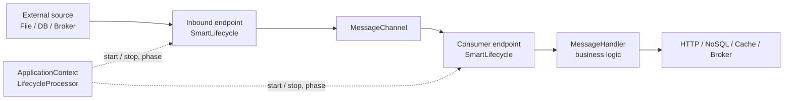
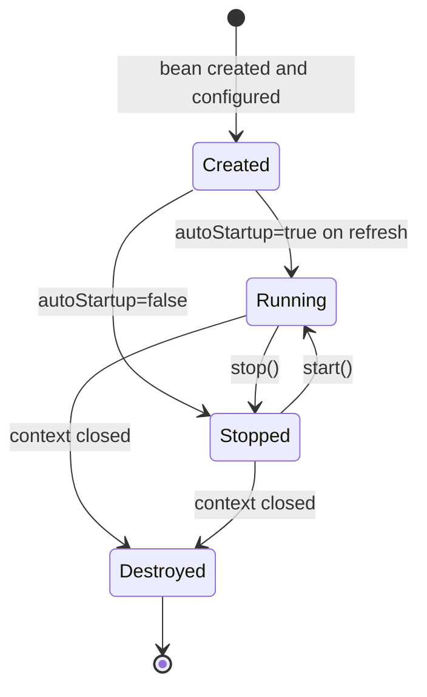
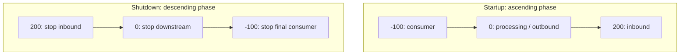
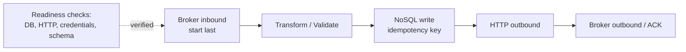

# Endpoint Lifecycle, autoStartup, and Flow Startup Ordering

In a Spring Boot application, an integration flow may receive data over HTTP, poll a database, read files, consume messages from a broker, transform payloads, and send data to another service. Those components are not necessarily ready at the exact same moment. If an adapter starts ingesting too early, it can push messages into a channel with no consumer yet, query a database before connections are ready, or trigger immediate retries and duplicate processing during rollout.

In the **SPRING_BOOT_INTEGRATION** module, **Spring Integration** organizes flows using messages, channels, endpoints, and adapters. This lesson focuses on three practical questions:

1. **How is endpoint lifecycle** managed by Spring, and how does it differ from bean lifecycle?
2. **What does `autoStartup` control** at application startup, and how can flows be controlled afterward?
3. **How does `phase` order** starting and stopping endpoints, especially with adapters, brokers, caches, or databases at either end of a flow?

The goal is a design pattern to **enable flows at the right time, stop ingestion safely, observe errors, and test lifecycle state**. Examples use Spring Integration's Java DSL in Spring Boot; check exact APIs against your project's library version.

## 1. Beans, Channels, Handlers, and Endpoints Have Different Lifecycles

A **bean** is instantiated, configured, and destroyed by the Spring container along the `ApplicationContext` lifecycle. A Spring Integration **endpoint** connects a message producer/consumer to a channel or a channel to a handler; many endpoints can be started and stopped dynamically while the context remains running.



| Component | Role | Lifecycle points to remember |
| --- | --- | --- |
| `ApplicationContext` | Creates beans, injects dependencies, runs lifecycle processor. | A bean existing does not mean an endpoint has started receiving messages. |
| `MessageChannel` | Transports messages between steps. | An ordinary `DirectChannel` is not an endpoint you start/stop to toggle polling. |
| `MessageHandler` | Processes a single message. | The handler itself can be a plain bean; the **consumer endpoint** binding it to a channel owns lifecycle. |
| `SourcePollingChannelAdapter` | Actively calls `MessageSource.receive()` on a trigger/poller to fetch data. | Starting enables the poll schedule; stopping stops scheduling new polls. |
| `PollingConsumer` | Polls a `PollableChannel` such as `QueueChannel` and invokes a handler. | Has its own trigger and can start/stop independently from upstream producers. |
| `EventDrivenConsumer` | Registers a handler with a `SubscribableChannel` such as `DirectChannel`. | When not started or after stop, the handler may not be subscribed. |
| Message-driven adapter | Receives events from JMS, Kafka, or external listener containers. | Consider both the adapter's lifecycle **and** the listener container's; control APIs depend on adapter. |

An `IntegrationFlow` describes how components wire together. Never assume calling `start()` on a flow bean automatically controls every child endpoint identically. In static configurations, Spring Integration creates distinct endpoint beans; for precise control, assign IDs and look up the corresponding **endpoint**. Dynamically registered flows also involve registration lifecycles managed by `IntegrationFlowContext`.

## 2. The `Lifecycle` and `SmartLifecycle` Contracts

Spring Framework defines `Lifecycle` with three core operations:

```java
public interface Lifecycle {
    void start();
    void stop();
    boolean isRunning();
}
```

`SmartLifecycle` extends this contract with automatic startup during context refresh, phase-based ordering, and an asynchronous stop callback:

| API / property | Practical meaning |
| --- | --- |
| `start()` | Tells the component to begin operating; for pollers, begins scheduling; for listeners, begins consuming. |
| `stop()` | Requests the component to stop, without necessarily waiting for all in-flight messages to finish or draining queues. |
| `isRunning()` | Reports the component's lifecycle state; does not prove external dependencies are healthy. |
| `isAutoStartup()` | Indicates whether it starts automatically during context refresh. |
| `getPhase()` | Integer ordering relative to other `SmartLifecycle` groups. |
| `stop(Runnable callback)` | Notifies the lifecycle processor when asynchronous shutdown finishes; implementations must invoke the callback upon completion. |

When `ApplicationContext` refreshes, `LifecycleProcessor` inspects lifecycle beans, starts those with auto-startup enabled, and respects `phase` order. When the context closes, the processor stops them in reverse order. This **start/stop** lifecycle differs from **bean creation/destruction** and from HTTP server or external system readiness.



This diagram is a conceptual model, not the exact state machine of every adapter API. A `start()` call can fail due to connection or configuration errors; a `stop()` call can leave in-flight work mid-execution. Always pair `isRunning()` with processing metrics, error monitoring, and external system health.

### What Happens When a Spring Boot Application Starts?

1. Spring instantiates and wires beans: channels, handlers, adapters, schedulers, and endpoints.
2. The context refreshes; `LifecycleProcessor` starts `SmartLifecycle` beans whose `isAutoStartup()` returns true.
3. Spring Boot finishes startup, executes `ApplicationRunner`/`CommandLineRunner` if present, and publishes `ApplicationReadyEvent`.
4. An auto-started endpoint can begin polling or receiving messages **before** `ApplicationReadyEvent`; HTTP/Actuator readiness also does not automatically confirm downstream services are ready.

**Never use `@PostConstruct` to trigger an endpoint that relies on the full flow already running.** Other beans may be instantiated yet not started at that stage. When waiting for business preconditions or external resources, set `autoStartup(false)` and invoke `start()` only after real readiness checks pass. `ApplicationReadyEvent` is a convenient post-startup hook, not a substitute for probing brokers, databases, or downstream APIs.

## 3. `autoStartup`: Controlling Exactly When Ingestion Begins

On lifecycle-capable Spring Integration endpoints, `autoStartup` controls whether they **start automatically during context startup**. Many endpoints default to auto-starting, though you should check the specific adapter and version; set it explicitly on sensitive flows.

| Setting | During context refresh | After startup |
| --- | --- | --- |
| `autoStartup(true)` | Lifecycle processor starts the endpoint in phase order when startup conditions allow. | Can call `stop()` and `start()` operationally. |
| `autoStartup(false)` | Endpoint bean is created yet stays idle during auto-startup. | Starts only when `start()` is invoked explicitly or via another trigger. |

Situations that warrant `autoStartup(false)`:

- An inbound polling adapter must only read data after schema migrations finish, config keys load, or connectivity checks pass.
- A JMS/Kafka consumer should only ingest messages after NoSQL storage and downstream targets become ready.
- A batch import flow requires controlled manual start/stop to avoid duplicate imports during maintenance windows.
- Canary deployments enable a subset of adapters before rolling out to all instances.

**Scope caveat:** disabling one inbound endpoint does not halt the entire application. HTTP controllers, gateways, or other producers can still send messages to the same channel. If there are multiple entry points, guard all of them. Conversely, stopping a `DirectChannel` consumer can make upstream sends fail due to missing subscribers, while stopping a `QueueChannel` consumer causes messages to pile up in the buffer.

## 4. `phase`: Ascending Start Order, Descending Stop Order

`SmartLifecycle.getPhase()` returns an integer. Across lifecycle components coordinated by the processor:

- **Startup:** **lower** phase values start **before** higher phase values.
- **Shutdown:** **higher** phase values stop **before** lower phase values.
- **Same phase:** never rely on arbitrary bean ordering for business correctness. Assign distinct phases whenever a dependency exists.

Example illustrating three ordered endpoints:

| Phase | Illustrative endpoint | Purpose |
| ---: | --- | --- |
| `-100` | Consumer/handler reading from `DirectChannel` | Subscribes before upstream begins sending. |
| `0` | Intermediate consumer or lifecycle-aware outbound endpoint | Prepares downstream forwarding step. |
| `200` | Inbound polling adapter/producer | Starts pushing messages only after downstream consumers are running. |



This phase layout follows the rule: **consumers ready before producers**, and **producers stop emitting before consumers stop listening**. These numbers are illustrative application choices, not Spring Integration constants. If an endpoint does not implement `SmartLifecycle`, or a dependency runs outside the Spring context, setting phases on other endpoints **cannot** manage that external dependency.

### Easily Misunderstood Limitations

1. `phase` orders `start()/stop()` calls on lifecycle components; it **does not** serialize individual messages across concurrent channels like `ExecutorChannel`.
2. Phase **does not** prove an external database, broker, or HTTP service is healthy. An endpoint can start with `isRunning() == true` while reads/writes still fail.
3. Phase does not create distributed transactions between databases and brokers, nor guarantee exactly-once delivery or duplicate-free retries.
4. During stop, in-flight or queued messages still need dedicated **drain, ACK, retry, idempotency, and timeout** policies.
5. `@DependsOn` helps bean creation order, not operational endpoint lifecycle or readiness probes. `@Order` does not replace `SmartLifecycle.getPhase()` either.

## 5. Java DSL Example: Handler Starts First, Inbound Waits for Explicit Start

Suppose an app periodically pulls orders from a source, sends them through a `DirectChannel`, and processes them. This demo generates messages in memory so lifecycle behavior is clear without external infrastructure. In production, replace the sample source with a file, database, or API `MessageSource`; for message-driven adapters (JMS/Kafka), configure per adapter API.

The app needs `spring-boot-starter-integration` and Spring Integration Java DSL matching your Spring Boot version. Configuration:

```java
import java.util.concurrent.atomic.AtomicLong;

import org.springframework.context.annotation.Bean;
import org.springframework.context.annotation.Configuration;
import org.springframework.integration.config.EnableIntegration;
import org.springframework.integration.core.MessageSource;
import org.springframework.integration.dsl.IntegrationFlow;
import org.springframework.integration.dsl.Pollers;
import org.springframework.messaging.support.GenericMessage;

@Configuration(proxyBeanMethods = false)
@EnableIntegration
public class OrderPipelineConfig {

    @Bean
    IntegrationFlow orderPipeline() {
        AtomicLong sequence = new AtomicLong();
        MessageSource<String> source = () ->
                new GenericMessage<>("order-" + sequence.incrementAndGet());

        return IntegrationFlow.from(source, endpoint -> endpoint
                        .id("orderInboundEndpoint")
                        .autoStartup(false)
                        .phase(200)
                        .poller(Pollers.fixedDelay(1_000)))
                .channel("orderMessages")
                .handle(message -> System.out.println(
                                "Processed: " + message.getPayload()),
                        endpoint -> endpoint
                                .id("orderHandlerEndpoint")
                                .phase(-100))
                .get();
    }
}
```

Here:

- `orderInboundEndpoint` is a polling endpoint. `autoStartup(false)` prevents it from emitting messages right after context refresh. `phase(200)` ensures the producer would start after the consumer if auto-started.
- `orderMessages` is the channel connecting the two steps. `handle(...)` creates a consumer endpoint with ID `orderHandlerEndpoint` and phase `-100`.
- The consumer normally auto-starts and subscribes to the channel first; the sample source stays quiet because the inbound endpoint has not been started.
- Switching `autoStartup(false)` to `autoStartup(true)` lets the lifecycle processor auto-start both endpoints in phase order: consumer first, inbound second.

**Why set explicit IDs?** The Java DSL otherwise generates endpoint names automatically. For operational controls, tests, and log inspection, stable names let you locate the exact endpoint; the `IntegrationFlow` bean name, channel name, and endpoint ID are distinct. Here, `orderPipeline` is the flow bean name, whereas `orderInboundEndpoint` is the endpoint ID to control.

### Starting and Stopping Endpoints at Runtime

The controllable object is the endpoint bean implementing `SmartLifecycle`:

```java
import org.springframework.context.ApplicationContext;
import org.springframework.context.SmartLifecycle;
import org.springframework.stereotype.Component;

@Component
public class OrderIngestionControl {
    private final ApplicationContext context;

    public OrderIngestionControl(ApplicationContext context) {
        this.context = context;
    }

    private SmartLifecycle inbound() {
        return context.getBean("orderInboundEndpoint", SmartLifecycle.class);
    }

    public void startAfterDependenciesAreReady() {
        inbound().start();
    }

    public void pauseIntake() {
        inbound().stop();
    }

    public boolean isIntakeRunning() {
        return inbound().isRunning();
    }
}
```

In production, invoke `startAfterDependenciesAreReady()` **only after** verifying preconditions: config loaded, database schemas/indexes present, downstream consumers ready, credentials valid, and health checks passing. This can run from an `ApplicationReadyEvent` listener **paired with dependency checks**, or from a controlled internal orchestrator. Never expose these controls on unauthenticated public URLs.

When `pauseIntake()` runs, new polls stop being scheduled, yet an already-executing poll or in-flight message handed to a consumer may still finish. For safe maintenance, wait until in-flight work drains to an acceptable level before stopping downstream dependencies.

## 6. Coordinating Multiple Endpoints in a Real Integration Flow

In a **broker → transformer → NoSQL → HTTP → reply broker** flow, the safe pattern is preparing internal consumers first and opening external ingestion last:



Opening an inbound adapter before downstream stabilizes causes immediate retries, timeouts, lost ACKs, or duplicate processing. Depending on the transport, broker redelivery can replay the same business event. Thus **phase and `autoStartup` are only one layer** of reliability:

| Scenario | Lifecycle organization | Additional safeguards |
| --- | --- | --- |
| Poll DB then publish to broker | Start sender/handler first; give polling adapter higher phase or start after readiness. | Outbox/idempotency keys; timeouts, retries, and broker connectivity checks. |
| Consume broker then write NoSQL | Enable inbound only after repository/schema/indexes are ready. | ACK rules, retry/backoff, dead-lettering, and duplicate-write protection. |
| File inbound adapter scanning folder | Set `autoStartup(false)` on source and start after mount/sync finishes. | Duplicate-file filter, failed-file quarantine, and atomic moves where needed. |
| `QueueChannel` used as buffer | Stop producer first; let consumer drain queued messages within a deadline. | Bounded capacity, backpressure policies; persistent queues if zero data loss is required. |
| `DirectChannel` between handlers | Start receiving endpoint before upstream emits; stop upstream before unsubscribing handler. | Handle `MessageDeliveryException` when no subscriber is attached. |
| Flow with `ExecutorChannel` | Start handler first; stop source before draining executor. | Monitor active tasks, queue depth, graceful shutdown, and handler idempotency. |

**Channel specifics:** `DirectChannel` dispatches synchronously on the sending thread; if no subscriber is attached, sends fail. `QueueChannel` accumulates messages when the poller/consumer is stopped, yet finite capacity fills up and in-memory buffers vanish if the process crashes. `ExecutorChannel` dispatches asynchronously, so returning from callbacks does not mean downstream finished.

### Notes on JMS, Kafka, and Message-Driven Adapters

Some adapters wrap or delegate to listener containers with their own lifecycle and startup rules. When setting `autoStartup(false)` on an endpoint, verify the setting propagates to **the actual adapter/container** receiving messages. If multiple flows share one container, stopping it affects the other flows too. A running listener can pull messages before downstream is healthy; testing against a real test broker and verifying ACK/retry mechanics matters far more than checking `isRunning()`.

Distinguish Spring Integration endpoint `start()/stop()` from stopping the entire app, altering consumer groups, or revoking partitions. Those mechanics vary by adapter and library—check the documentation for your exact version.

## 7. Safe Shutdown: Stop Source, Drain, and Verify Outcomes

In event-driven systems, `stop()` **does not mean** every event committed to the database or ACKed to the broker. Controlled pause procedure:

1. **Stop new input** at the upstream inbound endpoint/consumer; when multiple sources exist, stop every entry point requiring maintenance.
2. **Observe in-flight work**: active requests, queue depths, unacked events, executor tasks, and pending HTTP callbacks.
3. **Drain downstream** within an agreed time budget; keep replay/retry paths ready for remaining messages. Never assume `phase` automatically waits for queues to hit zero.
4. **Stop downstream endpoints** after in-flight work finishes or hands off safely.
5. **Restart in reverse order**: restore downstream, verify dependencies, then open inbound and watch incoming message metrics.

When implementing a custom `SmartLifecycle` with asynchronous stop, always invoke `callback.run()` inside `stop(Runnable)` once shutdown finishes. Forgetting the callback stalls context shutdown until the lifecycle processor's phase timeout expires. Spring Boot exposes phase shutdown timeout properties (e.g., `spring.lifecycle.timeout-per-shutdown-phase` in supported versions); that timeout bounds waiting rather than replacing data-durability strategies.

## 8. Testing State Before and After `start()`

Alongside message-processing tests, test the lifecycle configuration your application relies on. For the flow in Section 5, a Spring Boot test looks like:

```java
import static org.assertj.core.api.Assertions.assertThat;

import org.junit.jupiter.api.Test;
import org.springframework.beans.factory.annotation.Autowired;
import org.springframework.boot.test.context.SpringBootTest;
import org.springframework.context.ApplicationContext;
import org.springframework.context.SmartLifecycle;

@SpringBootTest(classes = OrderPipelineConfig.class)
class OrderPipelineLifecycleTest {

    @Autowired
    ApplicationContext context;

    @Test
    void inboundStaysOffUntilStartedExplicitly() {
        SmartLifecycle inbound =
                context.getBean("orderInboundEndpoint", SmartLifecycle.class);
        SmartLifecycle handler =
                context.getBean("orderHandlerEndpoint", SmartLifecycle.class);

        assertThat(inbound.isAutoStartup()).isFalse();
        assertThat(inbound.isRunning()).isFalse();
        assertThat(handler.isRunning()).isTrue();
        assertThat(handler.getPhase()).isLessThan(inbound.getPhase());

        try {
            inbound.start();
            assertThat(inbound.isRunning()).isTrue();
        } finally {
            inbound.stop();
        }
        assertThat(inbound.isRunning()).isFalse();
    }
}
```

This test verifies **lifecycle state and phase configuration**. It does not prove messages were processed successfully. To test actual flow execution, replace the console-printing handler with an observable consumer (such as recording messages into a test queue or thread-safe counter) and assert:

- Zero messages emitted before inbound starts, barring external paths.
- Once started, valid messages are ingested, transformed, persisted, and keyed properly.
- After `stop()`, no **new** polls start; in-flight messages finish per contract.
- Restarting after `stop()` neither loses messages nor duplicates processing beyond declared policy.
- When downstream disconnects, verify error logs, error channel, retries/backoff, dead-letter/rollback, and post-recovery health.
- On context close, phased components stop in intended order while in-flight data drains or persists safely.

With scheduled polling sources, wall-clock tests can flake. Prefer controllable triggers/test schedulers or bounded synchronization primitives; avoid fixed `Thread.sleep()` calls to infer asynchronous work has finished.

## 9. Observing and Diagnosing Flow Startup Failures

When an application reports **ready** yet processes zero messages, inspect in order:

| Symptom | Possibilities to check | Remediation |
| --- | --- | --- |
| Bean exists yet never polls | `autoStartup(false)`, `start()` never called, missing poller, or trigger not due yet. | Check endpoint name, `isRunning()`, trigger, and startup logs. |
| `Dispatcher has no subscribers` or `MessageDeliveryException` | Upstream pushed to `DirectChannel` while consumer endpoint was stopped. | Adjust phases, check consumer state, and guard ingress paths. |
| Endpoint `isRunning() == true` yet no data flows | Source empty, filter drops all messages, broker not delivering, or connection broken. | Inspect source, filters, connectors, auth, partitions, queue depth, and metrics. |
| Poller continuously logs errors | Query errors, timeouts, mapper bugs, downstream failures, or retry loops. | Read root cause, configure error channel, slow poll/backoff, inspect poison data. |
| Stop hangs without releasing tasks | In-flight executor work, unacked listeners, missed shutdown callback. | Stop upstream first, observe draining, audit `stop(Runnable)` and shutdown timeouts. |
| Environments behave differently | Env vars, profiles, replica counts, manual start commands, or startup order differ. | Log `autoStartup`, phase, endpoint IDs, and rollout policies per environment. |

Capture at minimum: endpoint name, phase, `isAutoStartup()`, `isRunning()`, start/stop timestamps, received and succeeded counts, errors, retries, latency, backlog, and in-flight counts. Use Spring Integration logging and Micrometer/Actuator if configured; availability and meter names vary by version. With Actuator and Spring Integration, `integrationgraph` (when supported, enabled, and secured) helps inspect flow wiring.

Spring Integration also provides a **Control Bus** for sending administrative commands to controllable components. It is a powerful operational tool; expose it only over internal secured channels with auditing and restricted commands. Never expose a control channel accepting arbitrary expressions from untrusted clients.

## 10. Common Design Mistakes

**Confusing bean startup with endpoint startup.** A created `MessageSource` bean does not mean scheduled polling is active. Check the endpoint wrapping the source, not just the source bean.

**Relying on `phase` alone to wait for external systems.** Phase orders lifecycle startup inside the context; it does not wait for a NoSQL cluster to finish recovery or an HTTP service to answer. Combine with readiness checks, bounded retries, and idempotency.

**Stopping handlers before producers.** If a producer emits to `DirectChannel` after its handler unsubscribed, sends fail. Stop inbound first, drain, then stop consumers.

**Assuming `stop()` cleanly cancels active work.** Pollers, listeners, and executors have distinct async boundaries; never treat `stop()` as a replacement for ACKs, transactions, checkpoints, or graceful draining.

**Assigning the same phase and inferring order from logs.** Log order from one deployment is never a guarantee. Whenever start/stop ordering matters, set explicit phases and test with real configuration.

**Using `autoStartup(false)` with no owner to turn it back on.** Assign a clear component responsible for checking readiness and invoking `start()`, retrying after failures, surfacing status, and recovering across restarts.

## 11. Pre-Production Flow Checklist

- [ ] Identified which endpoints produce/ingest messages and which run downstream; assigned stable IDs to managed endpoints.
- [ ] Set `autoStartup` explicitly on sensitive inbound endpoints with a verified readiness trigger.
- [ ] Assigned `phase` so consumers start before producers and stop after producers where lifecycle applies.
- [ ] For JMS/Kafka/HTTP adapters or external schedulers, verified actual lifecycle of both adapter and backing container.
- [ ] Defined policies for missing channel subscribers, full queues, downstream outages, and redelivered messages.
- [ ] Designed stop → drain → stop downstream, preserving data and verifying idempotency on restart.
- [ ] Tested both lifecycle transitions and end-to-end message processing, including failures and retries.
- [ ] Exposed observability for endpoint names, running state, message counts, errors, backlogs, and shutdown drain durations.

### Official References

- [Spring Framework — `SmartLifecycle`](https://docs.spring.io/spring-framework/docs/current/javadoc-api/org/springframework/context/SmartLifecycle.html): auto-start, phase, and stop callback contract.
- [Spring Framework — `LifecycleProcessor`](https://docs.spring.io/spring-framework/docs/current/javadoc-api/org/springframework/context/LifecycleProcessor.html): start/stop orchestration on context refresh and close.
- [Spring Integration — Reference](https://docs.spring.io/spring-integration/reference/): endpoints, channels, pollers, Java DSL, and flow management.
- [Spring Integration — Endpoint Roles](https://docs.spring.io/spring-integration/reference/endpoint.html): distinguishing endpoints from message handlers, polling, and event-driven consumers.
- [Spring Boot — Application Events and Listeners](https://docs.spring.io/spring-boot/reference/features/spring-application.html#features.spring-application.application-events-and-listeners): where `ApplicationReadyEvent` fires during startup.

**Key takeaway:** `autoStartup` answers *whether an endpoint starts automatically on context boot*; `phase` answers *the order in which lifecycle endpoints start and stop*; `start()/stop()` provide operational runtime control. Pair all three with readiness checks, data contracts, error handling, idempotency, and observability to keep integration flows truly safe.
