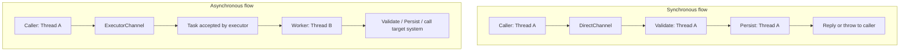
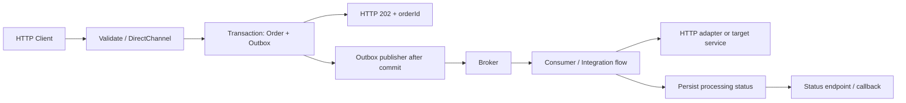

# Distinguishing Synchronous Calls from Asynchronous Processing in a Flow

## 1. A Spring Integration Flow Can Change Execution Style at Any Step

In the **SPRING_BOOT_INTEGRATION** module, flows connecting HTTP clients, databases, caches, message brokers, and Spring Integration adapters commonly span multiple stages: receiving requests, validating inputs, persisting orders, calling external systems, and publishing events. A flow may look like one continuous chain on a diagram, yet **not every step runs on the same thread, at the same time, or in the same transaction**.

For example, an order-intake API:

1. Receives an HTTP request and validates inputs.
2. Persists the order and an outbox event to the database.
3. Dispatches a message to the shipping subsystem.
4. Returns a response to the caller.

There are at least two ways to organize it:

- **Synchronous:** each downstream step executes directly while the caller waits for the result or exception. The API may wait for the entire pipeline to finish.
- **Asynchronous:** a step hands the message off to a queue, executor, or broker for another component to process later. The API can simply acknowledge receipt while the business outcome completes afterward.

In Spring Integration, changing the **MessageChannel** type mid-flow changes how endpoints are triggered. Still, four separate questions must be answered independently:

| Question | What to inspect |
|---|---|
| Which thread runs the handler? | The same thread calling `send()`, or a different thread? |
| What does the caller wait for? | Handler completion, task scheduling, a reply, or broker acknowledgement? |
| Where is the message held? | On the call stack, in JVM memory, in durable storage, or in a broker? |
| Which transaction covers the step? | The caller's active transaction, a new worker transaction, or none? |

**Key point:** "running on another thread" and "returning an asynchronous response to the caller" are two independent properties. An HTTP request can still block waiting for a reply from an executor-backed flow; conversely, an API can return immediately even if background adapters communicate synchronously with an external system.

## 2. Where Execution Boundaries Change

Spring Integration passes data as `Message<?>`, composed of a **payload** and **headers**. Endpoints (transformers, filters, routers, service activators, adapters, etc.) normally connect via `MessageChannel`.



In a synchronous flow, when the handler executes directly on the sending thread, `send()` typically returns only after the synchronous chain completes; if a handler fails, the exception can propagate back up the call stack, sometimes wrapped in a Spring Messaging exception.

In an asynchronous flow via an executor, `send()` can finish as soon as the executor **accepts the task**, before the handler has started or finished. `send()` returning `true` does not prove downstream database, HTTP, or broker operations succeeded. If the executor rejects the task under overload, submission can still fail immediately on the sender side.

### 2.1. Comparing Common Channel Types

| Channel | How consumer triggers | Execution thread | What does sender usually wait for? | Notes |
|---|---|---|---|---|
| `DirectChannel` | Invokes subscriber directly | Same sending thread | Handler finishes or throws | Easy to share transaction context on one thread |
| `ExecutorChannel` | Hands handler to `TaskExecutor` | Usually a worker thread | Executor accepts the task | Depends on executor policy; breaks thread-bound transactions |
| `QueueChannel` | Places message in queue; consumer pulls via poller or `receive()` | Poller/consumer thread | Queue accepts message, may wait for space | In-memory queue by default; no built-in durability |
| `PublishSubscribeChannel` without executor | Dispatches to subscribers sequentially | Usually same sending thread | Sync subscribers complete per dispatch mechanics | Multiple subscribers do not automatically run in parallel |
| `PublishSubscribeChannel` with executor | Dispatches to subscribers via executor | Usually worker threads | Executor accepts dispatches | Ordering and per-subscriber errors need separate handling |

The word "usually" in the table is intentional: for example, if an executor uses `CallerRunsPolicy`, rejected tasks fall back onto **the sender's thread**. Always verify thread boundaries against runtime configuration, not class names alone.

### 2.2. `DirectChannel`: Synchronous Forwarding on One Call Stack

Suppose a handler calls `orderService.placeOrder()` through a Spring proxy and that service carries `@Transactional`. When upstream uses `DirectChannel`, steps running on the same thread can participate in the active transaction when sharing a compatible transaction manager and propagation setting.

However, "same thread" **does not create a transaction by itself**. A transaction exists only when opened by something like `@Transactional`. Furthermore, a handler calling HTTP or Redis directly creates side effects outside the database transaction: a JPA rollback will not undo an HTTP request already processed by the remote system.

### 2.3. `ExecutorChannel`: Handing Off to an Executor

`ExecutorChannel` is a point-to-point channel whose subscribers run via a `TaskExecutor`. Once the task is accepted, the caller can continue while downstream steps run on a worker thread.

This helps decouple fast request intake from longer processing, yet does not provide a durable queue. Tasks sitting in an executor queue vanish if the process crashes; retries on handler failures and monitoring failed jobs must also be designed. For workflows that must never lose accepted work, use a **transactional outbox** or a durable broker.

### 2.4. `QueueChannel`: Message Buffer with Active Consumer Polling

`QueueChannel` is a `PollableChannel`. Senders enqueue messages; receivers only process them when a poller or explicit `receive()` call pops a message. A bounded capacity causes sends to wait or fail when full.

By default, `QueueChannel` stores messages in memory. To survive restarts, configure an appropriate persistent `MessageStore` and re-test semantics—never infer durability just because the channel name contains "queue". Local queues also differ from brokers: acks, retries, multi-instance load sharing, and crash recovery depend on the backing implementation.

## 3. Java DSL Example: Same Business Logic, Two Invocation Styles

The following example uses Spring Boot with the Spring Integration Java DSL. Assume `OrderProcessor` is an existing business service exposing `OrderResult create(OrderCommand command)`. For database persistence, that service may declare `@Transactional` on a public method invoked via a Spring proxy.

Define simple data contracts:

```java
public record OrderCommand(UUID orderId, long amountInCents) {}

public record OrderResult(UUID orderId, String status) {}

public interface OrderProcessor {
    OrderResult create(OrderCommand command);
}
```

Two gateways express **the caller-facing contracts**:

```java
@MessagingGateway(defaultRequestChannel = "orderSyncInput")
public interface SyncOrderGateway {
    OrderResult place(OrderCommand command);
}

@MessagingGateway(defaultRequestChannel = "orderAsyncInput")
public interface AsyncOrderGateway {
    void submit(OrderCommand command);
}
```

And flow configurations:

```java
@Configuration
@EnableIntegration
@IntegrationComponentScan
class OrderIntegrationConfiguration {

    @Bean
    IntegrationFlow synchronousOrders(OrderProcessor processor) {
        return IntegrationFlow.from("orderSyncInput")
            .handle(OrderCommand.class,
                (command, headers) -> processor.create(command))
            .get();
    }

    @Bean
    ThreadPoolTaskExecutor orderExecutor() {
        var executor = new ThreadPoolTaskExecutor();
        executor.setCorePoolSize(4);
        executor.setMaxPoolSize(8);
        executor.setQueueCapacity(100);
        executor.setThreadNamePrefix("order-flow-");
        executor.initialize();
        return executor;
    }

    @Bean
    MessageChannel orderAsyncInput(
            @Qualifier("orderExecutor") Executor executor) {
        return new ExecutorChannel(executor);
    }

    @Bean
    IntegrationFlow asynchronousOrders(OrderProcessor processor) {
        return IntegrationFlow.from("orderAsyncInput")
            .handle(OrderCommand.class, (command, headers) -> {
                processor.create(command);
                return null; // one-way: emit no reply from handler
            })
            .get();
    }
}
```

Declare `spring-boot-starter-integration` along with any adapter or database dependencies used by your app. Imports and the `OrderProcessor` implementation are omitted to focus on flow boundaries. `@IntegrationComponentScan` discovers interfaces annotated with `@MessagingGateway` within the scan scope.

### 3.1. Understanding the Synchronous Path

```java
OrderResult result = syncGateway.place(
    new OrderCommand(orderId, 250_000L));

// Reached only after the handler returns a reply to the gateway.
```

`SyncOrderGateway.place()` waits for the `OrderResult` returned by the service activator. Because the direct input channel defaults to a `DirectChannel`, the handler runs on the sending thread and exceptions propagate back to the caller. Use this when requests need immediate validation and persistence results.

A synchronous API should never hold threads waiting indefinitely on slow or unstable external systems. Design HTTP timeouts, retry policies, and error status mappings independently of the channel type.

### 3.2. Understanding the Asynchronous Path

```java
asyncGateway.submit(new OrderCommand(orderId, 250_000L));

// A void gateway does not wait for a business reply from the handler.
// Task acceptance does not prove the order was created successfully.
```

This gateway sends to an `ExecutorChannel`. Once the executor accepts the task, the caller resumes without waiting for `processor.create()`. Still, sending can block under overload if the executor uses a blocking or caller-runs policy. Never promise "always returns instantaneously".

In real APIs, when accepting requests for deferred processing, the response contract should communicate **accepted/pending** (such as HTTP `202 Accepted`) with a `requestId` or `orderId` for status lookup—never return "order created" while creation is still queued.

### 3.3. When to Replace an Executor with a Pollable Queue?

You can create a bounded queue processed by a poller:

```java
@Bean
QueueChannel orderQueue() {
    return new QueueChannel(200);
}

@ServiceActivator(
    inputChannel = "orderQueue",
    poller = @Poller(fixedDelay = "500", maxMessagesPerPoll = "10")
)
public void consumeQueuedOrder(OrderCommand command) {
    processor.create(command);
}
```

This snippet assumes `processor` is injected into the bean holding the handler method. Producers call `orderQueue.send(message)`; the poller pulls and processes up to the configured max per tick. Queues can fill up, and if the process dies before messages hit durable storage, they are lost. In production, explicitly define capacity, concurrency, retries, poison-message handling, and recovery.

## 4. Running on Another Thread Does Not Automatically Free the Caller from Waiting

The most common mistake is seeing `ExecutorChannel` and concluding every call into the flow is asynchronous from the API caller's viewpoint. Consider this gateway:

```java
@MessagingGateway(defaultRequestChannel = "orderAsyncInput")
interface WaitingGateway {
    @Gateway(replyTimeout = 3000)
    OrderResult placeAndWait(OrderCommand command);
}
```

If the handler behind the executor **produces a reply** back to the gateway, the call still blocks up to the configured reply timeout. The handler executes on a different thread than the HTTP thread, yet the HTTP thread remains parked waiting for `OrderResult`. By contrast, `AsyncOrderGateway.submit()` returns `void` and expects no business reply.

For `WaitingGateway` to receive a reply, the downstream handler must return an `OrderResult` rather than `return null` (which made Section 3.2 **one-way**). If the handler misses the deadline, the gateway can time out even while the worker keeps running. A reply timeout **never confirms the business work was canceled**.

Values to distinguish:

- `requestTimeout`: max time the gateway waits to **send the message into the request channel** if sending can block.
- `replyTimeout`: max time the gateway waits for a **reply** when the contract expects one.
- HTTP client/read timeout: wait limit toward an **external HTTP service**.
- Broker publish acknowledgement: signal that the broker processed up to a defined durability level—**not** automatically that consumers finished business processing.

Using `CompletableFuture` or reactive return types on gateways (where supported by your version and configuration) can let callers receive results non-blockingly. Even then, correlation, timeouts, cancellation/state transitions, and exception handling still need explicit design.

## 5. Transactions, Errors, and Reliability When Switching to Asynchronous Processing

### 5.1. A Thread Boundary Requires Re-Evaluating Transactions

Standard Spring transactions are bound to the current thread. If a transactional step hands off to an `ExecutorChannel`, the worker **does not automatically inherit** the sender's transaction. With `QueueChannel`/pollers, the consumer likewise runs in its own transaction if configured.

```mermaid
sequenceDiagram
    participant API as API Thread
    participant DB as Database
    participant EX as ExecutorChannel
    participant W as Worker Thread
    API->>DB: BEGIN TX-A; save Order
    API->>EX: send message
    EX-->>API: Task accepted
    API->>DB: COMMIT TX-A
    EX->>W: Dispatch handler
    W->>DB: BEGIN TX-B; update status
    W->>DB: COMMIT/ROLLBACK TX-B
```

This sequence shows two independent transactions—**with no guarantee the worker starts after TX-A commits**. If the executor runs fast, the worker can query the database before TX-A commits and see no row. Conversely, if TX-A rolls back after task acceptance, the worker task may still run. That is a major design hazard when sending async tasks or side-effect dispatches **from inside an open transaction**.

Fixes depend on requirements: trigger async handoff only after commit if signal loss is tolerable; use a **transactional outbox** if crash survival is mandatory; or design independent, idempotent handlers keyed by business identifiers.

### 5.2. Synchronous and Asynchronous Paths Report Errors Differently

| Scenario | Synchronous path | Asynchronous path |
|---|---|---|
| Validation fails inside handler | Exception can return straight to caller | Caller may have already exited; persist error state, emit events, or use an error channel |
| Database rollback | Caller observes failure if running in the same call | Worker rolls back its own transaction; original request may already show accepted |
| Executor/queue refuses message | Not applicable when calling directly over `DirectChannel` | Send fails or times out immediately; handle rejection at ingress |
| External HTTP timeout | Caller wait time stretches | Worker times out; needs bounded retries and duplicate protection |
| Process dies after accepting task | Active call typically aborts | Tasks in memory channels/queues vanish; durable handoff required for recovery |
| Need to report final outcome | Return response directly | Expose status endpoint, callback/webhook, event, or separate reply channel |

When asynchronous processing fails, `try/catch` around `asyncGateway.submit()` will not catch worker exceptions. Spring Integration provides `errorChannel`/error flows and endpoint-specific error handlers; routing depends on dispatch paths and configuration. Explicitly wire error routes, retries, dead-lettering, or `FAILED` states—and **test** that failures do not merely get logged and forgotten.

### 5.3. Idempotency Matters in Both Modes

A synchronous step can still be retried by callers after HTTP timeouts. An asynchronous step can also be replayed after worker or broker restarts. Therefore, design for both with:

- **Message ID/request ID** for tracing, plus a business-defined stable **idempotency key** to block duplicates. Never generate a fresh random UUID per retry if you need to recognize repeats of the same request.
- **Database unique constraints** or equivalents protecting side effects that must happen once per business rule.
- **Bounded retries** with backoff and clear separation between transient failures and unrecoverable payload errors.
- **Durable status tracking** such as `PENDING / PROCESSING / COMPLETED / FAILED` whenever an API returns accepted before final completion.

"At-least-once" describes redelivery behavior; it does not make business operations execute once by magic. Always inspect final consequences across databases, HTTP partners, and consumers.

## 6. Testing to Observe Synchronous vs. Asynchronous Behavior

Never judge execution mode from a method name like `submitAsync()` or a fast local run. Tests must verify **threads**, **completion timing**, **errors**, and **post-transaction state**. These two unit tests isolate dispatch mechanics without booting a Spring context:

```java
@Test
void directChannelExecutesInCallingThread() {
    DirectChannel channel = new DirectChannel();
    AtomicReference<Thread> handledBy = new AtomicReference<>();
    channel.subscribe(message -> handledBy.set(Thread.currentThread()));

    Thread caller = Thread.currentThread();
    boolean accepted = channel.send(
        MessageBuilder.withPayload("order-1").build());

    assertTrue(accepted);
    assertSame(caller, handledBy.get());
}

@Test
void executorChannelCanReturnBeforeHandlerFinishes() throws Exception {
    ExecutorService executor = Executors.newSingleThreadExecutor();
    CountDownLatch started = new CountDownLatch(1);
    CountDownLatch release = new CountDownLatch(1);
    CountDownLatch completed = new CountDownLatch(1);
    AtomicReference<Thread> handledBy = new AtomicReference<>();

    try {
        ExecutorChannel channel = new ExecutorChannel(executor);
        channel.subscribe(message -> {
            handledBy.set(Thread.currentThread());
            started.countDown();
            try {
                if (!release.await(5, TimeUnit.SECONDS)) {
                    throw new IllegalStateException("Handler not released");
                }
            } catch (InterruptedException e) {
                Thread.currentThread().interrupt();
                throw new IllegalStateException(e);
            } finally {
                completed.countDown();
            }
        });

        assertTrue(channel.send(
            MessageBuilder.withPayload("order-2").build()));

        // Handler has started yet is blocked from finishing.
        assertTrue(started.await(5, TimeUnit.SECONDS));
        assertNotSame(Thread.currentThread(), handledBy.get());
        assertEquals(1L, completed.getCount());

        release.countDown();
        assertTrue(completed.await(5, TimeUnit.SECONDS));
    } finally {
        release.countDown();
        executor.shutdownNow();
    }
}
```

JUnit 5, `AtomicReference`, `CountDownLatch`, `ExecutorService`, and Spring Integration imports are omitted for brevity. The second test uses latches to **hold the handler incomplete**, proving the caller already moved past `send()`—far more reliable than measuring milliseconds or calling `Thread.sleep()`.

For a complete Spring Boot flow, add integration tests covering:

1. **Synchronous happy path:** call gateway returning `OrderResult`; query the database after the call returns to confirm the transaction committed.
2. **Synchronous failure:** throw from the handler; verify the caller sees the error and the transaction rolls back per policy.
3. **Slow asynchronous path:** pause the worker with a latch/stub; verify the request is accepted before work finishes and final state saves afterward.
4. **Asynchronous failure:** fail the downstream service/HTTP call; confirm error routing (`errorChannel`, `FAILED` state, retries/DLQ) and how callers observe failure.
5. **Overload:** configure small executor/queue bounds, burst concurrent messages, and verify rejections/waits follow policy rather than testing light load only.
6. **Commit boundary:** open an outer transaction, send a message, and roll back; verify workers never assume uncommitted data exists. When durable delivery is required, test against a real database and broker to verify outboxes, restarts, and redeliveries.

For asynchronous flows, assert eventual state using bounded waits (such as `Awaitility`), avoiding fixed `Thread.sleep(...)` calls and avoiding declaring success based solely on mock invocations.

## 7. Choosing a Model Based on Business Contracts and Operations

### 7.1. When to Prefer Synchronous

Best for short steps needing immediate answers: input validation, request contract checks, necessary queries, writing a record inside a DB transaction, and returning a business identifier. Benefits include simpler error paths and single-stack tracing. Drawbacks include caller wait times and held resources if external systems slow down.

### 7.2. When to Prefer Asynchronous

Best for work that can finish later: publishing integration events, processing images/documents, generating reports, syncing data externally, or tasks with unpredictable latency. Requires progress tracking, retries, timeouts, load bounds, deduplication, and recovery.

Especially with brokers or HTTP callbacks, `ExecutorChannel` only handles **in-process handoff within Spring Boot**; surviving restarts requires durable mechanisms such as outboxes or brokers.

### 7.3. Organizing a Realistic Hybrid Flow

A common production layout:



In this design, validation and DB persistence remain synchronous to establish a clean transaction boundary. External integration decouples from the HTTP request, relaying via outbox and broker. The HTTP client gets a tracking ID and checks a status API for final results. If callers require completed results synchronously instead of accepted receipts, design flow timeouts and SLAs accordingly.

### 7.4. Production Signals to Monitor

| Metric/signal | What it tells you about the flow |
|---|---|
| HTTP receipt-to-response time | Measures caller-perceived latency only; not necessarily full business duration |
| Queue depth / pending tasks | Reveals backlogs and impending admission rejections |
| Executor active threads and rejections | Shows worker saturation and whether caller-runs falls back to callers |
| Handler execution time / end-to-end completion | Separates fast acceptance from actual completion speed |
| Retry attempts, failed messages, DLQ | Surfaces failures occurring after the original request returned |
| Order ID, message ID, correlation ID, trace ID | Links logs/traces across threads, brokers, and HTTP adapters |

Across thread handoffs, `ThreadLocal` state (including transactions and logging MDC) does not travel automatically without configuration. Use framework context-propagation instrumentation—never copy transaction context manually. With Spring Integration, Spring Boot Actuator, Micrometer/Tracing, and correlated logs distinguish enqueue, dispatch, execution, and completion times.

## 8. Common Misconceptions

**"The flow uses `PublishSubscribeChannel`, so subscribers run in parallel."** Having multiple subscribers is not enough; without an executor configured, dispatch normally stays synchronous.

**"`ExecutorChannel` makes the whole gateway asynchronous."** A gateway returning `OrderResult` still waits for a reply; only dispatch changed. Check return types, `replyTimeout`, and whether handlers emit replies.

**"`send()` returning `true` means processing succeeded."** It only indicates the channel accepted the message under its rules; worker processing may not have started or could still fail later.

**"`QueueChannel` is a durable queue."** It defaults to in-memory storage. Use an appropriate `MessageStore` or broker to survive restarts and share work across replicas.

**"Async steps stay inside the sender's `@Transactional`."** Spring transactions are normally thread-bound; workers open separate transactions if configured. Running a worker before the sender commits can even trigger race conditions.

**"Switching from `DirectChannel` to `ExecutorChannel` is just a performance optimization."** It also changes **response contracts, error timing, transaction boundaries, observability, and recovery**. All of those changes must be re-tested before production.

## 9. Criteria for a Well-Designed Flow

Before finalizing a flow, the team should clearly answer: which thread executes each handler; up to what milestone the caller waits; who receives and tracks handler failures; whether messages are durably persisted; where transactions commit; whether retries can duplicate side effects; and how maximum backlogs are bounded.

**Synchronous** fits when callers need direct answers within bounded execution time. **Asynchronous** fits when deferred completion is acceptable and tracking, recovery, and load bounds are built in. In Spring Integration, the right design does not come from a single annotation or channel class—it comes from **the entire journey of messages, replies, transactions, and errors** through every step of the flow.
